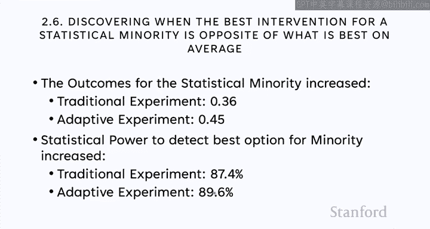
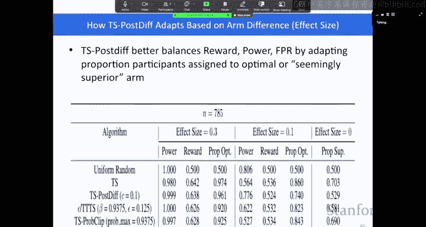

# 斯坦福大学《从人类偏好中学习的机器学习》课程笔记 - P1 🎯

在本节课中，我们将学习如何利用自适应实验和智能干预来引导行为改变。课程的核心是介绍一个名为“Outcome”的框架，该框架旨在将日常技术接触点转化为能够持续学习和优化的智能教练系统。

---

## 课程概述 📋

本次讲座的目标是让每位听众都能获得一个可分享的核心信息，并能解释数据驱动的实验如何广泛应用于行为改变的各个场景。我们还将探讨如何为自适应实验领域做出贡献，并思考听完讲座后可以立即采取的一个具体行动。

讲座主要围绕三个主题展开：
1.  **自适应实验工具**：使实验更容易进行和利用，从而产生更有效的干预措施。
2.  **个性化与情境化干预**：根据个人和具体情境提供定制化的建议。
3.  **将运动科学与实践相结合**：将严谨的科学理论应用于实际行为改变中。

接下来，我们将深入探讨第一个主题，了解如何通过实验设计更优的干预措施。

---

## 行为改变与智能干预 💡

行为改变能够解决许多人类问题。想象一下，如果你能找到“魔法话语”来改变任何行为——无论是促使自己或他人更多地运动、更好地连接、减少压力，还是停止某些不良习惯。

我们的愿景是：**到2034年，实现能够按需提供、可测量地帮助人们思考问题并持久改变行为的智能教练**。

为实现这一目标，我们依赖于 **Outcome框架**。该框架帮助我们设计“智能干预”。一个智能干预（无论是一条短信、应用内消息还是一个概念解释）不仅是旨在改变行为的措施，还能智能地感知并尝试在当下给出最佳方案。真正的智能在于持续学习——不断测试想法以了解什么对你有用。

要构建智能干预，我们需要整合多个学科。那么，我们正在研究的智能干预有哪些例子呢？

---

## Outcome框架：将一切转化为实验组件 ⚙️

Outcome框架的基本思想是：**将用户体验的每个组成部分都变成可以进行微实验的“Outcome组件”**。

这意味着，我们可以从一个静态的用户界面（如短信或网站）出发，将其改造成一个可以持续测试、改进想法的智能干预微实验室。

以下是几个具体例子：

*   **短信**：想象一条每日激励短信。我们可以利用人群智慧或大语言模型生成大量不同的版本，然后通过实验找出在什么时间、对什么人、哪个版本最有效。
*   **电子邮件**：例如，教授发送邮件督促学生尽早开始作业。我们可以生成数十种不同的主题行和开场白，测试它们在各种情境下的效果。这样，看似普通的电子邮件就变成了一个智能教练。
*   **网站解释**：当用户访问网站时，不应总是看到六个月前相同的解释。网站应该是一个Outcome组件，随机向用户展示不同的解释版本，收集反馈，并通过A/B测试找出平均效果更好或更适合当前用户的解释。
*   **大语言模型交互**：当用户向LLM提问时，模型可以生成10个不同版本的答案并进行测试，以找出真正能帮助用户的那一个，而不是固定输出一个答案。

这为我们提供了一个思路：**你每天接触的任何事物都可以成为一个Outcome组件，一个可以测试不同版本并随时间进化的智能干预**。

---

## 从二选一到概率匹配：重新思考决策方式 🎲

传统的决策方式往往是二元的：我们要么100%确定某个选项最好并执行它，要么在完全不确定时进行50/50的A/B测试。但我们的信念通常是概率性的。

**自适应实验提出了一种更优的方法：按照我们相信某个选项是最佳的概率来分配它。**

例如，如果你认为版本A有70%的概率优于版本B，那么你可以将版本A展示给70%的用户，版本B展示给30%的用户。随后，你可以根据收集到的数据（无论是定量数据还是定性反馈）来更新这个概率信念。

这种方法使我们不再局限于“100% vs 0%”或“50% vs 50%”的极端选择，而是进入一个更精细、更数据驱动的决策空间。

---

## 定性A/B测试与ABscribe工具 🛠️

在实际操作中，我们可能没有足够的数据进行大规模的定量A/B测试。这时，**定性A/B测试** 就显得尤为重要。

我们可以利用工具来生成不同选项，并通过思考或小范围反馈来评估它们。课程中介绍了一个名为 **ABscribe** 的工具，它正是为了支持这种“思维实验”而设计的。

**ABscribe的工作流程如下：**
1.  在编辑文本（如邮件）时，将想要实验的部分标记为Outcome组件。
2.  使用大语言模型或人群智慧为该组件生成多个替代版本。
3.  在工具界面中并排查看这些版本，思考或获取小范围反馈，评估不同组合的效果。
这个过程就像在头脑中进行A/B测试，帮助我们做出更明智的选择，即使在没有海量数据的情况下。

---

## 案例研究：利用“积极压力”提升表现 📈

为了展示这种方法的效果，讲座引用了一项具体研究。该研究基于心理学原理，旨在寻找能在三分钟内提升学生考试成绩的“魔法话语”。

核心信息是：“压力实际上可以帮助你在考试中表现得更好，它不一定会伤害你。”

研究人员通过Outcome框架，围绕这个核心信息生成了多个变体（例如，不同的解释、是否包含视频、是否链接到论文等），并进行了实验。

**结果**：与仅看到核心信息的控制组（平均分76%）相比，某些优化后的信息版本将平均分提升到了80%左右，实现了约4%的提升。这证明了通过系统化的实验探索，可以找到显著提升效果的干预措施。

然而，关键点在于：我们不应立即将这个“最佳”版本推广给所有人。我们应该思考：“这个版本在我的受众中有效的概率是多少？”然后，我们可以继续使用ABscribe等工具生成更多版本，结合定性或定量数据，以概率匹配的方式进行分发和持续优化。

---

## 量化信念：贝叶斯方法与汤普森采样 📊

为了将“概率信念”形式化，我们可以使用贝叶斯方法。以最简单的两臂（A/B）实验为例，每个选项的结果是二元的（如喜欢/不喜欢）。

我们可以为每个选项（臂）设置一个 **Beta分布** 来建模其成功的概率。例如，使用Beta(1,1)作为先验分布，表示在看到任何数据前，我们认为成功概率在0到1之间均匀分布。

每当我们获得一个用户反馈（成功或失败），我们就更新对应选项的Beta分布参数。例如，如果选项A获得了3个喜欢和2个不喜欢，其分布就从Beta(1,1)更新为Beta(1+3, 1+2) = Beta(4,3)。

**汤普森采样** 是一种根据这些信念进行概率匹配的算法：
1.  从每个选项当前的Beta分布中随机抽取一个样本值（代表对该选项成功率的瞬时估计）。
2.  选择抽取值最高的那个选项展示给当前用户。
通过重复这个过程成千上万次，我们可以估算出每个选项被认为是“最佳”的长期概率。

这种方法直观且易于解释，为自适应实验提供了坚实的数学基础。

---

## 确保实验的统计严谨性：挑战与改进 🔬

尽管汤普森采样直观有效，但在实际应用中存在统计挑战。研究发现，标准的汤普森采样可能会**增加统计检验的误报率**，并**降低检测真实效应的统计功效**。

**原因在于**：如果某个选项早期表现偶然较差，算法会减少对其的采样，导致对其效果的估计不确定性很大。最终，我们可能错误地认为两个选项有显著差异，而实际上它们没有。

为了解决这个问题，课程提出了两个关键改进：

1.  **使用 ε-汤普森采样或TS-Positive算法**：不再纯粹基于当前信念采样，而是以一个小概率ε完全随机分配（探索），或以自适应概率进行随机分配（TS-Positive）。这保证了持续的探索，避免过早放弃潜在的好选项，并能更好地服务于少数群体。
2.  **使用算法校准检验**：传统的统计检验（如Z检验）假设数据是均匀随机收集的。当使用自适应算法时，需要调整检验方法。算法校准检验通过模拟在零假设下使用实际算法收集数据的过程，来校准统计量的临界值，从而控制误报率。

结合使用 **TS-Positive** 这类更统计敏感的算法和 **算法校准检验**，可以在保证可控误报率的同时，获得更好的统计功效，使自适应实验既智能又可靠。

---

## 总结与展望 🌟

本节课我们一起探索了如何通过机器学习人类偏好来驱动行为改变。核心要点包括：

*   **愿景**：通过Outcome框架，将日常技术接触点转化为持续学习的智能干预系统，构建未来的按需智能教练。
*   **方法**：利用自适应实验（如A/B测试的扩展）来优化干预措施。这包括从传统的二元决策转向概率匹配决策。
*   **工具**：使用像ABscribe这样的工具支持定性A/B测试，即使在数据有限时也能做出更好决策。
*   **基础**：用贝叶斯方法和汤普森采样将人类信念量化，为算法提供依据。
*   **严谨性**：认识到标准自适应算法的统计缺陷，并采用改进算法（如TS-Positive）和校准检验方法以确保实验结果的可靠性。

这个领域仍处于早期阶段，未来需要在算法敏感性、人机协作的信念量化、以及让这些工具更普惠等方面进行大量研究。希望本节课能启发你思考如何将这些理念应用于解决你关心的行为改变问题。