# 斯坦福大学《基于人类偏好的机器学习｜CS329H Machine Learning from Human Preferences  Autumn 2024》中英 - P1：Introduction.zh_en - GPT中英字幕课程资源 - BV1n2Hfz6EGR

Hi everyone， I'm Sam Coja， faculty in computer science。

 I work broadly in trustworthy machine learning and AI and just to check the un right room。

 this is CS329H machinech learning from Human Pros。

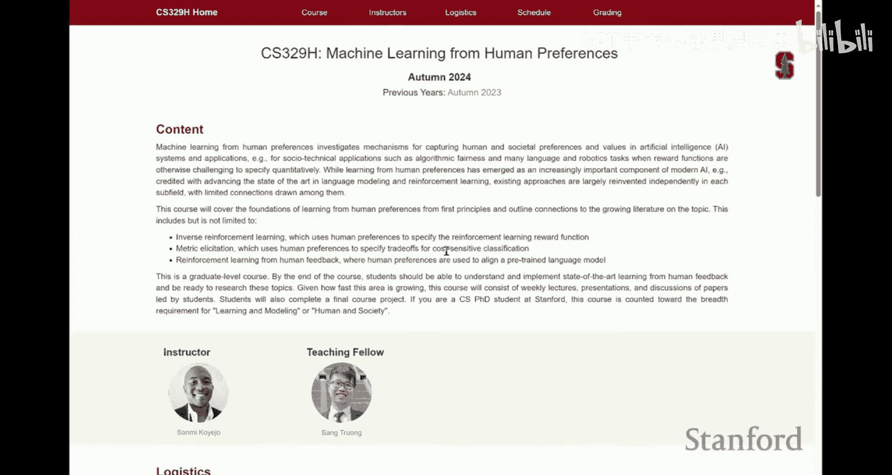

Excis everyone here today， in addition to myself， we have a teaching fellow sang。Say hello， soby。

Engaging a town with T over the course of the quarter， so over the course of the quarter。

 you' have many k interact with the teaching staff。

So the plan today， as always， for initial lecture is sort of。General overview， so we'll get into。

Some of the framing of the course， the course is new， this is the second time we've offered it。

 so it was offered first last fall and this is the second time we're offering class we're still figuring out exactly what this course is。

The upside is， I think it'll be slightly less experimental than last time。 So you guys are， you know。

 you'll benefit from some of the experiments we did。A year ago。

 but also I think we're still some rough edges so well depend on you for feedback on aspects of the course that you think are going well or badly to sort of further refine it。

So， you know， the course is sort of timely， I think， for many of us。

 exciting by lots of engagements and or aspects of machine learning that are very explicit about using human feedback。

 Our goal is to engage some of these questions， both on the application side。

 but also hopefully much more foundationally， I mean， foundationally， in a broad sense。

 So both the aspects that are about machine learning。

 but also will'll touch on aspects that tie to things like economics， psychology。😊。

we'll play amateur everything hopefully not too badly some of this will be with the course staff。

 some of this will be with invited lectures， I'll go through some of this over the course of the meeting today or the class today before going into slides so one I think nice benefits。

The fact that this is the second time we teach the class is that the core staff and other folks have been proactive。

About putting together a textbook。 So we have a textbook。 to my knowledge。

 there isn't a textbook on this topic in the world。 or if there is it's not public。

 So I think a unique resource from engaging in this class。

 that'll be a link in the slides which you'll be able to access for the book and other material。

 So we'll be able to see all this stuff。 And it has so it's， it's a very rough cut。 So again。

 be gentle， but criticize and give us feedback as you go through。

 But mostly today will go through the introduction over the course of the quarter we'll go through aspects to modeling human choice。

 some of the model based techniques and preference learning。啊。

Third module being model free optimization。And then finally。

 a module on human values and AI alignments。 So that's the rough setup of the course sort of intro section and then these four sections in addition to like I said。

 the teaching time there will also be。

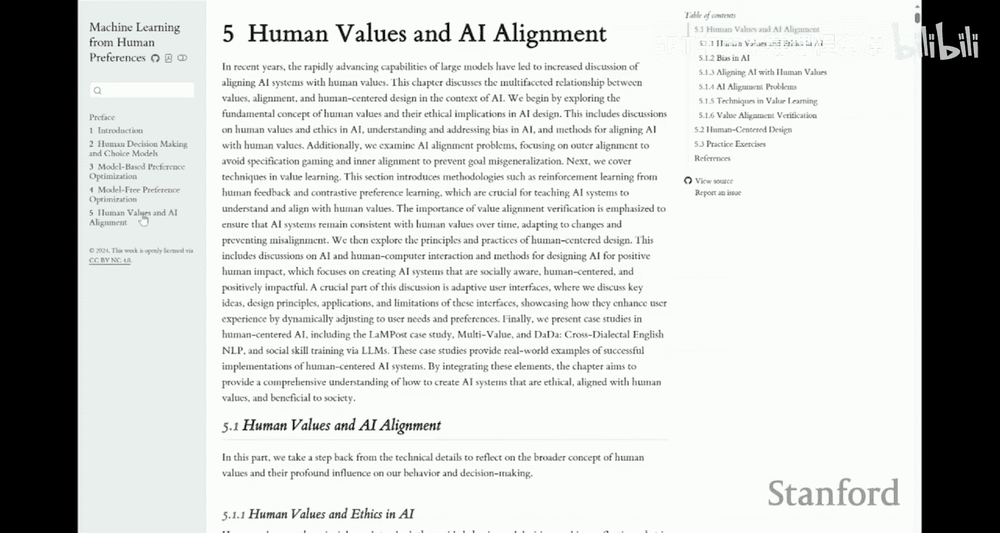

So if we looked there a syllabus。There'll also be quite a few invited lectures early October。

 so roughly at the end of our V module we expect to have an invited lecture on topics who are relevant to the module that we just covered。

嗯。This iteration of the course is the first time we're having homework。

 so last time was purely sort of discussion and lecture this time we're setting it up as 60% homework you' get the first homework。

Soon in about a week or so。

Again， they're， you know， unlike courses that haven' been running for a long time。

 this would be sort of。Fresh iterations of homework questions。 So again。

 I'm sure there'll be some wrinkles。 It's a small to medium class。

 So our hope is there's a lot of discussion back and forth。 and it can both be sort of。

Adaptive to the needs and what you want to learn， but also we can learn a bunch from you and how to improve the material in the course。

 There's a big focus on projects for a class like this so。

The plan is that you would organize into groups of up to five students and each group will have a series of deliverables that at the end will be a final project that will be presented at least to the class group and potentially to additional folks externally。

 so this seems to have worked well and many of you have taken courses that have a big project flavor so that's part of our plan for the rest of this class。

And then as mentioned， because there's a bunch of stuff that we're still。Figuring out。

 there's a meaningful load on class participation， so we encourage you to engage in the class either in the class itself or on the other artifacts that there'll be aspects of。

 for instance， giving feedback on the textbook on GitHub。

 there will be aspects of engaging with questions and answers on Ed。

 and then there'll be as already mentioned in class participation。

So I think that's that for logistics she went a little bit faster than my planned again for a class like this on sort of newish topics。

 I think there's a lot to be gained by the discussion so my pitch is considered coming anyway and hopefully there'll be some value from engaging into a conversation in the class。

Good question。The other thing to mention， if you're a CS PhD student， this course counts for。

Either you learning and modeling requirements or human and society requirements。

 which may give you some sense of the kinds of material that we plan to cover。 So in the end。

 this is a technical course。 So I think we'll always sort of fall back on machine learning fundamentals。

 However， intentionally， this is scopeed as trying to think about what this means。 you know。

 it's about learning from humans is's gonna be a bunch of work thinking about human engagement。

 societal considerations， a bunch of these other broader questions。

 So we'll attempt this mix of broad and breadth and depth at the same time with a slight bias towards breath in the material。

Okay， other questions， if not。Yes。そ now我バ。It background。Okay。

 so this is background of the instructors sure。I've been at Stanford a couple of years。

 I before that was professor inverse of Illinois relevant to this class I。

I've been working for a while on ways to get human preferences in sort of。

Classic machine learning problems， so' a framework we'll talk about briefly today as well calledmetrication that I worked on to try to engage with these questions。

Strongly related to folks in say RL they doing MR Rl and so these kinds of ideas in the ecosystem。

 Now all of this。Got exciting once again， I think for many people with language models and sort of RLHF being a thing again。

 we'll engage a little bit with this and。Placeces in some context。

 We do a little bit of work related to these kinds of questions。 Yes， some interesting。

Questions on sort of academia industry for these kinds of work that actually help be part of the discussion as we go through。

 I think that's also interesting。I think that's that for my I'm happy to。Go into any more depth。

 other teaching staff for free to say more about their backgrounds everyone has relevant experiences。

You like。

I work on book paper on this topic。Since，20，23。long啊。That's my mind。

So we'll go through the material for today。

Again， feel free to take a look at the textbook once you get a chance。

 So our bill today is an introduction。嗯。And go through some of the frame of the class and maybe set up some of。

How will think about the topics as we go through the next few lectures？So。

The broad area is still being defined， but we attempted to mock up definition that we can critique actually a little bit if folks are interested。

 but this class seeks to explore the challenge of efficiently and effectively eliciting values and preferences from individuals or groups or societies and embedding them within AI models and applications our specific focus will be on。

Some of us fiscal and conceptual foundations and strategies for interactively  querying humans。

To elicit information that can improve learning and applications。So， you know。

 as discussed and this framed， we'll think about many of the questions we'll think about in this class would be sort of through the lens of the sort of machine learning question。

But we hope to meaningfully engage with。Broader impacts of this work in terms of how it affects。

Individual society， all these kinds of questions efficiently there。

Is going to speak to some of the challenges of。Engaging with interacting with people and trying to do this with。

Sort of as few interactions as possible so there's a term query efficiency we'll talk about this a little bit more I a tries to and ask questions when you can about sort of things like how many samples would you need。

 how many interactions would you need to like get a particular estimate a particular function for interacting with。

Some set of agents and effectively thinking about the quality of the illustrationation process。

 but getting this signal from people。Any questions on the setup， broad framing。

 any strong criticism or weak criticism of this thoughts？Here's why the word interactively。Very you。

所以。不好意思，处理过一半。してよ。So。Excellent question。Yeah， so the question is about interactively and sort of why we state interactively。

 So I'll engage with this a little bit in a couple of slide， but one。

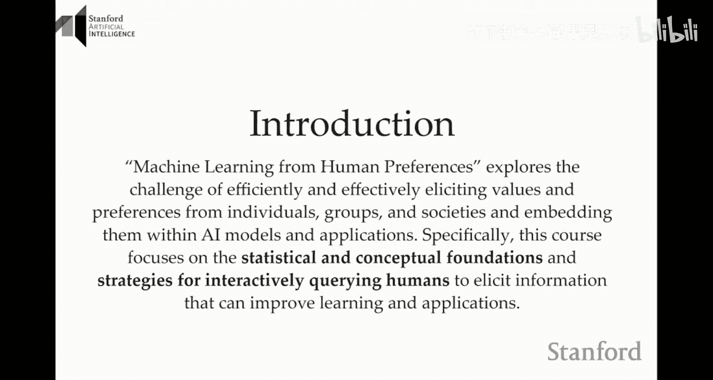

From a certain point of view， all of machine learning is learned from human preferences。 So， in fact。

 it's not。 it doesn't narrow the field at all。 And the reason for this is a lot of work。AI models。

 machine learning models are're trained to do are effectively to learn from signals that come from people so you know many applications of machine learning are sort of。

Saay medical applications， people label or actually almost all applications involve humans creating content of some kind and then we build models to mimic or approximate that content so from that point of view all of machine learning is machine learning from human purposes。

There's also， I much more focus。 are we trying to build AI as some intelligence goal。

 We'll talk a bit about this a little bit， which again。

 directly engages with the idea of learning from humans here we're going to focus on。

Settings where we're much more。Explicit and intentional about the human signal。

 so I think of the settings where you know humans are labeling data and then you learn from that data as。

In some ways， implicit。 so there's a preference effect that will show up based on how。

Whereever the data labeling is coming from in this class we'll focus on the subset of these questions where the goal of the learning procedure is very explicitly about learning from preferences often through interactive processes so exactly as you stated we'll focus on this of this seems the gap that's most interesting。

 this is again the motivation for this class and trying to think about these questions it won't cover everything but that'll be your explicit focus。

Thank you， good question。I think I like it。I like the broadening of it because in so many real world。

Applications。Pic set is immeutable， and that's just not the real world。And sample ins。

Like just the defense we quite missed is humans don't agree with themselves 25% of the time。

you have the same exact way of grade depending on if you've had lunch or not。

 you get a different answer and so we。You know， bringing the distribution that models the actual labeling process of。

In turn and so I like the broadening to include that part of that system into the。Itter thing。Yeah。

 now this is a super interesting point。 so we'll touch on this a bit questions like。

I guess inconsistency of humans and how to think about human labels in many settings and some existing literature ways of thinking about what this means。

 I think good with this。We'll talk a bit about models， we choose Bnoli models。

 I don't know if that's the truth， so we'll talk a bit about at least some framems out of think about this issue。

 but yeah things like noise。Or at least uncertainty that comes from。Inconsistence。

Signals from humans。汇款。Okay。So。As mentioned a little bit in the last slide。

 so our goal is to engage with both the foundations and a variety of strategies for interactively querying humans to information that can improve。

Some kind of learning goal or some kind of application。So we'll focus mostly on sort of。

Learning systems that have a very explicit human in the loop。

Component with some biased towards interactive kinds systems will'll engage a little bit with some of the foundations。

 So some of these come from economics， psychology， marketing statistics。

 we'll talk about applications。 So in front of mind for many of us are applications and language。

 So again， learning preferences or values from people。 but also sort of。

Long history of work and things like robotics， and I don't remember what we meant by oh logistics。

 yes， okay， so explicit logistics， I don't think we'll talk much about。

The applications and logistics， for instance， where for instance you're trying to plan delivery or routing or things like that and you might take preferences into account and how you think through。

Or explicitly illicit preference as a way to improve things like routing models。

All of these will focus on through the view of machine learning so what this means is we'll try to set up the problem。

 try to understand some of the angles of the problem and then we'll focus on questions related to things like modeling estimation evaluation questions within each of these problem settings I think part of what this means and we'll talk through prerequisites a little bit is that there'll be an assumption that you're comfortable with the basics of machine learning enough to sort of write some simple programs and build simple machine learning models so know train test validation splits should not be surprising to you if they are we should have a quick chat logistic regression should not be surprising to you taken this class if it is again we'll we should chat to make sure things a bigger fit so again。

 you know we'll need that components and so we'll think about this as a meaningful part。

Of the problem。The next aspect of this， so the second arm of this is thinking about what this means in terms of human preferences。

 so what how do we think about humans in here， I think it's an interesting thing because depending on where you sit in the sort of MLAI world。

I think we have some aversion to think about humans， even though humans are everywhere。

 So you see this in how many of you might or even your colleagues engage with。

Some of these questions， there's an argument made， in fact， I was on a panel last week。

Where someone made ambitious statement， they said， I don't know if this would be true。

 but maybe food for thought for the group。They said， you know， within。

A generation I don't know what a generation might mean in maybe five to10 years they think all of AI will be HCI and so actually there won't be an AI thing anymore in the sense that all the hardest and most interesting questions we about human computer interaction I think there's a plausible case to maybe for this I think you know we've made meaningful progress on the pure algorithmic side and many of the questions that seem important to try to solve to get to applications or impacts that we want seem bottlenecked by how we think about humans within our deployed systems so we'll try to think about this a bit again some of this will be grounded in literature so we'll have papers for you to read but some of this will also be just discussion in the class and think about these questions。

So a bunch of sub questionsions show up， various aspects of biases， I think you brought up。

 or questions of to what extent should we assume rationality in the humans。

 is that a good assumption， what does it break？Questions of thinking of human errors as noise and when that might be or not be a good or bad assumption。

 various kinds of notions of correctness， expertise in human engagement with AI systems。

We're going engage your questions of so often the questions change if it's a human or a group of humans or like a broad societal context。

 So we'll attempt to engage in all of these questions。

 there's some balance based on expertise literature preferences， though again。

 something we're open to adjusting based on feedback from the class So questions for instance。

 if I'm interested in listening a preference know does the problem change if I'm trying to get your preference as an individual versus the whole class's preference。

 how do I deal with the fact that。

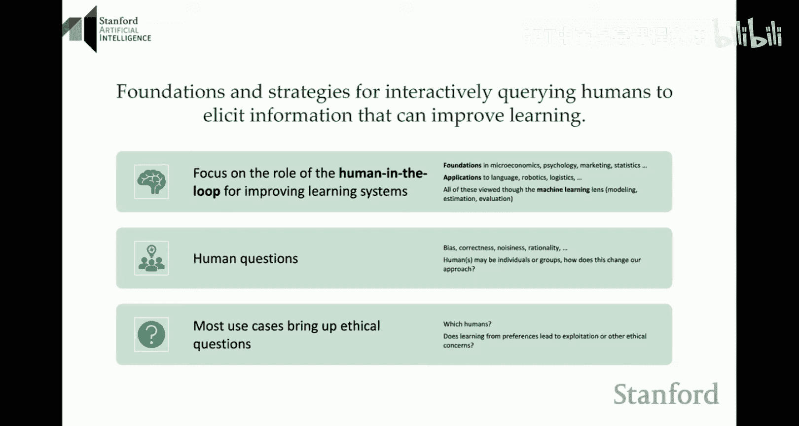

We won't agree on many things about， for instance， size of groups for projects and what does it look like to think of a synthesis and aggregation of preferences and think about this in ways that might get at broader values。

 or does this look like in terms of strategic agents that may be trying to game some coordination system and how can we are there settings that we can build tools to engage with these kinds of questions？

The last bits， but I think quite important。Is that the nature of this class will mean that。

In many settings， we'll have to think。Although almost always be a meaningful。

 ethical angle that we'll try to think through。 So this shows up in a bunch of different ways。

 I have a few examples here。 But for instance， questions of humans。 So if you're building a system。

 you're gonna deploy it。You pick who is going to give you signal。

And whose preference you're going to try to get the model to align with。

 And that choice has an effect downstream。 So， you know。

 which humans you're getting preferences from has some meaningful effect。 Some of this。

can be positive， some of this can be tricky and look exploitative。

 we'll try to engage a little bit with aspects of all of these questions and not shy away from sort of ethical questions that might be part of what it means to do modern AI and engage with learning。

I pause for questions or reactions。I have a question the last part。

 as we say that we often do data sampling to like where we make sure the data is coming from different scenarios and different sectors so that a model is trained to handle all sort of edge cases。

 Do we also will come up with this course with some kind of human。

Like like human sampling where we make sure that we are taking concentration of different groups of humans for that human preferences to be actually sort of in sense ethical human preferences from all groups Yeah this is a great question so this question of if we're framing this question in terms of ethics and maybe representation across different subgroups are we going engage in methods that allow to think about this question carefully。

We'll touch on it a little bit， so have at least one lecture that。engageages the question。

 I don't think deeply enough。 And I think this is actually really good。

 So I don't think literature literature is complete on this question。 There's a bit of work。 will。

 I think add to references some of the work。Given the interest that thinks about versions of this human preference learning when you have different groups and think about this question。

to representative sampling or other ways to think about balancing preferences across groups。

 but I'll also mention that I think this is one of those areas that the field。

 at least the MLAI subfield is very fairly early on all the folks have thought about this a bit。

 some work economics there's sort of work in ethics broadly you're thinking about these questions。

 I think it's a great project direction if you're think about projects。

 ways of engaging with getting preferences across。Feververse groups。这个 question。Hey， yes。

 on the line。Individuals。对。我对他什。Case of what very。Yeah。

 this is a fascinating question so the question is you know。

 I guess there's whole literature on learning with limited samples and the limited data of various kinds。

 to what extent are we going to engage with that？

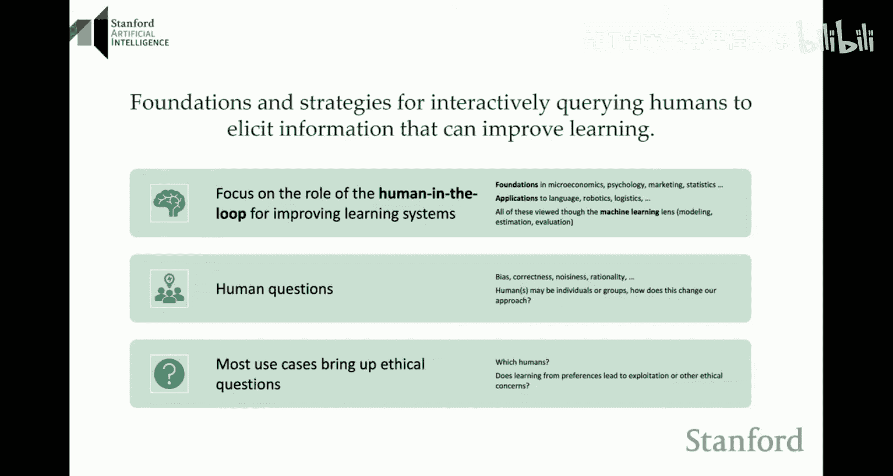

So I think well this is a good I thought about this very specifically I actually like that question a lot we'll engage with this implicitly because in almost all settings the learning problems that we'll set up will like by construction require learning but limited samples again engaging with some of what I mentioned before about querying humans can be expensive and so we're often under some budget constraint on sample size。

Yeah， it would be good to actually think about。Maybe being more explicit about that part of the framing。

It'll be implicit in problems where we hadn't planned to be that explicit but it's an excellent excellent question and it'll show up everywhere so almost all settings we'll need to learn a mid limited data and we'll be using some of the tricks of the trade sub pretraining foundation models。

 all that kind of stuff。Yeah， great question， thank you， yes。

You mentioned it would be a good topic to explore for the final project it made me wonder are most of the final projects like coding projects that are outputted。

 or there more research on like theoretical questions or what's kind of the？Yeah， we'll have more。

 so this is like what does the project look like？We have a pretty wide。

Brereadth of things that will be considered good projects we'll try to get feedback all the way through We will have documentation this week as well。

 saying a bit about our perspective on what makes a good final project。

 but to your question theoretical research makes sense。Critical examination of a field makes sense。

In some settings， literature survey might make sense。

 so L surveys are harder than people give it credit for I'll just say that upfront and people think it's easy way to engage I actually think a good lit survey is quite hard or technical science technical research。

A code or。Some other program artifact， all these will be in scope。Okay。

 and also applications we think about， you know， this is an area that seems to touch lots of different application areas so I think most of you end up at least from limited one quarter of experience。

And also just the zeitgeist， I think most people will end up in a language， but vision makes sense。

 Rl makes sense。There's a really fun application I'll see if we can get someone to show up。

 but there's some applications and sort of legal and policy that I learned of about recently they're kind of cool so yeah。

Ft of different areas that you could imagine applying these as a tool。 So feel free to。Expand。

 explore all that fun stuff。And there was the project from last year is still up on medium。 Oh， okay。

 yes， we should add that link somewhere。So if you want to find project from last year， you can。

I can over it over。This is searchable on it。

Everyone searches， it's great。Okay， okay， so what else to say。 So， you know， this is a。

Emerging topic in some ways， I think the edges of the topic are unclear。It's also broad。

We're not going to try to be exhaustive。 We have some breath bias。

 So we'll try to cover lots of different topics， but we don't expect that we can cover everything that's relevant to this question。

So you know some other aspects of this， so I talked about this at the beginning a little bit。

 but in some ways all of AI you can think of as learning from your preferences。

 so in some sense a catch all will avoid lots of。That part of the problem。There's also。

 beyond the data itself， people in this room are the people who actually build machine learning and AI models。

It's sometimes underappreciated how individual decision making and choices actually has a meaningful impact on what the models。

 what the actual models that come out of sort of some production process。

 So you know you're making choices about which problem you actually want to solve and what's feasible。

 where you're gonna to go look for data， what kinds of architectures， what kinds of loss functions。

 what kinds of optimization algorithms， all these are sort of individual decisions that have a meaningful impact on AI models So again。

 you know if you want to go to catch all， this is a kind of learning from human preferences because as a designer you making preference decisions about the algorithm。

 for instance， the data， the loss functions this is not what we mean。

 but know want to say that this I think is also like a meaningful way of thinking about these kinds of questions。

There's a bunch of work on things like model architectures。

 so you know beyond high level problem definition， but even things like how one builds most commonly in graphical models and causal inference you put a lot of inductive bias in models but even more general framings often use expertise in various ways。

 people have argued for instance like convolutionary networks or a thing because people noticed convolution was good inductive bias and sort of match to things about human vision for instance。

 so there are many ways that you can think about expert knowledge and inductive biases， again。

 we're not talking about that but want to mention that this。

It's important and then we'll touch a little bit， but we won't go into any meaningful depth on HCI problems broadly。

 I think it's super important the gap is partially expertise。

 partially scope so won sort of do super deep depth I would say though you know experience or interests in HCI will generally serve you well if this kind of topic is something that you're interested in so you know questions about interface。

 questions about process， questions about things some of these are the road things like how do I design a study and get IB approval。

 many。And the building are actually on campus don't know how to do this because we don't do that often。

 but if you're going to do work like this， particularly if you're going actually query humans。

 that kind of experience can be very helpful。 So some of you expect you might consider projects that engage with those kinds of questions。

 encouraging that as something。Okay。So this thinking broadly。Again。

 this broad framing of human feedback shows up everywhere。 So I'm showing a figure。

 a nice figure out of recent paper， borrowing supplies from colleague at the talking about how human feedback shapes a lot of the explicit machine learning process。

 So as mentioned already， but things like data selection， labeling， model selection， training。

 valuation deployment context。 There's a bunch of good work taxonomizing ways that human。そ。

Human preferences end up shaping what we're building and machine learning models again I won't。

Talk too deeply about this， but when to mention this for grounding my statement about human preferences playing a big role and lots of what we do when we're building models so all the way from how we construct data sets and how we might think about。

Questions on things like synthetic data， for instance， often have explicits。这。

Judgments and decision making within it all the way to things like how to specify constraints of various kinds or reward constraints embedding into models。

 various ways of adapting models and so forth。And so I'm mentioning it's also because， again。

 out of scope for this class， but it's also， there's a bunch of work。

That thinks about ways to capture human preferences， to engage with everything on this page。

 so it does work on illustration mechanisms for constraint specification， for instance。

Which we're not going to talk about that much， but I think is a very important subset of problems for various。

 for instance and logistics problems and planning。Okay， so examples and applications。

 I'm hoping some of this also to learn from you because I often learn some cool new things from this so just get the elephant aisle away typeGPT got。

A lot more people excited about what it means。嗯。In many ways it's been argued。

 depending on where you stand， it's this revisionist thing， did we expect it， did we not。

 I don't know， but of the many innovations that got this work in the sense of people getting good experiences engaging with a language model。

 it's been argued quite strongly that a lot of the work on trying to align to human preferences here。

 things like ArHf made a big difference， so I think again。

 some of this reinvigorated interest in this area。

A lot of this work builds on long history of work， so some of it， a lot of it。

 particularly for language models。And various mechanisms for。

Captturing feedback in building language models so I think to the earlier there was a comment or question earlier but things like document level interaction。

 label consistency queries from humans or experts word levelvel interaction so you I have some language model can I have a human tell me which terms and most influential or label those terms within language system and a human help in thinking of which features to add or remove based on what we think might be important again。

 still an important part of most sort of MLO frameworks and like large scale deployed systems some human intuition about what might be important features all the way to things like humans trying to help select model parameters thinking about both the measurement and then sort of feedback on where models are doing well or failing and using that signal to improve。

Or explore across ranges of models。Examples of this so version of this。

 so again the references are in the slides feel free to take a look so things like。

Trying to improve parsers by labeling sort of connections between different words。

 Pat ate the cake on the table that I baked last night and the parser might say I baked the table because it has incorrect interaction between the term and the noun because supposed to be labeling and you might correct this。

 So human understanding that I baked the cake， and you might include this within a language model system as a way to improve its quality of parsing。

 So for instance getting parts of speech correct or just more generally trying to get。

So the right structure in examining or explaining a sentence。So， you know， some of these。

Are still important problems that are worked on independently。

 arguably lots of these things language models seem to be much better at without as much explicit intervention。

 but some of these questions I think are still quite interesting thinking about how to frame and some of these papers explicitly thinking about how to get feedback efficiently from people to improve systems that look like this。

Um，Okay， so other big line of work。Trying to engage with so we'll spend some time on this going through in some detail。

 but it's useful to look at the some of the early descriptions of some of the work trying to improve learning from human preferences so as many of you know in the standard framework we start with。

Supervise。Learning from humans。 So humans。I'm talking about language models now to give some context。

 a language model， as many of you know， you start with some pre training。

 generally train a model to you know。Do a good job predicting next words on web data。

 Once you do that， the standard the common next step is supervised by tuning， where you get。

Examples of sort of knowledgeable at least or generally somewhat knowledgeable humans。

 the examples of questions and answers that might be relevant for a certain query。

 And then you get these as sort of specialized examples。 They typically much smaller。 So， you know。

 web data is huge。呃。In terms of the token counts， you go down to something on order of often thousands of examples to do supervised fine tuning where。

The objective is still the same and still doing sort of。Next for a prediction。

 but the model gets better at question answering in general from this part of the process。

And then the next step is generally this comparison data。

 so this is thought of as querying humans to get some kind of preference signal between different kinds of completions or certain query。

 there are various ways of doing it， sometimes the most commonly used approaches。

 pairwise preferences， so I ask a human I have some some query。

 I have a set of different completions， I ask human what they prefer。

 which of the completions they prefer， and then I train some model to sort of be better at responding with the preferred a preferred responses。

 I guess from either the pair or a sets， so for instance if you have four different possible responses and you might ask the person to pick between the four typically this is discrete choice typically again。

 these are somewhat limited sets of samples。In this class。

 you know all of these are important in training language models we'll spend a bit more focus on the sort of step two version of this So again this interactive I think of the step one is mostly one shot so there's a bunch of work offline to query a bunch of people to sort of get good completion examples section two the step two is typically。

Its best done interactively actually would be good to engage with some of this in a sense that some versions of this work do stuff interactively。

 some versions do stuff offline， we' dive into some of the technical details of those differences over the course of the class。

But in either case， you know you get examples， people label them in terms of preferences。

 you can think about this narrowly in terms of narrow preferences for completions。

 you can think about this more broadly is maybe embedding values somehow in terms of what they think the language models should be doing we'll try to engage in both of those perspectives of this question and then the next step is sort of optimizations that typically two and three are done together。

 which is a combination of。The various mechanisms， the most popular one is using reinforcement learning strategy。

 so some like a PPL algorithm。We'll touch a bit on this。

 combined with trying to get preferences to interaction。 And over the sequence。

 you get the model gets better at getting。High rewards。

 so gets better at the picking or choosing a completion that's likely to be the same as what a human expert would have picked。

any questions on discussion so far， they've outlined a few some of the literature existing work。

Particularly within language， particularly within that has engaged with thinking about learning from human preferences。

 Any questions so far in the framing and how we think about topics。Yeah。

 how much will we do if like7。like training policies with Yeah， so the question is。

 how much we do step 3， How much are we going to implement， for instance， RLHS。

The plan is a meaningful amount， I don't know how to ask that question actually more accurately than that。

 but our plan is to include implementation， so we'll build the plans to build some systems。

And actually， so test things like this。 DPO other ways of。Doing so apparently。They on language one。嗯。

Yes， on language models。Yeah，So you have some work。Homework。Definitely a project if you chose to。

It'sGood question。Okay， other questions and or if anyone knows of other interesting applications that have similar flavor。

Email preference measurements。To improve algorithmic systems。I me your favorite example。Yeah。

 thats a good question。Yeah。As a contrast。To learning from human feedback there's also a network thinking about AI judgments。

 so for instance， language model judgments as ways to improve models。

We don't plan given the thesis of this class， we don't plan to spend a lot of time on those often the techniques。

 at least the machine learning part techniques are effectively the same with some differences in the query mechanisms。

 so I think stuff will transfer over reasonably well， but the plan is。

To focus much more on human feedback。That's good question。We have。

GPUs to with run credit this is a good question， so the question is are we going to have GPUs or credits to work with？

Working on it slower than I would like。

Almost definitely have something。 The size and scope is not yet clear。

But we'll try to figure this out before any meaningful computational。Or projects。

Good questionThe bottleneck of academic work in this space is compete almost always。

Are the homeworks primarily implementation focused Yeah， so other homeworks implementation。

 our plan is a mix。Some conceptual， a fair amount of implementation。

So in a lot of research like pureM research， people don't usually go to like steps two and three where maybe it's like model architecture and they just do pretraining plus SFD。

 so I'm curious are there specific applications where like human preferences are just avoided or at like industry level is always done but on the research side？

It's a great question， so the question is a summary of the question。

Many ML applications don't do very explicit human preference。

 as there some gap between aprem's research versus academic work for many kinds of questions。

mSo indeed， u there is more。Most of the published work that engages with。

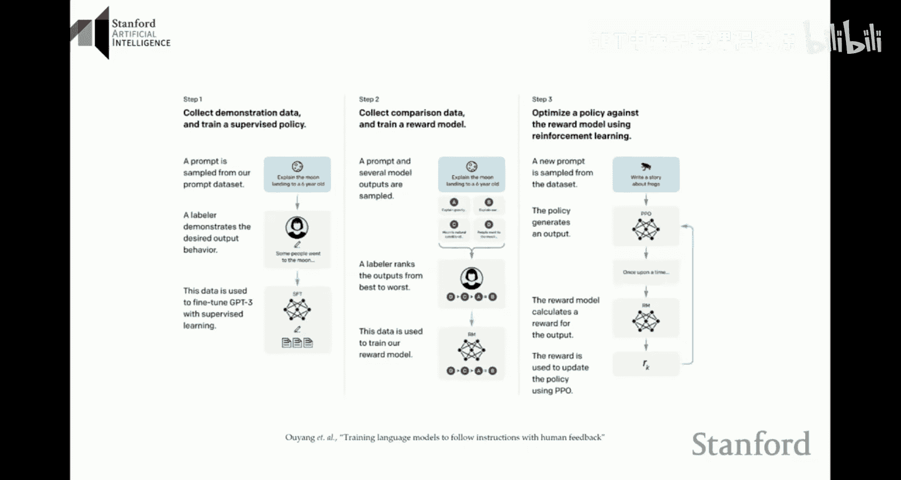

Sort of real world learn from your preferences， at least in the machine learning literature tends to be from industry。

 I think there are a variety of reasons for this。 One of it is， it is。

A bit more challenging to do a good job of sort of collecting human preference data。Partially。

 you have to go through a bit more process in many companies。

Either the process is lower overhead for various reasons。

 so we don't need to delve in details or we can。Or。

The processes are managed by there's a bunch of people to hold deal with the process for you and so it's sort of more straightforward。

 it can also be expensive。So you know in many versions of this you want to pay the people that are giving you like signals or preferences or particularly the SFT one。

 but even the preference one and so you know for many academic research things in some sense GPU is a or like compute is a sun cost to sort of amortized in this is like an additional thing and people don't always do it there are few data sets out there and I think we'll use some of them like pre- collectedlected human preference data sets that one can use and I think will frame a lot of the work in a class around either synthetic or like existing data sets I think some of these blocks lead to this gap like who is actually doing the work。

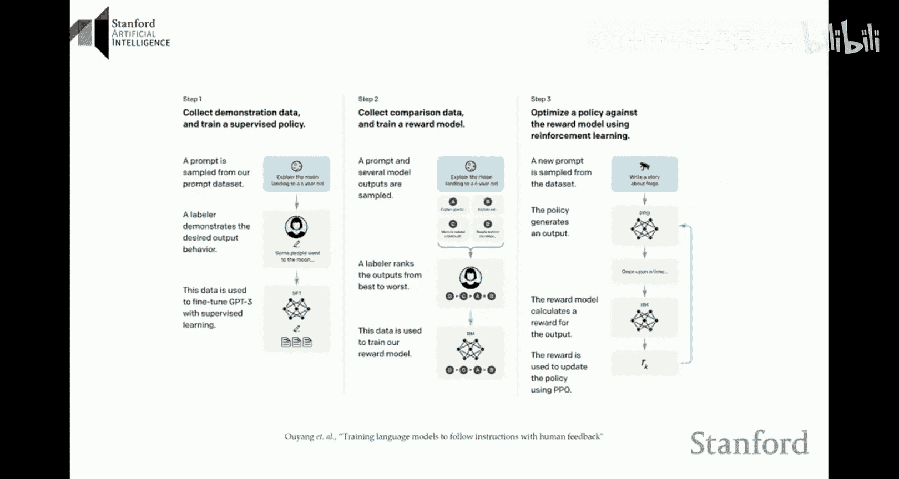

嗯。Our hope here。So we'll engage with some of these topics I think our hope here is to。

Build enough foundations such that like the more one has to do some of these apply things。

 the gap is lower。

What you need to do to actually get things up the ground is easier。

The specific question was about specific applications that are engaged with differently。That's a。

 you know， most interesting big language models and not academic models。 There are few。

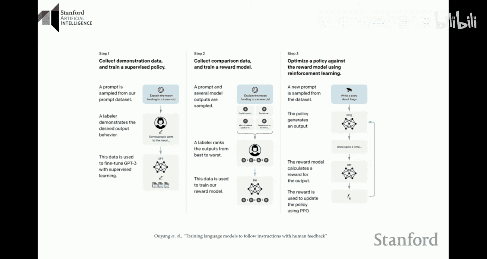

Outliers。There's something out of。This company out of Se， forget it did Omo。Yeah too， yes。

 and there's some work here that' trying to do meaningful large scale language models with N to end。

 everything。But that's a big one， very obvious one。

Just not that that much end to end with all of this process that includes collecting human data。

 a lot of it will use。Existing data， so like DO， for instance， which is we'll talk about this a bit。

 but famous work engaging in some of these questions use some public data。

One question are these reward models or the analog。

 some like open source model which we can plug into any model or it has to be custom built to say a language model or a vision model that we have Yeah。

 so the question was， are there good downloadable RTF models or essentially do we need to build our own？

This is a great project question， So this is an interesting one in a sense center。😊。

Is now more effort in trying to publicly share reward models。There's this reward bench thing that。

Who gave a talk last year is building and sort of a few so public infrastructures engaged with this。

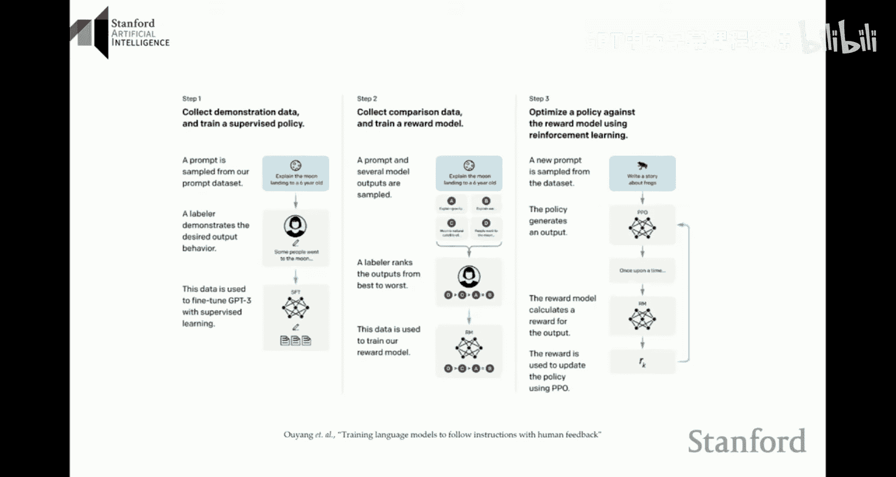

So a lot of the space， the reason I mentioned this is a good research question is。

 I think in language in particular。A lot of the signal is that。

Training a reward model separately and then training a language model to fit the reward model tends not to work all that well the most successful implementations actually updates both the language model like this whole process so you collect data at the same time as your proven model with the kind of model you reading Yes so actually I can just mention so almost always the reward models are you take your language model you cut off the head and you put on of classifier at the end we'll talk about specifics and what this looks like and a few lectures by next lecture I think we'll have enough grounding to。

And so mechanically， it's some big， unwielly like as big as your language model。Procedurally。

It's not fully known why you can't plug and play language models that well with reward models。

So there are a few high policies out there I think it's sort of active interesting research again I think an excellent potential project and particularly if you look at public ones or called the data trying to ask some questions about why they break sometimes when I try to take a language model separately take a word model separately and so try to stitch things together and practice these are often trained quite close to each other there's a few explanations in ether things like you know is this a distribution shift issue is。

Should we think about their reward models actually learning human preference or just getting sort of a local approximation that's good for updating the language model。

I don't think we know the answer， so very much frontier of the research base。

 I think a great another project I do。Actually， we don't need previous years。

 I think from this class probably。Please， yes。So you said some recent work。

 somewhat recent work that doesn't work with explicitly learning the reward model like DPO。

So do you think there's still a case for learning the reward model explicitly or is this just another fascinating question？

Another great research for us， so chocolates myself。

So we'll talk about this a fair amount so in fact， the way we've set up the course material is a whole section on sort of learning from human preferences implicitly without so things like pairwise signals or without an explicit reward model so things like DPL will show up there but other kinds of so things like bandits will show up there as well and then other ways of thinking about learning from human preferences that are explicit about learning a reward model and then using that as part of the optimization process。

You know， depending on the setting， I think the community is pursuing both purely computationally it's much cheaper not to have a big reward model because they tend to be big at least how apparently they're implemented sitting around when you're building these。

And R REL also， you know， in settings where people get away with things like behavior cloning。

 they try to， this is essentially treat the reinforcement learning problem like a regression problem and you don't explicitly like have a reward model。

嗯。As a。Perspective on the problem， I think it's valuable。

 the reward model itself is valuable as an artifact because it hopefully tells us something about human preferences that we can maybe examine offline。

 and it's also useful for like evaluating it itself and what it's doing most of the field。

Doesn't take that view， so the road model is only useful in as much as it helps you train。

So the learning model that you're interested in。 And so if you can get away with training a learning model without explicit reward model and you get similar performance。

 than many people with many implementations will do that。

So I guess a short answer is you don't need it。In practice， many people prefer not to have it。

 I think it's valuable but it's much more of a conceptual philosophical view than something that I have a great sort of practical answer for。

 I think it's one of those things where in addition to getting signal about model can also give you signals about where things might be breaking。

 actually be curious because their experts in this room。

 if people have either alternative opinions or expansions of this idea。Sense of yes。

 I would say I that people aren't using the reward model for anything。

Getting a better agent up until a work。O one is just using infinite looking where I just sample 1 thousand and then use a smaller word model。

Between some examples。And say that's the one I like and iterate on that。

 so that's where the reward model makes a lot of sense。

 but it has to generalize beyond the local pref data。You know。

 the biggest issue is the reward model is easily hackable。 if you over PPO on the reward model。

 it it will just our outputting just。It's the forward model。

You don't have enough pref data to prevent that Yeah。

 we'll talk a bit about this sort of overfitting in various ways from word models。Oh， meaningful。

 important points。啊。Yeah， I'll try to think I think this is an important question that I'd love to get a better answer to because I'd like to advocate for more keeping role models around。

Yeah， I mean， another angle。 So again， rewardbench is motivated by this idea of like examining reward models themselves to say something about what it is models of learning。

 Again， if you think they're learning human preferences to something there。

 But jury is out and I think most of the field doesn't care all that much。 So again， you know。

 this class is framed is learned from human preferences， whether you're explicit or not。

 So in some ways， we're not engaging as directly， this is not the point of view that we need to take for this。

 We'll talk about both。

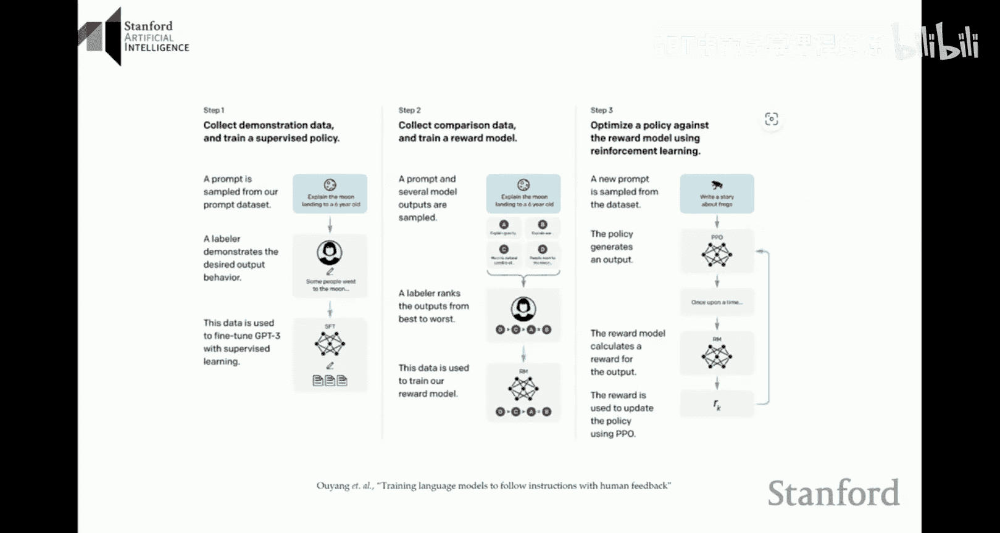

Arithms that try to use both with and without explicit rewards， but it's a fascinating question。

 what do you actually need to get at the test？This is所。This back the your systems。

Probably how quarter。IndeedYeah。We'll talk a bit about our recommended systems。

 but are you going to say oh examples Oh yeah， yeah， for sure。

So we'll talk about recommended systems and some of the other。Applications this question of。

 you know， do you need reward models as a foundational question that's。

Okay， so many of you have already seen this， but this is these are results from you can look up paper。

 we'll have this on the slides， but they showed in some of this earlier work。That with， for instance。

 summarization tasks， you could get much better results if you explicitly used human feedback and preferences as opposed to things like supervised like the generic pretrain model。

 noisy， not that bad not that great supervised man tuing， improves things。

A meaningful amount and then close human feedback tend to improve things meaningfully further。

 And again， a lot of this borne out in the results and the artifacts that we're using now。

 So motivation for perspective on the。 So here are some examples。

 again in the paper or you can see this in the sidess but showing a human reference。

 a supervised man tuning model that tries to answer this question。

 and then a model thats use human feedback。Okay。So why do we care about this question so and engages a bit with some of the discussion earlier？

So a bunch of different reasons I don't think it's uniform across people who care about this problem one of them is sometimes you're interested in signals or like evaluations where you don't have a good explicit metric or loss function so it's unclear what it means to evaluate progress on that setting so for instance you know if I want to build a chatbot that's funny I don't know what the equation is that quantifies funny something here might but you can imagine getting examples from people or rankings from people that says you know this statement is funnier than this other statement it gives you a signal that you can then use to train a model that will improve on this task so useful in settings where。

Explicit rewards or costs or losses are just really hard to specify and we think humans are universal experts。

 or at least good experts at getting a signal for those questions。

Another is settings where stakeholders care a lot about the outcome。And again。

 the specification problem， so things like healthness， questions of things like fairness。

 where again， there are many meaningful， maybe perhaps reasonable definitions of what good is。

 they don't all agree and you want to use interaction with human preferences as a way to specify a good target。

 say typically across a large stakeholder group。It's often useful。

 it's sometimes useful when sort of。That's some ideal behavior。

 we don't know how to fully specify it， but we can use evaluation signals as a good proxy。

We'll see a bit of this when we construct sort of synthetic evaluators we'll touch on this a little bit and then you know。

 depending on who I talk to lots of these conversations where。Really。

 it's just a good proxy for we know a problem， we know that humans are good at fixing this kind of problem。

We don't really care about preferences， we just want humans to help us fix our issues so you know all the way from things like you know model makes a certain kind of spelling mistake all the time。

Yeah， if it's a single spelling mistake， sure， if it's a broad range of spelling mistakes。

 maybe having labelers tell you。 different kinds of mistakes model can make can be more efficient and practical than trying to specify all the sort of settings that this。

So you know， as you can see there's a broad range is all the way from much more explicit interest and say values or preferences for their own sake。

 and sometimes these are the reasons why we engage in this and sometimes it's just a useful proxy for some real world outcome that we'd like to cut。

Any question。Okay， so I've given some examples of all these， they' happy to get more。Yes。

Missing gaps， okay so。There's been a lot of progress over the past couple of years is again。

 I'd say one of the more active parts of the MLAI research work。

 but there's still lots of places where where we know that we're missing something so as many of you know in language models。

 they explicit biases that the models have that reflects also human biases to a lot of extent。

 so for instance， many of you might know。That chatbots tend to like long answers and also tend to like given responses that have。

Bullets， apparently， these are the two strongest signals in terms of both human preference and sort of language model biases。

 So if you want to get a good reward score， you want to get a human to say you give a good answer。

 make the answer long and give lots of bullets， whether or not you actually answer the question。

 people just you look smarter right And so you said a lot as I'm doing now。

 So there's also lots of settings where human preferences aren't reliable。

 So we'll talk a bit about reward hacking I'll give a quick example in a little bit。

 So some of these can have reward impact。 know some of you know a bunch of like news stories that came out when door mistakes many of these。

I guess defined as things like hallucination errors in a model for factual queries。That。

Can sometimes be attributed。Something that we're missing potentially in how we construct and trade models。

Okay， there's work or gaps tied to potential ethical issues so no。In many settings。

So there's a bunch of the work that often will require sort of experts。

 so things like supervis maintaining data， but often the pairwise preference data is often outsourced and sometimes can be outsourced to sort settings where it's low cost to get data from individuals the ethics here are tricky。

 so I don't want to say this as sort of a simple cut and dry thing。

 but I'd like for us to be thinking about engaging some of these questions。Okay， so， you know。

 this includes， and on one hand， sometimes there's actually can be a good job in certain places and many settings though。

 they're often like the places where one might outsource labor for things like moderation。

 but also often for training models。Can be things issues are settings where the individuals that try to improve these models get see the worst of the signals that the models can create so you know signal or say images。

 for instance that。So deeply unethical in various ways or even potentially traumatic where you might need psychological help after doing some of this work so you know challenging open question one that。

Our field engages with a bit， but one that again， I'd like us to in scope for what we're thinking about and think about these kinds of issues in this class。

Okay， here's a paper I like。No need to read the details。 so you can look up the reference later。

There's some small chance， the author is here。Now。It's a Stanford paper。

 so they did this clever thing where they I thought clever， where they queried。

 they gave the Pew survey， some of you might know this is a survey that people Pew uses to evaluate values and preferences across typically different societies。

 the US different subgroups， so they gave the Pew survey to a language model。

 and so they asked it a bunch of different questions it can give responses。

And they tried to check sort of the extent to which any of these responses correlated with different demographic groups。

 so do the responses look more like you know someone just looking through on the right hand side。

 conservative with less than high school education。Who makes less than $30000 as an example。

 So you can do this a sort of perhaps straightforward survey to do。

Does anyone know what they found as sort of the highest correlation group to？The survey。

 So what opinions did it suggests that their analysis suggests that the models sort of captured the best。

And it's not a trick question。Is the obvious one。Guesses。label the Pf data Yeah。

 some to the pref data， not completely though， which is a little bit surprising。

 but I want to state this as a location， so where're in the world。Do you think？😀は。😊，Gue is the。

 the US more fine grained than this。Yeah， so very California where was very around here， actually。

 so it turns out language models like to be California。😊，for Palo Alto kind of people。

 perhaps you know not surprising in retrospect because again。

 you know I mean perhaps part of the labeling is done all over the world。

 but there's a lot of to the earlier point there's a lot of intervention in the models that ties to people who generally work here that have political opinions and preferences that match know people that live around here and so these kinds of purposes get embedded in language models so again。

 part of our goal we，Understand the mechanism by which this happens and sort a process either intentionally or unintentionally。

 but also I think in scopepe is critiquing and evaluating what ends up being embedded in language models。

And， as you might imagine， this can have downstreaming impacts of various kinds。Okay。

 so we talk a lot about language， it's hard to avoid it。

 but there's lots of other stuff that you can do with preference models that we'll talk through some examples So there's work。

 for instance， this is， I think quite cool work from some colleagues out of Caltech。

Where they're building an exoskeleton so people， particularly for people who cannot walk and so have lost control of part of the limbs their legs they have exoskeleton that helps them walk and part of the calibration process requires getting signals on either what either feels better or worse or sort some signal from the human about how well it's working you know to actually calibrate the exoskeleton and so you know you can imagine asking。

Setting up the model some way asking the user you know is the setting good for you and the setting here involves a bunch of these probes at the back which have different settings across this array and this all this you have to tune so there's some response tuning curve that you have to fit that is somewhat personalized so each person has some tu curve iss specialized to them is you have to answer this question of how do I calibrate the model to an individual and here you know the signal that seems most reliable is what the person tells you in terms of how well it works for them and so you can try an absolute value querying this four or five in terms of how good this is a problem clear by the way okay so a real context and then a bit of the algorithmmics。

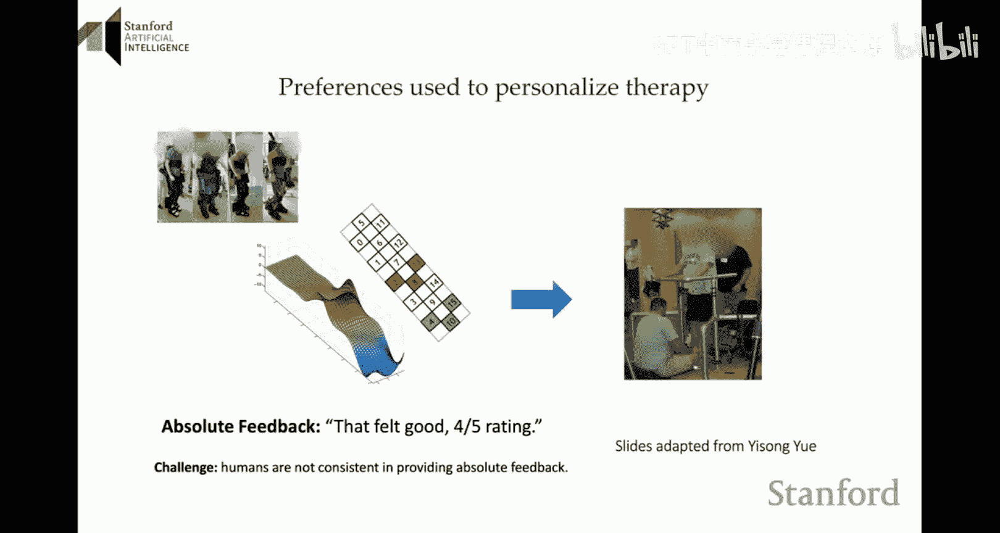

They found and will argue a bit in many of the applications we'll look at that preference queries worked a lot better。

 so instead of saying know how good is this in absolute skill。

 you ask people to compare two settings of the models and then you have the algorithmics behind the scenes that can use this pairwise preference as a way to tune this array such debt you get hopefully the best behavior in terms of the actual skill iss involving so we'll talk a bit about this we'll talk about where talk a bit about preference you that we' talk about yielding bandits which are a way to think about banded problems with pairwise preferences explicitly as a way to frame problems like this in a bunch of different papers where this group is engagement。

Okay other algorithms， so I talked a bit of beginning on some of my work in metrical stations so the idea here is for various kinds of learning problems。

 say classification problems you want to get a signal lots of classification problems where the metric of success is unclear or there asymmetric tradeoffs potentially so there is a maybe differential costs for making different kinds of errors。

 this shows up a lot in say medical application settings where false positives and false negatives don't cost the same in terms of impact on the individual and here calibrating your learning problems so actually figure out the right tradeoffs can be tricky and so we've done some work over a few years now thinking about ways of getting pairwise preferences from humans as a way to tune the preference of the learning model to best align with extra feedback on various kinds of work。

Typically classification problems for things like this， but we did work on things fairness problems。

 learning from stakeholder groups empirical empiricalical evaluation。

 so we've done some work in looking at how this looks like in real world contexts of various kinds。

Okay， so illustrationation is interesting again。I've mentioned this before， but。

Where individual stakeholders matter or where the tradeoffs are tricky and hard to specify and so we found that valuable some recent work recentish thinking about inverse decision theory so this is this question that's a similar kind of question but in a classification setting of know decision theory is this forward process I have some probabilistic model of the world I want to come out of decision the inverse is I want to figure out again。

 how to think of tradeoffs and tradeoffs and classification problems always almost always boil on thresholds but do I set my threshold for I have a probabilistic model of some behavior。

 what do I set my threshold for yes no， I'm going to make a binary decision for instance。

And so you know you can think about this as sort of some feedback process and we've done a bit of work。

 I'll leave you to read details if you're interested and ways to frame this problem and so what comes out of it。

Recommendation systems like you brought up so another meaningful high impact application in a sense that a lot of our world now is driven by recommendation systems so all the way from things like you know movies and audio Spotify and Netflixs theres a bunch of work in this space this you know at some point was the coolest part of the AI field。

datingating myself a bit， but when the Netflix fri was a thing。

 Netflix set out a million dollars wherever it could improve their recommendation system algorithms。

 I tried didn' when weren't even close but。We gave it a shot like many others and everyone did fairly heavy complicated algorithms that tried to be good at means square error there's a bunch of work building on this instead of other parts of the field I tried to make this problem so much better specified but again。

 a lot of this often boils down to like you're trying to model and capture human preferences over items。

 movies objects， things that people might want to buy， there's a bunch of literature。

 both technical and sort of otherwise of come out from this。

 so various kinds of querying various kinds of signals。

 so things like thumb up comes down which is this pairwise thing but on an individual item getting pairwise preferences。

 ranking preferences， rating preferences so it's a whole literature there that will touch on and will again think about how it might apply to other things that we're interested in。

We' already talked about RLHF， so I won't belabor this， but additional detail if you're interested。嗯。

It shows up in reinforcement learning this is work。In 2008。

 which is the first time that people use Ral algorithms from human demonstration。

I guess automatically or learn some policy for actually playing the helicopter。So again。

 this is like some of。way ahead of the time at the time there's some work from colleague Dorsa and some of her PhD students doing all sorts of cool things and preference learning for reinforcement learning applications so I'd argue RL is engaged with this problem for a long time and has lots of artifacts but will' also try to learn quite bit from RL settings they've also done work it's the same group looking at ways to learn from demonstrations so I won't played a video for time but you can take a look and I've also asked questions about how to model things like comparison data。

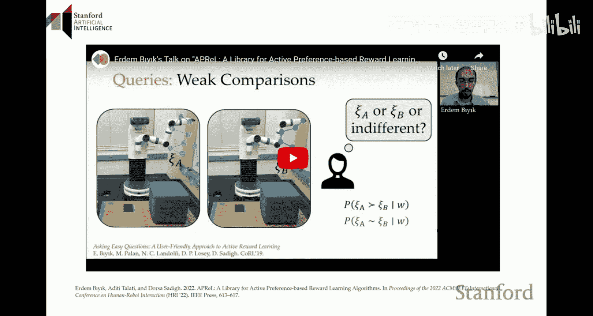

I maybe show this。 So this is this。 some of you might have seen this video。

 So this is now famous as a。Example of trying to learn or specify word function for a gameplay agent。

 So the model is meant to the bolt is supposed to complete a course。 As you can see。

 it's not completing the course。 It turns out is still getting a good score。

 So most of you might have already seen this what the agent learned is there's a very specific set of sort behavior that you might repeat。

 It turns out that if you hit。Those green things at the bottom。

 you get a bunch of rewards that we spawn at exact right timing to sort of。

Hit a bunch of these bolts。 hit the side and come back and get the reward over again。

 So your reward function was maximize score。 agent figured out I can get a really high score playing this。

 And so sometimes it's called reward hacking。 We'll talk a bit about this and how it shows up and ways of。

😊。

あ。😊，They some engaging。😊，Language models。😊，啊。Okay， okay， so a bunch of factors。

 you think about things like how hard is it for a human to specify signals。

 how do we think about correctness， what happens if there is no correct answer and how do we think about things like truthfulness and。

Strategic behavior， various kinds， roles of mistakes， expertise， questions like this。

In most of the work we'll assume sort of some kind of rational human will'll engage with this a ton over the course of the lecture。

 but we'll assume that there exists some kind of reward function。

 even if we're not being explicit about it， but there exists some sort of explicit deterministic function that tells us what a human would prefer and we'll build a lot of our models based on this。

 but it is an assumption and at least one invited talk will engage with。

Whether the assumption is reasonable or not and what to do about it。

 talk we'll mostly talk about sort of discrete choice kinds of things and kind of pmetric models that build around that。

 a bit about biases， aggregation， a whole bunch of the topics that I've talked about。

Okay so that's that about material a bit on just general overview so we're going for breadth over depth for various reasons again new space we're trying to figure out what the edges are that make sense for the class we'll try to engage with a bunch of different applications we have lecture schedule which you've seen online though there might be some shuffling in terms of topics and speakers as already mentioned we assume you have machine learning basics you can do some basic programming if you cannot we should chat because I think there'll be some challenges in engaging with the course there's a textbook and this link the slides would be available and so you can take a look and next will start on material on some existing choice models for the rest of the。

All right， thank you。Welcome to CSD 39H。

