# 斯坦福大学《基于人类偏好的机器学习｜CS329H Machine Learning from Human Preferences  Autumn 2024》中英 - P2：PreferenceModels.zh_en - GPT中英字幕课程资源 - BV1n2Hfz6EGR

Okay， I'm going to get started。

So the goal today is to cover choice models， if things go as planned roughly by the end of today's class。

 you should have sort of all the technical tools you need to at least understand the human preference learning parts of most modern。

Of at least many modern sort of learning human preference red。

 So this would be a lot of the fundamentals， but as you'll see。

 many of the models and approaches people use end up reusing many of these ideas。

 So think about these as one of the sort of foundational。Meeths lectured。 So the goal today。

 as mentioned， we're going to talk a bit about standard， quote unquote。

 rational choice models and we'll focus on the discrete setting。

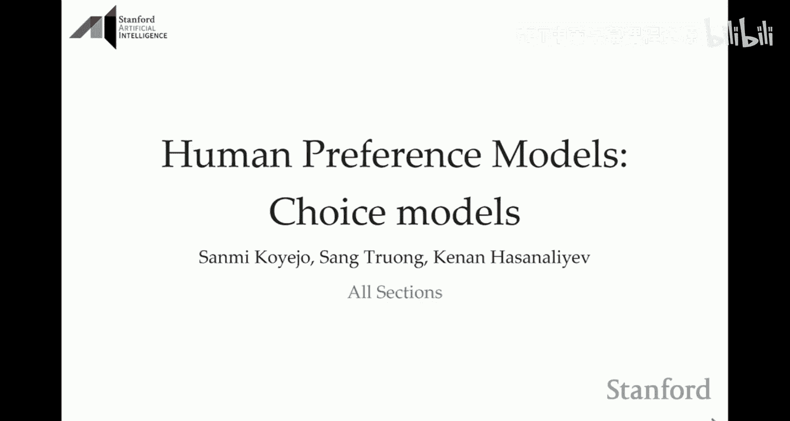

So choice modeling has a long history， I'll give some historical context in a little bit。

 but one way of thinking about the goal of choice modeling。

Are a set of tools that help one predict choice behavior of either individuals or a group。

 generally within a specific context。So if you like you know like many things that we like to do within sort machine learning models。

 the idea in choice models is that I get to observe either an individual or a bunch of people making choices。

 this becomes my data set and the choice model is literally what model can I fit to this data such that given a new context I can predict the choice that people might make so as we go through。

 I'd like to encourage people to also engage meaningfully with。The assumptions that we're making。

 I'll try to call them out as we go along。Those assumptions are important and part of this class would be sort of critiquing limited many assumptions that we make when we try to build choice models。

Okay。So you know， applications all over the place， here's a simple one I'm interested in modeling safer marketing applications。

 what preference or what choice people might make。Suppose I'm either say a car dealership or I and I'm running a website that compares cars and sort of sell people cars。

 I may want to be able to sort of predict something about preferences that people that come to my website or people that look at cars might want。

And so like everything we do in learning， the things you need generally are sort of some set of features that describe sort of objects。

 so for instance， for cars， you might have the brand of the car， you might have the price invoices。

 a bunch of other information you can encode this in a bunch of different ways and then you might want to know something about the decision makers。

 it's not here， but you know individuals something about maybe either express preferences。

 maybe demographics， often might be predictive signals。

 if you have other signals about things about It know background previous cars that they have driven these might be of good features to extract and trying to predict when they come to your interface。

 what they might choose as the preferred car or how they might rank different options across these sets of ways。

You can also do this for transportation so this is actually a quite popular real world application so you may ask questions for instance。

 I want to do route planning so I want to make choices about say between some set of routes the ways to do this in a break up the route into multiple steps and you making choices around of specific paths to take I can think about this as a sort of global choice modeling so I have a discrete set of possible paths and I want to understand and model and predict for a particular individual what their preference might be in terms of the route so things like this are often used in route plan algorithms that are part of say many of the sort of mapping algorithms they're even more so used in things like logistics planning and alluded to this last time but say delivery and sort of other kinds other aspects of logistics applications you might take into account things like whether might take into account。

Traffic for the user， you might take into account whether they like to you know。

 drive as fast as possible， but are willing't take a longer route or they would prefer。You know。

 actually literal shortest path， even if it means that they're driving slower things like that。

 you might also include cost in this so you can do this again through features or you can do this through sort of other kinds of illustrationation mechanisms will' go through some details on applications in a little bit。

 but you might want some signal on say how much the particular user is willing to play。

 you can think about this for say fuel， you can think about this for tolls。

 a bunch of other choices and be part of your your choice model。Okay， other applications。

 things like energy， I think this fits well within sort of planning， logistics， things as well。

Lots of fun applications， there papers here if anyone's interested in applications in a bunch of other contexts。

 I'll have you take a look at it。Another fun one， but maybe one that sort of sufficiently。

So simplified so we can engage with it， you want to plan the activity sequence for an individual and so to make choices about say ordering of activities。

 particularly depending on what things are adjustable and whether they might say drive or walk and so you might want some model of what they might do over the course of the day and so know some activities are fixed。

 some activities may have some ability to adjust things again you might want to model individual actor behavior and then use this for signal model preferences。

We already talked about this quite a bit so this was。

The discussion that we spent the most time on over the last couple of lectures。 So language。

 we again， used similar kinds of tools， similar kinds of ideas to model here we're modeling choices of some decision makers。

 typically in the second stage， but you might go in the second stage and try to model。

Choices of decision makers across。Preferences across documents。

 And so we'll talk through sort of what kind of models one might use for these kinds of discrete choice problems。

 Alright， so a bit of history to set the context。 So choice modeling has a long history。

 Some of the earliest recorded history is worked by Thurston looking at food preferences in the 1920s。

Some of this work evolved eventually into applications in macroeconomics， utility theory in the '70s。

 and in fact， some of the work done at this time eventually led the Nobel Prize in 2000。

To McFdden on the theoretical basis for discrete choice against some of what we'll talk about a little bit today does work in psychology some of these models actually that they built quite a while ago end up still being quite useful and again are some of the key tools that we use now so for instance work by loose on budget analysis for qualitative choice behavior in 1959 I've already talked about sort of marketing applications maybe not surprising thinking about predicting demand for new products and then trying to do this within say constrained cost settings so when you're different products might be asymmetrically expensive to produce and so you want to get a sense of。

Demand so that you can maybe do some planning in terms of what you might actually produce。

OkayHe talkeds a bit about application as well， so in particular and may interesting for folks here。

 some of the original route planning and sort of transportation planning for things like the BarRT was work done by McFtten figure out likely preferences across populations as a way to predict how you might plan as and way you might put stations and things like that。

 so again you know these things have been out for a while found lots of meaningful use and some quite important often quite an interesting rule application。

Okay， so a bunch of references here or alluss to references easy to look up for free to take a look。

Okay， so choice models。End up being as mentioned at the beginning。

 some of the at least the quantification and sort of mathematical formalism of choice models have ended up being some of the most useful tools in machine learning when trying to model choice or use choice models again within learning context again。

 as mentioned， the standard setup is that you ask humans。

 individuals or groups about choices across alternatives。

 you combine this with some futurization as we often do when we're building machine learning models so you get signals about the items signals about the individual and then you try to build predictive models on top of this lots of the core technology for choice models as mentioned are you know。

Where initially defined in 50s， 40s， 60s are still the same models we use today。

 this may not be surprising a lot of of mathematical concepts from a long time ago are sort of still the key technology of what we do today and so we'll talk through things like Bradley Terry and Plaet loose as some of the standard choice models that were involved a while ago and are useful now for modeling discrete choice。

As mentioned a couple of times， I'd like that we engage in assumptions when we're going through these models。

 so either questions， feedback， I may ask little class questions， but questions for instance。

 about rationality might come up。

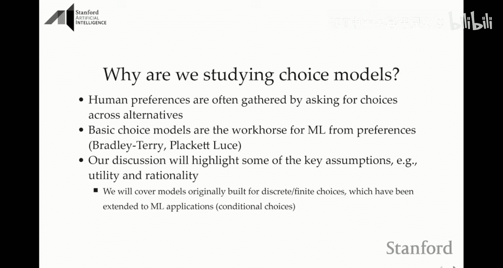

Most of the models we cover will be focused on discrete or finite choices because they're the kinds of problems that we end up working on the most。

 but I will give some sort of als to other kinds of choice models for those that might be interested。

And machine learning problems， again， often there's a ton of context。

 the context may also be you know in many of the classic settings。

 the context is futurized so there's a set of features for the items set of features for the user and we think of these choice models are sort of learning models using those featuress make predictions in many machine learning applications there's not an explicit futurization。

 so again not surprising to you perhaps but you might for instance use a sentence as the context or a whole completion of a phrase and sort of build models that can go straight from phrase completions to a prediction of choice as opposed to how you might have built choice models in the past。

 where you have an explicit futurization step before you make the prediction。any questions so far。

 again， very high level， if you haven't seen this， maybe context free。

 but hopefully to set this through。Okay， so discrete choice models。

They end up being useful for capturing， at least they're designed to capture decision processes for individuals or sometimes can be used for groups。

They make the assumption that there exists some utility， you can think about this as benefits。

 you can think about this as value， you can think about this as reward because in many of the applications。

 say reinforcement learning， what is called reward is equivalent to what economists might call economists might call utility and so the key assumption in many of the choice models is that the utility that an individual gets from say a pair of items。

 say model item A。Versus item B is a function of the frequency that they choose item A instead of item B its given the chance to choose between those items repeatedly so hopefully it's starting to clarify how you might think about a model for this again the data is some individual described in some way they get to see a pair of items。

 you get to measure their choices， whether they choose one item over the other over multiple runs and this becomes sort of the data on which you build a model that predicts in future what choices they might make。

In general， and in lot of this space， the true utility is assumed unobservable。

 so there's an assumption that there exists a utility。

 that there's some function that actually fully describes the choices that individuals are making。

 but you don't get to see it， and a claim or the hope is that you can measure this via preferences that are actually sort of stated or revealed over choices。

So how might you do this and math。Additional assumption。

 So at least for these kinds of choice models， a simple way of modeling this is， again。

 using this utility idea。 So utility， again， this latent variable that captures some underlying true preference。

 So for an individual。N or sample N， given item I or an item J。

The thing that you get to observe is what people choose right。

 So I get to see if I give a comparison I versus J， do they choose I or J。

 And so the label here is one。If they choose I over j0 if they don't so those are the two options in a pairwise preference setting you could also do this for lots of different choices beyond two。

 so you could also similarly model an observation of choosing one out of K options and the same exact modeling setup would work so you get to see these sort of discrete observation of what did a person pick across a set of different options and then the key modeling set up here。

 So observation yes， no across choices， what did they pick modeling。

 we assume that these choices are generated by an underlying utility function that exists a utility function such that describes fully the choice that people are making scastically that people are making and so。

嗯。A bit more formalism， you might have features so here I'm having features described generically as Z these are variables that describe the individual attributes。

 they might describe also alternative choices you can have a large futurization that describes both individual the option that they're picking and instead instead of all other options a bunch of ways of doing this we' talk through some examples。

And then you have from these features you have some function that match on the features to the utility right so in standard machine I chill Z。

 but if you want to map this to standard notation， you could use x just to make sure no one's confused right so X is the feature of the feturization of individual and choices some description of those choices why is the label that they pick a over B and then I have some function mapping that goes from the inputs to the choice and the function mapping is assumed to be described by this utility function。

Right。And generally we pick some function class that we think is sort of a reasonable descriptor of features to choices or utilities that people are driving people's decisions。

So a simple example might be， say a linear model， right， yes。So the Z vectors。

 since it capture as individual attributes or does it need a subscript I。be your。Yeah。

 so the question is does your Z vector need to capture attributes of item I or sort of how rich essentially does he have to be in most applications。

 particularly for classic choice models， Z can be fairly rich so it can often it's the individual so there's maybe a need for additional subject of you using this from multiple individuals that be I don't know。

And for the。Okay， you can imagine using N for the like sample I for item I item J and maybe K for individual or something like that。

 Often the Z variables in sort of classic settings will be some large futurization of generally the individual attributes。

 the item and also alternative choices because you might also often。One that oh。

 I'll give an example in a bit， but。Your choice may be driven not only by the item that you like。

 but what else you're comparing it to and so to capture that intuition。

 you might have the alternative， sort of other choices。

 alternatives as part of the feturization Z and what you want your model to capture so hopefully what be when you fit your model captures is how all these features interact to define the utility and the probability of picking item I over item J。

Also9 represents the individual。Here we're using an as the sample。

 but nothing breaks if you make an individual。Let's make it individual。 make the consistent。 That's。

 Yes， so why and I this one if N persons I don't everything else。

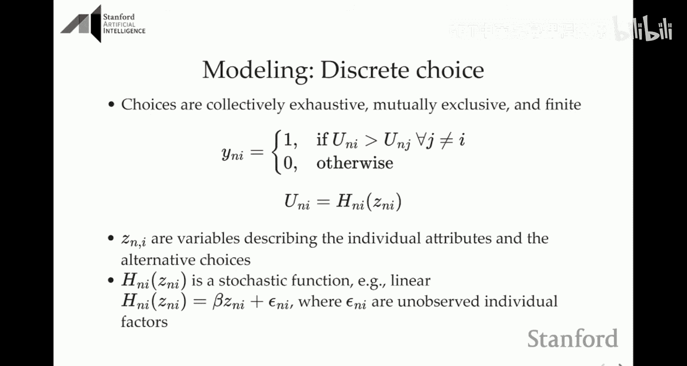

But then there can be cases pair Y N I is 0 for all。Theres no strict preference for one item。 Yeah。

 so the question is， what happens， It would actually be interesting to talk through。 So， you know。

 what happens if there is no choice and how to might building in a model if sort of an individual doesn't pick any item over the alternatives。

 I think that's what you're saying。

Yeah。This basic model assumes。啊。It seems that you have picked between the alternatives。

 if you wanted to break it。It'd be awkward to not have a choice across the key items for at least this class of models and don't have a good intuition。

 yes。We're going to say the same thing maybe one option is just to absstate and treat that as aU。

Sure， you can have a choice that's uptain and is that what you're saying sure？

That's an option I'm avoiding that extension for now， but actually maybe that's a sure yes， okay。

 so a good way to handle this is an abstain option and so you're modeling also the choice of abstain sure。

Other questions， I think came up。thanks for the signal there Okay。

 any questions on the overall setup？Maybe a quick， sort of。If I gave you data to look like this。

 I fixed the function。How might you actually fit a model。

 but what does fit in a bottle mean and then how might you fit a model on this data？

It intentionally naive question， but I just want to make sure we're on the same page。

It did awkward past thing。It's the obvious thing。Okay， so what what do we need to estimate， I guess。

 given a bunch of data。Samples。Data samples here being choices of Z or observations of Z and Y。

And that becomes your data sets？Yes， we morning。Output maybe a distribution of like the probability of what I think one for a particular choice of I。

 So we need to do this kind of way to fill like something like。G tries today。With your model。

In from Z to y。Yeah， so if you choose a simple linear model like this。

 then the thing you need to fit， the thing that you're learning。

 machine learning process will do is find a setting for beta。

Which will give you a model such that given a new individual。

 I now have a way to predict their choice right because if I now give you， if if I know beta。

Then given a new item for an individual， I will that new item for an individual fixes。

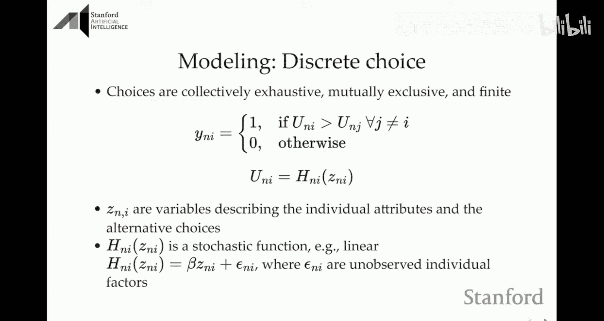

Z。Right so that fixes this part of the model from that I can immediately computes H at least expected value of H I may not may or may not have a noise model or know this one capture the noise but will capture sort of expected value of H H is exactly the utility function and I can predict。

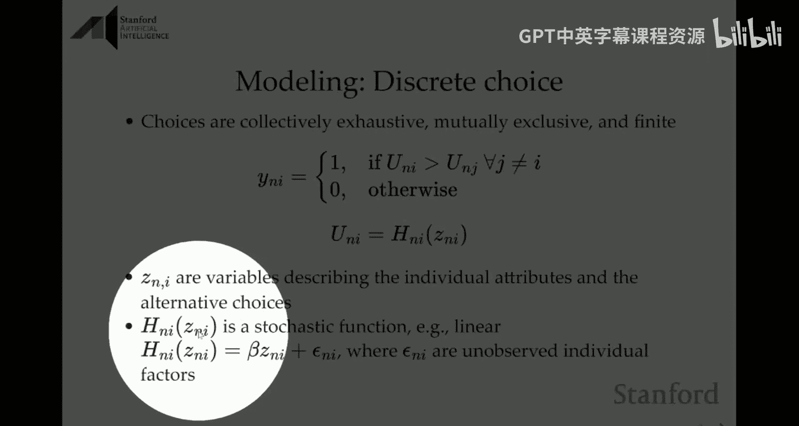

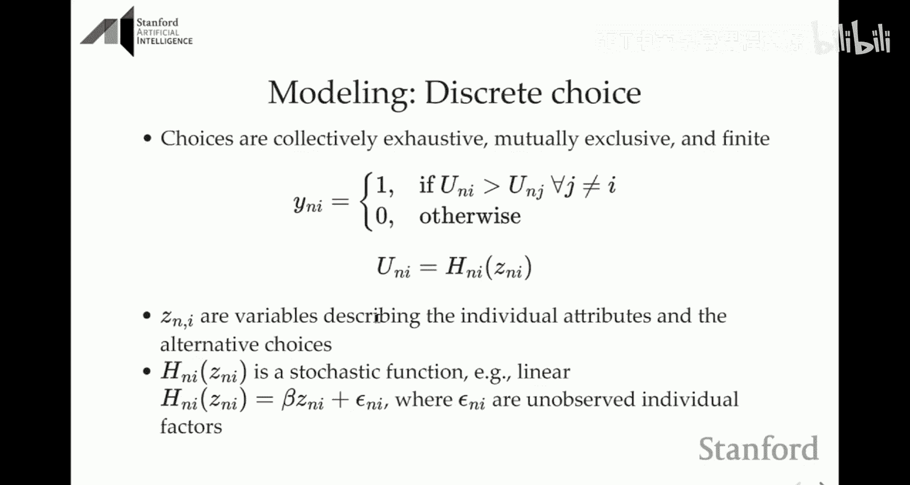

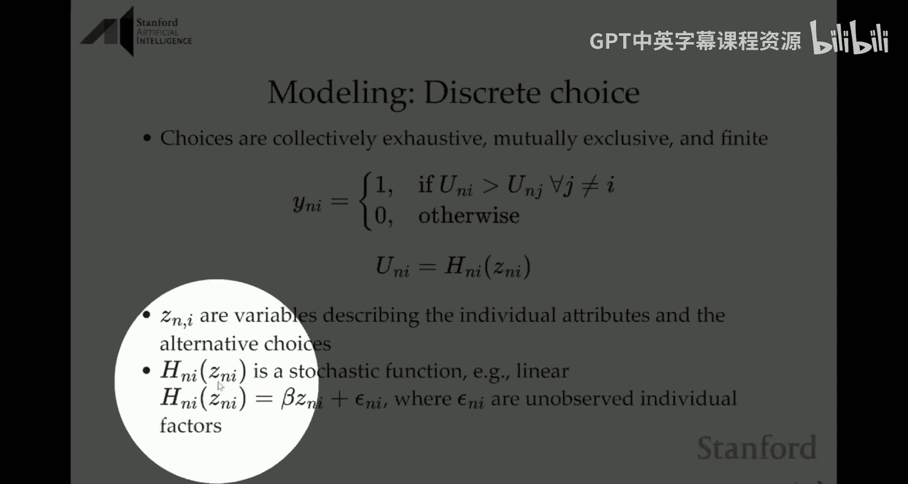

The choice that they would make up to noise by just plugging and whether the H function for item I is bigger than the H function for item J。

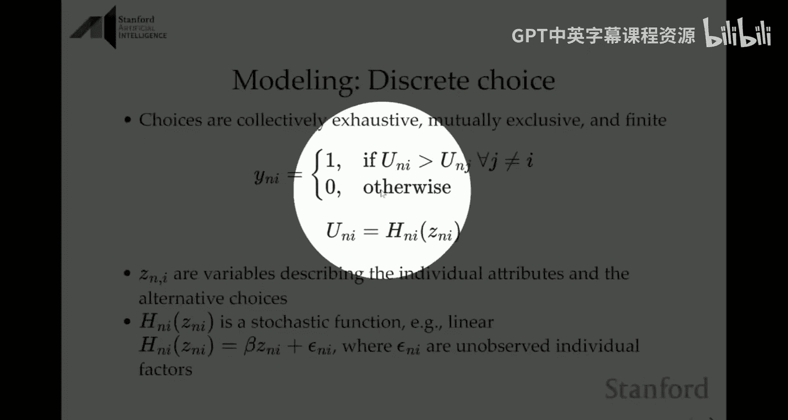

That's the prediction problem I want to solve， estimation problem is finding a setting for beta。

So this for a linear model， if I make this a neural network。Then， this whole thing。

Is a neural network model， I just need to fit that neural network model。Okay。

 so we'll going in some more detail on what this looks like。Okay。

 so some implications of the choice model worth going through。 So again。

 remember that the choice model assumes a utility turns out that you don't actually estimate the utility。

 or at least it's。The information you get turns out insufficient to actually fully estimate the utility。

 So while this is written as once I know Z and some function class H。

 I have a explicit utility function。 It turns out that I can't tell。In this model。

 if I shift the well maybe the obvious easy thing is if I add some arbitrary value。

 so I add some positive constants to all the H's， the choice model remains exactly the same right because both left and right hand side increase。

 the ordering information will increase。Nothing has changed in the actual prediction of choices Also lots of sort of monotonic transformations of various kinds end up keeping the order。

 And so all this is capturing and keeping in terms of the information you're actually getting is this ordering information across alternatives but doesn't actually tell you a precise value for what you is This is a known issue with these kinds of models。

 this will come up later and some of the difficulty in getting these things to work So in a bit more math。

The thing that we're trying to capture is the probability of making a certain choice。

 picking alternative I over all the other alternatives that you could pick。Again。

 the key quantity in sort of measuring our choice is the probably that utility for item I is greater than utility for all other items。

 So this is this term。UN I is bigger than UNJ for all the other items。

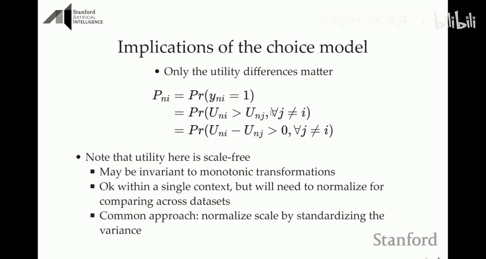

And as mentioned， I can apply some transformations in particular。

 I can rewrite this by just moving this the left hand side。

 I can think about this as the probability of the difference being greater than zero。

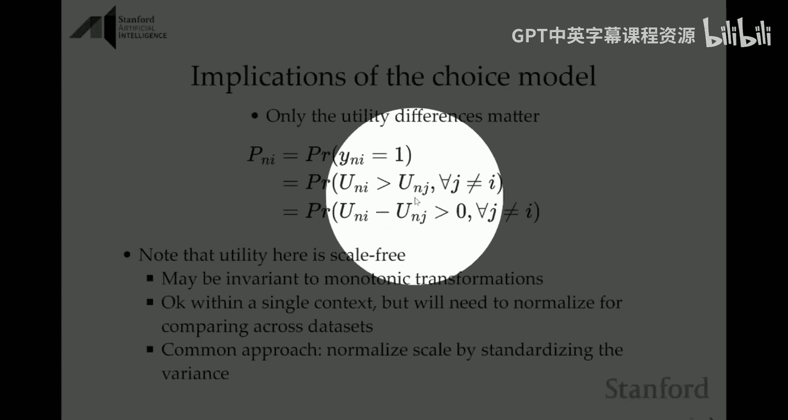

So skill free invariance monitoring transformations， good to convince yourself。

 the additive one is trivial， hopefully easy to see， I'm subtracting to two。

 so if I add a positive number， the both the positive number disappears。In this subtraction。

 but it's probably useful to also convince yourself by scale， for instance， by an arbitrary value。

 the scaling will go away。Or all scalings will have equivalentence choices， equivalent probabilities。

 So any global scaling or any global shifts， you can also show that similar things will be true for sort of monotonic transformation of various kinds。

So this causes issues。You know， if I fix the context where you expect sort of all the alternatives are comparable。

 then things are fine， but often we want to sort of take a utility model trained on sort of some model。

 some context， another utility model trained a different data set， different contexts。

 and somehow compare them。Because the H that we learn。

 the U output is only good up to monitoring transformations。

 it turns out that you sort of generally can't compare across context in a。する。

Meaningful way in the literature， this is， I don't see this that much in the machine learning literature。

 but if you look at economics and other areas， psychology that uses choice models。

 often there is a assumption of a normalization that allows for comparability critiqueable about whether this is sufficient or not。

 or if you need more information。To nail things down， but as instead of standard practice， you might。

 for instance， assume the scale and standardized variance。

As a way to get a utility function that is on the same scale and thus comparable across different contexts。

Okay， so one example of this is when I just have two options。

So hopefully we get to the point where again， this feels familiar because some of the setup seems a bit might seem a bit for unusual so I have two options my options are。

Do I pick the item or not so just ignore sort of the J index for alternatives and so have characteristics for individual and item potentially and the utility function is the same say linear model that I did before if I combine it with the mapping from utility to choice so just like before it's just a single utility number。

 is it greater than zero less than zero。

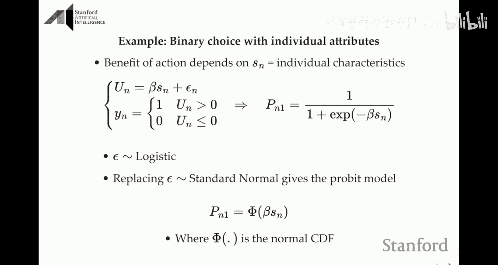

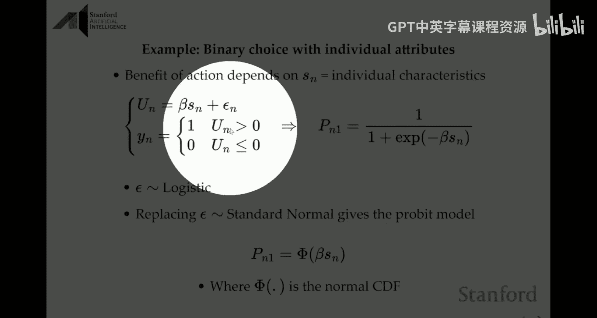

And it's going zero， I'm modeling the choice of picking the item or not picking the item easy to show and good exercise for yourself that if the noise。

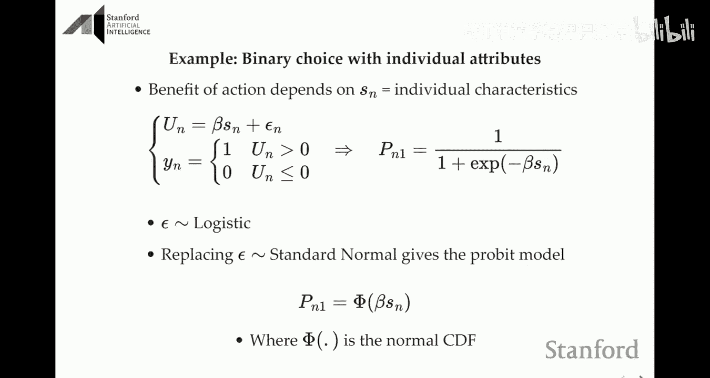

Model is logistic what I get out as the probability of picking。

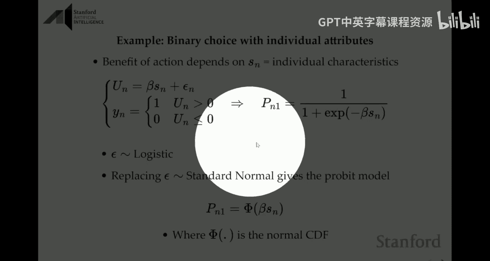

Making a choice of the item is going to be sort of a familiar。

 hopefully logistic function that you might see in logistic regression。And in fact， if I wanted to。

 if I get a data set of choices over alternatives， I want to fit this model。

 the actual algorithm I would use is literally logistic regression right that have a bunch of features。

Say we use SN for the features here， a bunch of features for every choice。

 bunch of observations of did I choose or not choose the item across the sort of data sets。

 so now I have labels that are binary， yes no， have inputs that are some vector set of vectors SN now I would literally fit logistic regression model and this would give me my parameters beta。

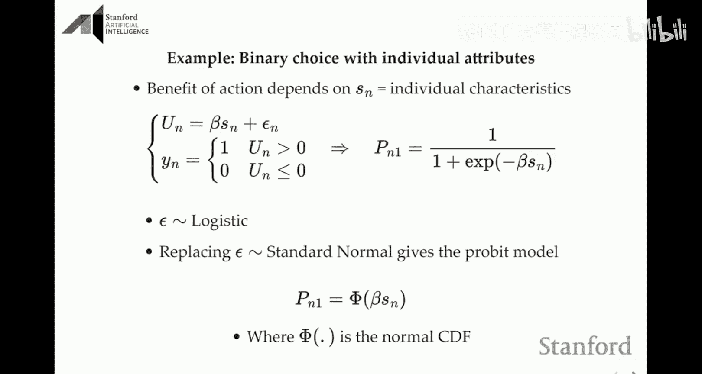

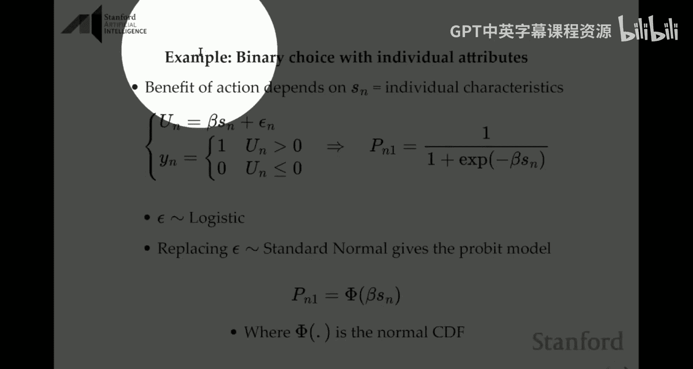

And this will allow me then for a new。For a new individual with the same set of items。

 I can now plug in the S for the individual， push it through the beta。

 and then make a prediction on whether they would choose the item or not。

So as mentioned in the last class， hopefully the logistic regression is familiar again sort of ML101。

 so you would just sort of run the same machinery that you would always run foring logistic regression。

 but now the data that you're fitting on are at least sort of choices over or binary choice。嗯。

You can do also lots of fun fancy things， so an obvious maybe interesting one that you might have seen is choose a different noise model。

So suppose you then pick the sort of standard normal instead of logistic then you get where you can show that then you get sort of a probate type of binary choice model as opposed to logistic model。

any questions on this？I just said a question earlier about like what happens if someone has no preference I understand how this would account for that because it seems like if someone had no preference。

When you learn your beta parameter， that still results in like some inferred preference。Yeah。

 so using the So one you can' do or。It wouldn't fit well in the binary setting so you'd probably need at least three options like choose don't choose no preference。

 I guess if you want to use the what we discussed as an alternative setup for this problem was I create a new choice quote unquote choice which is no choice and just add that into my and I'll have a triplet of possible options if you do it that way then。

So you can't use this model we do something slightly different we'll show in a second if it's into the general context。

 you just have to modify for three options your question was also I guess you're implicitly modeling a choice of no choice Yes。

 that's the set of tradeoff of using that kind of setup or this model how do we think about two samples or two individuals having a different choice that lead to different。

Learning for a different individual Yeah， so the question is。

 you know how do I handle multiple individuals and so potentially making different choices so a few different options one again。

 like everything else in machine learning you make a explicit modeling assumption and modeling assumptions matters and will have an impact on the quality of results and you will make all these assumptions in all the ways that we typically make assumptions。

 things like how many samples do I have So like am I likely to overfi so because it is how I make a more restrict assumption or less restrictive assumptions。

 things like that we'll talk about this briefly in a second So for something like multiple individuals one modeling option is to assume that they all have the same underlying utility function So they all make choices the same way So I just think about them as multiple observations of the same underlying utility model Another option is that they have different use。

And so there， at least in this model I don't get any benefit from modeling them jointly some as well just have a separate choice model for for every one of them。

 I could。Make some other like another model assumption might be they have different betas but the betas are tight together。

s a way additive to each other or across a set of individuals。

 the set of betas is low rank resistance is another sort of implicit choice you can make so sort of all of the degrees of freedom that you normally have I don't know it's a satisfying answer。

 but sort of explicit answer is。Yeah， the decision you make on modeling depends on what assumptions you think are reasonable to make。

 trade it off with our sort of practical sim mobility things that we typically。

 but the pragmatic choices typically make exactly fit machine learning model。

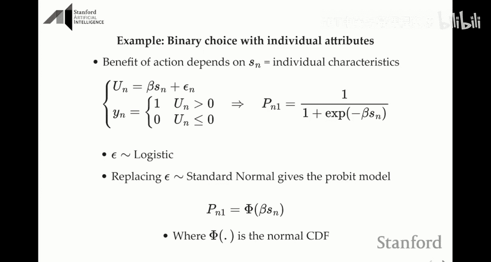

I'm a bit confused。 Could you connect this way。ま。Sure， so the last slide was talking about， actually。

 I think we'll literally do this， we did not okay。

So。Two slides ago。I think hopefully the series is clarifying。

 so here we're talking about discrete choice over an arbitrary set of the key assumptions here is there's some collectively exhaust。

 mutually exclusive and finite sets of options。And so across all these options。

 the key assumption I'm making is that the choice that an individual makes in a certain context。

 across items。

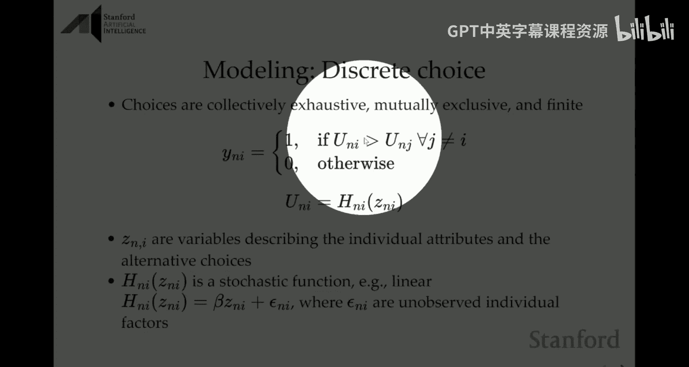

Is governed by some underlying utility function， which is some stochastic function as a deterministic component and then some noise component。

 And my goal in learning is to estimate the deterministic components so I can make sort of expected choices across now。

But this is。The most general， if you like this is the most general framing we're going to give of this problem。

 there are other ways to generalize further， but for this class is sort of as general as we're going to go and then the further restriction that we made just now is instead of having some K set of choices that you're picking within what if I just restrict you to yes or no picking an item。

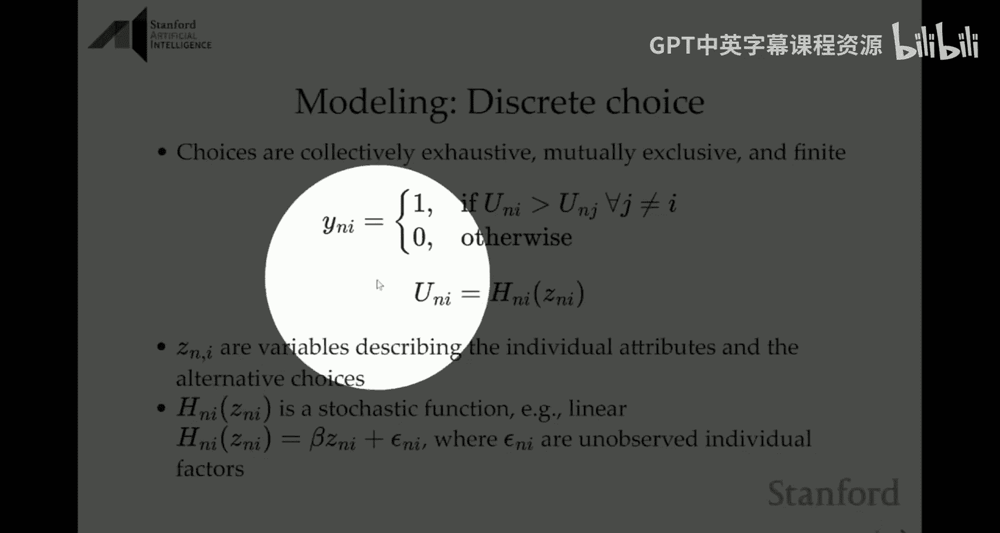

For now I have only two options。And so J is one or two or zero or1。

 depending on the indexing that you like。It turns out that。

You don't need to keep J explicit because okay， actually I may see also the gap that was。就。😊。

It turns out that you can model this difference explicitly， so I going have UN1， UN2。

for the two options， binary option choice， as we show here， the actual values don't matter。

 only the difference matters。

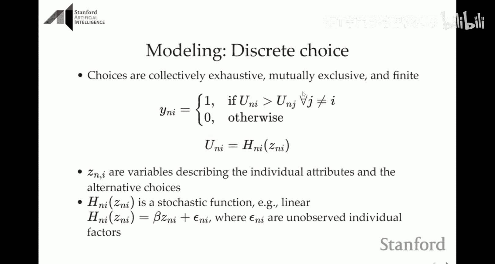

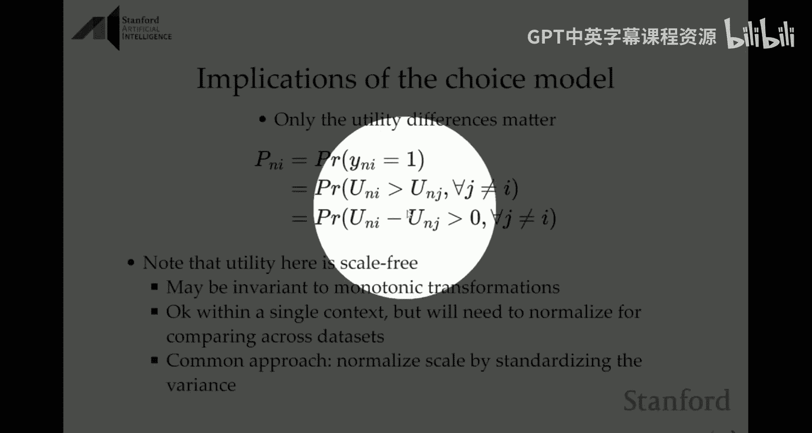

If I only have two options， it's equivalent just to have a single U and then like a constant or zero。

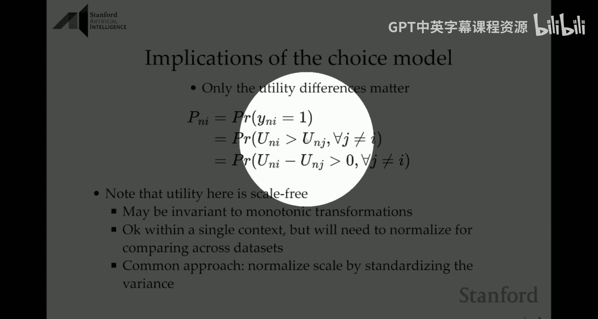

So once I have that， is that clear so far？So the statement made again is general model for utility assumptions across a set of finite choices I'm going to restrict myself to two options and I have two options。

 same exact model but I have UN1 UN2。And the claim being made here。

 but useful to check for yourself offline is that this model。With。Y and1 equals the one。0， if。

You and one。Its greater than you and2。And then otherwise。Is equivalentence in utility model world。

 There's no difference from the model Y N1 is equal to。1， if。Say， let's call this。You told them。

N is greater than zero and zero otherwise。Where you tell the。And you can see okay， this still see it。

Youil the M is equal to what we were calling U and1。Mナ1。

And the reason that we can do this is that we know that utility functions or this whole setup is scale invariance。

 monotonic variancevariance and all that matters in sort of the models are essentially like the differences across the utilities and so it's sort of equivalent to just collapse things out。

And so we can collapse them out and if you do， then you end up with this model。

 which is exactly the thing on the board， which is the binary version of the general case。Exactly。😊。

Thank you， good question。Any other questions？系。So again， hopefully it's even more clear， you know。

 literally I would run logistic aggress on a data set that looks like this and this would give me a choice of like setting a beta。

And I will use the beta to make predictions or choices in the future。Okay。

 so let's complicate things a little bit more。So。We can have a slightly more interesting model now again。

 I keep the two choices， and I'm going to allow the utility to say depend explicitly on oh just like before。

 features of item one versus item two。 So actually very similar to this model will end up in a similar place。

 and so。

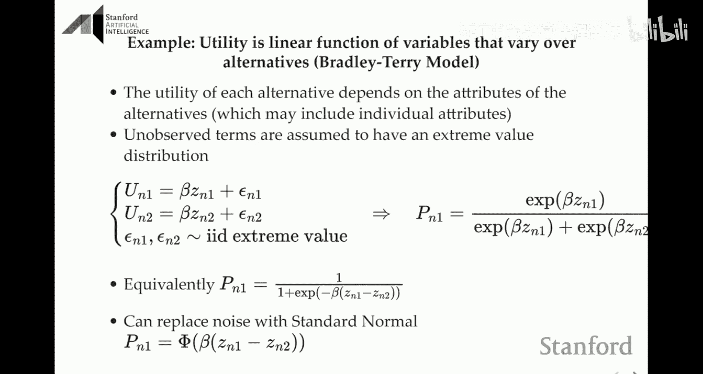

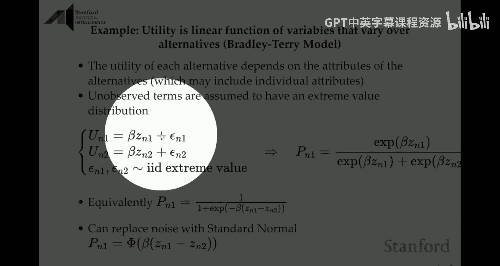

啊。You know I can make different choices for the noise terms one choice that's convenient is I extreme in value for the different noise terms for item1 and item02 if I do that and I do a bit of sort of massaging on the map the massaging here is I'm going from just to be clear on this I'm going from this statement which is utility is given by this and this is the option yes or no and I want to understand was the probability of y equals1 which is exactly equal to the probability of un0 un grade and zero so I'm just actually literally working that out and to do that I'm going to plug in this function into the UN and sort of see what the。

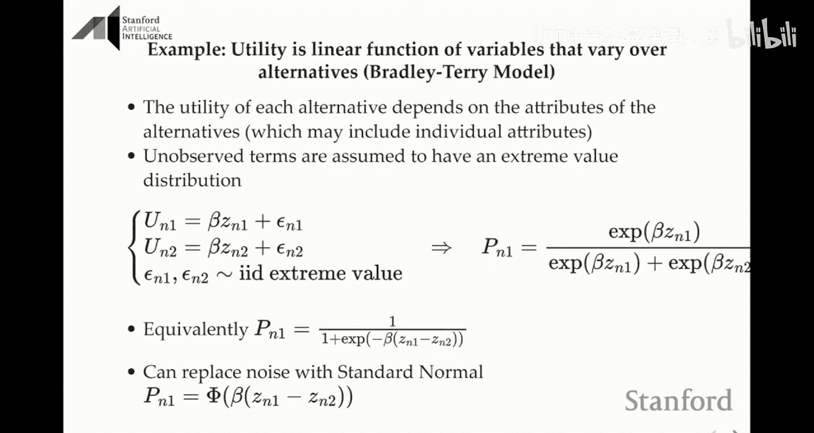

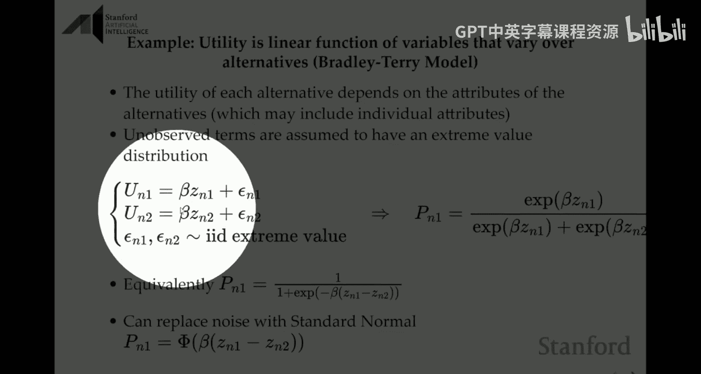

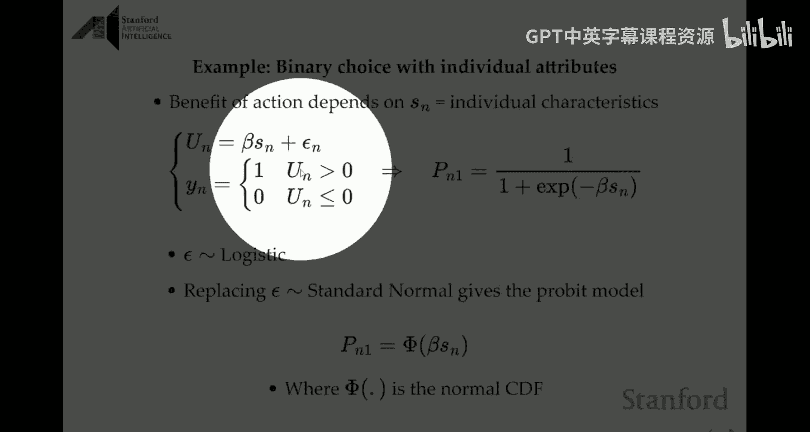

Algebra works out too。If I do that in this setting。

 I can write the solution a couple of different ways， one way is to keep the utility separate。

 so I have a probability of choosing item1 is sort of e to the beta for item1 plus normalizing constants may sum to1。

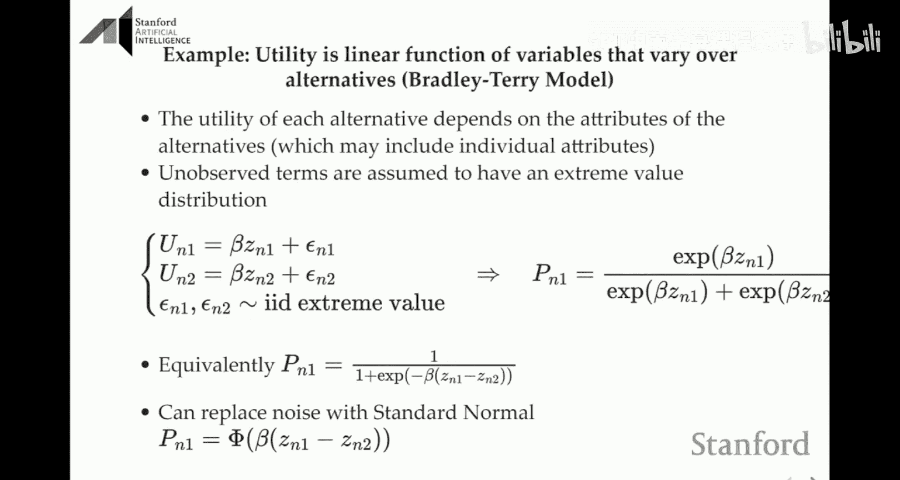

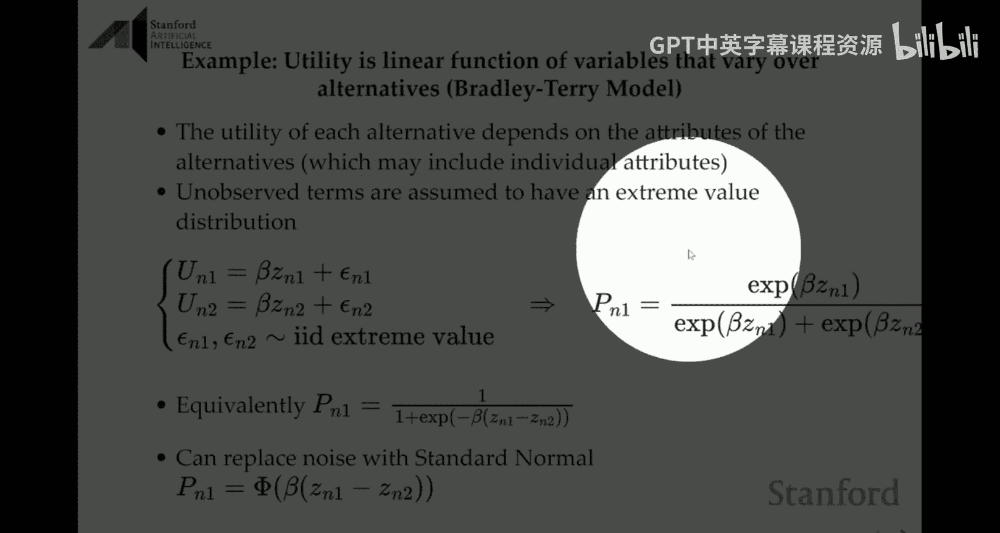

Just like I showed here， you can do the exact same trick， you can do this。

Different ways of doing this， but if I have a shared beta。

 so I assume the parameters are the same and this is exactly equivalent to normalizing out the numerator term so that you get one1 plus beta is the and1 minus the and2 So where matter you have seen this the most likely place you've seen this is if you've worked through the math of doing multiclass logistic regression and you sort of worked through what it looks like。

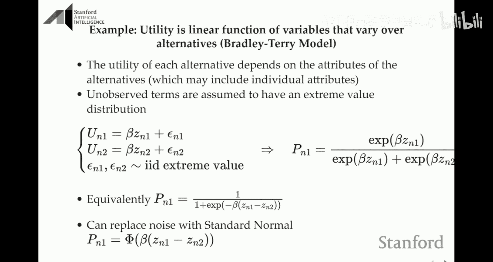

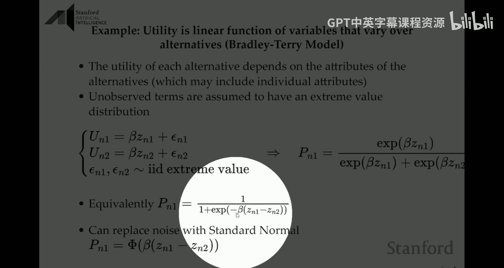

So you can either do a multiclass， but I allow sort of some default class and you can show that all the weights will look like differences or you can look at multiclass regression and ask what happens if I reduce it to just binary options across choosing between two options exact same math so if you have done that this move familiar if you haven't useful exercise and we may test stuff like this actually to make sure sort of easy it should be straightforward sort of if it's not we should work through its manipulations of algebra yes in real life is it like a valid real assumption that the noise is like I Yeah so excellent question so you know just。

A is the noise being independent， a realistic assumption。

 So what this means in this context is that any randomness in the choice of item 1 is independent of the randomness in the choice of item 2。

In real settings， maybe there's actually some correlation between the two。

The math gets a bit more complicated， but with modern tools is actually not that much more difficult to do it。

Yeah， we'll mention some approaches that you might， for instance， you know， you could do some。

 the obvious thing to do would be maybe a hierarchcho model with like parameters for the noise。

Epsilon 1， epsilon two， and then maybe something hierarchical that。

Ctures the correlation and try to estimate that。 I think that's a very reasonable model assumption and practice and what you see in most applications is this idea assumption。

But you know just like we make idea assumptions everywhere pragmatically and sort of things sort of work well enough。

 it's probably not reality， but also this sort of other things broken that are not reality here so I'm intentionally anchoring on I like the question because again。

 I want to make clear that you know as designers in the system you're making choices about models。

And like always， the closer your sort of modeling choices are to reality。

 the sort of more accurate models will be， but it's also generally tradeoffs with things like sample size and so pragmatic choices that actually allow you to fit things。

 so we getting in ground truth， probably not， but often this is a reasonable approximation。

そ。最近我啲手水哦嘅你 start出嚟冇噶。哦。我 start。So here it's like if someone has a choice between like an instantency five cars。

And we are trying to figure out for a particular car。 We are trying to figure out something right。

 because。It's like youre matching the highly。

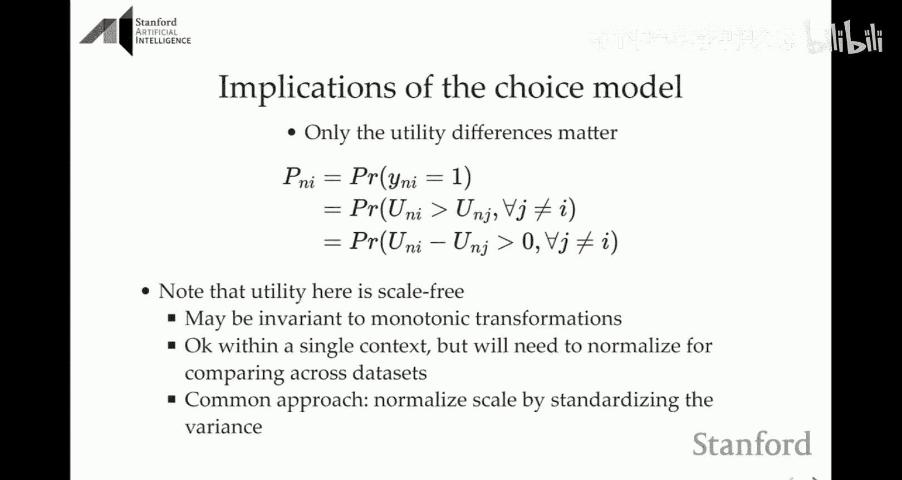

And then in the next slide you can use it for either the choose or not choose you can also do the same exact model for choose A or B。

 there are only two options。

So the math for those two settings are exactly the same the reason that they're exactly the same is this right so I can plug in choice car one car two nothing changes in the a2 that I learned if I just use a plugin estimate and the wh workout is exactly what's shown in this bottom slide specifically difference of the features。

Could you explain so I think I sort of going to understand where the probability comes from。

 but could you explain like how you'd use the logistic regression to solve the bill？Yeah。

So the question is how I might use logistic regression to solve for this？嗯 so。What you want to say。

So。I'll describe something and then just tell me here。太快生啦。

It will be simplistic but I just mean this in trying to like。Hopefully clarify what's going on so。

I have this model， I collect data， my data set will look like。Samples of。In this case， no。Why can be。

I have key choices where I can be which of the key choices I pick。

Let's assume we're in the binary setting， so I was just yes or no， did I pick option one。

 it just always picks option one where option one could be one of two options or pick or not pick。

I the same thing， so I have observations of YM。And I picked a feturization。For my data set。

 if I say I'm using this model， it is exactly equivalent to just sort of say X and z to Z and1 minus ZN2。

And a way we know this is that we work through that all the differences matter where you can work through publicities directly。

 And so now I have a data sets via Xon。就 one to这个。Where the inputs are some set of vectors。

 of features， for every example， the outputs are binary。So I am。Is M0 or one。嗯。

So I can go into more detail， but what I was trying to say is once I constructed it is that I can literally call。

Model that fits。This is my data， get a bit out。Well， that's what I meant to say。I iss Claire。

Or other questions about this？嗯那个你。we use extreme value noise to use normal Yeah so the question is why do we use extreme value and noise that are normal Ex value noise is what gets you logistic regression so I。

I actually don't know in what order the real world they have， someone here might know。

 but if I choose to model choices you'll using on language regressiongion。

 then the IID noise that I need in order to make the whole math work is ID extreme value noise。Yeah。

 that's the。What does those actually end up looking like in like a wreck engine or like some of these other？

voting it's a good question， so this is like what is the empirical noise distribution that we see and does it look？

Anything like the choices made here。P now I'm not aware of， well， ML， I've never seen the analysis。

Which is probably telling about how much we examine our models。

I don't know the answer to that question。 I think it's a good questions。Maybe easier to check。

 it's the case that we just don't hear what it looks like。

 We just assume that it might look like this。 And then it gives us this model。

 and we can work with it。We don't really the noise。 Yeah， so。Yes and no。

 So the comments is do we actually care what the actual description is So pragmatically the way and actually I'll go back to put on my M hat or even if you want to put your stats head。

 but there are ways to check goodness of fits there's a literal data I can do a train test splits I can sort of check how well did my model work by bi on a subset of data checking how well it work on a predictive set and standard M parlance and is to give you a sense of am I making reasonable choices because I have a high accuracy and predicting on future data so from that point of view。

 if the error is high， then I have a bunch of interventions I could pick I could decide that my feturization is incorrect so I try to add a bit more features I might decide why noise model is wrong and if I'm careful I'm actually examine the noise model and see if somehow the noise is in a wrong place and so I might try to change the noise models that I would better fit my data I might try。

I have more sophisticated function class so here's linear models might try a deep linear model whatever so all the standard things that you do so the thing I'm really trying to anchor because again。

 this may look exotic is that once you set up a problem and transform things appropriately。

 this looks literally like a standard machinery problem。So like， you know。

 the work is going from the choice model framing to setting up in a way that sort this looks like predictive estimation。

And all the standard tools that you would use from that setting would apply directly so you know that's the ML hat if I'm aware a stat hat。

 I might do various kinds of tests goodness of it， I might do what else youd like to。

 but all the standard tricks in different parts of the ecosystem for checking whether I fit a good model or not you just use them directly here。

So that was， I guess the question was initially is a nice model to write and then a comment about do we care or not。

 so you know we care to the extent that we get a good。Fits at the end。 And however。

 we choose to measure fits。 I work mostly in the machine learning world。

 I would typically use like a train test lits and the addta sample。

Performance as my measure of goodness of it。Does that make sense to everyone or any questions？Okay。

All right， so you can make other choices we've already talked about， or at least mentioned。

 you could say choose a standard noise， standard Gaussian noise model。No know， rest of it， again。

 we're just got playing with the same objects， just playing what。

Things in this case mostly function class distribution， noise distribution and range of items。

 so you know a slightly different setup I have a set of items I allow for up to jail alternatives and I use the extreme value distribution you know you could decide again。

 this is somehow programmatic the right choice or you could say what I say which is this gets you to logistic multiclass logistic regressiong so either way I think that's fine。

And in the same way， you could replace extreme value noise with probate noise。

 you get the Gaussian version of the samenc thing。I mention you this because these are common model modeling choices in lots of practical applications that people like to build。

Okay， there' a question about correlations？So one option if I'm interested in explicitly capturing correlations。

 one good choice might be， for instance， assume that the noise are sort of Gaussian with some covariance that describes how they're correlated with each other and now my job is to both fits the parameters of the linear model and then the sort of correlations of the noise and use this。

 so the joints correlations or the structure of the correlations will change my fitting procedure a little bit standard tools so essentially if I go to。

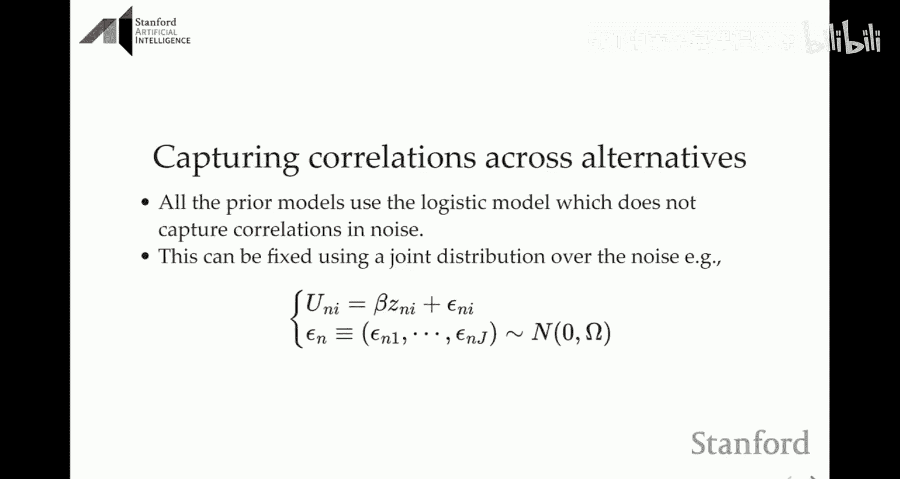

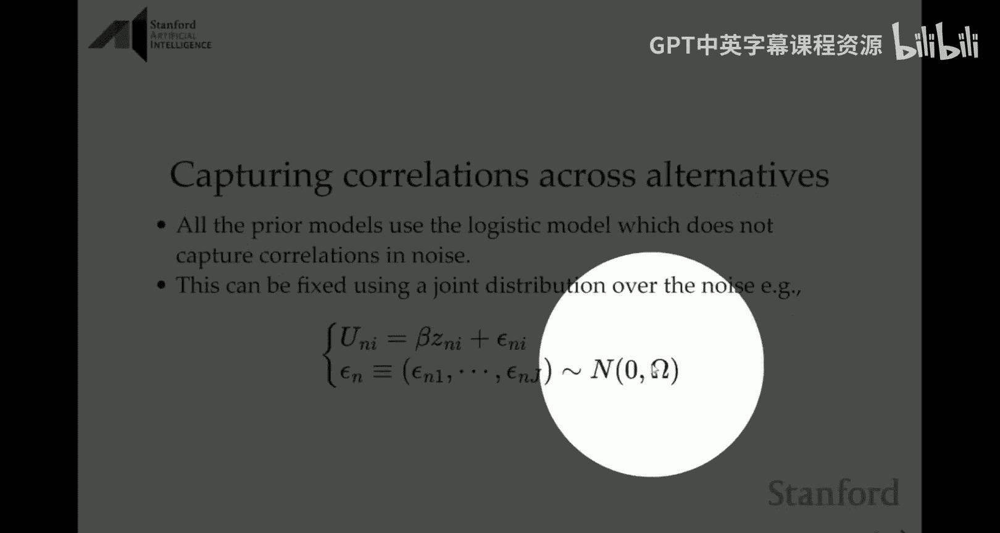

I guess our model fitting packages or can have this。The fact they're escaping me right now。

 I don't thinks learn has correlated noise， but you could use。

Probably stats models and Python would do it or U R and sort of throw in any of the standard packages。

Question all you could do it yourself。also。So less and less necessary。啊，对。Okay。

 so I've mentioned this a few times， but I just want to sort ground this a bit more so now we've set up the problem。

 set up the choice model problem， said that there's a key assumption of an underlying true utility that fully describes the choices that people are making and we've shown how we can convert that problem into a sort of effectively a multiclass。

Problem binary in the case where we're doing making this and binary for binary choices。

 you've also explained a bit on degrees of freedoms。 in particular， this is obvious one differences。

 but also monotonic transformations and the sort of the fact that you don't actually get a U but you get something monotonically equivalent to you because you can't actually fully estimate the monotonic transformation。

 at least using the standard approach。 So you might。Try to use other tools to do this。

We talked about logistic models， if I picked sort extreme value kinds of noise。

 if I use Gaussian models I get appropriatebate regression。

 all the examples we gave use linear models， but once I know how to set this up as a learning problem in this way I can pick any model class I like that can throw in a deep learning model。

 decision tree I don't know what's your favorite SVM， we don't even I don't think we teach SVM。

I'm not classes anymore， but you're cool。What's your favorite model I don。Whatever model you like。

 throw that in and fit it using sort of standard fitting semantics。So you know。

 you might use the cast gradient descent as sort of the hammer we like to use for fitting many machine learning models。

 whatever optimization problem optimization machinery that you might use in general。

 you would throw this in a existing toolbox so I could learn tighttorage。

 whatever and sort of fits model again and again， hopefully this is clear all of the standard decision choices that matter in trying to train good machine learning models matter in the same way for fitting choice models So things like bias variance trade offs overfitting。

So， you know， generally you can pick more more complex models。

 generally if you functioned your choice model here。

 the function class that you pick from that D X to y。

 more complex it is generally the more data you need。

 you don't have enough data generally you overfits。

 meaning actually just to double check can someone give me a quick description of overfitting。Sure。

Made is hopefully familiar from a class or two ago。Yes。

 if you train your model on like just training data for long early training and test data。

 or no sorry， training it for long enough， it's possible that it's not going to perform very well on like real world test data。

It's correct， so yeah you have good training performance。

 bad test performance because sort of models have picked up all the nuances of trust data but doesn't generalize data informally but again。

 hopefully you've seen this before even if you've forgotten it over the summer or some of you might be using this actually in practice so all the standard stuff in terms of picking what function classes dealing with noise modeling choices。

 all that stuff advice here we talked a bit about this cross individual thing I think you might have asked the question So know very often you just do a pooling in fact。

 almost all the ML applications of these that I know most of the models don't disambiguate across individuals most of the choice models psychology and economics do because they think that is an important signal I think it's something that slowly are the ML applications of the field of these toolboxes are slowly understanding might matter more and more but if individual differences matter then you might。

Want to pick a model that has features not only about items。

 but also individual rating to particular item。I'm making the choice across。Thequaium。Okay。

 you can make this more sophisticated。 So so far， we've talked about binary choices， but you might。

 for instance， want some of liker scale style。Preferences。

 so now I'm choosing how much I prefer an item compared to alternatives。 So for instance， query。

 am I enjoying this class so far， and you might try to rank this one through 5。

And so a standard model of some like this is in addition to your utility， you have these thresholds。

Or not just a binary choice， but now up to like K order choices simultaneously。

 so in addition to fitting the parameters of the H function， you also need to find，Oh。

 it depends in most implementations， you would fit both the ABCD and the H。

It often actually works reasonably to preselect ABCD。

 so preselect the threshold and just fit the function that does the best job but it prese the thresholds again。

 this is set up as a standard or can be set up as a standard maximum likelihood estimation problem use gradient in a sense fit all the parameters。

Okay， okay， so we need to play with slides a little bit but。I can use this or implementing this。

 for instance， give you something like the ordered logic model， so linear model under the hood。

Thresholds for K options， I can work out from the utility and the threshold。

 the probability of all the K options， probably choosing one， two， three， blah， blah。

 and given observations that would fit this model。We'll try to fix the slides。From here。嗯。

Slights alternative version of this， generally called the Pet loose model and ascribed a model that came up in the 70s。

 used a to in biomedical literature for say ranking， stuff used for genetics applications。

Sometimes used in econometrics， they like to call this the explodeed logic model。

 I actually don't exactly know why I just know that this is the name is there anyone here who knows。

If not might be fun to find out， I should find out maybe and have this in the next version but very similar setup but now I'm modeling the ranking over sort of J items so again positive probability model the way the loose model works is that I have this sort of cumulative sum so this is the probability of the first choice given the first choice probably of the second choice so it goes from two to the end given the second choice probably the third choice all the way to the last choice that you're making sos probably of sort of the ranks set of J options。

and again， all the other standard extensions， so you can do these are linear models。

 I can throw some generic function class in there， I can expand on noise instead of using sort of extreme value style noise and I use pro noise。

 correlated noise， all that。Okay， so summarizing again what we've said a couple of times now。

 So again， the key setup in the problem is that you're measuring individual responses。

 this is of choice queries。The observing people making decisions about preferences。

The key assumption being made is that this decision making is governed by utility function and then you make a choice about a model for that utility function。

 and once you have that general you'd have features that describe the items and perhaps the individual and then you can set up the problem as a sort of machine learning problem and then you fit the parameters。

 that model， this gives you a prediction or a model that you can use for prediction for future observations。

And you know， use standard maximum likelihood， you might add regularization， all the standard things。

てれま。Any questions on？Modeling and any other setup。Yes。Mistrate that forces counts， not orderly。

So this is useful in settings where the observations are ranked。Orders。

 so what I ask a person to do is rank item1 through K one through J。I get to observe ranks orderings。

I want a model for。So every time an individual comes in， they get J items and they get to order them。

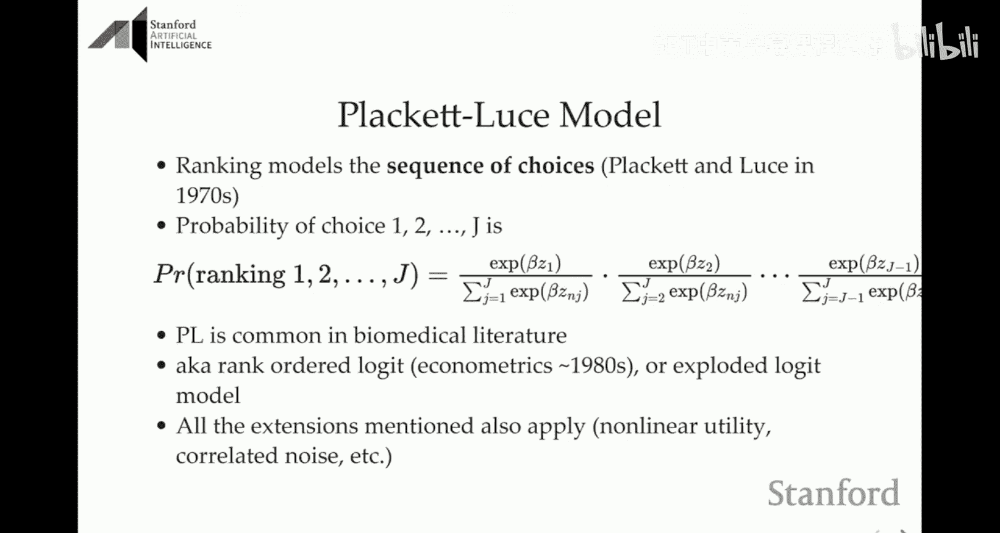

So the observations are these ordered lists。

And I want a probability model for the ordered list and a simple probability model for the ordered list。

 what the bucket loose model does is the distribution of the choice of this ordered list is the probability of picking the first thing on the list。

Condition of picking the first thing was probably picking the second thing on the list。

I up picking a second， third， fourth， all the way through J。

 And so this exactly looks like the probability of picking the first thing on the list。

which is a normalized sum of the score for the first thing。

 normalized the probability condition on that first choice， I look at all the other choices。

 so2 through J。And so this is a sum that starts at two instead of one。

 and I keep doing this all the way through the end， is that clear okay？Good question。 Thank you。Yes。

If we're trying to learn preference over like。Safe three options。 and what has circular preferences。

我。Yeah， so that's a great question so the question is this modeling assumption。

 we didn't state this explicitly， we will， I think I hope actually I'm not sure。

 but the key assumption here。

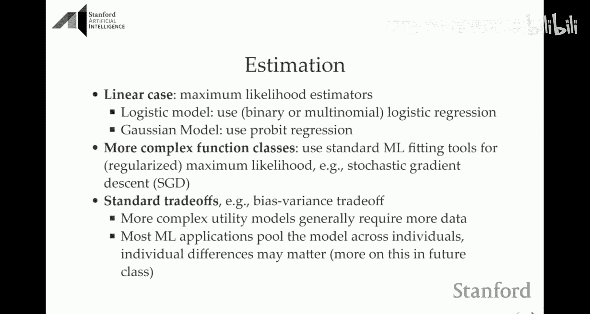

Go too far， the key assumption here is that the choices are such that they're effectively like linear or orderable so this is one of the key actions in using utility type。

One way that people like to say it， particularly economics is that we're assuming that people are making rational choices ir rationalal and rational here exactly means that you don't end up with this transitivity mass meaning like A over B be over C let then C over a this setup will not allow that to happen outside of noise。

 but at least in terms of expected behavior orderings。

 you assume in expectation that sort of all the options the preferences are transitive so you don't have this。

Weird ordering issue that you brought up in order to model that。

 you would need to change that align model。And that's one of the key。

 So actually really like that you asked this question because again， it's a key observation。

 key assumption using these kinds of models that can be broken。

 So what might you do if this is broken？ So one option is sometimes this lack of transit can be explained by just not having rich enough features so you might add more features like that it breaks things。

You might， I guess there are other classes of models which we're not covering。

 but I should give references to that I allow for some in transit。Preferences。

 which are similar enough in a similar class。Generally， though， in most of these setups。

 assume that the sort of quote unquote， true preferences are quote unquote， rational。We had。

 I don't we're not doing this this year， but last year we had sort of psychologists and marketing folks in the room had this fun conversation about actually tied to this idea of noise。

 which is one of the ways that you might explain lack of transit。 And there was this question of。Now。

 when we see。Observations of preferences that break these assumptions。

 does this mean that humans are irrational or does this mean， so is it a problem？

This is a bad way to say it and this is not what I mean。

 but lack a way of saying it are humans the problem because they're not matching our models or is it' sort of our models or the context is not set up right and I think a compelling answer to me is。

I should look up the paper， and I think we might add it to our reading list。

 but a compelling answer to me is that when you see。Okay。

 so one extreme is the rationality assumption is completely broken and we shouldn't be using it we have at least one talk I think in a week or so I'll talk about whether or not strong rationality assumptions are good assumption for human choice。

 particularly in sort of complex settings like language models So we'll engage with that question a little bit another setup is that sort of we're not modeling the problem of the right weight。

 This is a version of add more features or a more context and sort of。

If we had sufficient appropriate contexts， we can almost always think of humans as rational。

To my understanding， this is still a debate in say economics and other places that think about this problem much more carefully。

I I don't know a good answer so it's for here I think we think about as a pragmatic modeling choice。

 we'll cover some instances where this is for sure broken and some tools were thinking about what to do when it's broken a little bit。

 but it quickly becomes philosophical， I think interestingly philosophical but。

Often you'll observe data that sort of these kind of rationality assumptions don't have。Thank you。

 Good question。Okay， so。啊。Another important point that we haven't talked that much about is what does it mean to actually observe a preference so there are at least two sort of broad families of preference observations。

One is called revealed preference， meaning I observe people making real choices in sort of real situations。

So for instance， I observe people actually come to my car site and picking the car that they want to choose often this is offline。

 but this captures sort of real behavior of people in real context。

So that's sort of one version of it another version is you put people in a room。

 you say imagine you were going to pick buy a car， here are some options for cars。

 which car do you think you would pick。So these are often called stated preferences the key difference here is that this is generally for the human this is hypothetical so they're not making a say economic choice。

 you're not actually putting money to buy an item they're instead trying to think through their mental model of how would I make a choice I faced with this choice in a real setting so the big plus of the stated preference is that you can control a bunch of the context so you can do well- controlledrolled experiments you can balance and sort of control for compoundfounds and things like that but the big issue that's often brought up with data preference is that it may be unrealistic people might state that it might choose something this often comes up and say election choices that it will state they will pick a certain option but it will actually make a different choice when they really need to make their choice in the real world so this is a meaningful issue I think it' one of those things is not engaged sufficiently in our field for instance。

 so for instance in language models。I guess there's a bit of a weird gap because we don't have good grounding to learn。

Say downstream impact decisions to make a big distinction between revealed and stated。

 But I'd argue and often in say language more experiments。

 we're thinking about this through a lens of data preferences。 Someone's in a room。

 I give them a bunch of language completion。 asked them， which would you prefer。

 There's no cost making decision。 in either way， It's sort of。

Your mental model of what you think might be reasonable。 So again， this is a sort of meaningful gap。

 It's again， it's something that's considered semi controversial depending on the setting that you're in。

Again， the big issue with data preference is that you wonder if people are actually going to sort of tell you the real thing that they will do if they're sort of simulating their decision process。

 however in real preference you have issues of compoundfounds， you have issues of coverage。

 so the set of choices that people make may not cover all available choices efficiently such that you can estimate good parameters for how people you' thinking about sort all the different choices options that they might。

Is this clear， does actually mean quite an important idea so I want to make sure that。It's clariish。

Okay， cool。 Any questions on discussion so far。Oh， I'm just curious。Actually， so， I mean。

 obviously this is an important distinction， but like you seem to also emphasize like the modeling choice preference。

You know， logisticgistic， whatever。Model you want to use。

And do you actually do all three interact in your mind？嗯哼。meanI mean。

 the ser mentor chooses and they want stated。All these things as well， yeah。So yes and no。

 so the question is， does say the experiments or choice of state of Vi revealed interact with the underlying model class that you might use。

 for instance？So。Practically the choices seem orthogonal。

 sorry conceptually those choices seem orthogonal。 practically they interact in the following way。

 So again， with revealed preference， you have a bit less control over the sample space。

 What this means is that you can end up in estimation gaps where sort of some choices are way undersampled in some parts of say X space。

 on a sample so tell your model is bad。 And so a pragmatic choice in that setting is to pick a model that say more restricted so that it does a better job。

Given restricted。Choices in terms of options if you're doing controlled experiment stuff as well。

 so you think about this as like control to sample testing kind of things15 options。

 then the observation model might also impact how you think about what a good preference model might be。

嗯。So they do interact， but I think it's a little bit weirdly nuanced， so important。

 I don't if actually。It's a good question， actually，'s not one I've thought about as directly。

 but it's an important design choice here。😊，You have thoughts on this？Yeah， no， I mean。

 it's actually the first time it。Was putting that together。

You actually have to choose maybe different goals that are most appropriate for time。Maybe。Yeah。

 I don't they actually interact because say I said on YouTube I don't want to see this but then I kept clicking on it anyway and model like who was right like is it your choice of like your reveal preference or is it your stated preference？

When you say interact， so I think the earlier question was about the learning model that you choose for the observed data versus the observation process and sort of whether it's if you're like I don't know。

 well what kind of observation process you to options could you I guess so I'm saying that are they really separate models or actually they actually should be in the same model oh okay。

 yeah， so I said this badly so you know what I meant to say and thank you for bringing software it wasn't clear。

 I guess conceptually they seem like independent decisions。

Practically they interact because like I said， if I'm in a re preference setting。

 this often will lead in many interesting real preference settings。

 this leads to like a specific distribution ske in the data I get to see。

So generally in state of preference， I enzyme design experiment so that everyone has to pick over every possible options and sort of things essentially the observations of y and x have a good coverage over all the possible options such that maybe it's easier to fit a more complicated model or something like that whereas if I'm in a real preference setting I don't have control over the sampling process I'm just seeing what the world is giving me and so you know generally where you don't have control over the sampling process is pragmatic to use simpler models So reasonable decision to make and in many settings it will tend to work better because I mean or you could do that or you could do more sophisticated things to control for distribution shift for instance。

 the fact that you get the skewed distribution of what you'd like to see which is some coverage of all different preferences So my answer is。

They interact with each other and the interaction matters， but I think of it as a bit subtle。

 or maybe it's not subtle， I think of it as subtle。Yes。Yeah。

 I was just thinking that's the YouTube example， like which one would I think would be more reliable if I had a。

Labeled the data set with a bunch of people and seeing which videos they preferred given， you know。

 some some。Information about them， you know， the example that I was thinking about is like my three year old Don gets by phone it starts going crazy and's it just like and clicking and。

And that happens and sometimes it is almost an no you know， so if you use the implied。

 did I complete the video， which is like， you know， a very good signal。

It just requires some cleaning and then it can actually mis you。If you just use it abroad。Yes， again。

 I think of it this as like， you know， the real world is messy and noisy。

 And you have to make quite choices。 I mean， the the counter argument is。

 if I'm requiring stated preference， I guess it's very well known that。

Now people telling you what they think they would choose and what they actually choose or not the same that's the actual gap right so the tradeoff that you're making is in a situation where either you don't care you just really want to be able to control the experimental setup or do you really care about sort really seeing what people's choices are I like the election one。

 actually know if who would you vote for asking in this room。

 I think people may pick options that think in this were in the West Coast in California what everyone might agree。

 you might have a different actual preference that you may not want to state because you don't feel comfortable stating in a room like this so here's for sure a gap as' a stated preference which is this I'm going imagine and in addition to imagining a choice you'd make you're also maybe taking into account who's asking you the question the context。

 your opinion how you think they might think about you making that choice。

 all that stuff gets folded in in real preference you're looking at the actual choice people make often。

And there is some consequence on the line。 There's an economic or buying decision that done some reward outcome that's tied to it。

 So it's a meaningful gap。 I may or may not have done a good job like really clarifying that these can actually be like night and day different from each other。

So of your reasoning and trying to imagine a preference versus actually making a decision into a world and so the data。

 you know， in the same exact situation are collected in two different settings in general will not degree actually is there animal that uses both。

uses a dummy dummy variable yeah， that bias kind of so some of this is modelable。

 I haven't seen that much work trying to engage with this。Though I'll be surprised if there isn't。

 given， how big this area is。If also you don't mind， I want to make sure we're close to time。

 So I love the discussion， but may push the rest of this offline so we can finish discussion today。

 So we'll skip the exercises because we had a good conversation and didn't get to this。

 I think I'll push the ideal point model to next week。😊，就。Actually， we can end here。

 so let's actually just go with maybe the last question I was just going to said I think I could clear。

We want to tell。皮部？Like for example， if people's own money is on the line。Wk and they want use like。

 I don't know your car theverseky preference models。

And then if you have stated preferences and simulation。

 then maybe they're like an expected utility maximizes instead because it's not below20 on the line。

 and so that's like really seems like a clear case where there are two different preference models to it。

Make sense to video。Yeah， I think those are part of it， I think there's additional nuance that makes。

 I guess not as clear a separation of pointed of situations。Yeah。

 maybe we'll just end that there for now， but it's a good point if you don't mind。

 I think we're at time so we'll just take the rest of the questions offline。

 but good discussion today， thanks everyone。

