# 斯坦福大学《基于人类偏好的机器学习｜CS329H Machine Learning from Human Preferences  Autumn 2024》中英 - P3：Model-basedPreferenceOptimization.zh_en - GPT中英字幕课程资源 - BV1n2Hfz6EGR

Okay， let's get started。

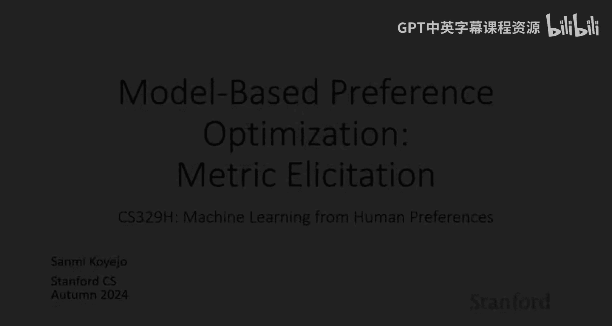

So， today。Our main topic will be on metrication。And the goal is to tie to both some of what we've talked about already。

 but also a bit future facing depending a little bit on time， I suspect we'll get through。

enough that I will get some of this。 I plan to touch on。

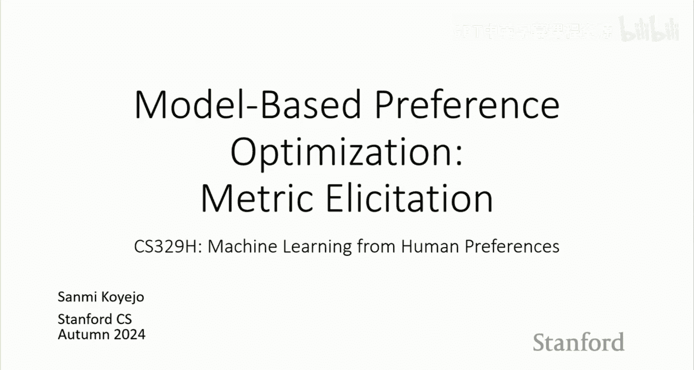

One of the topics that ties metricization into mechanism design， which is something that is sort of。

Coming up。Meaning quite a bit later in the class okay。

 so so far weve talked about last lecture was active learning so we were trying to understand mostly the idea was we can frame many preference solicitation or preference selection tasks as machine learning problems。

 actually classification ranking problems。

The first lecture essentially try to make that claim up to again a lot of the caveat that we've pointed out over the subsequent classes right so we posited a point of view。

 you know this is a utility maximization type perspective tied with sort of Bman style utility functions。

 so these are like functions that are the key normative claim just to give a summary because I'm attempting to read faces on where people are so summary from beginner of class。

Interested in preference modeling posited that one of the primary ways of thinking about this problem is to frame everything as sort of a utility estimation and then sort of preference selection kind of methodology。

 so the key idea here is that you think of choices as being governed by some underlying utility and we build models that can help us estimate these and we showed in the first class second class actually that all these things boil down to essentially a kind of machine learning problem where we're essentially turning preference choices which can be sort of binary or ranked choices or other kinds of comparison choices into classification problem and so this look like machine learning。

And so again， you know somewhat of a narrow view but it is a predominant view and a lot of work has been built around it and over the next couple of lectures one of the things we did was trying to expand that perspective to include sort of multitakeholder perspectives and a bunch of other things that may be missing from the narrow utility framing of the problem that's where we were in the last lecture we tried to connect this to active learning this is the idea that。

In machine learning broadly， we found a lot of benefits in framing various kinds of learning problems as active learning problems。

 the idea here is that instead of having nature give you the samples that you're going to label。

 you have a procedure that sort of explicitly seeks which examples need labeling and the claim is that if you do this intelligently and sort of your world is sufficiently structured the right way。

 I can learn much faster using this than using sort of standard existing just like found data style labeling so random data labeling can be less efficient in terms of in this case we called it sort of sample complexity effectively or query complexity does come up again here how many samples do I need to be labeled in order do a good job of the learning problem。

And in the last class what we tried to do was sort of discuss active learning as an interesting idea and then connect it to preference learning。

 saying that a lot of what we know about active learning can be applied preference learning and we show some examples for instance。

 in the sort of car navigation example to show that these two tools combined can actually be quite valuable in lots of your world settings so that's where we are。

So today we're going to extend any questions on general framing necessarily necessarily utility maximization function Yeah so active learning is a generic procedure for way can be applied to preference learning and so part of the what we're hoping to pitch maybe is that one of the gaps that seems to exist in the preference learning literature is active learning as a way to help it be more efficient。

I'll give a stronger argument today， or at least a argument today。 Well I can actually just mention。

 So one of the reasons that active learning is appealing in a preference learning setting is that remember。

 the key task in learning from preferences is asking humans questions。And the。

We've done a little bit of work。Talking about literature。

 maybe actually this question suggests me we should actually anchor in this a bit more。

 but there is literature and maybe just anecdotally it's not maybe hard to argue that people get bored very quickly and so being very efficient in trying to get examples from people can be a good thing because this means that you don't need to ask as many questions to learn your utility function so the way these things connect is if you're interested in sort of getting samples from people as a way to learn their preference function and as a maybe normative or at least observational claim sample collection from people is fraught because people get tired and maybe expensive and so you want to make this very efficient and combining this with tools that we know like active learning to help you speed up learning is a sort of good combination as overall。

So we're going to play with the same kind of idea today as last time。The difference here。

 So the main difference here is that instead of thinking about the utility estimation problem in a generic sense。

 I'm going to narrow down to a sub area where。There's been a meaningful amount of work。

That I think is meaning well， interesting。 So interesting us is maybe the first order motive for presenting this。

 I think it has some lessons that are potentially useful for broadly more broadly framing some of the questions on sort of preference eation。

Specifically， instead of thinking about sort of this active learning illustrationation。

 preference learning problem in generic sense， I'm going to narrow down to the specific setting。

Of picking metrics for classification problems。 So cost sensitive metrics to classification problems。

 which is a sort of narrow version of this broader set of things that' interested。 In this case。

 the utility you looking to elicit are the relative trade offs。

 So say different cost that people might have for different kinds of cost sensitive classification problems。

 And so the most of the class today would be on this narrow。

a deep dive on this version of the problem and the connection to previous lectures is it's again a sort of preference solicitation problem。

 but again a special case and we'll be using the active learning sort of point of view so we'll be very sensitive to number of times you ask a question and that will be a one of the main criteria of success and one nice thing is that we'll be working in settings where you can quantify this which is not always true so you know many of the big problems that we're most interested in and sort of modern machine learning。

Explicitly。Quantifying how many queries you need to actually get a good answer so sort of this active learning problem plus quantifying the query complexity is a hard problem I don't know how to do this for chat as a specific statement。

But in settings like what we'll cover today， there is work you can actually like give bounds。

 for instance， and quantify how many samples you need to answer these kinds of questions。

That won't go into Bruce we'll state some very simple theorems when they're around and I'll refer to papers for details。

Other questions and framing set up？It's like a simple example of a classification。

 so I'll go through that in a。Good good question。In fact， next question。

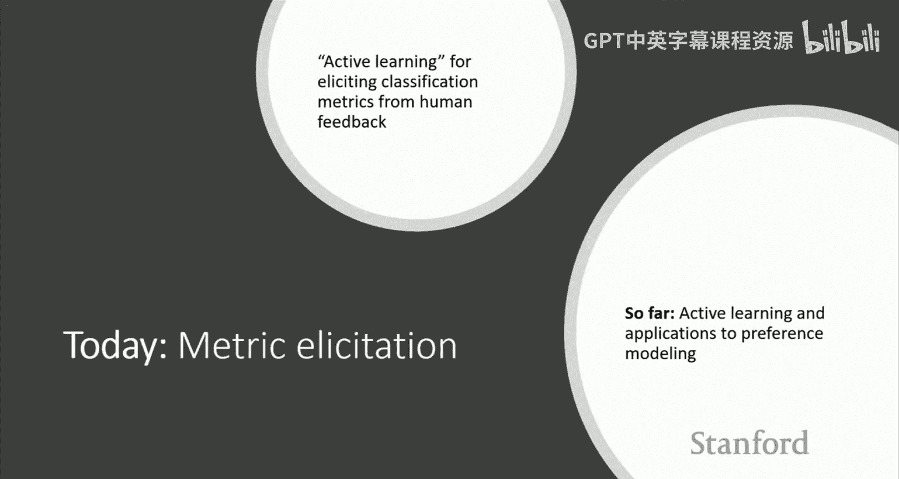

The next slide， so the setup for this problem is that I'm interested in。Building， let's say。

 sort of a simple classification model。So。The mental model you want to have now is that or maybe I can ground this a lot of this ends up being very useful in say clinical decision making。

嗯。A variety of reasons in general in most machine learning problems in the real world。

 different kinds of errors have a different real world cost if you like。

 so I'm building classifier perhaps what I care about is the actual literal number of mistakes the classifier makes so that's my major metric of interest and I care about accuracy。

Fraction of errors as you know， or maybe false positives are really expensive。

 So predicting a label an outcome of positive when the true outcome is negative in a medical setting。

 maybe this means that I incorrectly diagnose a cancer， incorrectly state cancer diagnosis。 So this。

 of course， causes， lots of harm to the patient。 This might imagine incorrect diagnosis of any kind。

 And of course， as you might know， in medical decision making， like。

Trying to understand better error rates of different tools of different kinds and so not just that it makes an error but the specific kind of error actually matters and so one of the ways to frame this question in learning setting is to think about sort of coming up or thinking through sort of the right choice of metric that says most relevant for the task and so you might think about this as。

Thinkking one of these statistics or thinking about mixing some of these statistics like weighted averages is another way to think about this so I'm much and more sensitive An example is I'm much more sensitive to false positives and false negatives and so I want to wait in my learning problem sort of pay much more attention to errors of false positive kinds of errors or incorrectly making say incorrect diagnoses incorrectly making diagnoses of a particular condition versus maybe false negatives may or may not be true just stating that in many settings errors are asymmetric like they don't cost the same different kinds of mistakes。

And so it don't cost the same one way to build us into the model is to come up with some measure that sort of captures these measure cost that has mistakes in classification problems this boils down to binary classification though many of these thingss can be extended to other kinds of learning problems in this lecture will mostly do to the binary classification case because it's succinct and sort of easy to explain and I'll try to give some detail where helpful。

So here， there are only two kinds of decisions that a model might make。

 it might make positive or negative decision， those are the only two choices。

 a minor your class problem as you know。And then there are only two states of the world for example。

 it's either sort correct positive or negative and so the measures of incorrectness are did I state that something was positive but it was actually negative or zero depending on how you just label things or did I incorrectly state to something was predict negative but the true thing was positive either way is a mistake and the claim here is that when the costs of mistakes are asymmetric then building in tools one way to the sort of human preferences are helpful here or preferences might be helpful here are helping to ground asymmetric costs of driven has mistakes。

Okay， so， you know， I built a model。 It has a high accuracy。 It has maybe 90% false positive rate。

5% false negative rate。 I'm sensitive to。As， so overall performance。

 then you know this is a good model。 Perhaps this is quite bad in terms of false positive。

 there's lots of reasons why this can happen。 Some of it could be tied to the overall prevalence in the population。

 so sometimes that is part of the skuw。 So you know heres a model here is some statistics。

 the key claim here is for the same model， there' are different ways to measure error and here is at least three。

And each of these three could be the right answer or some combination of them for different settings。

So I pick another model here， this is an illustration of say the nearest neighbor model。

 for instance， so it's a different learning model， same data set， same problem setting。

It has a different accuracy， so perhaps here it has a lower accuracy， 89%。

 and so it's worse in terms of overall performance， but in false positive it's better。

 so it went from 90 to 50 and in false negatives also better。Again。

 these are real numbers from a real problem， by the way。 So I can reverse engineer。

 I was a spreadsheet somewhere。 I can reverse engineer some of these。 It actually makes sense。

 if you look at different rates of different kinds。 Again， often prevalence makes a big difference。

 And then I say a third model。In this case， the illustration of support vector machine。

 so different accuracy number， different false positive number， different false negative number。

And so。The decision for you as a designer here is I need to pick a model。

 I've explored three families of models， I fit all my models， the way I like to。

 I'm in some decision making setting， I have three different measures of good performance。

Which capture different things， overall performance， false positive errors， false negative errors。

 and need to make a choice you know。Thoughts on which model I should pick and what might guide a decision I've given some of this away。

 I guess in the discussion。Yeah。Question for the group。So if you're faced with this as a designer。

 which model would you pick and why？And maybe what might move your decision？

I think for if it's in a medical application， I'd picked a second model。

Because I w to have as little false negatives as possible。

that's probably a reasonable way to think about the decision。Anyone else？I think I mean。

 default for most of us is accuracy， I think that's what everyone just looks like。

 you may not even bother looking at the other metrics。Anyone want to fight for false negatives。

 maybe some setting with them？okay so like cancer。Application， it's positive athletes and can be。

Yeah， perhaps， so you know maybe you're okay with overdiagno， for instance。Again， yeah。

 it depends on context。 ahead I mean， this is another context。

 I can think that in the criminal justice system you don't want toly incarcer that's a great example positives bad Yeah。

 so， you know， again， just repeating a bit。 Yeah， So if you're using these kinds of models part is important and say recciivism。

 which is a common use case。 I come up later， actually。

 then they're incorrectly accusing or making some clear about sort of。Potential， yeah， for。

In that context for sure， like incorrect predictions over predictiondiction is a big problem。

 that's something you'd be quite worried about。 So you want to be conservative in different direction in that setting。

 So so what is hopefully clear from this slide is again even in this very narrow setting that many of you are again almost everyone here is taking machine learning course familiar with this the main thing I'm hoping to like highlight is that even here choosing the if you like utility function。

 cost function， loss function is actually not a free choice we often think about as a free choice we don't think about this sort of carefully often this whole class has been about much more complicated settings where we think about choosing utilities or reward function so like how do I choose a word function to measure language of performance or measure funiness I think was first one of our first examples these are for sure complex complicated things but even in what we might think of as a simple thing like I just want to build a binary classifier the argument here。

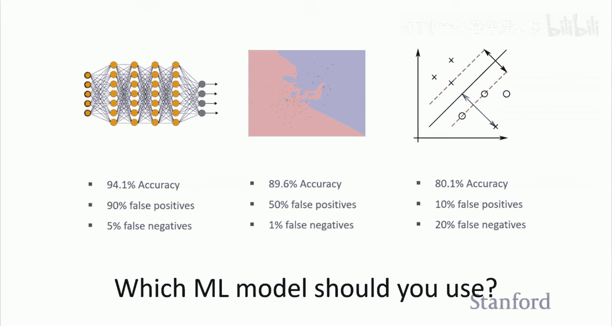

Is that evaluation choices actually can be complicated and contextual and depend on the application center you're interested in。

And so almost always， maybe as a strong claim sort of across most of learning。

 choices of evaluationary utility functions can be as important as every other choice that you're making in your model design because they can completely change what you value what you think of as sort of a good result。

So somewhat underappreciated， but for the you know it's the premise of the work I'm going to talk about today。

 so useful to highlight。Okay questions thoughts。So yeah。

 falls down to this choice of how you measure performance of a model and one argument and the main argument and the discussion today is。

 well， the actual thing that you end up picking is some performance metric。

 which is some quantitative description of。

How you are evaluating errors in your model， again， similar equivalents。

Essentially a sort of from her point of view of this class， reward utility metric。

Roughly mean the same thing as this mostly different domains have picked different sort of specifications。

 but from our point of view， these are all similar things。

 but some description come quantitative measure of goodness of whatever procedure you're building。

Or whatever machine learning model you're building。 And so your argument here is as discussed。

 you know the choice depends on relative cost and benefits and might change depending on how you choose to quantify relative cost and benefits。

 So you know so far we've talked about these as maybe three options you know accuracy false negative only false positive only you can also think about these as weighted combinations and that ends up often being very useful。

 meaning the relative not in terms of an absolute binary I'm picking one of these but actually like。

How sort of much more expensive is a false positive error than a false negative error。

 and if I can quantify this， then I can give weight to these different kinds of mistakes and I can think of building models that optimize some weighted combination of different errors that a model can make。

In this case errors model can make are sort of different kinds of classification errors。

 so two types， false positive false negatives if you don't like errors you can go sort of different kinds of correct predictions the model can make we'll go through this in a second same kind of idea so you can think of like true positives and true negatives so did I correctly predict。

Negative and positive。 turns out that these are essentially equivalents。 We might go into this。

 if we need to。Okay， so you know。A bunch of different metrics out there。

Even even within binary classification， we went through at least three。

If I expand to sort of different kinds of learning problems。

 there are a ton of them across lots of different learning problems。

 even if I stick with binary classification， if I allow myself to do weighted combinations。

 I've immediately now gone from。Say three had common options to really infinite options because all weightings so all real valued weightings are valid choices of measures that make sense in this context so very quickly you know the space explodes even in this very simple setting not to talk about again more complicated sense we've talked about in class so far。

嗯。Another useful argument。Again， this ties to。A lot of discussion in class today， but I I like。

 I find it valuable， even in this simpler setting， because， again， does this。

Implicit assumption and many learning problems that sort of any metric is as good as any other metric and so I can just sort of you know maybe the actual answer is different。

 but you know things should relatively order models the same way and so just pick at any of the metrics and they should all behave similarly sufficiently similarly that any metric is as good as any other one for。

Any of the things that we need to use them for machine learning so again for selecting models once I've trained them or if I have a metric I can convert that into loss function that I can then actually directly optimize so are they exchangeable or not did lots of examples showing this is not true Here's one of my favorites because it's salient for I guess when I was a PhD student I think this was。

One of for me， at least at the time， quite striking as an example of where metrics can fail。

So any of you know the Netflix Prize？Okay， still around。 Okay， I guess the Netflix is still around。

 So it's good in the 2010s。When I was a student or was it around that。

 I think it was earlier than this。 but anyways， there was a lot of excitement about。😊。

Academics and industry broadly trying to build improve on Netflix's recommendation system algorithm and so they created this prize where they sent out sort of a large data set of sort of existing recommendations and asked people to predict missing recommendations and so this was a competition。

 they had a number prize tied to this as a million dollars， a huge amount at the time。

 probably I mean even now， sort of a big deal as a prize for this kind of competition and it ran。

 I believe was a year。Though that's checkable。 I don't remember anymore。 but I tried。

 we didn't do that well。 It did。 Okay， I not that well。 But lots of teams build tools for this。

 If I remember correctly， this team was at least the leads of the winning team that's deployed the algorithm。

 There's also other color I could mention offline but I'll just tell the main story here。 the。

Meeasure， the metric they chose to use was what is the root mean square error of the prediction of the actual rating number so in Netflix as you might know you get to rank things one through five stars so for every user for every movie if they've rated the movie there is a number one through five and what Netflix chose to measure in the competition was mean square error average of the。

Squared error difference between whatever prediction you gave letter rating and the actual one through five number and then squared root over the whole thing so RsC。

Is that clear or actually the details not matter， so it's a choice of number but what they actually wanted was to improve the recommendation algorithms。

And arguably what matters for recommendation if you think of your Netflix interface is mostly like if I get the top of the ranking correct。

 so I want to get the first five or so to be things that you're likely to say you like because that's what you see when you turn on Netflix。

Dashboard， but you know people， as you might know there's a strong bias to the top of the list so you want to get this a top few things likely accurate so people are likely click on it and hopefully likely to like it。

 but it's sort of。Confound a little bit。 click on and like So of seemed to be very close。

 And what they found was that predicting Ruth mean square error as the measure did not necessarily correlate with trying to do a good job in terms of actually getting top end ranking。

 And in particular， you could come up with very naive algorithms。 something very simple。

 like like a PC thing or just like overall popularity often did much better than some of the methods that came out of this competition。

 Now， the competition made sense in its own context。

 it was trying to optimize for Ru mean square error。 And from that point of view。

 they got some good algorithms。 But in terms of。A the actual task it turned out that they didn't pick the right metric and in fact there were other metrics that made a lot more sense there are lots of metrics for top end ranking particularly that would have been better suited that if they had picked they might have gotten models that were sort of better suited for the task that they cared about。

And so， you know for me， this was very salient example of sort ofs coming up with a task picking a metric that on its face sounds extremely reasonable It's going to look for like average error。

 we use squared loss all the time RC is a small variance of square loss so it sounds very reasonable。

 but it actually like is a bad idea and methods that win respect to this metric are actually often the argument here is that they're often not useful but the actual task that this was meant to so another example of again。

 like metrics can matter a lot in terms of building algorithm。As a fun and anecdote。

 it turns out you some of you might know this that Netflix did not actually end up using any of the winning competitors。

 Does anyone know why， if you know what is。So some of it is this。

 though I think that's not the biggest thing。上啊。It's another fun part of。

I guess norms in maybe academia and industry。 But what year was the competition。

 My memory is correct。 I think this was in the end year。 So I think 2010。

So it wasn't a deep learning that really interesting。 I think they were using matrix factorization。

They had been using that and some other sort of content based thing。

So the short answer is it turned out， you know， the field came up with， this is the heyday of。

Very fun sophisticated metric specialization methods lots of sort of Bayesian hierarchical methods and things like that。

 Turn out that they were very expensive to run。 They couldn't remove running in production settings at the time at that level of compute that people were investing。

 And the method that they were building that they had internally sort of was as good in terms of the things that actually mattered。

 but much less compute intensive。 So another fun said anecdote。

 up not being useful it was great press， though， I think I think more than I don't think academics paid。

I think they got more than a million dollars worth of effort of people are researching them being able to get people to come work for them theres bunch of other stuff that they probably got out of it。

The actual thing they thought they would get， they did not get that's the lesson the reward lesson Yeah oh this is what I care about。

 this is a lesson for the class。😊，Well， okay， so my counter。 So the argument is。

 it's only compute because I guess your argument is if they had enough compute。

 they would have run whatever won to competition。 the counter is whatever won a competition was good on RsC。

 And I'm saying it wasn't good necessarily for what they cared about So the whole premise of this is not just compute under the assumption that sort of the world is not perfectly predictable。

 which I think most of us hopefully will agree that there's always no reason。 So a relative costs。

 relative errors do matter。 And。Quing it appropriately for the task can make a difference。Yeah。

Another example， this comes from fairness work， but I think is as another salient example。

 So this is tied to， we're talking about the legal type。Applications， this is recidivism prediction。

 So this is risk of reoff。This is work out of。I guess the company was called Northpoint。

 The algorithm is called compass。 I think it's still around and still in use。

 If I remember this correctly。 But the goal was it was supposed to predict the risk of reoff。

 which had help a judge in sentensing decisions。 And so North point。

Was interested in good performance accuracy， but they also sensitive to some notion of fairness。

 how does this treat different demographic groups And so in particular。

 they use a notion of fairness height calibration she's roughly asking for different sort of。

Prob bins of risk that should be reasonably well calibrated across sorry。

ethcology they should be similar across different demographic groups that's what they were hoping to capture there was a post analysis by Propublica。

 which is a media company and what they did was they looked at a different metric so they looked at false negative rates and false positive rates which is sometimes called equal opportunity in the fairness literature。

I may get that wrong the acronym is EO， but there are actually algorithm two metrics that are called EO I sometimes mess it up。

 but I'm happy to send a reference。Anyways， so false negative rise and false positive rate differences across demographic groups it the single thing they were looking at and what they found was that black defendants were twice as likely to be incorrectly labeled as higher risk than white defendants and similar kinds of issues if I looked at the other so if I looked at false negative I saw again big disparities。

 false positive I saw big disparities so again you know from a is this a good algorithm that sort of normatively a good thing would'd like to deploy this was worrying for me the salient takeaway from this work。

Is， you know， it wasn't you know the claim that sorry the compass algorithm was not sensitive to fairness issues is incorrect。

 like they actually had a fairness notion， they built something。

 there was a different party that post studied their algorithm but used a different measure and came with completely different conclusions。

And the argument here is again， you know two quote unquote maybe well-meing actors for building algorithms can have different normative views of what might be sort of a good outcome for an algorithm from different normative views they pick different measures and actually completely disagree and sort of how they evaluate a particular algorithm one actor says。

 well I've done what I said that was going to do I've built a fair algorithm for this very sensitive societal decision making task someone else is an auditor。

 they look at the same test， they look at the same results but they use a different measure of performance or in this case measure of fairness they come up with a completely different conclusion this led to I think there's also maybe a fun anecdote in this as well this led to quite interesting academic work actually where at the time there was some hope I think also maybe a bit of naivety and the technical fairness committee thinking that we could come up with some measure that was like the golden measure so there is exists some metric that will。

like be fair in a universal way for all different settings and I think people didn't appreciate that again。

 you know as the premise of this class， the actual metric you select has a big influence till this article because it made a big splash I mean some splash externally。

 but I think，Meaningfully bigger splash actually within the technical community studying this because they really anchored a problem and led some follow work if you've ever heard of impossibility results and fairness it comes from sort of the prompt of this work led to people to study this much more carefully and the main conclusion was sort of and if I'm interested in binary classification problems with sort of fairness measures roughly you can pick one maybe two measures to sort of try to maximize at the same time。

 but you can pick three so，😊，The simple way of saying it is that there's no universality。

 different metrics will optimize。Different metrics will pick different things as the fair outcome。

Or if you want to think about this in a sort of pure。Meric collection sense。

 the degrees of freedom are such that once I pick multiple measures of fairness。

 I will not satisfy all of them simultaneously， some of them will break another example of the same phenomenon。

Okay， so one of the ways that at this time， my group was interested in this question。

 So one of the ways that we chose to engage in this question。

Is to ask whether we could use human stakeholders This is again the premise of this class as a way to select metrics that align with the preference of whoever the stakeholders are。

 So the idea was there is not a right answer， but perhaps for particular stakeholders there's a right answer for them And so can we come up with an algorithmic tool that helps them efficiently select the metric that best aligns with their preferences。

 that was the premise of this kind of work。 And so this led to what we ended up calling metric hoation which I'll go through and at least the high level key points over the next couple those slides so。

Okay， so it's related to a bunch of other stuff， some of what we've covered already。

 some of which we'll talk about later， so we haven't talked that much about standards yet。

 but we will， so it's related to some of those ideas。

We've talked a little bit about inverse reinforcement learning， but connected some of those。

And there's some sort of older core literature and say psychology。

 econometrics that thinks about eation， which I think for a person of this class is reasonable to think of as。

 again， this combination of utility estimation with active learning。Very good summary of it。And yeah。

 again， we're interested in the sort of narrow special case of using this as a way to pick good classification metrics or like metrics tied to classification models。

 So I'll mostly talk about the simple case of binary classification metrics。

 I'll refer to papers if you're interested to sort of other settings that are like the fairness setting。

 multiclass setting a bunch of other settings。 They could use this so。😊。

You can show that sort of binary classification metrics。

 linear binary classification metrics can all be reduced to something that looks like this so as I alluded to earlier。

 you can think about this in terms of errors so there are two kinds of errors model can make false positive false negatives。

 the binary classification metric and so you can think about this is like the relative weight of false positive errors versus false negative errors and so the problem that you're trying to solve if you're trying to elicit linear binary classification metric is to fix a number for a1 and A2。

As an aside， it turns out scale doesn't matter， this is the same thing as some say iss better we can't recover scale。

Also， scale doesn't matter。 actually， meaning if I scale this thing up or down， it's the same metric。

 It picks the same classifier。 It ranks things the same way。

 So it's sort of veryant monotonic transformations。 actually， a few other things。

 So the way that this shows up here is that actually， it's not really two numbers。 It's really。😊。

The numbers are a bit tied together relative to you can scale them up so to stay sum to one。

 for instance， so you you pick there exists a rewriting of this where I can pick an alpha and1 minus a alpha as a relative way to the same problem。

So I went and you pick a number， which tells me the relative weights on two different kinds of errors as a population measure of a classifier。

 and if I can pick those numbers well， this addresses the sort of relative cost of errors for a minor classification problem that is useful for sort of trying to solve this kind of problem。

Questions on the setup。So I'll also discussed the noise reset setting because I think it's at least I'll start off at noisery setting because I think it's probably easiest and the algorithmic tool will be sort of straightforward。

And perhaps I'll go into， I'll mention some extensions to other settings as well。

So I already mentioned some of this， but if you're interested in binary classification problems。

 at least in terms of population performance overall performance across the model。

 the way we quantify errors are again these four numbers so it's sort of true positive。

 true and negative true positive is a fraction of times the ground truth is one the model predicts one true negative fraction times ground are zero model predicts zero false positive false negatives of two kinds of errors the model is making so is it making a mistake and incorrectly predicting one when the ground truth is zero and how often is this happening and upgrade grid across the population and then false negative errors is it incorrectly predicting zero is when the ground truth is one。

We are in this across population。Okay so this is called the confusion matrix for binary classification。

 you can extend this to confusion matrices to multi-class classification instead of doing this for just two classes。

 I have all K classes that are possible ground truth。

 all K classes that are possible predictions and I have a K by K matrix for all possible combinations of sort of ground truth and predictions and。

Typically， those don't have a name within the box。 It turns out we do binary a ton and so we can call them specific names。

 but you just have。I guess generic confusion matrix for larger multi class classification settings。

 is that clear， by the way？I have a K class problem。I just have a K by K box。Or。Why equal goes mine。

Y equals a。 and then by predictor。呢个关。A predict there okay， and I'll count the fraction at times。

Each of my examples false in in one of the buckets， and I got a K by K。Okay。

 and then linear so you can also show it's gonna be a fun aside won't go into my detail。

 but you can also show that most classification metrics that people use or you might be familiar with can be written as some function of the cap matrix so it turns out to be a useful quantity and so in particular for a linear ones for binary ones。

 you can think of the composition function as just await weighted some in this case the offtagonal。

 so it's some number that multiplies the false positive number。

 another number that multiplies false negative again the some degrees of freedom that you have to play with but linear metrics can be written as again these two numbers speaking these two numbers。

Okay， so a little bit an algorithm。 So before presenting the algorithm。

 it's useful to do a little bit of。Discussion， spend。2 minutes on this。嗯。

Does anyone know if I'm interested in Max the best classifier that maximizes。

Ex the value of my data over my data。So x y， think of this as a distribution of accuracy so indicator。

H of x equals y。

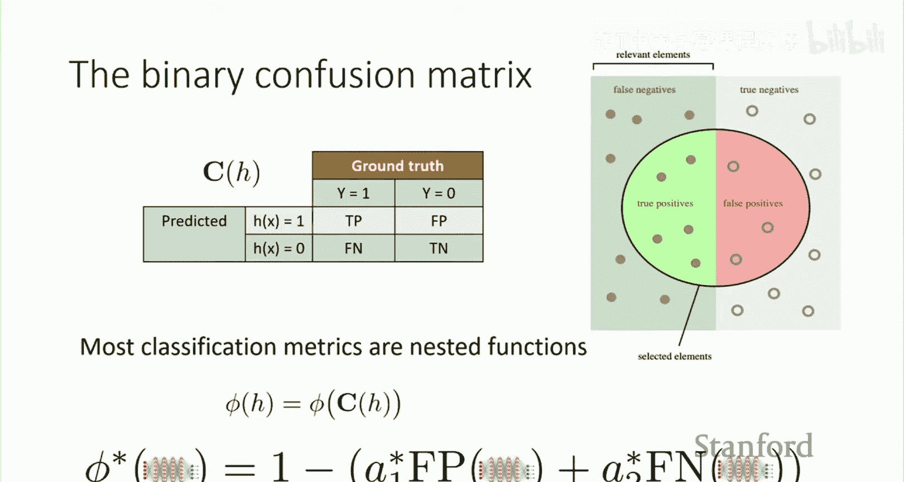

嗯。If I know my distribution。What isDoes anyone know what the optimal class card is。

 you might remember this from？And I want to guess so I know my distribution I know my P is y P of x you Y of an x all that stuff you know the answer to whats what model choice if I knew my distribution and I could pick any class bar including one type of my distribution。

 which model should I pick that maximizes。Accuracy。Similarly。

 minimizes errors so I can rewrite this as minimum over H。numberumb of times I'm this。

So that problem。Then remember， you've almost definitely seen it before。Anyone want to guess？

So it'll be something in terms of the probabilities。So this might be a fun exercise offline。

You've definitely seen it before， I suspect you've seen it before when you build a logistic regression model。

 so logistic regressionggress gives you a probability for Y given X。

How do I convert it into a decision？Yeah， so you pick a threshold。

 there is a quote unquote natural threshold that everyone uses。Okay。

 so it turns out that if I know my population is actually the reason why we pick a threshold half or religiousversion problem and you can trace some of this in the technical literature as well。

 it turns out that the optimal decision making role is choose one if P of Y given X is greater than half。

Or zero otherwise ways。This is like the yamal left truth。

 You can also write it as sometimes people will write as a sign of P of Y， given at trying。

 I should rewrite this。A minor thing。It can be important。

So typically we use the positive probability y equals one is given。这一个。this is anything。

 I so suspect out a half check of it very less threshold one。One。

 otherwise that think through negative ones thing too。So you might have seen this。

This is sort of some of where latest regression semantics come from the idea is that we hope logistic regression gets us this and then we can threshold out it appropriately and we get the class learn。

嗯。What happens if I。呃。Go from。This problem。To a weighted problem。

 So I'm going to write it in these semantics and to make it closer。

I want to make this instead of accuracy， I want to make this error。

 I to make this minimum of number of mistakes。I suppose I wanted to solve a different problem。

 which is men。Over age。Keep my expectation of a population。

And now I'm going to look at two different kinds of errors。 So this is H of x。I have false positives。

 so I predict positives， but y equals zero。嗯。Plus。The other kind of mistake。Age of。X equals 0。

 Y equals 1。SoThis is my overall problem and suppose。This is the exact same thing as this。

Because this are two ways I can make a mistake because I'm just decomposing that。

But I suppose I have a weighted version， I put that alpha1 alpha2 or A1A2。

Does anyone know or guess what the。Optimal classifier might be。

So the best age that actually minimizes this turns out to have a nice barmetric form as well。Yes。

 just a guess， but would it be some ratio of the output？

So it will again be a threshold of the classifier so be sine of p1 equals1 is an x minus some delta。

 and I will confess that even though。I wrote some of the papers that defined the stuff I don't remember up hand actual ratio。

 It is a ratio。 It's some ratio。Do you remember it was like A1 and81 plus A2， something like this？

Some' very close that I will refer to a big breath It's actually quite easy to prove for yourself。

 actually， surprisingly， even though。At least informally， some of the technical details can be added。

 but the high level proof is straightforward。 So this is。Willll end up being a useful property。

 We end up using it a lot for what I'm going to discuss。

And that's the main point I'm trying to make here。Is that the optimizer of weighted classification losses looks like a sort of threshold classifier some kind of so I'm optimizing if you like。

 there is a sort of clean connection between weighted losses。

 threshold classifiers and maybe another thing to mention is that you can also think of a weighted loss as a linear function so。

I'll just right at the bottom so。Any weighted loss can everyone see properly？Anyone who needs to see。

 I assume the TAs don't or first followss don't need to see。Okay。

 some people cannot see I'll erase the first one because not， we're not going to use it。

This is a generic statement I end up being helpful。So the weighted losses。Awaed utilities。

So some of this type。And I'll be written equivalently as theline。Function。Of the confusion matrix。

 they can also write this as like no。There are a few different ways to write it。

You can write it as a transpose C， and then you do a trace。You can also write it as like。

Meectorizing a。Fball， factorizing the sea。So all these are the same thing as sort of weighted utilities all have this form of like linear combinations and so the connection I'm hoping to make is that if I'm interested in a weighted loss or weighted sort of weighted error thing。

 all of these end up being solved by some kind of threshold classifier with some threshold somewhere。

So how is this equal as a bit of a digression？So。So let me connect。 So it turns out that。

We can actually map out for all possible classifiers。

 we can map out sort of all of the achievable confusion matrices。

The way that we like to do this， you can do this bunch in different ways。

 depending on how your favorite choice of parameterization。

 it turns out that even for binary matrices even though they are four numbers。

 therere actually only two degrees of freedom， Does anyone know why。

Take a quick look at the completion matrix so it turns out you can show us a bunch of different ways。

 but one easy way to show this is that the sum of TP and TN have to sum into the probability of y equals one which is a population constant doesn't depend on anything that you're doing similarly some over this column sums to some constant and so independent of the classifier that you pick even though they're four numbers it's four numbers such that these two row sums are fixed as something they can show that actually're own to degree freedom of like actual flexibility that the classifier has in this setting you only adjust it can adjust the four numbers but you can always like if I have two numbers in this four numbers that can always work out the other two。

Is that if I have any two numbers。so but for sure if I have sort of this number I always worked this out by taking overall fraction and removing that will give me this number similarly I can。

She's a two decrease of freedom in the multi class case also in the multi class case， it is not two。

 It is k times k minus1。After that， we'll check。啊，大得知道。It's not two it's not two， yeah。

 so it ends up scaling， I think quadraically， roughly quadraically with the size of number of classes。

嗯。这 great question。对。Its很 complicated。Because theres some issue with the。

Like a cost person with the one a。Yeah， no， that's a whole other。

 we're not going to get into that different Yeah， it's the multi class case can be meaningfully different and one of the reasons I'm choosing not to discuss it it gets complicated very quickly。

 So we just stick with a binary case。😊，Okay so binary case we've done some degree of freedom stuff the main observation here is you know I can describe everything with two numbers and here i'm just choosing to use two positives and two negatives as those two numbers if you've seen ROC curve before this is effectively an ROC curve an ROC curve essentially allows you to show sort of。

As I trace out different choices of threshold。For a given probability model under some underlying geneerative model。

Overall data distribution， I can trace out sort of all of the possible combinations of true positive or negative。

 which are essentially all the feasible kinds of classification patientss I can build with a particular model for a particular data set。

So this maps out the whole space。If you。For the prongs， we care about。

We only care about usually the top part of the RC curve。

 it turns out you can often map out the bottom part。

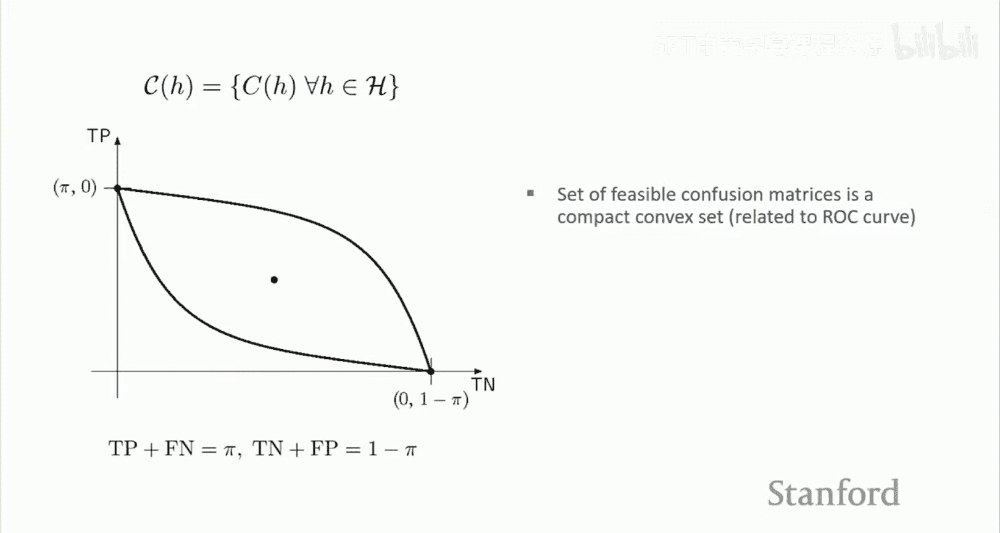

You have to do a weird thing， you have to like intentionally classify badly to do negative classifications anticlasss。

 but you wanted to map out all possible classifiers meaning I look at the classification problem。

 some data generating model and I don't know about every possible TBT impaired that's feasible for a particular model turns out that you can fully describe that space and the nice thing is that the boundaries of that space are given by thresholdings of the conditional probability。

So this is a sort of nice property what this means is that I can sort of tell you without knowing the detail of whatever function that you choose to use。

 I can tell you all the achievable。

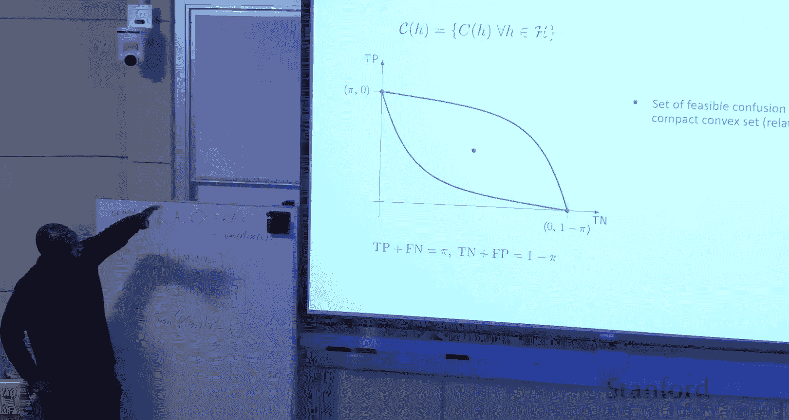

Trade offs that are available for a particular cost creation problem。

 and it just maps out to trying all possible thresholds for the underlying conditional problem。

So the peri frontier it's a good way to say it maybe a better way to say it the connection to thresholdholding will be useful which is I'm using it。

 but it's essentially the peri frontier of TTN as two objectives。

Across all at all possible classifier or particular they generating distribution。Questions on this。

Is that equal to de higher。Delta is going to be。a good question。

 but Delta is going to be some function of the A。So。P here。Where Delta is。

 I call it like G function of the A。If I give you A1 and A2。Then I can work out what the delta is。

 and I'll refer to a paper。What is is it。What is P in this case？The pie， sorry， the pie。

 this is a good question。 Thank you， the pie。Is probably。喂 goes完。

I'm just explicitly mapping out the degrees of freedom。

 so if you remember on the confusion matrix I show the column sums。

 so probably y equals1 is pi and then the only other choice is y equals zero。

Prob y equals zeros is one minus， the probability y equals one。So even in the role sums。

 there's additional backup here。而且很 important。I probably white was one given an X probability this is marginal over the population。

 so white equal was one。So P of y equals one given x is。

The whole thing will be the object that we are sort of playing if I average this over the possible access and I get fine。

Inす。那。Yeah has。Yeah， so now I apologize for being lazy because I didn't work out the actual equation。

 but。The delelta here， I'll connect it in a second， and let me know if it's still confusingusing。嗯。

就是。But Delta has a roles play。 So Delta is the threshold on the conditional probability model。

 the claim I was making is that it will map directly to a choice of a。

And I'll try to make that connection useful in a second if we'll see if it works。Okay。

 so the other point I was making， which I already put here， is that weighted measures。

Works out to linear combinations of the confusion matrix elements I've already sort of made that claim and。

There are few ways to see this， but。I just stated it as a。What's the best way to say lemma。

 maybe you can improve for yourself and have a convex base？

And I'm looking to maximize something over the time space， the maxima。Sorry。

 Im maximizing linear function of our comeback space Maxma always lie on the boundary just state that as a statement as a you can。

The good references in like optimizationization 1 on1 textbooks are if I don't think have a reference in the notes。

 the references in the papers that are referred to。 So if you take a look at those。

 or if you ask me offline I'll send some references。If you're not familiar with this。

 if I'm optimizing a linear function of a comeback space。

 depth is always somewhere around the boundary。And so the intuition we're going to try to use here。

Is that。The Akimo is land the boundary。The opta are always going to be these kinds of linear functions。

You know that these linear functions are these kind of thresholds of the conditional probability。

 we're going to try to use that intuition to sort of map out so the main thing we're going to do here is we're going to reduce the problem again where we started was want to fix an A that matches a stakeholder preference。

forgotSo all of this engineering is such that we can convert this a really into a threshold。😊。

I feel that there iss a sort of correspondence one to one。 And the way that it will help us is that。

Finding the metric that matches state departments will boil down to like searching along this boundary。

 but we turn a， I guess four dimensional problemminally。

 nominally in the confusion matrix space into a two dimensional problem by explaining degrees of freedom into a one dimensional problem by exploiting the sort of geometry of con。

So it makes our problem our life easier， surely。But the underlying goal is still the same want to find some model that matches stakeholder preference。

Questions。Okay， so let me try to put this together。How to actually do this。

 it turns out that sort of a reasonable way to do this is to enroll space。

 so I want to find a linear classifier。Sorry， a linear metric。

 so a choice of weights that best align with the stakeholder preference。啊。I didn't mention this。

 but I think it's worth mentioning actually， let me let me actually just state this。

 so suppose I could do point wide search。Yeah， okay， so I could do search。

 what might be a good way to try to find the maximum。Maximum being。

 I get to ask people questions every time I ask the question to give me some signal。

And want to find you can either think about this as the point on the boundary that's closest to your preference。

 which will be essentially finding this delta。

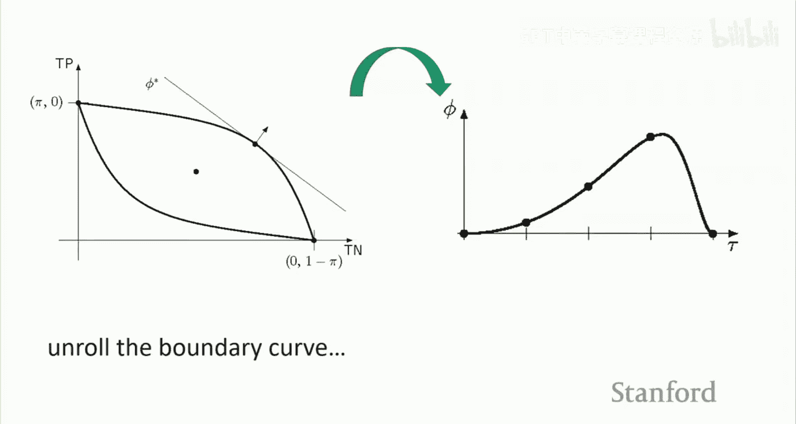

Or you can think about it as finding the linear sort of weighting that most matches their preference。

 which is again， the sort of tailor these relative A182 weights。

What might be some good algorithms for？作ですか。Like a search 101 from。But again。

 we're in the noise list setting things are nice and easy。What may I try。Guesses。I research。

Have you seen this before？You might have， you should have， if you haven't done， if you're worrying。

Okay， so binary， so binary research turns out to be a good worrying because using' my groupman should have read some of my papers。

😊。

It there's no requirement it just observation Okay， so binary search turns out to be a good thing。

 it turns out binary search actually also works if I don't get to see things pointwise。

 but I only can ask pairwise preference queries。😊，So what I could do。Is I can ask。

A bunch of pairwise preference queries along the boundary。I can ask。

 do you prefer the classifier here versus the classifier here。

 because I know how to map from qua on boundary back to linear weightings back to classifications。

So I can either ask these in the sort of confusion space or in the classifier space or in a sort of partial space。

 depending on whatever makes most sense。If they tell me that。

They prefer B and A to suggest that whatever the maximum is， it must be somewhere towards the right。

I check B and C if they also prefer a C， then it must be to us the right。

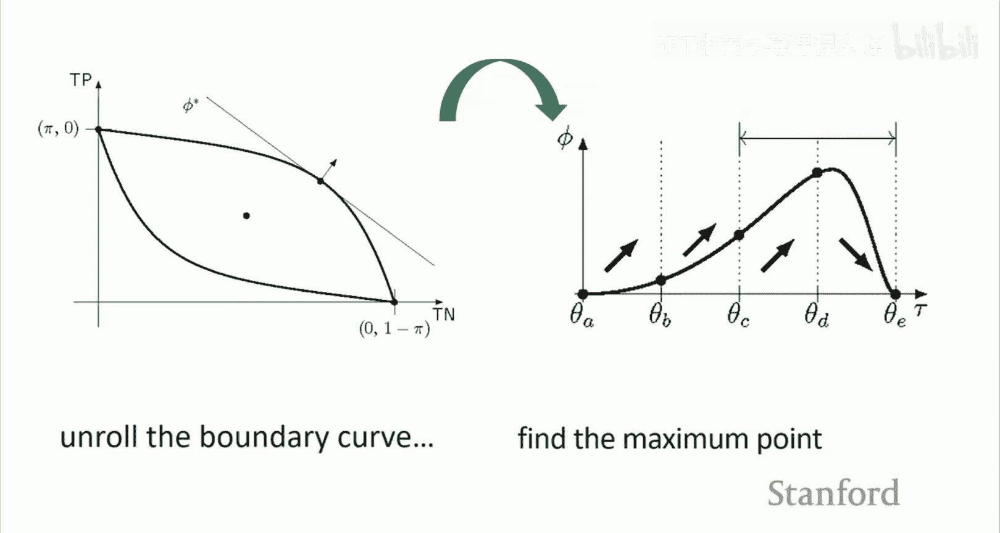

Is is a particular instance of this set of queries。 C and D， what you prefer， prefer D。

 then it must be towards the right D and E， I prefer D。 So wherever the optimal of this thing is。

 we know that， you know， it must be somewhere between D and E。

By doing the Yeah do you know anything about the conduct。

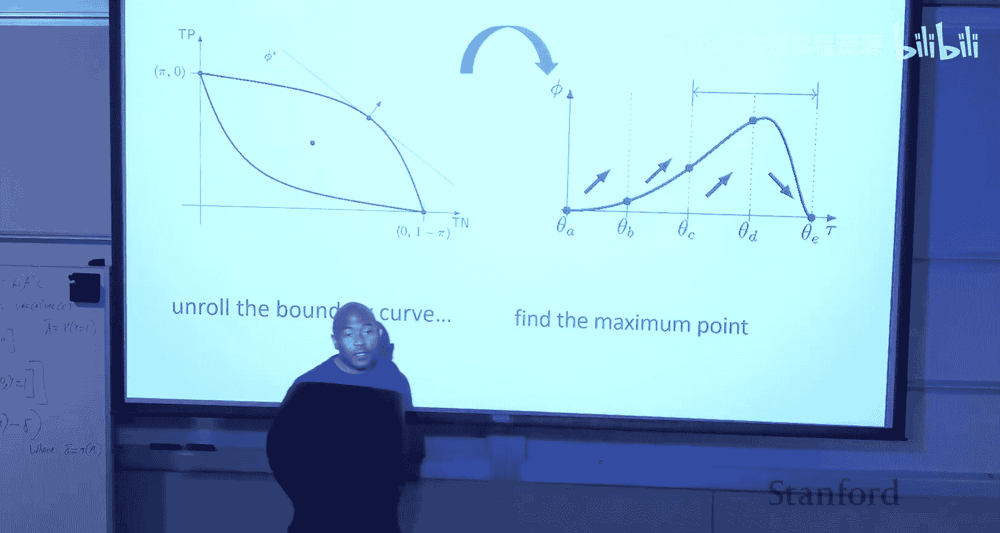

Yeah， so this is under the assumption。 this is a good point。

So there is a weak uniqueness assumption that's being made roughly。 So what you need is。

You can also connect this to a rationality assumption， I think that's a good point。

 So meaning they actually exists a utility that is actually driving people's decisions and there is a more than that there is a utility so there is a union utility or like we can approximate their preferences well enough with。

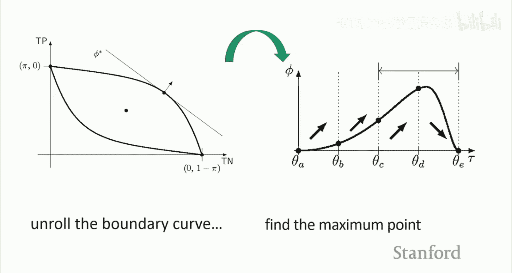

This linear waiting over a different error。So when that breaks， of course， this。

 at least the specific approach here will break so this approach works that's extremely good points because for that to work。

 you need this sort of unmodal thing and unmodality comes from the fact that from the claim that there exists the utility within the class of utilities that we're searching for。

This allows us to use a standard search procedure。Very good question。

So capital A is not given that these preferences are constructeded using sum。

So that's an excellent question。 So every point I'm querying。First line to point under boundary。

Every plant of the boundary is equivalently either a choice of threshold or a choice of A or a choice of C。

Essentially， they're all equivalent all of this derivation was to try to anchor that as sort of and given a problem and sort of distribution。

 I can connect all these things together。And all of this machinery is exploiting to geometrymatry comes from。

To reduce the search base to one dimension dimension， and so to make these connections。

Make the search easier， essentially。Yes。😊，So what you say it's an pre you like when people compare if they compare several times these the same Yeah。

 so that the comparisons actually reflected true preferences and they're giving you those preferences by error。

So if there is error， then this is you either the Bolman setting there some noise addition。

 we'll go through some at least one example where you can expand this idea a little bit。

 you can use a， I guess probabilistic variant because this search will work。

 we're slower in time than I imagine because I spent a lot time in a setup。

 but I think we'll have time to go through at least one of these examples。And the moreized。A， please。

Boy on this。A batterytter。It's， it's a true， positive or true negative。Population。

 so say that you want to。Theloy is as a human， you have finite later。So， I was。I was wondering。

 how does a。How does the finite finite data impact does it make the the battery kind of blur Yeah that's an excellent point yeah so what will happen with finite data is that instead of having a smooth boundary you have a stepwise thing。

So end up looking。 and if you've done our seek curve。Something。系。This。

There are a few ways to fix this， the most common way that people use。

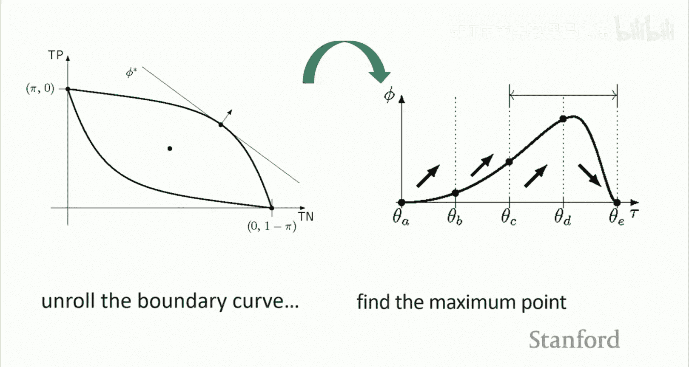

So RSC literatures disconnect these。Because you can show that I can achieve a classifier at the interpolation of the Comebackex Hall is achievable。

The the way you can keep the comments to a mixture of class hours。

 these two always achieve our receive middle。Or any any point in the in the interpolation can be achieved by mixing the points in the edges this is a bit of an aside your question was what happens if I finite data the answer is you end up with this stepwise thing。

Something like that。You can。Convert the problem reasonably easily as something where the algorithm does something reasonable。

Back and or if you have little data， seem like the true positive estimation under finite data。

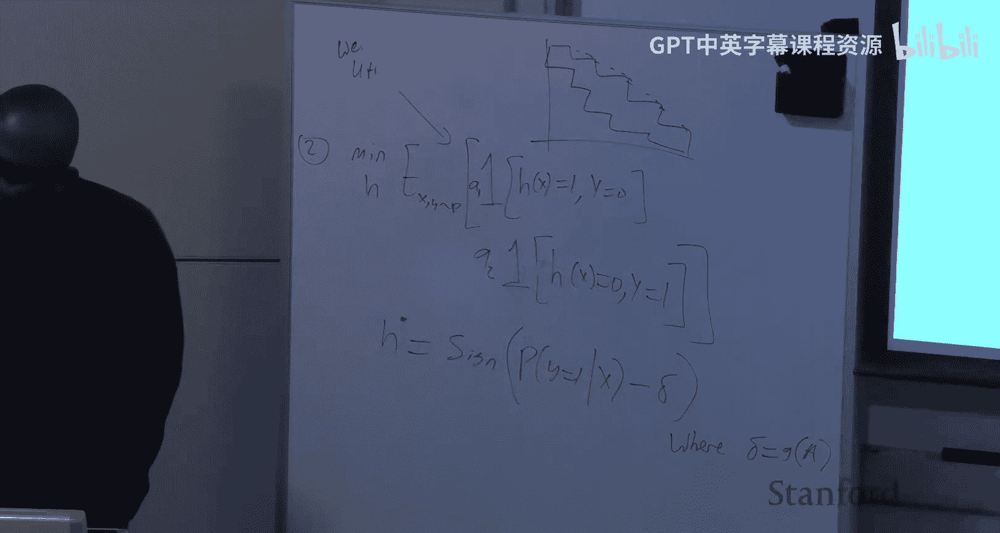

That's a source of noise，So then you want to use a sort of more noise robust search method and pure binary research。

Yeah， so all of this for really expitory purposes， but also actually even the original version of this work。

We got reasonably far。I see me noise free and so dealing with at least some of these sources of noise。

 lead to stepwise pattern in our space。Okay， so。There are some proofs in the paper。

 I won't go into any detail。 The， the main claim here is direct consequence of binary search。

 So if I just look at like， what guarantees binary search give me for searching in like a nice problem space。

 It turns out that for binary search problem， I get eilon accuracy with log one of our epsilon steps。

By， I guess。Pro by binary search， I guess is a statement。 But again。

 the details in the paper if you're interested。 It also turns out that unless you make more assumptions or constrained a problem further。

 we are pretty sure this is the lower bound。 So you can't be faster than this。

 meaning there is no way to ask other than making more assumptions or like constructing constraining the problem further。

 This is the fastest that you can estimate the trade offs So you can't there's no way to ask fewer queries and get higher accuracy in the worst case anyway。

 on estimating the tradeoffs from people。 So this connects to again。The comment earlier。

 like this is a space where sort of constrained enough that we can actually give some quantification of things like query complexity。

 How many questions do I need to ask to get a good estimate of。Those are individual preference here。

Okay there's a little of extra work adding various kinds of noise we call people oracle in this work so you can use public extensions to handle some of the noise I'm not going into this there's a bunch of other papers to look at to handle multiclass settings I think ask this question more complex metrics and some work and so different kinds of stakeholder groups。

We also did some more applied work。 We'll have a whole lecture in HCI。 so I I might use this example。

 when we go back there。 So for time reasons， I'll skip on details it's in the slides and does a paper as well where we implemented this idea with。

Some stakeholders showed that eliciting in this way seemed to better reflect their preferences than some other default approach。

Okay， any questions。On general framing。 So again， big picture。

 I'm interested in metric selection for classification problem。

 I'm looking to pick cost sensitive metrics that align best with。😊。

like a stakeholder and what we've done is exploit some of the properties of the classification problem such that we can convert the metric selection problem。

 particularly in the binary case to essentially one dimensional search problem。

 allows us use some multi the shelflf binary search algorithm and make some specific claims in certain settings about how quickly we can pinpoints the weightings that best match the stakeholder preferences。

Even in terms of like questions to directly ask users， like。

 how do we get something that's a little complex like this， Like would you prefer Yeah， Okay。

 so this is an excellent question。 And in fact， its one of the big gaps in let land work。

 So this framing depends on the ability of the oracle to do population level comparisons。

And so you can think about And in this example， this is like。

 So I guess one key point is first educating on like。Perfect classification is not possible。

 And in general， this is true。 If it's not possible here are different trade offs that you might imagine making and what we're trying to ground stakeholders on is how this trade off might look at look like in maybe individual examples。

 So， you know， one of the ways that what could try is I come up with scenarios that capture what this might mean if I。

LikeWhat a positive positive positive negative error might mean and ask。

Freferences for those situations and then asked them。

 how this might reflect on the population level based on a sort of base error rate。

And try to get a difference from that。 I think your point is very well taken。

 I think that's actually a big gap in this kind of work is that it needs a fairly sophisticated stakeholder。

Sych said they can do these kinds of comparisons because these comparisons are at a set of population。

Person level， and so some of。Like useful extensions of this work might include like not specifying the measures at the overall。

 So， okay， so things are tied in that If you're interested in weighted consecutive metrics。

The natural space to do the comparison is at this population preference level， if instead。

Either you think your preferences are much more contextual。

 so it's not about overall population weights， but like individual example weights， for example。

 then you want one your problem gets more complicated because the set of measures now needs to be conditional so A will condition on Xome。

Because it's a different way to say it for different points in the space as to a single weights across all different categories it ways to frame a problem like this。

 This has the big benefit of like the listation problem is a little bit easier because I can now do it as an example level as opposed to population level I can give an example for this person which you prefer this mistake versus other mistake like much strular easier for response but then your metric space is much more complicated。

嗯。We sort of intentionally tried to give。Quries of this type， because wanted people to。

Like their cognitive biases to match the population setting because otherwise you can actually have a mismatch between the way you asking a question and the sort of kinds of metrics that you're asking for can lead to other kinds of mistakes and errors。

I guess maybe the big takeaway is and actually， given the question。

 when I spend a bit more time on these in the H lectures。

Useful version of this usually need some meaningful connection between the algorithmic problem and sort of the human interface。

对。Other thoughts or a question？Yeah， so you see like the whole framing it。It't necessarily。

To be true positive。The rate， it can be。Anything as long as complex combination。

They have on geometry。 Yeah， in like the the and thequa complexity can。 So， for example。

 I I trade between maybe。The cost that I construct in a certain model versus the accuracy and not necessarily about。

Most positive and most negative。Yeah， so the question is， you know I can restate it as like。

 you know， is this a generic way to do perito frontier search to pick operating points in a peri frontier？

Yes and no。I think the thing that makes this actionable is being able to map back from a choice on a frontier to a particular model that achieves that choice。

If you have a mechanism that can do the full loop and in principle， yes。

 I guess you can generalize the same idea this comes out really nicely in the classification setting。

 I think if you're thinking of I don't know that's a complicated one accuracy versus speed of training and if you have a sort of a good way to instantiate the full loop of this than in principle you can use a similar idea it gets much more complicated in general so this is a case where things work out I'm not sure I haven't thought about other cases but the methodology that is other than we're exploiting the geometry to make our life easier I guess it' not that special to necessarily binary classification。

I mean， the geometry is special。Yes， but it's complexvex。Yes， one object。Because， so。

This where does does the classic city come from with like the private convenient combination。

The convexity。Comes from。 what's the easy way to say this。 So。

 I guess the statement is the set of feasible confusion matrices I comet accept。Well， that， okay。

 that was intuitive in the sense that， like you can。Argue like， oh well。

 if I have two classifiers Yeah， I can always achieve the interpolation， Yeah。

 so you can prove that easily。Let me state thatxly just for people who are interested so the statement。

 the set of feasible confusion matrices a convex set comes one way to prove it the key property of convexity is that taking any two points I can find a point in the middle or sorry any point interpolation will always be within the set as you might recall from either machine learning or this is the statement the key property of convex sets is that any two points you can interpolate or remain within set and set like that I can pick two points that have to leave the set to interpolate that's not nonconvex set and so the statement being made now is the proof of convexity for confusion matrices is easy to show because if you know that if you remember from ROC cards essentially that。

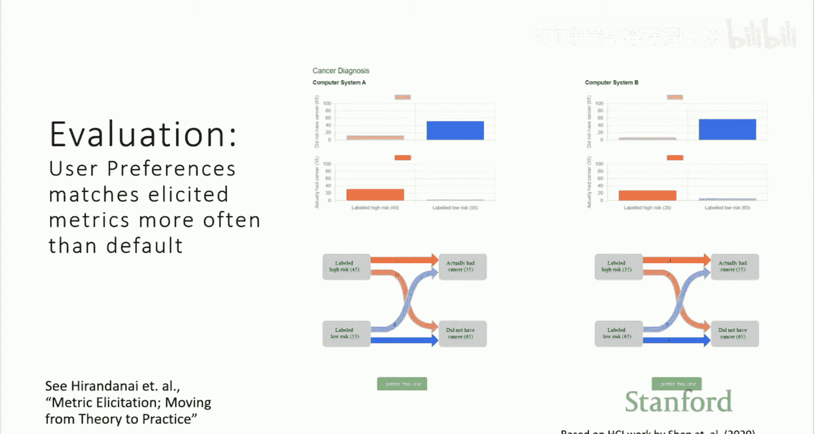

Any two points in RSC curve can be interd by weighted combinations of the classifiers。

 and that's of all you need for that proof。I just wanted to make sure。

I hope you I didn't lose your train I thought No， when we talk about something like more're abstract so what was it like training speed？

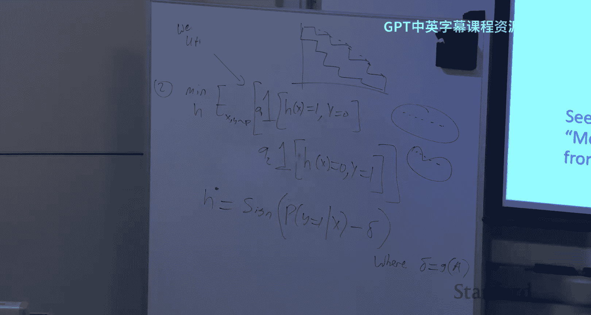

Some other metric。But， I think it becomes。Let's clear， like what？What space that's going to live in。

 you might argue like， oh， well， you can just randomly take or something。

 but then it doesn't end up working out the same way because like maybe the the actual sheet that you get isn't。

Interesting。Yeah I don't know so I think the actual answer I think the premise is appealing that you can generalize this idea of other things I think your criticism is also correct。

 which is。

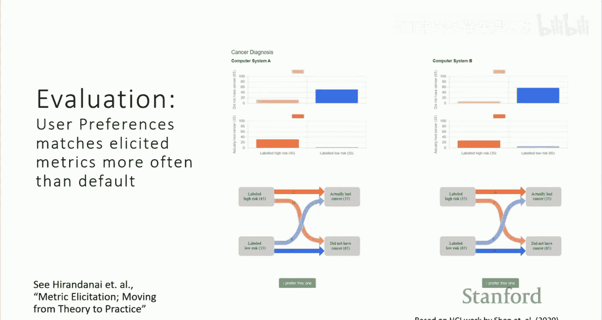

You know， for this to work， you need some of these properties to be true。

 including complexityveity of the space of which you're searching。

 which is all makes the sort of the connection easy and if I wanted to do this from some other setting I don't would have to check those properties and see what was true or dev something that worked in some other space this is a comment。

But I think it's useful。 Like the idea of a confusion space or trying to tabulate。

How or the pre frontier idea any way you want to call it。

 that is a useful and generalizable idea that you do see。 So like people often。

Do research that is very close to something like a rock curve without knowing it。

 And if you point that out， you can usually spur vote to。

Consider something for much of a perspective， which tends to be helpful。I agree， that's a good time。

Yeah。I guess like maybe。InIn a generic setting， you cannot have the full loop。 But I feel like here。

 because you pick the threshold that you end up with many joys of auto。He practice。When。

I feel you only have few number of model like 100 model or something。 And， and you don't。

 therefore of course you can't threshold like there's no， there's a model that costs $100。

 there's another model that costs $110。 There's nothing in between。Awesome， I think， no， I mean。

 maybe， maybe not。 I don't know。 It also may be that it's a useful abstraction for the search process。

 if if。So I I think it's a you know， beyond the setting。

 so the thing that has been worked out is the setting， I think beyond the setting。

There is interest that I think we've played a little bit with trying extent。

 but I don't think we've done this in full generality necessarily。

 and we can talk about that offline。So we have three minutes。And I had three papers。

 and we got through one。 The third one easily can move to mechanism design。

 Let me spend a couple of minutes on the second one because I think it's interesting because I also don't think we'll have time to go through later。

 but might offline take a look at it。So。I I do this in two minutes。

There's a talk and sorry there's posted ass a talk， there's a paper then take a look。

 but maybe I'll frame the problem and a little bit of the algorithm because it varies。

 it borrows a lot from what we just talked about I think to be close so the naming and the framing is a little bit different though there's a lot of underlying connections to what we just talked about again in the setting of binary classification problems and it alludes to concept in psychology called inverse decision theory。

 which is there a way to frame the idea of somehow we think about。😊，呃。

Inferring other people's preferences is by one way to think about it for other people's preferences to think about sort of their underlying preference problem as matching some underlying。

So I'm gonna， I'm gonna to do this badly。 so I will actually stop。

 I'll say this explicitly in the human machine interaction setting。

 So the setting that's interesting that I wanted to work on。Is the machine has some models。

 So the machine has done this work of estimating conditional probabilities。

 and I'm looking to find the classifiers。 I'm looking to find decision role。

 And I want to do this from a few samples。 a little bit different from the previous setting is I'm going to try to do this at the individual sample level instead of at the population level。

 instead of comparing the type your question a little bit instead of comparing to the population metrics over or population performances over things。

 I'm going split geometry a little bit more to actually try to do search over specific examples and ask people preferences over。

Labellings of different examples as a way to get at you can you think about this at the threshold the best matches their preferences and in my claim is the threshold will map to a trade off in sort of aerospace that best matches the trade offs that。

They're most interested in。 So again， like much of what we've been doing， you know， you need。

 I didn't mention this earlier Ra， actually， this is a useful abstraction。

 You need the model first for both of what I've talked about。

 You can think about this as one abstraction that people sometimes like is think of getting this model as pre training。

Get the overall distribution and then preference tuning is finding the weights or the threshold that matches the decision making setting that you're most interested in that matches a little bit some of the rest of the setting that we've been talking about。

Okay， so。Okay。So what's helpful to say it turns out I can solve this problem I think I go straight to the algorithm So it turns out I can solve this problem I think the interesting aspect of this paper compared to what I just talked about is that we try to be a bit more explicit about sources of noise as opposed to again assuming zero noise so this allows for noise that comes from a distribution of stakeholders。

 noise that comes from some extent error in the algorithm。

 potentially other kinds of noise that can lead to uncertainty and the main algorithmic change here is that using a probabilistic version of sort of search algorithm instead of the deterministic one so you can use a probabilistic by section algorithm details in the paper in the in the slide and also in the paper works very similarly to what we just talked about the main difference again it allows。

For some uncertainty， the key intuition is you build a prior over possible threshold points and then every time you get additional signal so labels from people you upweightigh evidence that's telling you the threshold is more likely to be here or not here and in fact you can use this to show explicit proof of like how long will it take before I get the right threshold and you can think about this is when will the measure around a particular point be high enough so greater than half for instance so I won't go into detail but mentioned this is there。

I'm going to end here because we're at time I think the thing and we'll talk about options when we talk about mechanism design maybe I just go straight the summary so I'll just move this to future lecture。

So the main things we talked about telemetric illustrationation。

 which is a specific instantiation of the combination of preference estimation and sort of classification problems and show that you can do so some special things there because there's a lot of structure that you can exploit and we talked about how we can use this for some of the argreg I did this very quickly but this is a second paper I may try to find time。

Sp more time on that because I think it's interesting。 We didn't talk about this。

 but I'll mention you can use this for other kinds of problem settings like algorithmic fairness problems and the like。

 and we didn't cover the last one at all。 So that's most of what I want to cover today。

 I think it's fine that we mostly covered the main thing because the key intuition is again。

 and the key takeaway。 one is you know just like in general learning problems。

 we spent a lot of time thinking about utility functions and metrics。

 even in very simple say binary classification problems that choice is also an important one。

 And many of the tools we've been building over class can be useful there。

 And specifically in that setting， we can use the combination of active learning and preference learning as a way to do a hopefully much better job of picking utilities that better reflect stakeholder preferences so that's a key takeaway。

 hopefully like from this and some detail in the slides and maybe in homework ground and things and future lecture will talk about benefitsits and sort of other kinds of algorithmic tools that can help us in preference learning。

Thank you。😊。

