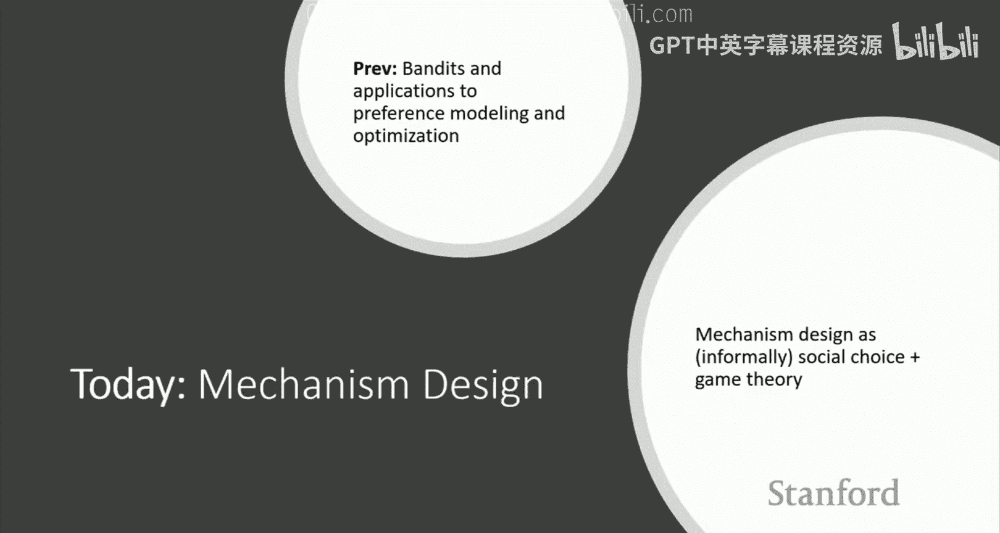
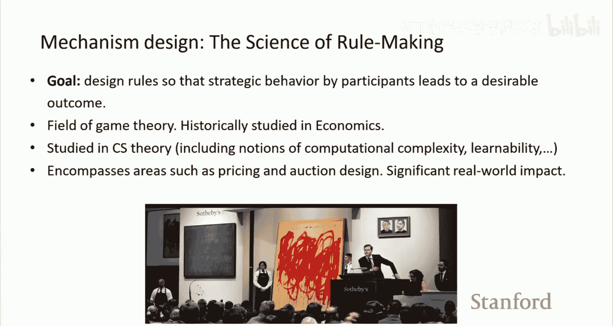
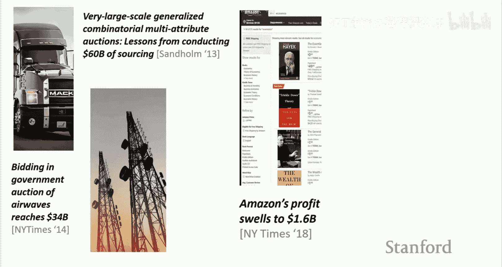
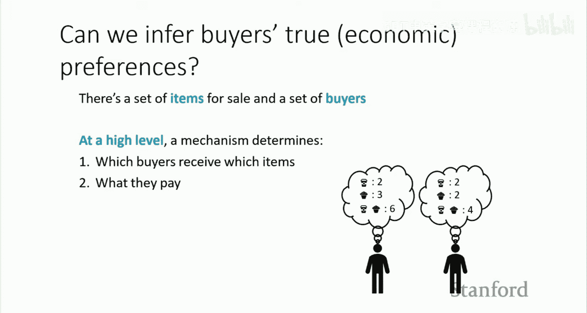
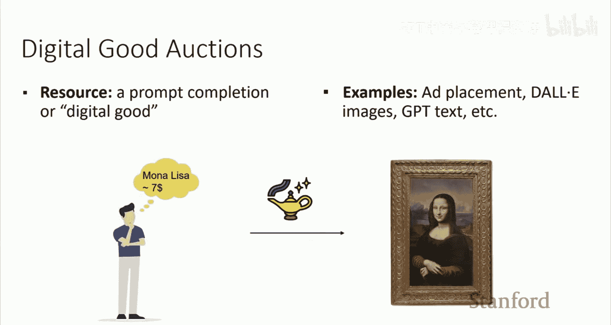
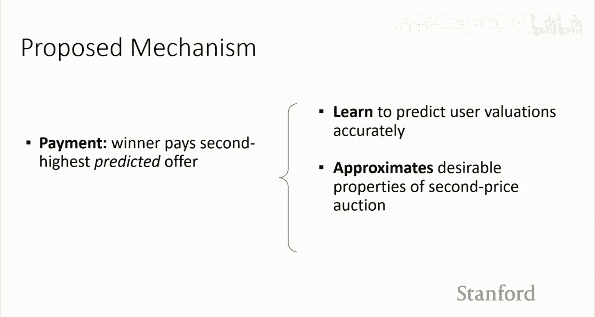

# 斯坦福大学《基于人类偏好的机器学习｜CS329H Machine Learning from Human Preferences  Autumn 2024》中英 - P4：MechanismDesign.zh_en - GPT中英字幕课程资源 - BV1n2Hfz6EGR

So the goal today is to cover。

Mechanism design as one of the tools that another interesting tool， at least from my point of view。

It's a combination of some of the ideas we covered already。

And things like social choice and voting and things like that with some ideas from game theory。

 which we alluded to at the end of some of the voting lectures。

 but connects to both social choice and game theory。

 we will try to make clear what those connections are building off of。At some point。

 some of the work we talk about today a build off of what we worked on earlier。

I should definitely。Ex。What we've worked on earlier tied2。

Asking questions about bands preference modeling， preference optimization。

 we'll think of similar ideas， but now in a。Strategic or game theoretic setting with actors that may be adversarial or may be facestious in various ways。

 and so hopefully some of this screening will be clear by end of lecture today。

So in terms of a bit of。Frame setting for those of you who haven't seen mechanism design before。

 So one of the definitions or some of how the field defines itself。

Is in terms of the science of rulemaking。So thinking about this as how one can design rules such that you get。

Design rules such that even if participants choose to be strategic， strategic meaning that。

The way that they engage in the system could include， for instance， being material or being exc。

Targeting their own preferences or like whatever way that they choose to engage。

 the overall ecosystem still sort of work correctly to lead to some desirable outcome。

 which is a social choice kind of setting just like in social choice part of the role of the designer is to decide what desirable outcome is and beyond that then the job is to figure out。

What are the interventions that one can？Oh how can I one this the rules of the game。

 if you like or the rules of the interaction such that you get a debt desire blog come even if the actors in that outcome choose to give a serial or strategic in various ways So I put sort of theralrating of what this field tries to answer So I'll try to make this a bit clear maybe grounding examples as we go through。

It borrows from a bunch of different， I guess fields of study。

 so traditionally mostly studied in economics， borrows a bunch from game theory ideas。

I don't know the actual length of time， but I want to say。Definitely in recent memory。

 roughly aligned with when sort of large internet companies became a thing。

 it ended up being extremely useful for real world of computing tasks and so it became a topic that was studied more and more in computing literature and so we'll touch on some of the use today。

 but this include you know things like what came up with social choice the notions of computational and complexity。

 but also interesting questions of if a machine learning model is part of the mechanism。

 how do I think about its learning process within the mechanism again hopefully some of this would be cleverer over the course of literature today。

So I'll talk through some of the reward impact。 But I think one of the。

Clara successes and actually one of the ideas we'll spend the most time on today。

Are things like as and various kinds of pricing and economic decision making where there's been a ton of impact of both designing mechanisms of studying their properties and various kinds of reward contexts。

 I'm showing here an example of an a as a little option to give maybe a flavor of some of what we'll discuss over the next few minutes。

So I'll start off with， you know， some of the。Existing examples of where。Mechanism design ideas。

 auction ideas have had impact。 So examples from things like when there was bidding a process for when some of the spectrum for radio waves was the regulation change。

 does' a bunch of work that use ideas mechanism design sort of set up a bidding process， such that。

 even if the actors， In fact， clearly， the actors were selfinterested， right。

 they want to maximize profit or whatever。 Yet you want to set up a process such that。

 you're likely to get good outcomes。 So again， framing what mechanism design tries to do。

So these are good references if you're interested in some of the history these kinds of ideas and particularly things like auction and pricing。

 I use a ton in lots of web companies， so allud to example I gave earlier。

 things like Amazon deciding sort of pricing and ordering of items and things like that a lot of the big web search companies use ideas borrowed from this literature so Google uses this as one of the things that powers the ad buying process behind search and I like these numbers I' borrowing this from colleague who gave this talk initially the references at the end。

But， you know， in 2016。Google had a $79 billion revenue in ads， total revenue was 89。6 79。

 so something like definitely the vast majority of their revenue was tight ads and this technology powered by again sort of auction processes and bidding processes and things like that。

 Facebook similarly I think。Again， ad revenue in 22016。

 everything else is running error compared to like what was tied to ad revenue and what power is the ad process are option kind of ideas that come from mechanism design。

 many of them directly borrowing some of them small adjustments， again。

 what we'll get to some of this over the course of the lecture today so the main point being made here is that this is an area that over particularly in recent times has had a huge impact on society generally because the tools that it brings have now been used for lots of pricing kinds of decisions。

 options collective decision making of various kinds。So for our purposes and maybe to be more。

Correct， the key question or one question that you might be interested in asking that may alle you to using some of these tools our question is like can we infer bias true true economic preferences and economic preferences I'm thinking here of as like you know what。

Actual value or price do different stakeholders have。 in this case。

 buyers have for certain items that may be looking to sell。

 And so if this is a setting that you're in and you're going to use a mechanism。

 then the mechanism needs to decide which buyers receive what items and then how much they pay for each one of these items。

 And the goal under the hood is to do in such a way that。Again， you know。

 you could define a societally desirable outcome often in these settings a societally desirable outcome as that。

The amount paid is。Comensurate with the value or actual items for individuals and like an economically good outcome might be whoever values item the most actually gets the win of bid for that item if they bid their true value for that item。

 So for example， in a coffee shop setting， an item could be coffee。

 cupcake or coffee and cupcake and we have two potential buyers who have different prices for like what they what they think a coffee is worth cupcake is worth meaning how might they'll be willing to pay and or the combination of coffee and cupcake。

And the task might be or the task here， the mechanisms task is to figure out how do I design the interaction system such that you know。

For instance， if you're comparing。Just the cupcake。

 the individual who values cupcake the most might win a bit。

And it's worth stating that individuals or buyers here have incentive to be strategic， right。

 so they want the item， but they also want to pay as little as they want。they can。

 right so there's this tension of， you know， if you like。

Trying to game the system in some sense and pay as little as possible。

 but also having some intrinsic value for set of items that are being sold。

Does this make sense as a general framing， just yes， please。 So in your， like this example。

 the cupcake1。P winning to pay $3。$2。 So as like we think， okay，$2 is a price。

 we are kind of exploiting that one person to give as max equal like that is three。

 So in like a social setup。iss that a good outcome。 Make prices too。

 But we are just exploiting that how much a user is willing to pay and then。Moern3， is that like。

 I think that's an interesting。 So maybe at a very high level。 You know。

 it's up to the designer to decide what a socially valuable outcome is。

 I think many of the frams of this problem use maximal revenue。 essentially as the desirable outcome。

 And so in that setting， then just maximizing the price paid would be within you're aiming for。

 I think at a very， very high level， somewhat beyond the scope of this class。

 a lot of what we said from social choice also applies here。 as a designer。

 it's part of your goal your job to decide what the desirable outcome is。

 And so you could decide to design a mechanism such that you get at different goals。

 than maximizing revenue。 That said。Most of。We'll engage a bit most of the things we'll talk about today。

Most of it will engage with strategic behavior of the actors and how we can make sure we avoid。

Been fooled by strategic behavior。 but I think it will be framed around maximizing revenue as societal good。

 There other notions of this that tied to things like welfare。

 which is not that difference of some difference of cost and revenue again， at 10000 food view。

 a designer could pick a difference。Social outcome as like what they consider social good。

 And for that outcome， design a mechanism to get at it。

 So if you like this flexibility in design there， But I think in practice and maybe not surprisingly for say economic books。

 it's maybe not a super kind of obvious that they might think of revenue maxization as a good outcome。

And I mean， we're not going deep into this， but。Theyre philosophical arguments for why people may think。

嗯。Capitalist style revenue Re is like a good way to markets。

 good way to design a bunch of other stuff。 So we won't go into that very much。 We'll take。

We'll borrow a lot from that literature， and I'm maybe spending some time on this。

 but I guess I'll say at a high level that there are avenues to think of other good outcomes and design for them。

It's a good question， thank you for asking。Other thoughts？Hopefully。

 it's also clear how this applies to preferences because again。

 if you think of preferences as being economic or can be economically priced or judged or valued。

 then preferences are now grounded here as like prices people are willing to pay for their9。So you。

It's maybe incomplete in the frame of the whole frame of this Glasgow we've talked about lots of different kinds of preferences and many that not don't seem as obviously quantifiable economically。

 but for most of what weve covered today and for many applications。

 and particularly when you can ground things economically， this approach can be very useful。

So it's it's a bit more general， but I think this is the。Easiest way to have the discussion。

 So I think we'll mostly so I guess I should also say that this is， you know， this is a topic。

 it's almost like everything else we've covered。 It's an entire field right And even here they entire classes on it and I'm only touching the surface of the material。

 So I'm hoping to inform on particularly folks who haven't are not aware on how this might be interesting。

 how it informs our questions of eliciting preferences and social choice kinds of questions And then if people are interested。

 like I'll have references so you can take more deeply and。B the stuff。Okay， so， you know。

 this is the framing， this is the setting。 there are a bunch of stuff you could do。 There's a very。

 very obvious standard thing that you could do to sort of。

Decide on how you might do the thing that the mechanism has to do。

 which is which buy the receive items versus and or what they pay I guess。

Ting out loud thoughts on how you might decide on。I guess how to sell items to these people。

Assuming these are the people， these are the buyers， you're the designer。

 let's say you're going with I want to maximize revenue for now。

What might be some ways that you might decide on？嗯。

I guess what mechanism might you design such that people can engage in this activity？

There's a obvious， not interesting， Oh obvious one。

 which is what happens in most places that are not options， which is。

 you post some prices and people will just sort of。

Decciide or not divide buy the items based on their value often we think about this as an individual level this might we think about this as utility so you know plus this price might be I choose 150 for the coffee350 for the。

Cupcake， and I maybe price this individually。 So the combination is just sum of the cost。

 whereas for an individual。The price or their value for coffee and cupcakeing together is actually different from separately。

 you can think about this might happen easily for lots of different kinds of economic decision making。

And so in this setting， the individual， you， I think 350 plus 150 is less than your six。

 so they'll probably buy to them they've increased their utility right because they're willing to pay six your total price for the item is together is five so。

The price is less than their internal utility。 So the internal value。

 And so the utility here will be 65 is 1。 there way。 Yes，2， the price is an additive。 like。

 That's a good question。 So in this example。 and the framing more generally。 And I which is also。

I'll state this here and then I'll try to bridge this more generally。

 so this setup allows for prices across sets of items that are not additive。

And it seems to match lots of real world behavior where people value sets of things differently than individual things。

 maybe， so let me attempts coffee cake， I mean， you can imagine practically that this by vitro true like you in a situation where you actually need both and you don't have food either and you might take a place that you know have both you can imagine this is a real worldor decision making but the other resourcing things。

 I don't know， you're picking a class and you have to decide instructor。

Who you might work with on of course projects， computing resources。

 there's some pricing for each thing individually， you can imagine there's some pricing for having actually those things jointly like the right configuration of those things that's very different from each thing individually because each thing blocks each other a little bit and so actually the right answer is a combination and you need to match your combination so your pricing for getting the combination right is much higher than getting a good or instructor you like I don't know。

Your friends taking a class and or on a class offering promising that they give you 10 GPPUs per student to do whatever you like。

Each individually these make sense and you know for some decision makers， single issue。

 if you give me enoughP I don't care about the rest of it or my friendss taking a class。

 I don't care about the rest of it， but I'd argue for many of us really a combination and so we're doing tradeoffs across these things and the tradeoffs may not be additive the combination might actually have a different value so maybe just the frame your question but more generally the framework allows for settings where combinations are not necessarily。

这个 question。Other thoughts， request。Okay so this is maybe the standard thing。

 this is what happens in most places， you know what you get at the end is that if someone purchases your item at a certain price。

 if you're thinking purely economically what you know is that their value must be higher than your stated price so you learn at least that much like an ordering thing because otherwise under this model they will not buy your item it needs to be that they have positive utility so you don't learn that much about individual preferences but you learn some at least directional signal about how they value the thing that they bought。

That makes sense。All right， so you might do something else。 You might do an auction。

 So this is you have your item。 Everyone guess the bid on the set of items and whoever has the winning bid。

No guesss the item， so this is maybe standard again to some extent thing。So， you know。

To some extent you might imagine that if you deploy this。

 you know you get maybe more signal about people's actual value for the item because you would imagine or hope that they would bid something correlated with how much they actually value the item。

 they might not and in fact。Actually， go， this is a lot of the literature and engagement here is again。

 engaging with what might individual buyers do in this setting and how may they try to game this system。

Any thoughts， so if you were bidding on an item？In this class and six of people at least in person here and we all have chosen to buy the Mona Lisa。

 whatever reason and we can afford it also some of you might I cannot afford Mon Lisa but。

I don't think you can buy it Yeah， do a standard bid standard auction thoughts on how one of。

 you know， if you want to be strategic and maybe get the item cheaper。

 perhaps what might you do Yeah， I mean， you you only bid like the minimum amount you have to。

Yeah so you sort of figure out if if you're the last person to bid in particular so you try to order information such that you get most information you get whatever else it will into to bid。

 your actual value may be higher if your value is higher than whatever is current maximum price you just go a little bit above you win a bid and that seems like a。

For the individual who is being strategic， this seems a very reasonable thing to do。So， you know。

If you're thinking of social welfare as maximum revenue。

 that's a bad outcome if you're thinking of like the goal of figuring out people's true utilities or value for things。

 it's maybe not ideal as well because know then people are incentivized not necessarily to bid their true value。

 they're incentivized to bid to win and winning is just different than like actually bidding what they value the amin is。

Any other thoughts on other strategic behavior that you could do？I think that's the obvious one， but。

For others。Okay， have you think about it， we， I think we'll get to it in some of the other discussion that we have。

Another option， one that you might have seen and is quite popular。Is a second price option。

So what you do is everyone bids， this partially mitigates the strategy that you just talked about。

Everyone bids。You get all the bids together， but the amount you pay is not the highest bid。

 you pay the second highest bid。Why might this。Be interesting。Take a some sort of a dye。嗯。Yeah。

A tie is interesting。 I think that's a little bit separate from this。

 Let's assume for discussion's sake， that each bid is unique。 So you don't have ties。 So， you know。

 you get to be what you like， but you're not allowed just for making this discussion easy。

 You're not allowed to bid the exact same number as someone else。

That's interesting because I could just bid like a million dollars。And nobody's got。Wantna pay this。

 So I got gets away So like， oh you can always win the bid by as long as you know that， you know。

 you're willing to pay the second price。Then you can bid some large numbers like that you win in the bid and you get。

 you only have to pay what it was at prices。I mean。

 I guess the counter the right is like someone could get annoyed that you did that。And then bid 999。

000。You know， again， everyone strategic。 Thank you。 Yes， exactly this。 So the other actors。

 someone sees， particularly if say you're not the last person fit And again。

 we're making a simplistic version of like some ordering thing。 But yeah， exactly this。😊。

Someone can be adversaral against you。 and then now the second order。

 the second highest bid is some really high number， much more higher than your value。Is that Claire。

 is a， I guess， a counter strategy from some other actor who， again。

 dear self interest is to win the bid and other I guess other people lose the bid as the ideal outcome。

You could also imagine， I guess that could be a mismatch between what the seller thinks of the value for the item and。

The set of participants who are choosing to buy， and so one way to mitigate this issue。

So that to be useful for other things。 But one we mitigate the issue of perhaps the value mispat between all the buyers and the seller is have a reserve price。

 So instead of， you know， second price wins， there is a minimal price of selling。

 So the seller has decided at least their sense of the value of the item。

 And so unlike the generic second price， the highest bidder wins if their bid is higher than what reserve price is。

 So this avoids adversarial collusion that may， for instance， lead。

Individuals to bid collectively too low or if their value just mismatch。

 so this allows avoiding that particular issue between the set of buyers and whoever' selling and。

If their bid is。Sorry， if the bid is high enough they win and the actual price that they pay is the maximum of the reserve price and the second price。

 if the second price is higher， they pay the second price that the reserve price is higher if their reserve price。

 so this mitigates some of the gaps in value， it also mitigates partially some of what you said at least you know the seller is guaranteed to at least meet your reserve it mitigates some of the adversarial behavior that we talked about yes the reserve。

You could do both in this setting。 It's known and public。But yeah， you can have either mechanism。

And interesting in different ways。 might imagine。 We'll talk a little bit about a amount of information available。

Co good question， so yeah， little example。あ。I guess some numbers the grounded。嗯。

Other or any questions on setup up？Okay。So。Now， lots of people have worked on this。

 We're going to see lots of Nobel Prize winners actually， I think one of those areas where economics。

 Oh， I guess a lot of them。Not surprising economics Nobel prizes that have worked specifically on mechanismchan design kinds of questions。

 So in particular， there's a second price option。 and sometimes also' what call the victoryy option。

And this work done in '61 eventually led to the Nobel Prize。

 and there's been a bunch of fall on work in the CS literatureature engaging with this question。

 again， adding in some of what we've talked about a little bit， things about computability。

 things about learnability， if there's a learning， algorithm in the middle。

 strategic behavior of different agents， different settings， things like that。

So a bit more formally to set things up。Suppose we have M items and end buyers。

And each buyer has some value for every possible bundle of items within a set of items。

T one defines the bundle and so sometimes this list of value across all the set of items is sometimes called the virus type places again。

 just you can think about this as a vector of enumerated of the value for every possible bundle of items hidden in the set of items。

Okay。And so， for instance， in our coffee example， as we already went through。

 has an example potential buyer。 So a set of items， coffee and cupcake value。For。

Nothing is zero numbers for every combination of things like we already talked about。

 And so their type would be just this。You this list of。嗯。

The values for different items and you could have this across all different buy in the system。嗯。Okay。

 and so in the sales setting。The mechanism is defined by two main functions， which is allocation。

 which is what some process that decides which buyers get what items。

 and then a payments which defines how much each buyer pays once they engage in the mechanism。

And as mentioned， often definitely you could， well， given this setup。

 you can always measure the revenue， which is again。

 I generally thought of a setup a sum of patients across all the buyers that participated in this mechanism and again。

 you might think about this as the targets and they of like what you want to maximize or you can have other things alluded to briefly。

 they want to maximize。Um， it's also worth saying that depending on the specifics of the mechanism。

 often buyers can bid whatever they like。As mentioned。

 often they will be incentivized be strategic because of this they may bid something that's not their true value of an item。

 And so we'll talk through implications of this and what。

Some of what is known about designing mechanisms to make it more likely that buyers might bid their true value for the bundle the set of items。

Questions。Okay。😊，So some properties that you might want and the one that I thought of as like the sort of core things that often won once when design mechanisms。

 one， you cover this in social choice briefly。This idea of incentive compatibility。

 this is incentivizing agents so that they bid de true value， they're likely to bid truthfully。

 which has multiple potential well from our purposes as a designer， we often this is our goal。

And you can about this purely in this sort of economic revenue maximizing sense。

 So you can also think about this in terms of eliciting preferences。

 So the true value you can think of as like。Da value for the items。

 and this is like the target that you might be interested in in this illustrationation mechanism。

Another thing that you will often want the mechanism to do is and this is often from the buyer point of view。

It should be individually rational， so if they're strategic and are looking to maximize whatever。

In terms of engaging mechanism， you ideally want to set things up so that they have nothing to lose by participating in the mechanism versus not。

 So essentially this makes it， you know， reduces barrier entry for them to choose to put to engage in the mechanism。

 So we'll talk to some of this in a second。So incentive compatibility is also another canonical idea so yet another Nobel Prize in 2007 originally introduced by Heritz in '72 and again。

 as mentioned， so formally primarily in sort of economic literature。

 but then engaged quite a bit across lots of other literatures and increasingly good computer science literature。

And so formally。啊。So I guess data claim and then do a sort of informal proof of the claim and pointers to sort formal proof if you're interested。

So the informal claim is that。The second price a， which we talked about briefly。

 which is this idea that you collect a set of bids。

 and then the winner is whoever has the highest bid， and then what they pay is the second price。

 second highest price， So whoever bid， second second number and the claim here is this is incentive compatible。

 which means here that the bidder， every bidder will maximize their utility by bidding truthfully。

 So the claim here is that if I choose this as the auction mechanism。

 the bidders are incentivize the bid or true value and cannot do better by over population cents over runs by。

Trying to be strategic and bid something that's different from their true value。Okay。

 so let's let's go through this So utility here is again measured as the value that they place on the particular。

Item that they end the winning。Minus the payment， so does gap。啊。

Times or indicators of selecting for whether or not they won so over a set of assuming there's a single winner。

 this is just the value management payment of the winner is the sort of utility for an individual you can average this over a population。

Okay， so why might this be true。 So we talked through some strategies and there were some version of like。

 should I bid over my value， Should I bid less my value， Let's talk through the first one。 So。

 and one idea is to strategically bid。Bigger than your value because you know that you're not gonna actually have to pay。

What you bid， You gonna bid。 You pay the second price。So why not do that？So。

 if they would have been a winner because they had the highest value， then they're still the winner。

Whether or not they bid above their true value， so just to be clear in this。

 we have a set of bidders across say on this line， a bunch of bidders that have some set of prices they bid front item。

m supposeose in this list， u individual K was going to be the winner of this auction because the the highest value for the item。

 then if they bid something above their true value， is still're going to win。

Compared to the other situation and the price will not change。

 So they' got nothing from doing this extra work of bidding higher than industry value。

 So the claim here is that in a setting where， again， it would have been the winners anyway。

 there's no additional benefit to bidding something higher。m separatelyparly。

 if they were going to lose the bid， meaning someone else had a higher value foot item。

Then they might end up winning by bidding something higher than their value。

 but then they pay more than their value and so this difference here goes from positive。

If utility becomes negative， see if this works。Worse one at likes and now's not one。

Let's first there， Okay， for this evaluation of the utility。

 which is this gap from what they truly value for an item versus what they pay is it seem to be positive right because you're assuming that we're sort of paying less than or equal to the value for an item。

 but if they bid really high。And everyone else could bid whatever if they like and so there's a good chance that if they bid high。

 then the second price winner will also be ahead of their value and so they'll end up paying more than the value and so you have a negative utility in that situation and so from a point of view of the individual bidder the claim here informally again can stay from ways that does not a benefit to bidding higher than the value from an individual actor point of view in this mechanism。

Okay， the other strategy is to strategically or overusing strategy here。

 but you could choose to bid below so we can go through what might happen。 So again。

 you can argue suppose they would have been the winner so they had the highest value across everyone Now if they bid below their true value。

Then their two value may end up lower than。嗯。Someone else who has a。

Higher true value that chooses to bid to true value， and so they end up losing the auction。

 and so they lose the item and again， they get zero utility。So again， you know。

 in terms for the point of view of the participant or the buyer， you can have positive utility。

The value is higher than what you pay， have zero utility。

 which you can just think of as they don't win。Or they pay the same as the value or you have negative utility。

 You overpay above your value。 And so the argument is， if you're trying to maximize this。

 where of difference to you。Decids to make and and what their impacts might be so you know if you bid too low and you might lose an option that you might have otherwise won until you end up getting negative utility。

Or zero utility from losing the oxygen。Okay， separately。

 if you're going to lose anyway because other people have higher value for that item than you would。

 then you're still going to lose。Reading it in real time， I might to use slightly different words。

 but same thing they're going to lose， lose the a。 and so the utility is zero。

 And so it's not from the their individual strategic point of view， they're not essentially。

 they don't do any better participating mechanism by strategically choosing to bid lower as argued here or higher as argued in a previous slide。

Thoughts， questions。Okay， so second prices， again， if you've ever engaged in anything with its auction。

 you've almost definitely heard of it sort of these property this property in particular has。

Let it to be I think one of the more successful strategies so we'll get to this in a little bit。

 it turns out that lots of the search mechanisms use second price。

 It turns out that they're not fully well matched in that second price for a single item being bid on whereas in search settings typically bidding over a bundle of items。

So it turns out we'll spend two minutes on it， but there's some misms there that said second price has had a huge impact in。

In practice and is like essentially a deleting option mechanism， partially because of this。

 this claim， this idea that。For a rational。Buying agents。

 their best action is to bid your true value for。 So strategically trying to bid above the value or strategically trying to bid below the value in a population setting will mean that they will do worse than if they bid your true value。

Yes， is it also the best thing for the one that sells the item。唔啦。Necessarily， and in fact。

 we'll get to this in two seconds。 So no， so the claim here， the question was， as I understand it。

 is second price the max the optimal mechanism in terms of save revenue。

If you're trying to maximize revenue and the answer is no。For a single item auction kinds of bids。

 but it is optimal for or sorry， is it does satisfy his property， but it's not the revenue maximize。

Meus。Okay。Okay， another property， which we mentioned briefly is this idea of individual rationality。

 So again， another nice property of second price is that it's individually rational， the claim again。

 say it informally and appoint your references。 want to read more carefully or get a formal proof is that each bidder is no worse off participating the not when they choose to bid their true value。

 So again， in terms of their individual I guess rational choice of participating not participating。

 they don't lose anything but choosing participate if they're going to choose。

 if they're going to engage in this， giving their true value for a set of items。 Yes。

 repeat at that so。The way to see this if the price of the final price of the item is less than their value。

 they pay nothing or their payment is smaller than value sorry actually that's the claim so it is paying nothing or they payment is smaller than the true value for that item given participating because again remember if they bid your true value then they either win the auction and pay a second price so they have positive utility or they lose the option but someone who had a higher higher value for the item will win the option and so strategicly in terms of engaging in this they lose nothing by choosing to engage as long as they choose to use the true value is that clear I'm feeling a bit word salary someone to make sure it's getting across clearly you know。

不。All right， so slightly more formally and the way often these analyses are done need a little bit more information。

So generally， you can think of bias values as defined by a probability distribution。

 think of these as samples for some distribution over the bundle of potential set of items。

And from that perspective there are a bunch of different ways that you can analyze IC properties。

 so the first is what is often called and I just list these as definitions more than engage in detail。

 the main thing to get away here from here is different levels of information about the rest of the mechanism that each bidder might have。

And agents might have so one analysis is purely distributional。

 so you presume some distribution over values across items from all the bidders。

 and so this is often called Xante IC or instead of compatibility so the goal of the mechanism design here is to ensure truthfulness and expectation over bidders values。

 given knowledge of distribution of。That where the values is sampled from。

Slightly stronger notion is called x interim to now bidders know their value and distributions over others values and so you want even in this setting some notion of truthfulness to be the dominant strategy like the best thing to do to engage in this and this mechanism thats called x interim I see and finally this's called exp post there's a termxpost I see which is you can think of as the strongest version so now I don't know distributions I know actual bids of everybody I actually know sorry I know actual values of everybody so I know essentially whatever values for all the items and you still want or you'd like that the bidders should still be inivized to be truthful in that setting so you can think about this as sort of different amounts of information that bidders might know and definitions of I see in these different kinds of settings and so you see this when you look through。

Teacher on center compatibility。Okay， so there lots of mechanisms out in the world。

 different kinds of purchasing systems， we talk through options we talk through。

 I guess first price in general， many of them。I guess either known to not be incentive compatible or in some settings they're sufficiently complex that a full analysis has not been done yet。

 so it' is not known if they are so common ones， things like first price auction which is often what display ads use so you pay the price the winner pays the price that they bid for many display ads。

And， you know， if you don't have this， then what this means is that。

A strategic actor may do better by picking a bid that's not their true value for the thing you're selling so again。

 that's the potential loss， the potential costs， I guess。

 for the mechanism of not having incentive profiability is that you lose the claim or the guarantee that participants are incentivized to bid to true value。

Okay， so things like first press auction， we talked briefly many sponsored search ads。

 so things like what Google uses。Are called generalized second price a。 The main difference is。

 again， the first price I see claim is for multiple bidders， single item and search ads。

 you're bidding over like ranking like multiple placements of search ads and multiple items and。

In practice in general， so I think the following is known。

 so people still use most search as still use generalized second price auction anyway。

People have shown that there are strategies that can gain general second price options。

 though it's known not to be incentive of edible。 I think yet that's still probably the most popular deployed algorithm。

 So it's maybe interesting。Uncognitive dissonance that is this strong property that we want。

There is an idea that's inspired by a different setting where we have very strong guarantees。

 people transfer it to this new setting， the guarantee is lost but it's still used in practice。嗯。

Okay。Yeah， and also lots of other kind of like more complex comm auction and things like that are either known to not be inside compatibleible or not known because the analysis is incomplete。

 So some of the issues include that figuring out the values might be expensive So this is a sort of computational argument。

 issues with like the rules and ease of explaining there might be some leakage between the bidding process and the sort of auction mechanism So for instance。

 using bids to and feature parameters of how you might bid in the future often will change things depending on exactly how the mechanism is designed or agents are not risk neutral And so the premise of the whole thing。

Means actually like invalidates。The assumptions that we're making about patients participating in the mechanism。

Okay， so there's a bunch of work in literature， I also wanted to mention that while I've stated this as a property。

 there's a bunch of work that also tries to make claims about approximate notions of incentive compatibility。

 so some measure of departure from it， I won't engage it all。

 but I'll point to references if you're interested， to get more details on。

Other notions of approximate， I see。Okay， so。That's most of what I want to say on incentive compatibility is also you can say similar things about individual rationality purely here in terms of。

 so remember here， this is this argument about whether bidders are worse off choosing to participate in your mechanism or not And so an IR mechanism has the property that eubator isn not worse off choosing to participate and you can analyze this again。

 at different levels of bidder information。あなすけど。Okay。

 so there was a question about actually maximizing revenue， so this is known for single item options。

So this is due to Morrisson another Nobel， I think a third Nobel Prize。

 I think I only had three in this。 There might be others related to this。So in 81。

 showed the revenue maximizing single light a， which is a somewhat more complicated second price。

 We'll talk through it in two seconds。嗯。So we'll answer your question。

So the issue with the second price auction as already identified partially is that stronger bidder。

Always pays the weaker bidders bid， and so the revenue from a seller's point of view。

Depends much more strongly on， I guess the the values of the participants。

 And you could argue that from a sales point of view。

 what they want is the true value of the actual maxim bid。 But if they ask for that。

 So if they ask to pay the top bid， then you lose incentive of compatibility。

 because their strategies that you can then use。 if you like。

 there's a trade off that needs to be made。 What the seller wants is to maximize their revenue。

 So get the highest price。If they knew all the values。

 then what they would pick is the buyer with the highest value。 if they do that。

 then this means your mechanism is vulnerable because those buyers can be strategic and actually then like bid something else and end up paying less。

 And so there this sort of yingyang whereness thing that's happening where the obvious mechanism of like just paying the highest price is loses strategic usefulness。

 But the mechanism that that is known to be strategically correct， which is again。

 the second price thing leaves revenue on the table。 So it says this this gap。

 And so Myerson suggested a alternative strategy and then showed that this keeps i see。

 but then also maximize revenue。 So it's this relatively simple idea in a distributional setting。

 let's assume that bitter eyes value has a distribution with a certain Pf。Call it F。

 say supported it on01， so we just normalize so that the values everything01。And so in this setting。

 we're going to define。A set of virtual values。Which are the difference between so。啊。This is。

 I guess a functional definition。 So given the distribution of values for each individual。

 I'm going to define this function， which takes that distribution。This function。

 what takes that distribution and computes a new property from it。 So this is。

What then we'm going to plug in is the value。 So I just go ahead and talk about this in terms values。

 because the value minus some normalized notion of distribution。Of values for that individual bidder。

so once you compute this， you're going solicit bids from across all the buyers and the procedure is first you check if all the virtual values。

 there's computed quantities across all all the items for each bidder if they're all less than zero。

 then it means which also then means that the gap between the value and this sort of CDf correction is negative。

 then you don't allocate the item so the mechanism end if there's at least one that's greater than zero。

 then you allocate the item to the buyer with the highest virtual value。

And then they pay a thresholded bid， which is computed as the sort of inverse。

Of this forward function， so。You can look at the definition but this is a variation on second price。

 it's actually probably worth saying so。This is a this maximum。the mouse here。

 This maximum is computing all the virtual bids for everyone else and looking at the maximum that's not the winner。

So it's exactly the second price for the virtual bids and then it has to be greater than zero。

 which is the first criterion in here and then you do sort of inverse transformation back set of values and that's what they end up paying。

And what Myerson showed is that if the bid is set up this way。

 this has properties that look a bit like second price， as you might see。

 because the price they actually pay is the maximum virtual bid for everyone else。

 apart from them assuming they're a winner。So what Myerson showed is that this keep sight see properties。

 so you remain in compatibleible。meaningan the optimal strategy is still to bid your true value yet you can show that this is the revenue maximizing strategy。

 so this will maximize from the seller's point of view the amount of revenue that they can get while ensuring that all the bidders are still like incentivized to bid the true value they have for each。

Okay， so， you know， in a simple setting where buyers's values are ID。

 so they'll have the same distribution， it turns out that you can convert this into a standard second price auction where you have a reserve price。

Of by inverse of zero and you can sort of kind of see this because the virtual values will all be sort of offsets of each other and the actual price being paid will look like this inverse function maximum of zero。

At least from。Cloqui point of view， hopefully it's clear why this is connected。Yeah， okay。

 and there's also work just alluding to it of the same item。

 but multiple units of an item and how to think about optimal revenue maximizing incentive compatible options for that setting I'll let you look at the reference。

If you're interested。Okay， so beyond that， it turns out that you know we know how to do single item optimally in terms of revenue mechanization I see。

 it turns out， at least I think it's still true to my knowledge unless something happened since when I looked up this literature and now which is minutes。

Or hours maybe that we don't know how to do even two items optimally so this may be a bit surprising but just stating as a statement of effect there's a bunch of work that engage with this both in the economic side and in computing and so meaningful progress on think about these questions but。

Maybe a hard， interesting problem with someone is theoretically inclined and wants a really hard problem to solve maybe a fun with。

And may surprising as well， right， perhaps given what we said beginning and some of the description of the overall setting。

嗯。So this also engages with more and more as people have connected this to machine learning setting。

 So in particular， as you might know， many of the modern， say。

 a bidding infrastructure has learning models under the hoods。

 which help say predict prices predicts placement as much of learning under the hood。

So there's a bunch of work that tries to connect learning methods with mechanisms and ask questions about their interaction。

 So， for instance， there are aspects that try to use online learning to ask questions about revenue and bidding。

 so you might think of say， buyer that say potentially might。

Choose to buy an item multiple times over the course of a week。 for instance。 So they arrive。

 either them or for population of buyers。 And they there's some price for the item。

 and they might choose whether or not to buy。 So this is the version of a fixed price deposit setting。

 like I mentioned at the beginning。 But you could also imagine doing this within。

Other kinds of interesting mechanisms。 And so there's a bunch of work engaging with how to do learning things in the setting。

 So some of the questions you might be interested in asking include。So learning questions regret。

 as you know， is one of the main ways。 we've already covered it in the Beijing organization work。

 for instance， that we did。Last lecture so this difference between the cuumulative revenue for the seller versus the best price that they could have gotten in hindight and so the bunch of settings where this isn't been studied。

 there's work engaging with potentially adversarial buyer values， schastic buyer values。

Maybe somewhat easier cases。Herbyer seem to behave truthfully。

Various kinds of strategic behavior via the buyers。

Other work and maybe much more directly related to us are things like mechanisms for where the buyer has to learn how to bid。

 so they're engaging in the ecosystem or the mechanism over time and based on the interaction and sort of signals that they get from the mechanism and also so this is what they get from the seller and what they learn from the other participants。

 they try to update their process for learning how to bid。So for instance。

 simple version of this is like a learn to bid setting where at the beginning the buyer knows nothing about their values for items at each round they only learn values for items that they actually win so they choose something and then if they win to learn the value if they don't win they don't learn anything and so the goal is to compete with the best fixed bids and hindsights so the optimal strategy is if I knew sort of true values and I could actually bid those and so the regret setting is again if I knew the optimal fixed bids what does it gap from that strategy similar to again the regret over the past couple the same idea other interesting aspects of this so there's something called profit inequality kind of a problem so here buyers arrive in adversarial order and have random valuations so again interesting setting people have done a bunch of interesting work many of them in competing venues asking about。

Like how learning again engages interacts with mechanisms。

 sector problems where the naming has meant to allude to buyers arriving in random order。

 so the gap here is again the two things intervene on our the order in which buyers arrive and then the evaluation valuations so the distinction here is and profit settings。

 the buyers are adversarial in terms of ordering but the valuations are some generic distribution and sector problems。

 the buyers arrive randomly but the valuations are adversarial they're thought to be some notion of worst case and some people have done a lot of work in trying to engage with how learning interacts with mechanism in those settings。

Also related to stuff we've coveredVID in class。So know you can ask about learning with various kinds of revealed preferences。

 So similar to some what already discussed in economic decision making。 but here pricing。

Tight in with。Or I guess you get to observe people's individual buyers' actions over iterations and you want to predict their behavior in the future and think through what the mechanism might be for pricing in these zones。

Okay， so lots of interesting questions， many of them learn theoreticaloretic so things like how many training examples do you need so that are kind of sample complexity kinds of questions you might ask in a learning setting algorithmic questions。

 how do I learn a preference function in the setting that captures the buying behavior and how does that tie to mechanistic choices。

Lots of fun work in this area again， as mentioned at the beginning。

 this is a full rich area which we're not engaging with hopefully we can pull nuggets of ideas here。

Or。How we think about the purpose of this class。 And then I think there's an opportunity for deep dive for people who find this kind of material real interesting。

 I think there are lots of lessons。 The reason I'm presenting this actually is I think there are lots of lessons。

For the task of like preference solicitation and preference optimization in AI。

 that I think is under the translation is under underutilized。

 And so I think there' are interesting things learned from this。One example。

 pairwise feedback options for digital good settings， which mixes a bit of illustrations。

 some of the online learning bandit things， a bit of mechanism design as sort of one example of all this things coming together in a preference estimation and optimization setting。

So this is motivated for digital goods， so things like what we've already engaged with， lens class。

 things like PRm completions， synthesized images， stuff like that。

But you could also imagine using this for things like ad placements and other。Other settings。

 I think in standard auction and bid settings， the market is obvious。

 The bidders get to know ahead of time the item that they're bidding on and something about the ecosystem and often will know the mechanism actually as well。

 So they know a lot about the infrastructure。 saying no， I'm going to buy ads on。

Google Adwords or whatever。 or I'm selling items on ebay。

 I want to sort of build those auction systems in digital goods。

 You don't know how good the response is going to be until you've actually completed the front。

 So the work has been done， essentially， So I'm looking to price。

 you can imagine from a seller point of view。 I'm。I'm building。

 I'm open AI or some other big generated model builder I'm looking to。

Assign some price for certain prime completion。 This is not how it's done now， by the way。

 as all of you know， right now， it's all fixed prices。 no options。 but you can imagine。

Perhaps economic incentives lead to variable pricing for pump completions。

 which a reasonable way to think about going about this might be some kind of some like this like an option。

 The challenge option， of course， is that I don't know how good the completion will be before I see it。

 So all I get to see I only get information after I've already sort of。

The seller is already done to work。 And so if I was looking for pricing a signal of whether to do the work or not。

 in some ways， this invalidates。The whole idea of like choosing whether or not to say complete a certain prompt based on whether the buyer is willing to pay a certain amount for it。

Is this， Claire。Not the wordsityy thing， but。YesSo so one more time。At least for myself。

 even if maybe you guys。I'm hearing I'm seeing nods， but I'm hoping they're not just polite nods。

 so mechanism is that the seller of the digital good has to decide how to price things like prompt completions。

Ideally， you'd want to do this before actually completing the prompts。And in order to do this。

 the seller has to know what the actual prompt completion will be So there's a mismatch of information here because the seller doesn't know the prompt completion until the prompt completion is actually done and so they don't know the value that they would have for the completion until the work is actually done。

 which means that the buyer can't decide ahead of time。

 whether or not the seller mixing bill the buyer doesn't know ahead of time whether they want to buy a certain completion。

 the seller isn't able to make the decision of whether or not to sell the buyer at a certain price because the buyer can't figure out whether this particular completion is good so there's a where cycle thing of someone has to make this in first and it's unclear how to engage in the setting。

Okay， so this is， again， related to many of the problems we've been discussing。

 But the main point is to argue that this is somewhat unique compared to the generic a setting。

 because there's this additional missing information because you have this sort of unlike standard settings。

 pricing and actually the item is actually not a real thing until the process is complete。

 So it makes the pricing a bit complicated。I know I shouldn't please please do hey I've more recently been calling this like it is used in the literature too just information asymmetry between the。

The2 parties like at the very beginning， you had this like so the be option an example in that context is。

One time。They sold a painting and as soon as the auction was completed。

 the painting automated itself and destroyed it。 Oh right。

 I remember the content is a recent thing yeah。Okay， that's a fun one。 I guess if the seller。

 if the buyer knew ahead of time， they might have changed your evaluation for my memory is that this wasn't known。

 right， Okay， does anyone people know the story。 iss a real thing。😊，Is it related to some entity to？

No， no， this was a real painting。 So， so it was a， it just， like as soon as it was sold。

 like it was actually like like like a paper shreddder the art included destroying the art。re。

 you're paying for the art being destroyed in front of you。And so you know， as an artist。

 you can imagine this may look completely reasonable， but from a bias perspective。

This may seem adversial， but the point here is that you know in terms of limited information。

 I guess it yeah， but this happens pretty sometimes if I talk to a one or something you put in a huge prompt。

 it thinks for like two minutes and then it spits out zero tokens。😊，一年。

I think that's a great actually very modern that was not available and that's a great example。

 indeed of this issue。Okay， okay， so what needs to happen， the bidders have to submit offers。

 And if you imagine in this in a competitive setting where。

The thing that's forcing pricing is say computational resources。 right。

 So you have to decide you get a billion requests， you have to decide a small subset of these。 Again。

 this is not what's happening now， but you can easily imagine the way things are being used it。

 Like this may be part of a。If there are resource constraints。

 then one way to mitigate resource constraints is to have adaptive pricing that may be tied to people's value for the completion and the challenge here is again。

 this information is symmetry so bidders have to submit offers to fulfill requests before actually seeing what the responses are and then does this resource behind the scenes needs to be allocated what completion do you do you make so the question is is trying to decide fair pricing。

嗯。In the ideal setting， and in standard。What you don't get as much as you get in a standard a setting is again。

 users don't have having complete information， and so you want to think of some way to improve or increase the user information to form the evaluation。

And you'd also like for the whole mechanism to be incentive compatible， as we already discussed。

 so that bidders， whoever is engaging this mechanism。

 is incentivized or their optimal strategy is to bid a true value for the completion。

 which at of time they don't have。 This is， of course， a challenge。

And so the setting more formal is that we have a set of users， we have the IT user at time T。

 this exists a mechanism that will choose to fulfill or not fulfill a request that comes in。

 so this is request X for the IT user at time T。The agent gets utility sum true utility muIT and reports reported utility RIT for the allocation。

 so whether or not the request is actually completed and we want to design an option that given only observations of request and reported utilities。

We good here and will define as sort of utility maximizing and incentive compatible。

So you want that again from a。Individual and like revenue utility point of view be maximized globally as mentioned before and then from a individual。

sort。Stakeholder point of view， they should actually state their true value as opposed to try to lie。

So compared to a lot of the existing work， some of the gaps include often we assume that agents know their value for outcomes as mentioned in some of the discussion earlier。

You also have uncertainty that plays a big role here。

 particularly in these kinds of stochastic generative model settings。嗯。

So the mechanism now needs to be dynamic in setting where the agent can't know the value ahead of time and the value might change over time based on context and things like that。

 and in addition， outcomes going to be uncertain in various ways so as you might imagine。

 so there's a challenging problem and somewhat distinct from at least what we've covered today in terms of existing standard mechanism setting。

So the proposed mechanism is a is based on pairwise preferences and other kinds of partial preferences。

 and so it's this loop of。Like an initial stage where。You try to learn。

The potential value of across items。 so you want to learn ideally you want to learn a function such that you can predict ahead of time the value for a particular response request。

 And so this is a learning problem behind the scenes of sort of taking X and predicting the value and the signal that you get back are。

Set up as things like pairwise preferences or like。Thumbs up， thumbs down for a particular pricing。

 So you might ask， for instance， from the buyer， would you like。

This or this as a completion to your prompt， as we discussed in an example for those of you in that class。

 I imagine the same is true here。 Theres settings where the buyer might prefer this or prefer that。

So given the last lecture， actually completely believe that now it's maybe uniform across this group。

 those of you that were in here， we did in class。Terroized and people argue strongly for a very different。

Very different thing。 So let's just say， you know， individually high variance。

 or you could ask questions as， you know， if I synthesize this， would you pay $2， thumbs up， down。

 So the thought is like low signal responses to various kinds of simple pairwise type queries。😊。

And so the mechanism under the hood is again， built on second price。

 But now because the prices are not known ahead of time。

 we have to use prediction of the prices because again， you know。

 you don't know the price for completion until you've actually asked that。

And so there's an initial learning stage。 and then the claims are sort of。Include， well。

 essentially the claim is sort of once you've seen enough。

Examples in this setting that you should essentially be able to predict the offer second price offer well enough。

So predicts the values well enough that if I use the second price offer for pricing that I will satisfy the properties that I want。

 which are again， high revenue and incentive compatibility So under the hood。

 the key things are predicting learning to predict user evaluations based on the responses like the ones I just showed sort of paywise preference and thumbs up thumbs down and then I guess that's the main thing and then the actual mechanism being use the highest predicted second highest predicted offer for a particular completion So in realor use case mechanism is behind some silo I as a user to come in。

 I ask for particular completion I give you my X the mechanism predicts what they think the value I would have for the completion of that X and does this for everyone in this room。

And then calculates the second highest predicted offer and then charges me the second or sorry。

 charges the winner， I'm not the winner， whoever is the winner of that interaction。

 so whoever has the second highest whoever has the highest predicted offer wins the auction。

 and then they pay the second highest predicted offer。Okay， so。

This is a mechanism you can use for direct pricing。 So as a way to like。

Do things in information asymmetric settings， like digital good options。

 or if like you we talked about earlier， I love that example。 your auction house and。

 you might sell paintings that may be destroyed。 actually wonder what happened to auctions after that。

's such a fascinating story。 anyways， I haven't followed up。 I know of the story。

 but I don't know the rest like that I think it was。

 Yeah exactly and it was auctioned much more because now it had interesting。 So that's fun。 Okay。

 maybe it's it would be a fun meta mechanism here like intention destroying things to raise prices。😊。

So I guess no for sure， in8 question。

Yeah。I think particularly in things like art where valuations are， yeah， exactly。嗯。

Fun individual valuations。 Anyways， what I wanted to say here is we applied this to maybe a interesting alternative setting where instead of trying to。

Price items for user completions， we wanted to try for the opposite。

Here we're interested in the fact that you know。A lot of what needs to happen for many of the modern journey VI systems include labeling potentially toxic or psychological lely。

Difficult material， both text and image completions。

 and one of the ways you could imagine engaging in this。 And now I want to be careful to state that。

This is not a like a perfect solution。 This is a， this may be useful as one of the levers to engage with potential psychologically damaging conclusions is that if you think that。

You can connect。Individual harm to some economic。Value and again。

 this is not a normative claim that this is necessarily a good idea， but in certain settings。

 this may be reasonable if that is true， and you can imagine paying people。

Tight to how much they might suffer harm for particular completion。 So you know。

 if you're going to do a particular completion and it's going to be one that causes you significant harm。

 you can imagine the price for that sorry the price of that labeling might be much much higher than for either the same individual with a less sensitive completion or different individual that just has a different profile and different sensitivity。

 the different amounts of difficult labeling。So there are a bunch of ways to engage with this question again。

 I'm repeating me for a third time， this is thought of as an interesting proposal。

 not as a this is the solution for everything， I think there are lots of levers to engage with with asking this question of can we curate the labeling ecosystem to be less psychological damaging。

 I think that's a key question， but one interesting potential lever is using adaptive payment systems that adapt to potential individual risk or harm from particular？

And so this can be tied， for instance， you can make a fairness argument。

 so you can think about this as like fairness， you might argue， for instance。

 that fairness means that your payment should be correlated with how much harm you might be suffering from。

Engaging in that task and so even here you might imagine there is some incentive to be strategic if you were just going to ask people and so you might imagine trying to call up with a mechanism that still gets at the same question of like can I actually accurately evaluate potential individual economic harm or economically eable harm maybe？

In， in this kind of setting。 So the way to do this with this mechanism is you treat this as a reverse a。

 So instead of having the values be negative， a positive， they're now negative。 And so you want to。

 instead of maximize it revenue， you want to minimize negative。I guess you still want to maximize。

 but now you're maximizing negative things。So you want to get things。

 you want to minimize the amount of negative value people have or harm people might suffer and so you can consider applying this compensation for various kinds of hazardous labeling。

So。We applied this Ill just show some results and you can look at the paper for some of the details so the key thing here is we wanted a mechanism that can use much less information because again there's asymmetric information we talked about you don't get seed completions so you've actually engaged in you've actually you don't get seed completions you've actually made the query and there's been a completion and so we want to use this sort of all the pairwise mechanisms that we talked about as a way to reduce the amount of signal that you need to learn the value from each of the stakeholders under the hood is mentioned as a prediction system that tries to predict potential value in this case negative utility from a particular completion and then we do the second price thing just like before and this is compared to other generic things they might imagine doing one generic thing is that you get to observe values and you just do a regression and then。

Predict directly from there。 Another is use a uniform across the set of stakeholders。

 and we show that using。啊。Sor of the Spwise feedback thing uses much less information and is in terms of overall regret。

 so this gap from sort of best possible allocation to predict allocation is much lower than say a uniform allocation。

 so one that doesn't take individual values into account。We also looked at other kinds of losses。

 I will yeah， I will defer， actually I think we're at time。

 so we show again that across the population you have better distribution of a certain notion of welfare loss。

Okay so we don't have time for the Q&A as always unfortunately， but I'll just quickly go through it。

 so mechanism design design rules， so of strategic behavior by participants still lead to a desirable outcome here we're mostly interested in how it engages with traditionalfully eiting stakeholder preferences or optimizing so eliciting or optimizing engage so update that a bit some of the main evaluation measures include an incentive compatibility。

 individual rationality and then often revenue or utility type of that or some other notion of social welfare。

嗯。Next lecture， we have an invited lecture by Joseph J Williams。

 who will talk about ideas related to this， engaging and using some of these things for like AB testing and other kinds of online learning preference optimization settings。

Okay， thank you。I should also mention， so a bunch of this is borrowed from great tutorial by Ellen and a bunch of other collaborators。

 so I will strongly push to see some of that material if you're interested and then Tim Roughgarten who is now at Columbia that teaches an excellent course on if you're interested in more of those details and the material here is roughly lecture your one too。

What he covers。

