# 斯坦福大学《基于人类偏好的机器学习｜CS329H Machine Learning from Human Preferences  Autumn 2024》中英 - P5：Human-centeredDesign.zh_en - GPT中英字幕课程资源 - BV1n2Hfz6EGR

Today， the main topic is on human centered design。

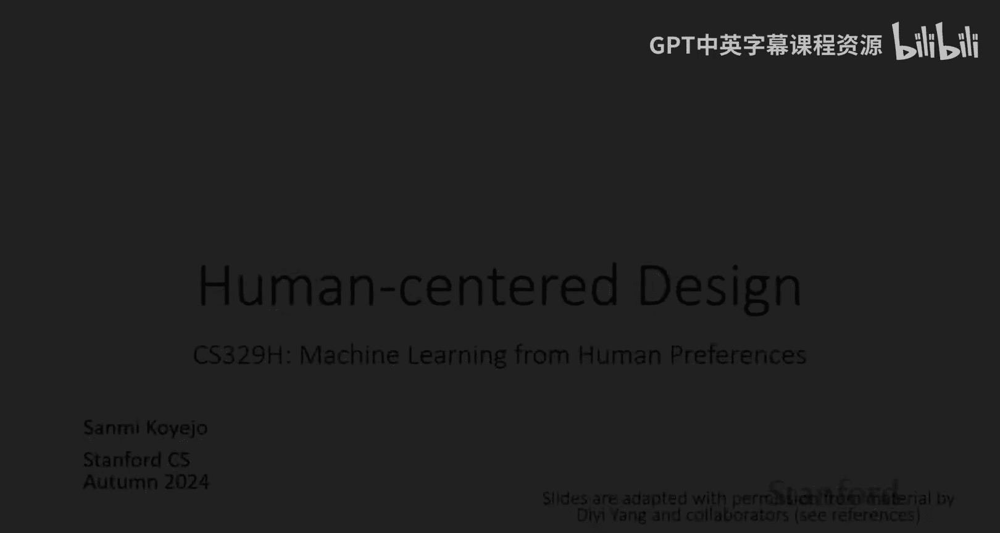

嗯。Just briefly to mention the slides I'm going to talk about today are built off of a couple of tutorials that I saw from D Ynk and I think very helpful in setting up this material。

 not my core area， but it's an area that I so learning a lot about and I think it's pretty central for towards some of the things that I think are important。

In this course and rather material more broadly。

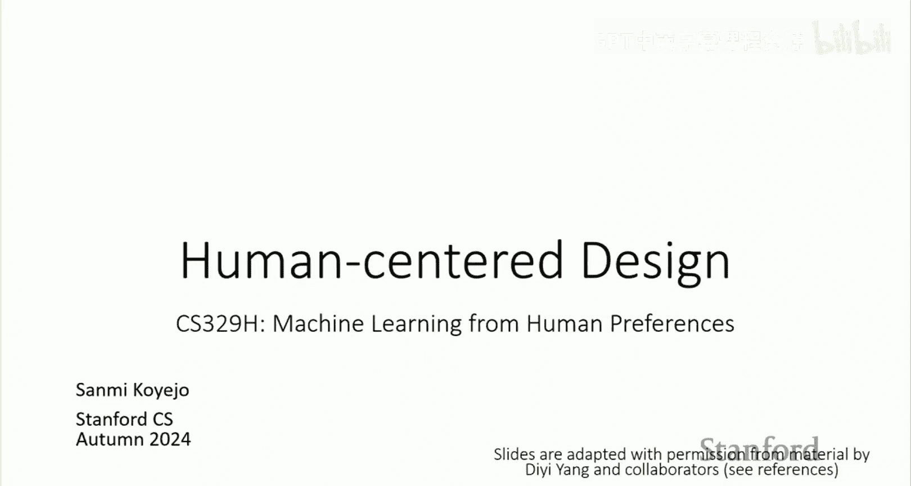

And so mostly we'll try to focus on perspectives and methods from human centered on human computer interaction and how they might play a role in thinking about questions and。

And to fix this。By human and I。Type of。Settings， and it'll be a bit of a departure from a lot of what we've covered so far。

 where I've been primarily methods focused。 But I think part of my goal would be to say something about how most of the topics in this class as a sort of technical area fit into the scope。

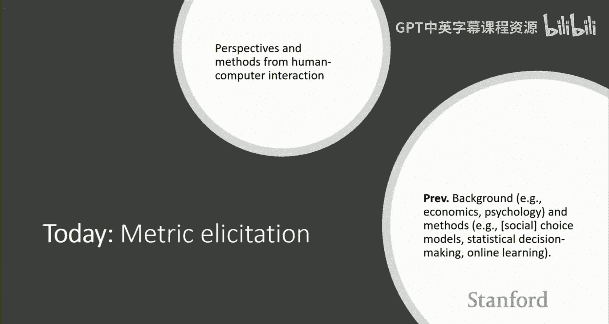

Of the narrowscope of focus in。

Sorry， I'll speak of the class as a narrow scope and then the HCI is maybe a potential broader way of thinking about the kinds of questions that we're interested solving。

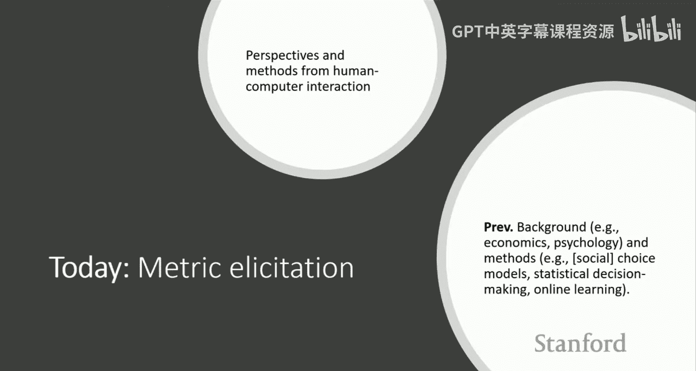

Okay， so if you're not familiar， So human computer interaction is broadly discipline that thinks about designing technology from a human perspective。

And is distinguished as compared to what I'd argue， you know， most of engineering。

 computer science is good at， which is starting with a sort of engineering problem and solving director there。

 Of course， I'm gonna， I'll just actually state us ahead of time。 I'm gonna take， you know。

 somewhat caricature at extreme perspectives on many fields in order to make a point。 Indeed。

 everything is much more of a spectrum。 So things are not nearly as extreme as all this。

But a way to think about it is applying the scientific method to the art of design and by Nielsen。

 the rest of the code is to eliminate paths that people actually walk。

So it maybe set up the problem is an interesting example of something called Norman doorsors。So。

 you know， come across the door potentially you try to open it and you tripped。

 Imagine many of you have had versions of this experience。 I have of you have。

 And some of the issue might be not knowing exactly how to operate it。 So， you know。

 is it a push or a pull， It's maybe not obvious。 So it has a handle。

 but what the handle does is not clear。 or sort multiple places that you could engage and handle。

 but it' not clear which one of them is actually the right。

Tools we use or it doesn't push or pull like neither is right。

 It's actually a sliding door So you need to know that it's something you're supposed to slide。

And the many ways to think about this， you could say you know we're not clever enough to engage with technology。

 I think I'd argue and， the thesis of this lecture is that that's not the right way to think about this。

The right way to think about this problem is that it's bad design so you know there's some infrastructure in the world in this case doors but broadly includes technology。

 things like artificial intelligence tools that we're building and they don't work for people and the argument is they don't work for people because they're not design appropriately and so one could think about what can be done differently to help them work better for people and I argued that a lot of what this class is about at least the framing I'll take that I think there might be other ways to think about this butraming I'll take。

Is that learning for human preference is a powerful tool as part of the toolbox of building AI technologies that work better。

So， you know， this is a bit of a analogy， but you could think of， by the way。

 Norman is the author of。PaThe book at the bottom， that's sort of framing of this design thinking。

Approach， but as mentioned， you can think about this with A AI， not just outdoors。So for instance。

 you for a door， the question that you're interested in asking is how do I get into a room。

 a push pull slide， all that stuff， but AI had some version of at least for most people when engaging with AI technologies。

 the question of how do I solve particular tasks using someI？

And so that's sort of what the user wants to do when engaging with the technology。There's also。

 what the user actually ends up doing。So this is maybe asking themselves。

 how do I operate the door to actually get into the other room？This is。

A standardended thing and AI maybe， you know， given we're in 2024。

 specifically maybe in language models， the main affordance。

 the main way we engage is maybe what's the special prompt。

 magicji prompt I need so that I can get this language model to do the thing that I wanted to do。

So again， in some ways。Now it's the way the world is now。

 but I think you one might argue it is really weird that this is the way the world is。

 like we've built this tool ostensibly to solve various kinds of tasks。

 but the way that we have to engage includes this mental gymnastics of can I create some magic prompt that does something？

And finally， there's the question of， you know， user engages。

 maybe learns over time and then answers this question of how do I actually learn to use this tool？

And in built environments， things like doors， maybe things like learn from previous encounters。

Usually， if you bump into a door you won't bump into it again， at least not in in your term。

 Maybe if you forget or， you're not thinking or you read labels or you guess maybe your most likely thing that might work and then try and then try again。

 and hopefully it works eventually for AI tools might be things like you know。Is now some。

There's a word for it which is incoming but special sauce about how to create good prompts。

 talk to other people， it's a bit of this extra art thing that's not science， but not science。

 people talk about is this magic prompt that does a certain thing or someone has you know people have done these prompt guidelines they're going to be influencers because。

Ive done these guidelines for how to create magic prompts。 And， you know。

 many of them effective because， again， it's a real problem that people are trying to solve。

 or I'd argue most of us just play until we figure out。The thing to highlight here though，Again。

 this is a real problem in AI technology， as it's used。

 and the argument here is that in a at least well designed world。

It's reasonable to argue that this shouldn't be a problem。

 Like this is a failure of our design of the tool that there's this key part of engaging that requires this sort of messy。

 unclear， unclear process， also unclear outcomes， right。

 because you actually don't know what you're gonna get。

 And I'll engage a little bit on the prompting thing。And a little bit。

Any questions on the setup so this this idea of。Design broadly with this analogy between doors and built environments and sort of technology。

 Yes， I feel that for doors are like more broadly， maybe the people who built the door would have a good understanding of it。

That's a good point that extends I honestly that extends that's a fascinating point。

 so I guess there's an argument that in addition to the design issue。

 maybe one of the reasons why blame is easier I y'all infer from your question is that in the door setting we could argue that the people designing doors know a lot about doors and so the gap there is partially just not making it easy for users to engage and I think your argument I'm repeating。

 but accurate that in AI part of the gap is that we don't know that much about the internal sort tools。

😊，Yes and no， I'll give some examples of some ways。And one can close some of this gap。

 that'll be actually the main thesis of the talk today。I think you're right that we don't。

I guess we know we don't know is this mix of knowledge， some scientific， some emerging。

 some folklore about what works and what doesn't work I think it's a little bit separate from how can we make it and tools that are you know thought of as stable enough to be products。

 for instance， and releasing the world What are there afford are there things that can be done to make them easier to use。

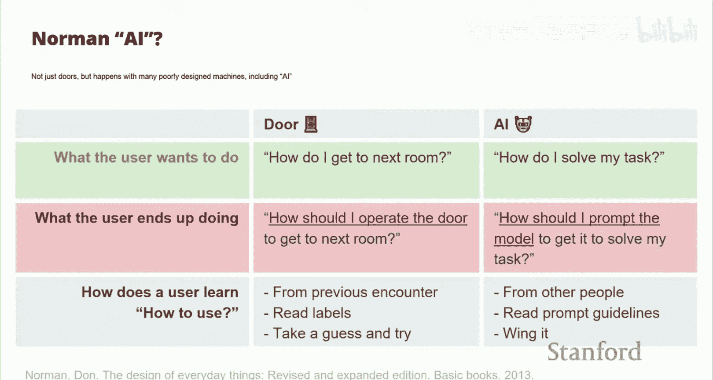

And the main argument will be， at least part of the discussion today will be。 I think， yes。

 even though we may not know all of the internals。 So it's not clear to me。

 but sure it makes the problem harder。For sure， there are some interventions that would be straightforward in a door setting that would be unclear in particular。

 know a lot of our tools will build on some optimization technique which so we hope works and a stable works appropriately across context。

 And so there's may be some brittleness and some of the ways that we can mitigate some of these issues that may not be as bad in the doorcase where you deeply understand the technology。

 I think that's fair。 but I want to separate that from trying at all and so building tools so that they're usable and better design。

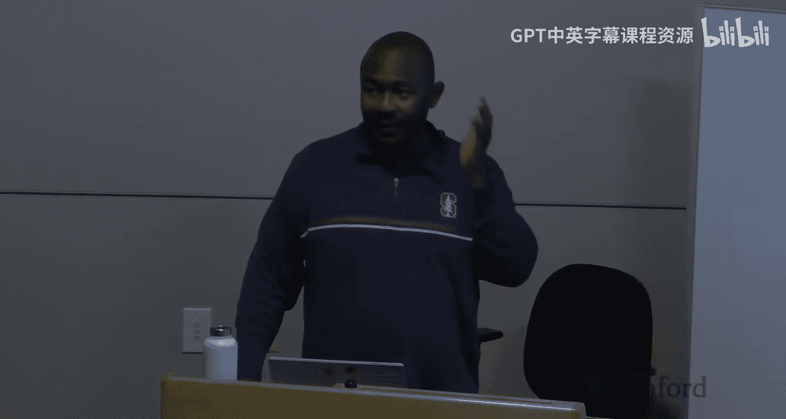

Excellent， excellent point。Thoughts， questions。Okay， so， you know。

 one could argue that the goal should be， in fact， if a technology is designed well enough。

 you should actually not know that a lot of effort was put in。

 it's actually as long as these were things where the more you're deeply aware of the work。

Likely the worse that killed technology is。Somehow you get no credit if you do a perfect job because it disappears in many ways。

 and so this quote from Mark Weeser。Says the most profound technologies are those that disappear that we themselves to the fabric of everyday life until they're indistinguishable from it。

 So， I think， I mean， partially this is also part of。

I feel like human psychology where we once things get easy and straightforward enough。

 we sort of come to the background and it's automatic and we're not thinking hard about a particular。

We of engaging with technology so we're just used to it I mean all of this can come from practice and overall engagement well I'll give you some examples there。

 but I think a lot of it can be just better designed such that it's just intuitive and it's not a big learning curve for engaging with technology。

So you know， for instance， you don't require an instruction manual， use it once or twice， and。

 you will barely feel it or at least never think about having to。

Figure out what to do from that point on。 So， some good examples of this might be things like various kinds of pointing devices。

 even though mine does some weird things。

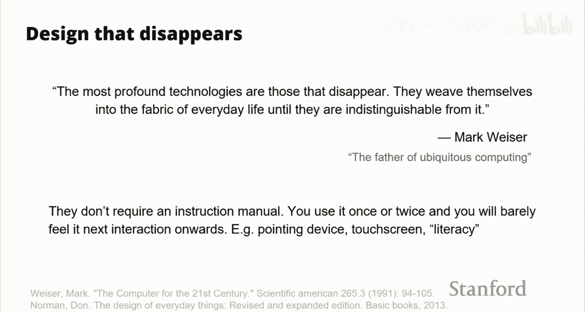

Now I seen not workings。It's a different issue things like touch screens this actually work does work again。

 technologies that are intuitive and part of the discussion would be about ways in which AI technology itself can be made to be more intuitive and easy to engage with and then we'll dabble or at least mention some of the ways that some of the preference work can gone over。

😊。

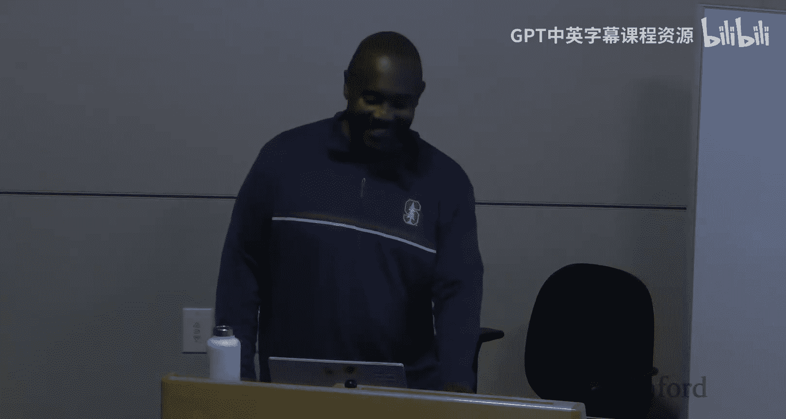

Might make this more effective。Okay， so you know， how do people who think about this think about this So one way to think about it is to think about bridgeging the gap between what humans。

Can do or human function broadly， humans engage with technology or tools。

 and then what computers may or may not be good at and both axes are important because technology evolves and gets better over time。

 and I think as it gets better， makes it easier to think of often as it gets as it advances。

 it often makes it easier to imagine。Ways that you could better bridge the gap between technology function and human functioning。

So， you know， on the direction of expanding。Extending computers if you all the way from early technology like punch cards。

 which are actually literally the way I have seen a punch card。

 I've never used one just know I'm gonna to stretype and say none of you have used the punchcard either it's possible I'll be surprised as the way that technology actually got built。

 all the way to command line， which still used still useful but requires high expertise and so useful for settings where that's the ideal。

 but arguably has moved over time to things likebuys or Gracode user interfaces people to engage with pictures that look like the thing that they want to do pointing devices。

 touchscreens all that stuff。 And so one way to think about I mean， of course。

 some of this is explaining technology after fact I think a lot of this is really though technology built to meet certain needs to make it easier for you to interface with computers But the argument here is that this is one of the way。

that particularly in personal computing， we've been able to make some effort and bridge a gap between some of what computers initially we're good at to some of what humans find easy to do and so it's ubiquitous and easy to engage。

On the GuI some of the thinking would be things like as already mentioned metaphor or objects so the icon looks like the thing you want to do for pointing devices。

 things like actions that you want to take and making that somewhat intuitive arguably this is love effort done in this and phones for instance to make them more and more intuitive and easier to use and as you know a lot of this is evolving so there's more and more technology being built often with the express purpose with making it easier to interface the technology so we'll see where things go but a lot of work in VRAR。

 stuff like that is you could argue is again trying to figure out this bridge making interfacing with computing easier yes what's the difference between the extending human versus extending computer what's the distinction exactly there Yeah so I think it's more this will come back again a little bits but the story。

Being told here is on one set of things now I'm calling it the story because to your point and maybe to this discussion。

 part of it is just naturally technology getting better。

 part of it is intentional design thinking to make it easier to engage and I'm focusing on the second part。

 which is the intentional design thinking and so the story being told here is you know punch cars and command lines。

 partially where a result of what was available and possible to do and computers first became a thing。

 but also。The reason that interfaces change was intentionally as a way to bridge sort of easy human cognitive。

Proce and of ease of interacting。 So that the point being made or maybe I'll tell a different story。

 There's an alternate world where technology got better in the ways that， you know。

Arguably many of us in this room will think of technology college again better， get faster。

 all the things GPU do for instance， so a better and better GPU doesn't necessarily help a user and it very indirectly helps the user's experience。

There's a difference between kind of the computing effort as just making computers moret know better being computers at some metric that we've decided or what a good computer is speed parallel processing。

 things like that versus intentionally trying to think through what makes it easy for you to engage with technology and then what can we build to make that interface engagement easier that's the sort of analogy and distinction I'm trying to share excellent question。

好。Okay， so， you know， arguably we're on this road and there are many people whose job it is to actually you think about this within computing。

 how to build interfaces and things like that。 I think more and more so。

Some of these questions are starting to come up in the AI world as well。 so as a part of technology。

 but specifically building machine learning artificial intelligence tools。

 this question of what it means to get a better AI tool from a purely technical it has a better AI tool。

 is is what it means to make it easier for people to interface with the AI tool and sort of solve problems that they're interested in。

 assuming that's the main motivation for this so you know from the AI side。

 many of the early ways of engaging with AI technology required that you're an expert。

 essentially your writing code as a way to engage with the tool。Now there's a bunch of prompting。

 so it's it's not。It doesn't need expertise in the same exact way。

 It's a different kind of expertise， but it is still like a somewhat specialized skill as we already discussed and arguably chatting while related to prompting sometimes some many interfaces are brought ups in ways that are maybe。

Les specialized and easier for people to engage with。I guess mostly language technologies here。

 but I think this is also true for many technologies。I think we are， in many ways。

 bridging the gap in usability。At least by the story。

 meaning the gap from having using code as a way to interface to using prompting as a way to interface to now maybe using chatting as a way to interface in some ways。

 a lot of success is driven by the fact that it's partially just easier for people。

 particularly non expertly trained people to think about solving real problems with these tools I think prior document here is。

Or there's an explicit explicit argument here that this is not complete。There's still more， I mean。

 arguably these things are maybe never complete， this whole point is make it easier and easier。

 but the chasm seems wider here than it does maybe in general computing and like what are the interfaces and what are the affordance system that can be built that make it easier for people to use AI tools to solve problems that they actually want to solve。

Yes， what do you think about neuraling， for example？This is a good question。 So near link being。

 you know， technology to directly plug into your brain。 And I guess。😊。

It's not obvious to me that it's built specifically for AI， I think it's more for I don't know。

 as an interface choice， maybe。Of course， any interface choice has an impact or will likely have an impact on AI technology because it can just be like the endpoint。

It's an interesting idea。 It's an interesting idea。 I mean， I think， practically。😊，对。

I mean now I'm just speculating wildly but yes， I'm have to be speculating wildly。

 I think adoption will take some time， I think different people will have different amounts of ease of imagining like something implanted in your brain as a way to interface technology I think the current technology is very impressive it's not。

So easy to use that it sort of completely solves the problem。 So yes you can think about。

 but my understanding and this is not from expertise is from a few conversations and maybe looking at a few things that you do need to be thinking sort of fairly specialized like it's still quite limited in bandwidth and how you can interface with technology as a computing interface device so you know could one imagine something implantable that if eventually makes it just intuitive and easy。

 perhaps I think there are lots of fun problems that seem。

Additional to the technology problems to that being ubiquitous。

 which one is just fixing technologies like that it's really truly easy to use。 But also。

 it's the social governance from， which I think will be fun。 And who's ready to go on there。

 get something implanted in your brain。Stillill a risky procedure。 I think it's still mostly。

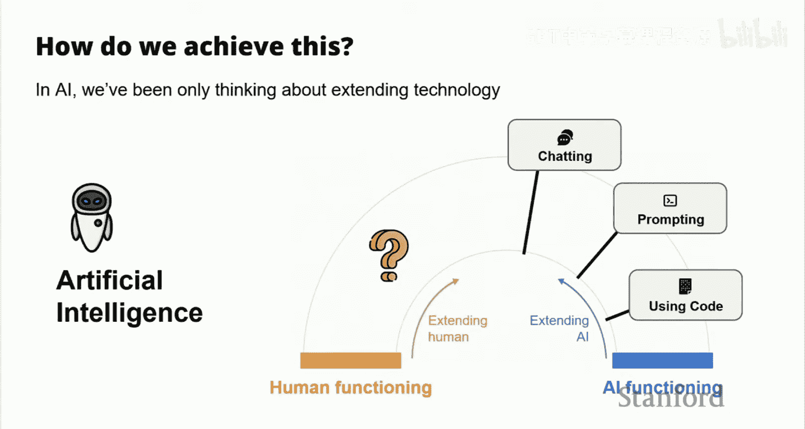

Most。To my knowledge， people that have。Been most positively affected by other people where really it's solving an explicit problem because。

There's some disease or neurological disorder or something else that they can't actually literally in the face of the world and this is the thing that's solving。

 whichs a very different ask maybe extremely important and solving a need。

 but I assumed you said it in the context of like well this beauty because technology that bridges gap and both technology needs more work。

 I think there' is also social and governancevenant things would be interesting to solve if that's the way at this point we're speculating。

How much of human functioning early can we consider like education like I guess in the example of learning how to read Yeah that is a good question you never have to learn how to read Yeah I think it's just like dictated to you。

YeahThat's a good question and I think correctly noted that it's a bit fuzzy in the description here because there' this assumption that ease of use is a zero learning curve thing。

 whereas there's acietal context and many people that use technology sort of educated in certain way。

 and so， for instance， you know typing，I guess pointing and maybe doesn't necessarily need specialized education because my kids have taught me about。

Like typing or other like also just knowing the right questions to ask or what you want to solve right sometimes I think it's an interesting question。

I think it depends on， I mean， it's a non statement。

 but I think true depends on a setting context of all that stuff。

 I think the way I want to think about it here， though， is。I think a good target。 actually。

 willll get to some specific to this。 I think the right way to think about these questions are really deeply contextualized。

 So the are people what you're trying to solve how do we solve from for these people。

 and once you get to that level， at least the way I think that this kind of work or at least the design thinking work is sort best framed。

 once you get to that level， you're take into account people's education and some extent leave the experiences if you can。

ll talk about equity issues， which I think also partially points to this。

 So this question of like if I'm designing for a particular set of people am I leaving a bunch of other people that could benefit out。

 I think that's some other hard questions here。 But to your point， it for sure has some impact。

 I think part the goal， despite the very high level discussion here。

 I think part of what I'm motivate a little bit is contextualizing I think contextualizing force is that you think about who your audiences。

 And then maybe specifically thinking about how do I broaden the scope between。

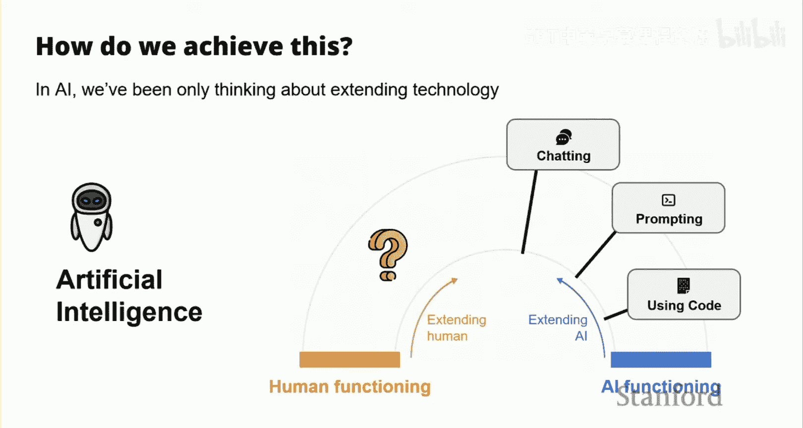

Making education less of a factor， for instance。

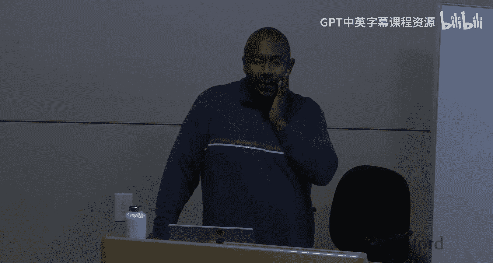

I think that's a good point。ありがとうございます。Good discussion here。Yes all the design people should up。

 That's great。 Okay， So to this point， I think arguably what many of us are best at are really pushing on technology for technology like I wantna just get a good tool to we have some definition。

 we may or may not be accounting for users or we have some abstract notion of users。

 they're not any kind of real user。 It's sort of know。

 some abstracted metricized user often there's a number that we're chasing。

 And so we can call this technology centric design。

 it can be useful and particularly when there is a ready technology。

 and there's a bunch of sort of well established maybe norms or ways of engaging。

 And so fully pushing purely in technology is actually very reasonable。

 I'd argue a lot of AI work sort of roughly。😊，In the space。

 a lot of like pure computing work like how GPU questions that we talked about earlier are in this space the arguably other side of it is instead of centering technology centering the user So you're thinking about what can I do to make the user solve your problem most efficiently And so here you're thinking specifically about sort of the problems。

 the needs， the focus of the stakeholders and your design process is built to make it easy for them to solve solve。

And so， you know， as many of you actually have said this many times， but as you know。

 I think one of the potential consequences of the technology centric design is everything becomes like a potential application of whatever tool you're building because again。

 you're not designing to solve a problem， you just have a coal tool or cool technology and you just look for sort of。

You search for an actual application where it's useful。

The point is not that this is this has no place here is not useful。

 I think the point here is it's solving a very different problem than uses centric design。

 which is again focused on making the user making it easy for users to solve problems。

It's fair to say like trap， for example。The like the adaptive technology to solve the user problem。

 So it's a little bit if users centered in that sense。

 But then because they aren't perfect at doing it is when it becomes a little tech centered。

 And you have to figure out Yeah， prompt。 It's kind of Yeah， so I said this a little bit。

 So two things。 when I said this So one for。啊，呃。Discussion purposes。

 I'm going to be somewhat extreme and say things like black and white。

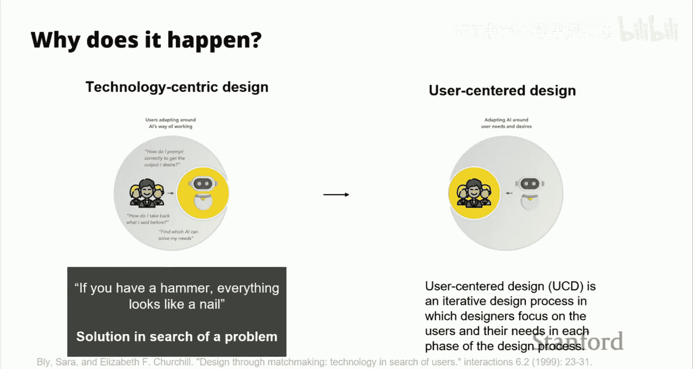

Real the world really isn't as you know， there's a little bit of partially designed for real users。

 There's a little bit of targeting problems， problems sake。 I think chat bots are again a mix。

 I think the。

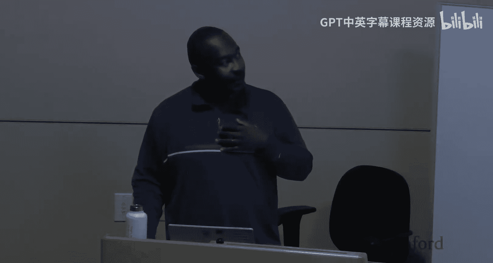

I make my sense and a little bit of like knowledge is that they were。

some of the design decisions made， actually， you know。

 we've discussed this in this class in early lectures how， for instance。

 if you focus on language models。Yeah in principle。

 the base model before you've done on the Sur my tuning or RTF for sort of preference tu。

Quote unquote， this is analogy complete， but our best understanding is that it has all the knowledge to do all the things checkbots do。

 but it's just extremely hard to interface with。 And what supervised fine tuning and like preference tuning does is solve the interface problem。

 So it makes it easier for a user to get the model to solve certain tests。 as opposed to。

In principle， in fact， you can do this。 if you have a big enough model， you can。

 they're big models that you can actually like without doing super maintaining and prompting。

 actually like chat with them。 They're worth the chat。 right， So still tricky to interface with。

 but arguably， like all the。And again， I'm aknowizing here because I can outfit because I don't have better language for this。

 but all the knowledge to do the thing is arguably Im the model already and chats are a way to close the interface gap so。

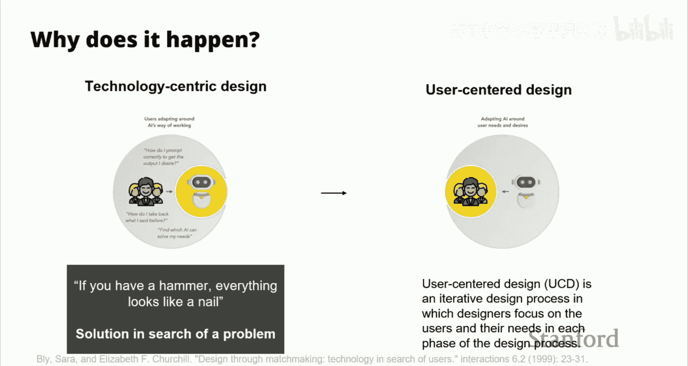

I think。😊，And practice， it's a little bit of both when I say both the other side of this is I think you know this class is a example of we started with a user interface problem。

 we abstract extracted it out to a technical problem and most of what we coveredID in class far is pure technical So you know we're still interested in how this maybe eventually impacts users but we most talked about tools we haven't done that much like specifics on user settings where many of these might be interesting and arguably you know you could finish an entire PhD here on something like。

Chat bots a user interface and never do a user study。

 just building better technology in a sort of pure technical sense。That's maybe the other side。

That discussion。Good question。Co okay， so maybe to summarize you know what is the point。

 so the idea in human computer interface is again to fill this gap between what people want to do and then how they can do this with technological tools。

So one of the key approaches and ways of framing how to solve a share problems is what is known as design thinking。

And so this challenges the ways of engineers， computer scientists focus on engaging with problems。

 So again， caricature。 But the first approximation， I think， true， honestly。

 based on both myself on talking about the people like what what actually excites you the most sometimes is the key technical problem。

 So you know， you find some problem。 And then your job is。

 I'm just gonna find a solution to this problem。 so solution。

 and then maybe you want to write a few papers。 and so you think of other solutions problem。

 your job is iterating over different ways of solving the problem。

Design thinking asked to reframe this perspective instead of starting with here's a problem。

 maybe somewhat statedd clearly what are solutions for some quantification。

 some upization of this problem， you take the problem and actually go back and ask why。

And so you know， why is this a problem that actually needs solving and you try to do this sort of over multi iterations It's sometimes called five whys。

 the five is not important and mostly five meaning five levels of sort of depth in industry the number five is not important the key thing that's being encouraged here is to think very carefully and sort of deeply about what problem you really want to solve but they can identify it very clearly what is the root cause of whatever it is that technology is meant to solve instead of it's essentially trying to deeply or encourage going me on surface level to deeper introspection。

 and we'll go through some of the tools。Yeah that you can use to engage with this。And so， yeah。

 just to give some quotes。So it can go in multiple ways。

 but one version from Henry Ford is if I had asked people what they wanted。

 they would have said faster horses， this is at the time before production cars were a thing and you could imagine the problem people needs to get faster from A to B。

 what is the solution or were using horses right now let's make the horses faster somehow so you could easily imagine a kind ofactual world where that was the thing that was optimized for as a solution instead of say let's think of some other tool that maybe solve the actual well the actual problems again。

You can argue about whether this is the best solution， it is a solution， it is a different solution。

 arguably better solution than trying for faster horse。Other quotes， so within that design context。

 framing is often seen as a key creative step that allows the original solution to be produced。

 so designers report on the need to get the problem to the problem behind a problem when presenters say what a problem by a client so sometimes also called creating a fresh perspective。

So you can feel free to read up on the quote and get to details offline。 but what this。

Kind of approach lead you to is， again， instead of starting with a problem and then going directly to like。

 what are the solutions to the problem， you ask many why questions， like why is this problem。

 What can I do to Like what is the root cause of this issue。

 this pushes you in a maybe different direction。 And so to operationalize this， one of the。

Popular methods is called double diamond method so this the first diamond is the sort of problem diamond。

 this is where you're asking all the y questions and then the solution is itself another y method and the reason it's called a diamond is because you intentionally start divergence first so you ask lots of questions with broad scope and then hopefully eventually converge into a small set of things a thing is sort of root cause in terms of specifying a problem and similarly you can do the same kind of thing on the solution side so divergent all the different ways can engage but the better you understand the key root cause and then also the affordance of the users and their context。

 the better you can identify a good solution for that context。So in a bit more detail。

 the sort of divergent part of the finding a problem is sometimes called discovery。

 so things like research and then you define specifically root causes。

 so sometimes called synthesis you combining things together。And then on the solution side。

 you have a this ideation step wherere developing a bunch of different ways of thinking about potential solutions or problem。

 then you implement or deliver。The final solution typically will lead you to one thing as maybe your best sort of potential solution to this issue。

So for this first step， again， discoveryover step。So lots of tooling out there。

 And many of our colleagues do this， I think。Again across all of science across all of sort of work that engages with people。

 but within computing and HI areas are the ones that do this most education I'm sure it does a of this as well So you know this could include things like field studies。

 interviewing people surveys you try to understand environmental factors， context， different needs。

 things like education of people， as you talked about earlier， market research。

 what are different stakeholders， all these kinds of things to get a sense of to get a better sense of the why underlying the issue and then once you have a good range。

 good understanding saying of the broad scope and you try to narrow down to the root cause of the particular issues So you try to some of the techniques that are useful include things like dispar design so you talk to stakeholders maybe jointly together to get a sense or try to see if there's a way to get to a consensus of。

The actual issue and maybe the root cause of a particular problem you could use analytical approaches so learn about relationships across the different tasks or people give you lots of causes you think about ways that can be grouped together logically so they actually may be describing the same thing but in different ways things likeffinity diagram similarly to help you think about groupings and again。

 the hope at the end of this step is that you've identified a specific or at least a small set of root causes that are at a for an analog sake got a sort of deeper level than the original specification of problem which can be sort of vague and not again。

 the horse versus carron analog from earlier。On the solution side， why you' developing？

So you could some of the tools that are used in those areas include things like storytelling。

 so you can situations where the user is in a specific context and you think through different ways that different solutions might engage with the user in those settings。

 prototyping is often useful， so build quick and dirty， sort of solutions quickly。

 get a sense of like what extent is this actual solution。

 meet the need that stated in context for the the users that you're evaluating and eventually you' try to get to some minimal viable minimal。

Minimum viable product。 So something as a synthesis final solution。

For this process that hopefully meets the need at the root cause level。So as mentioned again。

 discover a problem， to find a problem， develop the solution。

 and then refine or deliver the solution。It's worth stating that you know while this is a useful p mnemonic or sort conceptual framework we think about solving problems。

In practice for many interesting things。 and both in terms of research。

 but often in terms of things like products， it's not a one time process。 So often it's iterative。

Where you observe， you generate ideas， understand root causes。

 prototype solutions test them out instead of that tells you you deploy the solution。

 you figure out what you're missing， observe again and so as can imagine as a sort of iterative solution and so one conceptual way to think about this is instead of as a cycle you can do about this expanding loop because again over time you're expanding the ways that hopefully you're。

Better engaging with the problem。By you like along the time axis anyway。

 spiraling out to think about solutions to。Reward issues。Okay。

 so this is at the conceptual end for us and for this at least closest to this class is what things like this mean when we're interested in humania interaction so more and more this is being formalized as a field。

Actually，At different levels of abstract， people have decided to name this。

 So there's that level of human AI interaction。 There's a level of human LLM interaction。

 human VLM interaction。 So people who think of their work as sort of narrowly within the scopes and the kinds of possible solutions that one can solve。

 I guess is partially technologists in the sense that you're anchoring on a particular technology type。

As opposed to， that's just solve the problem。 But it's a useful way。

 maybe of organizing a set of skills instead of tools and the different ways that one could solve useful problems with those。

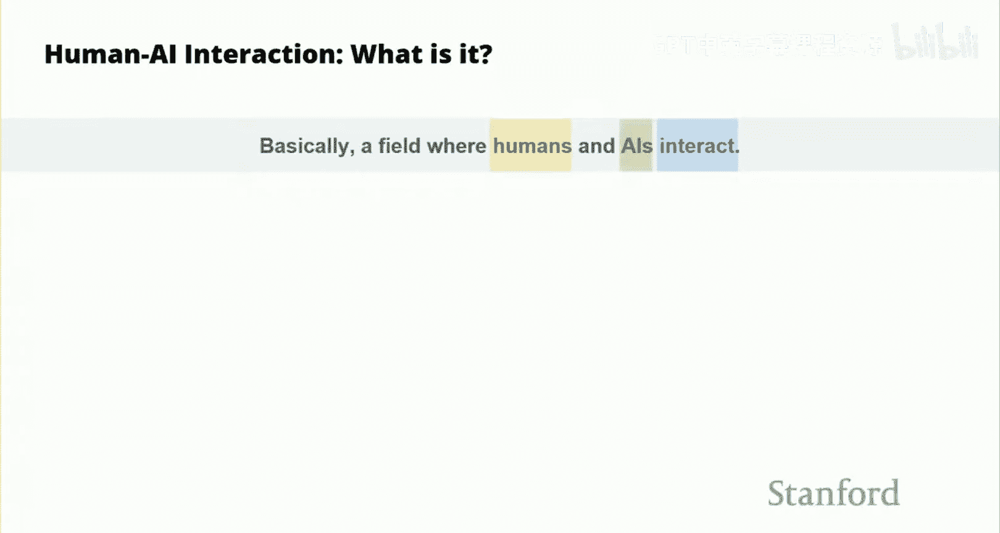

toolss or skills so one way to think about this is an area or a field。

 a subfield maybe where humans and AIs interact。

The humans include researchers， model developers， the experts， but also end users。

 so each one of these will have different needs， different goals， different， again。

 context matters a to， and one will be thinking about how to build solutions for each one of these potential end users。

And then the AIs here are focusing on things tied lots of different contexts。

 but I talked about languagelongage models， but there are other kinds of tools， dialogue。

 audio systems， recommended systems。Autonomous driving。Build you know pick your technology area。

 or in this case， AI area， and you can think about ways in which there are sort of new kinds of problems that combine different humans with different technological tools for solving some different reward world problems。

And then interaction part is maybe。The key new thing here is thinking about different ways of how the interaction might go。

 so it could be collaborative， it could be assistive the eyes forist even solve something。

Theres the understanding maybe to your earlier point， humans try to understand the AI tools。

 so you can imagine helping various ways you can think about what the interaction might be and so at a high level the field tries to set itself up as again thinking through different human stakeholders。

 different potential AI tools or technologies and then think about different interaction mechanisms。

And ways that you could bridge between these the overall problems。Okay， so how do you solve this。

 This is in some ways， the key bits。 So the first step typically is figure out who the human is that you're trying to engage with。

Could be you could be typically the research will have agency to at least in the research setting。

 of course， in a product setting， it's different。 Maybe the product defines who the stakeholders are。

Research you often have some agency there， and then also the AI language model or whatever else。

 which typically already exists but needs some improvements to make it easier to bridge this interface gap。

And so some of the key steps are things first a design step， you know why should they interact。

 what needs to be done to make it happen， what instances， what context， things like that。

 enabling the interaction， so how can we enable this sort of depending on the setting and context。

 what can be brought to bear to make this interaction easier。

I'd argue that most of the work in this middle is about tooling。

 and most of what we've covered in this class are， in some ways。

 you can think of as tools they can bring to bear to make the interaction probably easier。

 So this enabling the interaction question。 So things like。

 can I better understand or can I ease the burden of the interaction by personalization by getting pairwise preferences from people most cover pairwise preferences。

 But we'll cover here briefly other kinds of ways of getting。

Like choice or the notions of preference from people。

 all is thought of as technical tools that enable this interaction between AIs and humans and AIs broadly defined。

And then there' evaluation step， which we haven't talked a lot about， but I think is super important。

 So we'll spend a little bit of time today talking about some of the ways。

 particularly when I contextualize what we've been covering in the broader scheme of simplifying the engagement between humans guys for particular problem settings。

 what evaluations could look like， different ways of thinking about evaluation tools， I will say， no。

 this is。Recovering this in an hour and change， like almost everything we've covered in a class honestly。

 but yet again， I'll say what I say almost every class。

 this is this material itself is part of like a three or four hour tutorial this is part of entire disciplines to spend people whose build the careers around or more and more so anyway。

 Els and you。 but still the people whose shape these are about this。

 So there's a lot of depth potentially here。 So if you're interested， I'm happy to give references。

 I have a little bit and here the references to sprinkled throughout。

 But there's a lot of depth that one can go into but I'll try to give sort of。

Enough of the stakes of the area so that you can find more material if you're interested。Okay。

 so first on the design。So here I'll say a little bit more about our favorite tooling。

 which is F engineering。So from a human yeah human computer interface tool。

 it's interesting and has been studied and thought of as quite challenging actually。

 as a way to interface with AI technology arguably what it's meant to do is or traditionally what user interface designs are meant to do is to go from some high uncertainty problem solving context to make it easy such that the sort of clarity and focus very clear what the interaction should be to solve a particular task。

Prompting as cartooned here。Cool paper with the figure that you can look in more detail。

 but you start with high uncertainty。 Maybe you reduce the uncertainty a little bit by trying some prompting strategies。

 we talked about， people talk to each other you sort of come up with best practices。

 but it's still a little bit brittle uncertainty still exists。 And so you try different tools。

 and then you know， new things happen， maybe in the tooling or the context changes a little bit。

 some of brittleness。 And so you have high uncertainty again， actually， so， you know。

 some problems that you thought were fixed， come back， say。I' know。

 Open AI changes the version number on the hood。 If you're using this for your tooling。

 I'm assuming the nodding is people's lived experience。 I certainly have had that。

 We built something built on， I don't know， some version of JackP and something changed under the hood and your solution。

Complete breaks。 But even this， this happens， he's leaving with like open source to because again。

 technology is evolving all the time。 So all kinds of unknown unknown problems you issues should show up。

 And it's kind of hard to get to the point where and arguably we havet solved this in a general context of getting to a point where we'll get to sort of ease of interface and clarity in the way that you would argue that you often can get to in a standard U setting。

就诶。Well， some of the ways， or at least some of the description is that the language interface。

 while it's freeing and makes it easy for you to in principle to our earlier comments about chatting。

 in principle it makes it easier for people to interface with AI technologies from a let's solve real problems point of view。

 arguably causes lots of new challenges because it makes it hard to get to the sort of UX outcome that one typically tries to get to。

 which is。There's a clear interface approach that has low uncertainty and higher reliability。

So one quote that some of you might like is that prompt engineers exist particularly chat PT in the right spot so that it coughs up the answers。

 I think many of you might agree with this， at least some of the ways that you can think about prompt engineering。

So you can think about adding references， saying things really nicely， playing with the framing。

 how much these other like strategies that people try to use to get language models to solve problems as they would like them to。

And so in real settings， you often need to engineer this。

Lots of engineering in the way that you frame， say a prompt enough that it actually starts to look a little bit like command line languages where essentially you need a format that matches some templates to have any luck。

 I guess， in anything that's nontrial for prompting So again。

 many successful implementations of prompting and language models actually， you know。

 in principle should be natural language and practice of highly stylized specialized things because。

This is what the thing you need for the tool to actually solve the problem itself。

 at least to some level of liability， often again， not perfect。Okay， so one way to engage with this。

 And I'll give one example from colleagues that I wrote this talk is think about maybe hybrid user interfaces and ways that maybe adding gus in the middle of prompt can make sometimes improve usability。

 I'll give an example in a sort of visual language model kind of setting。

 So trying to prompt things so that。You can say better create images that match a certain design goal。

Okay， so in this work， is a reference at the bottom called prompt charm。

 The first thing was research。 So this part of the design example that I thought about better identify what the gaps are。

 what the root causes of the issues are and the end of their research work they found from user studies that there's significant conceptual gaps when a novice。

User writes prompts for image creation in in many cases， users have a clear image or style in mind。

 but they have a lot of trouble articulating it and a prompt in the right way so that the model does what it would like it to do。

And so to solve this problem， this paper went through a few steps。

And identified five major user needs and then a few steps to address the problem。

 So first being automatically recommending and revising text prompts。

 balancing automation and user control， various kinds of exploration make it easier for users to explore different ways of framing prompts or at least engaging with the AI model various kinds of version control so that users can go back and so see if something broke。

 it can go back to what worked earlier So making that easy trying and provide explanations for generated content so it's maybe easier to see what matter worked and what。

What， what can be done。Make it easier in the future。So based on this research。

 they developed a new design。The first step again was this or one of the first things that they tried was automatic revision of prompts。

 As many of you know， this is now standard， actually in many commercial language models。

 they don't show this to you It' maybe a separate conversation， but almost always。

 or at least in models that prompt chat bots to create images。

I w to I don't have a percentage because I don't know the IP of the companies。

 but I know specific examples。 many of the language models have something in the middle that rewrites your prompts in a way that is more likely to work。

 This is like the engineering that gets the VLM to get the right solutions here。

 they expose it to the users， So you say， hey， I want to pay me of a wolf sitting next to a human child in front of the moon。

 This might be expanded to say give a specific。Style， so a particular kind of artists in your style。

 and maybe something about the。This is trending on art station。

 so a particular platform like something that looks like something that they imagine a user might want。

This is also ability for the user to change the term so there's a rewrite but there's exposed if the user thinks that this doesn't identify what they want。

 it's made easy to revise this to sort of change the prompt in a way that better matches what they need。

The goI also includes easy ways of finding similar items so if you don't know your artist super well or you can't remember it the artist's name。

 maybe give you suggestions for different kind of artists or different kinds of styling and hopefully use some of these word choices match your mental model of what you'd like they also enable weighing of terms which is kind of cool So again。

 technology allows this to sort of up or down weight various aspects of the prompt and they expose this against a user So these are ones like emphasize more or less particular terms that you have the ability to click on a word or a phrase or in this case the style and an upward or down weight how much that is an important part of the provided solution。

Okay， next is support exploration。 So make it easy to play with again。

 sort of Harry talked about the rewriting and engaging with the prompting types， but also。

Things like quick prototyping， so G drop down， have a particular kind of style。

 you quickly iterate on it， maybe iterate on various kinds of the same thing。

 It helps you maybe pick the one that you prefer better。

 actually want it to look a bit more photorealistic pick photo based on a quick prototype of like some early you can do this cheaply by doing maybe like small like low resolution versions of the image and things like that this works really well with the diffusion technology itself So actually this ends up being a good idea。

嗯。You also make it easy for users to track what they've done。 So if you want to go back。

I don't have this here， but so step four and then I think another cool thing they tried here is to try to provide explanations again you know I think technology is。

Okay， on this， at least enough to be usable where。So for different terms。

 you try to figure out which parts of the image correspond to those terms users can modify sort of how important they want different terms to be。

 the explanation helps with building mental models and mental maps of what technology is doing enough that inter。

Intervening and manipulation is quite a bit easier。And then they also allow for direct manipulation。

 So I want to remove an object， say this mountain in a background。

 I can im paint so I can select with a simple tool and then in paint with this background I can add things like all this stuff that again。

No I guess now our standard tooling don't know this is a recent paper but don adobe lets you do stuff like this。

 for instance， and many of tools， but as an argument for how you can make it much easier for people to engage with this generation technology as opposed to just write your prompt and then spend your whole PhD figuring out the right prompt to to work I think a good example of what it might look like to make it easier this is more of a thought。

 but if you was just like a fundamentally pretty hard pro of this solve like someone has this picture in mind but you put it in where it because it was interesting that it's like something that you can't like even another human like if let's say someone was like I guess like the police like sometimes you like draw a sketch if someone saw them like that process maybe could be made better with this I know it's interesting as an application I'm hearing this is an application technology like this as opposed to。

It's sounding like you think this is a cool idea and what are the other ways you could use this Yeah I'm happy to agree with that that sounds right to me as a cool application Yes on the side before where it was like oh this is how this image corresponds to those words I that like after the fact or some kind of like attributetribut I'll read the Yeah they used a my understanding is a pulse ho the paper at the bottom this interpreting stable diffusion using cross attention。

😊，You know， it's better than nothing。I think interpretability tools are still the work。

 I think to make them fully robust and stable。 But these contexts and the settings that they play with here。

 I think they work quite well， but it's not perfect。

 I guess the issue has always been how robust they are。

 So's a different technology problem that we see also as a collective is communities still need to solve。

 But I think there are tools that seem good enough for people to start like building into interfaces。

 for instance， people to start using。 so yeah。But yeah， well you should get the slides， I apologize。

 I tend to do them after the lecture， it really should， oh we're almost done with the covers。

 but the next next year everything will be ready at the time。And but yeah。

 you can get the references。😊，Look off me。えOther thoughts。Okay， so you data some evaluation as well。

 and we'll talk a lot more about evaluation a little bit。

 looking at various tasks and the accuracy of the users on these tasks using their tool versusIS。

 other approaches that they could have tried。Okay， so you know， building interactive systems。

 good ways to think about it have lots of different components。

Some of it include thinking about who your stakeholders are so thinking about human cognition perception。

 the more cognitive loaded task， the more you want to make it easy for humans to be creative so they can engage meaningfully and sort of complicated cognitively loaded tasks so like the example we just showed there's a lot to be said about trusts and reliance on sort the technology that you're building so you want to ideally build a tool such that if appropriate users can depend on it to actually solve reliably the task that the tool is meant to solve reliability can play a huge role sort of calibrated trusts can play a huge role and getting that right can be tricky do a quick slide on it but I think mental models often over undershoots and trusts uses to trust too much and sort of don't appreciate the corners of where the tool can actually work or to have one bad experience。

And think that the tool is garbage。Don't actually figure out where so is useful to getting the trust corrated as itself。

 I think， a challenging part of good user and interfaces。Now。

 other aspects of building tools broadly in the world， things like accountability， fairness。

 transparency， ethics， we'll have a separate lecture that spends a bit more on these kinds of topics but you want to build tools ideally that works for broad range of individuals and in particular doesn't perpetuate bias a discrimination or based on different stakeholder groups much as possible as I guess normatively for many of us I think thought of as a good design goal。

 and then things like personalization adaptation and given feedback easily things like guiding interaction。

So that it's easy for particular individual users with their preferences and needs to engage with the tool。

 maybe to your point also maybe even learn how to engage easily。

 but make that as friction free as possible and improve over time to better align with human preferences。

Okay， so bit on some of the details。 So things like trust and reliance。 So as already mentioned。

 trust is some evaluation of。The belief of confidence and the reliability， integrity， honesty。

 it's really a human property， I think more and more we apply the same analogy and concepts very directly to machines。

 the things like agents。嗯。Reliance is a again， another property thinking about depending on someone or something to perform a specific function or task irrespective whether trust is present。

 So in some sense， they're distinct from each other。

 can have lots of differences this four quarterrant thing between humans and maybe human decision maker and AI tool may be using where。

If a human decision maker always rejects theI decision。

 but the eye decision is correct and has an under reliance problem。

If it always accepts the A'S decision， so it's automation bias kind of thing。All right， well。

 if it accepts and it's correct， then it's good。So it's appropriate reliance。

 but it accepts almost no matter what the eye says。

 particularly when the eye is incorrect and is over reliance from often sometimes called automation bias and then。

If it rejects when it should， that's also appropriate， so you get the appropriate lines。

So some of the challenges here figure include trying to design overall systems so that you're in the green parts of this setup。

 so I'm not going to go into technology， there's a bit more in the reference material。

 but mention this is the target of good design。I guess I will go a little bit so one way that you could do this sometimes it's helpful is things like explanations we talked about briefly sometimes showing uncertainty helps。

 I think the research is still open in this but their ways to meaning I think the research is open because the way people understand uncertainty is still tricky。

People tend not to be good at actual percentages。 They bucket into big ranges like low。

 medium high is roughly， at least my understanding of the best research in this space。

 but still showing uncertainty can be a useful way to better calibrate the user to what the AI is actually good or bad at。

Allowing the user agency to maybe decide when to see results。

 So allowing for self prompted suggestions as opposed to things that are automated showing the processing。

So you know showing that this work happening actually sometimes builds good mental models for people and says how easy or hard certain tasks are so even though it's in some ways it's a bad thing because people are waiting。

 but it can actually be good in that it can be a way to calibrate effort or difficulty maybe effort is not the right word difficulty of particular tasks and can help people build mental models to them have better calibrated trust。

So some tooling， bunch more is good references on think about some of what we know about making this better。

Questions on fairness， accountability。 So fairness questions， again， making sure as a normative goal。

 thinking about tools that don't behave very differently， say based on things like gender or sex。

 other kinds of demographics， such economic factors。

 So tools that can work for various diverse populations。

 accountability here measuring so for example in。Thinking through consequences of mistakes and then building that somehow into how you evaluate and build systems so for instance things like mistranslation can be a low risk thing and I don't know if you're playing with the Jebo model can be a higher risk thing if this is a translation used for。

Decision about this asylum， for instance， in a different language， right， this is someone's life。

Some big life decision that a translation error can make a huge impact on and this happens actually is a big issue so getting that right and collaborating that correctly for you know normative we want the tools to be as good as it can be but also when it's not good you want the stakeholders to understand the gaps into tools so the user themselves to understand it。

 the say the judge or other the parts of legal system to understand it。

 the better you can achieve that the better you can have better accountability and so correctly place accountability for。

Good and bad parts of technology tools。Consparency can often be useful。 I think this one is somewhat。

Yeah。Yeah。Well， it also is a big bucket， it's transparency and what I was going to say is it's slightly controversial as well in the sense that I think the argument。

 one argument that that's made all the time is that you shouldn't trust models that you can't understand I think again。

 sorry come back the comment you made earlier how will we understand AI tools there's a kind of argument that we actually don't understand lots of things we trust and the example people like to use a lot is like aspirin and medical things。

We know something about the outcome， we don't know the mechanism actually all that well I see some surprise faces。

 go look it up， it's actually it aspirin yeah， but as lots of other sort of most doctors for instance。

 don't understand the MRI in any kind of technical detail don't understand input output。

Enough that they can use it for decision making， but enough physicists。

 they have specialized physicists in the hospital whose job it is to like understand MRI。

I don't know where the field will land， but that's maybe a separate question。

 I think what's useful here is to say that it can be a useful way to calibrate user interfaces if possible。

 explaining accountabilityability transparency of things that are going on in to hood can be useful。

And then also ethics。 So we've talked about this briefly， but。

Thinking through various kinds of interactions between humans and EIs and what they mean in context of broader world and maybe again。

 different ethical perspectives from different stakeholders thinking about ways to bridge between the ethical perspectives of the humans and what the AI tools can。

I guess to what extent can we have decision make from the I tools match human ethical principles and values。

 Again， part of the goal of the broader classes we've talked about and we'll spend a little bit more time on that。

 I think a couple of lectures from now。So。In addition to thinking about what we would like in good interaction design is also thinking about you know who starts or how the interaction gets started。

 So on one end， it's sort of human as the initiator。

 so human as a creator using computer as a tool and your goal is to sort of。

Make it easy to for human for instance to be creative be one potential outcome the other might be a computer initiative so a computer is sort of deploying something maybe automatically so human is the audience a computer is the creator and here your goal is to make the computational outcome creative such that it might meet the need so you can imagine for instance。

 things like，Controversially， but I think true， like automated things like art and things like that as examples of cases that the other extreme most。

Many real world things are somewhere in between some mixed initiative。

 and I think increasingly it does interest in thinking through more carefully what collaborative human AI interaction looks like。

 where Beser collaborative there's some mixed initiative potential outcome。

 how do I make it easy for that to happen？So makes initiative systems allow for collaboration where the user and the system will take an active role in carrying out tasks to make decisions and to do it well。

 you have to couple sort of automated services with various kinds of direct manipulation that encourage creativity so you can do this。

 for instance， by creating automated agents that take actions only when agent beliefs。

 compromiseizing a little bit that they will have greater expected value than not doing anything in a particular context by a user。

So again， more detail in some of the reference and the rest of the text。

 but just to summarize some of what we've said about interaction design。

 so ideally you can make it seamless without necessarily having explicit instruction manuals。

 some of the ways they can do this include thinking through how humans interact with the world and extending those affordances sort of at least standard interaction mechanisms。

 making it easier for those to match well with what the algorithm is expecting。

Design thinking is very helpful， things like finding a root cause of a problem， finding solutions。

 iterrating back and forth， so that you can ideally build applications that users actually want to use as well as to have to perhaps and then beyond the human factors that are about usability。

 there are also sort of maybe unseen human factors， things like psychological and cognitive aspects。

 underlying trust and reliance， implications in the real world。

 things like ethics and fairness and the other issues that talked about briefly。Okay。

 so I'll switch gears here for the last 10 minutes or so I'll talk about evaluating human interactions。

So some of the key questions that you want to be asking when you think about evaluation are。How。

 what to， when， So how are we evaluating， what is being evaluated， who' is doing evaluating。

 when do we evaluate。So on how a bunch of different directions one could go。

 the key ones being on the methods on the types and on the metric types that you might pick。

 so methods， things like quantitative evaluation， which is I think what we're best at。

 you find some number that quantifies what you hope。Will happen in the test？Fast completion。

 things like that。How many questions did the model answer correctly， did the user complete the task。

 how long did it take， So is there quantitative evaluations？

Quative evaluations are more openended you do things like surveys ask people or try to think through what are some reasons that the model answered some questions incorrectly。

 what did the user or stakeholder group like about the experience where they're frustrated so often in a good design study you do some kind of qualitative evaluation this gap is striking and I think language models because as many of you know。

 the quantitative evaluation particularly via benchmarks are again somewhat precise in ranking models people's lived experiences with models often diverge from。

What the benchmark say。 So often this can give you quite different information。 When there's a gap。

 at least my personal perspective is that there's a this says there's some issue with the quantitative quant。

 And so we should make better tooling on the qualification sites like that。

 It better captures what people like about tools， but。

I think the key point here is in terms of valuation。

 both kinds of valuation actually carry signal and their importance in your own right。

 little quantitative。Turning things into numbers that we can now use compare， rank。

 select things like that and in qualitative understanding the why。

Perhaps open ended we can then synthesize into hopefully better ways of measuring is ice in my mind。

 often one of the useful use cases of these。Okay， it's also an evaluation side thinking about types of evaluation。

 So there's intrinsic evaluation， which is you just take the model on its own。Have an LP model。

 Again， benchmarks to this。 I just want to understand how the model works in a specific task directly related to model performance。

 So this may or may not involve users in any explicit way。 is also so， you know。

 you can imagine log likelihood or like。Spchmark completion in that sense。

 but also extrinsic evaluations how helpful is a model in some real world ideally downstream task so you're evaluating it within the context of or some use case so you know if you're building a coding assistant to evaluating within the coding context as opposed to generically having a database of code completion task that is a benchmark and you can get again very different signal and the intrinsic abstract evaluation compared to extrinsic within use case context evaluation so both can be very valuable。

 intrinsic tends to be faster because you don't have to build it into the experience extrinsic can be slower but can often remove gaps in the intrinsic。

Again， very useful as part of the evaluation process。

And finally things like metrics so over time is work and trying to validate a set of different metrics is quantifications of various kinds of tools。

 so quantifications for instance， of things like productivity， things like how many lines of code。

 where was added in a certain coding tool， so sorry you have a coding tool。

 you have a human engagement coding tool， you measure minds of code that is as a quantification of productivity。

 for instance，Things like costs， how much did it cost for？

Adding this tool in some larger context of cost some of the choices here include do you rely mostly on existing validated metrics where field doesnt work to say that this is a good metric I'm saying this from the paper by the way。

 that's referenced at the end a good read and I' thinking about evaluation of pair programming human AI peer programming do you try to come up with a new metric that maybe better captures the context some important design decisions and trying to build evaluations。

On the what is being evaluated。 So again， it can be。The model， it can be the HCI。

 It can be whole end to end。 Often， these are separate modules combined together itself some test。

 So in the code review case， code is a good one。They built as' a tool called critique and a reviewer asked for some defensive。

Coding practice， the author their model acts as a reviewer。

 I guess you can have either way model or reviewer being the AI tool and you have within this say different kinds of things like different colors to identify parts of code that should be added or removed things like that。

 the key point here being there's the underlying technology under the hood there is a sort of HI interface and ease of interaction with the tool and it's also the end to end so evaluation often you would do most good evaluations do these things separately and then think about well the end to end is the whole thing。

 So you that's part of it。You can also think about different goals of the evaluation so things like utility satisfaction。

 whole bunch of different goals so here you know have some。Different code snippets。

 you can ask a metric that looks at whether the code passed or didn't pass some tests or you could ask how close is it to some reference code so just similarity matching between the text or you could ask a human to give preferences on the code outcomes and get a sense of the human like than you could again different ways of measuring So different goals that you could have in the evaluation process and again。

 any good study design has lots of these again hopefully it's clear it's a huge design space of evaluations a bunch of work thinking about all these I think good studies will tend to pick a subsetid of these are most relevant the context and think about how to implement operationalize these choices in an evaluation process。

Now finally， one thing about， I think finally， who's evaluating， so it could be laser。

 it could be domain main expert， it could be some kind of automated evaluation。

 things like ElM as a judge is's more and more popular so this tie to this question。

 it's tricky that design systems work for everybody， I say everyone here。

 not in a so I want to separate out everyone in terms of demographic bias of various kinds versus other kinds of say stakeholder groups in stakeholder settings。

 which should not be should be distinct from things like demographics。

Sociomic factors so for instance， is it an expert group is it use lay users are there sort of use case specific things like teachers in education settings。

 parents who are trying to engage somehow with the tool students who are trying to learn something so the target group will make often a big difference or big impact in how you think about the evaluation process again more details in your material。

对，反。I said finally， but I was wrong， this is the actual finally。

Is when to evaluate I forgot there were five things so yeah different time skills there's instant evaluation at the time of interaction。

 there's some kind of short term interaction so you look a few rounds of things is long term。

 you try to build a tool deploy it for some say a week or even longer。😊。

They're tools you can try to implement and deploy for weeks， months years。

 see what impact it might have so you do long longitudinal studies again some important design decisions that need to be made and one is trying to build evaluation tools for human computer interface and in our case specifically human AI interface design problems。

Okay， so let me summarize。So we talked today about。Human AI interactions。

 and think about the design decisions tied to this。

 both some of the motivation foundations work in H that deals with this。

Implications of this kind of work。 and some of the ideas in how to implement this and。

Arguably the goal is that if one does this well， then you can harness various kinds of AI techniques in ways that actually solve people's problems and respect people's needs。

 goals and values and reward work contexts。We talk through a few different perspectives。

 one on enabling。Human AI interactions。 So things like various ways that you can help AI tools。

 continuing to learn from interactions， things like preferences。

Interaction settings that maybe help to the tool be more personalized， for instance。

 things like social choice as an alternative to high personalization。

callling back some of our tooling from the class so far and in various ways to do the analysis and what impact it might have on decisions for different stakeholders。

We then talked about evaluation。This is thinking about this mapping between use cases， the user。

 various kinds of evaluation mechanisms， things like sort of different lengths of the evaluation process。

 qualitative versus quantitative evaluation those other questions are part of the design decision and now the design of the evaluation。

 so evaluation itself becomes design problem picking design setup up for the evaluation that best matches what you're actually trying to build what was the best fit for the context。

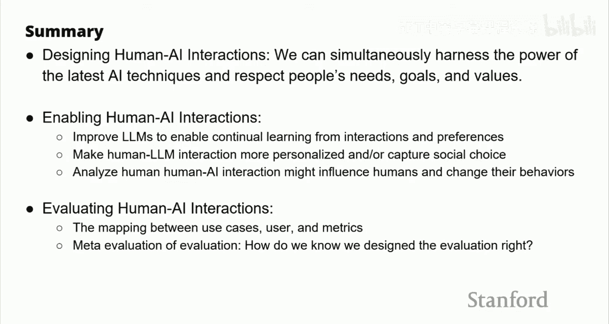

Okay， so that's that on what I wanted to cover or about a time。

