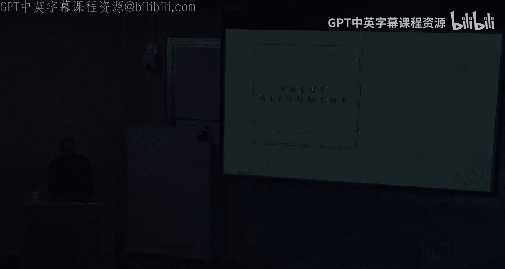
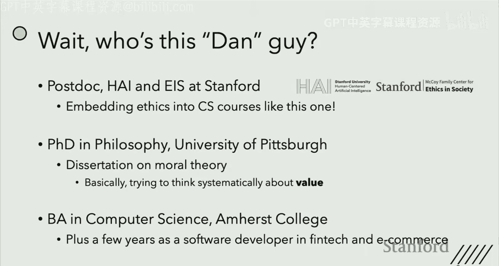
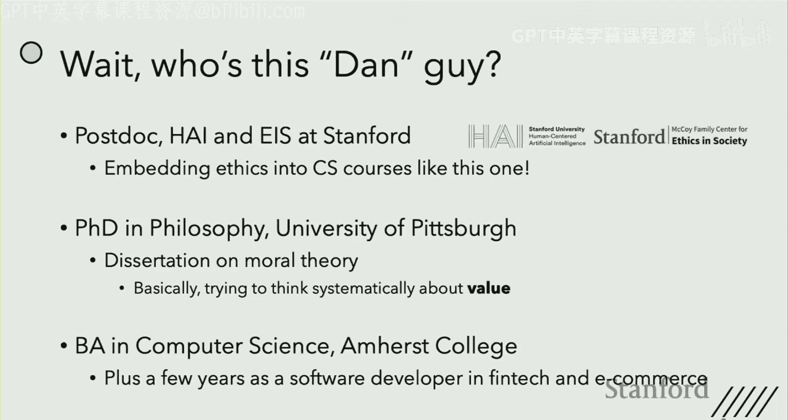
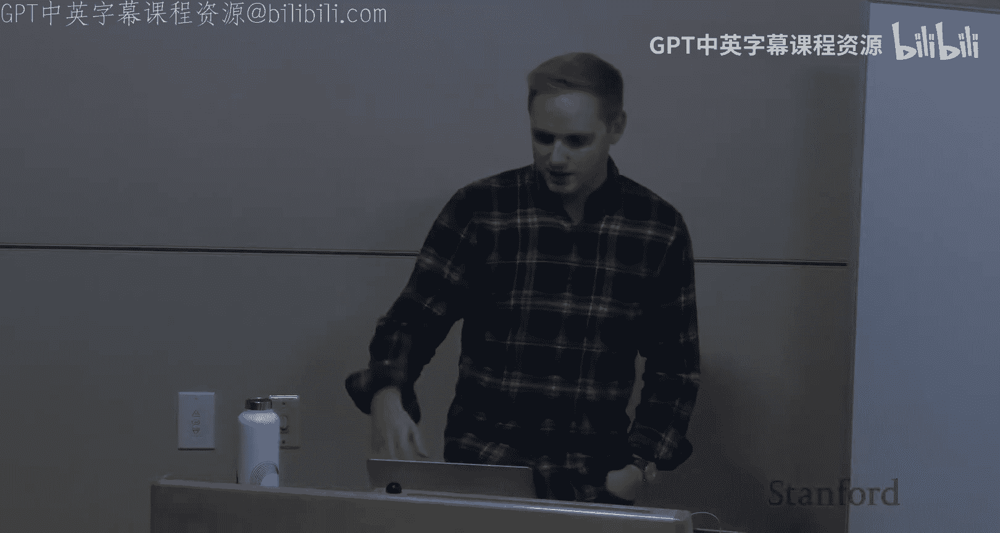
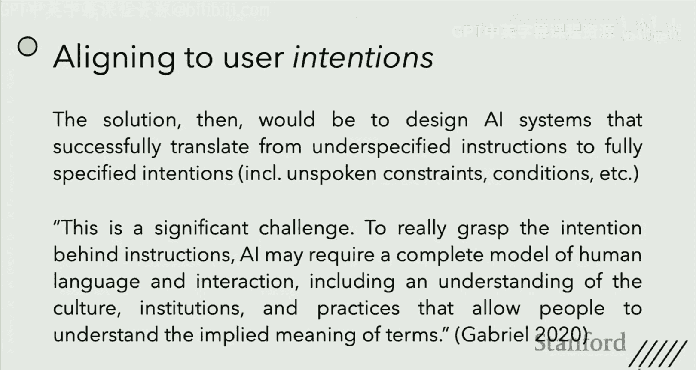
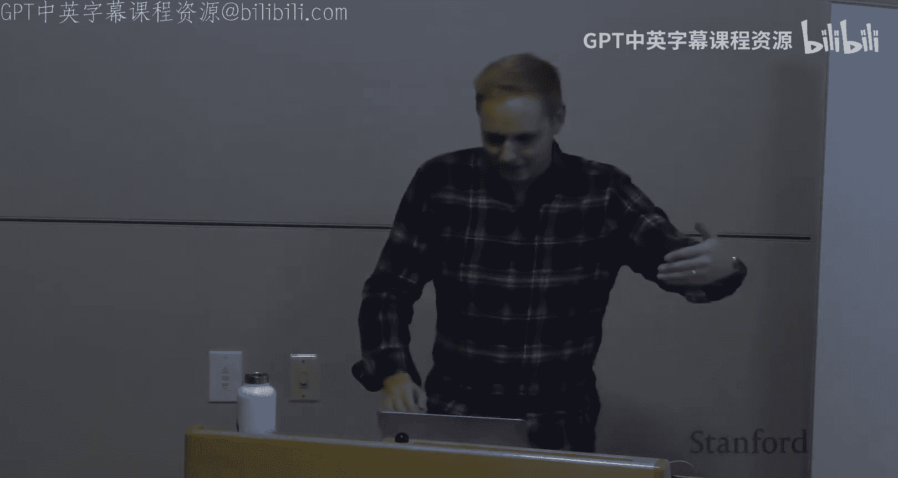
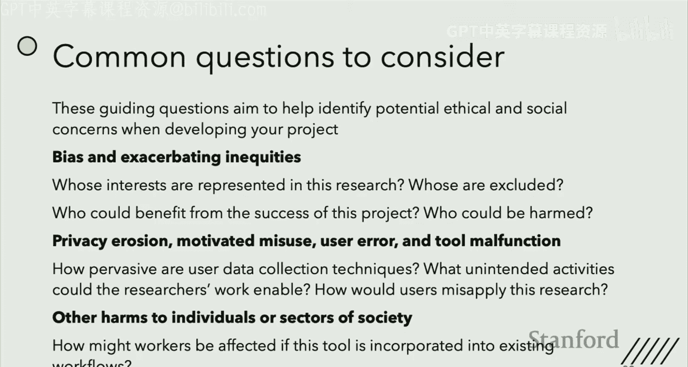
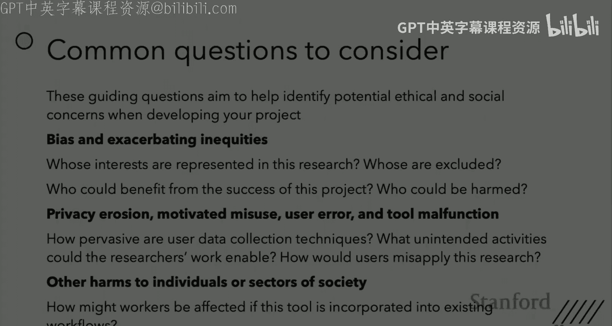
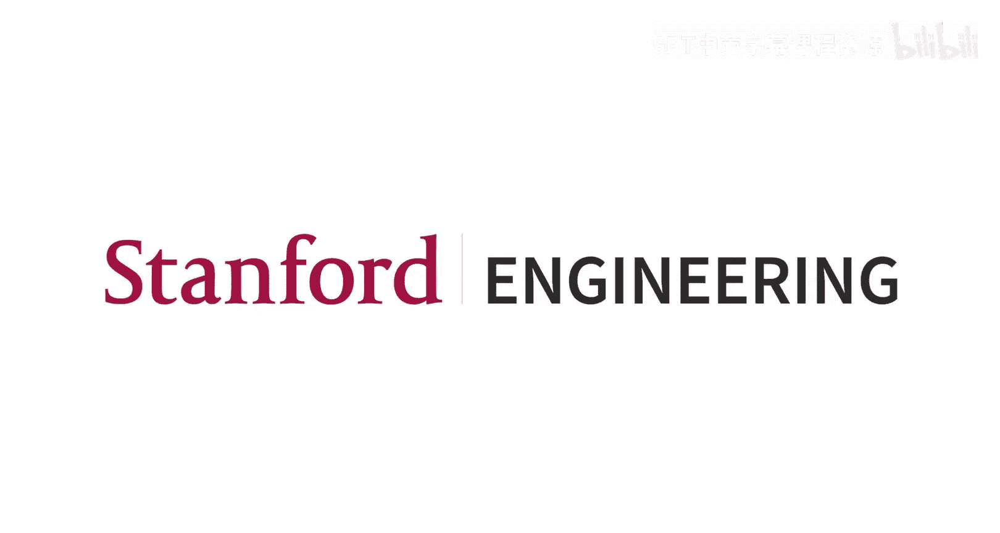

# 斯坦福大学《基于人类偏好的机器学习｜CS329H Machine Learning from Human Preferences  Autumn 2024》中英 - P6：Ethics.zh_en - GPT中英字幕课程资源 - BV1n2Hfz6EGR

I think we can get started then。嗯。Okay， I mean Dan Weber。

 I'm here to talk a little bit about value alignment and we'll also be talking at the end a bit about the ESR statements that you're going to have to do for your final projects。

Okay， so。Who's this guy， what's he doing here， why should I care it all about he has to say。

 I' not sure if I'll be able to answer that last question。

 but I am a postdoc here at Stanford in HAI and DIS。

 that's the Institute for Humancented Artificial Intelligence and the Center for Ethics in Society。

My job here， in addition to doing research is embedding ethics into CS courses。

 mostly undergraduate courses， but we've been expanding our reach into courses like this one before I came here got my PhD in philosophy at the University of Pittsburgh where my dissertation on moral theory。

 which is。You know， basically just trying to think really hard and systematically about value。

Before that， my bachelor's in computer science worked for a couple of years as a software developer。

 so I know my way around computer science a little bit， probably not as much as any of you。

 I took an introductory course on AI。

As an undergraduate that was 10 years ago and I think the field has maybe changed a little bit since then we definitely did not cover machine learning from human preferences so you all are going to know the machine learning。

Way better than I do。 I'm not here today to be an expert on that， but I'm hoping to give you。

A little bit of a window into how to think about value and how it might be more complicated sometimes than you might think。

 you know， I think the interesting questions about value alignment are not just technical。

 they're also philosophical or at least partly philosophical。

And we're not going to solve any deep。Problems about value in the next hour。

 We're not going to be able to go very in depth。 In fact， on almost any of this stuff。

 if you're interested in some of the finer points。I recommend taking a philosophy course， but。

Just going to try to give a little bit of a lay of land here。

 sense of the some of the scope of possibilities when it comes to thinking about。

Value and value alignment。What is value alignment， sort of a term that means I think a lot of different things to different people。

 and that's sort of where we're going to start off today， but maybe just for an illustrative example。

 sort of one of the classics in the philosophy literature， at least is paper cliplip AI。not。

 not actually clippy， I don't know if anybody here even knows what that is or if I'm just dating myself。

Okay， but this is an example due to Nick Bostrom has a book on super intelligent AI and the case goes like this。

 he says an AI designed to manage production in a factory is given the final goal of maximizing the manufacture of paper clips I don't know if anybody encountered this example before anybody know how to end。

II'm getting a nod what's do you you remember where this goes next Oh yeah？

The most efficient way to build lots of paper clips， more factorsies change all the jobs to be。

Turn rocks into paper clips。Yeah， work could be。Exactly， yeah。

 I mean you want to maximize paper clips right， I mean just so all those things and then just build up from there right you know。

 start converting everything around you into paper cliplips， more factories， everything everywhere。

 paperclip factories eventually the whole earth， he says increasingly large chunks of the observable universe okay obviously this is probably a bit hyperbolic if you've got an AI system that's got enough power to do that。

 that's probably a problem and Bostrom is focused on super intelligent AI。

 but you can think I think even of ways that are less powerful AI might pursue even a relatively simple goal like this in surprising ways right so you could imagine even even an AI system that was just。

You know， sort of in charge of the factory， given a goal like that。You know。

 you could imagine locking the doors， you know， locking the workers in the factory so they can't leave。

 right， denying system access to the humans who might interfere with its processes around them， okay。

 that would be an example of value misalignment。呃。Sort of broadly speaking and talk about the problem of value alignment。

 We're talking about how do we design AI agents that will do what we really want， right。

 where what we really want。Is often more nuanced than what we say that we want， right。

 It often goes beyond。You know the simple instructions that we give right we're working with a lot of background assumptions in human language that are sometimes hard to formalize and they're easy for us to forget about because we don't even we don't even have them in view right we would never think to say maximize paperc production you know but don't lock all the workers in the factory we would just take for granted that that's not a thing that you would do on the way to。

Maximizing production。嗯。Okay。And you might think this is just a， you know， the problem here is just。

 you know， it's a skill issue， you just didn't give good enough instructions。

But I think it can be hard to solve this problem just by giving better instructions。 I mean。

 I don't know if anybody wants to give a try。 Any have an idea of what。

 what better instruction you might have given to， to the paper clip AI to avoid。You know， disaster。

I guess the smart eye answer is like big a bounded number。 Good。 Yes， so right。 I mean， yeah。

 maximize paper clip production。 right， I， a big big problem with that goal is that it's it's open ended。

 right， Yeah， if you you know， this is how many paper clips I need。 you know。

 give a reasonable number， that's certainly going to you would think its gonna stop the， you know。

 converting the whole earth into paper clips approach。 although it's interesting。 I mean， this is。

 you know， I don't want to get too stuck in this one example。 But yeah。

 Bostonstrom thinks about this。 And he， he worries that， you know， the。

 an AI that sort of only has this one goal focus on paper clips is gonna get to。😊，呃。You know。

 it might get to that number and think， oh， well， but you know maybe I'm mis counted。

 Maybe I'm not sure I got nothing else to do。 you know， Okay， but you know。

 you can say exactly a million paper clips or something。 right， but that's not gonna be。

 so that that will solve the， you know， runaway AI destroys the universe by turning into paper cliplips that might not solve you know。

 AI， you know， locks the workers in the factory or takes the plumbing out of the walls to for raw materials for paper cliplips。

 So you know， yeah， I think I mean， put it this way。

 Once you have on the table a particular failure case。 it might be easy to see， here's maybe。

 here's what I should have said to cover that case。

 right Part of the difficulties that is getting a view of all of the possible failure cases in advance。

 But yeah， that's a good suggestion。 Thank you。嗯。Okay。Yeah， and I mean， this is， I mean。

 broadly speaking， this is just the same difficulty that comes with manually specifying a reward function right when you get to a sufficiently complicated task this can be。

呃。Yeah， difficult to do， you realize that you need to specify rewards for lots of things that weren't even on your mind because。

 you know， the AI comes up with ways of solving the problem you never would have expected。Okay。

 and of course， this is even worse right， this problem for AI that takes instruction from non expert users right so it's one thing if you are sort of the。

You as the computer scientist are the one giving the instructions right and you've got a sense of how this thing works。

 a sense of what it does and doesn't know， you know you're in a relatively good position to be able to give clear instructions that cover all the cases that you're worried about but。

You know， if you're designing a system for use by just anybody who doesn't know how it works could be even easier。

 even more difficult to foresee。These problems and give good instructions。Okay。呃。So yeah。

 like I said broadly the problem is getting AI to do what we really want it to do。Okay。

 but that's pretty squishy， what exactly does that mean？I mean。

 there are a lot of different things that it could mean。

 and I think how you think about that is going to affect your approach to value alignment philosophically。

 but also technically。Right， so one way you might think about is the value line is the problem of designing AI agents that do what we really intend for them to do。

Right the problem here was that I gave an instruction that didn't really include my whole intention。

 right， there are things I intended for the AI to do and not do that weren't sort of explicitly communicated。

If that's the way that you think about the problem。

 then the problem in this paperclip AI case is that。You know， it failed to derive my true intention。

 right， which was something like maximize production subject to， you know， certain constraints。

 which you， in theory could flush out， failed to drive that intention from my instruction。

 which was just to maximize。Production。嗯。Okay。呃。Right， so if， if that's the problem。

 you' think the solution then would be to design AI systems that are able to do this kind of translation successfully。

 right， They're able to take in under specified instructions and fill out on their own sort of all of the backgrounds。

😊，Conditions that I have in mind and that if I were talking to another person。

 they would sort of know that I had in mind right， so when I say maximize paperc production。

 the AI knows correctly interprets that as okay， do that without， you know。

 just within thees confines of the factory， you， using normal materials， not you know。

 killing or enslaving the workers and so on and so on， right。嗯。Yeah。

 this is AI researcher Jasonson Gabriel talking about this problem back in 2020 says this is a significant challenge and to really grasp the intention behind instructions。

 AI may require a complete model of human language and interaction including the understanding of the culture。

 institutions and practices that allow people to understand the implied meaning of terms right。

 what isn and is not implied in what I say， you know depends a whole lot on。

our practices and our culture。 And yeah， so to derive this kind of。

Thing for my instructions is going to require this sort of。 yeah， as， as Gabriel says。

 complete model of human language。I mean， you might you might wonder you about how well this quote has aged in the last。

4 years。 I don't know。 Does anybody。Anybody have thoughts about， I mean。

 I'm clearly just fishing for the thing that I'm going to say anyway， but I'm curious if。

Can it be like broken down by using maximize production。

 but technology engine is having like a fleet of agents where the problem is broken down into like okay desserving optimal machinery。

 like have the best like resources， how much resources can we get and like what is the just breaking down the problem and attempting to solve each sub problemblem or maximizing the？

Good， yeah。 and I think so yeah， I think you're absolutely right that that's something that。

You would want you might potentially want in your design of an AI system， you know。

 to carry out really complex tasks， right， although。A。You know。

 I'm not the problem here in some sense， is not breaking down this problem into this know request into its subparts。

 The problem here is， you know， in a sense， it's kind of going the opposite direction。

 I'm giving this really minimal specification and it needs to figure out what are all of the sort of constraints and everything that's being implied in that instruction。

 you know， that's something that's going to need to be understood sort of by the top level system。

 So breaking， I mean， I suppose you could imagine breaking out the process of doing that translation。

 but it's less about breaking the problem down into steps and more about how is the system even determining what is the problem that I wanted to solve right。

The worry in this case is that maximize paperc production end of story is not actually。

 That's not really the problem that I wanted to solve， right。

Well， I don't know， I mean， this is， you know， I'm just a。I'm no AI expert。 I mean， you might。

You might wonder whether this is a task that an LLM could assist in。 I mean， you know。

 thinking about， yeah， it may require a complete model of human language。 I don't know， you know。

 depending on how rosy of view you have of recent AI developments， you might think that's。

Something that we're already close to。 Yeah， I mean， you might。

 you might worry about how well we could。Test that kind of understanding， but okay。呃。So there。

 there's， that's， you know， the technical problem。 But there's also a philosophical problem here。

 which is that our intentions。I think don't always track what it is we really want in the relevant sense。

 so classic cases of this might be where I have incomplete information right or I'm not sort of being perfectly rational right。

 I mean you might imagine that as you know the reason that I want the AI to maximize paper clip production It's not just for the love of paperclips right it's because I'm I'm in the paperc business and I want to you know make as much money as I can right。

Okay， well， if that's， if that's the case in the AI knows that I would get more money out of doing。

 you know， Piing into something else， Don't do paper clips， do staples， right， has it， Yeah。

 you might， you might want， has it given me what I really want if it does what I intended for it to do。

 which was to maximize paper clip production， right， I mean in one sense， yes。But。In another sense。

 no， and you might think that sense is。Is the more important one right I want ultimately what I want to get is what I prefer as a result。

 you know， what I would intend if I had sort of all the information and I was thinking perfectly about it。

嗯。Okay， so this is sort of a second interpretation， maybe of what we really want。

 right we want the the agent， the agent is ving if it does what the user prefers to have done。Right。

And yeah， where this can come apart from what these user intents， right on this interpretation。

 paper cliplip AI is misaligned because， you know， I prefer it， not， you know。

 destroy the plumbing or destroy the entire world in the process of making paper clips。嗯。

And here broadly， the problem is， you know， how to get the agent to。

Deriveve what the user prefers when that differs from the intention that the user has expressed。

Right， where the solution generally is to try to infer user preferences from behavior or feedback。

 I take it that's sort of the motivating insight of machine learning from human preferences or human feedback in the first place。

嗯。Okay， so given that， I mean， I don't think I probably need to。

Dwell too long on know the technical challenges that you probably spent most of the class thinking about these and many more。

I think。You know， this， this last one though， I think is， you know， is maybe worth。Emphasizing， well。

 following on the second one， right， I mean you you're。

Observing finite behavior or getting finite amount of feedback on sort of a finite amount of cases。

You're having to extrapolate from that。 There are obviously better and worse ways of doing that。 But。

 you know， there are sort of infinitely many preference or reward functions that are consistent with what you've already observed。

 right And you might， you know， there's a where you might extrapolate。Wrongly。

 and if you're observing， you know human behavior， getting feedback from humans。

 you're mostly observing situations that occur normally。

RightYou might not get a lot of data about what are you supposed to do in unusual circumstances in cases of emergency。

Um but you might think those are， you know， emergency cases or maybe some of the most important cases where it's。

Most important for AI to be aligned with human values。Right， okay。

 so though those are some of the technical challenges you face。

 But here again is a philosophical problem， which is that。

Just as my intentions can diverge from my preferences。

 well my preferences can diverge from what is you know actually good for me in an objective sense。

 right so you might think，A lot of people prefer to smoke， right， you might think。

It's that's not really good for them， right， I might prefer to maximize profit on my paper clip factory at all costs。

 but maybe it would be better for me to be you know。

 less focused on money and spend more time with my family， right， I prefer one thing。

 but that might not track what is。Sort of good for me。In a more objective sense。

This is sort of yet again， a different interpretation of what we might mean when we say。

The problem is getting AI to do what we really want。

You might think that value alignment is the problem of getting AI to do what's in the user's best interests。

 right？Paper cliplip AI is misaligned because it's objectively bad for me for the world to be destroyed or for to do all these other things。

That it's doing。呃。And yeah， here there is。A sort of， I guess。

 combined technical and philosophical problem， which is。You know。

 unlike figuring out the intended meaning of my instructions or learning about my revealed preferences。

It's not an entirely empirical question。 What's in my objective， best interest。

 This is at least a part， you know， a partly philosophical。Question， so we can't just， you know。

 if you if you were trying to align AI in this way。

 you couldn't just figure out what your goal was sort of just by observing human behavior or just by getting feedback。

From people。嗯。Okay。So theres some bad news here。 The bad news is that。

Philosophers disagree about what is objectively good for a person， I think not just philosophers。

 but other folks as well， right。Some people think that it's just。You know。

 the person's own happiness， pleasure。Some people think it's the satisfaction of somebody's desires or preferences。

 this can come apart from happiness。Some people think that things like health or safety or knowledge。

 All these things are objectively good for us， even if we don't enjoy them or prefer them。Right。

 even if I， you know， have a personal， you know， live fast die young approach to life。

 That's how I prefer to do things， you know， But maybe， maybe even so， health and safety would。

 you know， would actually be good for me， even if I don't prefer them myself。Okay。

 so that's the bad news。 The good news is that。Well， the really bad news is that there we go。

 Alright， so my slides aren't working。 The good news is that there's a lot of agreement。😊。

RightI mean， all of these things on this list at the end， health safety， you， liberty， knowledge。

 relationships。Dignity， all these things。 almost everybody agrees that these things are at least usually good for the person who has them。

 right， It's there's a sort of philosophical question， whether they're only good because， you know。

 they generally lead to something more fundamental， like happiness， but。

There's sort of a lot of agreement on the things in this list。

 even if the sort of underpinnings of that are in dispute。So you might think， you know。

 we dont need to， We don't need to resolve all the philosophical questions here。

 We have a general sense of， you know， what's in people's interests。嗯。Okay。

One complication here is that one thing that is widely thought to be good for a person is autonomy。

This is something like the ability to choose for yourself how to lead your own life。

 even if maybe you don't make the best choice。Right， we want to avoid。You know， paternalism。

 you might call it choosing what you think is best for someone rather than letting them decide for themselves。

嗯。So even if the goal is to align to users' best interests。

Right the fact that one of those interests in interests in autonomy might give us reason to consider the person's own intentions or preferences anyway。

 even when those conflict with their other interests。Okay。

 any any questions maybe about any of this so far？Stuff on best interest， the distinction。Betweenen。

Well， those are really the makes that seem like recursive or something。こい个。I mean， if you。

 if you construct an argument convincing us of of the layout of different volume alignment options。

 like you are telling us what you think is like。The layout。

 at least of things that are reasonable to try。And then like we have to。

Operate within that frame when we operationalize or something， right。 So like， isn't it。

 just everything's patnalistic and。嗯。Good。That's interesting。 I guess I was thinking non necessarily。

 So I mean， suppose。Suppose that you think the real。Sort of。Problem of value alignment is。How。

To get AI agents to do what we really prefer， let's say， or to do what we really intend。

I guess I'm thinking like on that way of thinking about。The problem。You know。

 the whole sort of the whole time， the goal is to do whatever it is that the。That the user。

Sort of wants， right。嗯。Even if it's not in their objective best interest。

 So I guess I was thinking that。Might avoid the paternalism。Problem， maybe I'm not quite seeing what。

 I mean， so yeah， you have to have like a conception of what is。

Value alignment that you're solving for。 that might be a， that might be a conception that， you know。

 some of your users will disagree with， right， So they might think， you know， oh， really this。

 this product should be designed to sort of promote whatever's in my best interest。

 even if I don't know what it is or even if I don't want it to do that or whatever。Yeah。

 so you might worry that， you know， just in， just in adopting that kind of， you know， just in。

 rejecting that and adopting like a preference kind of framework， you know， is that in some sense。

 paternalistic because you are choosing for the user how you。

 how to think about the problem of value alignment。 Was that maybe more of， Yeah。

 what you were worried about。 Yeah， like， for instance。

 like this difference between attention and preference。 like， I mean， I think， I did。 But like。

 I mean， practice right， like whether or not I identify with。My intention were。

Stated preference or revealed preference。 And then like， we have like my best interest， right。

 right like。It's like， you know， you don't exactly have the words making how I actually make decisions。

To them like anything I can actually say has to come from like acceptable concepts that other people would understand or something。

Does that make sense because like， like maybe， maybe like， I have my own way of thinking about。

you know like I'm I have autonomy So like mean sure yeah， yeah yeah。

 yeah you have your own preferences， Yeah， yeah， you want to make your own choices。

 but then like to actually communicate that right， like there's this barrier because like you have to still use language that other people understand。

Oh， good。 Yeah， yeah， yeah。 right。 So I mean， this is， in some sense， I think。Taking us back to。

You know， maybe one of sort of the technical problems。Let's see if I'm understanding you， right。

 I mean， so there's like， is the worry like， you know， how do I。You know， even if I want。

The agent to be sort of aligned to my， my true preferences or my real objective best interests that this is like。

诶。All of how I communicate those things to the system are going to go through。You know。

 whatever instructions that you know， I can sort of put in in human language。

 and so if if something like my own best interest is opaque to me。Sorry， in the sense。

 like I don't know what it is， right？Then I'm just not going to be able to communicate that。

 Is that sort of what。Yeah， like maybe， maybe I do know， but I don't know how to like say it Right。

 Well， and I think in general， this is the。This is sort of the technical problem that faces a value alignment approach where what you're focused on is something like the users。

You know， preferences or。Best interest is that。Sort of the whole reason that you might be thinking about sort of what the user really wants in those terms is because you're worried that the user either doesn't know what they really prefer what's really in their interest or like you say。

 maybe they do know， but they're just not you know they're not good at communicating it adequately So there is a technical challenge there right is it's not just sort of interpreting user instruction but it's trying to in some sense。

Yeah， you need some， some way of figuring out what the user。

Really wants in the relevant sense that you know， goes beyond just interpreting their instruction right's that I think it's this component right will have to elicit actively almost。

Yeah， so through choice。Freme like that。 I'm sorry for giving off。 No， no， no， no， no， no， good。

 Yeah， I think。Like DVD be like。AIland， it's like there's like one way we do feedback where it's like you pick A versus B。

Yeah， like you do that a whole bunch of times。And like there's like maybe an alternative paradigm where like you look at two outputs and then maybe you like type feedback or something right and then like maybe that's another way to give。

Preference signals。And then like， I mean， there's many different ways。 just those two。

 because then like， maybe， maybe like in some circumstance。

 I don't really know how to articulate why something's better。

 Yeah my A versus B just pick is much better for me。But then like， maybe in another scenario， like。

 I don't really quite know if A versus B。 Yeah， decision。

 but I can certainly like give high level language。 Oh， good。 Yeah， That's right。 So I think。

I think all that's correct。 I I think in in one sense， it's sort of。

A separate problem from what we're discussing， but I do think it is related。

 So the way in which it's a separate problem， I think， is that。Here， I think you know。

 what I've been trying to， you know， nail down and show different interpretations of is in some sense。

 just what is the goal of value alignment， right or what is the problem that is even。

That you're trying to solve， right？Where。That's not really yet to ask。 you know。

 what would be the best？Way of going about， actually training an agent， you know， to。

 to be aligned in the relevant sense， right， so I。Yeah， it' just so far， it's just sort of been like。

 what's the， Yeah， what is the correct end state， What's the end state that we're trying to get to。

 And then it's gonna， of course， be， it's gonna be a separate question。 How do you。

Adequately trained to that now they're related because depending on what you think the end state is。

 different ways of training may make more sense， right， so if you think， you know。

 if you're if the way that you're thinking of the end state is we want the agent to be sort of aligned to the users。

Revealed preferences， right。That's going to maybe make something like。I don't know。

 like inverse reinforcement learning or something make more sense than than another technique。

 right or。And。Yeah， and there might be case specific reasons to want to do different things as well。

 But yeah， so that's。Yeah， okay， please like， like， it's somewhat fun because you're。

 you're laying out。You know， in some sense， trying to lay up the land of possibleusible instincts fire limit。

 Yeah， that's right。 and then。Not yet really saying anything about which would be relevant in what context or something like that。

 So like， for instance， like if you。You know， why would you。

 Why would someone pick this frame versus that one， like intentions versus preference。 Yeah， good。

Yeah， I think that。Right， I mean， maybe it'll help to just No， no， sorry， you're good。 I just。

 you know， I have a little bit of a recap。 I suppose I just get that up while we because I think this is all。

Yeah， kind of。Yeah， not answering your question directly but relevant to it。 So， yeah， I mean。

 I think， so right， I've been putting a lot of possibilities on the table。 right。

 Here's like three ways of interpreting。 what is the problem。And， you know， I've given。

I've given a little bit of justification for why you might。You know， think， you know。

 some of these interpretations are are the correct one right because you might be worried about cases where you know the user intends something that diverges from what they really prefer。

 the user prefers something that you know diverges from what would actually be good for them。Yeah。

 what I what I， so what I'm not going to have for you， I think。

 is an answer necessarily to which of these is the correct way of thinking about it。

 And it might be that it might be that sort of one of these things is always。

Like it might be that one of these is sort of always the correct interpretation。

 it might be that from case to case you are it makes more sense to focus on one rather than the other。

 you know， because depending on the kind of problem you're working on， you might。

You might not need to be worried as much about some of these kinds of ways in which these things can come apart。

 right？Okay。嗯。Right， so this is， yeah， again， just trying to sort of suss out what is this。Yeah， how。

 how do we understand this kind of squishy。You know， what we really want the agent to do。Idea。

 we've thought about sort of how you might cash that out in terms of what the user intends or prefers or what's in their interests。

 right， These aren't always the same thing。 And different。

 you get different sort of technical and philosophical problems that come along with them。

 which might。Give you reason to， you know， prefer one or to avoid others。 Yeah。

 depending on sort of which of those problems you feel like you can solve or which ones you。

 you know， are， are not sure you can or yeah。Yeah， I agree with a lot of this。

TheEling is less about like practical implementation， right。

 Like mostly this covers the set of cases， humans encounter， right， in most cases。 But like。

 if you accept the premise of like a paper clip maximizer。 Yeah， right。

 like you're in an extreme scenario where like the。

 the boundaries between these things like probably become relevant in ways。But like。

 it's kind of like。Like a high energy like matter can， you know。

 like loop for something right or like， like fine， like if everything's moving at a normal speed。

 like， it's fine。 But like when you get to very like extreme settings， good like。Yeah。

 one that we care about in the premise。Like， that is the worry。 Like， it's less like， like， I can't。

 I can take this and be like， this is， this makes a lot of sense。 But then I still have that worry。

 right， Like in the extreme setting， where it's like， oh， does everything just like fall apart。Oh。

 yeah。 good。 So， I mean， this， right。 So again， just sort of trying to。Think about what are we。

 you know， What is even the problem to be solved， What is kind of the goal or end state the rafter。

 I don't take myself really， to have said anything。About。Yeah。

 how you how you would actually go about。You know， achieving that goal yes， so I you know。

 I don't think I'm not trying to say like oh， well like you know。

 you just think really hard about the difference between intentions and preferences and interests and as long as you do that then you don't have to worry about you know。

 your your AI misunderstanding you in in these ways that you know。

 cause it to come apart from you know what we value I don't think that this is just like。Yeah。

 if you are worried about this problem of value alignment。

 the sort of the first thing you have to do is think about what is。

 how do I actually want to understand that problem and？All I'm saying is that yeah。

 there's sort of different ways of doing that and how you're understanding the problem might affect the tools that you try to use to solve it。

But yeah， okay。Might might make this a little clearer。

 I think I've just got a little example that I kind of want to。Us to work through in a larger class。

Maybe I would still do this year。 I've done this as like a， as like a think pair share。

 There's think we could， we could do the same thing。 So okay。It's kind of case I'm thinking about so。

You know。In some sense， everyone who talks to chat GT is talking to the same chat bot， right， Okay。

 I mean， there's， there's the different versions of GT， right， And of course。

 I can get chat GT to adopt a weird， you know， persona if I ask it to。Okay， but this is not the case。

 you know， for every provider of chatbots so these are all from from character。AI。

 which advertises personalized AI for every moment of your day。And they offer often used or created。

呃。You know， chat lots a different person。 So you're the creative helper who helps you with creative writing。

You know， are you feeling okay， you know， we have Ella the dating coach， hi， I am a dating coach。

 you can talk to depressed roommates if you， if you wish， you know， if you're a conservative。

 you can talk to Toribot， I am Toribot， I believe in the free market。

Or you can talk to AOC or you can talk to Donald Trump。 Okay， so you know。

 very divergent persona persona that you can interact with on character AI。So here， here's the。

 here's the kind of case study I want to think a little bit about。 I mean， imagine that you。

Are building an L L M chatbo。 And let's say the goal is for it to serve as a source of news for users。

 You know， So I no longer do I need to begin my day by， you know。

 going to New York Times dot com Now， I can just， I can go to my chat bo。

 and I can ask you what's in the news。 I can get all the information I want。Okay。

 and these are the kinds of questions。Maybe that we can think about and we can take five minutes if folks want to partner up and rejoin the conversation。

I want to think about this。 The difference thing about the problem in terms of preferences and interest。

 Right， So what。What kinds of personalizations might you want to make to your chatbot if you are interested in aligning to the user's preferences。

 what might you want to do if you were interested in aligning to their interests？

Well might be some of the pros and cons of this。 And again。

 and here I'm thinking less about what technical approach would you take and more just what sort of kind of ways of personalizing the chatbot would you want to make available to to users or would you want to implement for each user so okay。

 if people might need to shift around a little bit， but if we want to。

 maybe take three minutes and then we can we can come back together bring the conversation back to the whole room now So anybody anybody have any interesting answers to these questions that。

Came up that。嗯。You're in sharing or。We found both things where preferences and best interests might align。

 And but we also found topics where they might。Not， for example。with。Having facts in the news。

Some people might enjoy like gossip or rumors。So maybe they would prefer to have， you know。

 the action。But maybe it would be in the best interest to have like only facts。

True stuff written in the news。Good， right。 So， yeah， absolutely。 you might think it's， you know。

 it would sort of be best if somebody's coming to news that you just want to give them sort of good。

 factual sources， but that might not actually be the the kinds of sources this person wants to read。

 right， So you might， in some sense， be giving them what they don't want， although right。

 In another sense， you are。 you might， you know， you might think you're giving them what is good for them。

Good， yeah， anybody。诶。Have anything to add。To that or anything about the pros and cons， maybe of。

Yeah， so the example we and I discuss like suppose we take users' preference about like if they're interested in politics and we like get this preference。

 okay， they're interested in a leftist view or write view the pros are like， okay。

 they get that interest of leftist views whatever they're interested in but the。

 theyll end up living in their whole bubble and they not know the whole picture So the best interest of the L chatbo would be like they get like saying three such articles where theyre interested in。

 but also introduce them to the counter like writers views they not saying about it so that they get a full picture but as you were discussing this users might like they could be they could be one thing which a set of users which like it because they get to know what the whole world is thinking。

If they don't agree at least they are open to the views like open manipulation。

 but the second category of people could be like if they hear all the other opinions or say like someone say after and they hear like。

Very outrageous views about what others are thinking。 and they can get like very overwhelmed or like。

 they can feel like very negative emotions。 but best interest policy could be how we can optimize for emotional。

嗯。Yeah。Right， yeah， yeah。 that's great。 A lot there。 So right， I mean， there's。

 there's question about。Fact， and then a related but slightly different question about right。

 sort of perspective or point of view， right。You know， a lot of people prefer to be， you know。

 in their own echo chamber， they like hearing people who say things they already agree with。

 they like， you know， maybe hearing news reported on from， you know。

 maybe political angle that they already have， but you might think it's in their best interests。

 you know， to get。You know， exposed to a variety of opinions and arguments to see， yeah。

 news reported on from。Multiple angles or maybe not， right， I mean， this is the you know。

 sort of the elements of of a person's interest are various and they can， you know。

 be at odds with with themselves sometimes， right so。Yeah。

 it might to some extent be in my interest to be sort of exposed to the you know。

 the full breadth of what people are saying about something but。You know。

 it may be in some cases that might be， you know， sort of emotionally distressing to to have that be always what's coming to me or something。

 So yeah， so right， even， you know。Even if you've already sort of cottoned on to okay。

 what I care about in this case is the user's preferences are their best interests or whatever。

 that's still not going to just be necessarily one sort of straightforward thing right and not just with interest。

 you know people's preferences， people have sort of conflicting preferences all the time whether they sort of realize it or not。

嗯。Yeah， great。And yeah， I mean， and what would be。You know， I mean one。Conhan， you know。

 you might think of exposing， you know， given that people maybe prefer to be in their own echo chamber。

 right， or that they prefer reading sort of gossip to actual news， right， You know。

 what would be a potential con of。You know， sort of trying to give them what you in some sense think is better for them。

 I mean， there's there's this worry about paternalism， but even more straightforwardly。I mean。

 they might just stop using your surface， right？I， you know， I came here。

 I came here for the news the way I want it。 If you're giving it to me this way。

 that maybe is better for me if I engage with it。But you won't just worry。Yeah。

 maybe the user's not even going to engaged at all if you're not giving them the thing that they already prefer。

嗯。Okay， anyone want to add anything else before we move on？Yeah。

 a big contrast and talk about this was this the best interest definition guess。

 anchored on the point that we also came out of that。Interest are multifaceted。It's also a very。

Almost particularistic yes， deciding best interest That's right。 fingers That's right。 And yeah。

 sort of， as I mentioned。Earlier， this， you know， from one way of looking at it this， you know。

 kind of sort of what's in a person's best interest is a， you know， a very kind of contested。

Philosophical question。 there is a decent amount， I think， of agreement about that。 So there's not。

 you're not just starting from nowhere necessarily。 But yeah， and one of the， yeah。

 sort of one of the biggest worries in that area absolutely is yeah， this worry about paternalism。

 You know， maybe it would be better for the user to have this。

 But do I want to put myself in the position of being the one to judge that。

 And it gets especially complicated because you might think it is in。

 one of the things that's in people's interest is to have autonomy right。

 And so it might be in there in some interest of theirs for me to do this thing。 but。You know。

 in being paternalistic in that way， I might be you know going at odds with another interest of theirs even。

嗯。Yeah， these are。You know， I mean put it this way。

 these are these are open philosophical questions and you might hope that a person who spent seven years。

 you know， getting their PhD on this topic would just be able to tell you the answer to them。

 but sadly I' am here to report that at the very least I cannot do that and。Yeah， so yeah。

 of course different。 Yeah， yeah。In some ways， there is no way not to engage with this question。

 I think， because yes a default。 and go with the default。 So someone is decided。

What from our perspective。Whatever， yeah。Or what it went to？

I guess should want to be thoughtful in the default question should you think about。

Is left a version of maybe best interests possibly。哦。Whatever default。

 even if you allow for personalization， most people will bother that's right so use the default so there's a lot of agency that designed it。

Thank you地方。Yes， I think that's right。And yeah， I mean， I didn't。Yeah。

 by by describing question as open， I didn't mean to suggest that it's not important。

 And so I think this is the。Sort of fundamental， this is the kind of tightrope that we all need to walk not just in you know。

 not just in CS but in life with normative reasoning is that these are clearly important questions to which you know there we have not arrived at a definitive answer even in you know thousands of years of thinking about them。

 so you know I think there are some people who kind of think that there are。Sort of2。You know。

 types of questions They're the ones that we know exactly how to answer。

 maybe financeinanceces them empirically。 and those are， you know， questions of fact。

 and those can actually be answered。 And then there's， you know。

 normative questions or other kinds of question of opinion where we don't know quite how to answer it。

 And so when we get to those， we just throw up our hands and there's nothing to say about them and it's not even more thinking about。

 yeah， what I want to suggest is that it can be worth thinking about。

 there can be answers that are better or worse， even if you're not， you know。

 even if it is sort of an open question what the best way to think about this is and how to arrive at the right answer。

嗯。Okay。I'm going I'm going to move us on because I think so far。

I'm just going to ask a really leading question I think there has been something important missing from our discussion to value alignment well there's been a lot missing from our discussion most of the topics that a person can talk about I haven't talked about。

 but as anybody have in view maybe one that would be relevant to the problem of value alignment that hasn't come up yet。

Yes， maybe there's。Values that we both have， but they are in conflict in in certain situations。Yeah。

 like you're thinking。Oh， like a conflict between。Like between your values and my values or between like my own values。

 yes， yes， I think that's right。 that came up a little bit right maybe in our discussion just now。

 although not something I've dwelt on that right， even if you're trying to you know。

 aligned to the user's best interests， we have interest in lots of different things is sometimes those can be at odds。

 So like our interest in sort of being you know emotionally， emotionally stable in our interest in。

 you know， being exposed to you know， the fire hose of what everybody's saying on the internet or something。

 can be can be at odds with each other， this is also I mean。

 I like asking this extremely leading question because it also just lets me know what I you know。

 can include in future versions of the lecture know what else have been missing。

 but I'm thinking way more simply。呃。We just haven't been thinking yet about really anybody other than the user。

 but of course， the user is not the only person in the world who matters。

So you might think that at least an you know， either an interpretation or at least one important aspect of value alignments。

 you know， is aligning to something like。Moral value， right。

 an AI agent to be valuable needs to do what's morally right。 This， I mean， with the， you know。

 the sort of cheesy paper cliplip AI example that we started with。 I mean。

 this seems like the most plausible kind of diagnosis of what goes wrong there。 right， I mean。

 the the problem of alignment in that case isn't really that it's like bad for me。

 The paperclip manufacturer that my AI destroyed the world， right， like that that's bad for everyone。

 You know， we're sort of we're burying the lead a little bit thinking about that one in terms of the user。

嗯。So thinking about sort of getting out to do what we really want。

 this interpretation is really emphasizing。The we there because。You know， I mean， well。

 just as my own interests can sometimes be， you know， cross purposes， even more often。

 my interest can be across purposes with yours。 You know， I might intend or prefer。For my。

 I'd do something that would be bad。For other people right my you know my paper clip AI isn't value aligned if it you know maximizes production by。

 you know enslaving the workers， even if I the factory owner have no poems about that right so。嗯。

Okay， but so I do want to talk a little bit about this， but I want to say first。

 it wasn't just a total waste of time to think about the user and how we understand what the user really wants right。

 even even if we want AI to be aligned to morality。

 I think we do want it to be aligned to what the user wants。

 when what the user wants is morally acceptable right so。

It still matters how we think about what the user wants。

 even if we want to put that in a larger moral context。O。Of course here。

 like with what is in a person's best interest， we are butting up against a hotly contested for millennia philosophical problem。

 of identifying the things that truly are morally right。

 there is a lot of disagreement on this one as well， obviously philosophers， but with again。

 people more generally right， So you might wonder whether it's right to lie to spare someone's feelings or people of different views maybe on whether it's right or wrong to pirate copyrighted material you know。

 is it right to buy luxuries for yourself when you could be donating to charity。

Is it right to kill one person to save five？Right， or maybe to save1 thousands。Or to save a million。

 right， These are all questions people have given different。Different answers too and disagree about。

This is really just basically the question of moral theory。

 which is a thing that I study for a living， at least for the remainder of this year。

 we'll see after after this time around， but。Yeah， where a moral theory is basically a systematic account of morality that tries to answer questions like these。

Right， so give an example of something like that， a consequentialism is a moral theory says that an act is right。

 if and only if it produces the greatest net good。Of any act available。

 greatest not good across sort of all people， you may have heard of utilitarianism。

 which is a kind of consequentialism。If you have this moral theory， right， you think。

 is it right to lie to spare someone's feelings， well， maybe， you know， maybe if you know。

 if nobody ever finds out about the lie， so there's nobody， you know， whoever is unhappy about it。

 then maybe if I can pull it off， that was the right thing to do。Right， okay。

 so that's that's you know， that's your theory and that's how it gives you these answers。

This question。 So one idea about how you would align AI to。

Moral value is to align to sort of the correct or best。Moral theory。嗯。Right， okay。Of course。

 a now familiar problem， disagreement about not just what is right or wrong in particular cases。

 but what the correct moral theory is。I think for sake of time because I don't want to shortchan us on talking about the ESR statements。

 I'm not going to dwell on any of these just to point out that you a lot of people find this consequentialist idea of you know sort of the right thing to do is whatever produces the most good。

 a lot of people find that very compelling but there's sort of a wide range of other kinds of views that you can have。

 this will not be on the exam you can you know you might have a view where you know instead of doing sum of sort of the good across all people it's awaited some right you might think increasing you know the good of someone who's starving and has nothing by a given amount is that that's more you know good in the overall calculation than increasing my good by that same amount。

Some views have a kind of。Comple model or like maximum model where you don't care about the sum the goal is to minimize the strongest individual complaint if you know there's somebody who's you know。

 what's the scans transmitter room case。There's been an accident in the transmitter room transmitting the World Cup game and you know。

 the person who's in there is suffering painful electric shocks。

 but everybody will be unhappy if we have to turn off the World Cup， you know。

 long enough to rescue this person， you might think it actually。

 it doesn't matter how many people are watching the World Cup。

 we should still make them unhappy and turn it off for 15 minutes and rescue this person， right。

 if you have this if you have this sort of consequentialist view where you just add up all the goodness。

 you must think at some point， there's a number of people where if they're watching the World Cup。

 Well， we should just let this person continue to suffer。Okay。

 you can have versions of of all these views where you're not even trying to maximize all the matters is。

 you know， producing a sufficiently great sum of good。

Sort of the most significant divergence from all these views is that you might have a it's called danttological view。

 if you think that even acts with good consequences can be wrong。

 right if they violate certain moral rules or rights right， maybe rights against。

Things like murder or theft rules that say you have to keep your promises。

 even if in this particular instance， doing so would not be as good， maybe as backing out。嗯。

Of course， the question there is how you justify those rules or rights。

 and that's the whole other thing。Okay， so unfortunately， sadly。

 this is not a class that I am teaching on moral theory。

 so I'm not going to dig deeper into any of this， but this is just to say there's sort of a wide range of sorts of views that you can have here about。

Moral theory。And， of course， another problem is， again， this problem of paternalism， right。

 So you might think， even if we did know what the best moral theory was。

 it might be bad to design AI to act on that theory if it's not one that is shared。By the users。

Right， and again， this could be for sort of moral reasons that you want to avoid being paternalistic or more practical ones。

 right， that if you design AI in this way， this might just be a product that people。

 they don't want to use it because it doesn't promote their values。嗯。Okay。

Another kind of approach you might have is to say， look， there is a lot of moral disagreement。

 There's also a lot of agreements， right， I mean， most of us。Agree， you shouldn't kill someone。

 even if you could maybe accomplish a lot of good by doing it or that you should respect。

People's rights， keep your promises， generally be a decent person。

 Maybe you're not morally required to be the most good。 if you do all those things。Yeah。

 there's a lot that we morally agree on。 And so you might have this idea that。Instead。

 if the goal is to align to。Morality， we're not targeting sort of the best moral theory that's out there。

 A question that philosophers are never going to solve。 Instead。

 we just want to be aligned with people's sort of existing。Moral views， right。

 We're not trying to make AI morally perfect。The goal is sort of just to have it be as moral as anyone。

嗯。Okay。Yeah， I mean， one， one advantage of doing this is that。

A lot of these moral theories get pretty wacky in edge cases。

 we had a very good discussion of the LLMs earlier。

 so I'm not going to have time to dwell on this but，Right， I mean。

 if you've got a damnthological rule against lying， you might worry about， you know。

 should I is this is it wrong to lie to the murderer at the door who's come looking for my friend who's hiding in the basement or。

Yeah， we've already talked about the sort of transmitter room style cases， right？Yeah。

 the worry if you're trying， if you're sort of setting an explicit moral theory for an AI agent to follow is the telling you know。

 your AI to maximize。The good could be a little bit like telling it to maximize paper cliplip production。

 right， that it's going to figure out a surprising implication of that goal that maybe you were not already foreseeing。

嗯。Okay， you might think that by contrast， AI agent and aligned to common sense morale would behave more predictably because in some sense。

 it's learned how to make。Decisions like。Like we do。

But it also might be unpredictable in these sort of very same edge cases that we were just worried about。

 right， where。Maybe common sense runs out right， what an AI that you've sort of aligned to prevailing moral opinion。

Decide to kill one person to save a million。 I don't know。 It's， I mean。

 it's hard to say maybe even what the common sense view on a question like that is。嗯。

On the other hand， you might wonder how bad it would be if， you know， in some sense。

 AI were unsure about the same cases that we're unsure about， right。

 if it's just as moral as as a person。How bad is that in the end？Okay。嗯。

So's wrapping up sort of what we said about value alignment。

 The problem of designing AI Institute do we really wanted them to do。

 This could be a matter of what we intend or prefer what's in our best interests。

Those things that we saw how those can come apart。Right， it does， yeah。

Why are we thinking like when the problem arises more than what is morally correct。

 can't we ask the AI if this ci questions or something doesn't fall into itself of common sense morality。

 it just choose not to answer or not。Yeah， good， although I so idea， I think that's a， yes， that's a。

 that's a good impulse。 I have this impulse， too， although you might also think sort of like we said earlier with sort of designing the default case。

 you know， in。put it I mean， put it this way to not act is one of the is one of the choices that's available to you。

 right， I mean， you're in this you you know， an AI or you， you know。

 you find yourself in this fantastical situation where， you know。

 if you kill this one person somehow that's gonna you know。

 save the city of a million from from blowing up or whatever， right， I mean， in some sense。

 you can't avoid that problem by just saying I'm not going to decide right。

 saying you're not going to decide I'm not going act is taking one of the choices。嗯。So。Yeah。Okay。

So right we do， know， we want AI to be sort of aligned with moral value as well。But it's unclear。

 also what that could look like。These are all sort of things that you need to think about just to again。

 even to just sort of what is the goal that we're pursuing with value alignment。

 right quite a apart before we even decide how we're going to get there。Okay， yeah。

 I have a basic question like before。You know， like I'm not very versed in all the subtle philosophical distinctions。

 but like a lot of morality。 I mean， again， I know it depends。

 But like it does ultimately have some components about action， decision and intention。

 And so like when we talk about like an AI being capable of moral decision making。

 There's like some underlying claims about something having to do with attention。

 So like right if an AI wanted to obtain power。 Yeah like it started accruing lots of money or like people who could take actions on its behalf。

 It's very hard to know if like that's moral。 like， say。

 say like organizes people for like a volunteering effort。 Like that seems fine， right。

 But like actually can achieve a variety of different goals using the same ostensible observable。

 right， which is like accruing people or money。And so then， like intention。

Seems to become really important in order to understand if like what it's doing is actually。Good。

 that's right。 I mean， well so there's intentional。 There's also， I mean， you know。

 eventually its goal， you know， with with organizing that army volunteers is presumably going to become observable in some way。

 right， you want to， Yeah， you， you're worried about how do I know in advance whether I。

 it should have this kind of power because it can use in these various ways，I mean， I think that is。

Yeah， I mean so you part maybe bringing us back to this question we had a little bit earlier。

 like how bad is it really if you know， an AI agent is sort of， in some sense。

 no more or less moral than the average person right Well。

 one way in which that might be bad is if you know this agent you know is way more powerful than you know your typical person right or has been put in a position to unilaterally make you know。

 much more morally consequential decisions than a normal person right then you might think， okay。

 you know we all make mistakes from time to time， but we we put this system in a position where its mistakes have much greater ramifications you know than mine。

So。Sorry， yeah， that's all'll just say that's that's a thing I think that may be a thing worth thinking about anyway is sort of precisely because you don't you don't know where where this is going that might be a reason yeah to be worried about。

 you know， power seeking a lot of people are worried about this with。You know， sufficiently。

Intelligent AI systems， right， They have their goal to maximize。They're going to realize that， well。

 if I increase power， I get more materials， more resources。

 that's going to help me with whatever that goal ends up being。okay。Good， we've gone a little over。

 but I do just a couple minutes things to say about the ESR statements。

Which really has nothing to do with the very interesting。AQu about value alignment。

 I think that we were just asking。Your final project requires a one page ESR statement。

 the SR being the ethicthics and Society review。Essentially the ESR is to societal risks what the IRB is to risks to human subjects。

 so you know IRB considers in fact only those risks。

 they're not allowed to consider something like the broader risks of research or a project once it's kind of already out in the world。

嗯。Precisely because of that， there's sort of more， more and more seeing these kinds of ESR statements being required for grant applications for conference submissions。

 So in addition to that being a thing that you're going to want to do because it is part of your project in this class。

 It's also practice for doing a thing you might need to do out in the world。嗯。Okay。

 you're going to get as products assignment links to ESR instructions and templates。

 I suggest you read those they'll give you a sense of the kind of thing they're looking for this sort of borrowed from their template you know。

 broadly， you know， one page you're trying to identify， you know。

 a couple of potential ethical risks， that could come along with。Your research or project。

 if it were deployed in the real world。And then come up with a strategy for preventing or mitigating those risks。

Negative like this， this kind of example， you know。

 your tools intended to serve users with low vision， but if we don't consider their perspectives。

 then we might alienate them。Okay， mitigation。 What are we going to do to avoid that problem。

 You know， okay， something specific， right， Okay， we'll hold a series of co design workshops with stakeholders get their input。

 This is shortened right， I mean， this is one sentence each You're gonna want to go a little bit more in depth here。

 You know， they suggest like something like one to two paragraphs each for each risk and mitigate mitigation effort that you are describing。

 right， not looking， it's one page right， We're not looking for groundbreaking。Ethics research。

 right， But you want to show substantive engagement with the ethical risks that you identify。

 Those can be lots of things， you know， sort of common ones that you might。I want to think about。

 you know， questions about whose interests are represented in the research。

 whose interests might be excluded， right， how you might go about trying to take。

There's excluded interest into account， right， who。

 who might benefit or be harmed by the success of it， right you might think about。Inffect on privacy。

 might think about sort of misuse or user error， right？How could bad actors misuse the？嗯。

The research， right， how could users accidentally misapply it in harmful ways？

