# 斯坦福大学《基于人类偏好的机器学习｜CS329H Machine Learning from Human Preferences  Autumn 2024》中英 - P7：Voting.zh_en - GPT中英字幕课程资源 - BV1n2Hfz6EGR

嗯。

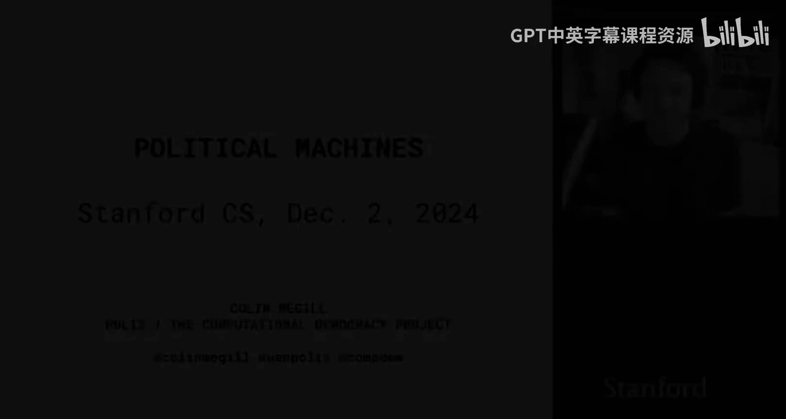

Thanks so much and hi everybody， my name is Colin Mc Gill。

 I've been working on an open source platform for about 13 years called Pols and so I'll briefly give a background to myself and then the project。

And then go through some of the reasons that this happens。Things like， you know。

 grant program in open AI and community that's on Twitter， which is based on poll。

 So there's some exciting， exciting applications of them underlying methodology and potential connections that we can make so。

So first of all' say， I would San to go。 I， my background is an international relationship of political science from from undergrad。

 And then I I decided。To go on into any startups and。

Pos was developed as a for profit pro social startup between 2012 and 2016。

 when we open source the technology open source in 2016。

 and then the for profit wound down and transitioned into a nonprofit in 2019。 And so since then。

To kind of transition from CEO before profit to president of a nonprofit。

 And so if anyone's interested in like nonprofit technology。

 I'm also kind of happy to talk about and answer questions about that。

 since sort it's a really interesting model， things like with E Po Academy or， you know。

 more recently like signal， which are open source nonprofit tech， and kind of how。

How the the funding and and considerations around that that work in case that's an interesting and interesting dimension。

I'll say that the project has users around the world that are employers as well。

 so platform thatllubscribe is deployed by the National government in United Kingdom， Finland。

 Singapore， Taiwan， and Amsterdam， Netherlands and others and whole bunch of like hobbyists like。

会是希万。And and then you with that， I think I'll dive in。

 So I'm going to focus as per kind of conversation in the semi and and students on the paper that we wrote with An Proic last year。

 which was which was on opportunities and risks for using large language models with Pols and like in this context。

 you know， what is the what is the new tech going have to offer and what are the risks using it in this in this kind of content。

 So I'm going to spend most of my time kind of talking about。

What we're building and how methodologically and that's currently also kind of loaded up in context for me as well。

 so I'm excited to talk about it。

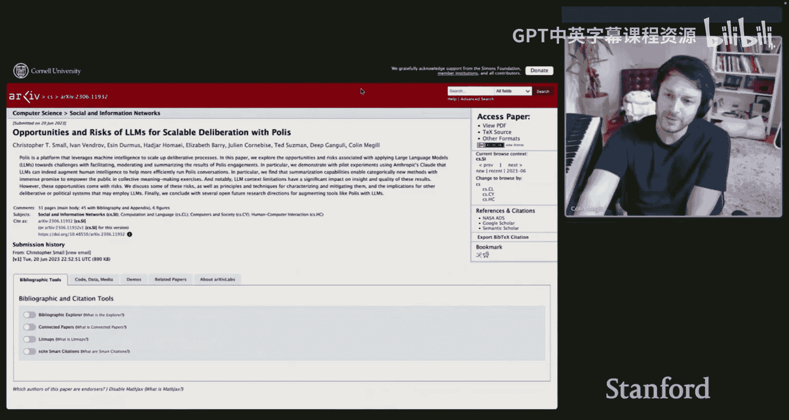

So so briefly， so what is what is Pols I'll briefly say for terminology during the talk PL。

IS is like the website， you can go to P。IS s home or PIS that will redirect you there and that's like you can log in use it for free and it's a site that that host the main instance of technology there's also a repo。

 which is people also callpolis it's just like the tech itself that people fork there's a methodology which is a paper。

 people also call that Pols， but really like that's you know more metrics and methods。

underpinid and underreliant。 And then there's also kind of like a community and， you know。

 usage and and users。 And so I think that generally polls kind of refers to that zone and stuff。

 that it's a little bit a little bit confusing for open source test sometimes people course。

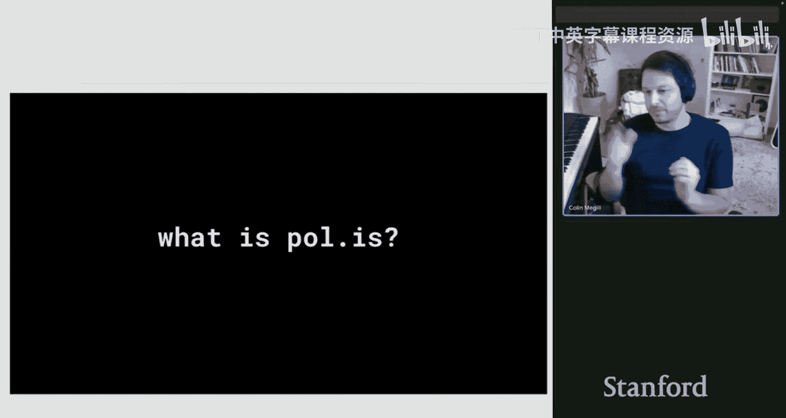

Okay， so。The most concrete thing I can show you all if you haven't seen it is that Pols is a system where people can submit statements。

 and those statements are shown randomly one at a time to other users。

 We can agree to Supreme pass on them。That that process creates a you know a spae matrix。

 We'll come back to and kind of like what we do with that in line。 But basically。

 this it's not driven around rep。 Everything that people submit is kind of an atomic tend to be an atomic statement。

 which goes into a pool。 And then the when people will a brief degree or pass on statements submitted by others。

 It's it's is agreed。 It'll take any amount of voting that people do。

 So the kind of intuition for this right off that is like an emergent survey。

 So it's like a survey created by the people taking it。 something closer towards creditit。 and。

 you know， that's like an uppost site。 but something a little more formal。In that， you know。

 someone will start a conversation with a population。

 and it can be used in a random sample and also also can used once。Random sample， formal， you know。

 formal sampling around the world。Okay， the idea is to make meaning of perspective at scale。

 The inspiration was out about Wall Street and three movement in the during Arab Spring social media motivated people。

To participate in political activities。But， the platforms that like Twitter。

 while they were useful for mobilization， based a particular。

Constraints in in coherent conversations that allow people to write collective documents or things like that。

 find each other specifically。In occupy， you know， a common thing for individuals was to kind of like in the movement in the in the dialogue around it was to kind of say。

 well， this is what it's about。 You know， this is what it's about。 And。

 and the assertion by each individual that they were kind of speaking for everyone。 know。

 they're right about some of it。 but not about all of it。

 And then names kind of fragmented and it was difficult to。

The idea of kind of like systems that got more coherent。

 the more people interacted were like really interesting。 And so， you know。

 the concept back in 2012 was like， okay， well， what would be amenable， what would we。

 What day would we want to gather， What algorithms would be， would we apply。

The long story short about that is that， you know its as far as matrix with PCA and opinionss。

 And then we look at we look across the groups for what the group had in common。 So's pretty simple。

 you know， like As recommend engine kind of pass。 But it's also stuff the no de learning。 But also。

 it is a system that we kind of like step and forget。

 it can be out there used by facilitators in the field without a concern that PC or cans are going do anything crazy。

Just to clarify on the technology itself。 So it's a people get to make comments。 You get this。 Okay。

 you want to go into the detail， I guess。Yeah， yes。 but yeah， that's right。 So。

 so if we think about like， you know， each statement that people submit as a teacher。

And then each participant is a row and the row is a voting record。

 then the raw data looks like know a series of either it's a null if they didn't see it。

 otherwise it's a one for degree， a negative one for a disagree or a zero the pass。

 and this is amenable to doing PCA and then came on to identify patterns。

And what you want to cluster are the people I guess here right so that's correct yeah。

 you're clustering people and then you kind of find like you know something you can find statements that differentiate those people and then that sets of comments form something like a worldview that's different than the others if there's it's differentiable statements。

That's right。嗯。So， and then I can， I could say， yeah， like basically like the the the the。

Heuristic here。For I guess it's easier here yet。 So basically， you can say like， okay， you know。

 given a， given that we see groups， what has a， what statements are common among。

Among people who think differently。 And so this metric is really the the what the paper what the paper we published。

You know， put forward。 and this was implemented in the code based path， you know， back in 2013。

And this became the foundation for the the conversation with Twitter to about how to operationalize that concept for them for community notes。

 The idea is like， okay， if you have， if you have a diversity of opinion。

 can you use that to kind of like recover signal about， you know where where。

I so the consensus in the context of discord is kind of like what this equation was。

 which is really exciting to see it。

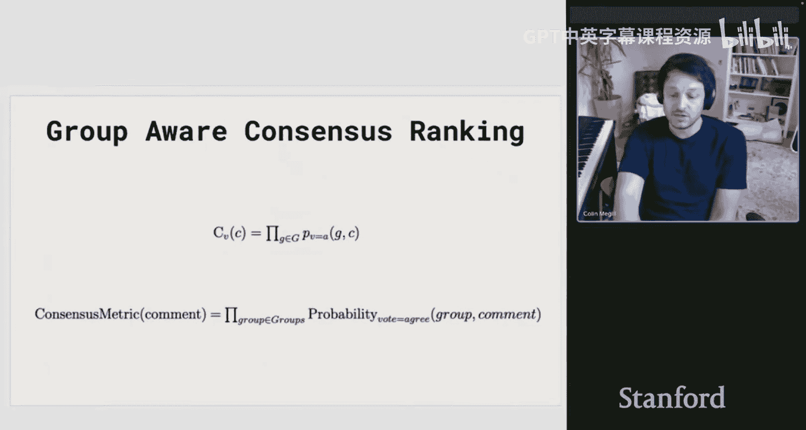

find more grounding in this information。

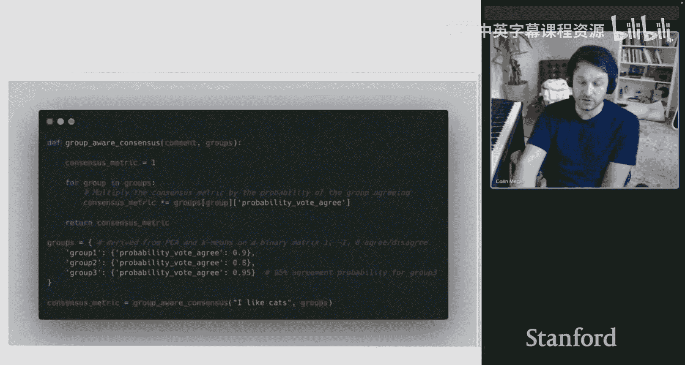

Okay， another quick。So knowing from other conversations context。

 beside said something about the sort of PC and K means。

 I'm interpreting them as interpretable enough and trustworthy enough that they're not risk in the platform。

 Are you planning to go a bit deeper into that。 If not。

 I wonder if I can engage you in that question a bit more。

 if you're gonna go more into it we can push no no， please go let's we should pause there。 Okay。

 so I guess what I understand that you're stating as a robustness。Claim maybe。

 So like how good is K means for representation learning， given the voting matrix。

 how good is K means plus clustering as a trustworthy way of getting at consensus or groups of people that are similar that look like consensus。

 And I guess the counter this is one of the risks of， say。

 an adversary trying to break this voting mechanism by attacking underlyingel infrastructure。

 And I probably bring up because， you know， in the class we've gone through voting and its robustness in some detail。

 So we're aware of like。Some of the ways that building can be non robust。Right， did you say。

I guess I also don't hear your strong optimism for。Like robustness。

 and I guess you know this because we've talked about this before。

 but I wonder if you could say a bit more about I think I interpret the comment about sort of confidence and K meanss and PCA mostly from the fact that they're sort of。

Classic， reasonably well understood algorithms that people who if they're not technical。

 but may be aware if they're technical。No， consider it a known hat。

 And that's where the confidence is coming from， not from specifically looking at robustness and attacking consensus via those mechanisms。

 Is that accurate， I wonder to speak to them。 Yeah， yeah， I'm happy to talk about that， so。Okay。

 and I would say that。嗯。Polls has been used in adversarial circumstances in nation scale。 And one。

 one example， one specific example of that that I could point to would be the usage in Uber and Taiwan。

 And so I'll just grab that really quickly， so。I think it's actually Holumbus down， it's down here。

This article covers， and this is the highest most highly covered case that there wasn't an adversarial attempt by Uber to gain it by sending all their drivers to the conversation。

 The question was whether Uber should be legal and how and there's challenges access to drivers。

one of the things that the Taiwanese government had done at the time with the system was to。

 and they opened it up to the entire country because it was a national national system。嗯。

If there's an expectation that， you know， that people come and interact Well they have like a very small surface area to interact with so they can submit a statement。

 But if the moderators will let them in， that's a no op。 So， so， so first。

 the mods are in control of that。 So then basically， the surface area is okay， know， if you're。

 if you're an adversarial actor， then you can agree disagree or pass on on statements。

This is the surface area you have for gaming。你好。The the PC and cames are， I' would say， like。

 you know， what you would be trying。 you would be trying to gain that from the from the voting。

 And what we saw was basically like repeatedly。The naive thing to do was to send people that you wanted。

 But that actually just it might have created a larger group， like it might have skewed the sample。

 but it was kind of like one one group getting larger， not necessarily， you know， So。

 so it was kind of naturally immune to the first thing， which was perating， right。

 because it just it makes one group larger， but obviously。

 if you're going to if you're going to build bos， you know。

 previously that might have been harder because the。But of course。

 now it's easier Now it's off the shelf from a product to to build a pot and have a click around and then say。

 well， I would like you to vote like this and try to be consistent。

 even if you see a new statement that we haven't seen yet。

 here's old statements here's how I'd like you to vote on those And you could say create three different clusters that really don't exist at all。

 to minimize the existing cluster。 And I think that basically is an arms race that just gets to identity。

 And then the question is what is the sample and how do we know。

 which is is something that we punt on because poll is school that can be used with any sample and we're intentionally acgnostic about it。

 And so I think that eventually you know eventually the question really gets down。

And I think that like the most promising stuff there is maybe in。In the like the Z K， like anonymous。

 you know， identify， anonymous， the verified identity space。

 I keep expecting that someone is going to do something really substantial in that space。

 There seems like there's there are some some stuff like。

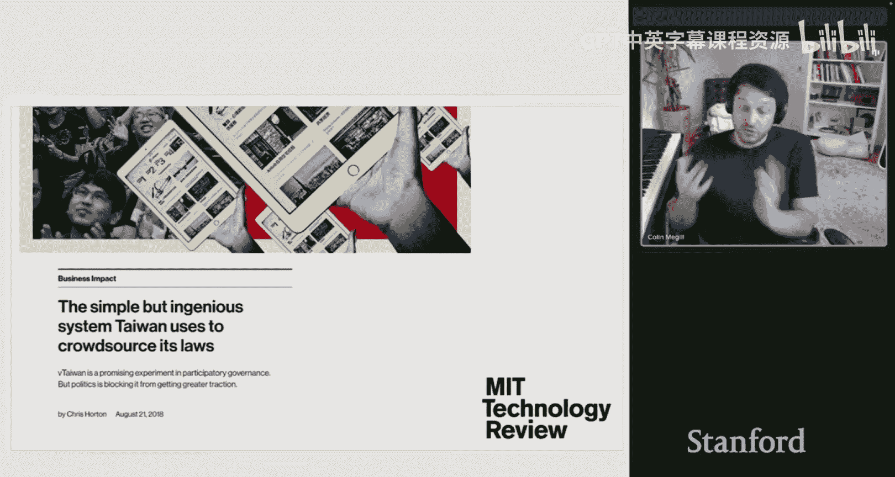

Remote passport。 there some experiments like freedom tool。

There are some experiments that that I have seen that are advertising。

That they that they're doing anonymous voting with with like Dk passport， like verification。

 like within a country。 they've run like referendums in Russia with this tech and。

 they're claiming that the case studies have been run。 I think it's。

 it's something like this that will be will probably be another layer。

 And it just won't be a part of us。 Like it'll be， it'll be something that we might integrate with。

 like eventually， But I didn't want think there a clear winner yet for us to do that。

 So that would be that would be the first part of my answer。 Is that， iss that an okay start。

It is yeah not helpful so。I'm interpreting that as right now。

 the risk doesn't like there are no examples where this is caused。You know。

 catastrophic failure and the path forward like to about be other technology that just makes verification。

 So individual sampling much richer and more accurate。

you don't have to deal necessarily with the robustness of the voting mechanism itself。

 because you'll know for sure that it's at least it's real evil。

 Now whether or not those were people are polluting is a different。It's right， right。 right。

 So if you， and if they did collude， you know， like the question then is， okay， well。

How different are So I think an open area of research would be like， okay， if we。

 if we think that we have some good conversations and we think we have like a sense of of like。

 let's say， like variance within a group， like， like how much if we' we're going to cluster something or call it a group。

 how much variance is there inside of that。We don't have currently any checks or metrics or methods to say。

 you know， this group looks synthetic because they're they're all voting like I mean， well。

 certainly we can say like 100 people have exactly the same vote record， right。

 So this would be a simple thing we could do if we were going to make it more chaotic than that and assume it was LM or that LLMs know vote differently than humans do where they vote tighter。

 that would be a really different way to approach it。

SoI think that that area is something we have not done， but could and is。

 I think an open area as to what it would look like to approach that problem。开续。Yes actually。

So course yes， follow up just to question on that angle and more see you mention now that if you do have like autonomous agents。

 you could conceive a world or I don't know you can adversarally try to create like I guess coding what you said。

 like say three different clusters that don't exist or， there's clearly some。

 I guess like some vague sense of like why this might be bad。

 because it's like disrupting with the actual opinion gathering mechanism is。

 But do you have some sense of like what a concrete adversarial objective there might look like。

 So if I'm trying to create these three clusters， what am I trying to optimize for or like what is my objective here。

 great question。 Okay， so let's assume let's use a concrete example。

 this is a policy innovation unit in the United Kingdom called policy Lab。

 They have a collective intelligence unit that that they've put together the goal of these policy innovation units is usually to say。

 we're going to innovate with some new method。Like using polls to gather opinion data from a population and we're going to use that for policy。

Then they'll say like， okay， we're when the government will kind of a third party。

 which minister is the most progressive and wants to do something new who has amended right now。

 Who has the will。 And then they'll go， they'll go do something like in this case。

 it was something ecologically related。 it usually it's going to be something that's like like cross stakeholder。

 So you're gonna have like fishermen and people in in tourism and people in industry or transportation or local citizen or whatever。

 So in this case， this is this case in the UK about CB bass regulation。 And they talked to， you know。

 some dozens of people in ethnography and they scaled up to thousands of people。 Well。

 if this is a nation scale sample and it was also open。 Then if somebody。

 if there was an industry player who was in fishies who was motivated， they could。

 let's say that they had an economic interest in skewing a national a national a dial policy dial。

They could add， let's say， three， very distinct worldview and personalities。

Of synthetic citizens that don't exist， but are very concerned about any。

 any kind of regulation on their livelihood or anything like that。

 And they could be way more dogmatic。 You could add like， basically， effectively。

 you could add synthetic extremist groups that would would would push the narrative of the of the economically interested fire。

 like in Uber， it could be the case that， you know， the citizens work。The groups， for instance。

 in Uber， there wasn't economically two economically interested groups and the Uber drivers and the taxi drivers。

 The citizens were kind of mixed in there。 And in this case。

 we could imagine that there were actually like two other clusters that were like cluster groups that were emerging or maybe there were a group of academic experts that were our economists that were talking about。

 you know，Outcomes in other countries， but it was also misinformation。

 it would be really confusing to untangle which users or opinions or which expertspts were real or which were which were the groups that were grounded in the country and which were just and so I would say an economic interest in a nationpe liberation would be something that you would want to be careful about。

Absent， thank you。 Yeah， I think synthetic experts is is probably the most dangerous thing because you're saying like。

 you know， actually， you know， there's like， there's like 200 economists in this group who all are concerned about。

 you know， the impact of any regulation on X Ys thing。

And they're standard transportation system going to class within three months。 Well。

 if there are actually 200 academics saying that that's material。 If there are not。

 then it may be hard to untangle。 And I think that that's the I think that that's the problem with Lns that they can produce。

 know produce something that sounds incredibly like academic they can draw on you know。

 theories and and and draw on projections or like lots of documents that they could kind of like actually even ground themselves in some adversarial case effectively build up if an agent or a series of agents could build up effectively like a legal case level。

 grounded opposition。 that was completely skewed towards towards a financial actor， that's， know。

 that's a pretty confusing thing to unwind for public servant who was just trying to go out and basically get a lay at land。

 which is kind of bill for。 I think we can imagine pretty sophisticated。

 if this game more and more power， I think we can anticipate more and more sophisticated opposition。

嗯。I'm confused a little bit and hopefully you can go back into the main presentation because like roughly you're suggesting something that we haven't quite seen yet。

 which is that like people are proposing the questions so like they could propose a whole bunch of questions that establish their expertise right they have objective answers and then filter out everyone who doesn't have expertise by proposing 50 questions that only an expert can ask。

I don't quite understand how questions emerge naturally in the platform。

 So I'm curious to see more detailed descriptions of the examples that do exist。 Yeah， great。

 great question。 So I'm gonna go to a let's see。 me grab a report here。 I think this is going be。

 Oh just a second。 This is pre production。

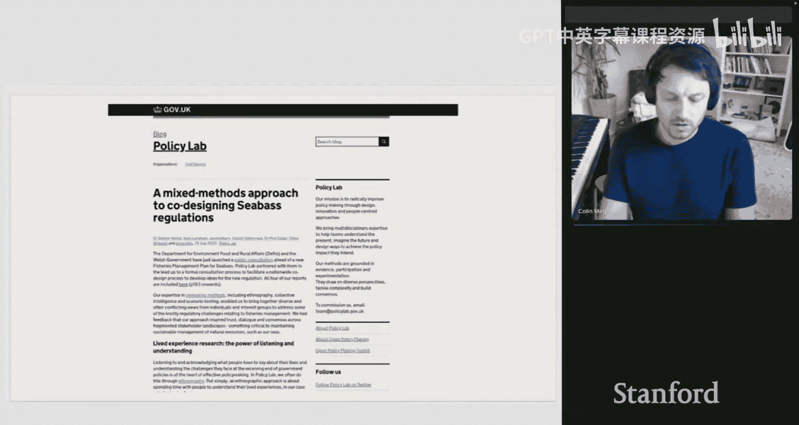

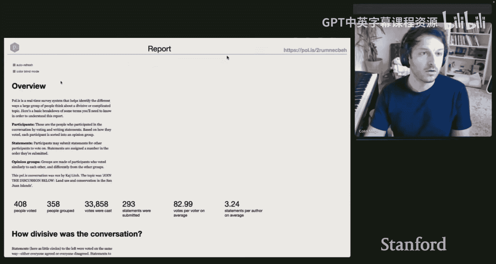

Yeah， so I'll pull up I'll pull this up for us This is a conversation that was run in the in San Juan Islands and this is like a 13000 person county with four islands in Washington state and the issue is a land bank issue so。

The the conversation centered around whether or not the land bank should continue to conserve more and more land because this is a public institution buying up real estate to keep it rural an agrarian。

 So the conversation started with the prompt， which is basically like， you know。

 even just as general as you know， as we're going to discuss the land banks。

 What are your thoughts of feelings on it， you know， where is it， where it should go。

 what's the problem， What's it been。And then people are going to submit statements。

 and so if we get add here to like the statements that were submitted。We can see。

 though so like top level stats， there's some hundreds of people that are just， you know。

 some single digit percentage of the county。Submitted about statements， cast some1 out of vote。

 So we can see that if we sort by， for instance， the metric of like what did people agree with across groups you know。

 people generally agreed between groups very strongly that having access to the land that's preserved that's conserved by the public institution is compatible to preserving the natural habitat。

 We don't need to ban people from visiting。 and that's not an issue under consideration。

 That's not what we're discussed。There are things that were really controversial in the statement in the conversation。

 I'll go up here and use these form， things that had more loading on the PCA or out to the right and question about whether or not like。

 should should it keep going was controversial So， is it reducing the land available in the island for development and for residents So was controversial than you know between the groups we can also see and we can look at the statements that are and these are statements that were submitted by people who were。

And so it's a way for people to express their opinion on an issue and then for everyone else to kind of say。

 have they say on what everyone else said not everybody's not everybody submit a statement。

 but everybody has an opportunity to vote that does that help at least with the structure that like general prompt and then what's coming back is not question。

 but actually a whole bunch of response to the prompt。Yeah， I think so。

 So people can submit a statement。 and then people are saying， like， if they agree with it， or not。

 correct。 So they're correct。 So the way that the system works is that it is that people will submit a statement like like that。

 like saying， you know， the land banks buying a property。

 it should stop because it's reducing the amount of property available to residents to live on in Dubai and other people have that will go out semi randomly to others。

 they'll agree disagree and pass on it and then and then the best statement forms part of other people's voting records。

Yeah。Yeah。哦。Yeah， and what results from that then is like a series of。

Se of voting records for participants row where each column has a each column is a feature in statement。

 and that's that's what the data set looks like。And then the metrics are computed per kind of like looking for clusters。

We can hopefully like as we go to and look at some of the features and way it's been used。

 we'll kind of move back on that， too。Okay， so I wanted to I wanted to just get forward to make sure that we have an opportunity to cover。

That we， we wrote a paper with Anthropic last year covering some of the the conversations today。

 okay， if we。Okay， if we have a。

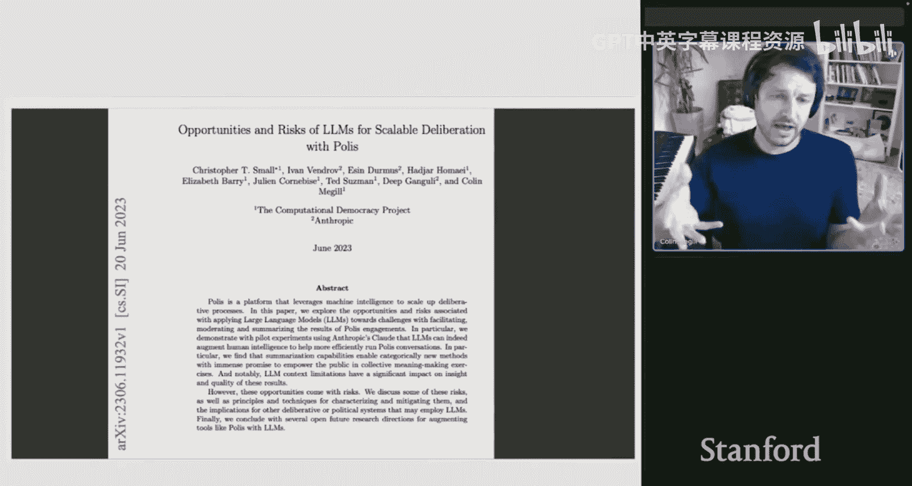

A conversation that me flip over here， see。What kinds of tasks can the LLM perform within a poll conversation and how well and how well will it perform？

So we looked at a number of things like moderation， summarization and vote prediction。

And one of the most promising results earlier on that we're still working on now， shift。

 it was summarization and the idea of question of whether or not we can round a summary in statements。

 We're getting closer and closer to shipping that。 And I'm happy to talk about some of the details around how how it is we're going about that。

 But we're currently looking at like clause level grounding in the so it doesn't really get to go past a handful of words without without grounding it somewhere in in the data。

We also looked at vote prediction and whether or not if the All saw more and more more and more statements in votes by participants。

 whether or not I can predict the next one， it was it was was quite fairly good at predicting people's votes。

 I think this is a particular surface area for risk because obviously it is very good at predicting votes than there's。

 there's some considerable amount of room for know for。

Both for actors to build good kind of like synthetic voters。

 but also I think for people to mistake the systems for voters and to say， okay， well。

 they are good enough representing people。 we can use an L and kind of like you replace lazily replace people and social research and further kind of intermediatete the public from from institutions and that's that's something that is is a risk that was discussed in the in the paper as well。

 yeah， could you say a bit more， so one just pure method。In prompting。

 so you give it examples and context and you ask it to predict。

Next one is that the actual implementation or is there something more sophisticated than that？Yeah。

 it is。 It's it is basically like， you know， giving it， giving it more and more famous。

 progressively more。 and then graphing like， okay， how accurate was it at saying like， you know。

 high predict， know， the vote would be， given this voting record， the vote would be， I say。

 fair some the greatest reasse。 And then as you give it more of the participant' vote history。

It gets better at predicting what the next quote would be。

Could I understand the risk a bit more as well， So in some sense。

 if you have a good predictor of people's preferences。

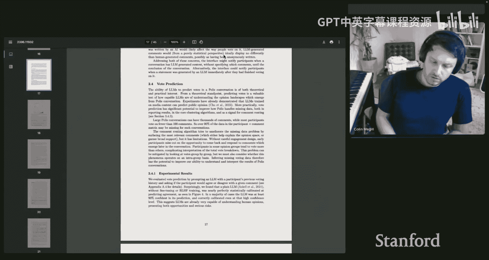

That seems in that win for correctly capturing。People of people's preferences。

But I guess there's also a risk of like missing something or particular issues where people the prediction differs significantly from the truth because people are more complicated than the models。

 could you say a bit on what you worried about？I think that the people being more complicated in the models is one thing。

 I think that this case was a kind of like weekend hack project like a system prompt。

 like pretend you're a citizen of Romania and the PM is talking to you， responders if you were。

To immediately like like， like worse stereypical people， right， Yes， really poor implementation。

 non rigorous kind of stuff。 But then， then， then if people believe that it's that good ends up out in in public institutions。

 like in sure order， basically。I can see that。Okay。Cool， so。So。Allright。嗯。嗯。Okay， so。

We we found that you know back in 2023， P was quite good at doing topic modeling from the from the reports and also being able to compare we tested basic data analysis tasks and because Pols is a lot of open data and open methods。

 it's interesting to kind of have it as an experimental and was interested part because theres there's an experimental benchmark in the open data and open code for a data analysis task So we've kind of taken this in advance further Yeah should I understand this stuff modeling as an alternative to the PC plus clustering So it just does it in context as a going through it does it in context that's exactly right so does so you'll notice that it does have group zero and group one like it does have the groups it does the clusters but it does not。

So it would look at the the it basically would be half the PCA and cameyians and it would use that as a statistical。

You know， a step that it had to the then build a pa。 And that's， that's that's kind。

 that's a lot of what we're looking at is basically， you know， formal ways of eating in。The。

 the in a structured way to the， to the prompt。Statistical outputs of previous steps and then to have it basically say。

 hey， we're not asking the LLN to do very much except the narrative bit and then if it does do something narratively it has to ground it immediately before it move on。

So so that there's like a containment you know unit of hallucination， basically。

 that's like one of the concepts。 I can say a lot more about that that's but in terms of like actually building something。

 if anyone seen Harvey， the lawyer from Open AI， there's a lot of good stuff open AIs investment in them and very close working with them。

 know led to some very good kind of podcast after about how they built to reduce hallucinations and like get。

in legal field operationalized， and there's a lot of really good work that they did in terms of like breaking things down subtasks。

 having custom data for prompt and then even using that's kind of drive hallucinations。And but yes。

 the topic analysis that is just look at all the comments and then group things that you would。

 and it seems fairly competent at that task， you know， without without going much further。Yeah， okay。

 so。Right。Okay， so。II'll say briefly that you know some of the contexts that Paul has been used in in terms of like sampling。

 this is an example in Tim or Lete， this is run by UNDP and the survey methodology like basically like getting into a vehicle and then go around the city and then stop every end person and ask them if ride for a few blocks and then ask some questions and input the statements and they use that to see a conversation and there were politicians in the two so they're like basically there's a connection to power and then that was a kind of a method of getting like an emergent sample of text。

 an emergent sample of votes and then using that stage one and then stage two was then more random sampling in other digital a digital processes they also did this in Pakistan Bhutan and there were some tens of thousands of people that participated across it。

And that one was that was UN pink。And。嗯。We， I would also say。Another interesting。

Group is in Philiplip called Cra。 And theyre another basically publicly funded institution that is in engaged in policy innovation。

 And they have a， they have some， you know， large scale conversations around policy areas and。

TheAnd they're they're like， I think that and this was， this was last year。

 they ran up with 8000 people， and they they do them regularly at nature' scale and have their own have their own instance deployment。

And so that that offers a few different， like you use a kind of large scale， know， large scale。

 some open， some close and focus on different topics。 but always trying to do some like。You know， on。

Ehnographic research on on a population so voting so you know I guess we can consider in the discussion whether you know how close we think that is to voting or whether we think invest know like or if it's a survey et cetera。

 et cetera， but you know but at any rate the goal is scaling up let me say also I want to make sure I get to some large recent stuff。

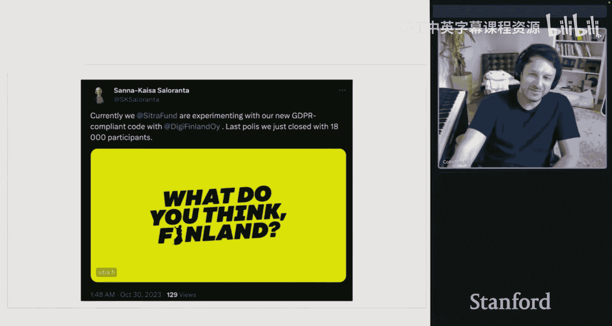

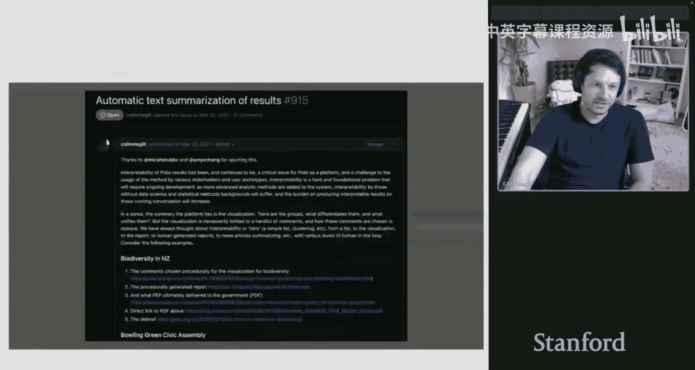

嗯。You canDe mindd just drop the paper。 Let me very recently。

Called AI can help humans find common ground Democratic deliberation。 they cite their in their intro。

As inspiration， the anthropic paper， we presented them the anthropic paper in July 23 last year and what they're looking at is basically like。

 okay。Can we have the LOM help group。To。To write a collective statement of themselves。

 And can we get higher and higher approval on on that statement。

What we're looking for is is know a group which is a same which representative of like and they're trying to get a about like to the majority of the group mean they're looking at a contest like C Asmbly where the facilitator might be writing a group statement and they're like we get the LLM to write instead。

 people prefer the LLM to the human they have their assertion of the paper if you do like the LLM better than the better than the human and they and they。

TheThese statements are particularly good。 I would say that， you know， from reading it。

 I think the statements are fantastic and you know， they kind of had a really good result， actually。

 and they super interesting。 So this work is done by Nil Baer。WhoAnd and for summerfield over UK。

 But Ba is still working on So summerfield。 And he's at MIT。 Now。

 he's moved on from De mind MIT to for。 he's still actually， he's like。

 he's gone down a part time at De mind。 This is very active for they that they're pushing forward out of MIT Center for social communication with which is De and over over MI。

I will also also mention question。For the work youre doing。

 one could imagine this being like the synthesis engine wants you to find the groups， maybe。

Absolutely， absolutely。 sopolis， you know， that's absolutely right。 So， sopolis you know。

 always had a concept that it would， it would visualize the clusters and then show them back to people。

 And what we were always the way that we were kind of labeling the groups was to say， okay。Here's。

 no， here's a cluster。 And then here's a set of statements that have voting patterns。

 And so what were what we've always asked getting the software of the participant。Is to say。

 you must reconstruct something in your head about what the world view a cluster is given a set of statements and the differentiated voting patterns。

 And that is a relatively intensive highly task that requires high numerous and compare and comparison。

 And then also， it changes over time。 So you have to continue to earn those caries to do it。

 So the idea here is like， okay， Pols has has has two things。

 It has a small snapshot or cluster differentiation here where youve got a consensus。

 and you've got a and you've got like a and you've got a set of。And then on the other hand。

 you've got a you've got a report which is attempting to kind of give you like more of an overview。

 which is more data driven a more haul in total and those are two really different goals one is kind of for the facilitator data assigned to others。

And the idea with with what Deep mind did the science is absolutely closer to this intention to say life。

 we would like to show you yourself back to you and say， Do you think。

 you know that you you and we have， I'll say that we have a Github that you up。

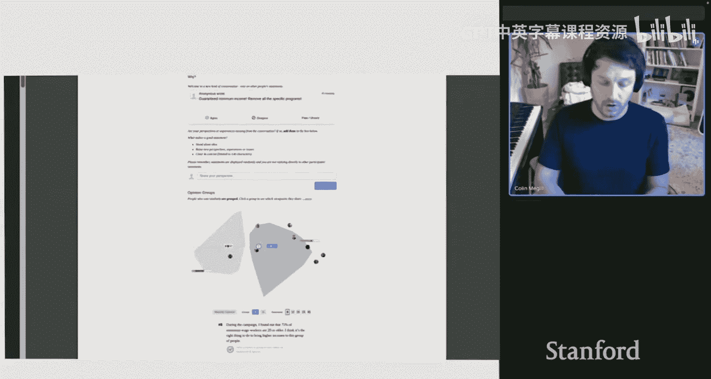

Which is under discussion where we we do use the LLM， like how the mu team did。

 And there's a little bit of like rating interface here。

 And we we're excited to run these tests over time to say like， but like。You know。

 if you show a statement back， if you show a collective statement back to people and we use01 to generate a prompt and here and 40 to do the work basically like。

 could you， could you have people rate this And then and then they get to rate their own statement and group informed consensus。

 And then if you see higher and higher ratings on that。ci it， obviously， there's some problems like。

 well， if the people are voting over time， when do they rate these statements。

 if they rate them and the clusters change， how do you manage that。

 And it's always been one of the problems in methodology is folks come over time and Thomas over time emerge and it grows。

 So how does then any collective statement relate to the underlying data and what stage which you do it And。

 I think that's like an interesting an interesting problem。 I don't think it's impossible。

 I think it's tricky know， it might be that you're having anyway。

 without getting further into there's a pretty extensive there's a pretty extensive discussion here from the a group that just ran another large conversation they have run before around a in in Uguwi and Uwise National University regularly runs data and。

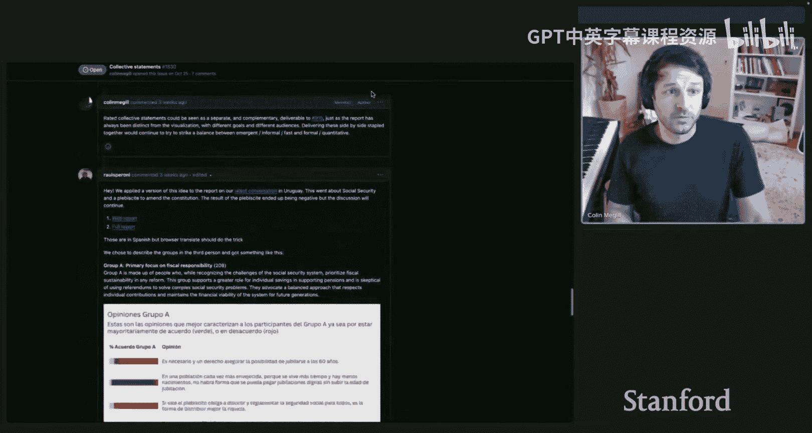

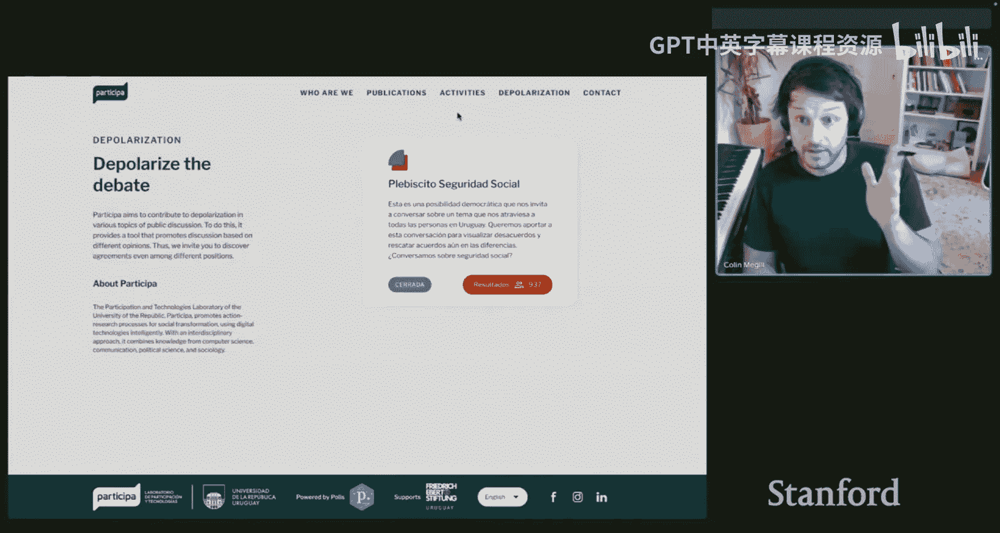

And so this is the kind of meat of the discussion is here where it's like how how might be approached to fact。

 how might we gather the data and how might we kind of like operationalize this paper for the like rating stuff。

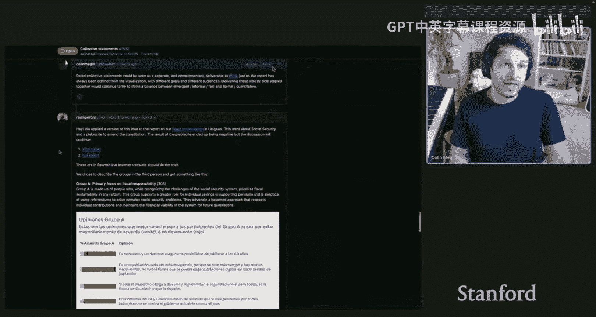

Yeah， so。

I'll briefly say also last year， open AI was interested in we at a high level mapping human values to have that be an input to completions they want to complete more and more in results in more and more context and its different values and so how how different you know a brief way of explaining million dollar grant program they give $1000000 grants and I advise like where advisor teams。

 the one way to think of it is like， okay， if you have poor authors you know who are。

We might differentiate a horror author from like know a grade schooler。

 And if we have like very poorlyry completion。 we want to show it to one another the other。

 This is toy example。 but like， know resolving like， you know。

 it will refuse to write poem that Trump， But it will write a lime about 5 things like that。

 know this kind of stuff in in alignment has to do with human values and know。

 cynically moving risk away from the organization in some legitimate third party system would be desirable if it was possible for the kind of a decision around you know。

 how how could what what process would we decide whether something was was aligned in some in some categories of alignment And so the results from this were 10。

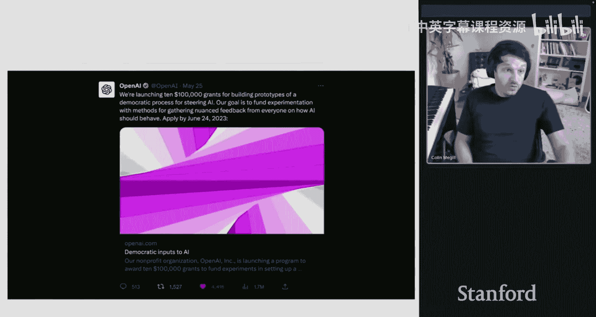

10 different open source projects that came out of it。 They're all up the Web。

 And and also a some prototype of what it might look like to do Pols entirely as chat where you were just kind of talking to to a model。

 And it was recording open text and then recording mode as when and kind of summarizing as a web。

 which I still think is like a very relaxed way to consider interacting with the software in the future。

 especially because in the realm of like agent elication。

 you're going to be able to ask the you're going to able to ask the model。Like， what parts it is。

We would be able to ask the model。You know， to follow up with people to get the next page of a level of detail after base if it a statement。

 And， and then that's something that's particularly a particularly interesting area。

 Peter Coy wrote about this about like know the relationship between， like。

 could you have better technology policy which， you know， it like like with Uber。 And if you did。

 Would that be interesting to， you know， like could put better tech help with better tech I that a。

You know that is that good。And it was a cool article。And Andic also did something with Pols。

 they did a project where they tried to look at Cla constitution。

Using using a random sample and in inhole about， you know， values。

 And I think it did kind of sign out that everybody was interested in everything。

 There wasn't a lot of disagree。 it's like yes， it should do that。 Just should do that too。 Yes。

 I should do that。 Yes， I should do that too。 So I think like overall， know。

 maybe not the most promising goals for this one。 but。

 but interesting that they did the experiment and it it was that those。 there was it was written up。

It was written up by Kevin Bruce last year earlier， I think that one earlier this year one。

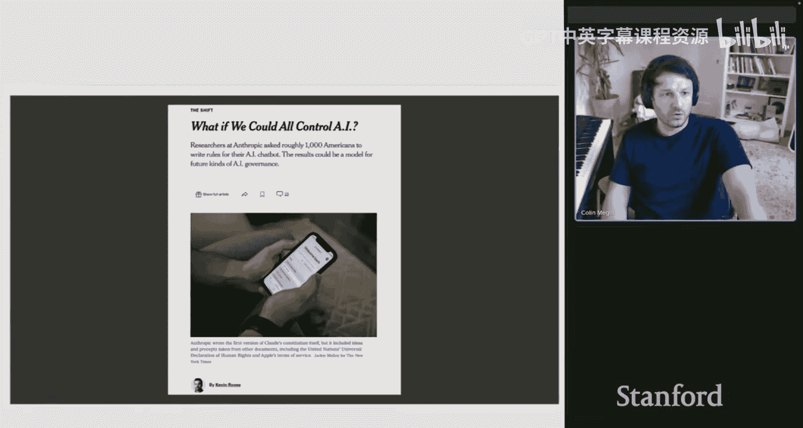

One notable thing to to cover。 And this is a pretty funny screenshot from Rhi Sat explaining community notes back to Elon Musk。

 which was really trying to funny。 that the work with Twitter began in 2021 and Appleba and Peter Pamarana wrote an article suggesting that Twitter You Pols for misinformation And they did that and they did。

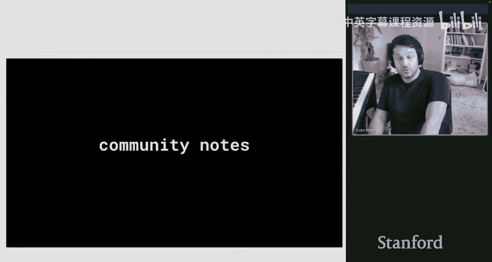

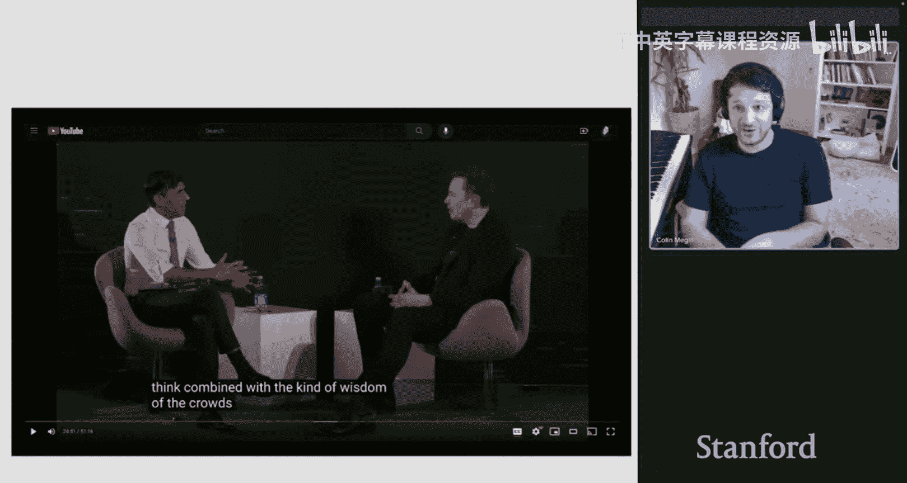

we reached out we started talking to them in 202 early 2022。

 and they had had they basically you know the birdwa paper sites sites false algorithm ability to highlight the trends in a specific basis for it。

 is not actually PC see opinions they do a matrix aization both prediction and they're doing they're doing their algorithm more in continuous space。

 They didn't want to cluster because they didn't want to establish like liberals and conservatives as kind of like the base clusters。

 was there was risk that people would， you know figure out one cluster or another and you know self identify with a cluster or something like that。

 So they didn't continue the space to say like different metric and they have different assumptions of thats time。

嗯。And， you know， you kind of see where they're like， they're saying， you know。

 they aims to identify notes that people on Twitter will find helpful。

 including people with different points of view。 And that's kind of the general， the general sense。

 which is the commonality is looking at first finding common the differences and then see what can get through those。

And Ta Gueran wrote a post that talked about the prediction and the matrix taxization and the algorithm。

 and that was all it was an extensive blog post that he wrote， which is which is then。

And you know interestingly， like generally the platform， because it knows elons well。

 even though people have had a lot of problem X recently。

 there is a they're generated and well well received。And pretty， pretty， pretty。

 pretty exciting open data that has been created off of it。And， and it also is， you know。

 fact fact checkes the line， fact check the White House。

 So there's like general acceptance between the right and left that that is a fair system。

 which is interesting。 Of course， there's criticism of Twitter and the algorithm。 And。

 and this highlights one point about the limitations of it。

 If Twitter becomes a fire of mis information， there's only so much of affect view。

 if people aren't seeing content begin with。 So it's like fact content people see But the algorithm。

 of course matter a lot too for for driving engagement。

 fact checking must be a different infrastructure， I guess。

What the Polish algorithm does is figure out， I guess Im imagineing opinion people getting a sense of consensus and whether this is a correct statement or not。

And then there's some separate process that like tries the fact check based on that。

 I guess do you know the back end of this， Yes， so the back end， the back end is basically looking。

 So so， so for a given tweet like like this one from the White House。

People who are in the bird walk system can all proposed notes。

 and they have to include a link out to some grounding like the ELS data here。So， so now。

 now what you have is you a list of notes。 Now， people are going to rate a note as helpful or not helpful and so you want and and what you're looking for。

 the statement， which will be shown is you're looking the objective function is add a single comment say a single statement for comment And the one that's going to be up there is going to have enough votes and they're and the votes are going to be from people who are predicted to vote。

So if people who historically have voted differently on helpfulness， both find it helpful。

 then it's likely to be shown and so the decision for the fact that comes from the you know kind of like the group performance consensusensus side。

But it is striking that I guess while ostensibly Pols is still powering this。

 the goal is completely different than the nominal goal， which is again， this threat。

 now it's say let's pick the best or single one that we're going to show。

 so that's really interesting。 So you know I'm just going grab this is kind of something I told them community notes is not a misinformation system。

 it's actually a collective response system。 And this is a really good really good example when Keith who a product of Twitter said thank you to So community notes says。

 hey thanks for contributing this year at the end of the year and community notes collectively responded。

 which is which is it was funny to try to explain that to because they were I said you you guys think you're building a system for misinformation that as aspects to deliver。

But you're not。 you're building a general system for deliberation in collective response。

 that you're only applying to mis informationformation。

 But it's not gonna it's collect is a high mind。 And it's not gonna stop there。

 It's gonna start talking to people。 And and they didn't really believe me which was very funny because it totally did。

 And they got upset And they' still upset upset right now about this。

 they can't stop it from doing something like this， which is like you're welcome。 And so。

 and then that's really funny because I need like I totally hold them。

 a nice response it's also a little terrifying because it's like， you know the board is like。

 you know， looking at people and community knows down there device count and stay on them。

 And so then it's like， okay， shoot， you know， if everyone doesn't like the person。

 It turned out that like then you have group informed harassment。

 So then now that now community knows it's just no problem is everything problem。

 So that anyway that's a bleeding that barrier of research and actually does need to be solve。

Which is like constraining collective response systems to past ans when youve actually build hyp And I think honestly。

 this is this may be come up and down because it's a boot cycle of。

 know a system realizing it's a little bit more than it would build before。 Anyway。

 we wrote we wrote an article。 on you know basically saying that saying like， okay， you know。

 we help to build a system。 this was under fraud before the。 we help to build the system but also。

 you know the system is generalizable and much more generalizable dis informationform。

 and can be adapted to produce mass public opinion。

 and you know here's how you would generalized community that become wholeless on Twitter。

 And so I hope that I hope that this happens on Bo sky。

 This is a paper that I really hope you someone someone tests out on。

 I think that's really a promising area that's undeveloped。There will be an organizational thing。

 right because the technology is exists。 So it's just getting。By yeah。

 I think we're they have an API。 So I think it's a half project level thing。 Now。

 I really think people can can， you know， to pick up this paper and like and pick up the community in those we go and try stuff like for collective response on sky。

Yeah， I think I think really's really good promising。Okay， I'll say， let's see。 what do I want。

 What do I want to What do I want to grab here， I would， I would。

 I want to jump the end here and just say that， you know。

 one of the larger points here is that this platform has been has continue to be。

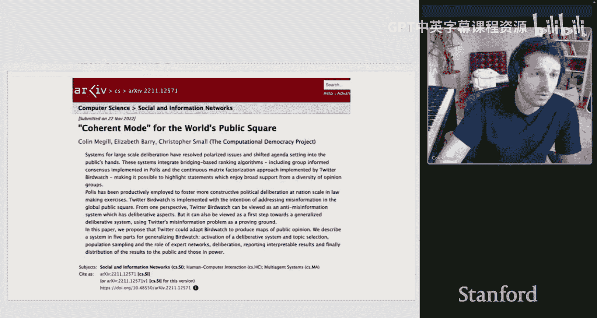

A kind of focal point for political scientists and C S you know， to connect。 and that there's a lot。

 know， there's a lot of opportunity there that is nascent know I just have。

Conversation with a science Po， which is a political science at know insute in the class。And they。

 you know， talking to the political science students that community notes're coming here the next month。

 It feels really excited to me because there's a lot of， you know。

 there's a lot of potential overlap with with all these concept to all these concepts。 And and so。

 you know， Ill may say that you know the big dream here is that there's a an opportunity to connect。

 you know， open source systems for mapping mapping public views since we have all this open data now。

To you know， to these， these， these policy innovation units。

 maybe they're working towards each other。 You know。

 new new policy innovation units in they're using new tools。

 and then a bunch of new data and new tools and social platforms。 And like。

 maybe if you connected and you end up with much larger scale stuff。

 And that's So that's a really exciting kind of a hope。

 I'm happy to go back over anything in much more detail in the time we have remained。

 but I wanted to make sure it was not to the end of and pass it back to you guys for questions。

Thank you。

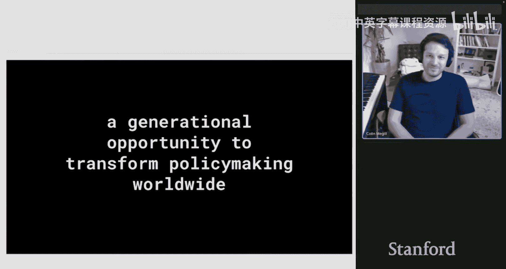

其他没问题。Oh， pause。Questions in a room。Well， people are thinking I'll try to keep an eye out for it。

Arm come up， I guess I'm reflecting a bit on when weve engaged with you on this。

Most enamored by the adversarial angle。So this whole gap of like what is gamemable and this sort of voting scaling voting giveability thing。

 but I guess I appreciate now more than before that that while you think that's important。

 you really want to push on the usefulness side of this。嗯。Yeah， I do。 in part because like。

 so that is where I feel the most agency because we have a lot of power to drive the system forward and in punching to to each individual conversation is firewalls from each other conversation。

 So like basically， like， we would say， you know， whatever sample。

 whatever context that is being run in， being closer to the， you know the。

the responsibility of the owner。 We kind of want to gives us an opportunity to stay out of that。

 and not feeling and own less， which is okay。 But ultimately when you like to give the answers。

 So there's a trade off there。 Yeah， I bring this up because I guess I wanted to maybe pick your brain a bit。

On what you think the positive opportunities are or impact。Think about being in political theory。

 So I'll talking a bit about。Some of the maybe LM direct ones。

 I think is like you know AI technology as a way to maybe help with summarization and describing groups and still grounding maybe any some of the conversation。

 I think the predicting individual preferences is also interesting or individual judgments or building and where hopefully that could be used positively。

 but both sides that that's a tricky one。 there's probably also like a very basic scalability thing。

 but this seems I don't see any big system gaps to scaling the stuff up to even larger。I'm curious。

 I say all this because I'm trying to get a sense of a landscape。

 both What you think computing can be most impactful。 problems。 Yeah， Yeah， yeah， so。

 so I do think there are a number of of really interesting problems。

 I think one of the the most interesting is is in new forms of clustering。 I mean， we what we。

 you know， we don't necessarily want to use can， especially because like， for instance， So， so。

If we consider that like， you know， the way that we communicate value， like， let's say， you know。

 in in is the how the groups differ， right， You can see like difference from how group A voted。

 how group voted， how group， you know， and what statements they。

We've looked at different cluster and algorithms， like the mapping this down， for instance。

 would be an example， or we there are。There are plenty of options like that for graph based clustering。

But and there's been a little bit of experimentation in tall us of different clustering。

 but nothing that landed and nothing that's really been like， you know。

Many forms of clustering are very noisy。 So page is not noisy。 You're guarantee that， you know。

 there air will be signal， but if we know that we're missing with， you know， obviously。

 there's more PCs there more the more nice now。And there's hierarchical clustering approaches。

 There's you know that there's not this clustering approaches we know that there's more。

 but we don't have a compelling reason to advance that。

 And so I think that like one of the interesting things that comes out of L as well。

 is that its possible to conceive essentially if clustering algorithms which are like let's say if eight statements are saying exactly the same。

 know， the same topic and then one topic is something same sort of different。

 or if a statement is more subtantive than another。

 there might be all sorts of interesting weightings that like， let's say that you know。

 this is a really experimental。 But like， let's go down a road where we。

 we try to reconstruct like the logic。 like if the land bank purchases more land。

 then there is less land available for residents。 theres there's a structural。

 like logic supply and demand。 we could look structurally at the argument itself and begin to reconstruct a public argument from that and to look at the to look at size in the argument based on voting records very differently。

I think there's some really interesting work there， but it's quite abstract。 that would be， know。

 way off into the you know， into into something experimental。 whereasas something closer to the home。

 I think is like， okay， you know if I go to like， this is the this is a list， which is like， okay。

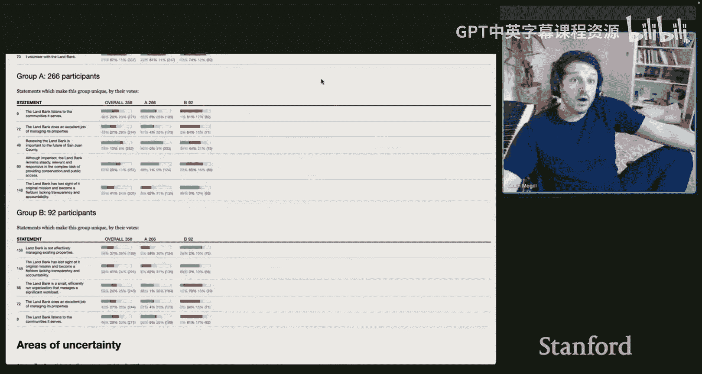

You know， could we do better vote prediction than poll us can do any vote prediction？So like。

 could we do better vote prediction is and like like take a community notes or could say like。

 here are all the different ways we went putting quotes。 Here's an overview of them。 Here's。

 Here's some open notebooks on vote prediction。 That is a territory that is also very fertile And human notes is doing vote prediction polls is not。

 and， you know， and re is doing the human vote prediction based on stuff that have a hold on。

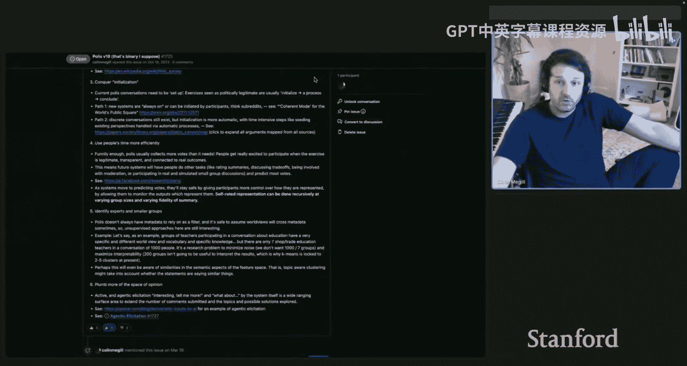

Oh。

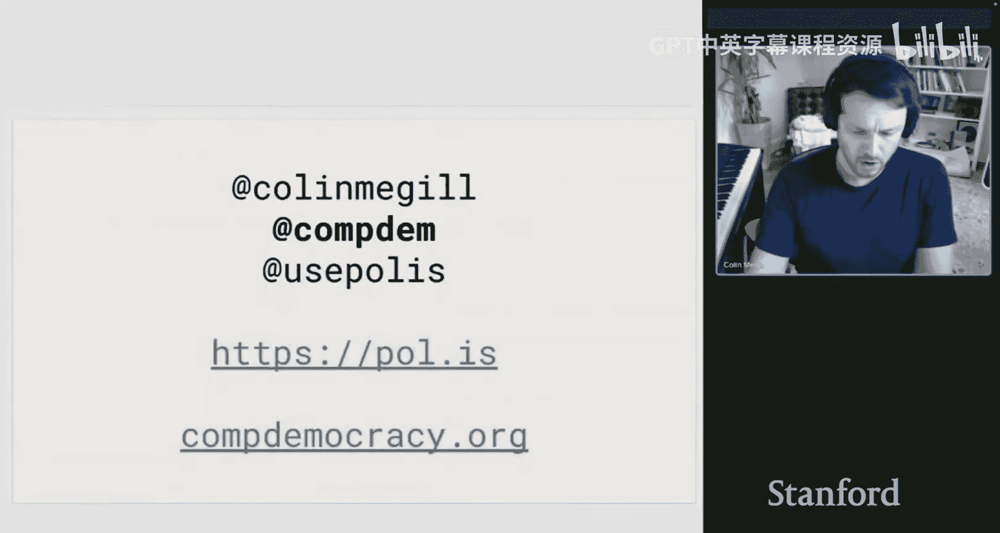

oppen review。哦，对。No。Oh okay， I'll have to send it over。

 There ares' there's papers out like you know Nuris territory from Remesh that are using， you know。

 large language models to to dev prediction as well。

 And so it's like you know that territory is much closer to home。

 given that there's very two implementation， hatred factorization in community node and the semantic transfer stuff of like correlation of and within large language models predicting from remesh。

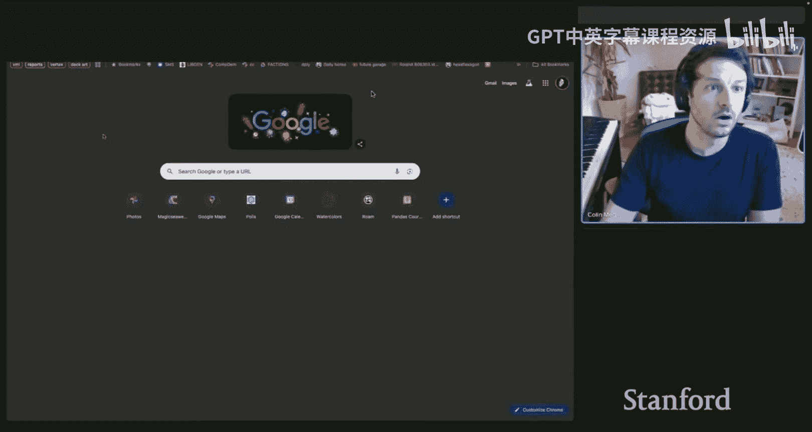

That is an interesting area， I think because there's room to benchmark about open data how to a prediction form。

 and I think it's closer to you it closer to being immediately valuable and and employable as already to employ the multiple different groupss in different ways。

 whereas you novel clustering that is better at finding expert signal。 know and it's like no， no。

 this group's voting differently and is high signal。 this group is this is noise。

 this is differentiation and I think that that's also something that potentially has a semantic aspect to it but that is still very very nascent concept。

I wanted to jump in at this point。 So there's a lot of references to like the platform allowing。

Opinions and issues to like naturally emerge。 But then actually， it turns out right。

 that you're using a very fixed algorithm to do the clustering itself。

 And so is anything really emergingnt at all， if you're actually just， I mean。

 the way you even talk about like picking clusters to amplify or diminish certain kinds of opinions。

 whether or not noise is good or or not， right， like these are all actually just subjectivities。

 And so like， is it possible to just end to end， allow people to run the entire algorithm rather than like a blockchain or something right。

 or yeah， there's a protocol。But like， I mean， besides the protocol。

 like whatever happens on that network is just up to the participants。嗯。Well， I would say that。

 you know， we're not。 There is currently。Currently， PCA Canyians， I would say， is the。

Let me ask your question really specifically。 Yes， I think there's an emergent aspect to the platform。

 I think it's defensible as emergent that anybody that any participant make any statement at any time。

 And that means that the set of statements itself is not determined at the asset。

 And I think that the clusters are， if unsupervised learning。 It's a function of the voting data。

 So different votes， different outcomes。 So I would say that I would say that you know that that we could drop the word emergent as fuzzy。

 and maybe helpful or descriptive at a high level， but we we should be much more specific。

 And we should say， you know that we're gathering as far as matrix dimensionality reduction cluster on。

 and that the clusters that that result are not dependent on the natural language。 And they are。

So they're not dependent in the natural language， and they are very they are very much a function of they're totally a function of participant voting behavior hate。

 So I mean that would be much more specific than a version。

 I think that that we're discussing the idea of running I think that where the code runs like should there be you know should there be a protocol version of it where you know there isn't a server like DOL do I Sure currently the way that we currently the way that we build trust is to open source code and to and to allow people to run itself and that is that is one level of trust in terms of like yes the system is doing what it says the question of reimplementing the entire thing on chain。

 I mean， that is an extreme level know of trust that has user experience implications。

People being able to log on and quote。 And so it's still a user experience for it off as to why we wouldn't do something like that。

 I do believe， though， that the EK space is very promising for identity。

 I think probably the idea of integrating with the on identity provider is if likely in the medium terms try to get around some of。

I I okay， let me clarify a bit。 So like， I didn't mean thatpoliless or some version thereof like needs to be run in a decentralized fashion。

 Like， I meant the algorithm the， you could imagine in your head that like there's a way to do the clustering where it's just more people asking more questions。

Right， like some， some set of further questions， medical questions where like。

 if those are engaged with like the clusters just pop out， right。

 like the reason I'm asking it this way is because like， as it's currently set up。

It very much feels like overturn window where you're like， yes， people。Do whatever they want。

 But actually， you know， there's like strict containment because like the clusters are one the only thing that like bubble up or something like this。

 And like， that's kind of where I'm like ingling at is like。

 is there a way for like the participants end to end。

To control like the entire interpretation of the results。Right。

 rather than at any stage being top down declared， you know， like， yes， they did the voting。

 but like we impose the structure。Great question。 Yeah， so， so what we are about。

The question now is whether or not I actually have the local host running。 Oh， I do， fantastic。

So what we'll shift soon is is part a series of five raw data files in like API form。

 read only API form。 And so one thing that we can imagine doing to prototype your idea is to have a website that you know basically just like shows the data more and raw format or pulls it in you know and then or in a notebook So let's say the person is set the data scientist first and everybody is we're gonna to run in data science class everybody is going to be able to make meaning of it however they want and then argue about at a meta level about the meaning name I think that's like that's a pretty that's a pretty you know advanced user set but I think that it would be neat to have be able to say。

 okay， we're going to set you up first with like your conversation。

 you be able to create data know so this statement breach the past and create the raw data and then here is like。

You know， here's the raw loads matrix。 and then you can just pull that in and and get and get to work big meaning of。

 I think for a participant to the meaning of raw data when it's just progress Mar matrix is a bit of a lift。

 You know， that's like， that's a pretty technical path。 But I think that， you know。

 having access to the underlying data is something that we're you were currently driven。Okay。

 this is cool。 First。Okay， so now I can really ask the question。

 I don't want to take up the time though。I think it's very clear now。

 I'm saying if it's emergent then like it shouldn't actually be that they have to look at the entire set of data and like。

 you know， like， deal with it。 right， wouldnn't it be the case that each individual can engage with some small piece of the better consideration。

 right， Like， I think this issue exists。 Someone else says， like， oh， I looked at this thing。

 while I was answering questions。 And I think this pattern exists。 And then like people do that。And。

 and therefore， it's still just people asking questions， right， But now。

 if it's emerge in the way that you're arguing， right， then like。

 it would be the case that like that fuller set of questions would allow you to， you know， create。

 I guess what right now is being algorithmically determined。 Like， I know this is very kind of like。

Almost secure， but that's kind of the point right is like people are being pushed。

I think I see that I'm not completely sure that I understand。

 I think I see the direction you're going。 And I guess I would say that， you know。

 what would the question back to you would be， what would if an individual is able to say。

 here's the pattern that I see and you have 18000 people in a conversation。

 how do you reconcile the 18000 with those 18000 responses。Yes。

 well like one version of this is like， I'm again thinking in terms of like。

 they've maybe engaged with like 20 questions or so， Perhaps they've seen summary statistics， right。

 Like maybe they can see， you know， like how responses were coming in or something to some degree。

 And then they might say pose a new question。 That's like。

 I think that like two key issues or X and y。 And then I will vote on that。 And then like。

 maybe there's like some sort of meta level discussion now in the sense of like， okay。

 like there's some claim about But this person thinks a cluster might look like。

 some other people are engaging with it or not。 if it was formally defined than like that happens across a variety of different contrast between different issues。

 And then that actually is just sufficient to declare clusters。Would you open any issue queue。I see。

 Okay， So like if I can write this down， I think there's a way to think about this。

 So I like on the up，不对。Yeah， if you think you've got a way to take the open data， know。

 there's an open data repository where you can pull this into a notebook and mess around with it。

 I mean， you know， that's like the best way to talk about this one would would be in code because you've got。

 you've got potentially scalele with many people。 So whatever whatever you're gonna do 10100000 weve had 10000 people。

30000 people on a single conversation， you with millions of votes。

 So whatever whatever you do has to work across know a data set like that。

 the largest conversation that we know the open data is the polling green conversation which has like。

 I don't know， quarter million votes， like like 2000 people， quarter million votes。

 So so you should thinking of that scale and terms of interaction。

 there are interaction that one can imagine working at like 10 or 100 people。

 But 1000 or 10000 is different is a different consideration for some of these some of these would call it like illitation like how you ask people。

what they see and know the elicitation mode， you know it does matter based on the scale。

 I think it would be amazing to consider you know basically like everything being like Robdex。

 you know in the future and maybe the model would be maybe a larger model will simply obate wholesale spiral。

So everyone will talk everyone will talk into the contact window and the model will be like you damn。

 Yeah， now thanks very engaging with this。 maybe it boils down to just like you know。

 this theory thing where it's like， you know how people in Excel can build a Tring machine or something。

 right， Like even though it looks very simple， like you can compute anything you want。

 So like the way you were talking about people being able to add any question that they like。

 it's making me wonder if like that it's like the irreducible computational substrate and like。

 you don't actually need anything more that。 Yeah， I mean， that's I love。

 I'd love to be that neighbor。😊，we're back out of time。 Thank you so much， Paul。 This is， as always。

 our amazing conversation。 I think we learned a ton。

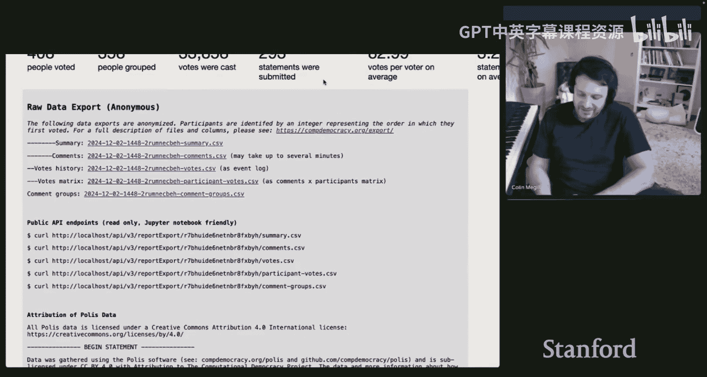

