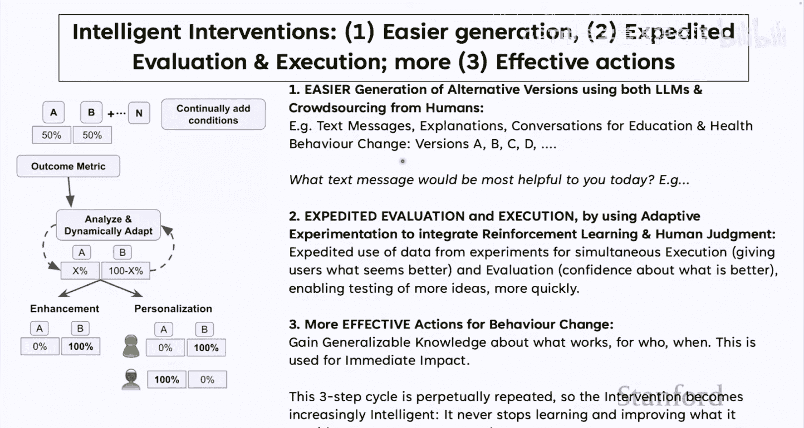
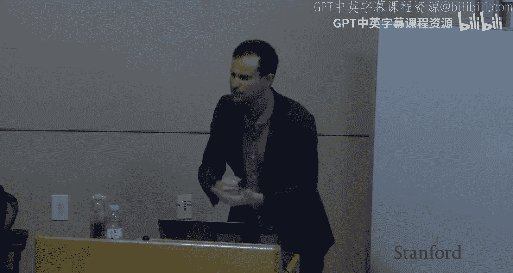
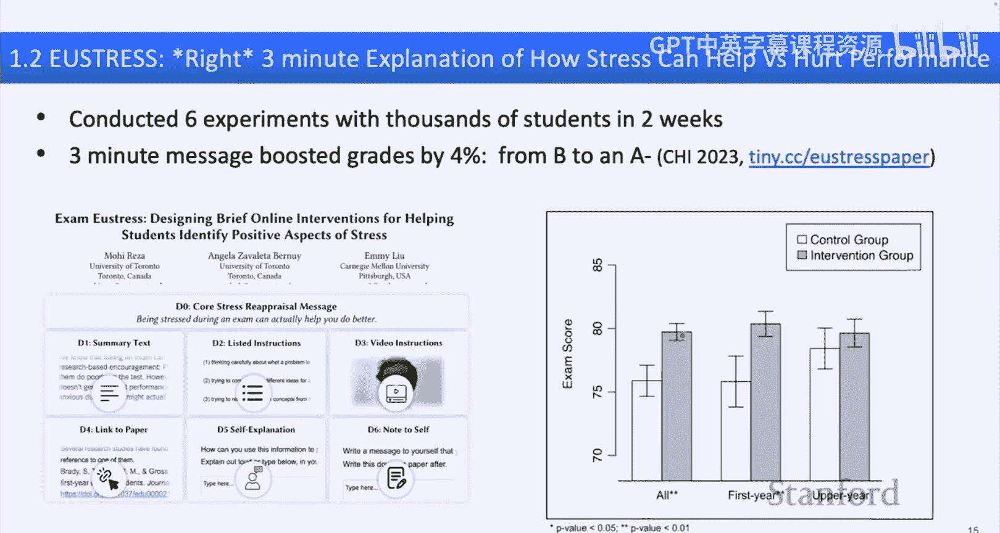
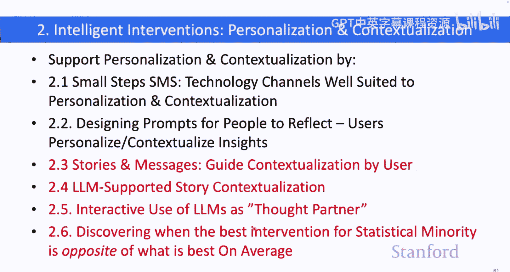
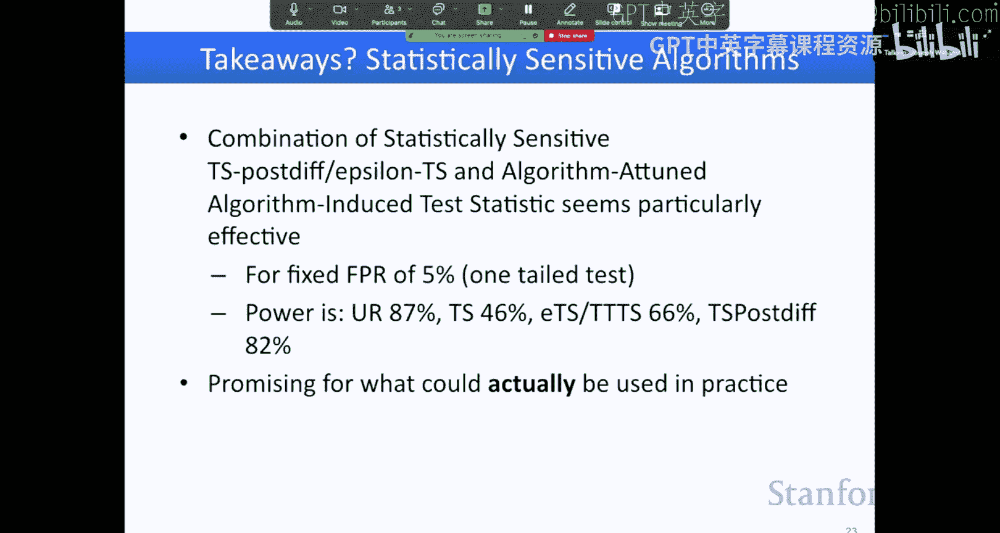
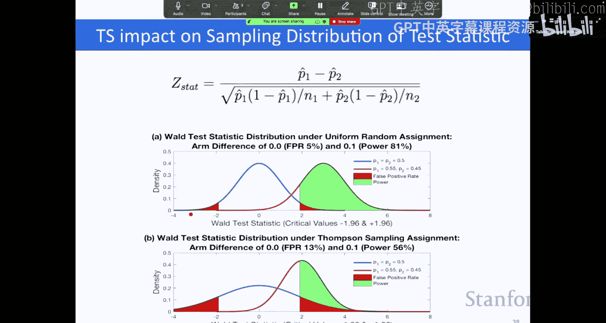
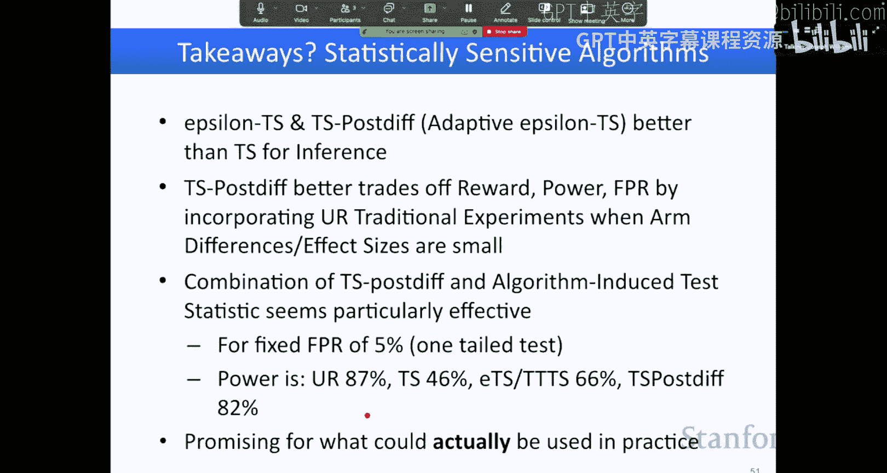
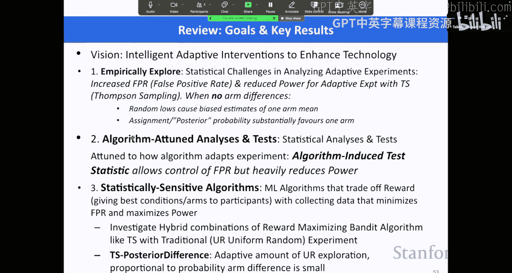

# 斯坦福大学《基于人类偏好的机器学习｜CS329H Machine Learning from Human Preferences  Autumn 2024》中英 - P8：GuestLecture_JosephJayWilliams.zh_en - GPT中英字幕课程资源 - BV1n2Hfz6EGR

So I put this huge thing up just to get people thinking ahead of time。

I want to give you a first a sense of the applied problem， right， about human contraction。

 what examples where we do these experiments I do have to say before I start the disclaimer I have to give is from Chand tobael in Erybeion。

People tell me that I have to say this because otherwise they miss the first part of my talk trying to guess where I'm from。

Now you all know I have a full attention if you want to read more about these papers。

 there are websites， papers and I have a link to my research and CC William search。

 which is basically overview view what I put in for tenure。

And this URL TCC join I extended is our meaning list you can join that and then you can listen in whenever if we have a lab meeting or a special meeting。

 we announce it and you can always pop by and listen it and we're trying to think of a global network of people involved in adaptive experiments。

So here my objectives is this talk。By in this talk。

 I wanted everyone to be able to have some kind of shareable message。

 right you could tell someone else what is interesting in a paragraph。

In a person you could tell person next to you by email。

 you could send them a link to this talk and tell them why it's interesting or maybe a link to a Twitter post。

You want to have some kind of concrete information that comes out of this。

 like being able to explain how data experimentation can be used in a wide range of behavior change context。

Well， you have ideas for how you could contribute to helping someone at win Nobel price for that experimentation。

I also want you all have cl to do or could do。 What's one thing you could do before you saw this talk。

 you want one trajectory after what you're going to do differently is going to have any impact。

Would you be joining a mail list reading a particular paper or share these slides with someone or give feedback like the world should change in some way after we had spent an hour together and more。

So think what your has sha share of a message and your tu could do。You'll be quizzed at the ends。

Right， so this is will be the talk I gave yesterday。Fundamentally， what's the goal of our program。

 it's to coach behavior change。For example， how do we coach people to learn more effectively。

 Like I just did are prompting you to have like a clear shareable message or to do。

 How do we coach people to manage stress better？How do we coach people to exercise， eat healthier？

And let's not approach that。Our approach is that we transform everyday technology touch pointss into intelligent interventions。

 and I'll say what that means， and how the out ofcom framework supports that and helps us win the X bright。

So there are three components this work。The first is adapt experimentation tools to make experimentation easier and exploit。

Because this gives us more effective interventions， for example。

 gives us better explanations of a concept or gives us message that will help someone actually do a stress better。

😊，The second theme is personalized and contextualized interventions。

 and the papers I present theyll all work by Anbacterharology and others in my lab。😊，And finally。

 a diverse temptation of solar science and practice。

Now that's what the actual full talk will be on the I'm going to abbreviate the first two parts just to give you a taste of an example too。

 so you can keep that in mind Now the science of behavior change can help solve many human problems。

Imagine if you could get the magic words， change any behavior。

What a behavior you wish you could start doing？Is it。Inducing yourself to people， exercising。

Connecting better， being less stress。Would it be you should stop doing？

Is it that you just don't speak up when you know， you should？

Its it that you keep eating 10 snacks instead of two。

 Are you scrolling on Instagram other things way too much？

Naththan La you on my page since works or that。Also， behavior change in others。

 what behaviors you wish others would do more or less often different contexts。

And do you all see how this touches on every aspect of what we do。Change your behavior in looing。

Making bad decisions。 exercise， eating， stress， happiness。And I' focus in the examples of Elcut。

 how technology can help us in behavior change in both education on health。

So the version we're looking for is。😊，By 2034。How do we have on demand intelligent coachess that measurably help people think through many problems and change your behavior for good？

What have we done so far to get to that point？From 2012 to 2024， Vivena Foundation。

And this is through the a core framework。Which helps us get tools for designing intelligent interventions。

An intelligent intervention， whether it's a text message you get sent or an app message or an explanation of a concept。

Is an intervention that changes their behavior。And it' intelligently sense that it tries to come up with。

 what's the best thing to give you at this point in time？

But also true intelligence is about learning， it's constantly testing on ideas you can learn what is going to help you if someone tells you they built an intelligence system and it does involve learning and continuous learning。

I mean， I have lots of snake while I'd like to sell you。And to build intelligent interventions。

 we have to integrate multiple disciplines。So what examples of intelligence interventions we've been working on that can help towards this behavior change？

So what we do is we essentially take。Components of everyday experience and make them into add cops。

The A framework takes a start use interface like a text message or a website and makes a microL for intelligent intervention where you can keep testing out ideas and improving them over time。

For example， sex messages is one that an unable about to charge and others have been involved in。

 im a message of the day， but that's an out of comp and what that means is we crowd so many ideas for those so we keep testing them out。

 use Llums， use people's input to generate ideas and messages。

 and then we and which of those is best for you when。When do we emphasize， you know。

 get up and go for a walk right now， you've got to do it。

When you tell someone it's okay to feel kind of lazy。

 you can take a break for10 minutes about this later。The idea is we want to figure out as a coach。

 what we can to see to at the right moment in time。Think of emails as well。

Onepic students who describe our job as a faculty member has focused on emails you send people to get them to start homework early。

 but again， we tried dozens of options acrosssource human beings and adapt through our limbs and trying to figure out when do they work in different contexts。

 but you see we take something as boring as email and not an intelligent coach。

The other prompt that you take this subject line， the intro message。

 and generate multiple versions and test out what works well。😊。

So anything you touch every day could be an intelligent intervention。Of course。

 you can imagine explanations or website。Sadly， I will be embarrassed to say my website is not intelligent intervention。

 You get the same thing has been there for six months and you should shame me for it until I fix that problem。

When you show up on my website， you should have an out pump。

 it should randomize you to different explanations。

 it should let you say just as if this was garbage here's a better explanation and it should be able testing enough to figure out which exps are better on average and what works for you at this moment in time。

Does that make sense how you want to make that piece of a website out ofcom？

We have actually done better job in other people's websites in 2013 when I was at B and Stanford。

 we had Sha run Experence at Khan Academy， where would actually test some different explanations of concepts。

😊，Different messages from motivation students to workcardo。

And increasingly now we're doing it in LLLs。I want to see it for all the good elementss are doing。

 Are't you all a bit frustrated。In an LLM， it's so easy to generate auto interversions。

 anything a conversation they can make dozens of versions of， and they don't do it。

Why they' not AP testing LM components when you' go to charge GBT and it gives you an answer。

 it could test 10 versions of that answer to figure out what's going to actually help you。

They have recently to issued some nice features， but those are just first steps they could be able testing2 200 times more than that。

So does this give you all a sense of how everything you touch in the world could be an outer poem。

 it could be an intelligent intervention to test out different versions and changes over time。

不相の not。W understands what I'm saying。Okay， you have to be sold once you understand。

 So I wrote this in the chat， but I'm unclear about how you're gonna have sufficient statistical power for these。

 These are small exchanges。 The impact on， let's say click rate is going to be very small。

 So you're gonna need to send the email to  tens of thousands of people。Yes。

 how does that work like I understand if you're a portal and you've got all the users。

 but for everybody else out there， you're saying you're saying send an email。

 this is not a major spam to 100，000 users， you're not going to have statistical power。

That that's a great point， so I'll reiterate the question so if we want to make this approach to ubiquitous。

 how can we make this possible because you won't have enough data right to do this so I'll say two things。

😊，One is that。We take this approach in settings like Education mental health where we've actually built collaborations to do this at scale。

 so if you do have 500，000 even 200 people， you can't apply this approach。Right。

 but the second thing I would say is this。 This is exactly what we're doing next。

 So one of our papers you can read on our website called EBscribe by Mo era eraser。

 That's about qualitative EV testing。😊，What if you actually could take the best features of AB testing？

And use them qualitatively， even if Im want to send email to one person。

 how can I actually gather feedback to understand different options。

It's also connected to something I would call a thought if experiment。Tell me something。

 when you write an email， could itash make sense user a describe tool to make different versions and then try and think through in your head how these would come together。

So you get no data。 It's all in your head。 But the process of A B test when we he out alternatives and think about the impact。

And that's actually what I want to do a lot more work in。Yes。

 I guess conceptual AB testing is this physical rather than qualitative。

I wonder if there's a name question where。没必要说。That is exactly on point the word AB testing means something to everyone and I'm trying to come and tell you all this thing here that you call a chair is now going to be something we fly on。

Okay， so that's a good point， so his exercise， everyone， his own contributes Obama。

Here's how you can contribute to acrossdo Nobel。 Okay。

 come up with a different word for those AB tests that are actually quality to。

Qulicity baby comparisons。Super AB comparisons， that's your exercise for homework， okay？

And then I can take it and you can charge me if I have make money off it。For now。

 I'm going to call them a qualitative APp comparison。All right。

 so now in terms of intelligent interventions， right。

 here's a process and I want to get your thinking。How could this process work even if you do not have point of data？

So here the elements， right， you take it out of comp like one of those messages we just saw。

And you now think part one。How do I make it easy to generate options， for example。

 if I'm writing an email， how generate alternative divisions using both LMs and crossroads from human beings。

And then。Explore that space of options come up with better and better ideas。Part2。

 now how do I exploit the evaluation of these options， What might be more less promising。

 but also how do I exploit execution。When I mean by execution。

 I mean actually using adult experiments to give people what looks better。

It great reinforce learning human judgment。

So。A very concrete example would be， let's say we have two versions of an email， right。

 I can ask you， what's the problem to email A that email B。

If you tell me actually you can ask you in the red。

 what's it probability that's let me show you' an actually maleed， okay， just make it up。

They had two emails hidden in my hearts， what's see poverty is Fmin B？嗯。

What are the where the you know nothing else，50，50， right？ Well， look at that。

 you think it's a 50% chance。 So why don't we assign with 50% probability。

What do we have fasterastic A testing Now， she unfortunately knows more than you。

 and she says there's a 70% chance is vitaminmin B。

 So what should we do assign that to 70% of people。Does that make sense？Well。

 pick on these a one is like， no if there's a 70% chance， you should give everyone at 100% time。

That's actually what we all do。We are arog guns， right， When I write an email。

 I send the email 100% time。 I'm seeing， Im 100% sure that is the best email I could have sent you。

 I did no randomization。😊。

So you see， we live in a terrible world， like Donald Kaman said。

 we're binary creatures living in a probabilistic world。

 we either give someone something 100% time like I'm here to give you one version of this presentation。

 100% time。😊，Or we give it them 5050， we don't have these in betweens。An adaptive AB experiment says。

 let's randomize with weighted randomization proportion to our belief。

So if you think like she does is a 70% chance is backmin B， why don't you give to 70% of people？

I give it to 30% of people。Then you get more data and this data can be quantitative or can be qualitative as well。

 you might just see people react negatively and say 7030 is too high。

 I think it's actually like 2080。😊，So the idea here is let's kind of start rethinking the world to not just give 100 or versus zero。

 there's one best thing and not just give 50-50， which is EB testing and we have no idea。

 let's actually give things proportion to the probability we think that there's going to have the best out。

Does that make sense， everyone？At least conceptually。

 do you all get the idea that we could actually start assigning items for actions， emails， texts。

 things we see。Proportionateally probability， we think that they're the best。

 where best has to be defined。How do you decide the complexity of how of the model that you're using to weigh your different versions against。

 like， for example， with the K Academy example， like。

 which LM response is the best one to elicit a particular action。

 I presume you have to build some kind of probabilistic model in the background for your estimate of the beliefs of the student。

嗯。But there are many ways of doing that and many different ways to plan subsequent actions and。

I guess。Is that something that happens real time or is that something that happens once before。

 And then you implement a system that just runs or。

And what's the process of even figuring out what are the relevant components of your model excellent questions and I have the answer you can always answer in anything that's with answering。

Towards， it depends。Those are fantastic questions， those are questions we're going to spend the next 25 years working on。

What is the model you're using to set probabilities， I will give you one model today so two arm case。

 A and B， binary outcomes and I will show you that that model actually isn't even good enough。

But you know what， first next you might say I want to do qualitative baby testing and they say I'm going to set those problems by a crowdsource mixture of experts I'm going to get the best marketing people in the world and we're going to ask them questions about1 meals。

 theyre can all give us weights so I'm going to combine that。Then when we send it out。

 I'm going to send them the data of what happens and get marked people to update the beliefs that's an alternative method I don't know if many papers have done that I'm sure five have but5 is basically not we need a lot more work on getting human beings to settle those probabil。

But I will give you examples of how we've done that using statistical models。

 again I want to say that's good， that's fine right but I think we can do a lot more innovative interesting work and most importantly like said。

How do we give these techniques to 8 billion people， 8 billion people are not going to run AVT。

 I love them， I'll run them， you will too， 8 billion people will send emails and text messages。

 they may with the right tools that we built， randomize them a bit。Yeah。嗯。

So I want to make sure I'm like understanding your intention。 Yes。

 so what's my intention so far I mean we think about statistics and AB testing formally。

 but like in reality， we just write one email yes， And so you're of saying that like we should explore this in betweent space where we don't necessarily have formal statistical power but we have all these other signals about like how did the person reply to this email or what how do you feel when you sent a versus B and like all these other proxies that like qualitatively give you the answer about like what you think is the best to send but like in reality。

 like we're just like sending one email。 And so like you're trying to push us。

To think like this kind of， I have never said it so well myself。 Good thing for're recording。

What's your intention today， Joseph？It is together the rethink the way we're making decisions to bring some elements of AB testing together。

To help us think about the signals we get about what might be better or worse and help us to start to actually randomize right with weight randomization or something where we don't just have 5050 or0100。

 we have something in between。And I think anything that moves us towards that is progress anything that makes me realize that when I send an email to someone its worth having two versions。

 even if I don't send it， I build the habit of A testing of qualitative A testing is is progress why because we're introducing a problem to solve a problem。

😊，Just like the person， why I'm quo you all by what you're wearing in the white song for what he said。

Just as they said， how do you choose those probabil， good。

 now you have a problem to solve the fact that youre worrying about that is' going to give you me a lot of confidence。

I will say what we have done， which I think is really good and can be a lot better and is a big research program。

Is work on those models that are quantitative。To use Bayesian methods and Sang Chong is working with us on this。

 to use basically ways of taking aB testing data from a quantitative perspective and estimating what are those probabil。

 we've done that。But I think that's not enough。That' not getting you know a price saying。

 let's say chemistry， economics or something， but it won't actually help those other billions of people who just want to make better decisions。

That's where the qualitative of work will help， the crowdsource approaches。

 and here's one way of seeing it。嗯。When I our models basically tell you what our probability is。

 I'll give you an example as sooner rather later I hope， but let's say you have。

 do I have a good example one second。ok。Let's say this is an experiment， right。

 and I'll tell you what it's about just now。This is advertisement， Go and。

 check these slides out and read it， we have 80 papers and I know you're not supposed to do this。

 but I try to put a question that once to a slide。😊，So check out ABscribe。

 right which I'm going to walk you through now， and I'm going to tell you an example of an experiment U stress。

 and I'm going to explain how you could use that for quantitative estimates。

 but how I think we could actually do qualitative instead。😊。

And this paper is about general explanations， you cross those explanations of people and then do these adaptive AP tests to figure which ones helpful。

If haven't got your question， don't hesitate just type it into the plan of CCM Williams talk。

 I'll have that open on my phone here。All right， so what is ABscribe doing here？

Can people tell from this graphic？Yeah。This is a tool that out of Conframe enableables。

Imagine you're writing email， right， for example， email does tell students what you've got a test coming out。

But you know what？Stress can actually help you perform better。

 It may not actually hurt your performance。 So what do we do is let's actually select pieces of this email and make them out of co。

 So start thinking green， that's an outcome。 that's an Navy test。😊。

This other one that's also not of co， so you define now what are the things you're going to experiment with。

Now you can use an alum setting。Where you could actually call El and say。

 give me a different version of this message about stress that will work well for someone who's very scientific。

Give me a vision that will actually work well for someone who believes someone who does yoga all the time。

 okay， I do yoga， nothing against it， okay？😊，Give you different versions unlesss experiment。

 so then the ascribe is that you choose a piece and make an out comp。To A B tests。

And then you generate visual L， but then this is the thought AB test I'm talking about because you can then actually look at these versions and toggle back and forth between them。

For this part， you have another a of comp below。 and you think， how do these things come together。

So I might use this when I'm writing email this。I think which of these combinations would look if I'm trying to say？

Don't worry before your big presentation， stress can actually help you。

But then I use the same three of options when I'm writing。On writing to someone else。

 Does that make sense everyone how basically you're doing this thought AB test。

But thought it comparison。By having the Arab prompts to define options。

Thinkaking through different versions， getting allow them to help you and then traversing that。

 does that make sense， everyone？😊，Okay， so now this， I think， is the future。 and I'm I'm not sad。

 He got a job。 I'm happy for him， but I think we had so much more to do on this。 Okay。

 and any one of you， you can publish really high quality papers in this area by just building on this。

😊，So what's the example of using this， what does it get you？Well， here's this paper。

 this is a paper of Mohers from Angela Zvalata from Kai 2023。

We talked about magic words right and you probably thought that's the yes but tell me something。

 what could I see at two in three minutes if you're a first year programming student that will increase your performance and test by 4%。

😊，I even if the answer to the test question， I could tell you in three minutes and help you， okay。

 you'd forget it。But here's what we did。We took research in psychology by actually people the your State Department of Stanch。

Andum。I'm sorry think I'm sorry I forgot any。And we then map the star setting。

We came with six different elements of this in the out crop。

 we vary the text we show people instructions， a video of me saying it or not。

Liinked to the paper for those who are scientific。Ask them to explain what they thought theyd learned。

Ha them write a no to themselves and the core message that we traversed in many ways was。

When you're stressed， it can actually help you perform better on a test。 It doesn't have to hurt you。

That message on its own， what you'll think that it did。That message on so is the control group， okay。

 so the average grade there was 76%。But when we went through many other options。

 when we elaborated on it， like helping them think， well when you're stressed。

 you might think of thestruct you， it can actually help you put more resources in。

 make you pay more attention。So join the exam when you're stressed。

You don't have to worry about it it might actually help you perform better。So those examples are be。

 right？Make sense， everyone。No。😡，Hey peeloff。When you explore these options。

 you will find options that actually will boost grades， so here's what you see on average。

 about 80% compared to 75。😊，Well that's I' 80% CO to 676。2 or something。That three minute message。

Which I'm not even sure they read carefully， also grades by 4%。From Bta a minus。

So do you all see some of the payoff you get？When you actually run these many experiments。

 I think we run like six experiments in a couple of months where traditional research might take。

 you know， a couple of years to run that experiments with 200 people。Bey pill。Now。

 let's ask a question。Should we just start giving this message to everyone。

 every class of Stanford at Berkeley and everywhere？

What's it probability that this particular vest will work in your population and will be the best thing you could do？

It's not a hundred shot， right， Nothing in life is 100。

So you could imagine that if you took this message。

 you would then actually aBscribe and use the LM to come with different versions。

 use crowdrowscing and come with many versions。😊，And then think yourself。

 well what's it public he's going to work people my setting？Does it make sense， everyone？

And you could randomize them that way。Qualitatively or quantitatively， and get more data。

Now let me give one point to circle back。We have data here， right， Like I could look at this data。

 and Sng or Mi or Tong Li Tong Li and Fred Hch So my start Sp students。

 they could calculate with few under some prior assumptions。

 What the probability is that this will replicate in a particular setting。And that would be like。

 let's say，80% and 8%。 Okay， there's a 9% charge for this message is better。y everyone。

But here's an interesting idea。What if instead of just using this statisticalco model？

And just mapping it over we to say， what if we actually give that data to someone， for example。

 if session a class？Let's see we get a dataum and says。

 here's what the results showed from this class， here's what the class was like。

 and then can say well， that's helpful。😊，My best judgment， wrong as it may be。

 is that there's a 76% chance that this is the best message I can show my students。

So do you all see now how we take quantitative data and we don't just blindly compute the probabilities based on a particular model。

 we then give our data to someone， we might get our model probilities。

 but we get a human judgment as well。Now then we can combine a human judgment who's looked at the data with actually the particular beta brainery or whatever model we use。

Does it make sense to everyone？是这个。They didn't about things possibly from but it' not very subjective。

Delegate way of。 I don't know how you think about this。That may be a good way。いのあるかな。

What do you say that， do you mean is it it sounds subjective。

 Yes don' mean specifically a f the of thinking about sort individual estimates that sort of drive much。

I guess the framing I'm hearing you somewhat well I think so yes， I'll say two things。

 I almost never have one belief okay， I have a Bayesian combination of beliefs， okay。

We can do this statistical model and you might say or let's say， okay， you she might say。

 in my class， we're doing straight up statistics， I will not enter my beliefs in here。

 compute the probability based on the past experiment。And we can do that for her。

But then you might say， well， I want to see her model on this data。

 but I'm going to add my own opinion。But then， you， personally yellow and green shirt might say。

 I'm going to do what they did， but I'm going crowdsource ideas from students themselves。

So the idea is these are all tools in your toolkit that you could do and even though to be totally honest what I'm pushing on right now is the more formalized statistical version because that's what we've done more of and to be honest it's hard to convince my star species students do these kind of things a human construction soon is much more openland that's when I'm pushing on to help Susansan Theo Alan Asporu get their Nobelped okay but I think what will help more people is actually these more subjective methods again what I think of what I love about math I love pure math is beautiful but time is something how much comedy fields medalists of change have help people be healthy and exercise more。

The really exciting part is taking math and bringing into human structure by designing experiences。

 interventions， the combined math， and that's where you have to start to do what they said part what depends in a one lower prize。

 one of the students said had high dimensional intuition， so here's a lovely anecdote。😊。

You come into Gr school， you would say， so if you want to work on things that are beautiful。

 mathematically， great prove， easy paper to publish， but may or may not re the real world。😊。

Well if you want to work on things that are messy， confusing， hard to formalize。

 but really help people solve problems。😊，And this student said。

 you don't always know which one protuion move towards because you had this high dimensional intuition。

 we may not all have it， but we at least need to try to take mathematical concepts and combine them with human behavior。

Such as by crowdsourcing opinions from people， that's a well definedfin process。

 everyone here gives me a probability and I wait it， I can reproduce it。

 I can change it I can evaluate it。And to be honest， remember， what are we doing every day。

 when you saw me outside， you just service on your mind， you were not being formal about that at all。

 you're being a human being， that's like' now let's make you slightly more of a formal reasoner by using things like adescribe an adaptive testing。

😡，So the general thing makes sense then the case people want to skim。I think。

People are notoriously bad。Being。I guess quantifying probablyly。

いからて。Yes， thinking have the premise of this class square。We actually are engaging students employee。

But like trying to do things， I think or low effort for people。

 I want to important you is the signal list probability。

Given that I guess I don't trust probably that mean anything that's a great question versus other like you know permanent signals or other kinds of。

Lower。Yeah， I think those are great empirical questions。

 be those are good hypotheses right about how to pursue。

 I think those sound really interesting to pursue in analyze。中。Ronnie。

 youve got some great questions in A。 I'm going also put Ronnie questions into this talk。 Okay。

 I've come back there a bit。We have shown cases where actually， oh yes， okay。

 I'll show a case where de from uniform random can increase power I think people are getting a sense of what a quantitative adapt A test is right let me let you all just read that for30 secondsd while I write an answer。

😊，So you all can read that， that's your homework and see if that makes sense to you。Okay。Yeah。

So let me move on for a second。Here's a formulation， okay。Of EB testing。

 this is what more people think formally， let me just lay it all out。

So this is what's called a Mountianban algorithm， it's the most fundamental form reinforcement learning。

And you can think of this as randomized probability matching。

 So what I said to you before about whats see probability that A is better B， and you give in 70，30。

Tmmp the sampling basically sum of those claims the sample of those probabilities So's also called postior sampling Now I want to focus on the most simple form of this because I think everyone thinks we've got this and we have not got this right。

Think of a Beta Bnoi Bayesian model。So you've got two arms， for example。Explanation A versus B。

And what's your reward？Someone says one， I like the expression or zero I don't。

Someone clicks on your paper after see next mission or zero they don't。

 someone buys a product after explaining what it's about or zero they don't。

Do you have a set of actions， right？Give her a water outcome， which is。1 zero。

And if a policy or a policy learning algorithm， I terms to sampling， which would assign 35%， 65%。

 what if to your probability is actually the best option。

And so this setting actually is really nice and simple。Basically， you put a beta distribution。

On the probability that someone's going to say， yes， I like this。

 So you have a beta distribution for R A。On北 this R and B。And here's a nice prior。

 let's do beta 1 and1， what is beta 1 and1？Any agree？

What is the beta 11 distribution if I have a beta 11 distribution， it's like I saw one success。

 one failure so far。What is the probability of someone saying they' like an explanation？It's uniform。

So beta 11 is uniform distribution it's saying as seen noted this this so far。

 so maybe a 20% chance people will thumbs up this explanation or 40% or 8% they're all equally likely。

Do you have a beta distribution on arm 1 and a be on arm2。

But now it his Bayesian in France and he's a conjugate。

 So what's beautiful about this is how simple it is and how interpretable it is。😊。

Now the reward is a benoi right， drawn with the parameter from that bit distribution。

 so let's be very concrete。Beta 11， beta 11，32 arms。

 Let's say that we give five people arm one and three of them said， hey。

 that was great and two said I didn't like it。Now， what's a distribution？

Our beta distribution is now beta 1 plus 3 comma beta 1 plus 2。So we have beta with one plus three。

 four successes。And one was two three failures。So we don't have a uniform distribution anymore on the probability And people think it's helpful。

 We have one that's now skewed a bit higher。 It probably looks。I'm not going to try and draw another。

 I'm not good that if somebody looks at it like this。

Let's say that actually for arm2 we gave it to five people and five of them were like hey this is great and zero said I don't like it now we have a beta of one plus5 comma one plus zero so now again we get a s right we now it's like I think probably people like that is high。

😊，But we're so pretty uncertain， right， it could actually be that there's only 0。

1 probability people would like this thing， it's just that we got a sample that biased us。Now。

 of course， if you are beta of。6ix， if you have beta of  six and1。This is bes of 60 and 10。

 then you would get a much more peak。On the probability of it being high。 Does that make sense。

 everyone， because now you have more observations。 You have the same mean， I think。

 can someone do the math quickly。60 and 10， right， Well's the meaning of distribution。

You can with you allowed。What's the mean of a distribution where it's beta 160 and 10 or beta 6 and1。

 what's the mean of that？A agree to the same。The variant should be smaller。Exactly。

 so I think the mean should be like 60 over 70， right，6 over 7。 So the mean is 6 over 7。

 So it's kind of saying my best guess is that the。😊，How guilty of someone saying。

 I like this thing is6 over7。But now in the beta， like you said。

 beta 6 and 1 is going to be like this， but beta 16 and 10 will be like really peaked。

See you up more confident。So does that give everyone a sense of at least how you could use a beta distribution to represents？

For A and RM B， the probability that people will think is helpful。

And what's really nice is how intuitive this is every sample you get is a successor failure。

 you can just update the data parameters。Now， this example is lovely because it's super simple。

 everyone can see it， I understand it。And so it's a great test gone for all these algorithmdos。

It's also a great test John for this qualitative kind of work。😊。

Now does anyone here know what Thompson sampling does to basically get an estimate of the probability that is B B。

 let's pretend you have beta six and 1， farm A， and you have beta3 and three， farm and B。

Well what term up we would do is it would sample， draw from beta 1， 6 and 1， you get 0。5。

Draw from beta 3 and 3。 you get 0。4。And then assign the arm that has the highest expected reward。

Well， if your beta from R 6 and 1 is 0。5， then you're expecting that you have  a 0。

5 chance people thumbs it up。But your beta from R andB is 3 and3。And then you get 0。4。

 then there's only a 。4 chance people are going to thumbs it up。So what gives you highest for what？

二米。So Trump and something will pull army。Does makes sense to， everyone。

You have the base distribution， six and1， three and three， you sample off each。

 and you can choose the arm that gives the highest reward under those parameters。

And if you want to know the probability empiricalerly， just do it 10，000 times。Right。😊。

Draw and you get 05。4 R1 R， then you get 0。6 and 0。3 RA， then you get 02 and。

8 RMB so you can just get 10，000 samples and you can actually compute。

 well what's your call ability R is got an RMB。Does it make sense to everyone？

How you go from the beta distributions to what's the probability of the arm being better according this algorithm？

Iag 80%， positive a， B B or 70%。And so on makes sense everyone。

I really think we need to do 10 to 15 years of research just with this。

It's super simple and it's not solved。When it's not solve。

 what I mean to say is the inference is actually not trivial and I think there are a lot of mistakes people are making when they use these adaptive experiments and don't realize it。

Cool， so again， everyones clear what how this works， how does sampling work here。

 and what's the online model。And so now you can imagine that if you have beta 1 and 1。

 you've got 50 50 assignments right， because there's equal chance of these being good。😊。

You could also use manual assignment human judgment and now actually we see something pretty interesting right。

 suppose that she said there's a 7 percent chance of ava Bmin B。

 couldn't one of us actually after the question about formalizing it。

 couldn't we then back out her 7030 into betas？You could actually say， well。

 you could even ask a person， you could even ask someone right， you could say tell me something。

 she thinks this the same person chance is Bethmin B。

Could you represent that as fictional successes and failures？And you might say， well， yes。

 I guess you expect something like that。 if I imagined， I'd seen。

10 observations before in A and 10 in B。And of those， I think， you know。

 eight was successes in it two were failures。And in B， you know， it was five or six， five feelings。

 so now this is super interesting right because we can actually formalize these propertiesbil that are so slippery。

😊，And I think there's a great k paper to be written simply on that。

Let's understand how people could express in poverty， something is better and B。

And then try and map that to data distributions。And to kind of help people understand which of those assumptions match what they say。

Like how do we actually help people formalize their beliefs about whether A is better B？

By actually helping them understand how those can map two beta distributions。I when say people。

 you could do it but have 10 participants who are like people in this class。 Okay。

 who know what a beta is， but have 10 participants who actually don't。

And can we give them interactive explorers or tools that help informize intuitions？

Another question is， could we then find a way of waitinging people's approaches， example， you know。

 sorry， it's quite by shirts， but yellow and green shirt versus black shirt， right。

Young green might say， you know what black shirt， you know way more than I do about what emails people are going to respond to so I'm going to get my estimates but I want you to wait my success and failures on10th of black shirts。

Like you might say arm1 is a beta， I think eight successes， two failures， arm2。

 arm A is going to be five and five， and then Blackshed says well actually think arm1 is nine successes。

 one failure， arm B is going to be you know， two successes。

 eight failures and you say do not wait equally。Wch his 10 times mine。

With his his success is 10 times mine， and now that's a way of combining expertise and offices。

 youll have something to say， but who want to wait his more highly。不。

So this is where we actually now doing ada experiments。

 we assign 5050 using human judgment like we just talked about waiting red shirts and green shirts sorry yellow and green and black shirts。

😊，Or using a statistical model。Then as we get data， we can actually evaluate。

 50 people got A people got B。Or maybe even smaller with both quantitative and qualitative metrics。

And then we might say， well， A has a9 percent chance being Bin D。But then we don't stop there。

 this is what makes it cost experimenting in the railroad， we won't just stop there。

 They keep adding your ideas。And so over time， we can actually keep it up in properties。

 does that make sense to everyone how this approach let us quantify beliefs and keep adding new ideas on the fly。

This does sound like a Saam measure requires a lot of trust and effort on the behalf of users I could also imagine that if I say I'm very confident about something I can try to ske in onely adversarialally。

Fantastic dozen other people iss out of chi papers other of people in your area。

 fantastic when we're gathering experts， so I'll see there's a question。😊，In this paper。

 let me try something on the fly title。Eliciting beliefs from people to get better decision making。

 even when some parties want to sway the vote。Abstract in this paper， we investigate。

Ways of gathering feedback from different people to try and come to a group consensus such as which emails we send out at the company。

We investigate policies ABC， which are ways of combining input from different people and we investigate wing schemes F and Y。

And we sure how。If someone。Believes they're right and will use that to s the majority。

 This scheme will suffer from bias in this way。To tackle we introduces other approach。

And that's a great one， that applies everything going to lunch。

Deciding where we're going to like have your retreat this year。

 that's and companies would love that kind of thing。There's a greater job。

 Who knows what the hippo is。R Ronpo hippo， highest paid person's opinion。

 Ron to determine is fantastic。 How do most decisions get made by the highest paid person's opinion。

 Don't trust the hippo。 Your paper on this topic could be a way of getting input from people and trying to defend against the hippo swaying people's beliefs。

😊，So。い。I haven't seen mentioned， but like I'm wondering what your thoughts on it actually do AP tests for all the papers that I write amazing。

 we should write a paper not for Kai all this stuff you all do every everything can be a kpe if it's well done or rigorous。

 it could be we just have to show that right you will get rejection Ka feels right on your own。

 but we can sure make it a good kit paper comment I'm not sure。😊，What is yes。

 it wouldn't be very helpful to me to wait for humans to do the feedback on the P test because that would involve like sending the papers waiting for the feedback like sending the next paper It's just really like artists So then like thing I heard you mentioned much is like can you use the language model to help you quickly like you know refine your prior basically because like he can ask it to like you know take on the role of a certain I would I'm trying convince this one of my gra students to work on that I would love to write a paper and I think it's a quick easy highly impactful paper So in your university Rob Willer has a paper and usings to see the human behavior that would be a great paper to write and I think there's like 200 papers that can be on not top in the next 10 years Yes。

 let's do it。😊，How let's talk that after。Using ours to simulate human behavior is a fantastic idea to get priors do all of these things。

O。So I think you all get a sense of basically some people say Ascribe。

 you stress and you can read with the others。 I just want to d something in front of you。

 so you're aware of this。Personalize and contextualized interventions。

 which I will not talk about too much today， but I want you all to be aware of。

There lot of work by Ashaana。So paper 2。1 is a small steps SMS is a you could sign up for it now。

 it sends you messages every day to manage stress and be happier。

And then I just publish a paper on design prompt self reflect so you can actually ask yourself questions to manage stressful situation so you yourself are personalizing and contextualizing advice to your scenario。

He's got a nice paper CS of on stories and messages。

 we give you stories about what people are going through。

 whether it's handling stress or applying for an internship。

 and you're then able to actually abstract that away to your setting。

This is a paper this year on how you can use an LLM when LM will actually work with you to figure out how to adapt a story that we've written to your context。

😊，And then a nice paper， 2。5 on how you El as a thought partner。So if you procrastinate。

 this will actually help you come with messages to send yourself when you're procrastinating and has a particular prompt engineering and interface to get people to actually come with best messages the L them。

😊，I'll put that in front of you all let me just entice you all because just look at the screen。

 really carefully it's going fast。😊，2win1。2。2。Next。2。3， the messages。The result。

 example of a message。The results。24。How do you contextualize with Lms。

You would share some context with what you're going through and I actually general story for you from that。

And then we actually found this， I was shocked it actually outperformed just a human story。25。

Aams the thought partner。So here's the interface。 you can just go to time and see sparkar paper or sparkar demo。

And you can actually type in what's going on with you， what you procrastinating。Grant deadlines。

 talking to someone， exercising， you type it in。 you tell the alum， you know， to an informal direct。

For me， you want a Trinad response。 you want an North American response。 I can tell you， Triads。

 Trinad。How many friends， colleagues and parents not talk the same North Americans talk to you。

Much harsher。And then it was actually generate a message for you down here。

 you can actually edit the prompt。😊，To change your message。

 I want a already tough Tri notion we of saying this。And he also generate more messages。

 Does that make sense， People just at least as a teasse of what the interfaces could look like。

And I want to say all the stuff at open air and soa hiring。

 I think they're only missing the boat and you all can eat them for lunch。

 It's the interfaces on Els at Ma。 This kind of interface is night and day。😊。

Don't just give people al good albums， tell them how to use it。

 give them ways of interacting the album， tell them what to say。

 give them custom prompts like this interface is kind makes all the world of difference because you know what most of people are saying now。

I haven't seen a case for AI really matters。Where is the business value。

So they comes is 100 billion plus， make some use cases like this that we'll actually show people what it's helping using psychology in HD。

 that's going to matter。Okay， now here's back to Addafi's fermentation Okay， especially。

 I think Ronnie will be interested in this one。Okay， so。What's going on this graph？

How can you use adaptive experiments to discover when the best intervention for statistical minority is the opposite of what's best on average？

So did you all see what's happening in this graph？You can choose your own setting。

 but I'll give you an example， this is part of what we want the X prize for。😊。

Imagine students get messages and the outcome of the reward is， do you generate a question。

 are you going to generate a question about what you're learning in online course？

So how me get you generate more questions。Well， one self folks message in blue might be generate a question because it'll help you spot gaps your knowledge。

Another in red might be gene question， so your peers might learn more from it。Now。

 if you look at this data set， right， you'd say， well， look at that on average。

The red message is giving you more people journey questions than the blue。But what's wrong with that。

 what are we missing？This is a day broken up by people who have low accuracy。

Becauseuse they got the last problem wrong。With hi accuracyy， Ca got last from， right。

I now hierarchies to people are 80% the data。8 percent of people are getting lost phone right。

 to the hypo accuracy。30% get it wrong， and so what's actually happening。

 how is actually taking just the average， actually discriminating against a statistical minority？

Could someone say that。Luchi and Hoie， how are we actually discriminating here？Well。

 so since like 20% of the data。あ？You have a more self focused。ああ。Chrisions like， so if。

 if you only to look at 20% and then 80% of the data， given the other one。

 you combine them like the weighting is far more towards the higher accuracy。

 So then like in the serve overall results that we reflected more because of that 0。8 versus 0。2。

 exactlyact，20% of people， the blue message is better than red。 and substantially better。

But for 8% people red is about in blue， So when you combine it， they get washed out。

And so you would actually end up as a policy saying， let's keep everyone read。

And you'd actually be hurting people for getting worse of it and what's worse you hurting a statistical minority？

Another question， do you think this is a bigger or smaller problem if you don't run experiments and you just use your intuitions or qualitative data？

I think it's bigger。If after class three， I given two ways of explain the concepts and three of you came up and said。

  hey， I like the red way。I'd be like， yeah， I'll give rights to everyone。

But because I didn't keep experimenting， I would actually have missedy chance to discover is a subset。

 and we're doing this constantly experiments are just a microcosm。

 a very well defined one of what we're actually doing every day。😊。

So here's an example of how we would actually want to run this experiment and how we do when we use contextual bonds。

So you sign 5050， right， but actually do it separately for the low accuracy and higher accuracy groups。

So then what happens over time is as we see what's working。

We would actually start helping the higher accuracy group。

They be a 70% chance that red is better than blue and so they get at same same time。

But we're not so sure it really low accuracy。 We might keep in there 5050， right， like 55，45。

 we're not sure。And that not being sure as good is we require more data。To me， she would be like。

 oh yeah， there's 8% Johnson red Beth and blue piucracy。But for low accuracy， this is 65，35。

So do you'll see how this approach would allow us to keep collecting data over time。

 we don't stop experiment early， be adapted so we might ask able to discover。😊。

What's better for a subgroup？Make sense， everyone。So I want to ask you all。

 what scenarios where we decide option B is better than option A because it seems better for most people。

We might actually be hurt your minority。And I will say when we use this algorithm。

It doesn't just lead to better outcomes for people in a small group。Like I think it 20% are better。

 it actually increases the statistical power to detect that effect。 and you all see why， right？

Because。We keep experimenting， so we might start giving more people less than one group because they're pretty sure。

 but because we're less sure we keep getting data so we actually get higher power to detect this difference。

 we're more likely to figure out there actually is a difference。Oh yeah， here's it data。

 so the outcomes to the minority in a traditional experiment uniform random， 0。36， 。

36 of people generate question basis percent。In depth experiment 0。45。

 plus substantially better to get better learning outcomes， statistical power。

 detect the best option of minority increased from 87% 89。Doesn't look like a lot， but those add up。

 and I think in terms of samples， that might be 50 less samples。

50 less samples to be equally conent is pretty good。 Even five less is good， right。Those are people。

 five people who didn't have to be in your experiment， taking the same confidence。Good。

 so what do people take away from this so far？

All right， now unfortunately， I did actually give you that whole first talk。

 but it looks like you all had a good time。😊，But now I'm going to give everyone a one minute break。

 and then I'm going to actually talk about the algorithm word， new algorithms， new analyses。

So if take a minutes and think whatever you want to think。Egno me up there。

Let me give one thing away， this most important thing。Six years ago。

 I thought and I run experiments using toxin sampling。

Today， I would not tell someone to use that。

Would you say more， spent a lot of time talking。ち。😊，Fortunately， there's the easy solution。

 What is absence of the sampling。😊，Epsilon of the time to Uniorandum。

E some the time do 5050 assignment and then do some the sampling more exploration。

Euc could the is more exploration。I hear about in terms of this。

Keep doing some amount traditional experimentmentation in order to reduce the biass of Tomson sampling。

It also guards against one， if the word changes， maybe exp A is great。

 but then people get fed up of it。Maybe especially is great for your majority population。

 but actually it's a minority that you're missing。😊。

the exhibition is great for Santaford students this semester， but next semester it's not。

So having somewhat of Epsilon uniform random。Epsilenttrition experimentation is really important。

And Epsilon of something says with probability Epsilon， do uniform randomol。If the epsilon is 0。1。

 10% time you uniform random， if it's 02， 10% time you do your uniform random。

Now is the second part of this。How do we optional analyze data from top to sampling？

A lot of papers will do all kinds of fancy debiing stuff in riskpro waiting， all kinds of things。

 I don't think these are working nearly as effective as people think they are。😊。

So one thing we've been developing， and I feel confident being I should tell people you can actually use this is an algorithm use test statistic。

So what that means in a sentence， and I'll show you more is when you do like a Z test for proportions。

 like is a proportion of people。ho。If you compare X A versus V and see who thumbs it up or not。

You do a Z test to say， is there a significant difference between these？

And so E Z test is designed for assumptions of uniformandum。

But you know you're using Thompson sampling or ideally you're using Epilon Thompson sampling。

So how do we actually know analyze data？😊，In a way that takes on account。

 that we were not collect with the uniform from random， but have sometimes sampled。

The algorithm used test statistic basically takes the Z test statistic and it regenerates it。

Using the algorithm to collect the data。So I'll show you more about that。

 but basically it generates the data。Under the neural hypothesis。

 using the algorithm you actually use and gets a different distribution to the testistic and you get a different cutoff value to the your hypothesis test。

Now， if you do that， the actually does not too bad at all。

You get a fixed force positive rate whereas we've shown that even in a tour arm trial。

 sometimes example we'll push your force positive rate to 130% compared to 5%。

And your power actually， is not bad。Uniform running gives you better power in a tour arm trial。

 some sound gives you 46%。But absent of sampling。With this argument， these test will give you 66%。

Particular algorithm we used and developed， we think can do even better。So key takeaway is。

 I should say now we have some Intel people， you running experiment adaptively。

 use Epon tops and sampling。😊，Or use our version， which is called TS postif。

 which is adaptive Epsilon of sampling。And then use the algorithm and use test to say the other people are developed。

 and we find this context and extended。I want to be sure I understand。 So yeah。

 you're saying that traditional Thompson sampling has a very specific trade off between treated its false positive and other but like。

You can kind of mess around with that hour a little bit and get other trade offs that might be more practical for your setting。

 More statistically sensitive。 If you good inference front。 Yes， So that's right。

 like one is like Thompson sampling is like not even all the Pareto frontier necessity。

 And then like。If you change the algorithm a bit like you can。

 you can kind of get like better uniformly。 Yes， so that thank you being precise and great you I coming back。

 So one is that Tom sampling has some issues。 Let me characterize how big they are。 So I'll say that。

 Yes， the second is that using Epson Tom sampling ideally。Adaptive E of which you're working on。

Will give you better， statistically sensitive results。

 But the third is you also should modify the way you're doing your statistical test。

 That's the algorithm of tune analysis。So does this make sense。

 just make sure people know what's happening？Just read that and see if it makes sense。

This is the world we're living in right， so think about this arm difference of0。

 the probability P1p2 0。5 response rates to expectation AOB or think of arm difference at 01。0。

45 people， let's say they like exhibition A， 0。55 X B。

And this wall Z test is what you to compare means。 So you're basically subtracting the sample mean。

P of people who set the expression A from B， and then you get this standard there of the difference。

 which largely depends on the sample sizes and1 M2。Makes sense， everyone。

That's a very sign that we are doing the syn。Okay， now you can see this in the paper。

 but basically Heotom sampling actually face false positive rates compared to from random。😊。

We did a bunch of other tests， which as details based factors or cause an issue in whose quality weight also cause a problem。

And it pumps up induced wall test， so this the algorithm induced test controls force for the rate of 5%。

 but power is 70%， which is not great power is probably detect difference when it exists。Fse per。

 there's no difference， but you set your test says the rates。

This is a sense of why this happens in terms of sampling。I give you all 20 seconds on that。Basically。

 when it's a random low and I mean looks lower， you think there's a difference when there isn't actually。

So that's where we get force positive a high end top sampling by the 130% in time， not 5% because。

But this is important。 So I'll just go through it。So what you see in the vertical axis is the sample estimate they mean right in reality。

 they're both。5 in reality。However， what happens is that if one looks worse by chance， right， arm P2。

Well， then she stop something from it， right。And you put all your samples up here。

 so what happens in the limit？Even with 800 participants。

 you are accuratelyly saying that arm 1 has a mean 0。5 and you standard area is very tight。

 you' are very confident， right？Most samples are there。 But look。

 you think that actually are' too as already low mean。 you're not as confident， right。

But you're still going to have a false positive because you put so many participants in one arm that you now think there is a difference。

Does it make sense to everyone？That's one reason why when they random loads with an adaptive algorithm。

And something it looks worse， you stop sampling and so you start to believe that there is a difference because you put all parts into one arm and you think there's difference when isn't。

Great。This also things why you get lower power in a sentence， as Ronnie said chart。

 if you're saying uniform random right， you're going to have like 400 people， 400 people here。

 but actually there is a difference and you estimate the means accurately。

 but actually you're not that confident because look how the sound errors here。

Tos you don't know is it actually difference or not， that's the problem we have experiments。

 this also happens with Beijing in France as well。😊，Again， I let people look at this after they talk。

 but even when there's no difference in our means。The sound probability is going to be 0。8 or higher。

In 53% of the time， there's no difference in our means。

 the Thompson sampling will tell you that the probability of one arm being better being 80% or higher is really。

 really high。Okay， so as if you spot about empirical exploring right。

 this is the empirical work we do just anchor previous I guess you did excellent reading。Yes would。

I guess fundamentally is still us the best。Yes。Would it be better in I some degree， it is not better。

Absonom something definitely better it has better behavior for those no difference it has a lower force positive rid and better power exactly。

But now here's what helps a lot。Is this algorithm tuned analyses， right？In a sentence。

 it allows you to control force positive rate to 5% of 13， but it also reaches power a lot。Yeah。

 I' going to get out of bit。But here's exactly what happens， Okay， so this is the difference of zero。

 right here。This is on difference of 0。1 here。Now on the uniform random。

 this wall Z test is distributed like this。And this is hypo success right。

 what's it probability if there's no difference that you get a wall tested to say that's 1。

96 or bigger or minus 1。96 or smaller， what's it probability？😊。

The alpha is 0。50。05 is is 5%。 You set the false possible， you say I'm choosing 1。96。

 if my tester to6 is big or not， reject the L just 5%。

 What's your power but your power is basically when the is arm difference 0。1。

 what's your probability。

That you get a tested to sick big than 1。96。 and this case， Paul is 80%。With asal size of 185。

Now， what does some Step do for many reasons， but part of what I showed about how when it's lower。

 right and you think it's with， but it's not actually。

It's basically giving you extremelyvisly test statistic。

 really big values because the arm differences are very separate。

But that's actually not the reality。 that's where you get 30%。But also， powers were lower。

 because again。It's reducing test statistic when there is a difference。

 because you actually don't put enough samples in the arm to tell。

So do you see how Tom sampling is actually reducing the。Signal from these two distributions。

 you can't tell apart when there's a difference which when there's not。And so。

The algorithm use test does something very nice， which is it says， well look。

 you've got the distribution on terms of sampling。That's your algorithm and use test statistic。

So take the test statistic on the informandum， generate underomic sampling， and then say， well。

 let's set the cutoff values to be higher。Let's set the cut of to give you 5%。

Makes sense to everyone and so now that's good so you can actually just adjust from 1。

96 in this case it goes to 2。6 and now you've got a 5% for positive rate。But what's the problem？

Problem is not， look at your power。Is 17%。 That's because fundamentally。

 the data are not discriminating。What Epsilon Tm sampling or adaptive Epsilon Tom Sammi does is it will drive those distributions apart。

And so that's the takeaway I showed you before。Let me skip that。

 these are just some other results you can read later。😊，对。

So you actually need statistical sensitive of algorithms。And this is the paper working on。

 I think may or may not be a quote on that depending where you all at。 I think so。 Okay。

 so here's a key idea， right？Let's investigate hybrid combinations of reward maxim band like Tom samplingling with traditional uniform random。

So Epson top and sampling has a fixed probability， but I'm record quota Econ CS Professor Harvard。

 right？I don't think you want be asking about epsilons。If I come to and ask you。

 what you in Epsilon for the experiments， 0。1。2， you'll be like， Joseph。

 how am I supposed to know whether you do 10% or 20% you from random， how is that my business。

 aren't you supposed to be a staistician？may know， but multiple awards。

So here look we do instead which I think it's quite clever when a patients students given this idea。

 you can read about the paper there， okay？😊，ok。I give them 1 seconds of skimnots。Now you come。

 I tell you， like red shirts。What is a small difference to you。And Richard might say。

 but Joseph you know， 0。1 is small， if it's less than 0。1。

 then do tons of uniform random and get me good power and force positive rate。And so then me say。

 okay， well， here's what Epson is， Epson is the probability that the difference between arms is less。

1。So that post zero probability， that's what it's called TS positiveif if the postior probability。

 the arm difference be less than 。1 is 8%， 8% uniform random。If the public it defense is less 。

1 is 5%， 5% uniform randomum。So do you see how we get a very nice epsilon of 80% or 5%。

 but something unified in terms of what's small to you。And of course， if the bubbles he is low。

 we get most of the sampling。Does that make sense to everyone， this adaptive episode talk sampling？

TS positives says。It the probability。Of the arm difference being。Small in the plants， you specify。

Is x then that x is epsilon， the probability arm difference is less than 0。1 is 80%。

 then epsilon is 8%。If the poverty arm difference is less than 0。1 is 5%。

 then Epsilson is 5% and that's how much uniform around than we。Makes sense， everyone。And again。

 you can read your slides and so on。😊，같이 하겠던데요。It gives a nice trade off across different sample sizes and different arm differences or f sizes。

On average， we do think it actually beats existing algorithms because it adapts Epsilon top the sampling will put you 10% you from random if it's big or small。

 doesn't care。There somewhat more detail breakdown， which I think is a nice whip breaking up。

But here's the kind of key thing， okay？When you use adaptted app and S， TS positive。

It would actually better trade off reward power and force positive rates And so now here's way thinking can finally say to people okay。

 you're running experiments。😊，Then use T S positiveif and the algorithm use test。

 because then you will get a fixed force45%， not Trump sampling，30%。

 and even epsonom sampling inflates this。😊，You get a fixed force force rate and your power is actually pretty good。

 uniform random is 87% power， to 7046， Epsilon Tom 7066， but Ts positive if is 82。😊。

So now I think you can actually tell people， tell me what's the small difference for you。

 where you want to trade off reward inference， and then actually we can use a good algorithm for that。

 and we can also give you a good algorithm and use test。😊。

So I can make sense to people， this is just the first step and what I hope is 10 years of research。

 well not 10，50， but I wantt my up around that long， I want。嗯。😊。

Have more statistically sensitive algorithms like talk sampling positive。

Which is an adoptedive app and something。And use algorithm tune analyses。

 such as this algorithm tuned test statistic。Which will adjust the cutoffs。

Based on the actual algorithm used。Great， so let me just review there。

What do people take away fromness？This is a vision of experimentation and coaching。

 we imperly explored challenges with the algorithms。😊，Giving yourself an algorithmligmatune test。

And more statistically sensitive of algorithms。I说 yeah他's talk。And they your takeaways。But again。

Coushing behavior change。The approach of technology touch points being intelligent interventions with ofcom。

Give examples of adapting feration tools like ABscribe and the U stress， positive stress。

 possess contextualizing， and the future， this adaptive presentationation of service science and impact practice。

Okay， so thanks so much and just think about what your away forness。Okay。

