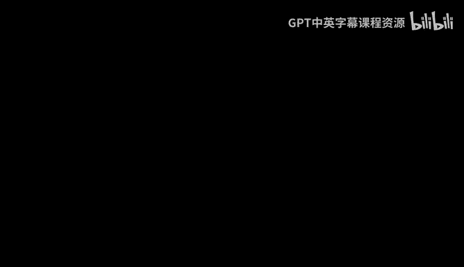
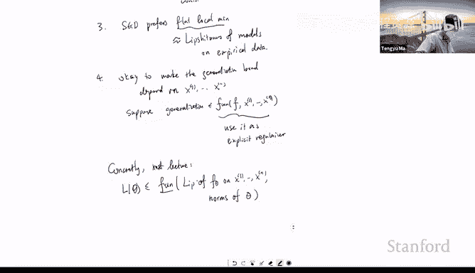
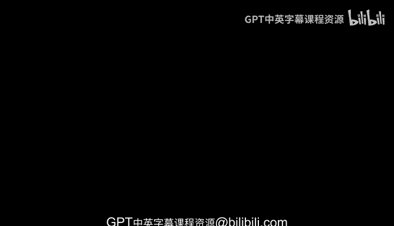

# 斯坦福大学《机器学习理论｜CS229M Machine Learning Theory - Fall 2021》中英字幕 - P10：-10-10_ Generalization bounds for deep nets.zh_en - GPT中英字幕课程资源 - BV1jT421r71m

Yeah。

So last time we have talk about covering number。 So covering number is upper bound for the rather marginal complexity。

And then our goal is to bond cover numbers， because this is a new tool for bonding the rather market complexity。

And we have discussed what are the bounds for linear models。 I didn't show any pop proofs。

 but there are some existing bonds， which are 20 years old。 actually。 And we also talk about eipus。

Lptus composition lemma for copy numbers， which is。Much easier than the。

 the corresponding level of a radar mark complexity。 So basically。

 if you know a function class has good covering number bonds。

 and then you compose it with a lipsious function， then you still have a reasonable covering number bounces。

So， so that's the the genuine idea。 And then。Today， we're going to talk about deep neural networks。

And we are going to use some of these tools because you can see that a deep nice is actually composed of multiple linear models with。

 you know， some of the lips functions， right activations。So， so this is the。The goal of this lecture。

 So let me set up the。Actually， sorry， let me give me one moment。

 I think I probably have to change a mask， because。I'm always having the fog。

I don't know what happens with this mask。Let's change one。

Maybe there's some efficiency with the mask。O， let's continue so。So we have a new network。

 So the setup is that we have some new network that's called H theta。 Theta is the。

It's used to denote the set of parameters and。And we have all layers。 So the network looks like this。

 So the last layer， we don't have any activation。 and then。

You have some activation in the next layer， you get -1。Some practice。So basically， you。

 if you do the。Ordering of the meta formula。 So you first multily x with W 1。

 and then you pass through a non linearity， and then you multily W 2。

 and you do this so and so forth。 until you have our layers。This is the right verb。

 so there are R layers。And W， I are the weights。And the kind of the bond that we're going to talk about is that so。

 so here is the theorem。So assume。啊X I。Two norm is less than。C。😊。

And consider a family of networks with a H data with some norm control。Of the， the weights。

 So we control the operator norm of the weights to be car。合发爱。And we control。

The2 to one norm of W I transse。To be BI。And then suppose to control your complex function class like this。

 then the rather macro complexity。Will be less than。Up to constant factor。C over square n。times。

The product of copper I。Times。The sum of。This is a complex formula。 Let me explain it in a moment。

IPhone 1 to R 3 over 2。So， and。Or alternatively， you know。As a corollary。

I guess this is not necessarily that formal because you have to talk about。

 you know what exactly this is。 you have to have some failure probabil。But， you know。

 roughly speaking， you are saying that generalization error is less than。偶跳的。1 over the margin。

Times always squared in。Times this time C。Times the product。Of the operator norm。timester啊。

It's quiet。I here， I'm using the。Sometimestime the norm。Just a little bit。Okay， anyway， so， so。

 so basically the important thing here is that the complexity measure depends on few things。

 One thing is that operator the norm。Of the。Of the weight matrix。

 And it depends on operating norm as a product。 So the complexity in the complexity term it shows the product of the operating norm of all the weights。

Show up in the complexity。 And also， there's this term。

 which basically you can think of this as a polynomial in cap I and B， I。 So this， you can。

 in some sense， think of this as a polynomial。Of K I and B I， which is not really important right。

 So as long as polynomial for for us， you know， it's not that important because the。

 the product of the operation of probably will be the dominating term and the the。

 the polynomial in B， I and the K I probably are somewhat kind of like。Anyway relatively small。 So。

 so， so， so we don't necessarily have to care about exactly what this2 to third2 third means。

 Actually， they don't have any special meaning。 It's really just something that comes out of the proof。

 But as long as they there are polynomous， we are relatively happy with it。😊，And so so basically。

 this is the important term。And this term， if you look at the bond。

 it comes from the luciousness of the model。 So， so copper I is the bound on the luciousness of a single layer。

 and the product of copper I is the bound on the luness of the product of all layers。So， so， so， so。

 so， so， so， so without， you know， any details， I think the this term， you know。

 you can imagine this comes from some lipses composition， some use of lipsious composition， Lemo。😊，我。

What about the act in the。もル？This， this is assumption， sorry。是我们他会了。This is I。

Or you assume it's true for every eye。I think this can be relaxed a little， but again。

 it's not very important。 So you can maybe relax it to be the average of Xi is less than C。

 It's not super important。Where is the operator Oh， right。 So that's a， yeah， sorry。

 So the operator norm is the。I guess maybe I didn't。 So this is the also the spectrum norm。

 Also the largest， the single so。This is the spectrum norm。All the largest。Startest singular value。

If any of this makes sense to you and if and also the formal definition is just that。The max over x。

嗯。不어。So so。I guess I call it operating now just because this is the。You。

 if you think about W as operator， then this is saying that how does this operator change your norm。

 right， So if you give it a two norm vector， then how does it change the norm， yeah。So。Cool， so， and。

 and you can kind of see that this is kind of like a about eiousness。 This is also。

 maybe I should expand this a little bit。😊，So this is also about the luciousness。Of this。

 the linear model W X， right， Because if you care about ellness， you know what you have to verify。

 you have to verify that W X minus W Y。It's less than some constant times X minus y。

And what that constant should be， right， So if you prove inequality， then you're gonna get。

The operator norm。A spectral norm of W there。 So that's why this is the correspond to the lipsness of a linearium model。

Any other questions？Okay， cool。 So by the way， I have。

 I haven't got any questions from Zoom for a long time。 So you。

 you should feel free to ask questions， just。😊，You don't have to but。 Of course。

 feel free to unmute yourself and。Okay， so how do we prove this， so。So the fundamental idea， yeah。

 So in the next 30 minutes， we're gonna talk about this proof。 The。

 the fundamental idea is that you somewhat cannot cover your function set iteratively。

So cover this set of functions。 I've iteratively。And iteratively means you you cover more and more layers。

拐咗嚟。And， and， and how do you do this itatively， You have to use the lipsiousness。

And sometimes the luptious composition La that we have discussed。And also， you want to also control。

And also， controlling。How the error propagates。Alright， so that's that's a high level summary。

 iss kind of abstract。 But let me， let me dive dive into the details。 So for simplicity， let's。

 let's can also let's try to abstractify。Justify each layer of F。F I F I。 So， so basically。

 F I corresponds to。A linear multiplication， a matrix multi plus an activation layer。Right。

 so this is a one layer。 And then you can write F。 Then you can consider F as。

This composition of FR with FR -1。So on and so forth。 So basically， for every layer。

 you have 1 certain choices， you can choose your weight matrix。

 and then you compose all of this function class By this composition。

 I guess we have used this notation multiple times。

 This is really just means that you are looking at。😊，FR composed with FR S1。Composed with F1。

 where each FI is from the family of capital F I。O。So。

So this abstraction will allow us to kind of have much cleaner notations。 But fundamentally。

 you can usually just think of each of the Fs as an as a layer。Right。So， and， and。

 and what we know is that， you know， so we know。So suppose， maybe I say。

So for the sake of kind of like preparation， so suppose。For every F in F I。

 F I in F little F I in capital F I。F I is copper eipes。This is actually the case for us because。

 you know， we restricted the。The spectral norm of or the operating norm of each of the W is to be less than K I。

 That means that every layer is K Ies。Alright， so， and the rh is one lipsses。

 So even you compose with activation is's still a car ees。 So suppose， you know。

 each of these functions is car eipses。 Then you know that， you know。F I X。These。

 these are just some preparations。So two norm is less than copper I。X minus y2 norm。

And maybe that's just for simplicity。Suppose。F I 0 is equals to 0。 This is also the case， you know。

 in the， in the real case we care about where you have like a new network。 So， and。

 and also that's suppose that X I。It's less than C。 This is also our assumption。

 So then with all of this， then you know that we know a bunch of like basic things。 So， for example。

 we know that you can。You can bond。What's this。What's the materialier application of on X I。

 What's the normal。What's the bound on the norm here。

 So the bound on the norm is can be bounded by each time you may at most capture a Ka I factor。

 So you get Ka I times K M S1。Times Co M2， so and so forth， times K 1 times C。So。So we call this。C i。

Unless the fund this should be equals to C I。So basically this is some。

 basically kind of like a preparation。 So， under this abstraction， you know。

 some bond on each of the layer。 and you know each of the layer islipes。And。

What we're going to do is that we are going to do two things， so。For two steps。So first， you control。

The covering number of each layer。好，一起 layer。And second。You have a combination来吗？ combine。

You compose this， you know， like combine them。Together。那个。So like。

 you have a lima that turns the the each layer， right， So you turn each of the layers。

 So you have a lima that turns single layer cover your numberboard。To multi layer。冇题。So。嗯。

And I think number two is the number one is kind of easy because for number one。

 this is just a linear model composed with them。Lpsious activation， right， one lipsious activation。

 you can just invoke on the what we have discussed last time， right， so。

 so basically the important thing is that how do you turn a single layer carbon number bound into multiple layer carbon number bound。

 That's basically the main thing I'm gonna discuss。 So let's call this， there's a lemma。 does this。

 So， so。Under the something。Seett up。Abo。And the， the kind of like the。The。

 the relatively abstract set up above。 So assume that。Suppose to assume。For every an input。With。😔。

out2 norm。Les than C M1。So these inputs are used to define the。Used to。Define。PN， right。

 the all L and and LP N and the metric L2 P N。 So this is the， the。

 the inputs where for which you are evaluating your covering number。 right。

 So if you to define covering number， you have to define the metric。

 define which empirical inputs you are evaluating on， right。

 So I'm assuming that for every inputs of this norm constraint， you have a covering number。

You have a covering number， wantt。So you know that。Havep some eye。If I。L2PN。

It's less than some function。Of this N C M one。Some function of the norm and some function of the target radius。

So this is just assumption。 this is assuming so basically this is assuming that you have a single layer bound。

Single layer榜先。So suppose you have a single layer covering number bond like of this form。

 And you do have this bond。 It just， I didn't give you the exact formula。 right。

 So if you instantiate on a linear model， you are gonna get something like this this will be something like。

C I-1 square over Epson square， right， the norm of the input square over Epson square， right。

 So that would be what happens when you have linear models。

But suppose you have the single layer cover number bound then。

The conclusion is that you can turn this into a multi layerer carbon number bond。

And the form of this translation is not very clean， but it's like this。So there exist Eon cover。Of。

F R composed。Up to F1。嗯。For Epson is equals to。The following thing。我不。Sure。

 one more have we finished。on right。the corner。So can you see again？InSure whats that simple。

 so so I'm I'm， I'm assuming a generic thing here。 but actually you can。That for the abstraction。

Like， you know， when you really use it for linear models。

 it's gonna be something like CM M S1 square over Epssonized square。😊，So， right so。This is G。

And then such so so there is exist appspson cover such that with this size， such that。The log size。

Its bound by the log side of this cover is bound by。Some of。G of Epson I， C M as well。

An I from one to。So， so basically， if you have a low covering number bound of this form for every layer。

 then you can have a low covering number bounds for this， for this thing。And the bonds just the。

 the low cover number just add up。In your song。 But the tricky thing is that it's not like a。The。

 the， the cover size also grows。 So the cover size also can add up in some way。

 which is a little bit kind of like complicated。So basically。

 your cover size is kind of like multiply It it kind of added in some way where you also multiply some of this kind of like curve。

Carass， which areipciousness in some sense。 And your cover cover number is also added in some way。

So this is the fundamental mechanism for us to turn a single layer bound to multiple layer bound。

 Of course， wem I'm gonna to use this in some way at the end so that we get the final result because you have to choose what epson I are。

 right， So eventually what you do is that you are gonna choose Epson I so that you get the desired target radius and you。

 you work out what exactly this formula should be when for that particular choice of Epson I。😊。

Does that make sense So far。 All。 So， but before doing that， I'm going to first prove thisma。

 and then I'm going to do the deris， right， So after you have this， this is the the core， right。

 after that， this is just a choose parameter。 So you just choose aize in some way that is in favor of you and and and work out What is the final block。

O。So。And in sometimes， the interpretation of thislemma is that， you know。

 you somehow you can add up the the covering number bound， the low covering number bound in this way。

As long as you pay some additional radius。Like home。Okay， so this proof is， in some sense， you know。

 in one。In some sense， it's actually pretty simple， but， but the exposition， you know， requires some。

 some challenge。 it's a little bit challenging。So， so the fundamental idea is the following。So。

 so we start with this data point。 We start with this。Congratnation of ended points。

 right So you have ended points。And you map this ended data points to。A set of points， right。

 This is the queue that we talk about。I mean， I think I need to draw this in a good way so that。

So that I I have more space。 So let's start with。You start with n points。

 and you map these n points into a vector of dimension N。Or maybe actually。

 it's a matrix of dimension。 so。So you map this to。Some space。 And each of this point here。

Is the concatenation of X， F， X 1。Up to Fx。And this is the so called Q。

 the set of Q right that we have to cover。Right， so and you can have use multiple functions app。

 right you can use app。Any function F1 in F1， right to map to a different point。

If you choose different F1s， you want to map different points。And if you just have one layer。

 what you're gonna do is that you're gonna cover this set Q。 right。

 That's what we do for covering number for one function， for one family functions， F1。Right， so。

Right， so， so then what you do is that you like， I'm just basically reviewing what we have done for cognitive numbers for one family functions。

 you， you， you create this kind of like。Bows， right， So that covers it。So， basically， you create。

Like the centers。And these are points that are in sea。Right， maybe let's call it C1。 So let's create。

 let's say C1。Is Epson 1 cover。哦。F one。This is what it means。Right， so， and。

 and now we are going to see， how do we turn this into a cover for F1 composed with F2。So that's。

 that's kind of the job we are trying to do。 And， and what's really going on here is that， you know。

 for every point here。In， in this， in this in， in the output space of right， So this is a。

 maybe let's call this Q1， which is the。The output space of。Maybe let's call this thing， capital X。

So then。Q1 is the family of outputs。We are。The function has to be chosen from F。Right， so。

 and what's the， what's the compose， So how about， you know， if you have have to another layer。

 So what happens is that for every point in Q， Q 1， you can apply multiple different functions。

 right。For any functions， little F 2 in capital F 2。

 you can apply it to map to a new point in the in the new space， right， to to map it to a new point。

 So you get a for every point here， you get a bunch of possible possible outputs。

 And for every point here， you get another bunch of possible outputs。

So each of this new point could be your image after applying two layers。Right。

 so so now we are trying to apply， we trying to cover this new set of fun of outputs like Q2。

 let's say。 And how do， how do we cover it。 So the approach that we are gonna take is somewhat kind of like a。

嗯。In some sense， you know， pretty brute force。 What you do is you say you want to leverage the existing power for capital F1 in some way。

 So what you do is you say you look at a center here in C 1。 and you look at what other image。

Of this point。In the in the queue， in the in the after applying a second year。

 So you get something like this。RightSo this is the side of the image。all the output。

Or like of this point。 So maybe let's say， suppose。This point is called。F1 x。Which is in C1。

 that's call this F1 primeax， which is in C1。And then you look at all the outputs。

From iPhone prime Max。 So you get this。Famial points。Where you apply F2。On F1 prime X。

And where F2 can be chosen arbitrarily from F2。Okay， so， and now what we do is that we cover。

This set。By a new Eson cover。 So what you do is you say。I'm going to cover this。With a。

 with a bunch of things。And what does that mean that really means that you choose a subset of capital F2。

And， and， and cover， because here you are ranging over all possible functions in F 2， right。

 So you gonna to choose a cover for it， you just say I'm going to drop some of them。

 I choose a subset a distization of capital of capital F2。So that's basically the approach。And。

And you， you do this。 and you， and then you do this for every possible points in C 1。And cover them。

 So basically suppose you have another points in C1。Here， and then you look at all of like。

It's image， and you do another set of cover。And you do this for every possible points in C 1 and every possible points in C 1 have induce a set。

 and that set can induce a cover。 And then you take the union of all of these right boss into。And。

 and that the union of all of his red ball becomes a cover for the， for the Q2。 for example。

 suppose you have。你是。After1 prime prime X here。Right， then。Maybe I should use a consistent color。

This see you have。I have one prime prime max， and this is mapped to the set of points。Here。

 this is the site of all F2， F1 prime prime X。Where F2 is in capital F2。

 and then you create a cover for this set。So that you can distize F2 again。

And then you take the union of all of this right cover。Of the right box as you cover for Q2。So。

So any questions so far。So formally， what we should do is the following， so。嗯。

So Epson 1 and Epson R are the。The radius。啊。On each layer。These are just pre and which are T。

 you choose this。 you know， I guess in this la， they are not T， They are just already given to you。

Eventually， you'll choose something choose some numbers for them。And then what you do is that。C。

 C 1 is the Epson cover。Epson 1 cover。Of F1， That's easy。And then you say that， for every。

I one prime in C1。Construct。This C2， a cover。In the second space。But this cover depends on FM prime。

So to cover to Epson 2 cover。The site。F2 composed with F1 prime。Which is define。

 which is what I I wrote above right this is F2， F1， capital x。啊。Of two is ranging。In capital of2。

Right， so for every set like this， right， this set is this。😊。

This set is really literally these blue things I drew here， like this blue set。

And I I I choose a cover I and denote that cover to be C2 common F M prime because this cover depends on F F M prime。

And then I'm going to take the union。So， I'm going to。Let's see， two。

To be the union of all of the C2 F M prime， where F M prime is in C 1。So this is how I do。

 how do I construct the cover for the second layer。So， so this is a， this is supposed to be a cover。

 supposed to be a。A cover full。Capital F 2 composed with capital F 1。Okay， any questions so far。So。

 so there are several questions， right， So one question is that， you know， what's the。

How good this cover is， right， That's one thing。 And the other thing is that how large this this cover is。

 So the size， the size of this cover is relatively easy to compute because you are basically just blowing off the the size multiply quickly。

😊，Because for every one in the Os in the C1， you， you create this cover， right。

 So you just multiply basically covering numbers together， in some sense。And that's easy because you。

 you can formulaly what you can do is that you can say C2 F M prime。

This is something the log of this is going to be bounded by。G of Epson1 C 2。So E 2 is C2。

But this is Epson 2， my。 This is Epson to C 1， I think， in my location。TheUpson to C1。你老师 what。

This is my assumption， because my assumption is that as long as you input is bound by C1 and your cover size is E 2。

 you have a this bound。Right， so， and also， so that means that。

The size of C 2 is bounded by the side of C 1 times this exponential of this G of Epson 2 C 1。

Because for every point in C1， you have。You have a bound for that particular that corresponding set。

 So then you just modify by C1。And that means the log of C 2 is less than the log。

Of C1 plus G of Epson 2 C1。Which is equals to G of。Epson1 C0 plus geo Epson 2 C1。I actually。

 I forgot to define C 0。 C0 just for convenience that define。明拜， so。Define C 0 to be just the C， the。

 the bound on the input。 C， So C C I are the bounds on the the， the the， the layers。

 the activation layers。And C0 is the bound on the inputs。Right， so。Okay。So， you know。

 so the so basic size is added up。 The log size is added up。That's easy。

 And we are going to deal with the covering。 How does the covering works like at the end。 So， so。

 so before doing the covering computing a covering radius， let's define。

How do you proceed with in more layers， So similarly。播基本。C K， suppose you have covered K layers。

 Then now you are constructing a cover for the K plus one layer。 So what do you do。You say that。 So。

 for any。FK。Prime， composed with。F K minus-1 prime。1 prime in C， K。哦。You construct。Some C plus one。

Which is a function。Of this F up to F1 prime。So， that。Epson K plus1 covers。The set F K plus 1。

 composed blue。FK prime。So I you like this。C， K， the final cover to be the union。Of。啊。

Of all of these kind of。6。And similarly， you can prove that the log of the C。

 K plus one will be less than the sum of all the single layer covers。 Epson K plus1。c k。

Plus up to G of eson 1 C 0。Alright， so， so I've shown you how to cover it。

 It's just the iterative cover that。Kind of pretty brute force in some sense。

 And now the question is why this is a good cover， right， Why， what's the radius。So basically。

 were we to answer the question， right， So， so for every。F R composed。Up to F1。

Which is belongs to this FR， this set。Right， this is the set we want to cover。

 So you pick a function in this set。 And you want to say that this can be represented by something in a cover。

 right， with some small distances。So how， why， how does that work？ So you first say that。You。

 you know， theres 6 S 1 prime in C 1， such that。Role of F1， F prime。This is less than E what。

 That's something you know， because C1 is a cover。Appom cover of the the capital F1。

 So now you have to say， let's say you try to pick something in C2 that can cover F 2 Comp with F1。

 How to do that， you basically， in some sense， use the。Use the construction， you say that。

Maybe I should。 I should。I should draw this a little bit more。Okay， so。

So the first thing is you suppose you have F。 you have a function here。 you have a point here。

 which is F1 of x。Right， so you cover it by this point。我操了就。😔，As you cover this by this point。

So now suppose you have a point in the second layer。 Suppose you have a point。Some here。

Which is the map。Which is computed from that F1 X， right you will apply some F2。To it。So。

 and what you do is you say that you first look at the the neighbors in the first layer。

 So you got this point。At this point， you， you look at。What's the neighboring。What's。

 what's the image of this point。In the second layer， or maybe something here。

So I guess here you're applying I guess let's assume you're applying F2 here， so you get F2 here。

 you use the same F2 on the on the on the cover and you get this point and then after you get this point。

You， you look at the the neighbors， the。In the right。See， you got this one。 So basically。

 this will be the cover。For the purple points。I'm not sure whether this makes sense。Sounds good。😊。

Okay， so in other word， in all formally。 So basically， you see that。So you。

 you want to say there exist function in this cover， right。In this C2 F1 prime。

So this is the this one。This one is。At the right point， I think。This is that right point。

So it discover such that。Such that。F 2 row of F 2， F1 prime is close to what is close to。This move。

 the blue point。 Whats the blue point。 The blue point is F 2。Composed with F1 prime。You know。

 this is less than Epson 2。Right， so。Yeah， I guess。

I guess maybe let's write this as F2 prime Comp with F prime prime so that just to make it looks kind of like。

You know that's my that's also what my cover is doing right So so suppose zero of F2 prime composed with F prime prime。

So your cover has this structure that you will first apply F one prime and then you cover。

 you use the F2 prime in the cover so。Suppose。So what saying。Okay， sorry， sorry， my my。So。

So you have this function in this cover。Such that。So。This is of the form， let's say F2。

I don't want to make this too complicated， but I think let's say this is of the form F2 prime composed with F1 prime。

Which is in this cover。 But this this one actually implicly depends on。depend on。F1 prime as well。

 But let's， let's ignore that to the notation。 So you get a row of F2 prime composed with F M prime。

 which is close to F2 composed with F1。 But this point is not what you really want to cover because you want to cover F 2 composed with F 1。

So what you care about is that row of F2 prime composed with F prime。

The difference between this and F2 composed with F1。 So this is the thing you really care about。

And you can see that there's still some some differences because the differences come from that。

This is F1 prime， but on F1。 So that's why you do a triangle inequality。 You say that the target。

It's lesson。Roll off。I have two prime。呃。Composed with F1 frame。So use this as the intermediate term。

Right， so this one is less than Epson 2。And you're left with this thing。

Where you only differ in the first layer。Right， that's the difference you can。

And but this difference is kind of like propagated， in some sense。If you look at this figure。

 this figure is a little kind of like trickyy。 So this is the difference in the first layer。

 But once you apply this， this F2， right So you have a bigger difference。

So this is the difference in the second layer。And this difference can be kind of like a blow up a little bit。

 because even though you apply the same function， you may blow up the differences a little bit。

So that's why you have to use the lipsiousness to say that this is just an Epon2 plus。卡跑。

Cuple two times Epson1。I maybe couple two times。R of F1 prime F1。 And this is the。

Less than Epson 2 plus cup two times Epson1。That's how you棒的。The， the covering。

 the radius for the second layer。Any questions？And you can similarly do all of this， you know。

 in the。嗯。For forK， which。So there exists a function， FK prime。Which depends on you know。

F1 prime up to FK。Ms one prime。In in this set C K， let's write this as FK prime composed with。Okay。

 minus-1 prime。Composed with am prime。And such that you know， this is a。Cover。

实 say the distance is less。Absson， he。That an uppson k。That's the definition of the cover。

 And then you have to kind of like。See why this is a。A good thing for the original one。

 where you call that this is not actually what you really care about。

 You care about the F K composed with F K minus 1 up， F 1。 You don't care about the prime。

 So you care about this。This is the thing that you really care about。You want to show this is small。

 and how to do this， You kind of like kind of expand this into multiple terms。

So you say that this is less than。So解 to。The first thing is your first comparer with。

This kind of telescoing sound is pretty actually useful in many cases。You first compare with this。

 and then you come compare。You just gradually pay off in more and more terms。This is no problem here。

And then， until。Finally， you got。Everything is kind of no prime basically。And eventually， you get。

What you care， there is no problem at all。So， so this is just triangle inequality。

 And now you bond each of this term， The first term， by definition is less than epsson K。

 and the second term。The second term， you see that these two are the same。

And this part is also the same。And only differences come from the the difference between this F K minus1 and FK。

 the F prime K and F F F prime K1 and F F K minus1。 So。

 so because of the cover that give you epom K minus1。

 and and then you also have to blow up a little bit because of the FK composed on top of it。

 So you also have to pay ell lipsness of FK， which is a cup up K。卡拍。K， sorry。

 my K and copper looks probably almost the same。嗯。So。

And then you have Eson K-2 times K K-1 times K K。So and so forth， until you have， you know。

In the last time， only the only difference come from the first one。

 So you you pay Epson  one because they are Epson cover。 F find prime is from the epson cover。

 and then you， you pay a lot of flipness like Ka K times K K minus-1。Up to couple 2。🎼So， and， and。

 and if you take K to be R， then you get the eventual thing， Right， So the。

 the eventual theorem is that。Your radius。For the final。Covering is something like。Where is it。Oops。

So the radius for the final covering is something like this。Right， so that's eventually what he got。

Any questions。想讲都就细。他们叫大。m going I every。For example。是我是。C1 which is called by C。收据。So that we don。好。

算。我 are you。one thanks。这是你块口经营的。我是道。我我还。Right。So I guess the question is that why。

Why you only have to， Why don't you only prove require this。This is because like no。Suppose。

 you know， suppose。Let me， let me try whether this works。

 Suppose your function class is like F1 composed with a fixed function。😊，maybe in it the other side。

 so。F 2 come F1 composed with a fixed function。 that's called F2。

 maybe composed with F 3 so and so forth。 F R。 and all of these are fixed。

Then you only have this term。But this， you also have to cover the the possibilities for。

 for the second layer and the third layer so and so forth。 That's why you have to pay the other。Okay。

 cool。 So now we are done with thislemma。 And now let's go back to the proof of the theorem。

And proof the theorem， as I kind of alluded before， is pretty much just the。Kind of annoying。

Teculation你 sum us。There's a way to do the calculation in a simpler way。

 but I'm going to first show you a zero knowledge proof。 So basically。

 I'm just going to tell you that I'm going to choose my appsson I to be this。 and。

 and it just works out。 And then I'm going to show you some， some way to kind of。😊，Like。

 at least what I would do with this。 You know， you know， if I read the paper。

 I'm gonna show you the first proof I'm gonna to show， which is just a just choosing some apps and Y。

 So if let， let's start with that。 So， so basically。🎼Everything is about choosing appsson I， right。

 So you first， okay， of course， you first know that this。😊，4 is equals to O tilde of C， M-1 square。

B I square over Epson I square。Because this is linear model。 This is linear model。Composed with。

One lipsis function。Right， so recall that each of the F I is a linear model composed with the one lipses function。

 a fixed onelipes function。 And， and for the linear model， the covering number。

 the log covering number is supposed to be something like the norm of the input。And this is the。

V I is。W I transpose 2 to one norm， right， so the。The norm of the parameter and divided by the the radius。

This is what we have shown the last time。 Like， we didn't improve this。

 but this is thelemma we had last time about the low covering number of the leaner models。Right， so。

 and we， so we， we're pluging this and then basically。呃呃。So basically， you have two quantities。

 right， So one is the logs carbon size。Which is the sum of。

Cm minus1 squared B squared over epsiloni squared。And also you have another thing which is the radius。

Which is some of。Absolutely， I'm writing with a some couple。I plus one up to couple R， from 1 to。2。

Right， so you basically have these two things that you want to trade it off。

You want to find the best dependencies between them。

 You want to make the log carbon sets to depend on the radius as as best as possible。

So you just choose some Abili。And so the so you care about the best kind of trade off or the dependencies。

So that's， this is Eson。 So， so what you should do is that you should say， I guess。

If I give you a zero knowledge proof， I'm going to choose。Choose。Ipon， I to the。C -1 square。B。

 I square。Over copper I plus1 up to Co R。A third。Times up soon。三漠 b i。To third over。Cole I 2，3。

Product of copper I 23。Right。See that choose absolutelyps to be this。Then， Ill claim that。

Some of Epsil I Co I plus one up to K R。 This will be indeed equals to epsilon。

And why is that I'm going to do the this tedious derivation for you。

 but you know I don't feel like you should really need to verify it on the fly or you don't necessarily have to verify later。

 but just for the sake of completeness， let me do the calculation。This will be。ho， this is a。

You're just plugging Eon I here。 So you get。I think C M-1，2， third， BI 2 third。

 this come from these two terms。And then， there's some。Think about this。 and this。And also。

 this thing， where so you can organize those things into， Oh， I guess I'm only。

I guess I'm treating this as a constant for the moment。In this distribution。

 So I got this multiply with this。 We got two third。Cop I，2 third。Anyway。

 if if you don't want to verify this， just maybe。B with me， for seconds。I搜。😔，I'm sorry。伦登。

Ex one thing is that C I is also function of K I because we recall that C I is a norm bond。

For the layers， which depends on car I。On question different。对。The eye here。我俾啲文。

This is the same eye。Oh sorry。 you， you probably， Yes， youre， you're right。

 You probably should use a different index just for the sake of， yes。So， so if you want to。

I think you you you might right， this is probably。Okay， right， you know what I mean。

 But I ideal probably use a J just for the for the sake of。嗯。Compness。 So， yeah， but。But。

 but this one will， you， you will average out this part。 like the the after doing the sum product。

 I is gone in the in the second part。So。Anyway， so let me。Do this tedious thing。

 So we call that C is the norm bound for So and C I is defined to be。

 I think C I is defined to be some product of cup cup ice。 And so we got。

I guess let's put B I in the front。 and you get C I is couple 1 to third up to。M1，2， third。

 This is this corresponds to。C -1。And you've got a couple i plus 2，1，2， third that's from here。

This is cup plus  one， I plus  one， sorry。安定。You still multily the system thing here。It this isn。

And then you simplify this。To。The first sum to。I guess you can see that the only missing term is a copper I。

 So this is equals to B I to third over copper I to third。

Times product of copper I to third and from1 to R。And tabs this thing。

And now let's deal with this thing。 you can see that this one consoles with。

This one cancels with this one and this one cancels with this one。

 so you got really equals to Eppsil。And the lock covering size。It's equals to。嗯。

What is equals to the sum of the。嗯。What I'm doing here is equals to this。Basically， the sum of。Okay。

 let's first write tri thing This is CM minus1 square B square over Epson I square and you're plugging eson I here so you got。

This gigantic thing， maybe let's call this thing Z。So you got one over Z square。

Times this one sum of C M1 square B I square。 You plug in this。So the -2。 So you get。啊。C M1 square。

 B M S1 square。minus。😔，2 third。AndCo I plus one up to copper I。2，3。And there's some cancellations。So。

 this will be。Because to。Think some of。行。😔，Me sir， are you I think this。会。

I think I I I jump a step in my nose。 So I okay， I Ill I， I need to。 So sorry。

I think you you you you you you plug in the definition of CM M1。

 then you get B I2 third over Co I2 third。Times a product。Of copper I。To third。

 and now use the definition of Z， which is this gigantic constant。And eventually， I think you get。

Let me now do that。That carefully。 But eventually， you'll get this。Over Epson square。 Okay。

 so I guess maybe this is a good demonstration of why I shouldn't do this。 right。

 like like even after I， even I verify this with my notes。

 which has almost all the steps is kind of tricky。 So， so， but anyway。

 so before talking about how to do this better。 I guess let's first agree that this， this is done。

 right because now you you say the log covering size is bounded by this Epson square。

 Something over Eson square。 And that's what we wanted to have。

 And then you apply the rather mark complex， App the rather mark complexity。😊，The the the the。

 the the tool from cover number。Through Ra mark complexity。

 recall that if you have log covering number。It's R to R over up square。

 then this means rather macro complexity is something like squared R over n。Right。

 so so this is what we discussed last time。 and if you apply this small tool。

 then you get the the radarar complexity will be this one。

squarequa root of this one and and overcorro rooted。 and then you are done。Okay， so。Okay， so。

 so we are done。 But I think I want to kind of share how to do this a little more easily without going through all of this pen。

 This is a small chick。 It's purely mathematical trick。 I I don't know how many of you know it。

 Maybe， maybe you all know it or maybe you all don't know it。 But anyway， let let's。

 let's talk about it。 So basically， the question is， you care about。😊，Right， this is the question。

 You cover the the trade off between these two。So。And you care about the trade off between these two and。

So what you could do is that if you abstractstructify this， it's kind of like。So abstract speaking。

This is about the trade off between something like AIs。 Maybe let's use some different numbers，阿发 i。

Square。Over Eson I。Square versus sum of。Beta i， absolutely， something like this。

Right that's kind of the the game you are， you are dealing with。 And how do you do the trade off。

 I think。So what you do is that you。I used this song。So called hold in theequality。

The whole in theequality is that you know， there are multiple ways to write it。 For example。

 you can write a in a product with B。It's less than the P norm of A times the Q normal of B， when P。

And queuea discuss this。Right， so， and。呃，发 example文批。And。Or you call ready like this。

 The sum of AI BI is less than。Some of AI to the power P。To the one。This， something like this。

This is just the exactly the same， same thing。 And guys when P 2。

 this is the culture shorts in inequality。 And we need something slightly different。 We need peace。3。

 where Q is 3 over 2。Then you got some of AI cube。A third time some of B I。2， third。

It's lower than some of AI， BI。 So in some sense， you know。

 all of these inner is trying to kind of deal with。Has this kind form？And。

I guess maybe what should I， which one should I do first？嗯。Like， I'm not sure whether I'm， I。

 I'm losting you。 So like， I guess what eventually I want to do is the following。

 Maybe let me just give you an overview。 I eventually I want to do is just that I want to do this。

And going said that this。Product with the sum of beta I X and Y。 This is larger than。

Some of of eye better eye。To the two third。And3，2。So if you， if you're able to do this。

 then you kind of like cancel out。So maybe， sorry， maybe let me do this。First。

 so we care about some of F I square eons I square versus some of beta I。Abspsilonone。

 and this is your apsilon。And this is our covering says， the covering。And what you want。

 what you can do is that you can say this。Time islessness。Squire。Just forget about this。

Let me do it formally。Is there's inequality that shows that this is rather than。

Some of alpha i beta i。The2， third over 3，2。 And this is essentially a hold inequality。 Let let me。

 let me justify this in a moment。 But suppose you believe in me in this。 Then you say that and。

 I suppose you also believe that this is aable the suppose。You believe that equality is achievable。

Which I will justify in a moment。So if e is achievable。It means that they exist eson I。Such that。

S of F I square epson square square is equals to this quantity。

32 over sum of beta I Epsson I squared。And recall call that this。Is your Epson square。

 and this is your log hover number。Then you get log cover number。

 can so then you get that you can choose。Epon I such that the log coming number is less than this。

 which is equals to this quantity of Eson square。And this quantity is on what you are looking for。

Right， this is the R thing that you are looking for， which is the。さなくです。

And and you don't have to do any of this verification， right， That's it。 And basically。

 you just have to plug in alpha and beta I and you just verify， and that's it。So。Does it make sense。

So so basically you cancel all the apps on I。 You know。

 you you try to find the best apps on I by proving the best inequality you want。

 And you also want the inequality to be achievable。So。So， so for example， another。

 another situation that this is useful is， for example， you probably have seen this kind of bond。

 Like you， you have a parameter Eta， you have Eta plus B over Eta， you bond something like this。

And you can choose your E arbitrary。A arbitraryrbitarily， so how do you do it， You know。

 many people tell you that you you just find out the minimum E by doing some kind of like a。

Ting gradient very so。 And， and you find out the minimum E。 right， that's， that's fine。 But so。

 but my way to do it is that I just prove that E plus beta E， this is larger than two times square B。

😊，This is cautious or like a A M G and whatever you call it。 And then this inequality is achievable。

 But you can attend the equality so that， you know。

 basically the best thing for this is two square B。Basically， basically， if。

 if you know this is equality， inequality is。嗯。Is iss attainable。

 Then you know that you can choose the exist Eta such that Eta plus B over Eta is2 square B。

 And then you get rid of the Eta。 You get the best bond you want。So the same thing。

It's the same logic here as well。 you prove inequality so that you can cancel out the parameter that you want to choose。

 And then， you know， and if that equality， that in quality can be attained as an equality。

 then you know that you are getting the best parameter。 And you don't。

 you don't even necessarily have to compute with F I。Or， you know， of course。

 in the in the written paper， probably you still want to。

Complete appsson I and do the zero knowledge proof。 right。

 That's why all the papers show you show you the discount things。 right， So because， you know。

 so how do I。Like， I have to do a lot more argument， right， to show that this， But， but in your mind。

 you probably should do the list later version， this later。It's later version， you know。

 at least this is what I did in my mind when I do any research like this。

 right because this is so fast so so that you can get a。😊，Get the estimate on what the。

 what's the bond we can have， right， so。And in some， this is useful。😊，In many cases，'s because。

 you know， one of the way to make your theoretical research。

Faster is that you have a lot of modularized small steps， which you can do very， very fast。Right。

 so so one of the way I found that people can get into this。Very messy calculation is that this。

 you know， every theory， you know， if you prove something hard， right。

 So you have to use a lot of pages， right， So you you you like your eventual product is that something like 20 pages proof or maybe more than that。

 Sometimes there are 70 pages proof or like 100 pages， right， So so。At least I， I。

 I think at least when I do those kind of like proofs。 I never really。Kind of like。

 if I change one part of it。I never have to do redo that 100 pages calculation to know what's the final outcome。

 So， so basically， after a certain point， I already know that， you know， this part。

 maybe these two pages are the most important thing。 I also know that how does this page。

Translate to the final outcome。 And I've already done those kind of like very fast。

 I have a kind of like very fast data structure so that I know that if these two。If。

 if this part can be improved by a factor of two， then what does that mean for my final outcome And。

 and， and that part is kind of like already。Abstract enough so that you have this very fast conversion and then you can iterate very fast。

😊，So， so， and， and and。诶 the。The， the flip side is， you know the。Like the。

 this is opposed to another model， which is that you， you change your proof in some part。

 you have to agreedo all the other parts。 And so so that would be much slower。 So。

 so this is one of this kind of this kind of tricks that I， I realize that So。

 so if you can do something small， like this kind of abstract things very fast and you can iterate faster in your。

 in your research。 anyway， so。😊，So， so far， it makes sense。 And。

 and if you really care about why this inequality is true， why this inequality is true。

 I think I was trying to justify why it's true because it you can just use how inequality。

 I guess if you apply the hold inequality， you get something like this。

 And this is still not exactly like this。 I think so， oh actually， this is exactly like this， right。

 because you have to choose。You can choose your AI to be。You just say。A I cube maps to this。 and B。

 I。You I have students this If you just want to verify， right， you just have to change it。Right， so。

 but again， you know， if you have to verify this you by matching it is still too slow to me。

 So what I do is that I also memorize other different versions of this ho inequality so I can do it faster。

 I think the version I memorize in my mind is that at least one version of the ho inequality in my mind that I memorize is this。

😊，Which is。Something like。Some of you are square。Times 1 third。ha the sum of V i。2， third。

It's rather than some U。V， I 2， third。Something like this， which is even closer to here。

 right because。In some sense， in some， the way you to memorize is that if you have a bigger component exponent here。

 too， then this two will go to the VI。How do I say this is the basic you put the。

So like so why this is Ui to the powers 2，3， right So why this is Ui to the 2，3。

 This is because here is you have a square and then you have a one third outside。

 And the reason why here you have V to the power23 is because inside you have V the linear term and then outside you have the two third。

 So so if you know that then you know that if you have a square here。

 then you can cancel this epssoni because Epson I will be squared and here you have epsili square So they can cancel each other。

 I'm not sure why this make any sense。 Like it takes some probably some practice if you see this enough times you know what in。

嗯。Anyway， I guess I probably should wrap up this discussion。Any questions？Okay， I think。C。10 minutes。

Okay， so I guess I will use the next 10 minutes to motivate what what I'm gonna to discuss next。对。错。

This inequality， because the equality can be achieved。 So that's why， you know， it's the best choice。

 Oh， you mean a final one。 Okay， yeah， maybe let me discuss that。

 Ill answer that in in the next 1 minutes。Right， okay， so， so basically now next。

 we're gonna to do something more。嗯。Better than this。So and actually。

 it turns out a proof is actually pin to some extent。Because it， in some。

 because it's capturing the right quality， so。So next， we're going to have generalization bonds。That。

啊。Depend on the。Absolutely。Loptciousness。And I'm gonna argue that the lipsness we had before was only a upper bound。

 right before we have this。But before we have this， right， so。Before we have。

It's spun where you have。Essentially， dominant term times other terms。

Which is just polynomial in the。In the norm。Which is not very important。 And this one。

 this is only an upper bound。On the luciousness。Right， it's the pretty worst case upper bound。

Because， you know， you have to， if you really want your network to be。To achieve this leiousness。

 you have to actually like a。Kind of construct something that is kind of like somewhat kind of like special。

And and even this is achievable， right， this worst case upper one can be achievable in certain cases。

 Still， you want to。😊，🎼Find out the network， which is， you know。

 probably better in than this empirically。 So， so， so I， so。

 so that's why we are gonna kind of have replace。 So basically the kind of the high level goal is they want to replace this product of the spectrum norm by something that is more。

More accurate。And there are many several many motivations to do this。

 So I guess one thing is that and this this relates to the the limitation of this bond。

 So one thing is that。😊，This W， I opera norm has to be。Larer than one。

 or even you can arguably say this is even larger than square 2 to make sure。F x。Is not too small。

And why this is the case， This is because if you look at every layer， let's say H is the ice layer。

define H I layer。能。HI plus  one， the true normal of it。Is the true norm。Of you know， this。

You apply this lesson。 And if you do a heuristic， you say that， you know， suppose you believe。

That this activation is value activation。Kels half of the corners， I see。Right。

 so so it is zero out half of the coordinates。 suppose you have that kind of like。

 then it means that after value， your norm will reduce by one over square two because you kill half of the cors。

So。Of course， this is a very heuristic。 This is just a belief， right， like a， you know， assumption。

 And suppose this is the case。 And then you say that this is less than our score two times the opposite norm of。

😊，WI times H2 norm。So then you can see that each time you can only grow。

Your norm of H by this factor。So if W I operate norm is less than square2。

 then you are shrinking a norm over layers。So your normal of every layer will become smaller and smaller。

 and eventually， they will converse to 0。 So your output will be very small。

So that's why you have to make sure that the upper norm of WI to be somewhat big。

 it cannot be like too small。 you know， in the most opt case， you know。

 I think you want the opt norm to be larger than one。 But in， in its kind of more typical case。

 you need it even to be larger than square2。So in any case， right， So， so this means that。

Since since sometimes this means that you know。This， the， the， the product will be， will be big。嗯。So。

 and， and another thing is that。So motivation2， I think this is something I mentioned right。

 so this is only a worst case upper bound is very worst case。Of the lipses。And in practice， you know。

 so the theness， the lipsness on the data points。The lipsciousness。On the data point。

X1 and ups to X N。Might be better。All the lipsness on the。

The population distribution or maybe on the data points， or maybe on the。

Or on X from P from the population distribution could be better。

Right so and this bond doesn't capture that。And another thing is that。It turns out that we。

 we'll discuss this you know， in the later lectures。 So it turns out that SGD prefers。flight lo in。

This is something we widely believed and in certain cases， we can prove this and flat local mean。😊。

It's roughly speaking， we we'll show this。 you know， we'll justify this in later lectures。

 but roughly speaking， this is。Like the lipsness。Of the models。On the empirical data。

So you can see that this is not a luiousness。 The worst case luiousness on all data points is the luiousness on the empirical data。

 So which。😊，Further justifies I probably want to have a bond that depends on the luciousness on the empirical data。

 but not the luptciousness in the worst case。So， and。And， and in。

 and also another thing is that another remark is that it's okay to。

 to have a generation bond that depends on the empirical data。So， O。To make the generation bond。

Ded on empirical data on。X 1 after action。Because and in some sense， this is actually， you know。Nice。

 because suppose。A generalization。It's less than some function。哦。The classifier and X1 up to X N。

This is still useful because you can still use this。Use it as an explicit regulator。

So there's no problem that your transition bond can。

there is no problem for a generalization bond to depend on empirical data。

 You probably don't want a generation bond to depend on。The population data。

 because you don't know how to recognize it anymore。 But if it depends on empirical data， it's fine。

So， so， so basically concretely。In the next lecture， I guess we'll approve that。Next lecture。

Will prove that the generalization error， the or the test error。

 the L of theta is less than some function。Of the lipsness。Of， of datata。On x1 up to X N。

And then the norms。Of theta。 and this function is a polynomial function。

 which doesn't have anything exponential in it。Okay， I guess I， I will stop here。 Any questions。

And interesting， the proof for the next lecture is actually easier than today。

 I hope I I don't know how how do you think about the proof today，You it's pretty bruteful。

 so in that sense， it's actually not very hard， but it's pretty messy。

Okay， I guess I will see you next week。

