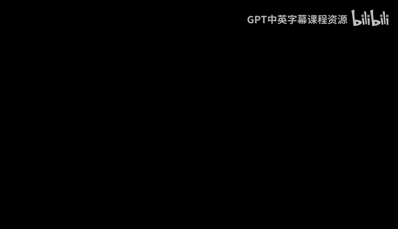

# 斯坦福大学《机器学习理论｜CS229M Machine Learning Theory - Fall 2021》中英字幕 - P11：-11-11_ All-layer margin.zh_en - GPT中英字幕课程资源 - BV1jT421r71m

So last time we talk about the generalization bond and today we are going to talk about some better gization bond for deep networks。

So recall that last time what we did was that we show something like the radar micro complexity。

It's bounded by something like this。Time some polynomial。Of the norm。Of the the weights。维收。

And we said that this come from kind of a worst case for the luciousness of the。Of the model。嗯。

Of the model。 So， and， and actually， this is the worst case。 Le justness with to input。

Over the entire worst case over the entire input space。

And this is because when we do the coupling number， we have to use this lipsious decomposition。

 this lipspttuscomposition Lama， and there you have to use you have to use the lipsusness for the entire set。

Sorry this is a little bit distracting in the life just because I'm sharing the screen using my laptop。

So that I can charge my iPad。Okay， so， and we have discussed a few motivations for us to improve upon this theorem。

 right， So I guess we discussed four of them。 And one of them。

 I guess I will just briefly mention them in words。 One of them is that， you know。

 this bond is exponential。嗯。Exponential in depth。Which is bad because typically you have a lot of players。

 And another thing is that， you know， this is worth his lipsiousness。

 And one another thing is that typically you want to have something like。嗯。SGD prefers。Lis models。

That's good。 But it， this is lipsus models， you know， and whereipus is on the。Empriical data。

Because if you think about an algorithm and an algorithm can only do something on the empirical data。

 right， So you know so well， we'll show this more like later in the course。

 but even you think about it right， So like on the on the high level right。

 So the algorithm can only prefer something about the empirical data， but not about the entire space。

Right， and， and and also we said that for tier bound。

 we are gonna to have something of data dependent， right。

 something that depends on the lipsness on the empirical data。 So concretely。

 I guess today we're going to do is that we are going to show something like this。

 The generalization of parameter theta is a function。Of luptciousness。Of F theta。On。

empirical data X1 up to X N。And also， the norm。Of data。 and its function is a polynomial。

So that there's no one need。Exponial dependency。 There's no paradox of things。

So that's the goal of this lecture。And we called it， so。And we， we have to like the。

We have to define some kind of like I introduce some new machinery to achieve these kind of things。

 And the reason is that this is a different type of fun than what we have done before。

 because you can see that on the right hand side， you have a function of the chainning data。

 So typically on the right hand side， right， So the the so called。

 let's call it classical uniform convergence。I guess， you know。

 what really uniform conence really mean。 That's slightly kind of debatable because it depends on how you scope it。

 But at least what we have discussed in this lecture， all the bonds are doing something like this。

 right， So the bonds。Before we all look like for every F in some。Hpo class app。The， the law。

 the empirical laws is less than something like a complexity measure。Of， of， of capital F over sced。

 something like this。Right， so or， you know， like maybe with high probability。Some like this。

 And all， alternatively。We can also achieve these kind of things。

 I think we in implicitly discuss this， right。 So for every earth。

L of F is less than a complexity measure of。呢度 f。Overscred。So， so here this is capital1。

So the first type is what we do exactly。 you know， what we got exactly from Read mark complexity。

 because you just， you know， apply Read marker complexity on it。 And， and this is， in some sense。

 the rather marker complexity。And the second type， you can also get it by doing a little bit things from the first type。

 so you can get the second type。By something like， I guess this is a remark by。

Considering F to be something like all the functions where the complexity。

Of later F is less than capital C。 right， Think of the complexity as for on the norm of the weight。

Right you first define hypothesis class where the norm of the weight is less than capital C。

 And then you apply。one on all on on on capital F。On this hypothesis class。

 And then you do a union bond and then and then take a union bond。On all C， right。

 So for every capital C， it defines what happens this class。 you probably can write that F。

Capital F sub C， right， So and for this capital F sub C。

 you can do the standard rather mark complexity。 and then you can say that I'm going to enumerate over all possible capital C and that do another layer of in on top of it。

 We didn't。 we never do this formally， but this is just one parameter。

 You can just discretize whatever you want。So， so in some sense。

 this is how you get the type 1 type 2 bond。 But the thing is that either of this bond on the record side。

 the bond depends on the data， the empirical data。 It's always a property。

 either of the model or of the function class。So。So the question is， you know， how do you。

 if you want to get something like this， right， like our go today， you have to do something。

Kind of like more。 you have to do some new techniques， right， So so our goal， right。

 So our goal is to get something like。I think maybe let's call this。

 I think we call this data dependent bond， generalization bond。

This term might be a little of overused in certain cases。 you know， but。

 but what I mean here is that you want to have a bond thats with high probability for every app。

Your population loss is less than some， maybe complexity。Of F and the empirical data。

So the right hand side is also random variable that depends on the empirical data。 Of course。

 the you you， you're asking this for high probability， Right， anyway， right。

 So you're asking that for all for with high probability over the choice of the the empirical data。

 this inequality is true。And， and this is useful in the sense that， you know。

 this is useful in a still kind of useful in the sense that。You can recognize the right hand。

 you can。You can add。The RHS。As a regulator。Right， so no not only this is explanation in some sense。

 but also it can be used actively as a regularr because the right trans is something you can optimize。

So。So， this is kind of the goal that we are trying to achieve。So， and in some sense。

 I think you know I used to have a little argument about you know why this is actually the very thing to do is's kind of like trickyy because you know this stage still there is no consensus on what exactly kind of generalization bond you are looking for you know I believe that this is one thing that is good to have but you know。

 but they could be other forms of like generalization bonds in some sense you can argue that this is the best you can achieve in a sense that you know。

😊，YouYou cannot， you know， have a stronger one on the right hand side， because， for example。

 you cannot replace this。Empirical data by population distribution， right， If you replace that。

 then you can just choose。 suppose you allow the complex measure to depend on the population distribution。

 suppose。You allow that I I can have complexity。Of F and the population distribution P。

 then why not just define this to be L P of F。 Like sorry。

 why not just define this to be the the population risk。Why if you allow this。

 why not just define it define to be something like。X from P。Fx。Right。

So the population risk would be a good complex measure。Then it sounds like you lose。The。

 the the gist here in some sense， it becomes too trivial。 And in some sense。

 they suggest that you are cheating this in some sense by allowing the complex measure to depend on P。

 So in some sense， the kind of the fundamental question， we are facing about this。

We are facing about in the generalization bound is that you don't have access to the population distribution。

 You want to have an empirical measure for your complexity so that you can use that for regularization。

Anyway， but you know， this argument is kind of like anyway deful。 So， so for now。

 we just to say that this is one of the reasonable goals， right so。Okay， and。

 and why doing this is challenging。I think the， the first thing is that this is challenging because you cannot do the simple reduction as。

 as we have done before。So， so the reduction from type the reduction。Betweenen。1，2。Type 1。

 type  two bond doesn't work anymore。And why this is because let's， let's， let's give a try。

 For example， let's define capital F to be。All the little F such that the complexity。Of F。X。

Suppose you say this is less than C。Suppose you depend， right， This is your hypothesis class。

And let' say， suppose our we attempt to use， you know。As attempt is that use F。

Use weather mark complexity。For capital。Worst issue。 Why we cannot do this。The reason is that。

If your complex nature depends on the data， then your random hypothesis class also depends on data。

Before your complexity， doesn't depend on data。 your hypothesis class is just a fixed hypothesis class。

So now it's a hypothesis cost that depend on data， so F is also random variable。Depending on data。

Data in data means means empirical data， right， And then you can use the random mark complexity。

 like the， the theorem for random mark complexity。 why the random mark complexity bounds the the gization over that theorem requires the capital F to be a fixed hypothesis class that is fixed before you draw the。

 the random data。So， so that's the， that's the challenge。Okay， so。And how do we address this。

So in some sense， the kind of like the the way to， the high level way to to address it is to kind of like redefine。

You have to have a refundd way to think about， you know， uniform convert。 So some refund refund。

Uniform converence。This is not going to be exactly what we do like eventually because， you know。

 you what we do eventually will be something very clean and， and。

 and doesn't have any kind of like a。Kind of like a subtleity。 But。

 but this is kind of the roughly thinking， how do you think about it。So。

 so maybe let's make a make assumption。 this assumption， supposed the complex measure。Is separable。

In the sense that。This complexity of F under the empirical example。Is of some form， like G of。F X I。

Right， it's really some function of F and X I。 I then you take the sum of them。

So supposeuppos in this special case， then you can think of。Essentially。

 what we are doing is that we are considering。能。We can consider。诶。An augmented loss。

So you can define something like L t the F is equals to something like L F times the indicator that this complexity。

It's less than C。So in some sense， what you are doing here is that you are changing the the loss function。

In some way， so that it's easier for you to use the existing bulb。 So before， for example。

 let's say kind of the the mental picture I have in mind is something like you have。

You have a loss function， which is like something like this。ThatMaybe I say this is the empiricalcos。

And you have some。Region。And this is the region where you have low complexity。Right。

 so but this region is a random region because the low complexity。

 the definition of low complexity depends on the data。 So this is random。

So that's why you cannot use the uniform convergence only on this low complexity region， right。

 So you cannot say that I'm only going to apply。My uniform convergence for this region。

 even though that's your goal， But， But you cannot apply the random macro complexity theory。So。

 so the， the， the kind of like the， this kind of like ordinary laws。

 what is fundamentally is doing something like it change the geometry outside。Outside the。

 the low complex region。 So you， you， for example， you just define a lot new allows function to be 0 here。

And then I， I。Like the same thing as it as it was， you know， in the low complex region。

 So now you have a globally defined。😊，Lo function。 And， and so basically， the。

 the region that you are taking union bond over， right the， the， the。

 the hypothesis class is still the same。 But you change the loss function。So， so， so if you do this。

 then you can hope to。 So can hope。To apply。Like， existing tools。On L25。

 an L2 of5 is is Samsungs kind of like a filtering thing that filters the。The， the low complexity。

 But， but， but you don't do it， you know， technically， right technically。

 you are just changing the loss function。 That's the only thing you do。

 But the effect of it is the same as you change the hypothesis class。So。

 so I think this is the first thing， like this is the first attempt that we have done in one of our paper when we try to address this and and and this is actually the fundamental idea in some sense。

 So so you change your loss functions so that you can deal with different type of quantities or different regions of the hypothesis。

😊，And then later， so， so this is one of the paper we had in。I think twenty19。And we got some results。

 And the， if you exactly do this indicator thing where you change the laws like this。

 you can already get something。 But kind of the the， the， the results are mess。

 So then we kind of like。😊，In some， think a bit more broadly， right， So， so in some。

 all all this is doing is change the loss function。 Right， So， so。

 so you are trying to have a surrogate loss。And， and surrogate laws。

 we are not actually unfamiliar with it。 we have used surrogate loss in the margin case。

 It's just the surrogate loss。 There is kind of like this the simplest way。

 The simplest surrogate loss。So， so， so basically what we are， what I'm going talk about today。

 you know， in the main part is this so called， you know， earlier margin， which is。A different way of。

It's kind of like a surrogate。Marin。And once you have this kind of like a。Like fake margin。

 is is kind of in sometimes to define a new loss function for you。

 And once you have this new loss function， you can do everything in a super clean way。

 And then you can。😊，Like you can apply the existing kind of tools in some sense。Okay。

 so this is a kind of like a sketch a vague kind of introduction。

 I'm not sure whether any there are any questions so far。Oh sorry， this is yeah。

 This is the name of the the thing we are gonna introduce， but we are gonna introduce a new margin。

 which is we call it earlier margin。 Yeah， I I probably should define that formally。So， okay， so。

 so basically the the main point I'm doing， I'm saying here is that we are going to define a surrogate loss and and using this surrogate loss the point of the surrogate loss is to change the original laws so that you can focus on the important part of the space。

 and this surrogate loss will be basically boring for。For this kind of like a high complexity part。

 right， they are just， they are not doing anything。 they are basically zero out like in some sense。

 And so that's the general intuition。 Okay， so now let's see。 how do we do that exactly。So。

 so we're gonna start with a generalization。Of， of margin。So。So， let F。

So this is a classification model。Right， so typically。

 you just threshold F and get you know01 and your margin is just F itself。 right， So the。

 the typical margin。The classic the standard margin is just defined。The standard margin。

It's just equals to y times Fx。Why is between。Pass one minus。That's what we used before。

And now I'm going to define a so called jized margin。会死。G F X， Y。S a。Generalized。Martin。衣服。

Satisfiies。The following two property。 So the first property is that G， F， X， Y。Its zero。

 if you classify。Correctly。You classified correctly。I think I have a typo here。 let me think。So。

 I think。If you class very wrongly。And this will be。Not in0， if。F， Xy。It classified I correct it。

 So let me。まです。port财富。再。Okay， so and you can see that， you know， this is trying to imitate the。

 the standard margin。 right for the standard margin is bigger than0。 if you class correctly。

 and otherwise， you say。You0 out。So that's external margin。 Also， this is only defined。Only be fine。

For correct classification。Alright， so so in some sense。

 you can extend to incorrect classification just by extending it to0。And so and we and we say that。

 you know， like and there's another small thing。Which is that。We have to define it so called。

 you know。Infinite cover number。So this is defined to be L infinity。Have song up。诶的。

This is a small technical extension of the L2 carbon number。 It's not that， you know， important。

 in most cases， it just makes the。In some sense， the in some cases。

 it makes the definition cleaner and in some cases， it makes the proof a little bit easier。 So。

 so I infin， cover number is the minimum。Cover size。With respect to the matrix。肉。

Where role is defined to be this L infinity norm。So basically。

 you say that you look at the entire space。Of the input of F。

 And you look at the difference between F X and。I have paraax and and you take the soup。So basically。

 this is the F minus F prime。免费的听懂。So。Okay， so given this two， well， what we'll say is that。

Ourlema will be that。The wisdom， you can have a analogous theory。

 analogous to the margin theory where you use this general margin and also the infinite covering number。

 actually， actually， you can even do it with L to like the standard covering number。

 It's just easier to state with the infinite covering number。And also， maybe before doing that。

 let me also have another remark。Which is that this infinite cover number。Is loud than the standard。

I want to covering。This is just because the。This is a more demanding notion。

 because you are demanding that F and F prime are close at every possible input。

 And before you are demanding that F and F prime are close on the empirical data。 right。

 So this is because。The metric that we used before。What's the matrix。That is smaller。

Thenhan the the matrix used in the infinite case。Okay， so。So with this small extension。

 what we're gonna to do is that we're gonna say， actually can have analogous margin theory with the general margin。

 So the lema is that。So suppose。G F is a generous margin。And let。This capital G。

To be the family of G。Where F is ranging over capital1。And suppose。

Rell that this is kind of like what we are kind of like， this is， in some sense， just a slightly。

 kind of like more complex version of your model hypothesis， right。Like if you just use Y F X。

 then this will just be Y times F X。 That's the hypothesis。 That's the class G。

 And this is a little more general than that。I suppose。For some are。The covering number。

The infinite covering number of G of G is less than。R square over Epson Square。for apson。

An 0 for any epson R 0。Or I suppose you have this kind of like one over epson square decay in the log carbon number。

 recall that this is one of the regime that we。That is' good， right， So this is the。😊，Actually。

 the the worst regime we can tolerate when we do the right mark complex right so。And。

Suppose you have this then。With probability larger than one minus delta Theta is the failure probability。

 which will be hidden in the in the logarithmic。Over the randomness。确ing later。

For every us in capital Earth。That correctly。Pdics。哦，是 example。Right， so for margin， we also we for。

 for and in the margin theory， we always consider。Functions that can correctly predict all the examples。

 Then you have the the 0，1 error。Its less than。哦。哦听的 of。

1 over squared n times one over the minimum generalized margin。Plus， a of one wasro。So， so。

 so we that basically before what we had was， oh， there's a R here， sorry。

So before what we had was that here you have the standard margin。Standard margin。

The minimum margin over the entire data set。And here R is the complexity of the model hypothesis。

Right， and then all the other things I to say。Now， the change is that now。

Here you replace the budget generous margin， and R becomes the hypothesis。

The complexity of the hypothesis class of this general margin year。

Right and the complexity is measured slightly differently we are using the covering number。

 but actually you can also use weather mark complexity here it' the same I'm just stating it so that it's easier for the future part。

嗯。And this bond is actually not very tight。 We can actually improve this bond in some ways。

 but this is the simplest version。😊，And and and the proof of this， you know。

 is basically just we we just basically reuse all what we have done with margin theory。

 which is everything seems to just can transfer exactly。 So， so just replace in some sense。

 the proof is just just replace。TheF。白居易。In the margin。Theory， I will do this， you know。

 step by step。 but， but this is the a short version。 So， so， so， so technically。

 what we do is let's still use the。But rampla。Record that one plus whats the loss function it looks like。

This。There this is a gama， right。This part is gamma。 This part is one， something like this。

And recall that before we， after we have this Ram plot， we defined this， you know， surrogial loss。

RightSo we define a surgate laws our had gamma。Beta to be。Before we just apply we the model。

 but now we use the general as much。Before here， this was just F theta。

 But now it becomes like G of F theta， G sub f theta。And we can also define the。

Srogate population loss， which is just the expectation of the empirical laws。Okay， so。

 and before what we do did is that we use the radar mark complexity to control the differences of this two loss function。

We said that you take alma。Theta is minus l height gama theta。It's less than。

The empirical random mark complex of F。 That's what we did before。

 But now is the sorry before we did the empirical mark complex of。L gamma composed with F。

 And now is Al gamma composed with G。Because the function cloud， the function is different。

Plus O to the form square。这个。Sorry。Oh my oh， okay， thank you so much。 Yeah， That's a。 thanks。😊。

So I would just switch to this。I only have one charger， but。Yeah。你头分。嗯。no。

 I think it's the problem is that when I use this， I cannot charge。Yeah。Right。Oh， but I can wait。

 it doesn't matter how。 Yeah， only it's not the charger。 is the the plug， the， the whole。😊，Yeah okay。

 so now it works。O， good， thanks。 okay who so。😊，Right， so。Okay， so。

 so now we have to use the radar mark complexity。 and then the radar mark complexity is less than。

The covering number， right， So I guess maybe let's still do the， let's do the covering number。So。

 cover number。So some preparation。 So we assume the infinitefinity copy number， but actually。

 you know。It's。Okay， I guess let's say。 So the covering number， the standard covering number。

I gama compose with G。的。L2PN。It is less than the。Send a cover number。Where you used the。嗯。

by removing the。The al gama， right， so Al gama， so L2 PM。Because this is。

This tab is using the the lipses。Lpsciousness。哦。Al gamma。 So it's actually one over gamma luiousness。

 right。So this is using the ellipsness of the car number。And now next。

 you see this is also bounded by the infin version。Right， and， and then the infinite version。

 we have assumption。 The assumption was that for every eon you you， this is less than r square over。

Epsson Square， gamma Square。The last step is by assumption。Okay， so， so。

 so you can see that actually， you know， even suppose you assume something about this。 then you。

 it's also fine if you assume something about。😊，嗯。Right。

 so you don't have to literally use the infinite norm。Okay， so， and then because the。

This low cover number is less than this。 And we have kind of like this kind of like a translation。

 right， so that if you translate low cover number to rather mark complexity。

 you got RRS al gamma composed with G is less than O tilde。Are over gamma skirt。Overcomes Scp。 right。

 This is by。呃，清0。A Ethereorum and and its consequences。

Guess we have discussed what kind of like cover numbers replies， what kind of random mark complexity。

Right， so。Okay， so and。Then。The same thing， I guess。Take。干嘛 to be干嘛 mean。Which is the min over I。

G IF。成 y爱。Right， so， and then。This step is not form。Some， some with theres some caveat here。

Because gamma is a random variable， you have to do union bond eventually。Com。

 but let me not get into it。 I guess we had this issue before as well。

 But it is only one number you can discretize and do un bond over gamma。

 But suppose I say we just take gamma to be gamma mean and then。I had咁面。这个0。So then you get L 0。

1 theta。S0 plus O to the of。Are over squared n times gaami。Fless some altitude of warm gr。O。

So this proof is not 100% formal just because the technical I'm not allowed to take Gama to be anything that depends on the data。

So I have to really show it for every gamma， and that requires another minimum bound over gamma。Okay。

 any questions。So maybe let's， let's see what we have achieved with thislema， right。

 What we achieved this thislema is that no， if you define。Basically， you can fold everything。

 You can try to fold everything in this general margin， right， This general margin， in some sense。

 is is a way to。To twist。Your model output， right， So you can stretch the model output in for certain F。

 and you can squeeze it for certain other app。So in some sense， this is what we actually will do。

 right， So we in some sense， stretched the function for those places where well see。

 you see how we do it。 like you stretch the function according to where you are at。嗯 and。嗯。So。

So basically， everything is folded into this。So it's margin。 And the question is。

 so the question now is that question。So， for what。G， F。

 you can you can bond the the generalization number。 You can bound the covering number。Of G。

 right And also， you want this G to be somewhat meaningful so and so forth。So， and suppose， you know。

 if you just take G F。To be the standard one。Y F x。

 then the cover number of this GF will be the same as cover number of F。

 and it will be the then the rather market complex， it will be something like。Then a cover number。

Depends on the product。so。So but but we are trying to do better than this。Okay， so how do we do this。

So now we define this so called all layer margin。 This is a special。Inst of this G， this is a。

Concrete definition of G F， for which we can bond the radar marker or the cover number complexity。

So to define this to define this earlier margin， this generalized margin， right。

 So we have to actually introduce some notations。 So we're considering。Some perturbed model。

So I guess， okay， I think。Alright， one more。 Maybe I think actually。

 it's good useful to have some motivations before I define。 I， I forgot to add this， so。😊。

In the our motivation is the following， so。If you think about the linear model。And the。

 the margin is defined to be。The the margin。The standard margin， right， So this like the you。

 you have like the the nominized margin。The normalized margin。

It's defined to be something like y times F X。Over the norm of maybe say your model is W transport X。

So your margin is defined y times the model output。Over the two norm of double。Right。

 so this is the normalized margin， which is something that kind of like governs the gization performance。

And the question is， how do you normalize， Right， So so like if you have deep model。

 then you can try to normalize by something， right， So if you have a deep model。You can。

 so one attempt is that you can try to normalize。By some quantity。

Maybe this could be the the product of the。The lipsiousness。Or maybe something else。 So that's the。

 that's the natural attempt。 And in some sense， all the previous work is in some sense， doing this。

 right， You are normalizing the margin based on the worst case luness。So。

 and what we are doing is that we don't know。 We don't want to normalize by only a constant that depends only on the function class。

 So， so we take a different approach。 What we do is we say we。

We interpret the standard margin by something else。 So， so we have another interpretation。

So our interpretation is that you can view this as。Something like。Minimum delta， such that。W plus调程。

嗯。唱 sorry w。Times X plus delta。hy。It's less than 0。

So you are trying to find the minimum perturbation of your data point， such that。After perturbbed it。

 you can cross the the boundary。 right， So intuitively， this is also kind of。Right。

 because the margin is the distance to the boundary。 right。

 So it's also the same thing as how much you can perturb it so that you can cross the boundary。So。

 so， so this is the kind of the perspective we take to generalize the margin for all for。

 for deep models。So， if you take this。You know， there are some kind of like a small， you know， like。

 if you do the all the exact math， maybe something doesn't match exactly。

 But this is the kind of like the the。😊，The rough intuition about it。And how do we do this exactly？嗯。

So for deep models， we are huge team to take this perturbation based perspective。

 but we have to perturb。 It turns out we have to perturb all the。All the layers， not only the input。

 so。Like the the， the， the first attempt we tried is that you just perturb the input。

 You try to see what is the smallest perturbation of the input so that you can change the decision of your of your model。

 right， but that。Just technically doesn't work。 It doesn't seem to capture the fundamental complexity。

 So we have to consider this。Ptuurbed consider this。Ptuurbed model it pertus all the layers。

So what we do is we have a perturbation deelta， which is a consequence of perturbation Delta 1 up to Delta R。

😊，And each。The other I is a vector。And the way you perturb is the following。

 you also have to work out the normalization in the right way。So you first perturb the first layer。

 So the first layer used to be w1 transpose x， w1 times x。In a deep net。

 and you perturb that by adding deelta 1， which is a vector times the norm of x a two normal of x。

And then。You perturb the second layer。So okay， how do you predict the second layer， you first apply。

W2 on the first layer， on the on the perturbed version of the first layer。

And then you perturb it further， with theellta 2 and how much you perturb theta with was the scaling in front of Delta 2。

 Delta 2 is a vector。 The scaling is the norm of the first layer。So。

 so how do you exactly design this perturbation is a little bit kind of like tricky， right。

 So like we tried various versions in our research。

 And it turns out this is actually make everything fit nicely。

 So you can do this for multiple layers。 And then eventually， you have this HR。

 the o layer perturbed。😊，啊，理。Its equals to your first apply the non linear， the。

 the matrix not and non linearity。On your previous perrb player。

And then you perturb it by vector Delta R scaled by the norm of the previous layer。

And after you define this perturbation， you can ask you know。

 what's the smallest perturbation that changed my decision。So you can。

 And that's the definition of the lower margin， which we call M F。X， Y， this is the earlier margin。

 It defined to be。The minimum perturbation。And how do you match the size of the perturbation you measure it by。

The sum of the tuor。Of the preturbation of every layer。 And your constraint is that after perturb。

I guess you call this F X delta。 This is the perturbation of the whole model。

 F X deelta after perturbation times y。It becomes negative。 So incorrect prediction。

You can also do this for maring on labels， but it's essentially the same。 So I'm doing binary labels。

Okay， so this is the definition of the all layer margin。 So you can。

 you can see that the definition becomes much more complicated。

 But then the proof of it will be easy。And I guess you can also in intuitively interpret this right So。

 So M F X。Why。So in some sense， this is big。呃， if。If it's hard to perturb， right。

 So if it's hard to perturb， it's hard to change。Hard to change。Decisions of the network and how。

 how could it be hard。 I think there are the two ways。To make it hard to perturb。

 So one thing is that。The model F is lipses。And this means that it， it's very lipsless。

 So this means that you have to perturb a lot to， to make a big difference of your big change of your model output。

Right， so， and another possibility is that your F X just is large。In sometimes。

 your standard margin is large。 If your standard margin is large， you have to change a lot， right。

 You also have to change a lot because。Before you're output putting something like positivestate。

 where Fx is very big。 and now you have to change it to another side of the boundary。

 So then you have to perturb a lot。Right， so or maybe I could， I could say I like Y F x。

 Y times the F x is large。So。Typically， I also， always talk thought about why is one。 So。

 so positive means that you are very confident about your prediction。 And if you're very confident。

 then it means you have to change perturb a lot。😊，So that you can change your change your mind。

对 so the model can change its mind。Right， so and， and here are lapes in technical。

 This isiously in the inter in the intermediate variables。Intermedia intermediate layers。

Because you are measuring。How robust it is to perturbation。

 but the perturbation is done on the intermediate layers。But the lipsness in the in community layers。

 it turns out that it's actually close to leisness。With respect parameters。

 I'll discuss that in a moment。Okay， so。And， and once you have all of this。

 so then you can have the following theorem。So this is saying that with high probability。L 0，1， F，0。

1arrow5 is less than O tilde of。The following， you have one of our scroll in first。

 and then you have some of。This is the so called 11 norm of W， which I'm going to define a moment。

And also， minimum I。嗯嗯。i。喂爱。Plusus O t等 of。Are overscrrowed。没儿。Its the sun。好。Apsol values。And cheese。

Stop you。I guess the in some sense， you know， we are in the mindset that anything polynomial in the norm doesn't really matter。

 So， that't matter that much。 So， so， so this is， in some sense， you just consider as polynomial。

 But， of course， you know， you can also talk about。

 you know whether this one to one comm one norm is the right choice of the norm。 In some sense。

 this is。Not the best norm we can hope for， so there's still some help for improvement here。

But I guess， you know， suppose you ignore the anything polynomial norms。

 So then what's important here is the。This earlier margin here。 So basically。

 this is saying that if the earlier layer margin。Is。Always big。 Then your generationization is good。

 If all layer margin is small， then your generationization is bad。 And what's all your margin。

 all your margin is about the perturbation robustness to the intermediatemedia layers layers。

 So this is saying that。😊，If you're robust to perturbs。Robust to perturbations。

In intermediate layers。And that implies that you have good generation。And you can also compare。

This with the bond that we got before。 You can pretty much argue that this is strictly better than before。

 So， so， so basically so compare。I is this the right place for scientific exhaust？

I guess let me discuss this， you know， comparing with the previous later。

 when I'm doing all the all kind of remarks about this theory， but， but you can show that this is。嗯。

Better than the previous one， mostly just because this M F。In some， this's MF X Y。

It's kind of like roughly speaking。 you can think of it， this says。So like in a worst case。

I think this is smaller。Maybe。Its smaller than。F X。🎼Something like this， right。

 So because this is ellipousness and this is how much you have to change your output。

 You have to change your output from F X to 0， right， So， and， and， and this is eipousness。

 So that's why you have to change。 You have to make a big movement to。

 to change it to change F X from。Something like positive or active to0。And， and and and， and， and。

Wait， my back。 I think I sorry my back。 I think I am doing the。チです。And。

And so that's why this is kind of better than the previous bond。

 because the previous bond didn't consider the different preciousness， a different data point。

 But here you are really talking about， you know， if your lipsness at the data point you have seen。

 then you can generalize good well。😊，But maybe let me discuss this more， I I think。

Yeah let me have a more thorough discussion about this like later， I just don't want to。

 I want to have a show a little bit of this just so that you don't feel like this is a useless response。

 but maybe bear with me and just assume this is useful and then we can discuss all the interpretations。

Any questions so far？How Im doing on。Time。Okay， I guess I only have 30 minutes。Okay。

 so let's just dive into the proof。So。I guess the proof requires， you know， a few steps。

 but a few small steps。 So first of all， it's， it suffices to。To bond。This is any up on you， bye。哦。

This。Anyway， I think I have some。Sorry， think have sometys here。咁。I think this should be this。

this should be this。我， double会才可没出。Because it's always a polynom So I didn't really pay too much attention。

 But I think this is a typo。 So， so， so， so I think you only have to show this。ok。嗯。Sorry。

 I don't know。 I I I don't know really what this。I also send ascribe note taker clarification about this。

 I think I don't know exactly whether the square is applied inside or outside。 But anyway。

 you have to show some bond like this。 right， So let's assume this is the correct bond。

 And then you basically， you have to show something like this。😊，Because if you have this。

 then you can use thelemma before。 and then on the general margin then you get this right mark this generalization ball。

 All right， so essentially we just have to bounce the cover number of G。

And it turns out that the carbon number of G， you have this very nice decomposition I。 So let's say。

 let F I。Define each layer。The hypopothecra for every layer。Right。

 and we also constrain that W I 1 comma 1 norm is less than beta I。Okay， so then your， your。

 your I is really F are composed with F R-1 up to F1。This is the notation we have used。

 And recall that we had a。Kind the decomposition Lama before， which was kind of complicated。 right。

 So you have all of these dependencies and how the error propagates。

 But now the lemma is pretty simple。可。So， so that。I'm composed with a。Deote。It's family。

Of the earlier margin。And then consider then。You have that。The logs。Of the infinity recovery number。

Where the radius is just simply the sum of the average， in some sense， a quadratic average of the。

Read is on each layer。And you care about the general margin。 And this is less than the sum。

Of the lock。In on probably number of Epsilide H2 Wifi。So， so in some sense。

 this is saying that you only have to deal with the covering number for every layer。

 and then you got the covering number for the compose function class。

But you don't get the cover number for the composer function class。 Ex。

 You get the cover number of the all margin of the composed function class。So， and here。

It's an infinity Epson I， F I。Is defined。With respect to the input。

 So there' is the input domain to define this。C number by So the input domain。

And switches the the the the one， the two norm ball is less than what。

And so I guess the one important thing is that this is not， this is。right。

 this is the earlier margin。Okay， so。And corollary。Is that。If。Each of the layer， you can bounce。

The covering number by something like C I square over Epson I square。 supposeupp you can bound this。

Let's use little see here。So， then。Take。Epsilon to be Epsilon times C I over。

Some of square roots C US square。そ I equal this。Then we have。落。

Okay you have the carbon number of the compose model。

It's less than sum of C I square over Epson squared。

So which means that suppose you believe C I is a complexity measure for each of the layer。

 Then you can get the complexity for the composed model。

 the earlier layer margin of the composed model。The complexity will be just the sum of CI score。Yeah。

 I think。I think， I know。I didn't have an error here。 I think this is indeed。Something like this。

Yeah， this was correct。Sorry。Okay， cool， so。And the C I will be something like C。

 I will be something like the W I。W， come on one north。 And that's how you。Go through all this。So。

 so basically， you know， we we we will show。 We can' show。I think I I won't prove this。

 but this is not this is all because this is for one layer， right， so we assume you can。Basically。

 you know， you can believe that you can basically invoke a theorem for linear model to get this。

 So indeed it's true。 So for linear models， you get something like this。

And and beta I was the bound on the recall that beta I was the bound on the onecoma1 norm of W I。

And this will imply the main theorem。Okay， so。I think I hope I convince you that basically。

 as long as you prove this decomposition La， then you are done because you。😊，For the right hand side。

 you invoke something about linear model。 and then you plug in this lemon。

 You get the cover number bound for the all layer margin。 and then you get the。

The original theorem using the the limo I have shown before about the general margin。Okay， so。那你快速速话。

Okay， so now let's prove the lemma， the decomposition Lama。嗯。

So we only so I guess I only state the lima for the concrete F I， right， which is the Z map to sigma。

 W， I Z。You， can also have， you can state dilemma in a more general form。

 and also you can prove it in a more general form， but I'm only going to prove it for this particular family of I find。

And so the first step is that so we'll show so there are two steps。step one。We show that M F X。

Is oneipsis。Are in。第2。And what onelips F means is the following。So for every app and app prime。M， F。

 X， Y minus F， F prime X， Y。It's less than。ThenIn some sense， the luness of every layer。

 So you have r layers， so this is sum from one to R。And。You take the max。Of F I X minus F I prime X。

出脑。X。Is registered211。 So， so here F is equal to FR composed with F R-1 up to F1。And I've promised。

FR prime composed with FR minus1。Of one point。So basically。

 the luciousness of this earlier margin is。Something that doesn't have actually a scale in some sense。

 because you are looking at the。です。There's no， no， this ball with no scale。 And also。

 it only depends。 It's basically a sum of the luciousness。or the sum of the。

The difference between F5 and F I prime。 right， So so there's no multiplier here， right。

 You are not multiplying on the， the lipsness of F， right， So it's really literally sum。

 It's very clean。And let's prove this step one in a moment。

 but suppose you have step one then what you can get。Is that you can use step 2。

 You can use this step  one just to get the theorem relatively easily。 What you do is you say。Now。

 you construct a cover。Construct。A cover。And how do you do that。

 the cover is the construction is also kind of trivial。 So what you do is you let。

You1 up to U R B Epson 1， E Epon R cover。Of F1 up to F R。Respectively。And recall that， you know。

 if you still remember what DVD last time the covering was very complicated， Right。

 You iteratively construct covers and make it， you know， very complicated。

 But now we just individually construct covers for every F I。And then。

 and we say UI such that UI is equals to this。The infinite norm covering number。Pepon Ffifi。And。

 and then。So so this means that， you know， by definition， right， So we got that， you know， for every。

F I。In capital F I， there exist some function U I in capital U I， such that。F I minus U I。It's small。

 right。 So， and I guess we are using this metric。 is in。Fing on metric。F I X minus U I X。出呢。

It's smaller than Epsilide。This is when， by definition。

And now we're gonna turn this into a cover for the composed family。 So， and the cover is just the。

 so we just take。The you to be the family of just a composition of all of this。

The conversation of U R composed with U R minus1， Com with U1， which is。

And this is will be our cover and we'll show this is will be shown。Will be our cover。f。

I'm composed with F。 And why that's the case。 This is because suppose we are given。

F is equal So F R compose。Up to F1 and cap to F。Then let I guess U1 up to you you are up to U1。

Be the nearest neighbor It a。你 neighbor。Of F R up to F1。So， then。

As you can see that using the slipciousness。This minus an。As U is equal to you are composed。

With your1 up to U1。 So you got this。So suppose to do this， this is less than using our step one。什么。

The difference between F I and U I。The worst is difference between them。Over norm more one。

And because F find you are close， that's how we constructed the cover。

 So we get square root sum of Epon I square。I from one to R。ok。So， so basically， you know。

 once you have such a nice luiousness。So kind of luiousness property。

 Then you can just cover everything individually。 And you don't have to think too much about the conversation。

 The conversation trivial， because it deal with this is dealt with bad this。So。

 and now why the luusness holds， So let's prove step one。So。

 and so we only approved the upper bounds。 So we only approved。Yeah。This by symmetrytry。

RightBecause F and F prime have the same row。 So you can only you have to proof one side and you can flip them together the other side。

And。And in some sense， the way to prove it is just really each of them is defined by some optimization program。

 right， And， and they are the solutions， the opt value of the optimization programs， right。

 Basically， you are trying to show that two optimization programs are doing similar stuff。

 And how do you do that。 Hey， people you construct optimization solution of one optimization program into a feasible solution to another optimization program。

 That's how you relate to optimization programs。So， so let Delta 1 star up to Delta R star。

Be the optimal。Tice。Of貂。呃 in defining。MF。X， Y。😊，So， and we want to turn。 So our goal。

Is to turn this into Delta 1。还叫阿吗？A feasible solution。Of M， F prime X， Y。Right， so if you have a。

 if it's a feasible solution， you get M prime X， Y。It's less than some of。D I hat square。

And then you can relate this to。Some of Delta I using your construction。Rightright， so。Okay。

 so that that's the rough idea。And how do we construct this Delta1 hat up to the our。

So we want you to be feasible so that we can have this inality where this part is going to be the feasibility part。

So， so so basically， the way we do it is that we want to construct。So， we want to make。off。

Prime with Delta 1 hat up to Delta R height。doing the same thing。

As F and with Delta 1 star up to Delta R star。So basically。

 want the perturbion on F prime to do the same thing as perturbion。The the。

 the preturbation of data I star on F so that then you know that this will be a feasible solution。

Because the what's the feasibility， The feasibility is about whether you pertuurbed the prediction to。

 to the other side。 right， So if this this one can perturb the prediction to change the prediction to the other side。

 then the other one can also change the prediction because they are doing the same thing。😊。

That's the principle and how do you do that it's just pretty much just algebra。So F has parameter。

That's a parameter， W1。After WR。And F prime has parameter W1 prime after W R prime。

And let's consider the computation， right so。I guess。The in， the competition is this right。

 So H1 is equals W 1 x plus deelta 1 star x。H2 is equals to sigma W 2 H1 plus deelta 2 star。It one。

So on and so forth， HR is equal to sigma W R， HRR minus1 plus deelta R star。Each arm is what？

So this is the competition you did for。This is the competition for。For M F， X， Y， right， So。

 and I want to imit this competition by perturbing F prime in some way。And how do we imitate that？

 So the imation is kind of trivial。 So imate this。So what you do is you say， you take。So for F prime。

 what happens H1 is equals to W1 prime x plus something， right。Plus， and how do so。

 And you suppose you predict that theta1 star X， then wouldn't help。

Because this W1 prime is different from W1。RightSo you have to predict something in addition to make this computation the same as before。

 and how do you do that is you pertuurrb in addition。😊，W1 minusW1 prime max。

And then these two are literally exactly the same。So basically。

 you declare this as my new perturbation。 You declare this has to be male Delta 1 hat。Times X。听到。So。

 basically compensate the difference between W1 and W1 prime by adding this additional preturbation。

So that means that Delta1 hat is equals to Dlta1 star plus w1 minus w1 prime x over the two norm of x。

And you do the same thing basically for every layer。 So now H2。

 you want H2 to be equals to the same H2 above。 But your first step is。You are。

 you are only perturbing based on W1 prime。 You are not perturbing based on W2。 Sorry。

 you are only perturbing based on W2 prime， but not based on W2。

 So what you do is you first pertuurrb the original one。The has two star H one。

And then you compensate the disk。Bypartmic， even more。Something like this。

 And you declare this entire will be defined to be Delta 2。H。1， to nor。

 And that means that Delta 2 theta2 hat。 The the2 hat will be Delta 1，2 star。Hello。Something like H1。

2 norm。And the denominator will be sigma W2 H1， minus sigma  to W 2 prime H1。

I guess you you do the same thing for every layer。 and in general。

You just take Delta I hat to be Delta I star plus。Sigma W， I， H M1 minus sigma。W I from H M1。

Over H I-1 to more。And now we got the same， we got our goal。 So basically， Delta one hat。On F。

 right on F prime is the same doing the same thing as Delta 1 up to Delta R on F。

I'm using these short fches too。To save some time in writing。 So I'm saying that basically。

 I'm saying you perturb the deelta1 hat up to theel R from F prime is is doing the exactly same functionality。

 the same prediction as the dial one。 So that means that this this is a feasible solution。

 This is a feasible solution for M F prime。 So that's why M F prime X， Y。😊，It's less than the sum of。

Yet I had two norm square square root。And now this is。This is equals to。

I guess I'm going to帮 this by。Scorge some of。Yet I star two norm square plus square root some of the differences between them。

And this is using the so called。嗯。This is using a so called Minco， I guess。I。

 I think I I always think of it as cautious words， but I think there's a technical name。

 which is called min。wininkovsky inequality。In the quality。So what is doing is that。

The Min in college say stay in the following。 So if you look at。Scorwood。

Of the sum of AI plus B I to norm square。This is less than square roots， some of AI square。

Let's go root some of B I。Two normm squared。So this is the mink means min of inequality。And actually。

 you can prove this inequality by Cay shorts， by just six。

 you take the square on both sides and cancel a bunch of terms， and it becomes Cay shorts。😊，哦，我们。

Alright， okay， so， so we apply this when where AI is Delta I star， right， AI is Delta I star and B I。

😊，Is， is this thing， is the difference between。I think 5% is enough for me。Okay， yeah， okay， cool。

 So yeah， I think one minutes per percentage。😊，Okay， so now let's see。 So on this one， it is the。😊，M。

F of X， Y。And， and the other one， you can buy it by。The this is。I guess this is literally。

You can bound this by square root sum over i from one to r， the max over x。In one norm and sigma。

 W X make a sigma。I prime X。Square。Right， just because this whole thing is homogeneous， so。

Dividing by the two norm is the same as restricting the two norm to be1。Right。

 so and then this is equals to M X y plus square roots。Some over hour。max。X to less than1 F I X。

S F I prime max。こ。And this is what we wanted for for step one。Any questions。たこ。W and W prime。

 So W and W prime W is the parameter for F， and W prime is the parameter for a prime。And。

 they don't have。At least in this context， they don't have any relationship because I'm just trying to show that I'm trying to show this step。

 this step one。So I'm taking two arbitrary F and F prime。

 and I want to say that the earlier margin difference， difference in the earlier margin is。

Boed by a difference in each of the layers， right so it doesn't matter what they are。我关的。但是。Yes。😊，不是。

So F prime involves all the WI primes， and F involves all the Wis。Okay， cool。 Any other questions。

どこいどす。propositionposition of group company。で使うかな。네 배。こよ。Okay， yeah， so so this you know， if， if I'm。

 I'm guessing the question， I think all of this depends on the definition of NF。 Yes， of course， and。

 and it's actually when we do the research， I think its we are trying to meet in the middle。 Like。

 you have to change the definition in a way so that。😊，The analysis this is okay。嗯。

But in sometimes this is in sometimes because the proof is simple and clean。

 so somehow I feel good about the definition to some extent。😊，Yeah。

 so I guess I'll use the next few minutes。And the4% of battery to。

 to talk about some of the comparisons interpretations。And。Our next possible extensions。So。I think。

I guess interpretation， I kind of like。In some sense， I've discussed this a little bit。

 so the most important thing is the earlier margin part， at least that's our mindset， you know。

 and we don't even care about the norm so and so you can then you can compare with。Compare with。

Bar rate at all。17 is the paper that we discussed last time。 So you can formally do this， right。

 You can formally say that。😊，The perturbbed model， if you look at the difference between the perturbbed model and the original model。

The difference is something。Like， if you do some kind of like telescoping。Thinking。

This is supposed to be not super hard。 So you can basically kind of imagine that。For every layer you。

 you perturb something。 So you pay something like that。 And then you have a。

 you also have to pay the blowing up factor because of the the other things， right。

 so you can prove this。So if you kind of like ignore ignore some， ignoring some minor details， which。

You know allows me to have a cleaner exposition， so for example， you ignore dependency on R。😊。

Then you can basically say that， you know， if。Maybe let's also suppose y is bigger than 0。

Just for simplicity， say Y is one。Then basically， if you want to。

 if you want F X to be bigger than 0 and F X plus delta to be less than 0， right。

 that's kind of like a what。The situation would be right。 you perturb your。

 your model to predict the wrong thing。 And， and then this means that， you know， your delta。

Needs to be basically something。🎼Laer than the product of the spec。Because， you know。At least。

 right because， you know， that's how you can make a enough difference。 right。

 So if your delta is too small， then the red hand side will be too small so that you don't really make a big enough of difference。

So， times F X。RightSo so thats that's the saying that basically。In some， this is saying that M F X。

 Y。Or y times F x， write the new margin。Versus the old margin， the ratio is something like this。

I'm writing this you know in some kind of like somewhat informal way so i'm ignoring in constant or even in some kind of like small minor details I think this product probably shouldn't probably range from one to R it should miss some terms in the middle but those are not super important and and this is。

Basically saying that， you know， if you look at the inverse margin。This is kind of like F， F X。

Ts the product of the spectrum。So。So this is indeed a better bound than before， because you。

 you are the our bound depends on this and old bound depends on this。 On the right side。

 Time the spec。But so， so this is a better bound。At least in this aspect。And。😊。

And another thing is that， you know， later。ButBut but why this， but， but this， but why this is。

 you know how， how much better it is， right compared to the previous one。 That's， that's。

 that's a question mark， right， So， so is it true that your earlier marginal becomes like polynomly instead of like exponential there are some indicators that the this is a much better bond empirically like like a conceptually empirically。

 we did verify it seems to be much better like the the number becomes smaller just because empirically。

 your。😊，E e is better than the worst case。And another reason why you can somewhat hope that the in。

 this is better is because later we'll show。I think I've said this once before。

 but let me scroll on here again。 So SD prefers。呃， lips solutions。

And and in some sense on on a data point and literature just on a data point。In some sense。

 this is saying that， no， your algorithm， in some sense。

 is minimizing the lipsness on the data point。 So that's why you， you。

 your lipsness on the data point is probably better than the worst case lipsness over the entire domain。

 And that's probably why the gap between these two bounds are significant。So， so in some sense。

 you are implicit。 So this， in some sense， this is you are implicitly。mininimizing。

Maximizing the earlier margin。So， but this of course， this is approximately because， you know。

All of this kind of like what SG prefers， you know， in terms of the form well see it's similar。

 but but they won't be exactly matching the same form。 So。

 so we haven't got a fully economic coherent story theory yet。

 but by conceptually they are they all seems to roughly match。

And another thing is that there's something which actually people I really in practice。

 which is called SM， this is called sharpness。A aware。Recogization。

This is something that can let you to get better performance empirically on many data sets and what they are doing is that they are doing perturbation。

😊，So we are doing a perturbation， but they are also doing a perturbation。

 but they are preservrbing the parameter。Theta， so they are trying to make this model more lues in the parameter theta instead of more luiousness in the more lues in the。

Hdden variable， the intermediate variable HIS。But actually， these two are very related。So。

 so here is a fact。If you look at the laws with the greeting of the laws， respect to the。

The parameter WI。This is equals to。The green of laws， respect to。I'm always。

 This is on a single example。 Always on a single example。

This is the equals to the green of the laws with respect。To the。To the hidden variables。

In the layer above， and times the hidden variable transse。So this is just a， just a。

Just by derivation， like a。Actually， this is used to called。喂很不乱听的 name那个嗯。Like in your sense。

 there's actual term for this， this thing like but but this is just literally just you compute the gradienting of WI。

 how do you do it， You do use Qin and you get this。😊，So。

 so so here this is the greening with hidden variableb and this is the size of hidden variableb。

 So if you look， so that's why if you look at the norm of the。😊。

The the gradienting respect to the parameter， then is quite related to the norm of the gradient。

Res respect to the hiddenver。This is a vector。 This is a vector。 and this is a matrix。 So， so。

So that's why this is true。So lipsptusness in parameter is similar to lipstusness in he marble。

It's somewhat related。Okay， so the first， the last thing， I guess I'm running out of time。 Sorry。

 So this is a more general version。Well， you don't have to care about。

The minimum margin over the entire set， you can prove something like。T over。It's less than。

One of us growing times。Instead of the average， the， this is average margin。

Instead of like the worst case mark， the， the minimum margin of the data set。

 So you look at the average inverse margin。Of this form。Square。And then times though。

Some of complexes。Of each layer。So and plus lower term。O already。哦告诉。It can really。 Okay。

5% is not enough。 Okay， but this is literally the last last thing I want to say， yeah。ButMaybe。

 let me any， are there any questions。嗯。So， so， so basically， the last thing I want to say is that。

 you know， like instead of having a minimum， like earlier margin there。

 you can have the average earlier margin。储行。😔，Okay， any questions。Okay。

 I guess then see you next Monday of or Wednesday in two days， okay。Wai today's moment， right。 Okay。

 okay。いぱい。

