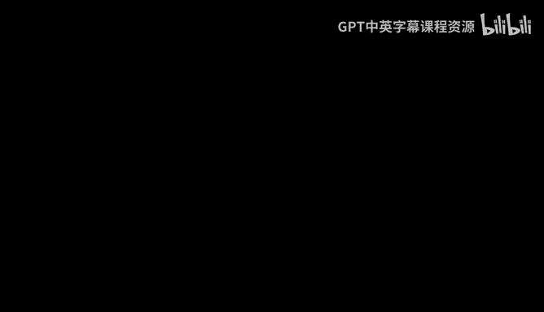

# 斯坦福大学《机器学习理论｜CS229M Machine Learning Theory - Fall 2021》中英字幕 - P12：-12-13_ Neural Tangent Kernel.zh_en - GPT中英字幕课程资源 - BV1jT421r71m

Okay， I guess like， let's get started， so。

I think， last week。I， I spent some time reading the feedback from the survey。

 I've been go through all of them。 So I guess I'm not going to discuss every points there。

 like all the points are well taken。 And thanks for all the very helpful feedback and for some of those。

 I， I'm going to improve。 I guess there are also some other。😊，Conflicory requests， you know， which。

 you know， still are very understandable because different people have different preferences。

 That's completely fun。 But I guess I'm just saying that it's not like oh。

 I can address all the possible requests just because sometimes there are some constraints but。

 of course， I， you know， sometimes I think even conflict requests can be addressed。

 if you are created。 You know， I， I will try to do that as well。嗯。I guess one。

I I guess there's one thing I want to discuss a little bit， which I think might be useful for you。

 is not trying to find any excuses for the for the lecture。

 but I think some people's mention that it's a little bit hard to follow the take notes while listen the lecture。

 I can completely understand。 I wrote pretty fast， which I'm gonna slow down a little bit。

 at least to make the the layout and follow my little bit cleaner to easier to read。

 but I think in my opinion， you know， of course， I'm not trying saying that you have to really follow my way to take courses。

 Like I typically don't take a lot of notes。😊，I think at least the this course， I。

I try to design so that you don't have to take all the notes yourself just because we're gonna have scrap notes later。

 and some of the scrap notes are already there。 And I， when I listen to a theoretical lecture。

 I try to。Think more so that I can remember them in my in my head a little bit because I feel that at least for me。

 it it takes too much energy for taking all the notes。😊，Like， you know。

 I'm not sure whether that this is useful for everyone。 I don't think it can be useful for everyone。

 but， you know， maybe you can try it a little bit just to see whether it's easier if you take less notes and and try to remember a little more。

 Otherwise， I I'm， I'm gonna slow down a little bit。 at least in terms of the writing for sure。

 And also probably I'm going to kind of like slow down a little bit in terms of the overall pace a little bit as well。

😊，Given all the some of the feedbacks， saying that some of the lectures are little bit too fast and also another thing is that I think the homework questions。

 you know， indeed some of the questions， I think I probably made a mistake that a few sub questions are too difficult。

 they were bonus questions in the past offerings and at this quarter I I thought that we have you have team of three people。

 So maybe I can put them as regular points。 but still they are probably too difficult。

 they require some kind of fix as you probably noticed some commentatorial tricks。Right， so yeah。

 But I guess， you know， I check the the， the last homework。 I think there's no nothing like that。

 Like most of the questions are。And probably shouldn't require anything。

Super special tricks about commators。 And and I guess another thing is that， you know。

 if you want to take some bonus points， I guess there are other ways， for example。

 take to subscribe notes， you know improve existing lectures， the， if you don't care about a plus。

 I think a bonus point， you know。😊，You know， the bonus points is always the same is's the same as the regular points in some sense if if you look at the grading policy。

 at least it' from your perspective， it's worth the same as the regular points。

 So so from the the basically the grading policies that we first decide to cut up before the bonus points and then the bonus points can only make you have better lighter grade。

😊，Okay， anyway， so， so， yeah， I guess， you know， there are other very。

 very important very nice feedbacks which I'm gonna incorporate as well in the， in the lecture。

 I'm not gonna discuss all of those points just to save some time。 So， okay。

 so maybe let's get into the。😊，Get into the the technical part if there's no any other questions other discussions。

So， so I guess last， last Wednesday， I was sick and and we skipped the we。

 we like we ask you to watch the video online。 And roughly speaking。

 what we did in the video is that we talk about this optimization。Like。No con optimization。And。

I think so the main point there was that if you， if you have the socal property of low， local minima。

All local minima global。Then you can find global minimum。 And， of course。

 there are technical things like there is so called strict saddle point。

 which we discuss in the video。 And， and there are other kind of like things that are a little bit subtle。

 But， but this is the main point。 And， and so basically， you only have to show that this is true。

 And then you can find a global minimum of the noncon function。

And this line for research from a broader kind of point of view is successful， and in some sense。

 the what web I'm going to discuss next is another example of this。😊，However。

 there are some kind of like special。Saties。 So， so basically。

 what what we showed last time is that this is really true globally。 The this statement。

 all local minimum or global are basically， this is a true statement for every for the entire space。

😊，And today， what we're going to discuss is that you are only looking a special part of the space。

 So in some sense， the function we are going to discuss this today is like。

 look like something like this。 You have some kind of like complex part about this function。

 which you don't know how to。😊，How to characterize， But you identify a small part where this is true。

You look at special region where all local are global。

 And there is actually a good global minimum there。 So then you just only work in that region。

And that's kind of the the connection to the previous lecture。

 There are other issues with this kind of approach。

 I guess we discussed a little bit in one of the the outlining lecture。

 the the limitation would be that you know， you identify this region where everything is nice。

 the landscape is so nice。 But is this the region you really care about right So if you really care about finding a global minimum of the training laws。

 then yes， this has to with the region because you find a global minimum of the training laws。😊。

But if you care about other properties， right， So like generalization performance。

 then it might be not the right region that you should focus on。 So， but for today's lecture。

 we don't care about that where we just say， let's just， we are gonna go through what this works。

 And and then we talk about limitations and， and in the future lectures。

 we're gonna talk about ways to， in some sense improve upon this。

A kind of fact fix the issues of this kind of approach。嗯。Okay， so that's。

 that's a very rough that's a kind of like a high level overview。 And also， by the way。

 if you haven't seen my notes or announcement on add。

 So there are actually two videos that we ask to to watch for making up the last lecture。

 So one of them is a full lecture and the other one has like 15 minutes。

 So there are about this noncon all local mini global mini kind of phenomenal。

 And this does relates to one of the homework questions。

 The question itself is still in some sense self content， but。

 but I think it's useful for you to know the the basic idea。 even the basic proof ideas in those。😊。

To， two videos so that you can see better how do you do the homework question。嗯。Okay， so， okay。

 so today， let's talk about this， this， this this thing we are like about the special agency。 So。

 and this is off also also called neurotent kernel approach。 I guess the， the name doesn't really。

So far just to think of this as a placeholder， like'm I'm going to explain why this is called newreent kernel。

😊，So， so the， the basic idea is that you look at some special place around a neighborhood of your utilizationization and you do some tailor expansion。

 So， so Taylor expanding。😊，And this works for un linear function。 So suppose you have a。

You have a non linear。Or even linear， but nonlinear would be the most interesting case。

 A non nonlinear model F X。And then you do a tailor expansion。Around。Inniflization。Cta 0。So。

 and when you tele expand， you try to expand the model at the immization。 So your model。

Its F say the X。 you tele expand with respect to the parameters， but not input。So。

 the input is fixed and the parameter is the variable。 So theta0 is the reference point。

 and then you look at the gradient with vector theta。Evalu set0。

This is the first other gradient times say the math 0。 So this is the first other。T expansion。

 And then you you， you say you have some high terms， which we are gonna ignore。 So。

 and once you do this， you can define maybe this one。Let's called this G theta x。Of course。

 it also depends on theta 0。 but let's say theta is the variable。 Theta 0 is fixed。

 So this is a function of theta。😊，So this is a linear function， so。So if you define this。

 then G theta X。Its a linear function in fateta。Because where sayta shows up， Sa only shows up here。

 and it shows up linearly。And basically， you leaderize on your， your your model。And you can also。

 I guess， define。Delta theta， which is the difference between theta and the 0。嗯。

I I guess technically， you should call this not nearly this is a fine function because there is a constant term。

 right。AF function in theta or in Delta theta。No， they are not two different。

 I guess just want to introduce this notation， Delta theta and。And so I have that 0。

 this reference point。This is a constant。From this perspective。

 right is's a constant that doesn't depend the constant for fixed x。

But it it didn't change as you change data。And， and in some sense， this is just not that important。

 And so， so， so sometimes for convenience。So not very important。Because he's so constant。

And sometimes， for convenient。Convenience。You choose。 So choose。So0， such that。F3 0。

X is equal to 0 for every x。嗯。How do you do it， So you do it。 So if you really want to do this， you。

 you need to， for example， what you can do is you can design network。That you。

 you split the audio network into two two parts， right， So maybe you have。Suppose。

Before you have a network， we have all of these connections。Right， so and then for the second layer。

 maybe for some layer split in 22 hs， right， So you have something like this。

And then something like this。And， and you do the same thing in these two hubs。

 exactly the same thing It these two hubs。 And then you put put plus one here and minus-1 here。So。

 so that they got canceled。So that you have a still a summer random inization but the， by。

 but the inization has a functionality that， you know。

 like the functionality of this initial model is， is0。

 I'm not sure that when my drawing makes any sense。 this， this like a， you know。😊。

I see some confusion in your face， but this is supposed to be something simple。 for example。

 let's say。😊，For example， I say you have some of。Ler models， some of sorry， two layer networks。

 some of AI times。Sigma of W I transpose X， iPhone 1 to add。 S this is a model。

And what you can do is you can say you added to。Mus AI Sigma W trans transpose X。

So you have two m neurons and， and and the the W is the same， and the AI is are paired。Right。

 so then this is becomes。0， right， So so if have two avenue new rooms and one part is the same as the other part in terms of W。

 and in terms of A， they are negation of each other， then you make is0。

 And you still have relatively good randomness， right， You can still choose W I to be random。

 As long as W I， these are all W I S and these are AI。😊，So anyway。

 this is a not super important point。 And also， even you don't do this。

 you can still somewhat kind of get away from it because this F theta 0 x is a constant。Okay， so。

 so basically from now on， we're going to assume this f theta 0 x is0 in most of the cases。So， and。

 and if you think about this， right， so。So basically， this is saying that。

So y prime supposed you take y prime to be y minus this constant。

Which we are going to assume is zero， but so far， I say this is。For this equation。

 I think we can still think of as generic。 So then you get this is this is a linear function in say transpose。

 Very So it's gonna be。Gd theta F theta 0 x times the theta。

And this becomes a linear function in the L theta。 So this， you can think of this as the parameter。

And this， you can think of this as a feature map。So this is the same as the feature map P of x。

That we discuss， for example， in C S 299， right， when you have a kernel method。So。

 and while this is a feature map， this is a pre， This is something that doesn't depend on the parameter。

 right， So say that0 is fixed already。 So I have say that0 of x is really just a。😊，Fix function of x。

Right， so so this is a fixed。つこです。哦。Given the architecture。And that0。But it's not。

 It doesn't depend on the auto。So in some sense， no， it just becomes kernel method。 And， and。

 and this k。 So you can define。嗯。Oops， what's going on here。 So I guess if you was。If for simplicity。

If you assume F sayta 0 x is0， then y and y prime the same。

 So basically you' f a linear function to your target。 And， and this becomes kernel method。

 you can define a kernel。嘿。呃。X， X prime to be the inner product of features。Right， the F the。

Phi of x transpose phi of x prime， which is the in a product of these two gradients。So。

 and why this is called neurotent kernel。 The reason is that this。Is the tangent。Of。

 of the new art work。 is the gradienting of the new art work。

I think then that's why it's called neurotent kernel ecosystem。The。

 the feature is the gradient of the neural network。 Anyway。

 the newer attention kernel is just a name。So。Okay， so。And suppose。So， suppose。We just use model。

 We just use。GC的X。Instead， instead of the original model。Then basically， you just get kernel method。

奥利妮。饿到。On top of the feature。Right so， and。And the loss function。 So suppose you believe that。

Theta is close to theta 0。 So when。Then you can also kind of intuitively say， okay。

 my original loss function， which is the function of the model output and why。

Probably approximately close to。My new loss function， right， which is G theta of x。And why。

And this is linear。And the whole thing is convex。Because L is convex， right。

 A con convex function composed with linear function is still convex。Right， so when this。

 but this is when theta is very close to。这条记入。And so basically， the question。 So the。

 so the remaining thing is just really that。 So how valid。Is this approximation。Right。

 because everything sounds nice， You know， after we did this， you know。

 like everything becomes super easy。 But in what cases this can be valid。😊，嗯各 ahead。我。find。嗯，对。呃。

被告书面。Yeah， so the inner product is just the the typical inner product。

 You just take the because these two are just vectors， right。非他说是对。包括人。So， so， okay。

 so what's the dimensionality here， so。Griiant of say， this thing is in the dimension recipe P。

 If theta is in R P。 So it has the same dimensionality as。Okay， I guess it also depends on what F is。

 So let suppose F。Is from。Some R D to R， right。 D is the dimension of x。Its the dimension of x。Then。

 but， but the， the problem， the point is that the output is one dimensional。

 and then you take the gradient with vector theta， you get a p dimensional vector where P is the dimension of the theta。

So the gradient， so the gradient with vector theta has the same dimension as theta。 That makes sense。

 right， So， so， so this is a p dimensional vector。 And you just take in a product of two vectors。

自己 find了 future。Ex sense。Cool， okay， so。So I guess to proceed。

 let' define two notations just for the simplicity。

 So let's define I had F theta to be the empirical laws with the model F data。

This is just the for formal so that we can write this easier in the。AndF had G theta。is the。Loose。

With model X G set。Okay， so the key idea is that。So in certain cases。

 this Tayloror expansion makes sense， right， so。So I guess the， the tele expansion。Can make sense。

 Can， can work。For certain cases。Here we're gonna to hide。

 you know they are gonna what for what cases it makes sense。

 you know can work is gonna be a it's gonna to be a big question。

 you know that we probably will discuss at the very end。

 but so far let's say just let's see how how does it work so the way that they work is the following so in the following sense。

So how do you say it works， right， so so you say that there exists a neighborhood。Of set 0。Such that。

In this neighborhood， so let's call this neighborhood B theta。系有 zero。Such that。

The several things happens。 So one thing is that you have a accurate。

Approximation in terms of function value。So， the app。Is somewhat close to G Theta F X。And and L hat。

 as a result， Lhead F Theta is close to L height G Theta。For every settle in this neighborhood。

 be3ta 0。So that's something you want。Which makes sense， right， so。

This is the point of tail expansion。 You also approximate an original function。And also。

 you want that it suffices to。Optimize。In b 0。Because， you know， if in this beta 0， there's no good。

Maybe let me， let me draw this again， so。So basically， what we are saying is there is a neighborhood。

Let's got B sayta 0。And this neighborhood， first all， you have say。

 suppose your empirical laws is look like this。😊，Maybe something else happening somewhere here。

 I else we don't know。 So first of all， you， if you do the quadratic approximation。

Is the tele expansion1 theta 0。I said this is theta0。You do a cadratic expansion。 Its something。

 It looks something like this。They are' very close。佢是咩作。So basically， you can think this right one。

This red one is G theta of x， and the black one is F theta of x。

So the quad expansion is very close to the。Orin expansion。Sorry， the original function。 And second。

 you want that it suffices to optimize here， right， Because if they are。

 if both the right and and and over the black curve， even though they are close。

 if they are boths in very high。It doesn't make sense to zoom into this region。

 right you should leave this region。But you can see that it suffices to optimize here in terms of the。

In the following sense， so there exists an approximate。嗯 global meet。Say the hat。In B 0。So I'm。

 I'm using the superscript for 0 for the0， which might be a good mistake， but。那你。Consistent use that。

嗯。that。I think for in some other lectures， I use superscript for time。

 So that's why I keep using superscript for time。嗯。Anyway。

 so you want to have a say that has such that its global mean。 And actually here you want that I had。

G said had to be approximate 0。 And this indicates that you you are a global mean because0 is。

Is the minimum。 There is no way you can go below 0。 You know， So， so if you are close to 0。

 it means you have to be close to global mean。 And， and this also implies that。Ill had F。

Hat is close to0。Okay， so， but with this two， we still don't really understand what， how do。

 how do we optimize the black curve， Right， So， so you also want to know that。Optimizing。

This laws L had alpha theta。Is similar。To optimizing。Lllha G。And not only this， but also。

And does not。li。B0。Right， because if you leave bit0。

 then all bets are off or your tele expansion breaks。 So。

 so you have to say that when optimize either the L had F or the L had G， I don't leave this region。

 So that's， so everything is confined to this region。And。So， so this is how we make it work。

 Of course， you can ask in why this is really reflecting the。What happens in reality， you know。

 the answer is no， not always。 but so far， we are just trying to make this work under certain cases。

嗯。So， and so that we can appreciate why this， you know， we have to improve this way。 So。

 and in some sense，3 is kind of like a little bit like extension。So three to some extent is。嗯。

Is follows from  one，2， because if you are， you have a global minimum in this region， right， So， and。

 and the black and white are close， then why optimizing， you know。

 optimizing it you probably should converse like that that global minimum。

 and you should stay in that region。 right to some extent， it follows。Follows  one， too。

But not exactly technically。 So， so。But still requires a formal of proof。So what I'm saying is that。

 you know， if you really just want something somewhat informal to think about the dependency。

 then probably you only have to first make sure one and2 is happening。

But if you really want everything then you need to get prove the three。嗯。And， and， and you and 1，2，3。

 you can make it this work， you know。Can be all true。In various settings， right， So with either。

Over parameterization。Or。And all。Some particular。Particular scaling。Of the initialization。

So if you play with the transition or you play with。The the wealth and and also。

 you need and small casttoity。even small or even0toity。

So if you play with the over proization and scaling of initialization。

 and also you insist that there's no saasticity that make you leave very， go very far。😊。

Because the sarcastic will may let you leave the local neighborhood。

So that's why you want small schasticity。And， and how， so then you can achieve all of this。

 And how do get most acity in a nutshell you either need。By so to get the small sasticity。

 you need to either do smaller in rate。Or full batch green vcent。So， so in some。

 this is the limitation， right， So this is a limitation because you require this。

 And this is also limitation because you have to play with it。 You cannot just say。

And what you really eventually get is probably not exactly matching what people do in practice。O。

Cool， so now let's see。 how do we do 1，2， right， but still like。Regardless of all the limitations。

 still， this is kind of interesting， interesting approach。 Like。

 it's kind of surprising that such a region even exists。 even you think about one，2， right。

 So you don't care about any limitations about it， It's still kind of interesting that there exists at such region that you can basically be close to a convex function。

 actually quaratic function。 if， if the loss is quaratic， right， and， and。

 and there're still a global minimum。 They suggest that there's a lot of flexibilities。😊。

And in this landscape networks， right， So you when you have a lot of overizations and non convex data somewhere。

 you have to have a convex region。😊，Right， so that's basically what' saying， right。

 So in this landscape， globally， you know， it's very non convex， very complicated。

 But at some special places in some neighborhood， you are， you are really having a convex function。

 and that convex function has a global minimum， reaching average 0。😊。

So even this is still somewhat surprise。So， okay， so now let's try to formalize。1，2。

And then we talk about three so。How do we do this， So let's introduce a notation， Let fee。i。

To be the P of X I， the features for the ice example， which is religious。And lady find this。

Fueature matrix。设别。Fe and transports。You put all the features in a row。This is N by P， where P is。

The number of parameters。Okay， so now we can see that。

The loss function with respect to the linear model。It's just a linear regression problem。

 which you are probably familiar with。 I'm taking cadratic loss。Or mean square loss。So。

This is just Y I minus deelta theta transpose。Times phi of X， I。Recall that， you know。

 you have a basic linear model in Delta Theta。And square。Alright， so。

I guess maybe it's easier to write in the other way， So that。Small consistent with the notation here。

Transpose。Delta。So if you write in the matrix not， this will be one over n times。

A two norm of y minus。Fe time still the fit。Fome square where y V is。

The concatesnation of all the labels。W is选 RN。Right， so this just sounds very familiar with。

Linear regression is it just exactly linear regression where theelta state is your parameter。

 Phi is your design matrix So or the all the feature matrix。😊，So。And let's assume。

This is just for convenience。 Y I is on the out of one。So that the two norm y is on the order of。

Scro n。So heres a lemma that kind of characterize what is the。I guess。手手赖吗。This is in somewhat for2。

In some sense， you are trying to see that in what neighborhood you have a global minimum。 So。

 so suppose。P is bigger than n。 You have more features than any more data points。And rank。

Of this future matrix。Its equals to N， and。能明了吗？Singular value is equals to sigma。Larger than zero。

Then。Light。B。Norm。Solution。To why hat。To this。Alright， so you want to fit feehi be2 y back。And。

 and you， you want to understand， you know， what is the nearest global minimum， right， So。

 so the other thing is this is the nearest global minimum。So this is in the nearest。佢老报名。

In some sense， right， Because， you know， if you fit it， you know， you， you。

 you are achieving the global mean and you want the other hat to be the smallest。

 So that means you're looking for the nearest one。And if you're looking for the new respondent。

You can have a bond on the nearest global minimum。Where the bond is something like this。

Sd an over sigma。So the ball itself so far is not that， you know， interpretable。 but。

 but the point here is that if you take the ball。This means that if you take the ball。

B theta 0 to have these radius， right， to， to be all the。Seta such that is good Theta 0 plus0 theta。

Such that。The otherta theta2 norm is less than。Of square Sigma over Sigma。Then this fall。

 this B set will contain a global meal。Contents。啊个面。Okay。

 so so this is characterizing how large the ball needs to be or how large the region needs to be so you can contain a global meeting。

And， and the number here， so far， the number is not interpretable。

 I'm gonna compare it with some other things， because。You know， by itself， you know。

 how large the region， If you just care about two， then you， you。

 you can just take the region to be as large as possible。 You have to compare it with something else。

And the proof is also pretty easy。 This is really just。A simple trivial thing like you say。

 you can write data set hat to be because you are the the minimum norm solution is the pseudo inverse。

Of three times by back。And there are some， I guess this is not。Exremely obvious， but you can。

You know， invoke， this is some relatively basic properties of the pseudo inverse。

 You know that the upper normal of the pseudo inverse is less than。The minimum singular value of fee。

Actually， these are， I think are exactly the same。So， and this is equals to one over sigma。

And then you， you know that you have a bond on。Delta theta to norm by。

Ising the upper norm of the pseudo inverse of p。Times the two norm of biva。

So this becomes more over a sigma times squared。That's it。I guess I don't even need a big O。

 I don't know why I have the big O。Sorry。😔，Just for me， like it's always safe to have big。

 So it's just part of my brain。It cannot work without egoO anyway。

 but here you don't need anything any constant。So， oh， I guess， oh， I guess there's a， I。

 I think I need a big O because I'm only assuming that y is's on on the order of scroton。Sorry。

 so because here， I'm only assuming this is。Yhy is's less than all squareroed， so that's why。

I need the big。But anyway way， the constant doesn't matter here， you get a point， I guess。So， okay。

 so。Any questions so far。So and now let's see whether this region is。

 whether it's too big or too small， right， It sounds somewhat big because n is there， right。

 But actually， you'll see that the region is not that big because the sigma could be made very big。

 in some sense。Or， or or there， there's some relative kind of things which you。

 you have to compare it with something else， right。

 So because you have to compare this with how good do you have approximation in the region。

So next one is for lemon吗。So this is for one。In some sense， so suppose。This。Is betalipses。

Suppose this gradient of。The， the network is lipses in datata。In the sense that。For every x。

 for every state and prime， you have this。So I think this is 0。

Because we always only care about the gradient at theta 0， evaluate sayta 0。Wait， sorry， my bad。

 my bad。 This is you view it。 Sorry， my bad。 Okay， so this is a， so here what I'm writing here。

 this is a function of data because I evaluate as some。Someub arbitrary sayta来 say。I invited。

 So I want this as a function of theta to be lipsious in theta。

 So that means that if you choose two different。Plaice where either theta orta prime。

The differences between them in L2 norm。I have to use L2 norm here， because they are。On vectors。

 and you won't say the L2 norm is bound by。The， the differences in the， the failure space。

So if you have this， then。We know that。F to the x minus g to the x。Your approximation is less than。

Big O， O beta times the difference。嗯。The the auto theta to norm square right because the difference between these two is basically in some sense depends on how far you are away from the reference point。

 right if at the reference point， it should be exactly the same。

And if you are a little bit more away from the reference point， then you're gonna incur some loss。

 And the loss is something on a second order， right， That's， that's also intuitive。

So and the important thing is that so for every theta。😊。

In the B that is 0 that we just have we just defined。We have an F theta。X minus g3到 x。

It's less than beta n square over sigma square。 And that's just by plugging in the definition of B 0。

 The B 0 has。This raius。Scro in over sigma， and you plug it in into this here。

Then you get see plug in this here。You get that in this written neighborhood you have some bump on how good your approximation is。

So。哦，稍的。I chart this beta in my。Copy pasting error， okay。PN squared。Okay， so far， this month。So。

 I saw a question。By the way， you can feel free to unmute， but I can read the question now。

 So how do， how do we define fee superscript Thus， Oh， this is the。So what is this phi plus。

 This is the pseudo inverse。Of。I think this is called。There there's actually。

 this is the the most common definition of pseudo inverse fee。 I guess you can。

Roughly think of as the Vverse of。With some small caveat。啊。Yeah， yes， more10s to the inverse。

 Thanks for the comments in the chat。嗯。😊，This is， I think this is supposed to be taught in the linear algebra course。

 Maybe I don't know like I'm not sure whether what I can say about it。

 What you know about it is that。At least in this case。呃。

I think maybe just just's for the sake of simplicity。

 just think of the pseudo inverse as the inverse if you are not super familiar with it and then you can verify this is a good solution to this equation right because if you multiply pseudo inverse you get you can this。

😊，So the inverse cancels with Phi。 and you get theel theta。So so， sorry， so， so you开。

 So you plug in this data to this equation， you can cancel fee and free to the inverse and you get why back。

 That's how you get the。哦。How， how do you verify this is a solution to the equation。Okay， so。And。

 and， and also another， I think， another useful thing to know is that。

The pseudo inverse has exactly the same。 It has the inverse of the spectrum of the original one。

 right， So suppose the。fe系 single value了。Sigma 1 up to sigma K， and then the pseudo inverse。系す。先佢老肺了。

1 over sigma 1 up to one over sigma K。So。And this， you know， if all these sigmas are positive。

 right you， you ignore the the zero single values， then this is exactly true。 So the。

 the single values are just the called inverted。嗯。Okay， cool， so。I hope that answers the question。

Okay， going back to this second lemma for number one。 So this is saying that， you know。

 in this neighborhood， how good your approximation is， right。 So we got this， you know， like number。

 So I'm gonna explain this number。 that's the important thing Right。 So how small is this， right。

 if this is small， that's great。 if this is big， that's a problem。 So。

 but maybe just let me just say the proof for this lemma。😊。

The proof of the dilemma is kind of like basically just follows the basic fact that。

From the fact that。If you have H。Seta satisfies。Greing of H es。

And this green of phipus is basically equivalent to the hehen。The operator norm is bound by beta。

If everything is defable。Then， you know， you can bounce the， the quality of the tail expansion。So。

 you can say that。She is sayta minus G to the H 0。Minus gradient H 0。It是个 zero。This is bounded by。

我恶悲痛。Sa of minus0， to two square。To non squared。 And this h theta will be just F theta x。In our quiz。

 if you take H to be F X， then you get。You get the the lama above。So， so the point is that you you。

 you， the approximation error is。Second order in the the auto in the difference between your point and the reference point。

So。Okay， and there's a small remark。 Another small remark is that。If。If the F involves value。Then。

N of theta is not even continuous。So you， it cannot belyes。I everywhere。

And this requires some special fix， So requires。Special。Fixes， the fixes is not that， you know。

 surprising just because even though it's not continuous everywhere。

 it still continues almost everywhere。 So， so it basically is kind of close to beious。

 And in some sense， L of theta x is， it' still like if you look at the average over data points。

 then you still have some lipsiousness。 But I think let's let's not discuss that。

 it's a little bit kind of like so。Low level details， which is not important。

 We can just assume we are dealing with a。not value。 we are dealing with something like Sigoid。

 then there's no such issue。Okay， cool。 So now let's go back to the the main thing， right。

 So the main thing is that whether this is a good b， right。

 So like you say that you have found this between 0。😊，And you have shown that in this B。

 you have such a good approximate， you have such an approximation error。

So the important fact is that what is this beta n sigma square， I this small or big？

And the important thing is that。So the， the， the interesting thing is that。

This thing is not scaling environment。 So N is something you cannot change， right。

 But B over weight over 6 is not。Scaling environmentvari。So what does that mean， that's。

 I think you can interpret this in some way。 So， but， but in some sense， like beta， basically。

 I think the， the easiest way to think about is that you have a square in below right you have beta。

😊，The， the， the the beta on on top。 So， so somehow you can play with the scaling。

 So to make this going to 0。So， there are two cases。Actually， there are more than two cases。

 but I'm going to discuss two cases。 These are in different papers。

 but I'm going to unify them in the following way。 So there are two cases where。😊。

Beta over sigma squared can go to zero。So the first way is that you can repower my choice。

With a scalr。And this is in Chiza。And爸。I think this is 19， and the paper is called lazy Chning。

Of the might work， something like that。So I guess the paper title suggest that。

They're saying that this is a lazy way of training networks is not really the the final way you should believe in。

 But nevertheless， the paper is very nice。 So， and what they do is the following。 So they say that。😊。

They let。So let your F the X， your parameterization。To be the following。

 you take alpha times let's say F say the bar X。So and this， let's make this a fixed。 This is。

 let's say， this is a standard network， a standard。Neural net。And， and fixed。

Fix in the sense that you don't change the architecture， right， You don't let the。

 you just take whatever is done on your。 you know， with any finance with。When it's fixed fixed with。

啊。And and depths so and so forth where， something that you don't change。

 at least for this perspective， and you only change alpha。Right。

 so for every alpha you define perfect is， is's a very network work with just you have a different scaling in front of it。

 right， So， so very every alpha you got an neural work。 And then let's see。

 how does everything change as you change alpha。😊，And also， you fix initialization。

 fix initialization。Sm 0。And then let's consider， let's say say the bar Sigma bar is the sigma mean。

Of the of the of the base network， let's say the base network is the I bar say right。

 So is's the sig meaning of this base one。Right， this is the。RightAnd let beta bar be the lipsness。

 beta bar be the lipsness。Also， of the base one。So you can think of Sig bar and beta bar are not changing us。

As you change alpha， right， So， and now let's see how does the alpha change the final sigma beta of your。

Final network， right， So then。So sigma is equal to alpha sigma bar。

 because once you have consider F theta。You multi as alpha， right， So all the features， right。

 like the gradient becomes alpha times bigger， and everything becomes alpha times bigger。😊，Right， so。

 right， this is just because when you take the gradienting with respect to。

So this is just because of Chen rule， right， So if you take written to this。

Theta of the F is the same as alpha times the gradient of theta with to。like the， the。

 the gradient of I far with back to theta。 right So you have a Chen rule。

So everything got scaled and beta also got scaled by alpha。Just because， you know。

 the gradient got scale for the same reason。And then you can see that you get for free of some factor about alpha in this equation So beta over sigma squared becomes。

😊，Beta bar over sigma bar square times one over alpha。

And this can go to zero as alpha goes to infinity。So basically they saying that， you know。

 whatever network you take， whatever inization， right， So as long as you Sigma bar and beta bar。

 they are reasonable and they are not。0 or something like that， right， So， so。

 so a long sigma bar is not zero。 So， so you have some beta bar over sigma bar square。

 that might be bad， but you can always rescale， re parametermeulate it with a constant in front of it。

😊，So that's this key quantity。Beta sigma square becomes going to 0。And if this goes to 0。

 what does the mean， It means that your approximation becomes better， better， right， So。

 and at you some point， you， if， if you change your alpha large enough。

 you make this approximation super good。😊，Right， so and the neighborhood。

 so basically you found the neighborhood such that in that neighborhood。

 your approximation is very good。If you take alpha to be big。同 you被告。No。

 the loss wouldn't wouldn't change， right， Because the loss， that's a good question。 So loss。

 What is the loss。 loss is something composed with the。Compposed on top of with the with network。

 right， So the loss is。I of for example。Alpha F bar theta x。Why。So。So， so first of all。

 at the inization， we always try to make an inization0，0。 the， the。

 the output at the in transitionization 0。 So that wouldn't change。 And second。Even though a。Seely。

 this whole thing is big。 Sure， that's true。 but we show that you have a global minimum。

Where this be in this neighborhood， you have a global minimum。I'm not sure whether it makes sense。

 so。So， so in some sense， I think， okay， let me try to draw a figure to answer this question。

 So the question is that， you know， what happens when alpha is big。

 it sounds like function value becomes big， right。So。That's true。 But I think you you you。

I think what happens is that， for example， suppose you have。嗯。那是 so。😔，SoHow do I visualize this。

 So use。I think your loss will be。 So if you stretch off， your loss will be sharper。Your。

 your loss will So like So， so if you look at everything， you look at depend on alpha， right。

 So if you make alpha bigger。You make this neighborhood smaller。Right。

So you make the neighborhood smaller。 So you're gonna get something like like this。

 very sharp in the neighborhood。And。呃， however。So， so， so， so， if alpha is bigger。

 actually you can find even something that is very close by。To make the so like you even。

 you have to even leave move， even。Le。From the transition。

Just because if you do a little bit of work， then you actually already kind of like。呃。

 alreadyread already fit the data。I'm not sure why that that makes sense。 So， okay， so。

 so there's always， okay， So there's always one thing which is useful。

 which is like the F say of 0 x， this is 0。So basically you always start with this。Right。

 where you don't have any scale， right， this is just literally 0。And if alpha is big。

 then this is still0， right？But when alpha is big， you are more sensitive to theta。Right。

 so that's why if you change a little bit。Then you can already fit your data。

So you only have to change very， very little。From the set 0 to straight data。And， and， and。

 and when you change very little， then you actually。

 your approximation is very good in that neighborhood。I'm not sure whether it makes some sense。

Maybe you can discuss， you know， it， it， it's a little bit con。 I I agree。 But right， it's just it。

 it really because the the only thing that happens here is that。

 how does this beta and sigma relative the， the relative difference between beta and sigma。

 How does that depend on alpha， right， so。嗯。So。So以 some the。If you have larger alpha， you。

 you need to have smaller neighborhood。But but but but your。But， but。

 but the approximation our scales in the faster。Because because because your function is kind of much。

 much kind of like more。Non smooth， right， So like your function becomes like sharper。 So， but。

 but actually， the neighborhood shrinks faster than the。😊，The the， the sharpness。Growth。

 so that's why it's working。Yeah啊。I hope that somewhat answers the question， right， Yeah。

 but this generally， this is kind of。Somewhat kind of confusing。

 And this is another place where we can also see this。So the other case is if you overpa twice。So。

And。So here， let's say， suppose this is， this is actually the original or the original first few papers that。

 you know， like which invent the， the N D K approach take so。So basically， what you do is you say。

 you have a model。Y hat， which is equals to1 squared m times sum of AI sigma WI transpo X。

 this is a tool learn network。With m neurons。 and I'm s this。Just in some sense。

 mostly for convenience。Because， you know， whatever scale you do。

 you can also change other scales to compensate。And， and the， the convenience come from that。

 you know， if I choose the。Everything on order of one。

 then this will put something on the order of one。 go to O C。 So。

 but maybe let's discuss that in a moment after I introduce the notation。 So I got。

 I'm gonna have this matrix W。Which contains all the rows。And w is in。M排啲。And。

 and sigma is value here。I guess right let's say is， maybe that's not say Sigma is right。 Sigma is。

心情 like。It's oneipses。And has second order derivative， second order derivative。So 아。So。You。

 you wouldn't see how those coming into play explicitly。 They're not super important。 And。

 what is the translation， those AI 0。So actually， AI。Is initialized to be。Plus1 -1。Initially。

Im not optimize at all。So they are not even parameters， technically speaking。And WIs are parameters。

W I 0 is Ni from Gaussian。A D dimensional Gaussian would defer coco virus。

And let's say x has the norm。 The norm of x is on the out of one。Its on the order of one。

This is just for convenience， so we have a fixed scaling。And unless it'。Let's run。

 let's say theta So the， the， the parameter theta is really just the。A vector version。

D times M is just really a vectorized version of W， so vectorized。Vson。W。Okay， so。And。So， we assume。

I'm goes to infinity。Like a so so I is eventually technically poly。And N D。

 So N and D are considered fixed。 And I something that will become bigger and bigger。 And， and。

 and that's the power。 So like everything comes from the， the scaling of L。

So I guess just to explain why we all want to have this one squared M and inization scale like this。

So。Scaling， and I think the reason， at least one reason is that。If you take， if you look at this。

 So sigma， W I 0 transpose x。This is on order of one。

Because W I is a spherical Gaussian and x has no one。

 A spherical Gaussian times a non one thing will have expectation。

 like will roughly be on order of one。 And then you take some value or of something like R signaligoid then youre you're gonna be on all of one。

😊，And then the sum of this。We will be on the order of square end。

Right because you have M of these things that are somewhat plus1 minus-1。And， and you。

 because AI is plus 1 minus-1。 So you cancel them in some sense。 and then you get。So。

 and that means f theta 0 x is on the out of one。Because you'd have another one over ascribe them in front。

So， that's why。That's one of the reason why you choose thisscape。Okay， and。O， so。

 so initially our output is on the other one。😊，And now let's see how does the sigma and beta depends on all of these quantities。

So we hope that this key quantity be over a sig squared。To go to zero as M goes to infinity。So嗯。

So let's first look at the sigma。 Sigma is the sigma mean。Of this。Feature matrix fee。And。And you can。

 this is also the same as。The sigma mean。哦。On this。Fhifi principles。

This is just equality because Fifi transferpose the spectrum is just a squared。

Of the the spectrum fee。And what is Fi P transpose。

5 P transpose is basically this empirical kernel matrix， right？

The IGs entry is just the inner product。Between。2 features。Of two examples。Right， so， and。

 and let's look at what the scaling of these P P transfers。 So to do that。

 you have to look at what's the gradient。So let's look at the gradient。So F theta。

 if you look at the derivative of the output。With very respect to each of this W， I。

Then you can use Che rule and and。Then you can get something like this。Timem sex。

So this is the gradienting of every neuron W I， every vector， W I。On安。

That means that if you look at the gradient， the entire gradient。All the the green。

 all the vector you look at the norm then is one over M times。Some over。

WI transportpose x times x to norm。Square， which is。1 over M times the two norm of x squared times。

And and what is this， It's kind of hard to know exactly what is this。 But I think you。

 you mostly care about what's the dependency。On爱。Right。

 so what's the dependence on M then this as M goes to infinitefinity by concentration。

By concentration。So yeah， as I'm going to in， this is really just。Convergence to expectation。

 because this is empirical sum。 There is a one over M here， right， So Singapore prime W transpose X。

Square where W is from。It there for a precas。Ts the two norm of x squared。

 which is the constant which is one， basically。So， and this whole thing will not depend on。

This whole thing will be something like all of one。 So I guess， you know， to see is of one， maybe it。

Some somewhat more tricky， but at least you know that this is not。你判定。嗯，哎。So， so。

 so M is not in in this equation。 So， so basically， this is saying that。Every。Every quantity here。

As M goes to infinity， you know， it some the norm of this is on all of one。

 That doesn't change as M goes to infinity。And also， you can do the same thing for。

The inner product of two。To example。And the same thing happens that if you look at the inner product is something like this。

系。Transpose。So this is。I think technically there should be a zero here。Does this say initialization。

Prime。And as M goes to infinity。So as M goes to infinity by concentration。

 this is con concentrated around the expectation of it。

 The expectation is something like sigma prime。W。I transpose x sigma prime W， I transpose x。那可。

Yes I can write following W transpose x signal prime， W transpose x prime。

Times x in the prime was x prime where W is from。是pherical告。Okay， so again， this doesn't depend。

 does not。Depend on app。Okay， so， so which means that so basically this is saying this entire matrix P P transpose。

You know， goes to some kind of a constant matrix。Constant matrix。As M goes to infinity。

And I think this matrix， sometimes people call it K infinity。And。

 and this is the the neurotian kernel。 This is the neurotangian kernel。With M is equals to infinity。

Okay， so this is a fixed matrix。 And you can show that。呃。And you can show that。 this is。

A matrix that that is like a， at least has some is a。4ra。So。

I'm going to skip this part so it can be shown that。Is K infinity is full。So。

 and let's take siga Min。To be the sigma mean of K infinity， which is larger than 0。哦。Then basically。

 you can show that the P fee transfers。For the sigmaome of 5 P transpos。Soorrry飞飞。This is， you know。

L than fuck them up half times s Min。If Im is sufficiently big， just because， you know。

 P P transse is converging to the， the constant matrix K infinity。 So， so if I is sufficiently big。

 then you should the eigenvalue should also con converge。 this part， again， is not。

Like I didn't do it exactly rigorously， but you can expect that when you converge to some matrix。

 your eigenvalue should also your spectrum， your spectrum should also converge to that。Matri。嗯。Okay。

 so， so with all of this， right， So basically this saying your sigma is not， this is our sigma。

 right， The Sigma is not changing in some sense， as I'm going to infinity。 But let's see what。

 what beta changes。So now。How beta changes。As M goes to infinity。

 we will show that the beta will goes to 0 as M goes to infinity， so that beta over sig squared。

 the key quantity will goes to 0。😊，And。嗯。How much time呢。Okay， so now what we do is that。嗯。

So we want to look at the lipsiousness。Of metal， which means that you care about。These two things。

 the difference between these two things。And we have computed， you know what the the gradient is。

 the gradient in every both of these are matrices。😊，Because the theta is a matrix， Right So。

 And each， the gradient of each column of each。Row is something like this， right。

 So this is really a matrix with entries。Time sex。Where I is from one to M。Right。

 so you have each of these is gradient。 So that's why if you look at the norm。Between this two。

If you look at the U norm。Then is the sum of the norms of each of the components。

So youve got one over n， which has come from this over squared n。

And then you look at the norm of each of these component， this is a scalar， this is a vector。

 so you get x。😊，Two norm times the scalar sigma prime。X minus sigma prime WI prime transpo sex。

Square。Right， so and then so suppose you， you want to get， let's say。

 let's try to get rid of this sigma prime。 So let's say this is less than one over M。Times。

Just without a sigma prime。 and this is your you assuming that Sigma prime is。

Sigma prime is one laps， or1 lecturees。Because let's pay big O here。And then of course。

 this doesn't work for Relu， as I said， if for Relu， we have to fix it in some way。Okay， so。

 and then you say that。This is。You get rid of the X again， so。Sometimes times some more time。😔。

I guess the norm of x is one， as we claimed。 So， and this one， we just use cautious words。

 let's say W I minus W I prime。Tun2on square。Time x to norm square。That's this part。

And x to norm square is also once weakness。And then this is one over M times。

The distance between theta and Cta prime in a Euclidean distance。So。

So this is saying that the luptciousness。It's where we am。Oh， I guess the lips is one squared。

 because we didn't take the square root， right so。X。So norm is less than one square time。2， so。

So beta is one of M。And now， if we look at this P quantity。Beta over sigma square。

 Then this is equals to one over squared M over Sigma。 Sigma is something like Sigma bar square。

 sorry， Sigma is this。Something that doesn't depend on average。 So Sigma mean。Square。Right。

 so this will go to 0。AsM goes to infinity。So， so here I think the， the。

 the radius you need is always the same。Because sigma is always the same。

But your function becomes more and more smooth。Your your greeting becomes more and moreipious as you have more and more neurons。

 So， so that's why eventually， as you have more neurons， you can。😊，Get into this regime。啊，你事。Okay。

 so I guess let me take the next 10 minutes to discuss the outline of the next steps。

So any questions so far？So now suppose that's try to establish。3。😊。

So recall that3 is about optimizing G and optimizing over。F are similar。Right， so。I can you。

 you can basically do two things。 Right， So like you can all the analysis。

 there are a lot of different ways to analyze this。😊。

And all the analysis kind of like take problem you can think of as two steps。Implicitly。

 even though the first step probably don't have to write in the paper。

 but I'm pretty sure many people do that when they derive the。The analysis。 So your first step。

 it sounds reasonable to say that you first optimize， you analyze optimization。Of our height。G set。

And the second step is that you somehow analyze。Optimization of Alhetz F theta。拜。Somebody reusing。

We're using proofs。In a， in some way， of course， you cannot reuse exactly。

 but you can probably reduceuse most of the ideas， right， so。And and， and。

 and your intuition is that these two things are similar。 So somehow you can。

We use the proof to do the， the， the actual。Optimization for the new network of data。Right， so。

 and there are two ways to do。wo four four a。I think essentially you can say two ways。

 Maybe there' is possibility that I miss some of the existing papers， but roughly speaking。

 there are two ways for a， and therefore， there are two ways for B， in some sense。So。

So the first way I say I is that you leverage。呃， the strong complexityx。Of this L H G Theta。And then。

So。Exponential convergence。I have to say that this， you know， the definition of strong convexity。

 I'm not sure whether I have really given it in this course。 this is a stronger notion of convexity。

 if you haven't heard of it， you probably don't， you know， it's not super essential for this course。

 But if you have heard of it， you know what what kind of what kind of things I'm talking about because this analyzing a。

 this is analyzing how do you optimize a convex function。 It does require a little bit。

Optimization background， at least two like the on the conceptual level。

 you you can imagine there are many different ways to analyze optimizations for regression。 So。

 so so strong convex is the stronger version of conve。

 and you can somewhat use that to get the very fast convert3， exponential means every time you。

Deca the error by by a constant factor so that you get exponential decay of the errors。

 And another way to do this is that you don't use the strong con X。

Because sometimes you actually don't have the strong complexityax in certain cases。

 So you don't use the strong complexityax， but only use the smoothness。

And smoothness means that you have a bond in second derivative。And again。

 if you have taken some courses about optimization。

 then this would make a lot of sense probably because there are different ways to analyze optimization sometimes you only have smoothness。

 you have a different kind of analysis。So， and based on these two approaches， you know。

 you can get two different proofs for for B as well。 And we're only going to talk about a。

So we only talk about a。So to sorry talk about。I， the first approach。And， and， and for this approach。

 there's no， no prior knowledge is required。 You probably wouldn't understand exactly what I'm saying about this conceptual thing。

 but the actual proof doesn't require。Prior knowledge and it's actually also pretty intuitive by itself as well。

So I think we are going talk about the the approach， the concrete analysis。Next week， next lecture。

 but let me before ending this lecture， let me make another remark， which I think is useful。😊。

And in some sense， it's useful。For two， for the second approach more。

 But it's also useful for the first approach。 So this is a interesting。Observation。

Or maybe intuition， you can say。So。And particular， useful for two。2。😔，So， so this isn at any， at any。

这叫T。Sose you take this Taylor expansion。 Take Taylor expansion。With reference points。Cta T。

 So now we are not taking T expansion at theta 0。 We take T expansion at Cta T。

 You can define this G T theta X is a function of theta。And it tele expand that say T。

 So the reference point is say T， and they have。Gient F T。X times theta minusity。

So this is the linear function。哦。And then， you can consider。嗯。nala l F theta。I tell the T， right。

 So this is the gradient that you actually， you are。This is the。Greianient。啊。You are taking。

Because you are you do really care about optim at Frank。 So this is what you are taking。

 but actually it's the same。😊，As the grade did。Of this。Head expansion。At the same point，这道题。

So these two thing。Yes there's two T here。 This is theta T。

 And this T is indicating that this is also tele expansion。At the reference for。So。

 so why this is the case， you know， I guess， you know， if you want。

 you can take the derivative you know， and you can verify it。 But， but fundamentally。

 this is actually。It's really just saying that。F的题。After the end。G said的 said的 t agree。Up to。

First order。I say T。 This is my expansion。 If they agree after first order set T and then。😊。

Anything that's。Like L。 So， so this implies。I of F theta， and。L of G c塔 T。Also， agree。

Up to first order。艾四道题。So。So， so， so that's why。So， so， so what does this really mean。

 This really means that gradient descent。On F on this function on， or maybe on technically on。

Ill had alpha theta。Right， you are taking gradient only with to the， the the F。 This is the same。

Nice， taking。Onlan reading decentcent。On。I guess I haven't defined online winning set。

 but let me define that in a moment after I write down on the sequence。😊，Of changing objective。LG系。

0 up to， Ill。这四题。So what does online winning design really mean。

 It just really means that you every time you take the。Gredient of the new function。

 You have a sequence of functions。 And every time you take。

 you get a new function and you take the gradient of that function， you take a one step。😊。

So that's unlike where this set。So。😊，So basically， you are saying that taking willing% on this fixed function。

 L heart is the same as taking。Gredings updates with this。

 with respect to sequence of changing functions。And this is actually how the second step。

 the second approach really work。 So， so this means that you can。Use。呃On。learningearning approach。

I guess。In this， in this in this culture， I'm not planning to talk about online learning。

 but online learning is trying to deal with。The case where you have a changing sequence of changing functions。

 right， So you are not optimizing a single function。 You。

 you have a changing example a changing distribution or changing environment or changing loss function whatsoever。

 So， so there's a rich literature on how do you analyze optimization when you have a sequence of changing loss functions。

 And this is exactly how what this is about right you are having a sequence of changing loss functions。

 And and， and if you can analyze that， you can analyze the original cases。

Now here there are also the spec structures about these loss functions because they are all somewhat similar to each other。

 right， So they are all pillar expansions。With Rex to reference points that are in a small region。

 so you can also leverage additional information about that。So yeah。

 so this is chapter 10 in the lecture notes， but I think in this quarter。

 I just don't think we have time to go there。Okay， I think I'm already five minutes late。

 And next lecture， we are going to talk about the， the， the， the approach1。

 which is more self content and and also kind of cleaner to some extent。😊，啱啱。Okay。

 maybe just the last comment。 I think there are many different newitian kernel papers。I， amm， I。

 I probably， I'm not super comprehensive， but I think most of them。Basically， is a combination of。

There several things， right， So one thing is that you have to optimize this establish this third step of optimization。

 and you have two ways， two in large ways and maybe some even subtle differences under under underlying differences。

 And also， you have to establish the。The first two properties。

 and those are properties about not about optimization。

 They're about your parameterization of your function class or initialurization， right。

 So there you can also have a bunch of different flexibilities。 You can change the frequency。😊，The。

 the scaling， you can change the， the wealth。 You can do many different things。

 or you can even change， for example， the。The architecture in certain cases to make it more more efficient or less efficient in certain cases so。

😊，Yeah， so， so， so Im I'm not， I don't want to have a very comprehensive discussion of this NTK just because there are so many limitations。

 but I think it's a useful thing to know given that there are so many works in it and there there are indeed some nice ideas there。

😊，Okay， cool。 So I guess I'll continue on next Wednesday。😊。

