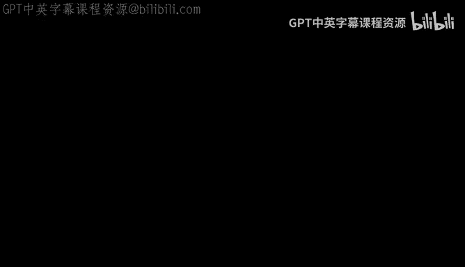
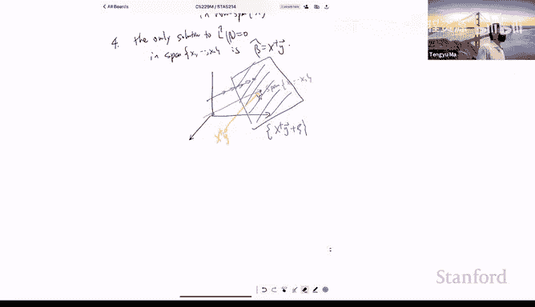
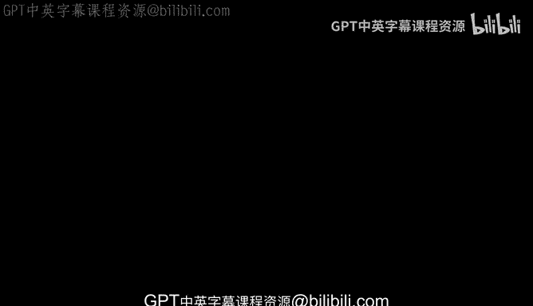

# 斯坦福大学《机器学习理论｜CS229M Machine Learning Theory - Fall 2021》中英字幕 - P13：-13-14_ Neural Tangent Kernel, Implicit regularization of gradient descent.zh_en - GPT中英字幕课程资源 - BV1jT421r71m

Okay， hello， everyone。 Let's get started。 So last time。😊，What we did was NTK。

 the neuroreent kernel approach。And。So today we are gonna continue with that to finish the last part of the neurotent kernel approach。

 And then we talk about。😊，On the so called implait regular effect。So， last time。Briefly。

 we recall that last time we have。And the following。So。We have claimed that there are two steps。

 three steps。And this analysis is an N K approach。 So one step is that you say。

You see that F theta x is close to G theta x。In some neighborhood。Oh， wait， oh， sorry。

There are too many steps in this setup。 So I always forgot some step。嗯。The。

 the worst step I would forget is that I forgot to record all。Then like， other， you know， this one。

 you can remind me。 but if I forgot to record then nobody would remind me。 So。

 so that's what that's the thing I check every time。Okay， cool and。

I think this is recording this is recording and you can you can hear me on Zoom， right。

 maybe recording thatll be great。Nobody this seems to say anything， but it， it sounds like the。

It's a recording。It preing audio。 Okay， so。So来。So， so。

 so last time we we we said that if in some neighborhood， theta。Around B setta 0。

 you can have accurate， accurate approximation。 and recall that the B setta 0 was something like a neighborhood of size。

 something that depends on the sigma。 So B theta 0。Was defined。 We， we show that if you look at。

The neighborhood where。You have some state where datata is close to set 0， with distance。

Something like。Scro an over sigma。Then you indeed have something。So嗯。

I guess you get how well the approximation is。 I think the approximation in this neighborhood。

The approximation。E。Is something like beta squared n beta n over sigma squared。

RightThat's what we had。 and also in this neighborhood。2 in this neighborhood。

So there exist at a global minimal。Withever。0。Nobody seems to respond to my request。

About confirming that the audio is working， but I don't know。There are only four people here Oh。

 okay。哦。Okay， so you can hear hear me Okay， thank you so much。 Great， great， thanks。😊。

It's just sometimes I， I get paranoid by this。 Okay， thank you so much。 Okay， cool， so。😊，嗯。Alright。

 so this is what we proved last time。 And we discussed you， this quantity is the key thing。 right。

 Beta over sig square is the very key thing。 And if it goes to 0。

 then that's great because your error becomes smaller and smaller。😊，嗯。Oh， I see。 I cannot hear you。

 That's the problem。I see。Probably now I can hear you。 I think my speaker is very。The。

 the volume is very low。O， cool。 thanks so much。😊，搜。And now the third step。

 as we discussed last time， is that， and we have discussed various cases where this beta sigma square over is goes to 0。

 we discussed two cases。😊，And today， we are gonna。Talk about the third step。

 where we show that optimizing。Optimizing。Optimize。With。I theta with a new network is similar。

 similar to optimizing。With G系。And in some sense， the only thing you care about is an analysis of。

The optimization for F datata， But you want to do this kind of like relationship so that you can make the optimization easier。

And we also briefly discussed， know what we do with this optimization。

 I think there are two ways one way is do there are two ways to deal with the G theta。

 So I think there are two ways one is something like using strong convexity。

And the other is using the only the smoothness。And and today， we're going to focus on this case。

 which doesn't require too much of the background about optimization。Alright。

 so now let's go into the detail。So by the way， I think a small remark before I go into the detail。

 So why you care about the steps 3 in some sense。Right， so it probably there's no other reason。

 you know， Okay， so there's one reason which is that you want to understand what happens when you optimize over new networks。

Right， but suppose the solution， the the understanding， suppose at some point。

 like we are at a moment where we want to prove this number three， but we haven't succeeded。

But you probably would question yourself， you know， why I care about such a answer。

 Even I prove this answer， why iss interesting。And and the answer is， yes。

 it's not that interesting because， you know， if you prove that optimizing over your right work is the same as optimizing some linear model。

 right like a kernel method， then why not just using kernel method。Right， so， so， and。

 and it turns out that that's indeed true。 Like， you know， if you use kernel method， you are not。

 it's not gonna work。 If you optimizing my work in this way in this particular inization with this particular learning race and so forth。

 It wouldn't work as well either。 So， so in some sense， this is。So this whole theorem。

 the value of this theorem is more is only for showing that under a certain regime。

 optimizing over new work is the same as optimizing over linear model。 but， but there's no any。

Like bigger impact in some sense。 like just because you' are optimizing the new working in a weird regime。

 which is the same as which is the same as optimizing kernels。 And in this regime。

 nothing works very well。But still， you know， for the technical reason。

 let's still try to go through this。 You know， it's not super complicated。 And I think in some sense。

 the techniques is kind of also， it's kind of useful because。

Partly because I think it's somewhat surprising because at the first place。

 you wouldn't probably believe it。 right， Why you believe that optimizing the right work in any case would be similar to optimizing kernels。

 And this shows that that's possible in some cases， even though that case is not that。

Informative that that kind of like useful。Okay， so let's analyze so we start with， you know。

 the first step。 we start with like analyzing the， the optimization with G theta。So。And。

 and this is really just a， you know， linear regression， right？

 It's really opt understanding optimization of linear regression。😊，So you take。

 so the problem is really， you take mean of this y V minus Phi Delta theta。To nu square with GD。

And just to briefly recall the notation。 So P is this feature matrix， which is of dimension N by P。

So this is N by P matrix， and each row is something like red F theta。And 0 x。i。Trans transpose。

 I say， you put all of these as rows。 You know what exactly this fee matrix is， You know。

 doesn't matter so much anymore for the for the rest of the discussion， because fee is just a matrix。

 And Delta theta is the difference between theta and theta 0。

And we are just optimizing over the theta。And what you do is we just take gradienting descent and you'd say then the gradienting descent。

As you take the。Gient， the gradient is fee transpose。Transpose times y back。Mus p deelta。Right。

 this is the green update and。One of the kind of the features of this analysis is that you are looking at the convergence。

The changes。In the output space。And in some sense， this is kind of like to some extent， this is the。

 the spirit of the kernel method。 where you're looking at not the parameter。

 You don't look at the parameter space， but you look at the output space。 You know， you know。

 and when you look at the output space， it's kind of like you're looking at the function space。

 to some extent。But， you know， what does that mean， that means that you're looking at the。

 the output y at time T plus one。So this is defined to be just the phi times deelta theta8 T plus 1。

I guess by definitely， let's define the version with T。So。

 and you look at how you change the residual。Over time， right， so。You compare。

Your output at time T with the car output at target output way way back。

And how does this change over time and this is just。The definition。And they plug in。

The definition of theta T， which is deelta Theta T minus Eta。Phi transpose y V minus p。这ta非塔。

Mus y back。And now this， you know。Acquire some kind of like real arrangement to make it look cleaner。

 And how do I rearrange this， I guess I'm going to。First group， everything。嗯。About the Alta theta。

 So you group this term in term related to this。This is also时调查题的题。So， so you get P。

Minus Eta phi transpose phi。I think I'm missing something here。😔，What's wrong with one moment， sorry。

Yeah， okay。 I think I'm right， so。So if you look at what is multiplied in front of this term。

 there's this one， this one， right So there are three things。Mip multiied in front of the sayta T。

So this is the multiplier in front of the T。 And then you look at the multiplier in front of y。

 y back， then you get minus。Eater free， free transport。Plus， identity。W back and and interestingly。

This， you can write it as。I E feehi trans。Certain。Fee。😔，Can you write this as Eta fee fee transpose。

Times fee。Dta30 minus I minus8。Fe fee trans。W back。And then you get I E。Fhi trans。

Do take the T minus y back。 All of these are basically just a standard calculation。

 I think some version of， you know， if you take some version of like a linear regression course。

 then probably you would have seen， you have seen this。You thisす。So that's the， the update。

 That's the recursion for the residual of the， of the output。

And you can see what happens is basically your residual in the previous round got multiplied by this matrix。

 And what this matrix is， This matrix is。😊，AA matrix that is smaller than identity because you have I in mind in something。

 and if something is a PD matrix。So you are shrinking your residual in some way every time。 So。

 and you can quantify how fast you you are shrinking。 So if when Eta is less than two over sigma max。

F free transport。And I let's define this quantity， let's call it one over two tau square。Then。

You can show that。This convergence， then。I minus Eta P Phi transports can be shown to have。

Operator norm less than。嗯。1 over。一厂。😔，操一趟。I think I have some。It's a signal square。So。

 and then you have， okay， so this， I'll show this in a moment。 But suppose you have this。

 Then you know that Y T， y high T minus Y y。In two norm is less than。

The operator normative of this matrix。Times。Sorry， let's take this TV T plus T plus  one。

When back to no。 So this is less than1 minus eta sigma square。Y had T minus y。2 norm。 And this is。

 if you do a lot of recursions， you get y minus Eta sigma square to the power T。

Plus one times y x 0 minus y 2 norm。 So you have a exponential decay of error。哦。Yeah， yeah， that's。

 that's a good point。 So Sigma is the minimum I I。Value of fee。And let， let's。

 let's prove this right now。 So this， let's say this is number one。 But suppose you have number one。

 Then you have all of this exponential decay。So now let's prove the number one。So。嗯。

How do we do that。So。Establishing。1， so intuitively， it's just really that this is a matrix X PD。

 So that's why you subtract something。 right， you your operator normally is less than one。 No， right。

 so， but we need to make sure we know exactly how small it is。 right it cannot be。😊。

If it has to be strictly less than one， that's why we needed this equality one。And， and to say this。

 I guess， you know。There are multiple ways to see it。

 But I think the way I tend to think about it is that。 So first of all， sigma。😊，Is sigma mean。Of P。

 which is also the sigma mean。Of fee phi transpose square root。

This is just by the standard property of the singular values。 So， so， so I guess， you know。

 one way to think about this is that if you look at the eigen single。

Either eigenvalue or singular value。Because this is a PSD matrix， so it doesn't matter。value you of。

If he transport。Then let's say suppose the eigenvalues are tau1 square up to tau1 squared。

And then tallu1 square is equal to tallu square。 That's a definition of the sigma max， right。

 and and tallu。N square is the sigma squared。 This is my definition of the sigma mean。And， and you。

 and then the I minus， we care about this matrix。So， this one has。

呃 singular value eenvalue or singular value。1 minus E tallu1 squared up to1 minus E tallu n squared。

RightThis is just because。I have singular value 1， so。I'm not sure whether this is。

Do you think this requires proof， This is just because I guess there are， many ways ways to see this。

 for example。I guess the best way for me to see it is always a tick。

Eganiccon you P is U Sigma V transpose， where sigma is this matrix with tall n up to tall n。

And then I minus。Fhi P transpose， Eta transpose iss just。I minus。一昌。要。Sigma squared。You transpose。

Right， and， and。And， and I is equals to U U transs。Transpose。

 and then you get U times I minus Eta sigma square U transpose。 And this is the I B D。f。Or。

 or the eic composition or SVD for for I minus E P P trans。

And that's why what's inside is the eigenvalues or the singular values for the resulting matrix。

Right， so， and， and， and then now you bound this， right， So， so they are， but。

 but if you care about the operating now， car about the largest， the absolute value of the aigvalue。

 Right， So， so basically， that's why I minus。Iter transport。

The opera norm is larger less than the max over J。1 minus eta tau j squared。Thatse value。

And I think your eatta is guaranteed the choice of Eta。

Is trying to guarantee that you never get to the negative side。

You try to make sure that Eta is less than。1 over to tallu squared and tau is the largest one。

So that's why even the largest one is， even the。The largest tall will not make the 1 minus E tallu squared negative。

 So everything is positive。 So then。Then， this is。啊。This is just equals to1 minus Eta。曹恩。Square。

 which is equal to minus eta sigma squared。Okay。So。😊，Sounds good。嗯。Yeah， in some sense， these are。嗯。

You know， in sometimes the basics of optimization。 But we， this course doesn't require optimization。

 That's why I'm providing some， some basic tools here， so， and。Right， so。Okay， so。

 so basically we are done with the， the an analysis of this linear regression， right。

 after you have this， you， you know that you are your error is decaying exponential fast。

 And then after sufficient number of iterations， your error is small， right， so。😊，So basically。

 maybe let's call this two。 So from two。You have。After。For tea is at most。

Something like log1 over Epsilon over E Sigma score iteration。So you ever， Y hat T minus y。Work。

It's less than Epon times the initial。And， and you can take Eson to be small so that you can。

You can have a， you know， you can， you can take apps to be very small， right。

 because it is logarithmic decay of errors。Okay， so。So， so this is analysis for G。

 And now let's talk， talk about analysis for F， right， So， so。Youll see that。Now。

 Naus for F is very similar to this。 just with some， some tweak。

 Maybe let me state the theorem just so that we have a formal statement somewhere。 So there exist。

A constant， says C 0。0 and1。Such that。When this key quantity B beta over sigma squared is less than c 0。

For sufficiently。Small eater。 and eater could。 This could depend on。Which could depend on。Beta sigma。

 maybe the dimension P， so and so forth。I think you can have a comfort bond for the for how small Eta has to be。

 but I I'm just lazy。 I want to， you know， not I'm lazy， but like I want to hide these details。 know。

 I'm also lazy， but I also want to hide these details so that it is's not too too complicated for for the for the exposition。

 but you when you have sufficient small Eta。 then in T is equal to log one over eson over Eta sigma square steps。

😊，The empirical loss for the F T。It's also less than， it's less than a。So， so。

 so the empirical loss for the， for the new artwork is also has having this error absolutely。

So how do we do this， So the， I guess we have kind of discussed the intuition already。

 So the intuition is that you always have tried to kind of relate this to the G。 So。

 and here by relating to the G basic， you will just try to follow what I means is really you try to follow the proof you had before。

Like just try to imitate as much as possible。 and and of course， there will be some differences。

 and you deal with the differences。So。😊，So I think one difference is that， by the way。

 this is a proof sketch because I'm gonna omit some small technical。😊，Dragons。

 which is not super important。 So the important thing is that you have a changing。Fe， in some sense。

So this is what the difference in new networks when you have new networks compared to the。The， the。

 the， the linear regression case。 So you see why this is the case。

 So suppose you define this fee fee sub fee superscript T to be the。The the kernel at time T。Right。

 so this is the。This is the N T K kernel。 When you tailor expand at time T。

And if you telex expand time T， then。Then the gradient descent， we。

 I think we have discussed this before。 but now you can see it explicitly。

 I think I have claimed that if you tele expand at time T。

 then gradient respect to the approximation is the same as the gradient with respect to the。

The original phone， the， the the， the， the menu， right， So this is what I， I think you wrote。

And very on here， this is a remark。 So if you take expand time T。

 then the gradient with work is the same as the gradient with respectful linear function。😊。

This is just because these two things agree。 This is。

 this is a these two things agree at this point up to first order。

 So that's why even youre composed with a loss function up to first order， they still agree。So。So。

 and here you can even see that explicitly so suppose you write out the gradient。😊，Of the。

Of the loss function， I I say T。 then what you get is that you have one over n。啊。

You can do the chain rule， so you can get this is。Y， I minus F sayta T X I。Times gradient F。

C角 T times X I。You can verify this just even without having using the remark ahead。

 but this is just a chain rule。And， and then this is equals to。嗯。If you write。

 if you view this as the， this is from the fee， this is the。The eyes roll of the feet， right？TheYes。

 so this corresponds to I fee， and this corresponds to the。

 the difference of maybe let me write this more explicitly。This is why。I， minus y。I。Right。

 times the gradient。And then if you write this as a vector for matrix magnification form。

 you had P T， which corresponds to this one。And then you have why。V minus。Why hat。T。

And there's a wall ring in front of it。So that's the gradient。

And that means that the update rule for sayta T。I think I信号入C的T。Yeah， for Delta set T。 I guess I。

 I'm gonna to use C T instead of data set T。 They are the same， right。

 They are just only different up translation。 So C T plus 1 is equal to set T minus Eta。😊。

Times this gradient。And this is equals to theta T minus-1 over n times 50。喂喂喂 h tea。And。Okay。

 so now there is a little bit kind of like。Sn。嗯。Thing here。 So suppose you say。

You you give a name called this B T。 So then this is。Let's see， through。一ton over。So this is这 T。你条鼻T。

So I'm going to try to， okay， so what's the our goal。

 Our goal is try to deal get a recursion for the wise。

 That's what we did before right recursion for the wise。And how do I get a recursion for the Ys。

 I have to look at how the y changes， what is what is the y。

 This is one entry of the y Y hat I the output at time T plus1。

But I want write this as a something like related to the time item the。

 the the function output item T。 So how do I do that。

 This is a non nonlinear function before we just， you know， do a linear math。

 because before we just know that。if this is G if this were G， then this is just equals to phi。😊。

Time the tell T plus one， right if， if this F was， was G。 But if it。

 but because this is non nonlinear， we have to do something。

 So what we do is we try to tailor expand。At time T。So that you can have a relationship between。嗯。

C到TNCT plus one。😊，So if a Taylor expand， you have to write the gradient of eon。T X， I。And times。

 the differences between。TheTo iterate and plus some， something。High out， right？And。

 and if you look at what's the difference， the difference is a function of Eta， right。

 The difference is exactly is Eta B， T。So that's why we can write。Plus， gradient， I's say the T， X。

 I。Times minus Eta BT。And plus， the， the second other term will be a cadratic in the。

 this will be cadratic in。This way， if I'm going to write it。Somewhat。嗯。Informally and。

 and more formally， I can write this as。Something。A function of like Eta square times something。

Because the， the， the difference has a eta in it。 So that's why you squared。 you get Eta squared。

 So in some sense， this is a term I want to ignore。😊，I'm trying。

 I'm trying very hard here just because I' want to ignore this term because and the reason why want to ignore it is because it's Eta square。

 right， So， so， so basically what I'm gonna say is that empty T， the constant， you know。

 is not a function of， is not a function of。Of Eta。

 So if you fix everything else and just take Eer to be very small。 So if you take Eer。😊，To go to 0。

 then the second other term， the Eta square m term。It is neible。We can do this more formally。

 but I don't want to go into so much dragons。 But there' is a way for you to kind of bond M T by something。

 right， whatever you bond it， right， So you get a bond for M T。

 And then you just say that if it is small enough so that it has square M becomes negligible。

 That's that's basically how you formally do it。So。😊，So if you ignore this， this second order term。

 then everything becomes so simple。 right， So for now， let's ignore the second order term。😊。

Then what you have is that why。Hi T plus one。This is equals to。If you put all put this equation。

 let's call this equation 3 in vector form。Reor form。

 then you get y T high Y high T plus one is equal to y height T， because this is y high T。And plus。

 this linear function of B， T， right， So what is this， This is really Eta。- E times。啊，飞。Transpose。

Fitch transport。Time B。I guess actually， this is right。 So， yes， fee transfer times B T。

And then plus， something like。Eta squared times some constant。

I'm gonna keep this just for a little bit so that But， but essentially， I want to ignore it。And。

And then you can rerite this as well high T minus Eta free trans post。

 And what is B T B T is this difference between C L T and H L T prime is this something like this。

 right， Let's you， let's go back to that， so。I fee。嗯。Wait， I'm not sure why I'm missing O。

I have a constant here。Oh， I see。 I see， so。I think it's one over in。

I guess there's some mismatch in my notes like a， but it doesn't matter。

 So let's have the one over in here。Well， like， like for the linear regression case。

 I didn't have the one over in the loss function。 I now I have the one over。

 And that's why it's a little mismatch。 But isn'' it's not a fundamental。Difference， so。

So let's have the one over and。 then you have。This is actually， this is VT。Sorry， this is V T。

And then， you have。eer肥 tea。V T transpose。Times why work。M wife he。I'm small。嗯。Maybe let me。

How do I do this？So let me ignore the one over and。For， forever， because， you know， you can。

 you can redef a loss function， whatever you want， right。

 Like let's say just we don't have one of in a loss function。Sorry， so。So。Then you have this。

 And then this becomes。嗯。If you。Subtract。Right back from。From both of this。

And then you re organize this。So， youre gonna get。This is equals to I minus E to50。Fity transport。喂。

😔，At T minus- y y。I think there's somehow there is a little bit problem with them。

There's a little bit。 I think this is a plus。 This is a plus。Okay， but the point is that， you know。

 basically， if you compare this equation。I guess technically， you still have some。Itter square term。

Which we don't care。 If you compare this equation with the recursion before。

The recursion before was this。Actually， maybe here。

The only difference is that this matrix is different。

But before you are multiplying with a fixed matrix P P transpo。 and now you are using。

FT飞T transportse。So。😊，So， but， you know， everything could be the same if this V T。

 but you don't necessarily need it to be the same， right in the original proof。

 you only need this matrix to be。Smaller， only needs I minus E of P P transpos。

 This matrix to be smaller than identity。Right， so suppose we ignore。The Eta square m term。

Because it's second order。 And then suppose。Cta t minus theta 0。Suppose you are in within Sigma。

For a bit。Att T。Then suppose， okay， So suppose you are not very far away from the that 0。 Okay。

 so then you know that P T minus P。In two norm is less than sigma over 4。 This is by。Lptciousness。

Of fee， this is our assumption。And that means that sigma mean。A VT is。

Not very different from the sigmaome of phi。See minus sigma over4。 This is larger than 3。

4 times sigma。So sigma mean of PT is also good。So， so you， so， so the eigenvalue。

 So you still have a lower bound for the eigenvalue。

 It's just a little bit weaker up to a constant factor。And that means that I minus eat Fi T。

FT transportpose。O norm。Is less than。1- Eta times3 over four times sigma。Right。

 so very similar to the before。And then， so， but there is assumption here。 So， so this sounds great。

 right there， But there is a assumption， which is that state P is not very far away from set 0。

 This is something you cannot take for granted。 You have to prove it is the case。

 So that's why we have to inductively。 So basically。😊，The， the only thing left is that we need to。

Inductively。Prove。This proves that T。usta0 is never too big。That's the， basically， that's the。

That's the thing， and。And in some sense， this is expected because you need。

This is expected because in some， this is expected。Because。Re that theelta set hat the two normal。

Sa say the hat was the the global minimizer。 like we。 This is the。Global meaning that be constructed。

In the last。Actually， so we said that there， there is a global mean of size squared and over sigma。😊。

Right， so， and。And， and because there's a global mean with this size。

 And if this is much much less than sigma over4 beta。Right， so when。Sigma。

Beta over sigma square is sufficient and small。Right， so so I guess this。

So beta over sigmas very sufficient， small Then you have this in equality。

 And that means that there exists a global mean within this region， Sigma over4 beta。

 If there exist a global mean within this region， why you should leave this region。

RightThat's why you should somewhat expect that it's always in within this region。嗯。

And how do we formally do this， I think you just say formally。You just do a induction， right。

 because you know that。I guess， scrolled。We know that。1 over an。

You see whether I made a mistake here。 So one。Overs scrowed times。Where high t minus y。Wack。😊，啊，5。0。

 this is all one， because every entry is on the order of all one。 So you have n entries。

 So you and then inductively， you can show that。😊，You can show this implies that。

We actually have you know exponential detail of error。 But actually， even you don't care about that。

 you still have。For every time you have this。And for if for every time T， you have this。

 then it means that。嗯。I skirt and。Phi sigma T minus s sigma hat。2 norm is less than。O one， because。

 say the hat is the the ground truth very。 I is because。Phi say the hat is equal to y back。

So how is the construct with the one that we constructed lost lecture。

And then this means the setta T minus setta hat。2 norm is less than squared and over sigma。

 which is expected， right， You are seeing that your。Your。

Your iterate is not very far away from your target had。

And then you also know that your target at hat is also not very far away from。So， we also know that。

The target， this is also less than。I guess there's a big O here。Big O squared in over sigma。Because。

This is what we did last time。And then by trying the quality。We get set t minus theta 0。S less done。

Sa要题 my say hat。At say the sorry， say the t minus the height and say the height minusta 0。For now。

 which is less than of square and sigma。And this is less than sigma over4 beta。

If beta over sigma square is less than， much， much less than one over squareton。So。

 so this is how you inductively maintain the distance between see that how do you inductively show that。

嗯。C T is not very far away from 00。Yeah， the， the， the， the step sounds a little bit complicated。

 But actually， the in is very simple。 It's just that you。Like。

 there are probably many ways to prove this。 Like I， I just present one way。

 So there's already global minimum there。 So there shouldn't be any ways for you to。Lve and。

 and what you do is basically you say that you have a set hat here。 You have set 0。

 You know that these two are。The distance between these two is of。Scord an over sigma。And。

 and you're optimizing。 And in sometimes， say head is your target， right。

 because say the headaches has the， the best fitting。

 So you're somewhat moving even closer to set ahead。

 So why not you should have even bigger distance eventually afterwards。 So， so， so， so， so that's。

 that's why。That's why this is working more。 So if you look at the the itererate。

 I think you are somewhat moving to say that。So， okay， so and after of all of this， right。

 So then we got to this。Equality。And when， with this equality， we got that。Y V T plus 1 y V。

Where had T plus15 is less than。T minus y V 2 norm minus E。Times3 over4 sigma square。

 And then you can do a recursion to get exponential decay of。Okay， any questions。

I think I made a small typo somewhere in the assumption of the。Sorem， I need to fix that。

I think my assumption should be that this is less than C over scrolled N。

But it doesn't really matter because you can make beta and sig if you change as， as we see last time。

 or if you make either them with bigger or the alpha bigger。

 you can make beta over sigma square arbitrarily small to small。 So。

 so it doesn't really matter matter。Any questions。我了。是。分件可。也不是。支住了。もしの。你不能。でどこじ。So。I guess， you know。

 I， I think I I。There's one version to like， let me rephrase your question and let me know if it'。

 it's not what you asked。 So I guess one question you could ask is that whether you really rely on the exponential decay。

For the kernel case to， to have this relationship between your network and kernel。

I think the answer to that is no。 So， so the second type of approach that I somewhat outlined last time。

 but didn't really go into detail。 That approach doesn't require that you have exponential decay of error。

 So in that case， both the kernel annual work can you can only show them to have some polynomial speed of decaying。

Like， the error is polynomly in T。 So you can still make this relationship。

 So so exponential decay is not， is's not that important of。

 but I think this is actually something that people realized after the first few papers at the very beginning。

The very first paper using this exponential thing and people thought that because you have exponential decay。

 you con so fast， so that's why you don't leave this neighborhood。😊。

But I think you can do something so that even without expenditure decay。

 you still don't leave the neighborhood because why will leave the neighborhood。

Probably depends most on whether in the neighborhood there is a global minimum。Right。

 if there is a global minimum in the neighborhood， but somehow you cannot con to it exponentially fast。

 that's still probably fine as long as you con to it eventually。😊。

So I'm not sure whether that's what you asked。😊，嗯。O。哦。そな。我们。所是说。对一个就是。Right， right。

 You do want to say and also， you want to。You know， you want to characterize the the networks， right。

 So if， if they， they don't have the same property， right， you and you somehow can opt。

 can analyze the optimization of neural networks。 That's fine。😊，But， but I think the， but then。

 but they become true。 But the， the， the relationship is something to help us to， to reach the。

The gap between what we knew and which we don't know， right。

 So for new new network is something we didn't know。 But the， the kernel one is something we knew。

 And， and， and if they are similar， then you can hope to analyze the new network。嗯。Yeah。

 so I think that's that's why we show they are doing something similar。Okay， allright。

 I think that's。嗯。I think I have a little bit。More things to， to add about the neurotent kernel。

 I guess we've discussed this many times。 like the。

 the limitation of neurotent kernel is that you only。And most do as well as the kernel method。Right。

 so， so they are kind of so basic question is， you know， how。How well a kernel method can work。Right。

 so are we really characterizing the power of deep learning， right。

 if deep learning is only doing as well as kernels。Is it really， is it good or bad， right， So。

 and the answer， I think， is that at least， I think most people believe in this。

 The answer is that kernel neural work can do much better things than kernels。😊，And。

 and this character of the newight work as kernels is not characterizing the the true power of Newight work。

😊，And you can， you can try to， you know， say this， you know， in various ways。 So there are various。

 there are a lot of papers that tries to do this， right。 So beyond N T K approach。

 I guess if you search beyond N T K or beyond lazy training， you see a bunch of papers。

 including some of my papers。 So， so we try to analyze deep learning in different regime。

 but there is， there's a simple separation， if you don't care about the optimization performance。

 if you just care about the power of the。The regular and， and， and， and the the。

The if you only capital a statistical， I aspect， it can easily show that new network can do better things than kernels。

 And this is。😊，This is a example。 So the example is something like this。So。

So I guess this is an example where。N T K or any kernel method。Is statistically。Limited。So。

And in some sense， the intuition is that the limitation comes from that。The colonel the colonel。

All the features。Are fixed。In the N T K approach， you don't have any adapt adaptivity to the data。

 So your data probably wants to use some features。But， but you are using a fixed feature for。

 for your data。 So， and， and this is a simple case where you have have such a concrete example。 So。

 so suppose you consider。This case where X is in CD。And， and y is in plus 1 -1。

And let's say each of the Xs are just a uniform。Like I D Gaussian。 So X I is the I example， I index。

The superscript is for the examples， and the subscript is for the， for the dimension。And。

 and let's say Y is equal to x 1， x2。 So you have a very simple function。

 which is just learning the product of the first two dimension。Of the data。So if you draw this。

 suppose this is x1。 This is x 2。 then you just have。4 different combinations。

 And this is a positive example。 This is an negative example， Po example。 this is negative。

 and this is negative。So so this is not linearly separable because you have this four points that are。

Position like this。 So you have to use a non nonlinear model。Or a linear model on some feature space。

Right， so if you use new networks。And suppose you regularize。 Suppose you regularize。On the L2 norm。

And this is equivalent to。To regularize。This norm that we discussed right this norm C theta。

 which is something like sum of。嗯。Ai。W I。I'm not sure whether you to remember this。

 whereas when we have this neural work， which is y is equals to something like sum of AI Sigma W I transpose X。

 And you can define this complex measure， which is the。K of like the path norm， right， And， and。

 and we have shown that regular L2 norm of the all parameters is the same as recognizing this somewhat complicated norm。

 which。And and which gives the actually the complexity gization guarantees， right。

So we' have discuss this。 And in some sense， and suppose you use the neural works。

 Then what youll find is the the best solution。😊，By， by by， by the best solution， I mean。

 the minimum norm solution， the minimum。Norm solution。Is a， is a sparse one， right， is uses。

A sparse combination。Of new rules。So basically， the best solution， actually， you can， in this case。

 you can exactly compute what's the best solution。 I'm not going to prove it， but I think it's。

Something relatively believable。 So to the the best solution， first of all。

 doesn't really use any other dimensions。 That seems to be believable， right。

 Why you want to use any other dimensions。 If your function is only the first function of the first two dimensions。

😊，And you only have to use something about the first two dimensions。 You only need the following。

4 neurons。 So one neuron compute。X1 plus x2。And another new room compute。Minus x1， minus x 2。

And even another new compute that computes value of x 1 minus x 2。

Another one that compute value of x 2 minus x 1。So I claim that this is actually equals to the function。

 And if you want to verify that， I can briefly do that， so。Ralu of x， value of T。Plus。

 value of minus T。This is equals to apps's value of T。So， so this is equals to x 1 plus x 2。

Mus x by minus x2。And， and now I claim that this is actually equals to x 1 times x 2。

When X my x are both binary and how do you see this， I guess the only way I can see this is just。

Like， try all the four combinations。 where， if X1 x2 R have the same sign， then this will becomes 0。

 and this will becomes one。RightIf x 1 x2 are either both one or both minus-1。

 And that's is the case when X 1 x to product is one。 And if x 1 x2 have different sign。

 then the first term is 0， and the second term becomes。啊 one。Wait， why I'm not。

 why I'm having a half here。 Oh， yes， and second term becomes2 right， So and you multip a half。

 and you get -1。Right， so。Good， so， so basically， if you use network and you。

 you recognize you can show that this is the solution you find。

 which is a very sparse combination of。😊，A a small number of features。 In some sense。

 when you use use regular， you find these four features and you do a linear combination on them。

So these four features are the right features for this task。However， if you use N T K。

 suppose you use N TK。Suppose using N T K， then what you do is you just don't。

 you don't learn any features。 You just try to。Do a do a L two。

 You do a dance combination of your existing features， right， So， so。In some sense。

 what you do is you say。I guess how do I。Say this in the best way， so。So， so basically。

 when you do NTK， what you learn is something like。嗯。Sorry， why I'm not。I guess。

 I guess I can see the theorem， but I think roughly the intuition is that your why will be。

 your prediction will be something like a sum of AI sigma W I transpose X or maybe a。

 maybe something like this。 Some of AI terms。Fe of。X。Right， and， and there are a bunch of features。

 and each feature is VI。 and， and these features。Use。All the。Dimenssions。You know， this depends of。

 of course， exactly what the features are depends on what kernels you are using。

 If you use anti curve kernel， you're gonna get some feature vector。 If you use random kernel。

 you get some other feature。Some other features。 But whatever features you do。

 this is always the function of all the data， right， So there's no。

Like you cannot specialize to a special subset of。Features， and， and also。

 because you are doing a regular on the L minimum L2 norm solution for the coefficient in front of the feature。

 you don't prefer any sparse solution。Right， so， so recall that。Small I'm yeah， sorry I'm， I'm。

II'm using the wrong version of notes， so I guess I have to。Imrovise a little bit。 So。

 so if you look at N T K， what you do is you try to minimize。The L2 norm of this vector A。

 such that the data， some of AI。V I X is equal to y。Maybe不要 have这。Right， so。

 and if you do the new right work。I think we have claimed that neural network is the same as L1 as VM。

In the kernel space。 So then the corresponding thing would be you minimize the L1 norm of a such that sum of AI。

 V I， X， J。It equals to yj。So in some sense， when you do the neural works， you have a。

 you have a lot of features and you're choosing a subset of features， a spa sub of features。

And when you do NTK， you are minimizing L2 norm。That never gives you sparse combinations。

 It's actually prefers dance combination。 It's the reverse direction。

 You want as smooth combinations of the existing features as possible。

 So that's why you have to pay more samples to if you use N T K。

 because you are using kind of subopmal features。 And this can be proved in， in this case。 Like。

 you can prove that。😊，This is a theorem。Where you can prove that。Colonnal method。With N TK kernel。

Requires。And to be omega D square samples。嗯 to。To learn a problem。With a less than。

 with error less than one。And， and in contrast。regularizing much work only need。You're not。Only need。

N is equal to all of the samples。嗯。Any questions about this。

 I think this part is a little bit kind of like hand w because I didn't want to go into all the details。

 And also， this depends a little bit on what be discussed in past， right。

 So the what I1 S VM connections to the to the， the connection between L and S VM and right workss。

Any questions。So I guess maybe， maybe the just to wrap up this once again。 So， so basically。

 if you do。New network with regular。 Then you are we have shown that this is equivalent to。

Doing L1 S VM in the feature space， you are trying to find the sparseest combination of features that face your data。

😊，Right， and in this particular example， it can。Pretty intuitive that finding a sparse combination is useful because not all the features are equally useful。

 right， So these features we designed。😊，A much better features than a random feature。So。

 and that's why。Nite work with regularization could have good sample complexity。😊。

And on the other hand， we you do N T K kernel or any other or most of the other kernels。

So you are not trying to find a sparse combination of the features。

 You are trying to find a dance combination of the features because you are doing L， L2。

 You are finding the minimum L2， No solution。😊，And the features and each of the feature is a function of all data。

 all the coordinates of the data point。So， the features are， you know， not that useful in some sense。

 there's a lot of noise in your features。 You have to rely on averaging。😊。

All the noise over multiple features to， to learn something。 You can still learn something。

 but it's gonna be less efficient。😊，嗯。Right， I think that's the summary。Okay， so。

IfThere's no any other questions， I'm gonna move on to the next topic。Which is about。Implicit。

Regization effect。I'm not sure whether you still remember what we discussed in in the mystery of the deep learning theory section。

 So I'm going to briefly repeat the kind of the high level goal here。

 So the kind of the observation we had about the empirical deep learning is that we found that there are multiple。

嗯，给老婆没了吗？Opportion laws exist。And the optimizers。Has some preference。Have some。😔。

Implicit preferences。And we have claimed that， you know。

 I almost every aspect of the optimizes have some preferences。 For example。

 if you use the particular initialization。That enables N TK。 Then you have the N TK preferences。

 You are learning the， the NTK solution。And if you use some other interpretation transition。

 you have some other preferences。 And we have kind of concluded that， you know。

 if the Nicular solution is the wrong preferences。 right， So like you， you don'。

 you don't do much beyond a kernel method。 You actually do exactly the same as kernel method。So。

 so basically， that means you are finding the wrong global minimum that doesn't necessarily generalize as well as other global minimum。

 So， so from now on， we are gonna try to look at other global minimumma of this objective and see what other opt optimizers。

 you know， prefer。😊，So if you use different， you may prefer a solution that is different from the NGK solution。

同意一份的。数实是。NG哦 yeah，我我在边 NG。よろします。Right， right。 So， so， so why I called it N T K inization， Right， So。

 so the N， So this is by N T K inization， basically。

 I mean the inization under which you can prove the N T K result。😊，So maybe specifically。

 I think last time we， we have two examples， right， So one example is。嗯。

Maybe maybe the the this example is。So when the results would just work out。Right， right right。Right。

 right， right。 So， so for example， I think just when， when you have to wait thing， right。

 So like where there is a。来个。😔，Something like here。

 I think we have this overpower model we have this with。

 and we initialize with AI to B plus 1 -1 and double I to be， this spherical Gaussian。😊，And you can。

 for example， initialize something with something much smaller。Right，And actually you should。

 right if you really do the experiments for this exactly parameterization， you should initialize。😊。

Both either AI or W is like maybe a one mag some like squared M factor smaller。

And then you're gonna see much different empirical result。 And actually， we have done this， you know。

 in in the in actually in the paper know， many people have done this like it's relatively simple experiments。

 So， so here you can say the naturalurization is the the c。 right So for the other case。

 I think when you change the parameterization to see the N K regime。 I think you can say the。😊。

The parameterization is the corporate。 and and also even in this case， where even this case。

 suppose initialize the same as N T K。 S you do stochastic within decent。

 You have sufficiently large stochastic。 It doesn't have to be super large。

 but but a little bit larger than 0。 Then you will leave that initialization area you gonna converse to some other places。

 So that's another way to leave the N T K region。So， so。

 so we are going to in some discuss this other kind of like ways to basically what we're going to discuss next are either use inization to leave NK or use srcasticity。

😊，And what else you can also。嗯。use the， the learning rate， the learning rate， too。

 learning rate is kind of almost the same as stochasticity。

 because if you have larger learning rate in some sense， and you have S D。

 then your stochasticity is bigger。Right， so。Right， so so the first thing wan to do is the。

 the effect from instrumentization， the， the implicit regulationization effect from instrumentization。

The first is this effect。Of initialization。And you see that in certain cases， you， you can leave。

You know， we don't， we we don't necessarily really care about leaving N TK。

 We really care about like having a better general， right， So that means you have to leave N TK。

 but you have to do probably more than that to get better general。So。

 and so this is what we're going to do this lecture the next 15 minutes of this lecture and and the next lecture。

 the effect of initialization。😊，And I'm gonna start with a simple case where you have over parametermatized。

Over parameterized linear regression case。You need over parameterization， because you need。

I especially if you consider linear models， right， the one of the important thing is that you have to have multiple global minimum。

 Otherwise， there's no so called implicit regulation effect， right。

 because optimizers have to converse to global minimum。

You have to have multiple global minimums so that the optimize can have a choice to choose choose between them。

 So， so that's why we need over parameter regression So that you have multiple global minimum。

 actually， there's a infinite number of global minimum when you have over parameterization。😊，So。

 and we'll see say see that in this case， small initialization。Prefers。L norm solution。

And this is also the case when we in the next lecture， we're gonna go beyond linear model。

 and and the， the， the high level conclusion is the same。 If you small inization。

 then you prefer lower norm solution。So， and today， we're only going to in know。

 in the next 15 minutes。 we'm only going to do the linear models。 So。

 and this is actually not that hard。 So let's set up first。😊。

So this is a standard linear regression case you have。Something like。I guess。For this lecture。

 I'm using the lower sub for the。For the number of examples。

 just because you should really look up any linear regression book that they use。

Subscript for examples。 So， and here we don't have this。So， so each of these X I are examples。

Example I， and you put them into a matrix。And let's assume x is full rank。So means rank N。

And let's also assume N is much smaller than D。Okay， so， and， and we have a parameter。bata。So。

 you get a loss function。Y y minus x beta。2 nom square。 as you have a half here just for convenience。

This is my empirical loss。Okay， so this is standard linear regression。And， and of indeed。

 Al had beta has。Infinite。Number。Of。그로 보면。And you actually can characterize exactly what other the global means are。

 And so and other global means with error with loss0。 So what other the global means。 So beta。😊。

Its equals to supposed to take Bay to be x。Sud do inverse times Y V plus。心。Vior Zeta。OnWhere。

Zta is any vector that is autonmal。Also， orthogonal2 x up to X。I is a global meeting。

So as ask you your beta has this form， then it's a global mean and these are actually all the global mean。

😊，So and actually here。I think last time someone asked about pseudo inverse。

 maybe let me have a some quickly， some basic properties of pseudo do inverse。😊，I guess my。

My view of thinking about this job is slightly different from。The Wikipedia。

 So the way I always think about today inverse， the following。

So I always think about it when when there's in the IVD， because with the IVD。

 I can verify everything so that I don't have to remember them。😊，So。

 so suppose you have a matrix x in dimension N by D。😊，And suppose x is of rank R。Of course。

 R has to be less than either N， both less than N and less than D。

So the way how I do how I remember every property of sub versus is the following。 So I consider x。

This SVD of x， which is U sigma V transpose。And sigma is of dimension R by R。 Let's say you。

 you ignore all the non zero entries。 So and U is of dimension， say N by。R and V is of dimension。嗯。

第120。So then you know that the column span。Of U is the same as the column span。Of x。And roseband。

Sorry， the columns spun。Of V， because theres the transs here。 Right， So columns span of V。

Is the rose bun。Ofax。And also， you know that the pseudo inverse。

In this notation is you can think of it defined to be V sigma。Inverse。U transpo。

 So here all the sigma。So here sigma is a diagonal matrix with entry sigma 1 up to sigma R。

 and sigma I are all positive。So。So then this inverse is well defined。

 and x to the inverse is just this。 We segment inverse you transpose。

And now if you want to understand what's the property of the pseudo inverse。

 you can vary for yourself。 So you know， X X pseudo inverse this。😊。

It's going be what is gonna be U sigma。We transpose V sigma inverse。

 U transpose V transpose V is identity。So。So， you。Newtrans。Right。

 because v transpose V is identity sigma times Sigma inverse is identity。 So what is this。

 This is the projection。😊，To the column span。Of x of x。Right。

 is the projection of the column span of U and the column span for U is the same as the column span of x。

And x， so do inverse times x。This is equal。 If you do the same calculation， it's gonna be equal to。

V sigma inverse U transpose times U sigma V transpose， which is V V transpose。

 which is the projection So the rose band。Of X， and you can also see the dimension matches because this is a matrix of dimension。

D by D and， and， and V and the rows the rows of a V is in in the machine D。sorry。

 the the the rows of x is dimension D， the column of P is in D。So， right。 And in the case。

 when you have a， so。In the， in this case， in this case， where。X is in。And by a D， then， you know。

 and the rank is then。Then you know that an x inverse is the projection。To the column span。

Of x and column span of x now is full， the full span of all the vectors。Wait， column span is right。

The column span is the spell dot。Right， it's all the vectors。 So that's why this is just identity。

And。And x pseudo inverse x。This is the projection of roseb。Of x。

 So how many rows there are there N rows of x， and they don't spend everything because the dimension D is bigger。

 So you cannot spend everything。 So that's thiss why this is not identity。 This is really just the。

 the。The projection of the Roseman facts， you cannot simplify more。Right。Okay。

 so it's a little bit too long， I guess as a。As's a building block。 But okay， I hope this helps。

 like a， this is how I understand this pseudo universeverse。 Like， I I， I never remember what X。

 X pseudo universeverse is equal to。 So this， this is how I remember。😊，So， and， and the question。

 okay， so now we have so many global minimum， right， So， and okay， I。

 I think with this it's easy to verify this are global minimum。😊。

Because you can verify this beta is global minimum because you can say take x beta。

 which is equals to x x pseudo the inverse y V plus xzeta。😊，Thezeta is orthogonal to the rows of x。

 So that's why xzeta is 0。So you got X X pseudo the inverse y back and X X pseudo the inverse in this case is that identity。

 So you get y back。 I just claim that X X pseudo inverse is identity。😊，Okay。

 so so that's why x beta is equal to y X。 That's why it's a global minimum。 And the question is。

 which global minimum youre gonna to converse to。😊，So my theorem is that the theorem。

Is that if you initialize so green descent。On albe。Wor。Initialization。Beta 0 is equals to 0。

And sufficient smaller learning rate。And right。Actually。

 you know exactly how small taste I I just don't want to give you too， too much dragon。

 So so if you have learning is small enough and the imization is 0， then this converges to。

The minimum solution。So the minimum of solution beta heart is defined to be。那 one阿妈 all给我面了吗？

Where the minimum norm solution among our global minimum of the loss function。 So basically。

 you get this two norm for free， right You are minimizing this。

You didn't say that I want to have the minimum norm solution。 You just say I want to do winning des。

 but you get the minimum norm solution for free。And the reason why you got it is because you express your implicit preferences through the inization。

😊，Okay， cool， so。Yeah， I think I have five minutes， which is perfect for the proof sketch。So。

I guess this is actually really， really proof。 But I just I。I think I ignore some small details。

 That's why I call it a sketch。 So the first step is that if you do standard。Convex optimization。

You know that。This goes to 0。 S T goes to infinity。 right， You know that if you run for a long time。

 then you， your loss will become 0。That's。You know， I'm， I'm not going to show how do you do this。

 But this is， you can invoke any off the shelf optimization result。And the second thing is that。

 you know that。This beta hat is e actually equals to X X。Dgger X x pseudo do inverse times y back。

 right so。So， we know that。All of these are global minimum。 But if you you you take takezeta to be 0。

 then that's the。😊，哦。呃。 if you take。Sorry， I think I'm。系。Yes， if you take 0 to be 0， then that's the。

Minum numb， I think this is this， there's no X here。And， and this is can also be simply。

 simply verified because if you take any beta。So， for any data。Ogonal to x1 up to X N。

Then you look at x to the inverse by v pluszeta。 the two norm of this。This is equals to。

X to do inverse y back to norm plus。Zta to norm， plus。Two times x should inverse by back theta。

And this is larger than x to the inverse by V2 normm squared。Plus 0， because the norm is less 0。

 and this。Quantality。It's just equals to。0。Because。See why this is equals to 0。 This is equals to 0。

 because。I guess this is maybe let's say this is equals2 times y back。X。So what's this， this is。

Zta transpose x pseudo do inverse way back， right。And I claim that this is equals to x pseudo inverses by v2 norm。

Because this is0 and why this is0， I guess。This is actually a good way to practice what I had。

 So X pseudo do inverse。😊，Is we。Sigma inverse U transpos。 Sorry， U pseudo inverse is V sigma。Inverse。

 you transpo。Stden。The columns。Sppan of x inverse is the same as the。Rose fun of x， right， so and。

Zta， okay， sorry， this is trans， not。Zta is ortho sogonal。To the rows of x。

 So which means thatzeta is orthogonal to the column。Of axod universe。Right。

 so that's why Zeta times this is the Zeta times columns of。😊，Of the， of the pseudo inverse。 So。

 so that's why everything is 0。 right， So this is 0。So that is orthogonal， too。Colum span。

Of audal inverse， which is equals to the row span。Of x。Okay， alright。 So， so， so basically。

 you see that the norm is only decreasing if you set a theelta theta to be 0。 That's why。😊。

When0 is 0， that's the minimum normal solution。Right， so three。

I guess this is one two our basic facts about this linear regression thing。

 The three is what's really。About the optimization。 So you can prove that beta T is in the span。

Of x1 up to x1。You can prove this inductively。And why this is the case。

 this is a super simple induction because beta T is equal to beta T plus1 is equal to beta t minus Eta times the gradient。

And there are tea。 And what's the gradient。The gradient is ex transpose。Y back minus x beta。So。

 this is。In the columns span。Of x transpose。And so。So it's also in the rose band。Of x。Right， so。

 so basically， your update is always the span of X。 That's why you never leave the span。 right， So。

 and better， by the way， betterta， So maybe I should start with the。The beta 0 is in this span。

 Beta 0 is 0 is in this span。Of x1 of xn。And each time you update that update is N span x1 after XN。

 So by induction， you get that you're always in Nband。So basically then so far。

 because you are always in no a spine。Right， so the only solution。Soution。To L at beta 0。In the span。

 In the span。Is。This。Right， because what are the solutions。With error 0。

 the solutions with error 0 are these ones。应该 are。This one， right。 So this has solution0。 And， and。

 and among this， you know， who has， who are in the span of the row span of x， right。

 So only this one has is in the row span of x， because all of these are not in the row span of X。

 They are orthogonals， the rose spans of x。So the only solution that is in the row span of x。

I's just the first term， we just take the first term。

So and that happens to be the minimum norm solution。And that's why you get a minimum social。

And sometimes basically all the magic come from this。Right。

 so basically this is a regularization sometimes this is a。😊，This is a constraint。

Imposed by the algorithm， The algorithm say that you cannot go everywhere。

 The algorithm say you can only go to those those places where in the span of the data。

 So that's why you have to stay in the span of the data。 And， and。

 and it happens that this in the span of the data。 Theres only one solution。

 and that solution is the minimum solution。Right。So， I think。In some sense， the， if I draw a picture。

 Okay， I guess I'm running late， but real quick。 So if I draw a picture。

 I think the this is a very difficult picture to to draw。 But I think you can still try it。

 So if you， you have a。嗯。You can have a。Maybe I say this， this blue direction。

This is the span of the data。 This is suppose we only have in sometimes one data。

 So the direction of the span of the data is only one dimensional。And。And then you have a。

A subspace of solutions。Which are orthogonal。 So this is orthogonal here。To the span， right。

 This is the， this is the。This is the solution where you have this。Right。

 so it's orthogonal to the span of the data。 and the intersection part is the， the target solution。

 So the intersection。The。The intersection part is really x to the universeverse way back。And。And so。

 you start with this。You try to reach this purple plan because that's the optimization wants to do。

 The optimization wants to reach the purple plan。But optimization also say you can only go in the the。

 the blue direction。And so that's why you meet in the in the intersection and the intersection is the closest point to the origin。

Okay， I guess that's oh， yeah。到。我司。Yeah， so do you need a condition that you have to spend on the on the span。

 right， So， yes， you do， because if you don't spend， for suppose， for example。

 what you suppose to start here。So what happens is that you。Can only move in this direction。

That's what the， the algorithm says。 right the algorithm says the update is in the span。

 So you you can only， all your changes is in the span。 So you can， you can only move。 So basically。

 you basically go in this way until you hit here。😊。

So then this place is not the minimum of social anymore。

This place is gonna to have some higher norm then。The the ideal point。Yes， in， yes， in。 So you。

 you can say the imp recognition effect always happens。

 but the effect is in the minimum non solution only if your initialization is 0。😊，Like。

 you always have preferences， right， So whatever you do with in transition。

 you have some preferences about which global minimum you want to conversege to。😊，Right。

 but if you want the preferences to be the minimum solution， then you really have to choose。啊。

0 ID transition。Any other questions？嗯。don'tですか。just this is sort of saying take me down that。哦。

storyもそ。Right。そすから。上ですけども、質論。Right， right。 So， so the question is whether there's any hope that this can transfer to no nonlinear cases。

 I think。Here we are using a lot of things about linear algebra， Right。

 So we know we know what is the minimum solution so and so far。

 We you have the orthogonality everything， right， So when you have non linear， you don't have。

Most of this。So， so those parts that we discussed about the。

 the very heavily linear algebra linear algebra part。 those don't transfer at all probably。

 But somehow， at least we can find one other situation where when you have non nonlinear models。

 you can still do。You still prefer the minimum number solution and that's next lecture。So， but。

 but the mechanism is somewhat the is not exactly the same。 the only。

 so next lecture and this lecture， the， the only connections is that the， the final。

The final message of similar the same。 But the techniques are quite different。

 We still don't know how to unify them in the right way。朱房。也是说。あのと。of for。不。过来过来。有。有。可以完毕。Yeah， yeah。

 So， So you are absolutely right。 So like the the， the difficult case come from the zero the very。

 very small rate case。 I think infiniteimal， small rate case。 So even for infiniteimal smaller rate。

So basically you have a differential equation， right， you just have a trajectory。😊，And。😊。

And you want to know where the transaction goes。Right， so I， as far as I know， like， you know。

 I'm not I don't know too much about differential equations。

 but I think the problem is how to solve that equation。 Like like， you know， the the solution exists。

 You know， there's a trajectory。 But what's the where the trajectory really goes。

 That's the hard part。 I don't think we。At least I'm not aware of any papers that use tools from differential equations。

Heavi， right， So this is a useful language， right， So you can the from the language， like the。

 the the formulation of the language perspective， the differential equations language are very useful。

But。Typically， the hard part is how do you solve it？In some cases， you can。 I think there。

 I know one paper where you can solve it， but， but it's not like is using the structure of the problem。

 You have to literally solve it using some new math。

 It's not like you can invoke a theorem in in in the differential equation literature。

 say these kind of questions can all be solved。 I don't think so。

Okay， sounds great。 Okay， cool， See you next week。

