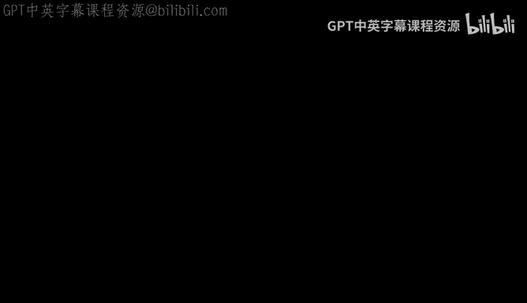

# 斯坦福大学《机器学习理论｜CS229M Machine Learning Theory - Fall 2021》中英字幕 - P14：-14-15_ Implicit regularization effect of initialization.zh_en - GPT中英字幕课程资源 - BV1jT421r71m

Okay， let's get started。 I guess everything is working now。Okay， cool。 so。

Last time we talk about the， we started talk about the so implicit regulation effect。

Of the optimizers。And。And last time we discussed the very basic one。

 which is that if you use initialitization zero。And then you use greeting descent and you have a regression problem。

 a linear regression problem。Then what you get is that you get a minimum normal solution。

This is the last time。And today， we're going to talk about a case where we have no nonlinear models and well see similar phenomena。

 But we're gonna have a somewhat different proof。嗯。So。Okay， so I guess let's the。Dve into the detail。

 So this is the non nonlinear model that we。嗯。You know。

 you will see that this is this model is nonlinear。

 but it's not actually that much different from linear model。 use， as you will see。

 there is a paper that can do little more than this。 But generally。

 we don't know how to do deal with， you know， very complex models like deep networks。

So this is the nonlinearium model we're going to consider。😊。

So suppose you have beta is the parameter and x is the input。 and the model is F X is equals to。

The inner product between beta times， O dot beta and x。 So O dot is the hard。Product。

 meaning the actualised product。 So basically， you。Entrywise squared parameter。

And then you take it inner product with X。So this is still linear in x， but it's not linear in beta。

So， in terms of like， and still the loss function。Will be。Non convex。

Because it's not in beta and you do the loss function to the square， then it becomes non conve。

So it's not that interesting in terms of。You know， the model itself。

 because anyway you are doing a linear model。 But from the algorithm。

 the implicit regulation effect perspective， its still interesting because you have a non convex objective function。

And we're going to make this even more interesting by， you know。

 consider a special case where suppose you have ground shoes。😊，Is that y is equals to。Beta star。

 O dot beta star times x。Where儿。But the star is our spouse。

So the reason why we want Bi start to be our sparse is that。Our sports means that the。

0 norm of beta is less than2。Like， you only have to。Are non zero entries。

And the reason why we want to have this restriction on beta star is because。

We want to consider over parameterized models。 if you have over parameter choice models。

 meaning so we consider the case where。啊， and is。Smaller than D。 When A is smaller than D。

 if beta is fully general， beta star is fully general。

 then there's no way you can hope to learn anything from。

 from less than dimensionality number of data points。So basically we make sure beta starts is faste。

 and so we assume。You're going to assume that n is smaller in D， but n is lower than。3poly2。

That's the setting where we are going to work with。嗯。

And more specific and and for simplicity or with all loss of general， let's assume also。

 beta star is larger than0 entry wise。😊，Because you can see that the sign of B doesn't really matter in terms of the functionality in terms of the ground choose model and actually for simplicity。

Of this lecture。Of this lecture， let's also assume that beta is just some indicator on some subset of course where。

As is a subset of coordinates。And the size of S is equal to R。

This is only for simplicity of this lecture。嗯。Okay， and now let's define the data。

 So I guess we have talked about that。 we are gonna have over parameterized model。

 So we have n data point and n is less than D。 So this end data point are denoted by x 1 up to X N。😊。

I say R ID from。高神。Of dimension spher covariance and whyi is generated from this model without any error。

So the Y I is just in product beta star times beta star。 like is this inner product。

Square of be star times X。So， and。N is much， much than less than D。 But we assume that。

And is bigger than omega。Tde of r squared。 So n is roughly bigger than r squared。And this， so。

 so this amount of data points in principle allows us to recover beta star。 Actually。

 you only need omega R to recover beta star。 if you can't dimension。

 So there R degree of freedom approximately。 So we only need n to be larger than omega R。

 But for the theory to work， we have to allow it to be larger than l square。 But still you。

 if R is very small， then you still can。Like N， much。

 much more than D and still bigger than R square。 Let's say R is a constant。

 That's probably the right way to think about it。Any polynoormmal depends on R， it's fun。

 and so that n is just something like a big constant， but n could be much less than D。Okay， so。

 and maybe so far after we defined this， you may wonder why we are。

 why we have to use this not nonlinear the model。 where the answer is， no。

 you don't have to use it if you really want to solve the problem。

So the nu model is only introduced to study this effect。 right。

 supposeuppose you really care about solving the question。 Then you can use the classical solution。

 which is called La all。 So all in the more。哦。Kind of like a you know terms using terms we we used in this lecture。

 you can use L1 regular。So， basically。Basically， so to leverage sparsity。

I think I'm not sure whether you all have this background。

 but typically people use L1 to in some sense in coverage spae vectors。

 I'm not going to get into detail there， but you can show that， you know。

 if you minimize the L1 norm of theta of the of the model， then you can。嗯。You can。

 you can reconstruct sports vectors。 So， so in particular。

 I think suppose you have this model of data。X， which is Se linear X。Then this is so called Laso。

 this is I1 regress objective， which is something like this。Plus。Lada times L normal of data。So， and。

 and the， the classical machine learning theory， I'm not going going to detail here in some sense。

 this is， you know， if you don't know the background probably just the somewhat memorized it or kind of like treated it as a fact。

 So， so the classical theory。Sa that。If n is larger than R。Say。

 I think you need to pay a logarithmic factor here。 If A is larger than R。

 then this objective function recovers the ground truth。objective。Above。Recovers。The ground truths。

Fta star。See a star， which is the。You I guess you probably already see that theta correspond theta up to this square squared and thing。

 so approximately。😊，So basically， if you just really care about solving this question。

 you view this as a linear model。 You don't have to care about the quadratic thing and then use L1 regular。

It covers spark factor。There is a rich， you know， you know a lot of like existing kind of theory about this。

 I'm not going into details， but this is something， you know， somewhat believable because。😊。

Because you are using the sparsity of the vector。And also， another thing to note is that。

Because data and theta the relationship between Beta and theta is that。

Theta corresponds to beta O dot beta， right， the M Y squared。 So then。That one normal theta。

Is equal to the two norm square of beta。The one number theta is the sum of entries of theta。

 which is equals the sum of。Beta is squares， which is the two norm square of beta。So， so basically。

 if you do the quadratic one， you can， you should recognize L to no， right， So， so basically。

 this objective one corresponds to。嗯。L to regular objective。So。

If you really want to use the quadratic one， you should do。呃，的靠 the the。

The coddirect parameter transition， you should do this F beta x。I。Square plus L lambda 2 norm。

Beta squared beta 2 nu squared， right， this is the objective。It respect beta。Right。

 so so in a beta space， you should recognize L2 norm square in a beta space， you should recognize L1。

😊，Right， so。So this is the classical solution。And now we're talk about implic regularization。

I think our goal is essentially， basically saying that if you。Use small inization。This is， you know。

 without regular， without。Expressive regularization。

This is kind of like basically doing the same thing as let's call this two。

So as long as you you small in transition with beta parameterization。😊。

You automatically get this L2 norm organizationization for free， to some extent。

This is not the exact way to state the theorem， but this is the rough。Bas的那么 idea。So。嗯。

So more concretely， we' are interested in this objective hi beta， let's formally define。

I think I normalizedize by four here just because it makes the gradient look cleaner。So。

But it suggest constant factor。 So one or4 n times the square loss， the mean。Squarearrow。

No regularization， right， So this is our objective。 and we will， we are going to do the optimizer。

Will be that you do GD。On I'll be hat beta。With。Small initialization。And almost more concretely。

 so the algorithm is for some。Very small alpha。拉 than zero。We initial betterta。

To be alpha times all one vector。So you don't know the support of beta， of course。

 you each names like all the entries。阿法。And then you take a gradient update every time。

 So you say the beta T plus  one is equal to beta T minus Eta times the gradient。还不要题。Okay。

 so this is objective were going study。 and well claim that this objective。sorry。

 this is the optimizer。 We're gonna study。 We're gonna claim that this optimizer actually actually finds the the beta star。

 even though there is no explicit regulation。😊，你快先说 far。So， so here is the theorem。So。

 the theorem is that。Basically， you know， the shorter version of the theorem is that。When n is。

 so n is omega squared， we can converge to。This algorithm。Conver this to。To be star。But let's， let's。

 but I think there's a little bit kind of like。With small alpha。But there's a lot details。

 So let me state the main theorem。So。I supposeupp。N is bigger than big of R square log。Sre地。啊。So。阿发。

没事。Maybe let's write in this this way， I think just to avoid confusion， so let's see be a sufficient。

 large constant。😊，Suppose。And is's bigger than C times R squared times log square D。

 I think the dependency on the logith factor is subopmal。

 The dependency on the R probably is also subopmal。And it all to be less than。

Some inverse poly into the sea。Then。When。The time T T is total number of。The total number of。

Step is less than one over Eer。Time squared D alpha and bigger than。Log d over alpha。Over E。

 So for this range of time steps， we have。You can recover beta O dot beta。In our two norm。

With ever alpha times squared。Okay， so how do we interpret this。So。

So I guess there are a few remarks for interpretations。So the first thing is that。

 I guess this is something problem I should have mentioned early。 So LH data。呃 heres many。佢冇面。

And why this is because。Of over parameterization。Because， you know， you have。

 like if you count a degree of freedom， you have n data points and D parameters， right。

 So you have more degree of freedom than the number of constraints。 So you have many。

 many global minimum。Right so that that's one of the reason why you have implicit biass if you want to have one global minimum there's no way you can have implicit biass and。

Second thing， how do we interpret all of these quantities in the bond。So。So， the run time。

Lower bound。Depends。Only on the logarithmic of alpha。

So this means that you can choose alpha to be anything inverse polynomial。So alpha can be。

Inverse poly。Where you can choose basically the constant C to be a constant。So。

 so so then the runtime wouldn't be affected too much。And， and error。Depens on阿法。So basically。

 if you want very， very small error inverse poly error， you can just take alpha to the inverse poly。

 and your run time is not changed too much。And theres the upper bound on the run time。

 which means that。You need to do an early stopping account to this fund。

So if you really believe in this， you have to do early stopping。

 but the early stopping is pretty mild， right， but pretty mild because you can see that。

The alpha bound actually depends on inverse alpha。 So if you take something like alpha to be one over D to the power 10。

 then your alpha bond is pretty relaxed。 You can run for a long time。😊，Right。

 so and and actually in practice， whenever never observe that you have to。

 if you really do the this synthetic example really run experiments， you never have to really stop。

 And I probably， I don't believe that you have to really stop。 This is more or less artifact of the。

Of the proof。 But this artifact is， is， is not too restrict anyways because。

It depends on alpha in in the inverse of alpha。 So you can take alpha to be small to make the bond very relaxed。

 So， so we didn't。😊，mWe didn't pay the attention to remove that completely。

 even though we believe that's possible。嗯。Anyway， so basically。

 the right way to use this is that you take offer to be something super small。 And。

 and then your error is very small。 and your runtime is。

 your runtime lower bound is log earthquake in offer。Okay， so there's one small thing is that。

Apha cannot not be 0。So why you don't take alpha to be 0。

 The only reason why alpha cannot be 0 is because。0， beta is 0 is a saddle point。So the I had beta。

At 0， at 0。This is part come from the the cadratic paraization， right， So the。

We'll compute the gradient you will see that because you have the cadratic parameter everything。

 the gradient always multiplied by beta itself， so if beta is zero， then you just have zero gradient。

😊，So， so， so， so if the green is0 and if you don't， if you and we are analyzing green design， no。

 no is nothing， right， So no one is aity。 So， so if you start at0， you will just stay there forever。

So that's why you cannot use zero。I in transition， but anything close to 0 is fine。 In some sense。

 this log one over our offer that you pay。It the log one of is what how。

 how much time you have to pay to leave the saddle point。

So and the leaving set point is actually very fast。That's in some sense。

 you can kind of reerate right， because you have a saddle point。How do I draw it like。

Some collectors。Right， so like leaving it is's kind of like you have it， it'。

 it's optimize your concave function。 and you youre going downhill， right。

 you basically accelerate so fast that eventually you you leave it very quickly。So。Okay， cool， so。

Right。And。And in some sense， you can interpret this as， you know， gradient descent。

Is preferring preferred minimum normal solution。In O2。So， so Im maybe preferring。For action。

Like a preferring global minimum。Cs to。Initialization。Right。

 because we have kind of claimed that you， you know， so， so actually here。I think we have。哦。

Somewhat alluded to this， but just be formal in this case， you can prove the following。

So you can prove that beta star is actually the a mean。Of。The norm。

With the concern that you feed the data。Suppose you try to find a global minimum。

With the minimum L2 norm。Very事。SoThis is a constraint， right。

 so this means you have a global minimum if it satisfies everything and you minimize two norm。

 then this is actually equals to beta star。😊，And， and。

 and the reason why this is true is kind of like similar to why the I1 norm works， right。

 just because。The minimum， the two normal theta is the same as the one norm of theta。And。

 and this one。If you replace this best data， then this is true。And， and this part。Is by。The。

Under standard theory。Which I didn't show。 But you know that if you look at all the linear models that face the data and you look at the sparseest one。

 it's gonna be the。TheActually technically， I think。This should be argument mean to the O dot to。

 because。To the square root， because there's a， there's a translation。Like the objective is the same。

 but the， but the the our community has the translation。 I'm not sure whether that makes。

That's right， so like， so if you， so maybe I let's it。

Maybe the easiest way to write this is the following， so。So these two are exactly the same。

Just because you have a translation。 if you look at the me。Right， and for the first object。

 you argument is be star。 And then you can。Somehow see that the art mean also transfers just by taking a square root。

So， and this is also the case for linear regression。 right。

 recall that we also prove that if you start with green descent with 0 and you do linear regression。

 you get the minimum non solution that face the data。 So it's very similar。

 at least from the on the surface， from the formulas。Like， like you have。

 you have almost the same on guarantee。把。But， but I don't necessarily believe that this is always the case for all the case。

 Like I don't feel like you， you always find the good， the minimum。Nom social。

 the solution that is closest to each tradition。Let's face the data。

 I don't think this is always true。 It's probably。I think there's still something special about these examples。

Yeah， we cannot just extralate generically。Okay， so。No。We are going to try to prove this。

 any questions so far。The proof of this theorem is pretty complicated。

I will try to finish it in one lecture， but if we cannot。

 I think I'm going to refer you to the notes， the notes has a pretty detailed derivation。So。😊，So。

 so to kind of get some preparation， let's try to understand。

Some basic stuff about this loss function。So。So first of all， let's look at the population risk。

This is the population no hat。So the population risk is。Y minus。Beta O dot beta times x。Square。😊。

Right， so， and you can try to。嗯。Get rid of the expectation， because this is population。

 So what you do is you plug in a definition of why。 So you get beta star O dot beta star minus。

Beta older， beta times X。Square。And then， this gives you。I think I have one fourth here。

 That's my population， right because。I know I have the additional four everywhere。

So and this becomes one fourth。Hamton norm。The difference in norm。This is just because。

The expectation of。Some vector times x square。 If x is Gaussian， this is equals to。

A normal be too norm。Scor。So， and。啊。And I'm going to click the following。

 So youre gonna have uniform convergence。For sports。So。

 but we don't have uniform convergence over the entire space， right。

 because we have over parameterization。 There's the。

 if you have over uniform convergence for everything， then。

They wouldn't have any implic regulation in that。So that would be the of the classical。

Theory that we discussed in the first part of the。OnThe first part of the。The， the course， right， so。

 but， but we that if you look at sparss beta， then you have uniform convertence。

So here is the I'm going to build， I'm going to build towards this。 So first there's a claim。

Which is with high probability。Over the choice of data。So for if n is bigger than something like。

O tde of R over deelta square。And for every we。😔，Such that。我。So the part of B is less than R。

 or I guess alternatively， can write the zero norm B。that's the R。Then you have the following， so。

The empirical average of this kind of things。 right， So why we care about this。

 I guess this is probably can be seen here。 right， So this is the pop the population has this form。

 something like V dot x square。 I take expectation。 And this is the empirical  one。

 I'm going to be more explicit in a moment。 But this time is， is kind of like。A small tool。

 So you're saying that if you have this empirical version of this V dot x squared。

And it's going to be very close to the population version。

 The population is just the two norm of b squared， right？So it's gonna be very close to。

The population。For， but only for V， that is sparse。So this concentration only works。 So。

 so if you have enough ns， right if n is infinite， then you or close to infinite。

 then you should expect this to work for every V。 It because this is law of law of large number or like a concentration inequal。

Right， but here the Constitution called is more subtle or more kind of like there's the finance here because you only care about。

Wes that are spas。 And also， you only have this many， for examples。 You don't have。A lot of examples。

 N is not only bigger than D even， right， N is only bigger than the sparsity of B。So。So this is， and。

 and actually， this is also called。So and also just for the language。

 I guess this is something useful to know， you know。

 we don't really have to depend on this kind of properties but。We， we say that。

If a vector satisfied this condition。Suppose I call is three。So， suppose。X eyes。Satisfy。3。

 then we call。人人为谁？This satisfied R P condition。 So basic  three is called R Delta。RIP condition。

The acronym is a little bit kind of weird， but I think there it's。Standard for restricted。I saw。

Matry condition。The reason why it's called restricted is because you are only restricting to vectors V。

But if you're not restricting to vector V， then this is a kind of like isometric condition because you are basically saying that all the exercise are iso isometric。

 right， They are， they are kind of spreading the entire all the directions equally， right。

 the exercise has covarience identity。 That's pretty much what you are saying。Right， so。If you don't。

 if you require this for every V， then you are saying that the the， the covariance of， So， you know。

 what is this really saying， This equation 3 is really just equivalent to。Some of X i。Xide transpose。

Times V transport， times V。呃啊。Right， this is like wanted by V Transse I times V times 1。

Delta rather than one minus deelta times。B transport items。Right， so if you require this for every。

 So suppose。Require。Forever we。Then what this saying is that。Some of X。X I transfer small N is。

In PSD sense。How do I write this。How do I write in P。会。哦，O。I'mBut Iingnotation for P。 Yeah。

 I like this。Less than one plus delta times7 and rather than1 minus delta times 1。

So if you query for every B， you are basically seeing the covariance of X I or as as as。

I think it's called not called isometric It colour。I saw isometric。 I saw parametric。

 it's just covari social identity， right， that's， I'm blacking on the word。 So， so basically。

 you' are saying the covari social。 But you are not requirement for every V， right， And also。

 this is not true for if you don't have enough data， right。

 So we only have n is less than D data point。 So， so in our case， this matrix is not even full。

How come you can expect a this only has rank R。Because it only has rank N。

 because only have n data points。 N is less than D。 So its no in full matrix。

 How come this can be closed。 and there's no way， right， But if you look at the quadratic form。

 right， So if you look at the quadratic form。And you only look at the culture form evaluated on sportse vector V。

 Then this matrix becomes。Effect look like identity。That's basically what this condition is saying。

Right， okay， so and once you have this lemma or this claim。

 then we know that you have the uniform convergence。For better。Spare， source sparse beta。

And this is just because， you know。Ill had data。I this one。Times 4 times 1 over n times sum of。

Beta O dot beta minus beta star O dot beta star times X， I squared。And this is off this form。

 so you can check this as V。And then you're in this form the V dot Xi square。Right。

 and this V is sparse if beta is sparse and beta stars is are sparse， beta star is always sparse。

That's our assumption。 And if beta is sparse， then this thing is also sparse。 you pay to our sparse。

It it， they were our spas， and。And now this wholeing would be probably two hours barss。At most。

 So then this means that this is close to。The norm， right， so one times four times the norm of this。

And， and this is equals to L beta。Right。So， so for spaarrs space， you have uniform from convergence。

 but you don't have uniform from convergence over the powerspace。So in some sense呃。So， and also。

 you can have。Uniform convergence。For the gradient。Of this， if you really care about it。I guess。

I think I will show this later fall。For sports。Wait， so you can even show the the the gradient。

 concentrate。哦。Around the expected gradient， the empirical gradient。Concentrate around。

The population grade。Falsepho spread。So however， on the other hand。They exist。Dance datata。Such that。

For example， L height beta is 0。But al beta is very much lower than 0。So there are。

 there are overfiing positions。 There's， there are places where you don't have the。

The property that training and test laws are similar。 So， but those are dense be。Okay。

 so the question is in why you are finding a sparse one， but not a dance one。Right。

 because the dance one doesn't have the nice property。 So the main intuition is the following。

 So we have done quite some preparation。 So the main intuition。Or。

 or what we believe to be happening is that following。

 So you can think of this maybe different X R to be。To be the spread of vectors that are sparse。

 so beta such that。Btter sports。420。So， and。So suppose you look at the space， right。

 So you have an entire space， which is probably something very large。And zero is somewhere here。

 this is the origin。And you have a。Some family of， let's call this X， R。

 This is the family of spa lectures。And。And you know， in this X R， everything behaves so nicely。

 The training and tests are just basically the same up to。😊，Like a， like up to some small error。

 right， So the training and test test and also in terms of the gradient， they are similar。

 The gradient of L head and gradient of L are similar。

And and I think basically what happens is that you start from somewhere close to zero and the reason you cannot start at zero just because the saddle point not very important。

 and you can think of like a grin descent， so you're doing grin descent。啊。

On the empirical al hadbeta。And because you have uniform convergence。

You are basically doing the same thing as green design on al beta。

As long as you don't leave this that X。Right so if you leave it， there's all better off。

 but if you don't leave it， it's fine。Right， so it turns out that。

What happens is that if you do green descent， you can consider the alternative world where you do green descent on the population。

So let's say this is the green decent。On a population loss albe。

And if it turns out if you agree on a population， you are going to reach a point。Which is been star。

 which is kind of on the boundary of this set。And because but and also in this trajectory。

 you never leave this set XR。Right， so now， because you believe that the the。

The black trajectory is similar to the purple trajectory。

As long as they are in the set X R and the purple trajectory is never leave the set XR。

So so that's why the black trajectory also cons to beta star。I'm not sure whether that makes sense。

 So， so basically。The purple one is the population trajectory。

 and black1 is the empirical trajectory。So you know that the empirical trajectory and the population trajectory are similar in the set X R。

 You don't know anything about outside the world。Right， so， and also， you know。

 the purple structure never leave the set X。 Then the black  one probably shouldn't leave as well。

 And the black  one should be similar to the purple  one， right， So， so， so for example， it suppose。

 suppose the purple structure look like this。Suppose that's what's happening。

 Then you you lose control because at the beginning， you， you are following the proper structure。

 And then you leave this set and then all that off。 you， you don't have any control anymore。

 But this turns out to be not what's happening。 What's happening is that the purple one after stay in the set X R。

For a long time， like， you know， until it reaches better star。And， and then say a bit of star。

 So that's， that's why this alternative。Situation doesn't happen。This doesn't happen。

This is not time。And。Inside this X， R， everything behaves nicely。 There's only a global minimum。

 which is beta star。 There's nothing else。 And outside X R， there are a bunch of different things。

 right， So outside X R， you can imagine that there is a。😊，That's a different color。

 So all that X are， there's probably。A quite a bunch of。Over facing solution。

So these are all solutions that makes the in。They per close 0。 There are so many of these solutions。

But you never get to actually even go to those places just because you black trajectory。

It's iming the purple one and the purple one didn't go to those places and the black one didn't go to those places either。

Right， so。So that's the， that's intuition why this is working。Any questions？妈妈。反过。

Well why the purple  one doesn't leave the。 Yeah， so that's not I don't have a。

 I didn't give a justification either， right， That's that's something we're gonna prove。Yeah。

And I don't think this this is something about the property of this problem。And。

If you see the proof is not that surprising because you are gradually。

 you are in some sense winning sense trying to， you know， it's a local search algorithm。 right。

 So you are trying to search your neighborhood first， right， So you are gradually kind of like a。

You start from  zero， Some are close to  zero。 you are gradually searching your neighborhood until。

 you find the global minimum。 That's why you don't want to probably wouldn't go this circuit way。

 right， So like so you're gonna go more straight to the to the to the closest point。😊。

But the real proof has to go through the math。But， of course， is the in vision scheme described。

Before isn in。说下我。Yeah， yeah。 that that's a great question。 So， so the initialization alpha times 1。

Right， so this is literally speaking is not in X， right， is is that。

And I gone to ask this question many times。 And I think the right way to think about this。😊。

I think I had some remarksmark somewhere else， but youre asking early。

 I should probably should just really answer it here so the question is why the in is not in XR。

But I think the thing to think about is that。Of course， it's not exactly in this far set。

But it's close and close in what sense， close in the sense。Alpha 1 is very close to 0。

And zeros is in this set。So， so that's， that's the kind of like the， the。

 the property we're gonna use。 So， so， yes， so you are right that， you know， whenever。

 we can never say exactly in set X R。 yours， you you're gonna say that you' are in the neighborhood of X R with a little bit small error。

 And the error is very small。 it depends on alpha。 So。

 and if that's why we have to choose alpha to be very small。所以算不算。You really want to choose 0。 So。

 so， so like from the all of this discussion， the only， the only thing you want to do is to choose 0。

 And， and， and， but0 just happens to be a saddle point。 that's unfortunate。

 So you have to perturb it a little bit。没有。あし。こ。こ。Okay。嗯。So the question is whether this。

 this particular property has anything to do with the positivity。Of beta， right， so。嗯。

I don't think so because so are you talking about the positive beta star or beta， the variable beta。

Beta star， right， So， so， so we assume the better star to be positive。哦。

I think no matter whether the star of datata is positive。Sorry， notata beta star is positive。

Beta star square is always positive。Right， so， so， so， so you can， if you initialize from this。

 then you just always go to the post。 It's always keep being positive。 So basically。

 you just learn the apps value of data stuff。And if learning the apps of value to star is's not that different from。

那 you被要 stop。So basically， suppose you don't restrict video star to be positive。

 Then you cannot claim that you recover video star。

 You can only say you cover the the absolute value of video star。But the picture。

 the intuition is still the same after that changes。好。我好的。嗯。Okay。Okay。Yeahep。So the question。我认个。

Yeah， so I guess the question is whether you really have to be exactly alpha times all one vector。

 right， So and the answer is， this is a great question。 The answer is， no， you don't have to do that。

 The only thing you have to do is that you neutralization beta 0。 This is a vector。

 I think you only need to make sure every entry of it。Is very small。

 so you only need to make sure this infinite norm is very small less than something like alpha。And。

Yeah， and， and， and you can even in negatively， I think。 So if you interface naturally。

 then action will become negative eventually。But the sun doesn't matter that much。 So that's fine。

Yeah， but yeah， so so， so， so， so， and I'm only doing this just for convenience because it makes the proof cleaner right。

Okay， so。So given this plan， this intuition。 So it's natural that we should start analyzing the population trajectory。

Like the purple one， right， so and then we try to say that the black one is close to purple one so so so let's start with the population trajectory。

Right， so you can in some think of this as a warm up。 or in some sense， this is a。Also。

 kind of sity check for， for this approach。Right， so。So so this is， I'm， let me。

 let me say the theorem formally。 But I think you expected what the theorem is saying right G D on the population laws will converge to。

By a star and， and。嗯。Think of lock。1 over E of over E。Tuurition。我。Epson ever。In L2 distance。ok。😊，So。

 but I guess the the formal theorem matters less than the the proof。 Let's see how the proof goes。

 The proof is kind of bru force because you just really literally control。

Each what each of the cos is doing。So， so it's pretty explicit and you see how the coordinates are changing。

 but the explicitness is actually a weakness in some sense。

 because because you are doing so explicit derivation， it's great for this problem。😊。

But it's harder to be extendable。I think that's a general thing right so if you have a version。😊。

Various kind of strong analysis for toy case。 and not that's not necessarily always the good case。

 because if it's too strong， too explicit， then。The extendability， the， the。

 the applicability to broader case becomes a problem。And， and this is， in my opinion。

 the probably the the main reason why we cannot extend to more general cases other than this simple quadra one。

 There's， there's a small cut。 Theres a， theres extension to the matrices case。

 but not fundamental extension。 So you can change all of these two matrices in the vectors。

 That's still fine， but not beyond that。Okay， so， but still， anyway， let let me do the analysis， so。

The proof sketch is that you first compute the gradient。 we call that L beta。

So l beta is equals to1 Four times beta or the beta minus beta star。

Although beta star to norm square， and you can compute gradient with respect to data。

It becomes better or the data when it be a star or the be star。Times。O dog被。

I guess you can kind of verify this， you know ways。Pretty much， you know， scalrs， but you know。

 vector version is pretty much。Taking a sum of the scalar， all the dimensions。 right So here。

 all the dimensions are。Separated。So basically it just a sum of the objective and each objective is about one coordinate。

And thiss just a simple chain rule。 And you can see that everything is multiplied by beta， always。

 right， reading is always multiplied by beta。 And this is why。Gd L 0 is 0。So。

 and now let's look at the the update。 the update will be beta t plus 1 is equal to beta T minus Eta times is beta T O dot。

不要提，lets be a star。 oh dot不要 star。Times O的贝塔 T。Okay， so， so and this is， this is really。

 this is everything is in D dimension。 But really， you can view this as the separate update。😊。

In in the coordinates。Because each coronies are not having any kind of correlation with anything else。

So， so this is really just saying that B TI is equals to B TI minus Eta。BT I square。Mus B。

Star ice square。Times。BTI。Okay， so， so every are just doing separate things。And。

And maybe maybe it's used but this different course has a lot of differences。

RightBecause this one is different。 Otherwise， all the quas are doing the same thing。

 So the target is different。So in some sense， you are basically so when。When I is in the support。

Of payta star。Which is to be us。So then your update is basically beta I It beta I minus Eta。

P I square -1。别爱。And when， I guess I'm all a T， just for， for notational simplicity。

 And if I is not in the support of beta。Sorry。Then beta I is just up to be beta I minus E。

Bit I squared cube。So， and and you can see this intuitive。

 all of this intuitive make sense because suppose this is the case then。

If so beta I is supposed it less than one between0 away that's suppose that's the current beta I。

 and this number is negative。This is positive。 So this whole thing is。Connective。

 so you are trying to increase Be。Right， so， so basically this。

 this update is trying to increase beta I If beta is not not yet reaching one。

And this update is doing the reverse direction。 right。

 So this is trying to say that as long as your beta I is bigger than 0。

 then you are trying to decrease your beta I。So basically here， this encourages。Bit I to go to one。

 and this encourages be I to go to  zero。And that makes sense because one is the beta I star and0 is the beta I star in the other case。

Right so。嗯。Okay， so and now let's try to do a more detailed calculation。To see what。

 what happens in each of this case。 So let's first look at the case 1。 Let's say this case 1。

 and this is case 2。So， case1。So， so here we are trying to， you know。

 the update is trying to increase beta I until it reaches one。 right。

 So there are still two separate cases。 The first case is that suppose beta I is less than at some time T is less than half。

So you are only half done your work。And then you can see what's the changes。

 So be I T plus one is equals to。But I T minus E。Beta I T square-1。佢IT。And。

We argue that this is trying to increase beta I， and we can see how much it increases beta I。

 It increases bitta I by this factor， Eta times 1 minus。你I t。Square， right。

 so you have a multipl factor。虽然 sometimes you multiply我俾 the eye。😊，To make it bigger。

 But how much you can you make it bigger， you know， it depends on。The value of beta itself。

 But if we know that beta is not too big， then we can bound this by。But I t times one plus eer。

1- a quarter。Which is a。Bigger than beta is equal to。Be的 I1 plus。3， four times 8。So。

So you have exponential growth。And。If。But I is already bigger than a half。Right。

Then let's see what happens。So now the growth rate might be slow， slow down because if you see。

 if beta is kind of close to one， then this this。This constant becomes close to zero。

 so your growth rate slows down。And that's true。 But what you can do is you can analyze how。

Where you away from。One from your target。And if you look at how far you're away from one。

 then you get the following recursion。Eta times1 minus倍ta I T。Square with IT。And。So。

 and let's try to reorganize this a little bit。So。I guess let's say。I think let's assume this。

 Let's assume this is。Also the last one。And then， this is less than。Sorry， to me think。

I guess I don't necessarily have to assume this。Remove this for a moment。

 This is less than one minus beta I T minus Eta。T square times a half。Right。

 because beta I T is bigger than a half。And now you can factorize this to get a factor 1 minus speed I T out。

It is 1 Eer1 plus beta I T。唱子好。Alright， and。I guess it might be a little bit kind of like you may feel like this is a little bit unnaural。

 but I think if you see my final target， I guess you know it's probably actually not super difficult too。

To guess how to do the intermediatemedia steps。 So now I'm going to use the fact that beta I T is bigger than 0。

So get one minus beta IT。1- E times a half。So， so my point is that if you look at the final outcome。

 you see that。Now， you are not growing exponentially。

 but you are converging to one exponentially fast。 So you are decreasing your error。

You are decreasing or distance to one exponential fast。All right。So in sometimes this。

 this behavior of this dynamics has two regime。 right So when you are small， you are growing very。

 very fast。And then when it becomes bigger， then your growth rate slows down。

 but you are converting to one exponential rate cost。So， so。

 so that's why if you combine this two regime， then you are you， and also， you can see that。

You can also see that this maintains。Beta I is less than one， right， So because if you before。

 you are less than one and later you are gonna be also less than one。So， so。

 so basically the behavior is that if you summarize， so basically in。Log one over。

A far over E iteration。You are in the first。 You are in the first version， so。So you。

 so this is beta I T。Growths。So a half， exponentially fast。Exponentialally， right。

 and you only need to use this number of iterations because you， you initially is， is alpha。

 and you want to grow to a half。 So， I guess technically also have a tool here， if you want。嗯。Right。

 so， and you have a learning Eta。 So， so basically， this is because one over Eta the half the power。

Suppose this T1， T 1， this is something like。At least。Sorry， this is。Gues this is your your growth。

 the factor that you grow and it takes you find some power to it。

 and then you want to grow at least a half over alpha factor。 And。

 and that's how you solve this number T1。Okay， but anyway， so。So， so this is how， okay， the。

 the first part。 and then。嗯。Log one over E over Eta iteration。背的IT。Convers to。😔，我买 episode。

And this is because you want to start from a half the error half to error epsil。

And and each time you decrease by one minus E over 2。 So that's why you have to pay。December。

还是 this你看。I guess this there is a small thing that I probably escape in some sense， right。

 So this is about how do you kind of derive how manys you need， right。

 So if you want one plus Eta to the power T to be bigger than。S number R。

 then this means T needs to be bigger than。Then log R。Over， overea。

So this is just something like burst burning into my hack。

 like you can neuro rapidly yourself as well。Okay， cool， so。Alright， so。

 so that's what happens with those coordinaterons that you want to converse to one。

And you also have case 2。And you can do the same thing。

 I don't necessarily want to bore you with all the deviations， but I guess the des here is easy。

Because you're just trying to say better I is。Decreasing right in this speed， right， so。And。😊。

And here。And here， interestingly。So。So if you really look， literally look at this。诶。

This is actually saying that you are decreasing beta I。Eventuallyual to0。

But somehow we care about something weaker， that is more。哦。Let me see。I'm using a plus here。

 So I don't know why I'm。I think I'm not missing a plus。Just just one。

 let me make sure I don't make any mistake here。Okay， so。I think。I think what I do here。

 like I have some duration here， some small claim here。Which is particularly useful for。

The the the empirical case。Which I'm not sure I can get into。 So I'm going to skip this part。 So。

 so at least for now， this it not tribute to see that beta eye is decreasing。

RightIf you start with alpha， then it keep being smaller than alpha。

 thats that sounds trivial to see。 And and maybe let's just leave it there。

 This is enough for us to deal with the population case。Right， so， so basically our conclusion is。

 you can see that the conclusion is that you converge。

So something close to one in this number of ittuerations， right。

 the each pertuation count is something like rhythmmic times  one over Eta。And。

You also have this property you， you are always less than one。

 right All the entries are less than one。And also。The， the， the the。

 the small entries are never growing。So， basically， your beta。Tea， at any time。

Basically looks like there are a bunch of entries which is growing versus in S and also in the in the I complement。

 in the I complement， all of these entries is less than alpha。Fever。

 and in this con and the N ask coordinate， you are growing potentially。So。

 so you can see that this is still always approximately R spas because at least you only have R big zero entries and all the other entries are very small。

😊，So approximately， this is still always approximately in the X R。

Just because the small answers are keep being small。Okay。

 so now let's try to talk about the empirical case a little bit。嗯。

I think this full analysis probably wouldn't within 5 minutes。

 but I think I can give you some idea about it。And actually。

 I'm going to only do the case when r is one， because when r is more than one。

It's kind of like a little bit complicated。 So I'm going to do the the the the。There are is one case。

So。So get that。So for some deelta。 And when r is one。And it's less than omega of 1。 So basically。

 you only have to have log of examples。安灯GD。On bit ahead。

This is just the simplification of the serum。 We have already stated。 I guess now the。

I guess this is also actually weaker。Maybe I should say。It's a weaker zeroorem。

Not only weaker in the sense of simplification， but also weaker。 So weaker and simplified。

So you get this iteration。Steps。We have。It's less than0 to to four growth。So here。

 I guess this is the why this is weaker than what we have said before。

 before the error can go to zero， as long as you take offer to be small enough。Right so。So。

 this is weaker。Because， ever。Doesn't go to zero。So before we can make the error goes to0 as alpha goes to0。

 And now you only prove that it depends on something like the number of examples。

This is just a technicality like if you want to prove the case when the error goes to zero。

 you have do after work， which is probably too much for this course。😊，嗯。Right， so。How do we do this？

 So in some sense。The proof is trying to。In some maybe let me the proof idea。

In sometimes it's pretty intuitive。 like a， like given that the this figure we have drawn drawn。

 So you' are just trying to show that L had beta is close to L beta。

 And that's something you can prove very easily。 So you try to prove that。So one。

 you try to prove that L height beta is close to L beta。For every bitta， that is。I guess technically。

 you have to say this is approximately sparse。Because you can never be exactly as sparse as we discussed。

So that's something that is relatively easy。 And all。

 And the second thing is that you want to say that the beta T。And for the， for the empirical case。

An empirical trajectory。In the empirical trajectory。Never leaves。This X R。Very far， right。Never。

 never leave it significantly。So， so， so how do you show to， Basically。

 you are trying to say that you are staying close to the。 So you basically want the error to not。呃。

 not。Blow up。 So what does that means。 So it means that maybe let's draw something here。

 So so you are trying to show two trajectories that close to each other just forever。 Right。 So。

 so you have a trajectory， which is the purple  one。 This is the green distance。

And what happens is after you take the first step， you have some error here。Right。

 so now these two traies are not doing the same thing anymore。 right， Initially。

 you are taking the gradient in the same quote。And now this purple one is taking green at this point。

And a black one is take at this point。So you have this error not in terms of the gradienting not different。

 but also in terms of the difference of the points where you are evaluating your gradienting。

So it's empirical versus population as one difference。 and the other thing is that。😊。

You are evaluating the empirical and population gradient at different places。

 And that could introduce a bigger error。And then it will introduce even bigger error。 So。

 so if you don't do this carefully， then it's possible that eventually you go this way and and the other one goes the other way。

 just because the error keep blowing， Keep being bigger and bigger。So basically。

 you have to kind of control。How the error control， How the error changes。So that's the key part。

And and this boy done for a lot of different， a lot of kind of like。At least on the surface。

 seeminglyly very boring calculations。😊，If you really want to do all this calculation well。

 you have to understand a little bit about， you know。

 what each term means and it does require some actual work。 but。

 but but but the first level thing is that you know， at least。

This whole thing is the simplification of one of the paper I wrote。A few years back。 and。

 and when we did this thing， like the first thing we tried is that we just try to do the calculation。

 So like， and you try to understand which term is problematic。

 which term may cause bigger blow up and， and， and then you focus more on that term and and then try to understand a little better and and then maybe some。

Divide divideivise some inequalities， but basically below this。Be this level。

 like it becomes like a quite technical， so。So I think I'm going to probably spend another five minutes to。

 do a little bit just like a。Thanks， so， so I think the。

 the the thing for you to kind of control this error is that one thing we realize is useful is that actually。

 this is actually important。Kind of like conceptual。Semi conceptual， kind of like。

think that we realized right to control this how this error is good to represent your。

Iterateerate in a， in a， in a convenient way。 So， so what does that mean。

 So it means that the beta star， we assume beta star， we assume R is one already， right。

 So let's assume beta star。It's just1万。Right， so it's just 1，0，0，0。

So you just want to say that you converse to this vector。And。

One of the useful thing we did is that we take beta T to be。

 we write beta T to be R T times E1 plus an error vectorzeta T。😊，So explicitly you write it to I。

A multiplication of data star， and some error。So so in some sense。

 like beta star is here and you're starting from zero and you try to say how much you are different from this this line。

 So this is yourzeta T and this is your R T times E1 that's how you represent where you're at at time T。

And， and you want to keep。 And what we did is that we want to say the R T。The plan is that。

You want to say R T is going to one。Because eventually you want to go to E万。And that T。

 the error term。Its keep is always small。Small， I think we prove it to be smaller than。Of阿。发复案的体。

That's how that's the the next level。Right， so， and。And， and then you basically， what you have to do。

 you have to try to derive or derive。A recursion。For RRT。按这道题。Right。

 and we derive the re question for both of these two things。 right。

 You can always keep in mind that what happens with the population。Right， so， so， so， so。

 so the recursion for R T and you can have the same recursion for the population case。So。

 so basically， you're gonna have so suppose this folks， for example， talk about。

Let me see which one I can talk about easily。啊。啊，对。Simplified this notes。

 I think I had some backup plan， yes。So。So。😊，So basically， for example。

 if you look at the equation for R T， it looks like R T plus1 R T is equals to R T minus E to。

RRT squared -1 times RRT。us some term。代理篇章的这一道题。So if you do， like。

 I have all of these formulas written here， but I don't want to show all the details。 So， and。

 and if you look at this， this is very similar。To the the thing that we had before。

I guess I don't know why I'm my， let me also change the the。The super script。

I think I should probably have。Yeah， in my nose it also super script。Okay， I guess， you know。

 I guess let me not change everything。 Just， you know， you know， like the superscript is the same as。

The here。 So if you look at this one， this part， this is the same as the update for the beta we had。

Right， so。Where is the update for data。Here， right。So this is the case when。

 when you are looking at quality， where you have a。Actually one in a beta star。 So。

 and this is the update， right， So， and if you just the。Replace beta I to the R T。

 you get the same formula， right So R T has the same formula。So， this， so basically。

 this part is what the population green does。And you already analyzed this part already。 So。

 so so basically the only thing you have to deal with is the how does the error term affect you。And。

 and you， and you inductively show that every small。 So under the assumption that every small。

 then you can show that the update for R T is， is basically doing the same thing as the update for the beta T before。

😊，So， so that's how you deal with R T。 But how do you know thezeta T is small。

 That becomes even more complicated becausezeta T also has a derivative has a recursion。

 right So Zeta T has a recursion， which is。I think I don't even see a simple way to write it。

I actually have something like this。Soze T is equals to。这道题 minus。是。Something like。

some matrix mT times这道题。Some some vector sorry。Some like row T times， something like this。

I'm not going to define U T。 And， and what you do is that this。Is。Some were similar。To the case to。

Does I not in us。The beta I do T recursion。So， you know， it's not。 So okay。

 what's the beta I T recursion， The beta I T recursion with something like beta I T plus 1 is equals to beta I T。

SE条倍的 I。T cube。 So I think this， if you really look at the derivation。

 I think this is something like。倍ta I T square minus-0 times倍ta I T。So， if you really。对。

To the the the。Match the terms。 I think these two matches and these two matches and something here。

 which also matches if you look at the details to some extent， not exactly。But， but。

 but but you somehow kind of have， you know， there's， there's no way to match everything exactly。

 But you just use this as use the be update as a reference for you。

 And you know that something you already matches。 And what does match is this。你肉。

Which I didn't define to this beta T square。 And you do some kind of like concentration to show that they are similar。

And what exactly concentration you show， it's also actually up to the exact terms。😊。

And and somehow you sometimes you relate the the T recursion to the B recursion。

Under the hood so that you can show that beta T doesn't grow eventually。

 right because you knew beta T doesn't grow。 right That's what we proved。😊，Easily， and。

 and once you can relate little T to be T， Then you can also try to show little T doesn't grow eventually。

😊，嗯。I think that's the。Pretty much the best thing I can do in。A shortle multi fine。And。

 and the details are in the notes。嗯。Any questions？那个。说是。不括。sorry yeah yeah yeah yeah。

I think it was R T plus one when I changed the subscript to a subscript， I forgot yeah。た。然后。收舍。不不在。

给费。This go。月6か。这不是。Okay。Okay， so the question is that。So the question， I guess the question is that。

 at least in this lecture and last lecture， we show two examples where gradient decent converts to a solution that is closest to the inization。

And but why empirical， you still have to use the explicit regularization like way pay。So。

I think I would like to argue that。Emirically， the w case is actually not very。Not very strong。So。

 so， so it's not even clear whether the way decay is really doing over regularization。Because。

With the same way decay actually you can memorize the training data like you can you can even memorize。

 sorry， you can even memorize training data with random labels。So， so。

 so suppose you permit your label。Arbitrarily so that there's no passion。 Use is random label。

 You can still use the same way decay and， and trend network with the same way decay to find a zero error solution。

So that seems to suggest that the way the case not really doing that much of regularization is fact at least not as strong as。

😊，The theoretical setting was say， for example， in this case。Supose or， or in in this case。

 on the previous case， where suppose use baby pay， you usually find the minimum solution。

Then use a strong like a regulator to say you want to find a solution with small norm。

 then you cannot fit random labels anymore。So。And also。

 another kind of like tricky thing is that the way decay in practice。

Also has some other effect that kind of like kind of regulate， for example， how。

The ba edition is working。And like if， for example， I think， like if you have specialization。Then。

The model becomes scale environmentvi。So， so like， it becomes like a。Like， like， how， like。

 if you multi all the ways by two， tactic， it don'， you don't change anything。

But somehow you want to recognize that。 you want to kind of regulate that in some way。

 because in certain cases， it changes too。The optimization。 So， so basically， okay。

 I guess I don't have a very concrete。 This is a good question。 I don't have a very concrete answer。

 But I think the， the thing we believe is that。😊，W decay is not actually doing a strong work in terms of the standard normalization of the norm。

 like recognizing of the norm。 And also， we somehow suspect that way decay has some other effect to some extent。

 And also sometimes the way decay is not even important， right， So if you remove the way decay。

You still get pretty good results in certain cases， so。I guess that's the the best we know for now。

Any other questions？Okay， sounds good。 I guess I'll see you on Wednesday。

