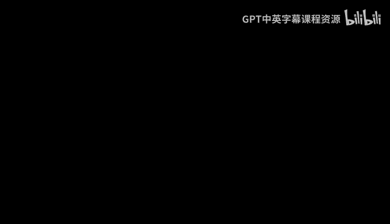

# 斯坦福大学《机器学习理论｜CS229M Machine Learning Theory - Fall 2021》中英字幕 - P15：-15-16_ Implicit regularization in classification problems.zh_en - GPT中英字幕课程资源 - BV1jT421r71m

Okay， hi everyone。 Yeah， let's get start。So， I guess today。

We are going to talk about continue to talk about the imp regularization。嗯。

So last time we have talked about。The implicive regulation。Of im。And today。This is last。Lectture。

Actually， last week， we like in the last two lectures。

 we have talk about inlic regulation of the transition。 And today， we are gonna have two parts。

 So one part is we continue with the implic regularization。😊，嗯。

And this is a better characterization in certain cases， as I would describe。More。

 and another is that。我要 talk about classification problem。In all the past few examples。

 we are talking about a regression problem。 And turns out that for classification problem， the。

The behavior is a little different， and。And you inside of converging to some minimum solution。

 you converge to maximum margin solution， which is， in some sense， know similar。

 but not exactly the same to the。Regression case。I guess with this lecture。

 we are gonna conclude the discussion about the implicit regulation of initialization。

 And then next lecture， we're going talk about the stochasticity。

 And that will be the last lecture about the implicit regulation。😊，So， okay， so。

So today we're gonna have， So the first part。 this is number one， number two。 So the first part。

 we are gonna talk about a more precise。😊，Talk your自。In in a certain case。

 about the implicit hybridization effect of imization。

 you can see exactly how the initialization influenced the regularizer。 and so， and to。😊。

Have some preparation for today's lecture。 We are gonna to talk about the so called gradientding flow。

I was trying to， you know， avoid this notion in the past。

 but I think the kind of the spirit has has shown up in the past as well。 like so basically。

 this is green descent with infinite testimal。G and decentcent will。Infin。Customestimal。等一问。So。

 and the reason why this is useful is because in certain cases。We have infinite test learning rate。

 you can ignore some of the high second order effect from the learning rate。

 And so this is just to make the analysis much simpler。

 You don't have to say how small learning rate is。 you don't have to deal with the second order effect because the second order effect is just literally 0。

 There's no second order effect。 And， and the way to do this is that it's actually also kind of a pretty clean formulation of optimization。

 even though it's continuous time。 So， so what you do is you say you have a loss function。

 Let's say L W is the loss function。😊，So if you do good descent。

Then what you do is you say you take W T plus one。 And now I'm using the parentheesis for time because I'm going to use that for the continuous time。

 So W T plus1 is equal to W T minus eta times the gradient of the loss I time T。

This is what we will do with bi thiss set。And if you scale the time。By beta。

 what do I mean is that now， currently， when you do gradient design every time you increase the step counter by one。

So before the time is T and now the time is T plus one， right， So， and now suppose you don't do that。

 You， you change the time scale， you say every， every update I only。

Advance the time counter by Eta instead of by one。 So what I'm gonna get is like a time W of T plus Eta is equal to W T。

一到LWT。And this two process if effectively the same。

 it's just at the time that unit of time change by effective Eta or one over EO。So。

 and now if you scale the time， then you can take it to go to 0， so。Take each to go to 0。

 And then this becomes a differential equation or kind of like a continuous process。

 So you can write this as W T plus D， T。I equals W T minus E greater than L， W T。I guess。

Depending on what kind of committee you come from， Like you can also write this as W T。Dot， right。

 This is a derivative with to。 I guess， sorry， I think here you also replace Eta by D T。

 This is how you take。The， the E K to go to 0。 And， and this is effective saying that the gradient。

So the the， the， the derivative of W with to T， which we do by W dot T is equals to minus gradient L at W I time T。

Where w do t。This is just a derivative。Of W with respect to the time T。So， and in some sense。

 this allows us to。To ignore。The Eta squared term。And it because it squared here becomes D T square。

 which is 0 compared to D T。 So that's why this is useful。 This will be useful。For us， like this。

 in some sense， this is mostly to simplify the equation like like all the， the。

 the technical meat in some sense are the same。 It just makes the the analysis cleaner。

And for the next two examples， I'm gonna I'm both in both of the examples。

 I'm gonna to use this gradienting flow formulation for gradientding descent。嗯。Okay。

 so now let's talk about the， the model we're going to discuss。

So the the model is a variant of the last lecture。And there are some reasons for changing their model a little bit。

 I'm going to discuss that， but it's not super important。So。

 so the model we are gonna to do is that you have。no三。cadraly。

Parametricized linear model in some sense， right， So we have two part。 the let me write it down。

 So you have some vector W plus。 and you take this O dot 2 minus W minus O dot 2。Transpo sex， where。

We use this rotation。 X， O dot2 just means X， O dot X and O， the dot the the。The this dot O is。

 is the this actual product。So w square minus w minus squared transpo x and w。

And w minus these are both vectors。啊，A2D。And you can write W as the concatenation of w plus W minus is the parameter。

So。And so， so basically， this is very similar to what we did last time。 So last time。😊。

We had something like F beta of x， which is beta or beta transpose。Right， so。

 so basically now you have an active term in it instead of just positive。

 And the reason is there are two reasons。 So， so there are two benefits。Compared to last time。

 So they are not super important。 but let me anyway you mention it。 So one thing is that is F beta。

 So So this model last time。系 only。Represent Lee positively in the combination。Of facts。And now。

This FW X can represent any linear model。Right， because before if you take the actualized product of double。

 the beta and beta is always positive or non negative。

 So you can have only have a non negative linear combination of the coordinate of x。

 And now it can have like a negative coordinates。😊，And another benefit is that。嗯。Like now。

 if you initialize。If initialize。呃，W class。0 at time zero to be equal to w minus at time 0 to be the same thing。

Then。As you can see， F W 0 x is equals to 0。 and I guess。For every x。

 it just because the positive part cancel of lose the negative part。

And I guess you have seen this kind of things before。 This is mostly for convenience， so。So。

 this will make the。The analysis even more convenient because Uniization has a zero functionality。

 And we have， you know， kind of like use this for the N T K and。

And and this will be useful for our analysis。 And actually。

 what we are gonna do today is that with this thing， we' are gonna see that if you change inization。

 actually， you're gonna to get different regularization and you can precisely characterize how does the regularization dependence on inization。

 And in one of the case it will be an UK in other case。

 it will be similar to what we discussed in the last time， so。😊，也没必要去。いや、那な。收。Okay， so。And。

Continue with the setup。 So the loss function， the L high W will be that the square loss。And we can。

 and we， we can consider。Iization， as we discussed。Goodcon transition W plus 0 is equals W minus-0。

 so that you get the， the0 in transition as the functionality of the initial model is 0。 And also。

 we， for simplicityistic， we choose this to be alpha times all one vector。 and alpha is the。😊。

The thing we're gonna change。 We're gonna see that how does the regular inlic regularization effect depends on the scale of alpha。

 So when alpha is small it， it gives you something when alpha is big， it gives you something else。

And and this all one vector is kind of like chosen as before in the previous lecture。

 it's chosen somewhat for convenience。 You can still do it with other initialitization。

 It's just that the form will be a little bit more complicated。😊，So， and you can also have this。

We can also have this data space， right， So suppose data。Corresponds to W。嗯。Plus。

 so let's say say the W is defined to be。W plus the power 2 minus W minus to the power 2。

 This is the actual linear function you compute the linear function of W， right。

 So and we can define。And， and， and， and we are interesting in what kind of like linear model we are learning individual。

 Okay， So， so let's say W infinity。😊，That fund this to be the。The limit in time infinity。 So the。

 this is how the greening flow con where the greening flow converts to。And let。data十 alpha infinity。

And I think sometimes we just call this。This is the basically W。The。

 the model corresponding to W infinity。So， so this is the， the， the coefficient that we care about。

 right， We care about when you converge to infinitely， what's the corresponding datata you get。

 right， So what's the property of this， this， this data， And sometimes we just call it。

For simplicity。We're just right say the alpha。And and， and omit the infinity。 But this is the， the。

 the where we convert this to。Okay， and， and for the sake of the， the simplicity of the lecture。

 we assume everything cannot have a limit so and so forth， right。

 So all the regular condition are assumed to be met。😊，Okay， and so。

 and also just for to set up some notation， let this X。To be the the data matrix。

And this is the matrix in N2 D。 And let's see why that is the label matrix， label battery。Okay。

 so now here is the theorem that characterize how does the characterized in place of regularization。

Let me write it down and then interpret。祝婆系你。阿芳。走。不烧。That。You convertverse to a feasible solution。

 So assume that。To a solution。That' spread the data。

So in the sense that x theta alpha is equals to y back， right， So this is。You know， if is satisfied。

 it means that we fill the data exactly。And I'm using a purple color for this is because I don't feel like this is necessary have to be assumption。

 You can prove this。 actually， The paper did assume this in the theorem。

 but I don't think you have to do it。 And actually， I just check check with one of the author。

Two days ago。 And， and he also thinks that you don't need it。

But this is not formally stated in the theorem， so I assume。

 but I do strongly believe that you can prove that you can converse to such a feasible solution。

You don't necessarily have to assume it， but anyway， let's assume it。

Just so that we have we are consistent with the paper。 And by the way， this is a paper by Wood。

I guess Ill， Ill probably add the link。都会。What word。In 2020。

 and in title of the paper is something like rich。Im criminal regime。II don't know。 I don't。

 I'm forgetting what's the。Which and kernel regime over parameter testimony。

So it's a pretty recent paper just。It just show up like two years ago。One year ago， actually。 So。

 and so suppose you， okay， so suppose you have this then。We know。

Tta alpha is not only a feasible solution。 It's not only zero order solution。

 but also it's actually a minimum solution。AOr minimum complex solution。

 according to the following complex measure。That is the minimum complex solution。

So you take ache over theta such that x theta is equal to y。

 So among all the feasible solutions you will try to find。

The minimum complexity where the complexity defined by Q alpha。 And what is Q alpha。

So Q alpha is a function of alpha。 So the complex measure does change as you change alpha。

 and Q alpha is equal to alpha square times the alpha square doesn't really matter because it's a scalar。

 when you do the argument mean times some。Function of each of the coordinates。Q of非ta。hi。

Over alpha squared。And what is this little Q， This little Q is a one dimensional function。

Where this little Q。I's a function that maps R to R。Actually， maps R to R non negative， I think。

And Qz is equal to something that I don't expect you to interpret。But I think we're gonna look at。

Special cases， which we can interpret。So this arc sch。I guess this pronounced as such。

 right in US orshine such。Anyway， our extension。S hyperbolic， Right So Z over2。

I think UK is called Shi。 I don't know why。 anyway。 yeah， okay， so， alright， so， okay。

 so the first other bit is that even though you didn't。😊。

Minimize this complex machine in the algorithm。 You only run green decentscent。

 Somehow you find a minimum。Complexity solution， and the complexity is defined by something like this。

Right， so， so and now let's try to interpret。 This is the abstract theorem。

 But the important thing is that in particular。When alpha goes to infinity。

 So if you have a very large translation。Then this complex measure of Q theta alpha。

This is something like。对的。Cta I alpha squared is something like theta I squared over alpha to the4。

So which means that the Q。阿法四他。It's something like。

I guess one over alpha squared times the two norm of data。Square。So basically。

 if alpha goes to infinity， then the socal complex measure should the Q alpha。

Is the L2 norm of theta。嗯。So and if alpha goes to 0， then what's the complexity measure。

So the complexity measure is what's this irregization effect， or complexity measure。

 this is Q theta I over alpha squared。This is roughly。Something like theta I。

Us value over alpha square times lot  one over alpha square。

 I don't expect you to verify this limit because you have to do some kind of like Taylor expansion to see this。

 But this is the thing。 So then this means that Q alpha theta is， in some sense。

The one norm of theta。I guess over alpha square times log one over alpha squared。

 but the constant doesn't really matter because。It doesn't change the the， the order of this。

The of different theta。So data。Oh， sure， sure， sorry。And yeah， that's for。Cool， so， so basically。

 this is okay。 in summary。 So when in summary。喂阿芳。Goes to infinity。 Then this is minimum L2 norm。

sution。In a sat space。없state。嗯。And an Al norm。放 for the w。Right， because theta is the square of W。

And when alpha goes to 0， this is similar to what we discussed the last lecture。

 So you have the minimum L1 norm。Of西。Which is the minimum L2 norm。Of the Ws。So。

 so this regime is what we have seen in the last lecture。 and with a very similar model， right， So。

 but this characterize the whole regime And theres so， and， and， and between off and 0。

 you basically have interpolation， some kind of interpolation。Betweenen。L1 and L 2。Reization。收。

So that's， that's why this is more precise than before。 Right So， you know， how does things。

 you know， interpret， Of course， you know， it's kind of like， for any particular alpha， this。

This Q function a little complicated， but it's just a sum。

Kind of like some of like some power of theta I in some sense。

 But the power is kind of between one two。 You can kind of think of like that。

 But it's not exactly a power， but it's something like that。嗯，他，就是。比如说。没说问。哦，可 again。Yes， yes。

 Al is the scale。 So this， this is the only thing that depends on alpha in the algorithm。

So we say that the imization is alpha times allman vector。

And this al vector actually can change it as well， I think it would change it to an arbitrarybit vector。

呃， for。For this regime， for this place， you actually don't change anything。So for this limit。

So for the other limit， I think you change a little bit because the L2 norm becomes weighted by the initialization。

By the by the particular interface， if it's not all one vector if it's all one vector。

 the weighting is just all the same for all currents， if they are not all one vector。

 it's not all one vector， then you have a different weighting Yeah。

 those can be found in the paper I just for simplicity， I didn't show the exact weighting。😊，Right。

 and。So here are some intuitions is about this interpolation。 And in some。

 just to connect to what we have， in some， this is kind of like a。

You can view this as a unification of what we have discussed。Like in， in the， in the past。

Few lectures， when offer is small， this is small initialization。so嗯。So this is basically similar to。

 similar to the previous case， similar intuition。To previous lecture。And， but there is a small thing。

 So a small note is that。嗯。It's not exactly。 So this is only when you have the learn。

 when you go to the limit， right， So you have the minimum L2 norm solution。

 But then when alpha is not， when alpha is not 0， it's not exactly。Minimum， like the。The。

 the regular effect fact is means the regular effect fact is not exactly closest。

clolosest solution to in。I think this， the paper shows some there are some tiny differences in some sense。

 So only when alpha goes to 0， you can basically say this is the closest solution to interest。

But generally， this is something we have kind of discussed last time。😊。

And when alpha goes to infinity， actually， this is indeed this is the N K。😊，so。哦。

And why this is the N T K regime。 I'm going to show you like， you know。

 this is kind of similar to what we have discussed before。 But let me just do it again。

 So why this is the N K regime。 So let's look at the record that in the N T K regime。

 we have the so called two parameter sigma and the beta。

 So beta there was the smoothness or the the lipsness。Of the， of the gradient。

And this is the condition number。Right， and we say that and recall that we have this discussion that' Sigma。

Beta over sigma square meters。Right， so if this goes to 0， then you are in the N T K regime。

 you can approximate that quadratic。 And now let's compute what sigma beta is in this case。So。

 the gradient。With respect to the inization x the W 0。Let's。W 0。

 let's take this to be alpha all1 vector。It'sW plus and w minus。Be both all and vector。

 alpha times all and vector。And。嗯。And we can compute gradient and inization。X， right。

 so there there are two set of parameters。 Right So the gradient for the W plus， I think you can。

 if you compute is something like this。An ingredient for the W minus is to do this。

Oh sorry this is Angel itemwide product。You can do this easily just by Chen Ru for every dimension。

And。This is just。Es to， I guess there's a two factor two here， which I。Oftentimes。

 probably click out。 And this is two of。Because these two are just all by vector。

 so this is two alpha x minus x。看看。Right， so， and now you can see that。Sigma and beta。bose。呢嘢你。你判弄2号。

Right， so what is sigma sigma is， the condition number of this of sigma is the condition number of the。

The， the gradient matrix， right， the feature matrix that consists of the gradient for every little point and the condition number scale linearly。

In alpha， right， And beta is the lipsness， which also scales linearly in alpha。

 It because alpha is multiplied in front of the gradient。😊，Just so， so both of these skills linearly。

 So that's why beta over sigma square will conversege to 0 as alpha goes to infinity because。😊，Below。

 you have degree 2 dependency on alpha and in the in the denominator。

 you have degree in the numerator， you have degree。Like you have a linear dependency on alpha。

 So that's why this， this whole thing， you know， goes to 0 as alpha goes to infinity。So and also。

 like when alpha goes to infinity。This is the NTK regime。For the， for the trivial feature。

 because now。The X R field of x is this。This thing。His feature map is really just literally this。

 right？This is just a literally trivial feature， because the only thing you did is the reflective X。

 which doesn't really make any difference essentially。So， so， so basically。

 you got the minimum norm solution。 So you get。So， so if you believe in the N TK perspective。

 you should get the minimum norm solution。 So So the N TK perspective will also tell you that you get minimum norm solution。

嗯嗯。Like according to the features， right， in a long solution。Minim L2 norm solution。us先。The feature。

Basically， x minus x。And X minus axis in terms of a feature that is not very different from X itself。

 So， so basically， you just get essentially the minimum L to nerve solution for the linearium model。

So， so that's the same as we。We discussed like the same格しない as we discussed about。

Any questions so far。So the question is why N TK give you the minimum social。I。

 I think this is just because me to do the kernel method。So。😊，So when you use kernel method。

 So so N TK tells you that you are doing kernel method with certain feature。做 n g p咩。Conal method。

And the feature just turns out to be this trivial feature。And。

 and kernel method with the feature just give you the minimum solution。 That's， that's the。

 that's what the kernel method does。So because what kernel measure does is that you。Like。That's。

 that's just what the kernel matter do。 Like when you don't have enough data， when you。

 when your kernel， like when you feature dimension， it's bigger than the number of examples。

In a kernel method， you are learning the minimum norm solution。For the features。Because otherwise。

 you know， you have to define something， right， So the， the kernel method， everything is L2。

 So you you are minimizing L2 norm。 That's implicitly in the， in the kernel method。嗯老。Yeah。

 that doesn't depend on transition because it's a complex problem。啊。有了。And yeah。

 and and you use a particular algorithm。 when you do the kernel matter。

 You that algorithm give you the minimum solution。Okay， cool， so。Okay， any question or question。好括。

ああ、こういう。反就是。民大。組は。Where I use。被告对。这这个都。Yeah， so， so I guess in some sense。

 repeating a question and also answering it。 So when alpha goes to infinity。嗯。So， yes， so your。

 your problem will be very youose in some sense， like the optimization landscape will be very bad。

 just because your function will be not very smooth。 So， and。

 and this part is hidden here because you are using greeting flow。 So you can。

 so you are using infinite testable smaller and rate。

 So that's why it's hidden and the it's swept and the work。 And practically， you don't。

You also don't necessarily want to use the large rate。 for one reason is the optimization。

 And the other reason is that maybe the L2 norm solution is also not good by So like you want to want you have L1 recognition。

 at least for this particular setting。 right， So that's another reason why you don't want to use very large。

Learning rate。 so sorry， very， very large， very large in。And another thing is that in practice。

 people sometimes do use， like， this is about the empirical setup when like sometimes people do use large initialization。

But people don't use infiniteimal smaller in the。So， so then you still cannot get into the N K。

But that's a good thing because you don't want to go to the N K regime。 So， so。

 so that's that's why at the beginning， some people have confusions because at the the very first paper by this N K paper。

 I think they are claiming that in transition scheme。

 they are studying is actually what people do in practice。 And that's kind of true。

 That's kind of it's very close to the the climbing the timing in transition or theer in transition。

 So in terms of the scale。 but because they are using very， very small learning rate。

 So it's actually not really the the theoretical setup requires very， very small learning rate。😊。

But empirically， you don't use those smaller rate。 And also。

 the theoretical setup doesn't have the sasticity。 So all of this together。

 it makes the theoretical setup different from the empirical setting。😊。

And that's a good thing because the theoretical setup says that you don't really do anything super different from kernels。

Okay， so now let's discuss the proof of this hereem， so。

I don't have a like there is a little bit kind of like a this。

 this proof is kind of interesting in the sense that it， it the proof is similar。

To the actual the the linear regression model。Similar to the。The linear regression proof。But。

 not similar。Not similar。To what we discussed last time。Now similar to last lecture。

But you would probably guess this is similar to last lecture because the last lecture has almost the same model as this one。

 and is only doing a subcase of this right when alpha goes to 0。

But it turns out that the proof is very similar to the linear regression one。

 And you have this this two steps。 The first step is that you find the invi。Maintain。带的。

By the algorithm， by optimize。And recall that this in virus was。Wass that Theta is in the spin。

Of X I。Right for linear regression。This was like probably like 2 or three lectures ago when we analyzed the in implicit。

Proagization impact fact of inization。For linear regression。

 we say that because you at0 and use green in， you always in the span of the data。And， and。

 and here we're gonna find a different environment， which is more complicated。

 And it's even harder to express， but we're gonna find an environment。

 And then you use the environmentvi。so。So， step 2。Like， like a kind of like， in some sense。

 characterized。I guess characterized is a very vague term。

 but characterize the solution using the environment can sometimes use the environment as additional。

😊，哦。Additional information。Right， so， to pin down which solution you converse to， right。

 in sometimes sense the， the， the difficulty is that if you。Without any additional thing。

 you just know that you converse to a zero error solution。You don't know which one you converse to。

 And the environmentvari tells you that which one you converse to and the environment depends on offer。

So嗯。And and there's nothing about nothing about population versus。Population。Was it empirical。

 Like everything is empirical here。I don't even I didn't even define where the data come from， right。

 I I， I don't tell you that this is the minimum solution such that the empirical error is 0。

 I don't have to care about population at all。So。😊，Yeah。

 how does this kind of techniques compare with the techniques we discussed the last time where you used the fact that the data。

 the empirical laws concentrates。round a population loss in certain regions。

 and you somehow do some kind of like control of the dynamics。 You know， I don't know how。

It's kind of hard to compare like。These are two different approaches。 There is a some。

Good thing about this kind of approach， because this doesn't require population。 That sounds a good。

 Good thing。But the best things about this approach seems to be that it's very hard to find environments for harder。

For harder models。 like for， for more complex models， the environmentvari。

 you see the environmentviance is a little bit of medical somehow。 But that said， you know。

 for more complex models， even the previous approach。

 the approach we discussed last time wouldn't work either。 So so it's hard to say。Anyway。

 so let's proceed to see how does the proof work。So we need a little not to somehow simplify our exposition。

 So let's say that is X tude to be the extended data matrix。😊，So you extend the matrix to。

This is to deal with the。那。这是。You concatenate x and minus X so that you get an N by 2 D matrix。

 And sometimes this is just to try to write everything in matrix notation so that you don't have to have the minus thing。

 So I， so we will take W T to be the concatetnation of W plus T。NW minus t。This is of dimension 2D。

And， and let's take a。W T oh dot2， I guess we we， we say that this is the un power of W T。

 And this means that with this notation， X tilde times W T。Or two， this is。X minus x times W plus T。

2W minus T。So two， and you can verify this is really the same as the this is just what the model computes。

RightThis is the model output。On the end data points。So I just want to use this so that。

So that you have the matrix nott。 And now you can compute what's the derivative。

Like of T was W dotty。 right， This is the gradient because we are doing gradient flow。

 So this is equals to the gradient of L I time T。 And what's the gradient of L I time T。

 This is gradient。Of this loss function and now can be written as。I guess， the loss function。

Of W T now can be written as。XQ的。W T，0 dot 2 minus y back to non squared。

 That's because I vector everything。So。It's cock placed to here。And then I take the gradient。

 Take the gradient。 You can use the Qing Lu， so。If you believe me that I I got a Russian rules。

 this is ex the transpose。儿体。Antrawise times， W T。Where are t。Is equal to x tilde。TWTO dot two。

Minus y back is the residual vector。So if you are familiar with linear regression。

 you will realize that this。It's kind of like。This is what you got from the is。

So this is the if it was linear regression。If it is a linear regression。

 then this time we will be upgraded。But now it's not linear regression because you have the quadratic parametermetric trust model。

 That's why you also have to do Che rule to look at the derivative of the quadratic of W T。

 That's why this is， this is because。It's called。By the way， so you know。

This this is just one way to think about why this is true。 But the the。

 the formal verification would be just you look at you do Che rules everything。支。Oh， sure， sure。

 There is a。There should be a， I think there's a two here。对。啊，你咪试。I think I wanted to make it too。

So that means I think my loss function should have a heart。So where is my loss function。Okay。

 the loss function。你 a好。I guess I also define a loss function somewhere else before。Yeah。Right。

 that sounds good。嗯。Like， like my brain just automatically remove all the constant。Like。

So it's very hard for me to deal with this。Okay， cool， so。All right。Okay， so now。

How do we kind of like we， we， we said that we want to have some environment for this in some sense。

 right， we to somehow solve this differential equation。But you cannot really solve it exactly。I。

 know， I'm not an expert on solving differential equations， but I think this is beyond the。The。

 the scope of like， like， this is something you cannot really have。Have a。

 have a close form solution。But interestingly， you can do， you can， you can。

 you can get something without solving it exactly。😊，So， we claim that。So actually。

 this is a in the paper， they just say they claim it's easy to verify this。😊，You can claim that。

WT satisfies the following。Despite this time， exponential-2 ex transpos。嗯。RS。Yes。Okay。

 why this is the case。 So  first of all， this is not a solution。 This is not like a。

ItDepending on what you mean by solution。 This is not necessary in my definition of close person solution。

 because。R S still is a function of W。我搜。But it's going to be something very useful。For us and why。

 and why this is true， It's actually relatively simple。 But so here is the reason。So。

 this is because。what you can do， supposeuppose you have a， supposeuppose you have a。

Like a differential equation， something like u到 T is equal to V T times U T。

So I'm trying to Iify it a little bit so that I can， I can give a clean。😊，Analysis。

 so you can see that this is a good abstraction of what we had。😊，Before。

 because before on the left hand side， you have the derivative of w and on the right hand side。

 you have something times W itself。 So this will be U。 This will be V。 This will be U。

 and this is U dotty。 right， That's my objection。and then suppose you have such a thing that you can always do the following。

You can say that you dot T。那 over U T is equals to VT。Right， that's always true。

And then the right hand side， this is one of the magical thing。 In many cases， like this is log of。😊。

The of the log of U T。By Chen， by Chen Ru， I think probably I've seen this in other contexts。

 like policy gradient in other cases， depending on whether you know any of those。 But anyway， So。

 and then you can integrate both side。So you can say， if you integrate。

You get a log of U T minus log of U 0。It's equals to the integration of the。Reconside。I't have this。

And now you remove the log， you get the exponential。 So U T。O you0。

Is exponential times integration of this。I know， if you might be you。3W and。V to this。

 I guess you to。According of W and V to be a。A coordinate of these actions， folks are。TI。

 then you can apply this and you get the the desired result。 And by the way。

 I think I need want make a remark here that。This is entry wise。Application of exponential。

So this is a vector， this is another matrix， so a matrix to of vector this becomes a vector and you take entryized exponential and you take the entryized product with WC。

😊，Okay， any questions so far。So now let's see why this is useful。It's a little magical。

 in my opinion， I don't have a。嗯。You know， conceptual， I think this is fine。 But I think the， the。

 the， the proof on a proof level is somehow there's a little kind of like。Either co。

 you can call it coincidence or magic。 So so it there turns out that this is all you need to。

 to verify。 This is a good solution。 This is the minimizer of the。😊，Of the solution。 So first of all。

 first of all， we turn this into something about data。 right， So now we have a character for W。

 and let's turn it into something about data。 So recall that。 So。

 and also we simplify this a little bit。 Re that W。Plus 0 is alpha all one vector。

W minus-0 is alpha times over one vector。That means that W0 is also all one。Alpha times all vector。

 this is in 2D dimension。Because w is connation of W plus， and w minus。

So that's why this thing W0 is basically not important。 You just have alpha。

So and theta T to the stateta at T。Is W plus T。Power 2 minus W minus T， the power 2。And this will be。

啊。Okay， let's use this formula。 Let's use this formula。 let's call this one。Uing one。

So the w zero doesn't matter， right only it contributes alpha， so we get alpha square。And。So， and。

I guess I'm not sure let's see。 So maybe I'll just do this small calculation here。

So x to the transpose is x transpose minus x transpose。So that's why exponential。

-2 x to your transpose。Some vector V。We， we will be this integral。So this will be a vector。Like。😔，嗯。

So I say， suppose you take this。The power of two， then will this will be exponential minus-2。X。

Transpose B， because this part is the from the first part and the exponential minus- to。あ、ごんなさ。

Times to x trans speed。And then to the power， too。Okay， so and then this。

 and this power two will become  four because it is exponential。 So you get exponential。

4-4 x transpose B， exponential。For x transpo speed。

So this small derivation is trying to simply to deal with this。 So you know that。

This thing to the power2 will be something like this。And， and then the first part corresponds to。

The first part corresponds to W plus and second part correspond to W minus。 So that's why you get。

Something like here。W plus square will be。啊。Exponential minus。Or。X transpose。Yes。And minus。

Exponential。For expo。I， I guess what I I'm doing here is just trying to make。

 make you believe that this derivation is true， but it， it should be， it should be trivial devation。

 And there is nothing like difficult， so， and。Okay， so this is the characterization of theta。And。

 and you can see that this is。This exponential of this minus exponential of the same thing you can write this more specificallyly as。

😊，The science， the scentin。f。X transpose。This is just about definition of the cinch。

 I think cinch is something like exponential T plus exponential minus t over two something like that。

So， okay， so basically， we have a character of theta。And。呃。Right。

 and then you know that the theta alpha。Right， is equal to s the alpha as in sayta at infinity。Right。

 so he， so this is equals to two alpha square。-4 x transpose。0 to infinity R S E。Okay。

 so this is something we， we know that said the alphapha， the final compound satisfied。

 Maybe let's call this equation 2。 And we also know that x said alpha is equal to y because we assume all we can prove。

 I guess we discuss this。 I think we can prove that you converge to a feasible solution。😊，So。

 and I'm climbing that 1，2。So2 and three， these two things turned out to be。It the optimal condition。

Of the， of the program。Of the， of the the program。Let's called one。 So one is this。Arrc mean thing。

 Okay， I guess it's far far away So here。That's call program program one。Right。

 so you want to say that sayta alpha is the minimize of this program 1。

 And it it turns out that sayta alpha satisfies this two equation。2 and3。

 and these two equations are the optimal condition of that optimization program， program 1。

So and and that optimization problem only has one。Solution because he's complex。

So so that's why this second alpha is the solution。That''s the plan for next。Right， sounds good。 So。

 so my automatic condition， I really mean a K K T condition。 So I'm not sure whether。😊。

All of you are familiar with the K K T condition。 So I guess there are two ways to think about this。

😊，This is just a small。Think about background about K KT condition。So these are optimal conditions。

For con optimization problems。To， to be honest， I never really remember exactly what's the K technician in many cases。

 So what I I'm gonna show you is that one way to think about it。 So which is probably not exactly。😊。

The same as what you can read from the。From the book but is going be very similar。

 So suppose you have this kind of things， right， optimization program program like this。

 And Q Theta is a complex thing。😊，And so， so first of all， the， the。

 the K KD condition is the following。So it says that Hill。Is to be equal to x transpose V for some V。

In dimension， I think this dimension is N。And then x theta needs to equal to y。

 So this is the KP condition for this kind of program。And， you know。

 what last thing you can do is you can just look up a book and like just invoke a theorem from a book saying which says that this is okay the optimal condition。

😊，The way I think about it is the following。 if you're interested it。

 So the way I remember this is that。😊，I remember this。Oh， I derive this every time if I need it。

As follows。So I think the， the insight is that optimality。

At least means that there's no first order update。 There's no first order。Local improvement。

So if you perturb your solution。You shouldn't have a first out improvement locally。

 If a per solution locally， a little bit by infiniteal small amount。 You shouldn't get get。

to your first other improvement。So。😊，So， but you also have to satisfy the constraints。 So you also。

Like a。No part of。Local improvement， satisfying the contraint。C panel I also up to first order。

Because you may not be able to。So what does this mean in this case。

 it means that supposed to consider preservation the autota theta。This is a perturbation。

So how do you satisfy the constraint， to satisfy the constraint。

 You have to say that the perturbation needs to be in the。A to the rose bank。Oect。Because if you。

 it's not in the row span of x， you， you， you perturb it， you may change the。

 you may change the x theta and then you， you change the you， you don't satisfy contrain anymore。

 So this is the way to satisfy constrain So that you you so so that x the theta is 0。

So that's how you make your constraint work。 And now let's look at sayta plus the also of the local preturbation。

And so this still satisfy the constraint。 And let's see what's the value。周周。So let's see。

 what's the value of Q。 So Q s plus deeltata。This is equals to。Up to first order， Q signal。pl你。はい退。

We cannot hear you。Maybe let's try this。Can you hear me know？ Thanks for letting me know。Yes。

Is the audio good or not， I it okay。Yeah， it is okay。O， so I'm using my laptop on microphone。

 So maybe let me turn in some way so that。Yeah， thanks for letting me know。

 So maybe I'll rewind a little bit back。 I don't know how far， how long time you have lost me。嗯。So。

 I guess maybe I'll just briefly go through the steps that。We have discussed that。

I guess I was saying that if you have the perturbation。嗯。You always satisfy the constraint。

 the peration is the rose span of x is orthogon to the rose span of x that you always satisfy the constraint。

And we won't understand。We want to figure out under what condition this perturbation will never improve your function will make the function bigger because if it makes the function bigger。

 it means that this point is not optimal。 So so that's why you look at the Taylor expansion of this Q and you found out the first other changes is this term and you want this term to be always non negative nonpoive because if it's positive。

 then it violates the optimality assumption。 So so so it's a necessary condition is that this term is always non positiveive。

 but this term， you know it's very easy to make sine flip because you can use the flip thel theta by whatever you want。

 So that basically means that whatever delta in the orthogonal space of row span of x。

 this term has to be just literally zero because if it's not0。

 you can flip the theta to make it positive。So that's why we are saying that here。

For every data set in a row orthogonal to the row span of x。This term is 0。

 And that really just means that。This vector， so because。

Every data row in these subjects is also to this vector that means that this vector is in a complementaryary。

s space。Of the sub deta。 So that's why this vector Q sta needs to be in the row span。Of us。

So that for every vector de theta or thousand of the row span， their inner product is zero。

So that's why this it can be written as x transpose。times没。

Because x transpose give it the call the rose span， x transpose mu， x transpose， I think this is。

 that's call V x transpose B is the representation of a vector in the rose span of X。So that's why。

 this is the。That's how we developed the K KT foundation。

 right the K KT commission was that you have to be in a rose band。

The gradient of Q seta has be the rose valve of X and also has to be a feasible solution。Okay， cool。

 so this is some digress about K K T conditions。 If you not familiar with that， then no。

 the only important thing is that this is a。Ccusization of the optimal solution， I say。And。

 and we can now it's just a pattern matching， right so。So， this。Herresponsible is right， obviously。

 And this one。Really， just correspond to equation 2。Because。Equion 2， okay。

 that's what I'm going to claim。 Okay， it's not to you yet， but let's see that， so。啊。

So K KT tells you that the gradienting of fuel theta needs to be something like x trans both V and the the environment。

The differential equation tells us that let me just copy past it。 just， let me just rewrite it。

 So theta alphapha is equals to。2 of square3。All right， so first of all， let's rev this as。

So simplify this and we write this as times v。time。Maybe we prime， I say。

 because the we what we is doesn't matter and then。And then， you can。呃。

I guess let's also look work on the Q se thing， the data Q s you can compute this。

In some when you derive the queue we are verifying it。

 but actually what you have to do is to reverse engineer to do this in other direction。

 but if you just verify that suppose you have given a queue， if you justt proveve it。

 you can find the derivative of the queue will be just arc。Sch。While we're two alphapha square。唱四。

This is a derivativeive Q。 It makes sense because the Q is a sum of。

Some function say the I and the derivative Q is a if each entry is the some function say the I。

And and so， so then you can see that this。If you plug in the feed alpha of here。To this thing。

 So arc sense。Yeah。Oscar say the alpha， this is equals to。Just the4 x trans to V prime。Right。

 so that's why。So， so basically， that's why gradient Q beta alpha。

It's equals to minus-4 x transpose prime。And thisatiisfies the K definition。

 the four that the matter because we can be manufactured。RightSo that's why Q alpha satisfy。就配配看去。

何がたそそそそそ个。这是个部。I guess you know this last step， you know， satisfying pay definition is global mean。

 this requires the convex of this program， The constraint is linear is convex， the objective。

 you can verify still is's also convex。it's something between I1 and normall to both of them my complex。

是。Any questions？Peach。So if there's no questions， I'm going to move on to the next thing。

 which is about classification problem。Yeah。Yeah。I see many of you are staring like there' proof。

 Steve， like this proof。😊，I know， I don't have on。You know， the the plan sounds very intuitive。

 right so how do you prove something is the minimizeable optimization program you have to verify。

It satifies the kidney condition， I guess that's probably the more or less the only way to do it if you want to show something is the optimizer of some optimization program。

But but it's kind magical why it just happens to satisfy the Kk condition。 So of course。

 there's something that we can choose right we can choose the queue to make and satisfy the K condition。

 that's something you can choose。 but the magical thing is that other things all of my job but the form。

 the X transpose times something all of those things have on my and also you can somewhat in some sense you can always work with each coordinate independentlyly in this special case So that's also something that。

Maybe a little special to this to the special model that we consider。Yeah。Alright， okay。

 so now let's move on classification function problem， and we are looking at separable data。

As we always do for a classification problem。And here we are going to only discuss my result。

 which says that if could do greening this set。It converts to a max solution。And this is actually。

Doesn't require any。大。会块。Any inization， like it works for any inization。

Like so the only thing you need is green descent and some loss function。

 which I will define and no regular， you just compute green descent on a loss function you went for a long time。

 you're going to convertverge the maximum solution。So。So I'm will have again start with a set。

So now we have a data set X I。by爱。I promise want to end。And an X I。22D。

And Yi is a binary label plus as well。诶 so。So if instead of assuming the quantity to be that squared。

 Okay， to the bar here。And is not carried because it breaks some that like when you computer together。

I。Okay， yeah， so the question about the previous thing and the question is about if you don't use W square you use W to the K。

 and this is a very good question actually， this is exactly what the paper studied in the in a more technical part so and the short answer is that everything can still go through and but the eventual Q would be different so the form of your Q would be something not L102。

 I think is something L it depends on the power。So I think if the power is P。

 I don't exactly remember， but I think it something like two over P Nor when alpha is close to0。

 when alpha is going to infinity， I think。Everything' is still the same。

Like the N T K regime is now sensitive to this。 So and okay， and technically。

 wide everything go through， I think the reason why everything goes through is that。Roughly speaking。

You are only playing with this。This single dimensional function in some sense， right， So， so。

 so it won't be s anymore Probably。 there will going be some constant， some other function and。

But still， this x transfer， something is still there， I think。It's now changed。and。So eventually。

 you just have to engineer a different Q to make everything。

And the queue is still kind of only depends on the coordinates。

 right you you do something on each coordinate。 you Take the sum。 The queue still has this form。

 So that's why it's still somewhat doable。Hi。Okay， cool， so。Going back to the classification problem。

So this is our setup up。 And here we are only going to do the Liian model。

Even though some of this theory still works for non nonlinear model with roughly similar technique and similar conclusion。

And here we're going to have a loss function， so the loss function。不要逼。啊L h w。诶 the the no。

Let's say we do the cross entrepreneurs。The the logistic laws。Across se laws。Times H W X I。She。

And where this loss is this logistic loss， which is log。ア one plusス exponential。S7。Okay， cool so。嗯。

And the first thing is that to， to kind of like get some inition。 So first of all， we have multiple。

个老冇边。If a separable data。So this is a premises for any implic organizationization factor if you don't only have one global mean then and you can con the global mean。

 there's no implic organizationization effect。SoBut why there are multiple global mean。

 this is just because you can。嗯。You can always have like a infinite number of like separators pretty much unless in a very extreme case。

 we just happen to get stuck at exactly so so for example。

' I think it's probably easier to draw something。So suppose you have some data points like this。And。

You have so many different possible separators。As long as you have one。

 you perturb a little bit steel a separateator。So they are theres this the infinite。系你 w。Such that。

W trans X I，Y I is bigger than zero for every。So you have so many separators。 And for every W。

For maybe let's say for infinite number of W bar， such that where W bar is English。

W bar is unit vector。This statement doesn't really depend on the norm so you can always scale it so for every W bar for any W bar such as this。

You can scale it。 So if you look at our hats。阿pha W。B， so we'll go to0 as。Apha goes to infinity。

 So any scaling of this unit separator。If you scale it extremely。

 then you are going to get the loss goes to zero。So basically。

 you have so many directions in the so you can go to infinity in different directions and still converse to on on a zero loss。

 So basically in some sense， if you're a little sloppy about so all of the this infinity times W bar。

Our global minimal。Of this loss function， just because the loss function goes to zero as infinity。

So the loss function， maybe I should also draw this。 The loss function looks like this。

This is the L of T。 when t goes infinite， you get close to  zero。

Closese to zero loss and and and what's inside was T T is Y times W transs X I。

 And this thing will go to differentiate as you scale the norm of the。Of the cost。

So so you have so many directions that you can， you can find there's so many global minimums。

 So the question is， which。Which direction。A you find。By green Lisa。

RightIf you don't use any if you just invoke a theorem about optimization。

 you know that witnesses that will find a solution with error close to zero。With loss close to zero。

 but you don't know which direction case you do have a bunch of flexibilities a few many directions can if you go to infinitefinity in many directions。

 you can get the loss to practice zero。So that's the question that we're are to address。So。

 and we're going to say that this actually convers the max margin solution。So， let's define。

So the answer is max margin solution。要表不是。So I guess let's define maybe first， the marginalized。

The margin and normalize the margin。So， so I guess we have a defined margin。In this class。

 many cases， in many cases。The margin is the minimum。This。哦 and and we also assume okay。

 so assume we always assume。Assume are linearly separable。

So this this definition is only defined for cases where it's linearly re separable and a normalized margin。

It。It's defined to be we normalize this by the norm W。Because otherwise， you can make the。No20再给。

Arbitarily small。Okay， so。So max solution。It is defined to be the。这个。for all w。

Which one give you the maximum normalized market？And let。W star be the。Maximizer。

This is the direction of the max margin solution and with un norm because。

If you only look at this objective。It doesn't depend on the scale because the scale is already normalized out so we define W star to be the maximizer receiving。

Okay， so basically， were going prove that if you do good this set。You're going to go to infinity。

 The it will go to infinity， but only a lot the direction of that will stop。That's the fear。

So green a flow。I guess here you are talk were talking about breathing flow just because， you know。

 it's convenient， as we discussed， So convert this to。啊，The direction。Of maxim solution。

In the sunset。I think we don't really exactly say the convergence in direction。

 We only say the convergence in the。The sense of that the value of the margins。

I think really you want to do the exact convergence interaction if you requires a little more work。

So what we say is that the margin of your iterate will converge to the maximum possible margin gamma bar。

哦。嗯。Right， so。IT goes to infinitefinity。So andWT is a EWT。Is the it attack。申清。

I don't have five minutes so in the next five minutes。

 I'm going to discuss a little bit about intuition why this is going this is working。😊。

This in contains why this is working and how do we proof it in some kind of a mixture of both of these two and then in the next lecture I guess I would prove the investing more reive。

So why this is going， why this is working， So the intuition is that。So。

I guess I have a few steps here。 So once step one， this loss function， I all had。W t。

Is going to zero。By standard。Optimization arguments。为置。Which is not covered by this course。

 so but I think you can kind of believe it if you optimization is working your'll。

If your opposition is working， then your lawsuit goes to zero。嗯。😊，Second。😊，So， this is。Observ one。

 and observation 2。嗯。I guess the laws。This loss function。Which we define with a logistic law right？

Sometract this。Its loss function is actually。re close to exponential。放。Lge sea。

RightThis is just because you do take expansion right a log of one plus x is approximately x。

That's why you can get rid of the log and what。Yes。And this is actually an interesting thing。

 right so you call it logistic loss but actually it's close with exponential loss so like。😊，So。

 so like so logistic law， So logistic loss is close to exponential loss。So， so， so。

 so then so in most of the proof， actually， we are only going to do the logistical。

 I think I think the proof actually， I I'm just sorry， I'm going to do the exponential loss。

 So in the proof， I'm going to just assume is exponential。

 even though you can still this small differences can be。On， deal to个 very意。

And the third observation is that because one， because of one。TheWT。

Has to go to the norm has to go to infinity。And， and the reason is that if you just don't go to infinity。

 you never make the loss close to zero now。Right， this is just because。If wT is boit。However。

 I say it's mine by B。Suppose it's always valid， then。

You can always bounce this Y I times W transport X I by something like。

MaybeB times the normal of X I， you have some bonds。So this is bonded。And then your loss I h WT。

this is you好。帮你 buy。Exponential minus B times X。上才不。And this is multi below by zero。

 and this contradict is one。Right， so if you， if your normal is always bounded and your loss is bounded below by some number。

 the number is， you know， welcome to zero， but still is bounded by some number。

 which contradicts with the convergence to0。So。So now it comes to the most important thing。

So with lot of this preparation。 So we know that the norm goes to infinity。

 And then suppose let's say， let's only look at the the final case， the later regime where WT。

A is very big， so suppose WT to norm is really big， that's called Q， is' very big。不。So。

Then let's try to simplify the loss function and see what the loss function is trying to do。

 So the loss function。i听。Maybe let's remove the T just for simplicity。

 just look at suppose you only look at some W such that the W norm is very big。

 So the L had W is the sum of。This logistic laws or exponential laws we not distinguishable for now。

And this is。Let's say this is roughly equal to the exponential minus y。It times double trans X I。不错。

And because the loss will be very close to zero， it's actually more informative to look at the log log space。

So if could took a log space of L had W。Then this is roughly equals to。The log。好丧。Of a minus y i。

Times W transpose times Excel。So this is lo sum exponential。

 I'm not sure whether this will be is some of you so this is basically soft max。

So I'm going to claim that this lock sub exponential is close to max。All of this。Mus this。系 mean。

 yes。So why this is the case， Let's do some， again， abstract irrivis。So if you have a log。Okay。

 I guess sorry， I think I'm。Probably I should have another step。 So let's first another step。

So this is lock something exponential， but also， I can try to。

I want to use the fact that YW has large norm，s。Get the norm of WQ in front。

 you get YI times that your bar transpose Xi。Where a w bar is equal to normalization。Okay。

 so now I'm going to claim that this is close to。Maxance Q Y i。他被冲复。I o。So why this is the case。

 this is， I guess if those who are familiar with this log sum exponential It's kind of like a soft max。

 So if you look and log some。me of心。As a queue。H u I。I'm trying to， kind of like。

Abstracted by a little bit where so you have a hue that is very large and the UI is something fixed。

😊，I claim that this is closed， this is roughly。Q times the max of U I。I n n。Plus。

 something like little of Q， something like that't that didn't depend kind onQ as much as Q goes to infinite。

So when the queue is very big， then this is really doing the max and sometimes this is kind of like when you do a temperature in the soft the max if you make it big then。

😊，Softm becomes hard max。So and， and if you do the， then this is really in sometimes soft。

And this is， you know， if you want how to prove this。You say the sum of exponential Q U I。

upper bound， The upper bound is that。log of。Replace each of these by the biggest one。

Exponncial few times the max。You爱。And this is only lot and。Plusq。Times the max of Ui。And。

So the log n is small compared to Q because Q will go to infinity and something fixed in this abstract。

 and on the other hand， you just take one term。You just only keep the term where you have the max。

 then you get Q max。UI or you drop all the other terms。

 there's no so many more law cancels with exponential。这个。So， so basically。

This lock sum exponential is close to the maxs， up to some。Factor log n。

 but this factor log n will be small if Q goes to infinitefin。And that justifies this step。😊。

Right so once you have this up。😊，This what what's going on here， right So this is saying that your。

You are minimizing a law， law， You are minimizing a law。

 So that's why you minimize a law of loss as well。 right， So， so， so。

 so minimizing loss is kind of like trying to maximize this。 And that means you are maximizing the。

So， so you are trying to maximize。Minimize。Thisquieting。Minimize the quantity max minus QY I。

A a transpose exide。Which means it's the same as maximizing。it means that sorry your， your。

You are minimizing， but youre maximizing。The mean ofq。Y I W transport X。

All right so you just flip the sign。喂。Minimizing the max of this is the same as maximizing the mean。

 this is just a literally the same。Like without any， it's not like youre switching in Max。

 It's just the really the sign。You have the minus sign， you know， maximize something is the same as。

The max of this is equals to。The minus the min。跳坏。W transport access。

And then you can put this minus also the minimize， okay， so。So。All right。

 so basically you are maximizing the market。's that's what this is saying。

 So if you do this approximation。Then you have maximize margin if Q goes to infinite。

And next time we're going to make this more formal with a little bit with essentially the same intuition。

 but the proof you know would be more clear it's not exactly like this it's not like you're dealing with errors。

 okay it's going to be a very clean proof。Okay， I think that's yeah， that's all for today， thanks。

