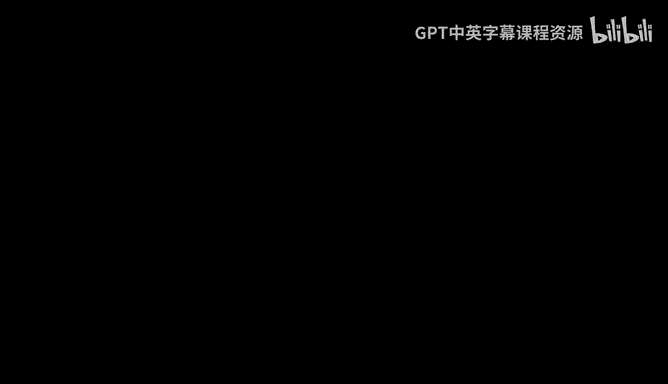
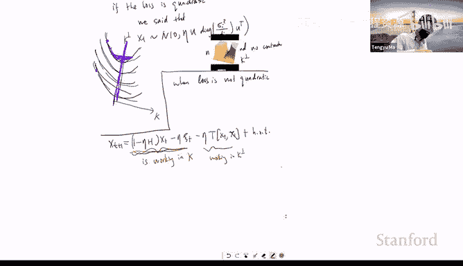
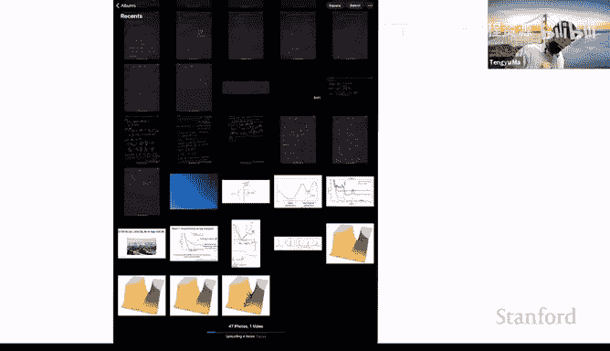
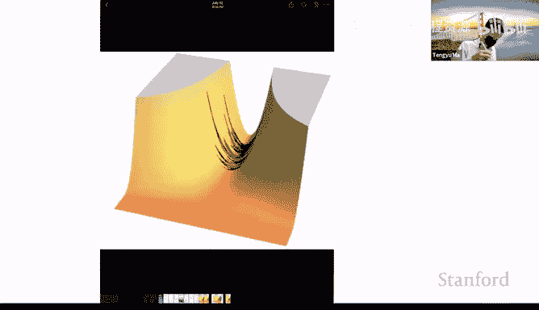
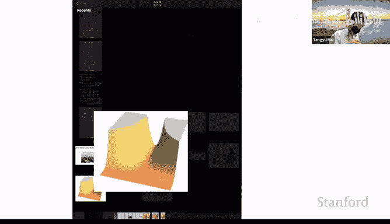
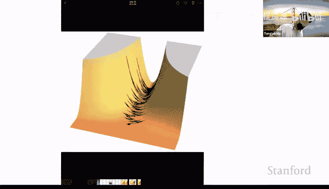
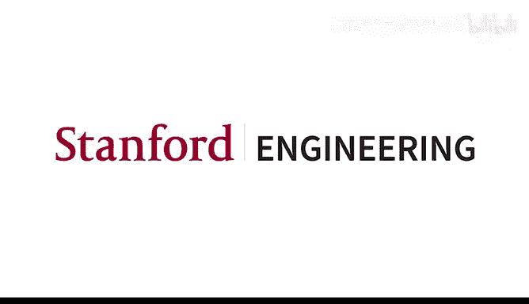

# 斯坦福大学《机器学习理论｜CS229M Machine Learning Theory - Fall 2021》中英字幕 - P16：-16-17_ Implicit regularization effect of the noise.zh_en - GPT中英字幕课程资源 - BV1jT421r71m

Okay， cool。 let's get started。 So I guess。Today we' are going to talk about inclive representation of noise。

So。And。😊，The plan today is that。Because this is a pretty challenging topic。 and I think。

The research community is still in some sense doing research on this。So we have some results。😊。

It's pretty complicated。 So what I'm going to do is I'm going to somewhat。

usingsing a re heuristic approach。So I'm going to try to convey the main idea without doing the actual。

R statement so so in this lecture I don't even think I have a formal statement to state because it's just a little too complicated and unnecessary right so if I really approved the formal version of the theum there probably would take two lectures or three lectures。

😊，So that's why instead I'm trying to kind of at least convey the main intuition。

 Why the noise is useful with some still with some math， because without a math。

 you don't even see the intuition sometimes。 So， but but the math wouldn't be always rigorous。

 And I wouldnt know where it is kind of like not rigorous。 And also some part。😊。

Cannot be made rigorous without additional assumption and I would be I clarifying that as well some parties really just for convenience。

 I ignore some kind of like the dragons， but they can be fixed by just a little more careful mass and some parties actually fundamental challenges and you have to really use additional assumptions or maybe even change the problem setting to go through those steps rigorously。

😊，So， so I guess the the the main portion of the。😊，The。Talk the， the lecture is actually not about。

Any particular loss function is about generic loss function。

 We' are going to make some special simplification for them， but。

 but you don't even need to really think about parameterization in most of this lecture。 So。

 so the setup up is that you have a loss function。😊，That's call this function G theta。

 And I'm also going to use X as the variable at certain cases。 So， and the the。

 the stochastic within decentscent algorithm by noise， I really mean a noise in ID。

The stochastic Wincent algorithm we' going analyze is something like this。😊。

So sayta t is equal to c t minus there t plus one is equal to say t minus some noisy gradient。最差不多。

Full gradient， plus some stochastic noise。So， where。The expectation of this casi。Is zero。

 So this is really a mean zero noise， but a distribution。😊，The city， you know。

 in the most general case。In most general case。The distributionion of Ka city。Can depend on这道题。Right。

 so the noise distribution depends on which point you are evaluating at right。

 So you can see this formulation at least so far at a very general level， does capture， for example。

 stochastic descent， as you usually know， like the mini batch stochastic with descent。

 because suppose you take a a mini batch gradient with a few samples。 then is indeed。

 can be written as something like the full gradient plus a stochastic variable， which has in0。

But we are not going to analyze that particular version because then the noise it becomes too complicated in some sense。

 right， So we don't analyze much simpler noise in most of the cases。

 like something like a Gasian noise。So this is a。So strictly speaking。

 this is more about noisy gradienting descent than stochastic mini batch stochastic green designscent。

But they do share a lot of similarities。Okay， so， and what we I trying to do is we're going to gradually build up our intuition about how does this noise affect our optimization algorithm。

 So， so we're going to start with you a various， like we are going to have a several levels warm up。

 So the first warmmark is that what if you have a quadratic loss function。😊。

So cadive loss pretty much means that you have a linear model under the hood。 But here。

 I don't even have model parameterization。 I only have a loss function G theta I say we have a catic loss function and haveion noise。

😊，And， and also， we have one B。One dimensional functions。Like Santata is fundamental dimensional。

So I guess here， I'm going to use。From now I going use x as my variable just to make it more consistent with the optimization literature and GX let's just assume it's one over two times x squared and this one over two doesn't really matter it just makes the gradient cleaner。

😊，So， so then was the update rule for this case， right， you are optimizing a quadratic function。

 basically。😊，Which where the global minimum is at 0。

But you are using stochastic green design or green design with noise。

So xt plus 1 is equals to xt minus Eta。Withing G of X T plus some noise。

 Let's say the noise has some。scale sigma？I'm much less Cas。 and Casi is not doesn't have a skill。

So have is means0 on standard deviation one。 So basically， noise has standard deviation signalma。

En go in distribution。And now let's compute the gradient。 The gradient is really just。X T， right。

 the green of one versus two times x square is the x so plus sigma times theity。

So this is v over eta X T minus eta time sigma times square C。I think this one is not working。你记得唔系啊。

So。😊，嗯。So， what's happening here is really that。This is a construction。Meaning that if you have X T。

 then it contracts a minimum of x T smaller by a factor of 1 minus eta。And this is a stochastic term。

That may make actually bigger or smaller， depending on， you know， whether you are lucky or not。

 right， So， so in some sense， what happens is that so the interesting thing is that if。嗯。So， when。

X T is large。The contract。I。Dominating the construction of the shrinking is dominating， right。

 Because， for example， suppose your X is here。Then what happens is that you first contract it。

SoSome here。by multily one minus eton and then you add some stochastic noise。

 so then maybe at the end of the day， you may end up somewhere near the shrift points， right？

So but still largely speaking， you are moving towards zero because of the construction or the shrinking。

 just because the shrinking is doing the most of the work。However。

 so let me finish so the construction。Dominance。However， when X is small。

Or maybe Xt is very small or maybe xt is0 for simplicity， then the noise。is dominating the process。

I guess this suppose you you start somewhere very， very close to zero。And when you shrink it。

 it doesn't really change much。RightBecause1 minute eer times are small。

 when number is still a small number。And then you add the noise and noise probably make it summer either on the left hand side on the right hand side。

So so the noise becomes the dominating part when Xc is small。So， and eventually。

 basically you are going to， basically。Converse to this second case to some extent。

So because if xt is large then you are moving towards zero。

 and what happens is that eventually your xt becomes somewhat small and noise is kind of like governing all the process。

So eventually， you are just sponsorcing。You're bouncing just the around。佢老个面。On certain level， right。

 So you you cannot bounce， you cannot bounce around on some very。

 very high level values because then your contract is too large。

 You wouldn't be able to bounce around that level very much。

 So eventually will be bouncing around on certain level， depending on the noise level。Right。

 so it's kind of like what happens if you have。I guess if you think about you drop a ball， you know。

In kind of a kind of thing without any friction。 It's not exactly the same because there you don't have really additive noise。

 but you still see this bouncing around eventually， just because you can overshoot a little bit。

 Yeah， maybe that's not exactly the right analogy。 But anyway。

 So eventually you'll be a bounce around some the value or certain level。 And how do we process it。

 by the way， this sounds like nothing really to do with imp， because eventually whatever you do。

 you always stay close to the global minimum， because there's no even two other。

 there's no too global minimum， right， But the intuition is very useful for or future things when you kind of move away from this。

 So this is indeed important。 So， and let's try to be more precise。And this is actually okay。

 so we can be precise。So they can solve the recurrence。So when solve the occurrence。

 what happens is X T is equal to1 minus eta x T x plus y is equal to1 minus eta x T minus Eta sig C T。

And then you plug in the definition of X T again and one minus eta one minus eta。

T minus-1 minus E to sigma plus C T minus1。Mus equal sigma和 C。And if you rearrange this。

 you get1 minus eta squared x t minus1。-1 minus Eta Eta sigma， C， T minus1 minus Eta sigma the C T。

 And if you do this for another level， you get one minus Eta cube X T。

Mus2 minus1 minus eta square eta sigma。个 c t。-2。And if you do this， you know， more and more。

 eventually what you're going to get is that one minus e to。For the power t plus1 times x0。

us E to sigma times the sum。Submission looks like this。

It a a combination linear combination可 CT可 CK but but the。

Coefffient in front of it is some power of one minusta。So。So from this， you can see that， you know。

 so actually there are several interesting things about this formula which can give you some intuition So so one thing is that。

This。Thing is a very strong contraction， right so you this is the contraction part。Right。

 because and in some sense， this term comes from you contract the initial value by a lot of one item so that basically this becomes negible。

This becomes。你个 littleable。啊 when。诶。T Eta times T is much much bigger than one， because， you know。

 one minus eta to the power T， something like E to the minus Eta T。

 And with Eta times T is much bigger than one。Then this term becomes superstar。So。

 and you can also see from the other term。This is the， in some sense。

You can view this as accumulation。accccuumulation。Of the noise。The noise are not just adding up。

 the noise are accumulated in a certain way。And maybe it is easier even to look at this。

So the the noise that I did last I last that is scaled by Eca time sigma。So。

 but the noise that you added at the second but last one step is scaled by one minus E。

 you have additional factor one minus eta。And how does this one minus come from this come from the contraction。

Of the second last step。 So basically， Ca one is what you added in the second last step。

 And then because you do another gradient step， step on top of that。

 you still contract that noise a little bit。😊，Right， so。

 so or maybe you can see this from here as well。 right， So this is what you got from here。

But this one's eer comes from the construction in a very last step。And the same thing happens， right？

😊，So this comes from the contraction， the last two steps。So basically。

 every time you add noise in some intermediate step。

 eventually this noise will die eventually at some point if you run for long and long enough time。

 just because there' is always a contraption that is applied after this noiseisy step。Right。

 so so that's why it multiplied in front of the noise is a geometric series and it depends on when you added this noise。

 the coefficient in front of the noise you know becomes smaller and smaller right so you forget the very。

 very long history right So if you add a noise at the very， very first step。

 it doesn't really measure because you multiply that So when k is equals to for example。

 t minus1 that's the noise per c1， then you added in the very first step and that noise becomes measure less because you multiply y minus e the power k in front of it because the contraction。

 that noise becomes less and less important。So that's one thing。

 why the accumulation in of the noise is。It's kind of like a prefers the close history and ignore the long term history。

So another thing is that this is a sum of cautionus。Right。

 because each of this term is a Gaussian and our assumption couldce is a Gaussian and can see time。

 something is still Gaussian。And you can also compute the virus of this。So variance of this。

It's equals to eta square sigma square times the variance of each of the term。

Which is something like。1 e to the power two。So。And the point is that if you take T to go to infinity。

 then you can know what's the limiting virus， what's the virus at the end。

So if K goes to P goes to infinitefinity。You can compute the variance of X T。

It's roughly talkinging like， because。Square sigma square。

If you pay T B infinitefinly one over2 Eta22 k。 and this is Eta square sigma square 1 minus-1。可以。

Sorry， my writing is sound very clean。1 minus E square。This is how you compute a geometry series。

 and this is eta square over sigma square。2 eta minus eta square。

 but this term can be dropped because that's gonna higher the term。 So this is approximately just。

On the order of each sigma squared。Okay， so in other words。哎The XT eventually ST goes to infinity。

Eventually has discussion distribution with mean zero and variess something on the order of E to sigma square。

So。😊，So， I think。So here so far again， we haven't really talked about in depth。

 like implicit bias yet， but I think we still already got some intuition。

About what's happening here with the Com space。So smaller rate。Small each。Means that。

Your interest rate will have small bouncing around， right， So small。

Saarrcasticity of the final iterate。In the， in the final， in the iterate。

Because your variance in the iterate X T is smaller。And you have small noise， the same thing。Also。

 it implies the same thing。And。And so basically what happens here is that in the noise。

Only makes it harder。Converge。To a global。So in some sense。

 if you only care about the quality of the final solution you con to。

 the noise is always hurting you。Especially if you're willing to take key to infinity。

 right just because so here you can see that when it goes to infinity。

 you still never converse to exactly the global mean So you always have some virus around the global mean So and you want the virus to be as small as possible because yout be as close to the global mean as possible。

So， and now it's only a hurdle instead hiding anything。So， so this is why I。

In the classical complex case。So this is why in the classical con case。Yeah。🎼Conposition。Typically。

 when you think about a noise。It's only about two things。 It's only about A， the noisy green descent。

嗯。那个。Leads to ice less accurate。Less accurate。Solutions。So this is the bad thing。

 that's what we discussed。And second。嗯。Noisy wind that it's faster to compute。This is because。

 you know， why the noise come into play。 This is because you maybe only sample a few examples to do the sampling where you do a empirical。

 you do a mini batch within decent。 So the noise gradient faster to compute。

And the only thing is that you're trading off tool。Two factors above。That's kind of the I would say。

 the typical way of thinking about srcastic in this sense when you really think about the complex case。

Right， so noise is bad because it hurts your final accuracy but you want to allow some noise in certain cases because you compute faster right so you can think you can trade trade off this in the right way。

 you can get the fastest algorithm eventually。And you can kind of imagine how you trade off this。

 right？At the beginning of the optimization， you don't care that much about accuracy。

 You don't care about that much about converging to exactly the global mean。

 You want to go to the global mean as fast as possible。 So that's why at the beginning。

 you don't care that much about noise。 So that's why in the beginning， you a rate。

And then when you are already close where your goal changes， right。

 Because now your goal is to really literally go to the global mean period。

 So then you can't allow any noise。 So that's why you have to decay a learning rate。

 So that's why there's always this kind of decay learning rate of algorithms。So， so so far。

 this is about。嗯。Yeah， and also another thing is that just a side remark， which is useful for。

 you know， which is useful comparison for us later。 So for any fixed。😊，Suppose you fix。二层四网。

Right so the expectation of X TD。It's always going to zero conforming to zero。

As T goes the infinitefinity。 Right， So even though there's a stochasticity。

 there's a bouncing round， your average is always at 0。

 So this is saying that there's no bias introduced。Butラ theカistic。You only introduce。In some sense。

 some fluctuation， of course， fluctuation is also bad。

 but at least you didn't introduce any bias or systematic biass against any other directions。So。嗯。是。

So that's another sidemark， which willll kind of like。Compared with in your bed。

And also another small remark is that this is also called。This process。

I actually has a name it's called Orton。Open and back process。

If you are familiar with this process in some other contexts you you can see this is actually doing the same thing and we're going to call it OU process just for simplicity。

This is going to be a Pan basic building block for us to analyze SGD more complex case。Okay。

 so we have， we have kind of like understood the the co。 And now let's do the multi dimensional co。

 which is not really much different that I think I needed。In some sense， just for。

 for the sake of like future。Like the the future steps。

 So suppose you have a multi dimensional quadratic。

Suppose to have sometimes G x is equal to a half times x trans both Ax where a is a matrix。

In dimensions D by D act is the variable in dimension D， and A is PSD。So unless let's suppose。

 suppose a noise， ca siti now let not assume it's just a sp ocean， let's assume it has a covarience。

这个吗？And then your update rule， let's say， suppose we care about this process where you。

we is that with this。Soastic， and then this becomes X T minus Eta。

 The gradient will just be a times X T。Can you add the C T and this real ranganging。

 you get I minus E a。F X t minus E和 city。So， and you can do the same recursion recursion as we did before。

 we replace X T， the definition of X T as a function of X T minus1。 and you do this recursively。

 eventually if you roll out， you get I minus E to a。To the poverty plus one times x0 minus一。系。是。

I minus it A to the power K。times个 C题 minusK。And you can see this is still the same kind of like intuition。

 this is the contraction， of course this is a matrix you are maging something less than one less than anything to you are contracting in a matrix sense and here this is the how the noise accumulate and also the noise。

In the in the in the history， in the very far history， supposed to take for I'm K to be close to T。

 right， so。Ca see T minus K， this is something in a very， very far history， like in a remote history。

 in a remote history， the noise becomes less important because there's a contraction term applied after noise is added。

So， and this is right。 So， and you can。In some sense so so this becomes a more complicated formula。

 but you can still somewhat。Do the same thing。 suppose。Suppose if you。

So you can still do the similar similar calculation。If啊 a and sigma。Our submit is acknowledgeable。

So if there are not simultaneously that there no flexible， you can still do something to solve this。

To compute this sum， to simplify this sum， thats going to be even more complicated。

 So let's only think about the case when A and cinema same is diizable。 Then in some sense。

 you can just view this as。You can just view this as viewed as。The different。

The separate oil process in the eigenspace。O your process is one dimension problem。In the eye个。是。

Coordinate system。Because when you use the eigencor system。

 then A and Smar are just both the eigagonal matrices。

 and then you' are basically just updating in as if you are in one dimension case。And in some sense。

 more formally。What happens is I suppose to take a。sose aUD。

You transse where is this diagonal matrix。which has the ienvalue of a as the supposed sigma is。要带。

Sigma I， youtranspose。Then what you can do is that as T goes through infinitefinly。

X T roughly comes from。Discussion with mean zero because this is hard got contractors and you can look at the virus which looks like something like this。

The4 K times sigma times1 minus eta。A to the part。This is this because。

This is just because of computer。The the virus of the reol。Expectation。神 matrix w 可是可是。

Timesca CW transpose the covarience of this linear transformation of Gaussian is equals to W。

C transpose W transpose， which is sequence W times sigma about transpose3。

 That's how you compute the covariance of each of this term， and you take a sum of them。

 and an E A is a magic matrix。 So A and A transpose are the same。

So and you can do this and then you can simplify this when you have the eigen decomization。

 so you have the eigen decomization then。I make it a。Its E Time diagonal。1 minus8 D I。要 just。

And cinemaigma is you guy。这 you transportse， and then you can compute this。So。

 you can compute this song。To be something like。Iter square times。I guess maybe that's also do the。

 let me just do this。Look at the case power， you just multily the K in front。

Because the U U transfer will got cancelled， But if you have the sequence。

So then this becomes it a square times sum of。You di。I guess I just assume this is thing。

Let's assume the sigma score just emit。That a looking Sig for5 is1 minus eer。Did I。To the power 2K。

 you transpo。Right， that's this matrix。 and this is the beauty of een decomposition because everything becomes on a diagonal and you have U square itta square u times。

Then this becomes， you take the sum。缘飞你趣。Because I from one tofin wait。This is k。

The I is for the coordinate， the K is for the。啊， some。啊，Sigma I square一ta BI。2 you transpose。

 and this pick up it squared times U times something like sigma square。Over BI。You transport。

 and there's over Eta here。 So let's remove the Eta here。 sometimes this。

So you can see that basically you have some noise。诶 noise。Is something on this level。

 so this is the noise。内部。In the。I。Ivan vector direction。And noise level depends on the。

This is this is the this is the。The。The left， maybe let's just be precise。 This is the。

The it noise answer right。Iterate srcasticity。Flecttion level。

Because were computing was the fluctuation of the iterate and the fluctuation level in the eigenmetric direction depends on the noise level in that direction。

 It also depends on how strong the contraction is。The contraction is big。

 then you are going to have smaller noise， smaller itererate storcchasticity。

Because you have so strong contraction and it doesn't wish there's a lot of noise to build up and if your noise is big。

 of course， and eventually you're going to have like a larger blood in the iteration。Right， so。

And another thing that is useful to realize is that another small remark that is useful。😊，Is that嗯。

This matrix。You die。Sigma I square D I new transpose。 This is always in the span。Of sigma， right so。

So if sigma has some direction where。Suppose sigma is lower than capital Sigma is lower up。

 so in some direction， there's no noise。And in those directions。

 the X T doesn't have any fluctuation tu either。So that will be something useful for us in the future。

And another thing is that。X T， if you think about。What's the rough size of xt， just at normal xt？

This is on all。Scrot一条。Because this the。This quantity is something I didn't depend on each。

Right so if you only look at data dependency， then the the norm of the the stochasticity or the the fluctuation in the。

In the inter rate will be on the out of square root E。

 And this is something just probably good to remember for the moment it will be useful for us in the future as well。

Any questions so far？请听懂。Just， but all of those depends on dimension， for example。

 it depends on on how large a sigma I and how large D are。 but in terms of dependence on it。

This is on all of square。该错的没。嗯。Yes yeses，是是。Yeah， I I guess I I'm I'm only talking about depends on我错吧。

그个。Those like the se deviationation。Well you best do social。Sure， yeah there were three yes boys。

The sign that's also taken to public a contraction term。

 So is this like for large T a contraction form， which turns sufficiently small。Yes， I I'm。

 I'm talking a case when he is infinitive。T is goes to infinity。 but okay。

 so maybe maybe one way to think about this。 Okay， I think I kind of sense what your question is。

 So this is the the the fluctuation in the eventual iterate right So in the iterate when T is kind of infinity it's different from the noise you add it at each time。

 So I actually， that's actually very big question。 So if you look at the noise that you add at each time。

So this is how large it is。 This is on the order of Eta。 If you ignore， of course。

 ignore other dependencies， except E。 So each time you add some noise on the order of E。

And eventually all of this noise filleded up， they got eye out together。

And they add up to something on auto square root。So so that's how the noise kind of like accumulate。

 but it wouldn't accumulate to infinity。Just because the because of the contraction， right。

 So because of this。This term that also contracts the noise to some extent a little bit。

 but still the noise build up with one kind of like half order higher in terms of E， right it。

It accumulates from Eta to eat square we eat over time。So， yeah。好点。So。Okay。

 so so we have a pretty kind of good understanding of what's what's happening basically。

 you basically eventually iss bouncing around with the radius。

 something like square eer in the in in the value of this quadratic and also you don't bounce around in those direction where you need it at noise。

rightSo that's the that's a。So and now let's look at is there reasonable thing up but the idea of noises directions back onto like our mean batch castle idea。

So is there any way for us to map back how like so you want to connect back to the world where we have the mini batch reading these networks so。

For for conve taste。It's not that difficult。 So what you do， basically。

 what you say is that what is sigma。Sigma is your so in our calculation， the sigma in our definition。

The sigma is the covariance of the noise in the gradient。

RightYou can compute what's the convariance of the noise when you use minimize gradient。

So you can compute that and that is something that might change over time。But I think you can。

Pretty much say that when you are kind of close to global minimum。The changes of the co。

Of the gradient the the changes in the covariance of the gradient。

Of the mini batch gradient is negligible。 it's even higher long term。 You can basically ignore it。

 So basically， if you want to map this back to the mini batch gradient， this sigma will just map to。

The convarience of the mini batch credit。At the globe star。So， so then you can get space gravity。

 but I don't think you get anything super interpretable anyways。 So that's why I didn't get into it。

ど我没。It very live most don't mention。就礼貌的情况。Yes， exactly。Exactly， exactly that's exactly correct。

 So this is a， so suppose you have two dimension。 I think this is actually a very good question， so。

😊，So if you have one direction， which is have good。I suppose you have another direction。我 is三个。

So the question is， you know， how does the noise affect the student dimension？

So and also there's a question about how you evaluate the effect of the noise。

 what's the metric you are thinking about So so far I'm thinking about how does the noise change the fluctuation。

In the iterate。Right so。So。So suppose I'm adding noise to the same amount of noise。

 one unit of noise in both of these cases， I think it's indeed true that stochastic will kind of fluctuate more in this case。

Actually it probably wouldn't look at this， it probably looked like something like。

Maybe you do some complex srcastic things like this。But this is。

 you're gonna to have a larger radius。For bouncing around and here you're going to have a smaller radius。

 you are going to be more closer to the value， however。Even you have a larger radius here。

 it doesn't necessarily mean that you have a larger effect and a function value。

Because your flu a lot， but the functions flat as well。 So it's O to fluctua more in some cases。

 So I think let's see whether。Let's see whether we can compute the the fluctuation。

 So suppose you have sigma square over I D I square。 This is the the radius of the fluctuation。

 and you multiplied。What do you multily， You multily V I， because C I is the curvature。

Of your of your function。 So this is semi square。 this is something that doesn't depend on curvature。

DI is the curvature， right， So this is the， this is kind of like x square right。

 the the the fluctuation you have。 So if you look at the the， the effect。

 the effect to the function value， it may not depend on the curvature that much。

 at least not for the contract。Yeah。Right， so so。等没看。Okay， cool， so。Al right。

 so now let's talk about non call driving function。 And then this is kind of。

When the things becomes interesting， but it's interesting only on top of what we have discussed。

 that's why we need to have the format。 So so non quadratic。And so far。

 I'm still doing a kind of a you can still think of this a as a convex function。

 even one dimension convex function。 so far。 I'm going to change that a little bit in a little bit。

So， and again， for simplicity， say without loss of general。Let's assume the global minimizer。

Of this G X。Its just zero right so we still have a zero as the global minimizer。

 we are still doing something around zero。And。I think I'm using the mission presentationtation right now here。

 but。I think I realized that in the matrix location。Oh I remember。 Okay。

 so the reason why youm using matching for because they I don't have to do the two things。

 the scar case and matching escape， but but， you can you you mind。

 you can pretty much interpret all of these scrs okay so。

So I'm also saying that because0 is global mean， then that means that the gradient at0 is 0。Right。

 that's a necessary condition and also that means that the hcinne。At this is PD。ok。So。

And let's also assume。This is the part when they cannot like become not super super rigorous。

 but we can make it part rigorous， it's just that I wouldn't have。Time to。

 to do the all the river stuff。 But this part is doable。 So suppose you assume eat are close。To zero。

 so start off somewhere thats close to zero and then you're going to tele expansion。Around 0。So。

 so what you do is you do X T plus one is equal to X T plus e times gradient of。AnXT plus CT。

And innuute expansion。To approximate the green。At at the city at a。So how do you do a test fashion。

So if you take by 0， you what going you're going to get theobla G0。Plus no plus square G0 times X。

T minus zero。And plus， you know。Number cube G0。哎XTXT。And maybe let's have also higher terms。

Which we are going to ignore heurically and then。我个唔 get。Aロ。T sometimes this。So I guess， you know。

 if you。If you're not familiar with a note matrix thing。

 then I guess this is really just saying that G prime Xt is roughly equal to G prime 0 times xt plus G prime prime 0 times xt squared plus Gq。

Third all Europe tape termss。Wait， what I'm doing here so。There is no Xt here， there Xt。

T X T square plus。Even还要到。Something like this， right。 So， but how much rotation than this。

If you do the matrix thing then this is a matrix vector product。And this is a tenser vector product。

 Let me explain that a little bit， so。So image。 So if you do the market dimensional case。

 this is a third auto of tensor。Of the mention D by D by D。

 So and suppose you have a tea that is or ten。Then I'm using this T T。X。hy。Rex。

 and y are all vectors。Its defined to be a vector so this is the multiplication of this tensor with two vectors first of all it a vector。

And second， the definition of this is that。The ice core of this is。

The sum over JK TI JK X IY J X XKY。X， J， Y， K。 So basically sum over。The remaining card is JMK。

 and you leave the eye alone left。 And that's the。然后か。So this is the basically Taylor expansion。

In multiple dimensions。Okay， so。By the way， just a reminder for the Sc note takers。

 I think for these kind of small things I write on the side。

 you please also take notes for those because they are useful for readers as well if someone doesn't。

Have time to take the lectures。 They read the like notes。

 I think these small explanations are also useful。 You can just have a small kind of some read in a paragraph football。

 so。Alright， so we have to that have pair expansion。 And then we can see that。 So why we so。

So we're expecting something somewhat similar to what we have done before。So and indeed。

 you will see that because a， this is going to be zero because it's the gradient at zero。

And this is0。 So， and basically， what you can get is that。X T minus Eta。下午。Okay， so I guess。

And you define。It's for simplicityimistic age to be has used。Like age to比较开。And0。Then this。

 you can provide this as。XT minus。一层H。XT。Mus一。啊，可是这题。And minus the third， the third or。

I guess I'm also gonna to define fine。你许我是间上最清苦。啊你翻T这B。The third other eed。And then， this is T。XTXT。

So and how terms does ignore that from the from on， in anyway。

 we are not going really formally of we。We just have an approximation here。 So。

 and then this is I minus E to H。X T。Mus一和 C题。us E T。XTXT。And I think you can see。

 I guess what I was hoping for you to see is that。😊，The third o term is something new。

 but the first autumn term and second alter term are not new。 A noise term and。

The second term are exactly what we had before， right so if you look look at。Here。对有。So for。

The quadratic case。You have an extraction and you have a noise。

 the extraction is linear and you have a noise， and now the only difference is that you you have a additional term from the third order derivative and that's expected because if you don't have the third order。

 you ignore the third order term， it becomes just cadratic。So that's why。

We want to tailor expand up to the third order because we want to really use the fact that this is not a contracting function。

So basically you can think of this as two process going on right so one process is this。

Is all your process kind of like。This can affect like basic one about quadratic and you have additional term that can of like make it a little bit more complicated。

So， but how do we proceed here？So。If you really think about。So， so， so in some sense。

 if you so there is one thing。 Okay， so this is the。Cistic derivations。

So in certain cases you can you're kind of attempting to even drop the third alternative because not maybe a small term and let's try to do that right。

 so this。So just the drop the third order。Term just topicph。so suppose to topic。

Then you have this process。 X is updated by。Something like this。Right， so this is the process。

 This is something we have analyzed。And we know that converence。X， T will be something on the order。

For detail。 So here。I mean， ignoring all the dependencies accepted the dependency on ET。So， and。

And now if you look look back on what happened with this third order。 So when X is on this order。

So Eta T， X， T， X T， What is this， This is on all of Eta square because X T contributes square Eta。

 This X T contributes square eta。 And there's an Eta here。 So basically， have a Eta square term。

Which sell very small。Why this is very small， this is much smaller this is so E is square is。Much。

 smaller than， for example， itta city。Right， but that probably is not unfair because Cas is doing some random stuff。

 So， but Eta Square is also。Much， much smaller than even just E to H。X T。

 which is on the order of it to the。1。5。So， basically， the changes。Of your process。

 where the the two other changes of your process is。These two terms。Right。

 and this term you can say comparing with that is a little bit complicatedable。

and because that term is doing some random stuff， right。

 So maybe you shouldn't compare with the absolute value of it。

Just because eventually there will some there will be some cancellation。

 but leastly compare with the the other deterministic term E H XT。

You are still this each square term is still much smaller。And a deter term。 So in some sense。

 it's very tempting to say that， okay， this。This thermal term， this T XTXT thing。It is is very。

 is very small。Right， so so the conclusion in would would be Latino。呃嗯。

So the conclusion is that this is kind of neplaceable。So and and indeed is is true when so。

 and this is indeed true。 This is negligible in， and indeed is true under one condition when the H。

The has is strictly PD。So that's when you have contraction in all different directions。So。So。

 however， when age is not strictly PSD。 So we for example in some direction。 So So basically。

 in other words， if you think about this， so。This term is only on order of Eta to 1。5。

 when H is now 0。So if H is0 in some direction， then the Eta H t term is0。

So then the Eta square term is when Right。 So so basically if in。In some direction。Where。H is 0。

Then Eta H X T is just 0 in that direction。And then， E square becomes the largest。Logest update。是的。

Yeah。収感しま。Etaacs is always the largest。 If you really look at an absolute value。

 So itacs is on out of what。 this is on out of just it。It's always the largest。

 but I think I kind of， I try to。I'm trying to argue that in a a city， if you compare with that。

 it's a little bit kind of like。诶。Isleading in the sense that either city is doing random stuff。

 right So in one step is doing is going positive direction。

 The other step is going to negative direction。 So eventually。

 so eventually so basically what happens is that if you have a random sarcastic term。

 suppose you have a satorcchastic term。Or mean zero term。Such that if you have one stack。

Is on all of E implies。呃 eventually like。M is the。This will be something like on the square root item。

That's kind of like what we kind of discussed in the quadratic case right every step this notstate term give you an eaten。

Noise， preservrbation， and then eventually they will build up to square feet eer。So， however。

When you have a determin term。So if one step。Its something like eat。

 Then eventually it's unclear what you will build up。

 It probably would build up to eat a tea because it eat times little tea， let's say。

It won't kind of like they won't cancel maybe maybe this is a little bit。

 I'm not sure whether this is the best way to explain it。嗯。How do I say this， So under way。

 this is like heuristicical because， you know， it requires a little bit more。

 if you to formal all of this， it it requires a little more work。

 But I guess what Im maybe let me delete what I'm saying is basically like the。The the locally。

 the largest update by but in all case， by locally， the largest update， of course， is Into City。

 but this one will have cancellation over time。Because in future you're going to have like a youre going move in different directions so that's why it's probably good to also compare with the deterministic changes。

 which is the Eta HTXT。And we compare with that， typically the changes is bigger than the eta square term from the third derivative。

😊，But when H is zero in some direction， its no longer true。So， so， so， so， but， but you can so。

 so you sometimes you can prove that if H is。嗯。So if when so when H is strict possible is0。

 then its negligible and otherwise becomes becomes tricky。 So if H has a。Completely flat direction。

 It becomes a tricky。So I think here is a is a good point。 Maybe let's just continue with this。

 So when this is case then so the third so in this case， the third term。我有。Introduce some biases。

 but very small。三百。But very small。And small in a sense， as Eta goes to 0。

 this becomes becomes negligible。 And I think I have some kind of like。嗯。Figures here。Yes。

 so I have this figure。So I'm see whether you can see it， Yes， so。This is a little bit strong。

 I guess， maybe this way。So， the function。Is a one dimensional function iss a convex one。

 So I'm in a case where the the H is strictly bigger than0。 So the H。Because it's one dimension。

 and this is strictly you know convex function。 So， so so this is a function。

 but it's not like a quadratic。 It's something like a， I think it's quadratic on both sides。

 but it not the same curvature。 The left hand side is more flat and the right hand side is more sharp。

And。嗯。And if you do good descent。So I guess probably the only thing important is this。

 So if you look at this is after you take。1001000 steps of sarcastic。And you can see that the mean。

Like the itererate is bouncing around right between this is the this is the it。

 This is the distribution of the iterate。Disus of the X T， when T is。青春的福。So1024 is pretty big。

 considered to be infinitive right， so and you can see that it's bouncing around around  zero。

0 is the global minimum， but。😊，The， the mean is no longer0 anymore because you have the third order。

 kind of like derivative。 And the mean is something left。To0， in some sense。

 you prefer the left hand side a little bit more than the right hand side because it's easier to stay on the left hand side。

 The left hand side is flatter， so it's easier to stay there because the construction is weaker。

And the right hand side， you know， is sharper and you add some noise and you kind of like contract it and you go back the to zero quickly more quickly。

So that's why the bias is towards the left hand side where you have flightter cur。

But the bias is relatively small。 you can see like you can even say this is in negligible because the bias。

 at least you know， if you， if you do take a random point， you're gonna to take something between0。

052。05， maybe and the bias is only a very very small number。

 And you are like your stuck your fluctuation is bigger than the bias for。😊。

So so that's why in the classical， kind of like。啊。In in a classical kind of like。Like optimizations。

 I think people didn't really pay too much attention to this。 I think they are。There are some papers。

 I guess。So I guess there's this paper buying。Ba。7een。🎼Breeing。Thank对。The gap。I guess， between。

Constant。Step size SD。And the mark option。 So this paper characterize this。Effect for convex case。

And you can see from the title of this paper where it's talking about constant step sets and why you have to talk about constant step sets is because this will go。

If you dec those step size， then this bias effect will be even smaller and it will be negligible。

 just completely kind of gone， right， eventually。 So that's why you have to to。

 to make this even somewhat useful， you know， somewhat kind make a difference。

 you have to make the step size not going to zero。So that's why in the con case。

 people typically don't care about this that much in some other cases， you know。

 you care about this a little bit， this figure is from one of my recent paper with some。

Students have suffered， I guess and here the reason why we care about this is because you have you have multiple machines and for some other reasons。

 youll have to care about this， but typically you wouldn't really care that much about it。

Oh just because the buy small。Okay， so now let's go back to。Now let's move on to。哦。🎼O， finally。

 we are moving to the implic regulation effect。So the more complex case。

I'm writing too fast this code。To cur three那 guess。We stronger。P it rack。So。So。

 and these are cases where both。Age and。C吗？啊， not。For rock。

So your hassing and your noise are both somewhat。Not full full dimension。

And this is now something to be super surprised， this is partly it comes from。Comes from。

Over parameterization。Especially， I think it's easier to think about the the has。

If you have a manifold of global minimum。Then along that direction of the manifold。

 your hassing will be zero。So， so I thought you have a lot of different global minimum。

 then your has will be flat will be zero in certain directions。So， and let's say suppose。So possibly。

 let me don't discuss when this can happen exactly because you need some calculations and so forth。

 especially suppose that the agency are both。In some subspace， In a subspace。

K and the subspace K is low dimensional， or least not full dimensional。And。

And if the loss is cadratic。For the moment， just let's still think about the loss iss quadratic。

 I guess we have to conclude this。We said that。The each rate will have zero， something like this。

We call that this is our calculation sigma square DI。U transport。And so kind of the picture， I think。

 is that。呃。But。嗯。There's no。So so basically you have no noise。And no construction。Nothing。

In the in the in the perpenators， the perpendicular space of K。 So in some sense。

 I think the function。Look like this in when you suppose you have。Some direction of。K。

 this is direction of K。 and this is the direction of。K park。

And and suppose your function is quadratic in dimension of K。Something like this。

 I'm not sure whether you can。Think think of my drawing is too bad so。So imagine a vit。

 this is I'm drawing a vit like this。But this value is completely kind of like oblivious to the of K perp。

So， and so this thing。Is the middle of the valley this is the three the valley so so basically then what happens is that if you start somewhere here。

Everything happens in the direction of k and nothing happens in direction K perk。

 So you're basically bouncing around the direction of k。

 So basically you maybe go here here and go about you do some bouncing like something like this。

But you never move in the direction of paper。So in paper per is kind of like you just know nothing。

 but you know nothing， you dont move法。So that's still not kind of lacking that that's。

 that's a little bit implicit bias， implicit regulation， because。

The implicit regulation comes from what comes from the transition， if you start with this point。

 then you're going。Stayです。In this part， but if you start here。

 then you're going to bounce around here。系。And this is exactly what happens when you have an over trans linear model because we have overline model。

 you never leave the subspace never leave some subspace and other subspace you never move So but this is not the most important thing where about the noise。

 but because the noise doesn't really do much， it's really just that you cannot leave a certain subspace。

However， when your loss is cadratic， when your loss is not cadratic， then。

The third outcome term is going to measure。So this is the main thing I want to kind of like of。

Comt wait today， but unfortunately just because this is complicated。

 so I probably wouldn't be able to do all of everything rigorously。

🎼So I just really cant do everything rigorous everything So what happens is that。

If the loss is not quadratic， then record， what happens is you have X T plus1 is equal to y minus E H。

X T minus eta个 city T minus E to T X T。X T。Does how the term。And this is happening。So， this。

Is working。In K， because I assume that H is working in K and noise is always in K in the subspace。

 So this main part is we always working in K。Youre bossing around pay。 And， and this is working。

In K perrk。And that makes them kind of completely separate。

 so there's nothing you can control the sort term， the third term can build up。

宝 long and long very long time。So嗯什么ABC是吗？ABC。So basically， let's see， so。

I probably will go to this figure multiple times。

Right， so this is what's happening here。搜。

I don't think I can。I don't think I can draw anything here So， but the。

Maybe， maybe first watch it， and then I'm going to go to a static figure so that you can。啊，I can。

 I can call Iult。So this is a satorcastic winning set in this valley。

And you can see that it's moving in this valley。 So now let's look at the static figure。

 I have one somewhere。搜。In our in the mathematical language。 So this direction。Okay， I see。

Different color。So this is the direction of the K。Pk。And this is the direction。O K。

 So so this direction is K。Okay， and so， but here this is not a quara because at least this is this is not a qua because your。

 at least the the K perb direction does matter to some extent。Because the， you can see that from。

 if you go from here to here， you're going to go to flightter and flightter region。Right， so。

What happens is that most of your work is in the K direction。

 You are just bouncing around in K direction。But there is some third term that drives you in the K per direction。

 and that can build up eventually for a long time。 right recall that you start from here。

 you do a lot of like bouncecing around。 But eventually after you bounce for so long time。

 you move in the K per direction。 And this is just because the third term is。

It's accumulating for long， for a long time until you go to the black region。

So the main term is doing the bouncing and the lower term is doing is accumulating in the direction of the valley。

然后。Any questions so far， I can go I'll go back to this figure probably once again just Wednesday do a little bit more math。

If we sort of know if this is happening。All you want to do is first let around really for paper for correction then。

Is that a feasible thing group？Yeah， that that's a， that's a great question。 So。

 so if you know this is what's happening， why not just do something more explicit to make it faster。

 right， so。I think there are several。 let me see。 So there are several things that， you know。

 like this is this is a good question， but this is not something super new。

 Like people have thought about it。 And I have thought about it。 And I think there are multiple。

Constraints we have to kind of respect like， you know。

 I still think this is a feasible thing direction to go。 but it's not easy。 So， and。

 and I don't think there's a， there's existing payment that can really achieve this very well。 So。

 so one of the thing is that， so how do you go to the valley。

So so what do you want to do you want to go to the value。

 You have to compute the the direction of paper and you go there， right， so。嗯。

So how do you go to the value， I think that's that's not too hard because you have to use。

 but not trivial because to go to the value， you have to either decay or originate or make your batch size bigger so that you have smaller noise。

But that requires paying more compute。Because you want to be more accurate。

 So that sometimes you want to be more accurate in the K data So it requires more compute。

So so that's one small thing where so whether you really cant afford those compute to really go to the value in the first place。

 I think you can probably in most cases you can， but it's not like for free。

 so you do have to consider the cost。So， and then you go to the valley and then you do the。

 you do this， right， you move in the Cap direction。

But the problem becomes that the real picture is not just one single。It's actually。

 this is only a local view。So once you go to here， maybe you know if locally it sounds great。

 I'm going to a better place， but maybe there's actually this function has a lot of other parts。

 so actually you have to travel really far far away somewhere else。

 So then you have to do this again， this local view again and then try to do it and so on and so forth。

Right， so then it becomes a， then you have to also find a new value and then probably find the direction of the paper per and also finding the direction of paper per is also not actually because it requires computing a third order derivative。

Computer third derivative。On one example is still okay。It cost you。

CompComping any other derivative on one example takes you a constant factor more than。

Completuting the personal derivative。 This is a very interesting thing about deep learning， so。

Computing the any derivative is give you almost requires almost the same time as as computing the first derivative as long as you output is a vector。

 So， but but it do， you do have to pay a constant factor sometimes two or three times more on compute and and also you have to do this for。

And this key， this K per direction so do to do to get it。🎼To get it exactly。

 you also have to do a full batch full because so so the third alternative is like is is the third derivative of the of the full function of the of the population of the other population function of the of the full empirical function。

 So if you use the s batch， then maybe you wouldn't get the K direction very accurately。So。

 so there's a bunch of decisions which make it complicated。 you know。

 we don't even know exactly which one is the bottleneck。 So so it's a little bit tricky。😊，So who。

 but， but that's a great question。 Yeah， So we will。

 we try very hard to somehow do this like a quite way already。 yeah， so okay， alright。

 so now let's see so。😊，I think I'll do a little more math just to kind of give you a small feeling about how we proceed to analyze this。

So， and the way to analyze this is that you somehow view this as， as I said as a two thing。

 So you first define a a companion process， which is easier so you define。

Uity plus one to be1 minus eer h。UT minus的 each of个 city。And this is where I understood。

Because this is space where you are doing optimization on the contract approximation。

And we have done this already。 So， and， and then you characterize the difference between them。

 So X T minus U T， we define this to be R T。 So basically。

 the main question is that what is what RRT is doing。And we can compute a recursion of RRT。Right。

 this is equals to you plug in the definition of X T plus1 and U T plus1， you got1 minus1 to。H。

XT minus UT。Mus一 to TXTXT。他's how有的车。And then still， And then this is1 minus E H。RT那 eat or T。XTXT。

And and the interesting theory is that you still have the contraction。

And this is the bias or the regular effect fact， but there's no noise in anymore， there's noity。

Noカステティ。You know， there are still elements srcastic in XT。

 but at least you don't have the cait teacher that you have added intentionally。

Just because this is you are taking a dip。When with a sarcastic trajectory。

So and you can actually remove the X T as well， because you can basically claim that this is close to。

The version where you plug in。你都 plug in X you plug inU体。This is just because this is just because。

XT and UT。Some were similar。 Of course， you want to understand the exact difference。

 but for this level， especially because you got Eta here。

So like the further differences becomes even higher the term you can drop， that you can drop。So。Now。

 what happens is that。If you look at the di。If you look at the in the subspace， the subspace。Of K。

 right， which is the span of H。This is still contraction。Because you have some additional biases。

 but the biases will be corrected by the contraction eventually。So however。

 for for the for the for the in purpose of space。The construction is gone。

 you project everything to the key purpose of space。Then you got。Right， so the。

 the H doesn't have any effect anymore because H has nothing to do with the K per direction。

 You just project it out。 So now the the， the thing is really simple。 So in the K per subspace。

 you are just basically taking the previous。RRT projecting a character subspace plus something new。

 So basically， you are just adding up。You don't have any contraction even。 So if you do this。

 you know， recursively， you look at the gut。The K perb of R0 minus the sum。哦。And now it becomes。

 you know， the question becomes， how do you understand the sum of this third dollar term。

 And by the way， I've never told you where the third order term is is going， right。

 I only claim that there is a third term。 I didn't really say where it's going。

 So now is the question is what these third order term terms are going in average， right。

 So in the long run over time。So we can kind of ignore this this is just a restricting to the sub subspace。

 So if you look at the sum of the where the third term is going。So this， you can。So， first of all。

 let's assume， maybe this is a organistic， I say assume UT。哦。你死。🎼I is， is something like UK。

U可trans systemvari of UK。啊，This is a。S可以 goes to infinity。And also， assume。

You see okay mixes as a Mark， I'm not sure whether you are familiar with this Max function mixing。

 but you just assume that UK is kind of like doing the bocing right UK is still doing the bouncing wrong。

You' assume that it's really good just doing that， it's kind of like a ocean。

Then an ice is the covariance of the Gasian and then this one。You can rewrite this as， you know。呃。

 tea of。In some sense， this is like。It goes to little T times， roughly equal goes little T times。

The key with the expectation for you。AU可以 transfer哦， maybe with us。So I guess maybe。

So what I'm doing here is that suppose you have some variable u that is drawn from us。

From ocean with。Coever as then the expectation of T U U。Its equals to T of。This is。Expectation。

I guess let's look at ice coordinate。 Then this is some of the。T， I J K， U JUK。

 and you can export it。Sorry， I okay speak to this。And then you switch the sum with the expectation。

 You have J， K， T， I， J， K。Expectation， u j。不是。有K。And this is some of J， K， T， I， J， K expectation。

 U U transfers。They take the JK coordinate。🎼And this is， you know， if you know this by T of。

Expectation又有 transport。So so you can also apply the tensor on a matrix。

 and the definition is really just this。So the definition of T apply matrix is。带住学心。f t i这佢。Sice。

 Jake。Anyway， so I think this might be a little two。ToMuch for this course。 But anyway。

 you can basically at the end of day， what you have is that you build。

I guess there's an eta here my bad So this T comes from you have multiple times。

 right you have T steps It's play a T and Eta is what you got from this Eta and this is something like your product ten to the average covariance。

 the mixed it the mixed covariance thing So basically the question becomes like what is X。

If you not asking you know which direction you're going and you know how far you are going。

 you are going by t times this direction because you can to take T steps。So。

🎼So the next so the final question is that what this TS is and this is very informal and not even exactly correct and to fix it you need something a little more irrations so to this bias direction T of S right minus T of S is the bias direction。

So this size direction is equals to minus， I guess remember what's the T T is the flow derivative and S is the each rate。

Of the， you know， I it just a matrix for moment。And you can rewrite this。So if you think about。

 what is this。This is the gradient of。The inner product of the hascin。Times us。

So this is an equation。And in some sense， you can argue that。This is a。

Heristic argument and actually it's not not even 100% correct argument。So， the T S is。Trying to make。

Nola square G X times S。Smaller because you are moving a gradient of that function， right。

 So let's define this to be Rx。So you are moving in a negative novell Rx deuction。

That's why you can argue that you are trying to make that function smaller。

The additional bias is trying to make。This this minus T term is trying to。

Make the Rx smaller by moving in the gradient of this Rx direction。So， and eventually。

I think that if you work out all of this kind of flag this。嗯。

 several details Right so with a lot of other。Like a like a steps and fixes and assumptions。

 you know。🎼And I think I'm not going to go through all of this if we're already going tograulate。😊。

But you can somewhat prove in certain cases。Let me just write down what finally you can prove。

So can prove。心正丽。白雪滴仪。我。The socal label noise。II didn't tell you what label noise mean。

 It doesn't matter it's the one kind of noise。 It's not the exact mean。

Is there some additional noise？And。Converge this to。A stationary point。Of。

The regular excellence laws。I plus of the R I h plus the R where。our seat。It's equals to。

 roughly equals to。Trees。Of the开线。Of the loss。So yeah， so I guess。

There there's no need to understand any details here in this there are some other subtleties。

 there are other assumptions so and so forth， I just want to give you a taste on what kind of the you may hope to prove。

So， and so basically， you are saying that if you run SGD， okay。

 this is on the original loss on your hat。 So if you run certain kind of SGD on the unrerous laws。

It will converge to the stationary point of a regular source。

So that's why you get this record as a for free。And what regularizer it is that here the regularizer is the trace of the hasing is something about a flatness。

The flatness。Of the loss al， right， the hcin is the curvature。

 the trace of the hcin is about the flatness at that point。So they are imp encouraging the flatness。

Of the。After last。So， but this has a a lot of things hidden here。 And， and actually。

 I think I'm missing a few kind of important questions。Important assumptions。 You know。

 I'm not writing down some of the important assumptions just because they are not。嗯。You know。

 it takes too much time to write up， but this is kind of like something we may hope to prove under certain cases。

O，我 questions。So this simple must。ここね。生产了。就说。Since this cost to zero。

That's a great point so the question just refers the question is the question is that whether the even higher order derivative。

 the false order rating would increase in the box。嗯。I think on on the conceptual level。

 if your third order thing is not zero。Then I think the fourth out of one wouldn't matter that much。

And if the final term is zero， I think indeed， there should be a point order just if the default term would have effect。

对对。But so far we're not。We're not thinking about the。

 we are assuming the soil term is doing something I'm changing。

So so so that the bottom time will be done me at a third。I。所有房给。行。是。The in the last year。

 the station response is。再開しでき。とて。So the record right the is。The trees of the as。But instead。Oh。

 I see。 Yeah。 So the question is why the regular is the trace of testing。 This is because。I mean。

 the regularizer is about a second alter term， the second derivative。

Then the the direction you want to move to。Is the gradienting of the regular。

Right because so when you have a recognize what they really mean。

 it means that you should move to the direction of the grid of the regular line。That's why。

That that's how they they买 up。 So， so actually， the the direction really moved with the third dollar derivative depends on the third dollar derivative of the loss。

对对。Except the hasn。It zero that the you感。我就全部。circle。Yes。Yeah。So， so so I guess there are two views。

 One view is that you， you look at it the。OnOn the regular level。

 then is the sub currently is the second order term， the second order derivative of the loss。

And another view is that you look at the。The actual the iterate space。

 the current is the third order derivative， iss about third order derivative of the loss。

And suppose in the it space， the third algorithm derivative vanishes。

Then you have to talk about the fall of derivative professionals。And in that case。

 the regularizer probably will be about the third other derivative the of the loss。

 its because your regular is always one or up compared to the direction of the move。

Does make sense sense？我同是。1日。TheG of course， is。Thatて。呃，So我 special话。那。気ち。Yeah， so。

 so why flight station point is better， Right， So I think yeah， why， whether it's better or not。

 So I think I'm going to talk about that。Immediately in the beginning of the next section。

YeahYeah the answer is that we do believe is is is generally better。

It depends on some it kind of relates to the lipsness of the model but all this stuff more actually no Wednesday。

Like。

