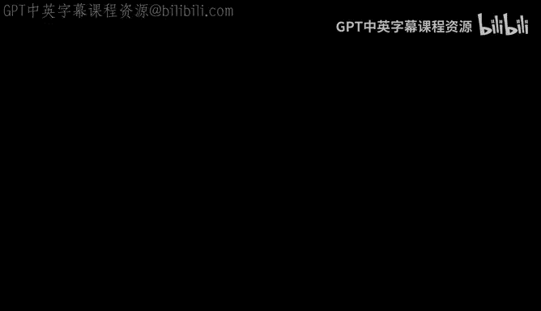

# 斯坦福大学《机器学习理论｜CS229M Machine Learning Theory - Fall 2021》中英字幕 - P17：-17-18_ Unsupervised learning, mixture of Gaussians, moment methods.zh_en - GPT中英字幕课程资源 - BV1jT421r71m

Okay， so I guess let's get started， so。So today， this lecture。

 we are going to discuss a few small stuff that that are remained that that are kind of like a left。

From previous lectures。 and then we are going to move on to as learning。

 So so I guess the first thing is that recall that last time。We talk about。

In place regularization of the noise。And。And we mentioned that。In certain cases。

 you can prove that a regularizer prefers the noise noisy SGD。Noisy Gd prefers。Smaller。

This quantity are theta， which is defined to be something like the trace of the hesing。So。And。

And in the first part of this lecture， I'm spending。

 I'm going spend probably 10 to 15 minutes to briefly discuss why this is a reasonable thing to try to minimize or try to kind of like regular so why the trace of the heing is some meaningful quantity or you know。

 but this part wouldn't be exactly kind of like rigorous because you have to do some approximation so and so first。

 but I'm just gonna do some kind of like somewhat heuristic duration to justify why something like the hesing would be useful for us to regular。

So I guess the thing is that how do we what is the hascin， right， What is the hcin。

 and maybe actually I actually write I will hide， this is the empirical。

 the hascin and the empirical laws。So。😊，Maybe for simplicity， let's only consider。

 let's only consider。One data point。So， and let's say， suppose F。As deep note， F to be F。Comata。

 this is the， I guess， maybe I should say。I have say like x。Be the model output。And let。嗯。哎。F。

Y be a loss function。Then what you can do is that you can compute。

 So then the L theta in this case is just the L of。You know， F theta X， Y， right。So in this case。

 then we can compute what the hascin is。 So the hascin。😊，Maybe let's call it Lhead。

To be consistent in terms of notation， the heing is the gradient of the gradient and what's the gradient if you use Chen rule。

 what you're going to get is that you get L the partial L over partial F times partial f over partial theta。

So， this is Nala。嗯。The derivative is back to。 So So this is a scalar function。

 L is a is a function of F， but this is a very simple function， right， because L is a scar。

 F is a scalar。 So， so this is a scalar and times the gradient of F theta attacks。So。

 and now you are taking the gradient of a product of two quantities。

 One is a scalar and the other is a gradient。 and then you can do Chenru。

 What you're gonna to get is that you first， for example， do the gradient with to your first part。

 what you get is。Let me see what you get from the first one is that you have L。

The second order derivative with respect to F。 and then you do the chain rule， you get。

This F theta x。 So this is greening with respect theta times screeninging F theta x principles。

 And this is the。In some sense， so this part is the gradient of this and this part is copying。

I guess。This is copying from here in some sense。But I guess， you know。

 this is something that you can verify offline。 like if you do all the kind of like if you look at all the coordinates and and。

 and do all the calculation， And then you can also do the the， the chain rule for the other part。

 So what you can get is the。😊，D L over D F times the second other derivative of the model。Heでアイデ。

The matrix。Of dimension P by P， if p is the number of parameter。And this is a scalar。

 this is a scalar， and this is a vector， this is a vector。So the whole thing is the P by P matrix。

So when you have a， suppose your loss。 So this is a general formula， which is just rigorously true。

 And suppose the loss function。I LOF。Y is equal to， for example， a half times y minus f squared。Then。

 this formula becomes。What is the second order derivative of this loss function with respect to F？

This function is a quadratic function of， the loss function is a quadratic function with respect to F。

 and the leading term is F squared。 So the loss that has the second order derivative with to F is one。

 So this is equal to one time squared and。😊，Of F times the gradient of F theta transpose。

And then this first order derivative will be with to F will be f minus y times the heycin。

My favoriteite X。So， so this decomposition is often called。

So so what you can see is that this is a convex term。This this is a PSD term， sorry。

This is PSD because it is the autoer product of a rank one matrix， and this is non negative。

And and this is not necessarily PSD。So the has may not be PD in general， of course， right。

 because you have a non convex function。 But one of the term is PD。And if you have in general。

 if you have a convex source function， the first term。 So in general， this is called。This is called。

 I don't know why this is called this， but it's called Gos Newton decom。

I think it must have have something to do with these two famous people at some point。

 but it's called Go decompositionization and in general， the first term。😊。

This is always is always positive for for。Convex loss function。By by loss function。

 I really mean the literally the top， the， the co at the cadratic loss of or kind of like。

Or cross entry belong， They are all convex。 right， So this term in almost all cases where you。

 we study the， the first term。 This is non zero。 So the first term is。This is PSD。PSD。

And empirically， people found that the second term， in most of cases， is small。So there。

 there could be multiple reasons for this。 So empirically。The second term。F minus y。This。

It's generally smaller。And one of the reason could be that， you know。

 at least when you are at a global minimum， this term is 0， so。When非。Is at a global mean。搜命令。

F sayta x is equals to y， right， So global mean would figure data exactly。 So in this case。

 then this term is actually literally 0。 So F minus y。😊，0。So this could be one reason why empirical。

 a second term is relatively small。 And of course， this is not always true。

 It's not always true you can fit a data at any point。 but somehow people found that。

 on the second term， you know， is somewhat smaller than the first term。

 So if you don't care about anything super。If you don't care about a worry。

Nuanced kind of quantities。 But the has in the first term is a reasonable approximation for the has。

 Of course， you， in certain cases， do care about nuances。 For example。

 when you care about whether this functions is convex or not。

 you should talk about even any non negative eigenvalue would make it non convex， right。

 So then the second term becomes important。 But if you just care about the trace。

 then the second term is not that important。So that's the， that's the rough intuition。

 And now suppose we ignore a second term。 This is a。A big assumption。

 but suppose ignoring the second term， Then we can see what's the trace of housing。Second term。

So the trace of the housing， you know， for whatever is where， for example。

 you can ignore it just because it's empirically small or you can ignore it because you are at a global minimum。

But supposely you ignore the second term， then the trace of the hassin。

And theta is approximate equals to this。Derivive physical to y， which is probably one。

 If you have square loss times the。The嗯。The trace of this。transpose。Which is equals to。

Some scalar times the true norm of the gradient。So you can see that by minimizing the trace of the。

 you are minimizing the L2 norm of the， of the luciousness with vector the parameter。

So this is so minimizing。The trees of the housing。Is somewhat similar， heically minimizing。L试。

Of the model。With respect to Santata。嗯。And I think so why minimizing eipiousness of the model with to theta is useful actually first of all。

 this is indeed useful if you just explicitly minimize this， know people have found that empirically。

 this is useful and why this is useful， you know， if you allow some heuristics， you know。

 you can also say that this is very similar to minimizing theipiousness。😊，Of the model output。

With respect to。The hidden variables。I think this is something that we discussed probably like。

A few weeks ago， when we talk about the all margins。

 So recall that if you have a neuro network theta， which consists of， for example， a bunch of。Layers。

Suppose you have a deep networks with a lot of weights。

 and then the derivative of the model which through some。Layer I。

 this is equals to the derivative of the model with respect to the layer。Above it times the layer。啊。

Let' me see， so this is H plus  one times H minus1 transs。So this is the the so called。 Okay。

 I guess now I remember the it's called hiding rule。You know， but it's actually just a little。

A simple change rule。In the， in the， in the neuro sense， this is called having rule。

 but but technical it's just a real chain rule。 You want to take the derivative with vector the parameter and the parameter kind of come into play that depends on H I1 and H I plus one。

 And sorry， this is H。So what is So So here H plus one。is。啊。W times HI。

Right so this is the ice layer。And this is the pre activation。Of， I pass one later。

I guess maybe technical I should call this H prime just so that I can distinguish it from poster calibration。

But I guess you get the point。 The point is that。If you take the derivative with the respect parameter。

 it's actually very closely related to the derivative with to the hidden variable and the norm of the hidden variable。

 H5。😊，Right， so this means that。That Uucraan norm。If you view this a matrix and it's a forbiingstorm of this。

 it's equals to。Two long times to each。重了。So， minimizing the。

The the luiousness with to the parameters is similarly。

 its similar to minimizing the the luiousness with to hidden variable。

I think this is something we have discussed before when we do the all layer margin， right。

 so then when you talk about the derivative of the hidden variable。

 then this is kind of like all layer margin。I guess you are maximizing all layer margin。

 because all layer margin is bigger if you have you know， more luious model。

 you have a larger all layer margin， so。None of these steps can be made100% rigorous。 You know。

 some of the intermediate equations that've written are exactly true。

 But I don't think all of these steps can be made completely rigorous。 But， you know。

 sometimes this is probably the nature of network where you cannot be 100% precise just because things don't match exactly。

 But I think the intuition is really just that the has。

The the the hecin relates to the lipsness of the model with retro parameter and the lipsness of the model with retro parameter relates to the lipsness of the model with retro hidden variables。

 which is kind of like captured of their margin。系。Any questions？Okay。Okay， so。

This is the first thing about。This is the remaining steps。 The。

 the remaining remarks from the last lecture about the in regulation of the noise and。

There's another thing I want to discuss， which is something I， in some， it's my omission。

 I forgot to provide a proof for one of the theorems that we discussed。😊。

I think two weeks ago about the imp recognition effect in the classification case。

I think there we only basically at the end of that lecture。

 we only be were able to kind of provide the theorem and the basic intuition so but we we weren't able to really show the proof The proof is very simple and short。

 like just the one page I think it's very nice proof。 So I really want to show it to you。

 So so maybe let's discuss that in the next part。😊。

So I will remind you what is the what the the was was about。 So guys just。This is a。2。

 I think two lectures ago。So two lectures ago， we show the following theorem。

 The theorem was something like。Suppose of maybe the context。I the a linear model。Classification。

And we have a gradient flow。 We have infinite small。Infinite testimal learning rate。

 And we understand what's the implicit bias of the algorithm in this case。

And the theorem that we had was that gradient flow。嗯。Conver this to。The direction。Of。

The max margin solution。In the sense that。So the margin of your it rate。

Is converging to the max margin solution。S T goes infinitefinity。So here， WT is iterate。

Of green descent。Attempt。Of gradient flow attempt。So and gamma is the normalized margin。

And gamma bar is the max margin。Max normalized margin。I think at the end of the lecture， I think I。

 I discussed the intuition。 The main intuition is that the cross entrytropy laws is really。

BaBasically， you can do an approximation。 And in certain cases。

 the cross entrepreneurs is a approximation。Of the max margin。 So the main intuition。

If you recall that lecture， I I， I will just very， very briefly summarize this。

 So the main question that if you do a a bunch of kind of heur calculation。

 you can find out that the log of the laws is approximately equals to。嗯。谁？

The log of laws is approximately equal to。嗯。Minus。Times the norm of W。Times the gamma W。

 So basically， minimizing a loss is kind of like either you want to make the norm of W bigger or you want to make the margin bigger。

So we did this very heuristic。呃Simplification。G youです。So that's why if you want to minimize the loss。

 in some sense， you are either trying to make the norm bigger or youre trying to make the margin bigger。

And it turns out that you can actually control both of these two kind of forces。

 these two kind of like tendencyency。 And if it， it's actually true that the norm is growing and the margin is also growing。

 both of them are trying to be big。 And， and you can show that the norm grows， you know。

 to its fiity。 and the margin grows to the the are margin。

 So that's the thing we're gonna improve in this zero。Any questions so far？And。

 and and one of the key thing that we discussed that at that point was that the the log sum exponential and one of the key technique is that log sum exponential is kind of like the same as max。

If， if your input is has a has a has a large scale。So。

 so today I'm going to provide a formal proof for this。Them， which is actually pretty， in my opinion。

 is's very elegant and simple。It will only prove it fault。

Proof for only the case when the loss function。啊 is。Mus exponential题。Like the， the exponential laws。

 we call that in that lecture， we also discussed that。The logistic laws。

 even though it's called logistic laws， it's actually very close to exponential laws。So， so， so。

 so we only deal with logistic exponential loss， which is kind of almost the same as the logistics。

 So the， the main feature is that as T goes to infinity， our loss goes to 0。

 So the T is the supposed to be the margin。 And when the margin is very， very big。

 the your loss is very small。So， and the。The idea is that we can consider the smooth margin。

So the smooth margin is defined to be。I think in the last in the lecture。

 we define a smooth margin to be。没 find到 the。没有。干什么呢？気ま。😔，Okay。

 so the smooth margin is going to be the following。 So consider the smooth margin。

So the smooth margin is defined to be log。Of the empirical laws。Over the two norm of W。

So recall that we have try to minus log。 So we have established this equation。

Last time during the intuition， and that actually motivates the use of the smooth margin。

 You can see that the smooth margin。😊，It's basically supposed to be approximately equals to the margin gamma of w。

 right， if this approximation is true。But it's not exactly equal to that。 because this。

 this is only approximate equals to。 So that's why we， we work with this smoother version， which is。

In some sense like almost the same as the margin， but just the more kind of closer to the loss function I all had。

And if you work with the smooth margin， you can show that the smooth margin is actually。

 I guess we have proved this in the last lecture。 So the the margin is actually bigger than the smooth margin。

😊，嗯。世界上。Maybe let's just write out exactly what this is， This is minus log。

Some of un exponential minorrs。Y I times W transpose X I。我 know of w。And。

 and you can show that the margin。Is larger than smooth margin。

That's because you can replace each of this term by the maximum by the minimum， right。

 This is just because。Y I W transpose X I is less than。Gmma w times the norm w。Sorry， this is not。

So the smooth margin is supposed to be something close to the margin， but smaller。

 So that's why it suffices to show。That the smooth margin L gamma tilda W converges to gamma bar。

WT conist8。This is because， you know， you have the sandwich thing， right。

 So you know that gamma W is always on gamma bar。 So， so basically。

 the smooth margin is sandwiched between。So， so if the smooth margin conge to the gamma bar。

 then gamma W has to conversege to the gamma bar because there are no way for gamma W to go beyond gamma bar。

Okay， so so now basically， this is what we're gonna do。

 We're gonna prove that even the smaller value， the smooth margin is gonna converse to gamma bar。

 So then the larger value will also converse to gamma bar。So， and。

 and proof is actually also pretty simple。 So we basically show that。will show。

The greening flow will increase。啊。This quantity， the log of the W T。Log of the law， the log laws。啊。

By because。Decreases。know， intuitively because it decreases L hat WT。So let's do this formally。

 So concretely。Because， I think， you know， the statement itself it will increase the minus of the log。

Loaws， that's kind of like almost obvious because the the loss itself is gonna decrease。

 But how much it increases requires some kind of mathematical derivation。So concretely。

 suppose recall that。The change in W is minus gradient LW T。This is the definition of the green flow。

 Then what you have is that。The derivative was faculty。嗯。Of the change。The changes in the log。

 the minus of the log loss。Its equals to。So how does this change this， you you take the chain rule。

 right， So you first look at how does the loss depends on。W。And then you look at how does W change。

And how does the loss depends on W。 So that's the derivative of the。 So then this is like a。

Dive of this， which is minus。啊， minus。You the chain rule again。 So you get L of W T。

 iss the chain rule for the log。 And above， you get。A gradient of alhead。W。T。And then have W dot。

And we call it W dot T is really the gradient of the loss function。 So basically up to a sign。

 So basically， you get。The gradient of the loss function。To non square over L of W T。

And this is bigger than 0。 So this shows that this minus log loss。

 it's going to increase S T goes through infinity。AndBut the important thing is how fast it increases its this quantity。

 this is something we're going to use。This is this whole thing is increasing。

 it's not surprising because the loss is decreasing。😡，But this。

 we also know want to know how fast this is increased。 And by the way， you can actually。

 I think it's useful to。Use this because we're going to compare it with。

You can also write this as this equals to this， just because the。Nbl L hat is just equal to W do T。

Okay， so now。With this， we can， what we can do is that we can control what eventually， after T step。

 what happens with the the log loss。So what you get is that minus log。L hWT。啊，诶。Equals to minus log。

 L hat W 0。Plus， the integral between 0 and t of the derivative of this quantity。地铁。满。So。

 and this gonna be using the equation above。 You get that this log。0 plus。Integ of W do T。

So no square over LWT。O。Okay， so， so we basically know now know how fast， you know， how large is the。

 is the log gloss。 right， So recall that what we care about is this quantity。What care about is。嗯。

What we care about is this。And how does this， how does this go to Ghana bar as T goes to infinity。So。

 and we have already deal with the。The the numerator， and we just have to kind of like oh。

 we we know how does this， someone know how does this change。For the new major。 And we have to again。

 another thing that we have to kind of like。try to understand。嗯。The denominator， So the denominator。

 you know， you have to normalize this by the norm of W。So。So basically。

 next thing is that we're going to deal with this term and compare it with the normalizer norm of W。

 So what you do is that。一路开的。W dot T square。This is bigger than。W do T times。W star。Recall。

A blue star is the direction。Of Max margin solution。This is just by cautious shores， right。

 So the inner part of two vectors is less than the norm of one vector times the norm of the other vector and the norm of the W star is assumed to be one。

So then， were plug in。The definition。Of w dot。-3 LW T。ItW star。

And then we plug in the true definition of the Nala L。Like we plug in a de for an na L。 So this。

Equals to Y， I times exponential。Mus Y I X。W transpose X I。Hences X I。And times W star。

And then this is a vector， this is a scalar， this is a scalar。

 so basically you can just take inner part of these two and multily the scalar。

So this will be equals to。I guess there's no minus here because the there's another minus in the gradienting which cancels。

 So then this is equals to some。Of Y， I times exponential minus Y I。W transport X I。

Times W star times X I。I got right。W star trans Xile。So。And this。

 we can see that this is the margin of the the the max margin。

 because W star is the max margin solution。 So this is。Always bigger than the max margin， so。

So this is larger than。Gma包 times。I guess。let me finish it and let me explain。Because。y爱。

W star principles X， I。It's bigger than gama bar。 This is just because governmentma bar is the margin of W star。

 So that's why every data point has a bigger margin than the。Then the the margin of the data set。

 gamma bar is the minimum over all data。So， and then this is equals to gamma bar times the loss。

So with this， then we can proceed by dealing with， we can proceed by dealing with this term to further lower bound how kind of control how fast you grow。

 So with this， you get log L had WT。Its larger than minus log L， h W。0。呃。Plus。嗯。

So maybe maybe just one moment before I use this， let me just try to interpret what this is really doing so this。

我。食数。😔，嗯。So， in some sense， as a remark， what is this seems really doing is that。So W T。

 we show that W T。 So we show that。WT is correlated。With isW star。That's what we are showing right。

 so we are showing that。的。The W dot T times W star is bigger than a nonn of quantity。

 And how color is is depends on and correlation。Depends on。Gma bar and loss。So， so in some sense the。

 and， and， and， and because you are calling with W star， it means that you， you。

 you cannot W dot T itself cannot be too small。 So， and also this is another thing we we got right。

 So W dot T。It's not too small。At least， compare to。The loss。So， so， so。

 so what this is saying is that， you know， if the loss is not too small。

 then you have to make some changes in your in your W。And if you have to make some changes in your W。

 then you have to make some changes in the log of the I had W T。 So basically。

 if the loss is not small， then your log of the loss needs to increase。

 the minus log of the loss needs to increase。So it's a little kind of like。

Conterintuitive in some sense。 but I guess so so what we do next is that let's control this term additional term that are circled here。

So， this term。If you used。The equation we get we got this is larger than gamma bar。time。

You cancel out one of the law， the law， or you， you， you can， you can use this for one of the。

 There is a power tool here， right。You can use the equation。

 Maybe let's this equation  one for one of this。Accurs of W do T。So then you get you。

 you are left with one， and then you got。TheGma bar and our hat our hat got canceled with the denominator and a galma bar is put in the front。

 So we get this。自己。Basically， I'm applying equation one。For one of the W doT to no。

And then you can use a triangle inality。So this is by one。

There was a triity to say that this is rather than。The integral of W do T2 square DT。

This is replacing the integral with the norm。 And you get gamma bar times。The norm of WT。So I guess。

 you know， next you're gonna see why we care all of this， because we care about this， because。Now。

 you can。Control how fast。Et。This log loss is improving。Compared to。

How fast the norm of W is improving。And this is what we really care about because fundamentally。

 we care about the ratio between them。This is the definition of the soft margin or the smooth margin。

So this means that the racial。I。Getting closer to G Bar。 right， So this term is a constant。

 and this term。It's something that becomes closer to zero as t goes infinity。so搜 wT。Goes to infinity。

 as T goes to 0 as T goes to infinity。That's why this term。Here。Converge to 0， S T goes to infinity。

So， that's why。If you take the limit。When she goes doing。Regarding this。Smooth margin， right。

 So we that this ratio is the smooth margin is converging to gamma bar。So in other words。

 the limit fancy嘛 children。WT一个速加网法。Maybe， maybe hear you only an negative。

 And then you use the other way to show that。And you also know that。 Okay， so we also know。

Gamma bar is largely in the margin of N W。Because gala bar is the max margin。

 and which is larger than。W7。And then you can show that the limit is actually equally equal to gamma bar。

 exactly。是玩的。Any questions。Okay， so I guess with this。

 we basically concluded our section about implic regulation。

 So I guess just very quickly briefly wrap up。 So this is the end of the。

The section about imp regulation。And we have talked about a bunch of things like initialization。

🎼So small initialization prefers certain of solution， typically， you know， small norm solution。

Prefer， you know， small norm solution。And and we are actually in one of the cases， we also show that。

 you know， you can have a interpolationulation between small initialization， large inization。

 So in that case， you can show the implicit bias for any initialization。

And we also talk about the classification problem。So where you get the max margin。

So this is where you get max margin solution。And we also talk about the cut， the noise。

So in all these cases， it's kind of like you have something about， you know， in your optimizer。

That is only designed for optimizing faster， in some sense。Right， but somehow as a side effect。

 you get implicit regulation effect。Okay， so。Any questions？😔，Okay， so if there's no questions。

 let me move on to。The final part of this lecture of this course。

 which is about more about answer learning representation and so on and so forth。So。

So then so in this lecture and and the last two two lecture， we still have like。 So basically in the。

Next 2。5 lectures， were going to talk about un first learning。There are not that many。

Theoretical work。About answer for certainny。 Of course。

 there are lot of like very amazing empirical works these days， like。

 but don dont not many theoretical work。 So what I'm gonna do is that I'm gonna start with。😊。

Somewhat kind of classical approach a little bit。 So for this lecture and the the the beginning of the second next lecture。

 maybe a good portion of the next lecture， I'm going to talk about the classical approach。I mean。

 theoretical approach。So there are many， many approach before， like， for example。

 the most empirically probably。Before deep learning。

 the best empirical approach would be probably like you do latent variable models with EM expectation maximization。

But I'm going to， for those kind of E algorithms， there are very little theoretical analysis。

 And even there is analysis it's kind of like a special case。

 and it's not clear whether they can be extended to。😊，嗯。A complex case。

 So what I'm going to talk about is a different line of research which use the so called moment method。

So， so these kind of methods， you know， don't necessarily work very well for。empiricalmly。

 but they have very good you can analyze them in a very clean way。

 And these kind of mathematical techniques are also useful for many other cases。

 So I think it's worth spending one lecture to talk about this this approach。 And it。

 it used to be the case that's actually around probably 2012，2013。 at that point。

 I think the community， the C community thought that this might be the new thing。

 It could be the new thing that you can both analyze and empirically work。 It turns out that。😊。

The analysis part， you know， developed， got developed very well。 But the empirical part， you know。

 is's doing okay， but not kind of like good enough to replace the E M algorithms。

 At least not enough to replace them completely。So， so。

 so and then I'm going to talk about some of the more more than。On work。With with deep learningening。

I deep learning like flexiblemal self tuning。Or contrastively。

So these are basically analysis in the last。While， two years about some of the new algorithms in deep learning。

So I'm going to spend probably the last lecture and the last 1。5 lectures on this。Okay。

 so that's the plan for the next 2。5 lectures。And。So today I'm going to talk about a classical approach。

Right， so。And， by the way， another kind of general comment is that， in my opinion。

 this answering seems to be the core for many things， right， So this。Also， relates to。

For example semi2 learning where you have some unlabeled data together with labeled data。

And this also relates to an domain adaptation。And my personal opinion is that all of these questions。

 right， what really you care about is really。Like in both of these questions。

 what you really care about is how do you leverage unlabel data， So in some sense。

 they all reduce this toing in my opinion。Okay， so now let's get into something more concrete， so。

So let's say， let's have some set up。 So this is the set。This is where you know。

Latnt variable models。 Lant variable models。So we are interested in those conflicting variable models。

😊，Especially in a classical approach。 So the， the formulation is that you have a distributionion。P赛。

P much as bicycle。How is para much theta that would be， you know。There are many different ways。

 which I'm introduce a few of them。But every parameter decide distribution key theta。

 And then you are given。Unlabel examples， there's no labels anywhere so you are given examples。

 you know， X1 after X1， they are sampled I from these distribution。B非ta。And your go。Is to recover。

等一下吧。Allert data from the data。From data。So that's the， that's the formulation。

And PC that can be described， you know， as a late variable model。A Ko typically is described。

By a latent variable model。So every data describes a genetic model in some sense。 So， for example。

I assume you somehow know roughly speaking what latent variable model is from CS 29。

 but let me give some examples， for example， mixture of Gaussian。This is one of the probably。

The most solid。Distribution in machine learning。 So。

 so the assumption is that in the most general sense。的非腾。

So the parameters are describe a bunch of things。So let me write it down first。

 So you have a bunch of vectors， Hey vectors and。A probability。A bunch of probability numbers。

 So each of this mu I is。In dimension machine D is the mean。Of the component。And P1 up to PK。

 this is a probability vector。In， in the simple， right， let's call it data K。

A simpleimax K dimension， which is。 basicallys。A set of vectors with norm1。 norm， sorry。

 norm equals to one。An onactive。And in dimension key。Right。

 so P1 f to PK is a probability vector over K items。And。Right， so and and given this parameters。

 how what's the model， How do you generate。 So this is my parameter and how do you generate data。

 So it's mix of cautionuss。 So， so intuitively， you just you want to model the case where you have。

 for example。Something like this， you have a。You have several clusters of data， something like this。

🎼I guess you you don't see the color in in in the data。 You just see the raw inputs。

 The color is just to indicate which gaugeus come from。 So， so mathematically。

 you say that you sample x from P theta by。You first assemble some I。

 the cluster I D from a categorical。Distribution defined by P。So， so I is， you know。Between I。

 I can take values from one to K。 And then given the I D， the cluster I D。

 you sample a Gaussian with mean mu sub I。And then some covariance， let's say identity。 So actually。

 the covariance can also be a parameter。 you want to learn。 But here for simplicity。

 I just assume all the Gaussians have the same covariance just to make this。😊，Like。Everything easier。

So， so this is the late variable model。 So where I is the late variable。

This is something you don't observe。In your data， you only observe X。

 but but given the latent variable， you can generate the the data。

 So so basically there are two set per set two parts where you first generate variable。

 and then you generate data。OfI the under the under the hood。And then any other approach。

 which I'm going to define probably mostly when I'm use it， I'm going to use it。

 So HM and the hidden variable， hidden Markov model。I guess if you take some NOP class。

 probably have seen these kind of things or。IC a independent component analysis。 This is。Also。

 something I think。啊Coing。嗯四 twenty nine。And so there are many。

 many other kind ofulating variable more space， nets so on and so forth。So。😊。

So this is the frame of questions we're study。And now let's talk about the approach。 So the approach。

Maybe before that， any questions？Okay， so the the approach。

We're going to study is this so called moment method， which is actually pretty powerful。As a。

 as a approach， there are some drawbacks in which make it empirically， ever less appealing。

 but approach itself， if you don't。Have about certain kind of like aspects。

 Then it's actually pretty powerful。 This is called movement method。

I think this method is proposed by actually economists。😊，Or actually。

 a few economists to understand data from economy。 like from economists。From like， I think， Michael。

I don't know。 I don't know。 I like some kind of like， you know。

 So the the original source is definitely not machine learning。

 But then people use this for machine learning these days with actually pretty complicated approach。

 actually， actually， even though， I think。actually I think me spoke the very original proposal of this moment method actually probably dates back to 19th centuries by some statistics and then actually some economists got even got the Nobel Prize by generalizing this moment methods to kind of like something like what we are discussing right now。

😊，So， anyway， so。So， so let's see how， how does this work。 So I'm gonna just only kind of like。

 I'm gonna walk you through this kind of method by showing examples。 So let's do the first example。

So。So first example， let's talk about mixture of。Of two options。So you just have two gas， and。

And I think for， and also， I say case is 2， right， So， and then let's also assume。

P1 and P2 are just a half。 So these two gasians have the same probability。 So they have the same。

Marginal density。 and also with all of generality， we can assume the the mean。

Is the average of the me is 0。 So basically， they are just symmetric around some， around origin。

This is in some sense， without aterity because you know which point you choose as the origin wouldn't really matter that much。

So。So then， meal one。You can write new ones。So。Let mu to be the equals to mu 1。 and then。

Mu 2 is equals to minus mu。 So basically， only want to learn one parameter， one parameter vector。

 which is mu。 and the the data comes from this mixture of two Gaussians， versus one Gaussian is。

Me mu and covari。 Anothersian is mean minus mu covari。Right so。And the moment method， so。

So the general approach for moment matter is the following。 So first。You estimate。啊。Moment。Of X。

Using。Emirical samples。I'm going define what exactly a moment really mean。

 moment really means I guess， you know， depending on whether you have any backgrounds。 You know。

 I I can define what moment really mean。 And then what you do is you recover。Pmeterters。

From moment facts。And by moment， we really mean something like this。 So the first moment。This means。

 the average。Of x。Of data。So。So the first moment， Okay， and let's， let's try to do this， you know。

 for this particular example， right， So if you do the first moment。

Then the first moment is the expectation of x。And what is the expectation of x， there are two cases。

 One case is that you you have a latent variable， which is one and other cases。

 the latent variable is 2。So you can look at the expectation for export both of the two Gaussians。

 right， So with half the chance you come from the first Gaussian。😊，And that's the case when I is1。

 ands half the chance you come from the second Gaussian。And when it comes from the first question。

 the min is mu。So that's the definition， right， So so you get a half times mu and you come from the second Gaussian。

 the mean is minus mu。 So you get minus mu。What is zero。So this means that there's no information。

About you。From first moment。Not so good， right， so this is not our plan。

 our plan is to recover meal from the moments。But from first moment， we cannot really get anything。

So then what youll do is you go to the second moment。So second moment。Is the expectation。

Let's call it M2。 Maybe I should call it M1 as well。 So a second moment is M2。

 Its defined to be the expectation of the。Of the， of the alter product of x with x itself。 right。

 there is this expectation of x and x transpose。So， so why this is called a second moment。

 This is really， you know， this is a matrix， basically。😊，嗯。Basically can see that I'm2 I J。

Is the expectation of X， I， X， J。So basically， this expectation of the kind of like the product。

Of two coordinates。Of， of， of the data。 And， and you， you organize all of this into a matrix。

 and you call it M M2。So， and if you compute the second moment， then you can see actually mu is。

 you know， you can， you can kind of see mu from it。 So how do I compute the second moment again。

 the same thing with half of chance， your x from the same from the same first Gaussian with the half of chance。

 your x come from the second Gaussian。😊，And。And the way it comes from the first Gaussian。

 So whats the covervarit， what the was the second moment of x under the first Gaussian。

 So this requires a little bit of calculation。 So let's do that here， So suppose。😊。

Xs come from a Gaussian with mean meal and covariance energy。And what is the second moment。

Maybe let's have a different letter for it so that we don't call it X。 Let's call it Z。嗯。

So how do you compute this。This，So there are several ways where one way is that you just literally look at each of the coordinates and and catch quite a complete expectation。

 That's perfectly fun。 So here I'm going to be a little bit lazy。

 I'm gonna to write that this is equals to the expectation of Z。😊。

H spectrum z transpose plus the covari。不水。Right， because covarience of Z is equals to the second moment。

 minus the alter product of the the mean。And and the mean is mu。

 so you get meal meal transse and the covariance is anity。

 so that's why we got meal meal transpose plus anity。😊，And and for the second， So basically。

 you get a half times mu mi transpose personality。😊，And for the second option， actually。

 the the moment is the same just because new and minus is new。😊，Is the same if you square it。

So got a half times new transfers， doesnt。SoSo eventually， you get new new trans plus identity。Okay。

 so now it looks good because at least meal seems to come from。 you know， mealo is。

Can be in some read off from the moment， right， So if you get the second moment， you subtract I。

 you can recover meal。Right， so basically， what you do is you say you first， you estimate I'm。

 but you don't really necessarily know I'm too exactly， right， So you estimate I'm 2。

By the empirical samples。So what's the empirical samples。

 So you define its empirical moment as the empirical。Second moment。And， and then you recover。

A meal from I to hat。You know， by pretending M2 is the same as same as M2 hat is the same as M2 right。

 So for example， you can recover mu by how to do this。

 one way to do it is you can subtract I from M to hat and then try to take the square root of it。And。

 and here I'm going to do one。 So， so so， so basically， the key thing is that。

So how do we recover So， so let's do a warm。 So there， I guess。

In some sense to recover it from M2 hat， the first thing ought to make sure is that you can recover it from M2。

All right， so this is kind of like a premises。看 recover。喵。From M2。Right， and。

 and we have argued that this is actually true because you can just subtract I from M 2 and then take the square root。

 There's another way to do it， which is， so another way。Which is the spectral method。

I'm going to introduce this here because。It's gonna be useful for for the future cases。

 So how do you recover meal from new meal transfer personality。 What you do is you take the。

Top agriculture。Of， I'm too。Es actually equals to mu over。A norm of me。Let's got this new bar。

So the top a vector of M2 is actually exactly in the direction。Of a new bar。

So and this is something like and also the e value。😊。

Is the top eigvalue is mu to norm square plus identityity。And this is something like， you know。

 you can verify very easily， right， So because eigenvector。😊，Of mim transport is。有包啊。And then。

 Eigenvector。Of mim trans spity is the same。ThisThis is just because if you are。

Identity to any matrix。 You don't change thes on the eigen system。You don't change di vector。

You only change the eigenvalue。 the eigenvalue。The eigenvalue。啊 got。Increment by one。That's。

 that's what happens when you add identity to to an matrix。松。そそそそそ。So you can see that from M2。

 you can recover mu， either using a simple subtraction and square root or you can do this identity composition。

And and this is the case actually， this is actually also corresponds to。The infinite data case。

Because when you have infinite data， you can literally compute M2。

 because the average will be exactly equal to the population。So now the question becomes like。

 what if you don't have infinite data right you don't have M2， You don't have M2 hat。 So basically。

 you need。Recover from M to heart。Basically using the same algorithm， using the same algorithm。

On I'm too hot。So basically， you just use the same identity on I to head and， and you need。

This algorithm。To be your best to hours。Probust to errors in the sense that if you have two matrices。

 I'm too and I'm too hot。 They are similar。Then applying this algorithm will give you similar answers。

Right so if that's the case， then you get similar answers as if you compute it on M2。

 So you get approximate an approximate estimate from you。

Right and it turns out that this robustness thing is often。O， like。At least in， in the。

 the in a qualitative sense， like for most of the algorithm we're gonna discuss， they are robust。

To some errors。 So， so， so， so actually， the， the most important thing would be this。

So we're going to focus mostly on the infinite data case。So we are gonna focus on infinite data case。

Because most of the algorithms is robust for hours。 So。

 so so the the error analysis part is important If you really publish a paper， But for the core idea。

 you don't have to really do the iron analysis because most of the algorithms are reasonably robust。

Okay。你快去说发。Okay， so， so we have basically we have completed a discussion about。

OnThis mixture of two Gausuts。 And now let's deal with mixture of three Gaussians。

 And you can see that the point will be that you cannot just only use the first moment and second moment。

 You have to actually go to the third moment。And we'll be making things a little bit more complicated。

So to the， maybe the general approach， just to。So is that you compute。M1。

 which is the expectation for x， M2， which is the expectation of x x prime。And M'm 3， What is M3。

 What's the third moment。M 3 is the expectation of x tensor x tensor x。

If you are not familiar with this notation， So x tensor。X tensor X。

 this is the third of the tensor of dimension D by D by D。So， and so let's say this is called T。

 So then T is the third all tensor and the I JK entry of this tensor is equals to X。

 I times X J times X， K。Okay， so， no， in， in some sense， like if you do the。

 So X tensor X is basically just a rewriting of x X transpose and x tensor x tensor x is defined of。

So。And you can also have like a tensor， B tensor， C， So suppose。Suppose T prime is equals a tensor。

 B， tensor C。Then T prime I J K is equals to definition would be AI times B， J times C， K。So I。

 and so that's why in this sense， if you look at M'm 3。I JK and three。Then this is the。The answer of。

The I JK entry， which is expectation of X I times X J times X K。So basically。

 every entry of this third of tensor M3 is the expectation of the product of three coordinates。

Of the of the data。So and you can do this even for M4 or M M4 and M5， so and so forth so。

And then you design algorithm。Maybe it's called a。Scrip a？That takes in the moment。And an outputs。不是。

Theta， so you want to recover from the moment， the parameter theta。And then if you。

 if you can do this， and the last step will be that you have to show a。Is robust。On two errors。

And then apply a。To the empirical moment。And how many， what is the order of the moment。

 So this is in this is in reality， right， So this is the final algorithm。

So applying a to the empirical moment。 that's the final algorithm。

 All the previous steps are kind of like the process of designing the algorithm。So。🎼So basically。

 but how what is the order of the moment you have to use， right。

 So do do you need third other moment， first other moment。

 that depends on how from how many moments you can recover the parameter theta。

 right from the first moment， second moment， you can recover。

 then sure two moments are fun if you need three moments to recover， then you need M3。 Otherwise。

 you probably even need M4。 In some some cases， indeed， we need M 4。 I guess in。Yeah。

 I think even in a case that we we're gonna discuss with and for the first sensor。The first。

Any questionsions。Okay， so I think I have only。Less than about。Or I have 5 about 15 minutes。So嗯。

I'm going to show that。嗯。Let's talk about a mixture of cake optionss。

And I'm going to see show you that。 you actually need。At least。Of the third moment。

When the number of components is not just two。And this is very typical in most of the cases。

 you need at least a third moment。 Actually， it's not very easy to find a case where second moment suffices。

 like I have to think about， you know which case second moment suffices for a while。

 And they found this like two component mix of Gaussian in in almost all other cases that you need third moment。

😊，So， so let's， let's assume again， let's make it simpler。 So let's assume that。

This is a mixture of Gausians。With a uniform mixture。

So all the component have one or K probability to show up。 So basically， use sample I uniformly。

From K。 And then you generate X from Gaussian with mean mu I and covari identity。

 This is the generate model for data。 And alternative， you can probably write X is sampled from。です。

The average of this。Take distributions。And what， you know， in in order follow up。

 we are gonna only do A And B。 We don't We So we only do A and B。The step A and step B。

 for all examples。你思。Evenncluding examples in the next lecture， the robustness， you know。

 you can do that， but it it requires too much kind of like mathematical dragon。

 which is not really needed for this course。 So an A And B is really the gist is really the core thing that enables this。

So。😊，嗯。So， so now let's try to compute the moment， right。

 So and see which moment is enough for us to recover。Again， let's complete the first moment。

 So this is。哦约后。K possible cases， right， So each case arises with x probability K。

 probability one over K。So each cluster shows up with probably one over k。So condition cluster I。

 your mean is mu I。And took some of them。This is one of a K times the sum of mewi。So clearly。

 from the first order moment， the first moment， you only know the average of the mean。

 you probably wouldn't be able to recover each of the mean。 That sounds reasonable。So， and。Now。

 let's look at a second moment。So second moment is。I guess we still do this kind of like。

Total law of expectation。 You condition on the hidden variable I， the late variable I。

 And you look at the second moment for that。😊，That Gaussian。

 and we have shown that for every Gaussian the moment。It。Second moment is mu I。

 U I transs plus anity。It is a sum from I to K。🎼Right， so and then this is one over K times sum of。

Basically， it's the average of the alter product of new and new eye transports。pl3。

So the question becomes， you know， supposely you just want to use the first moment。

And a second moment。The question becomes。Can we recover。From M'm1， and M 2。Right。

 so or maybe more specifically from。The average。Of new， eye。And。The average of Mui， Mii transports。

So and the claim is that this is not possible。At least when K is lower than。水。

So there are two kind of arguments。OhI guess there's one argument。 So the argument is the following。

 The reason why this is not possible is that these are just not enough information for you to recover in some sense。

 So there's so like a you， you still missing some kind of like of。rotationations。

Miss the rotation like the information。Okay， what does that really mean？Let me specify。

 So suppose you。Just to make make the discussion easier。 Let's define you to be this collection of。

It means mean after new K， which is in dimension D by K。So this is the matrix you want to recover。

 right so。And。I'm claiming that youre going exist too。Set of news that have the same。Average。

 like the same quantities here。 these two quantities the both M and M2 are the same。

 even though the mules are different。 I'm gonna construct such a situation。How do I do that？

I'm going take。呃A rotation matrix。Our。In dimension K byK。I'm gonna to rotate。 So basically。

 I'm gonna， consider。U versus u times R， right。If you rotate on the right hand side。

 you got a different type of set of means。So I'm going to claim that U and U times R have the same statistics。

 You know， have have these same two quantities。嗯。So。

 so first thing is that if you look at the average of the auto product， Mi I U I transpo。Sorry。

 this is one ver K。 then this is one ver K times U U transfers。InYour simplified notation。

And this is equals to one over k times you are。Time you are transs。

This is because RR transpose is equalsity， that's the definition of rotation matrix。

So that means that you and you are are not distinguishable from this quantity。

 from the average of the product of the new and U right principles。So I now let's look catch the。

Let's look at the the first at moment。So to make the first all moment also not distinguishable。

 I also have to take another take。😊，In addition。Or such that。

R times all one vector is still equal to all one vector。So you want a rotation such that you don't。

You want a rotation， but you don't want to rotate the direction of all one vector。That's easy。

 You have so many rotations， right， You can。 You just want to say， Im gonna。

 it's kind of like if you have a globe。 you have one direction， which will don't change。

 but you can rotate still in other dimension directions。

 But you still are still okay minus two directions， But because dimension is K here。

 So you still have a lot of degree freedom to choose many different Rs that sifies this as long as case someone big like larger than three。

😊，So， and then suppose you satisfy this， then you are。Times all one vector。maybe let's write this。

1 over K times some of new I。 This is one over K。Times U times of one vector。Right。

 I'm claiming that this is equal to1 over k times U times r times of1 vector just because I design our vector。

So， that's why。From。This average call of statistic。Or or from this point。

 you still don't distinguish。You and you are。Very搜。You and you are。Are not distinguishable。

Because they exactly match the first moment and second moment。So that's why we need to go to。

Go to M 3 to distinguish， to uniquely identify the columns of you。Okay。

 I think we are five minutes early， but I think the next thing would be。

Prob takes much more than five minutes， so I guess I will just stop here to see whether there's any questions and tomorrow next lecture。

 we don't continue with solving this question with with M3。Any questions。1个。Yeah， so the question is。

 how do you re infer the number of optionsussians。 So first of all， you indeed。

 you are right that in the formulation right now， I'm assuming I know exactly the number of options。

 I'm even assuming that I know。All the the pro for each高。 right P1 up P T are exactly to one over K。

So， and the question is， how do you kind of like in front of of Ga， Maybe also another question is。

 how do you infer the P1 of the P K， right， So there are ways， of course， you know。

 there are ways depending on， know， there are various ways depending on what assumptions you make。

 But definitely there are is possible。 For example， one。Somewhat。嗯。

One way that would work in certain cases is that you can infer the number of Gaussians by looking at。

The rank of this matrix。Suppose you believe that all the mu eyes are not kind of like degenerate。

 They all not， they are all in kind of like general positions。

So then the rug of this matrix will be K。Especially for when when K is less than B。Right so。

Then you can infer number of Gaussians K by looking at the rank of these matrix。So。

 but but I'm not saying that's that's actually really a great method because empirically you may got into other issues because media conditions not exactly mass on and so forth。

 So there are many other ways and empirically， the most kind of like typical way to estimate number of Gaussians is using nonparmetric basin methods。

 which I guess is not something we will cover here So for the theoretical setup。

 we are mostly interested in the clinic setting where you know everything and it' still an open question to recover the mewi。

 even with the knowledge of the number of。😊，Right， so as long as that happens， it wouldn't work。

 right， So that's why it's probably not a great idea。No， actually， typically。

 if you really look at the high dimensional data， the new eyes。😊，Typically， they are independent。So。

 but they could have some kind of like one of them we could live in。

Approximately the subspace of the others。 So then it becomes tricky because whether you are robust to errors on and so forth。

 Yes， so， so I think loosely speaking is reasonable。 But if you really look at the details。

 it's not that great。 So that's why you you need other methods， sometimes。Okay。

 I guess if if there's no other questions， I will see you on next Monday。

