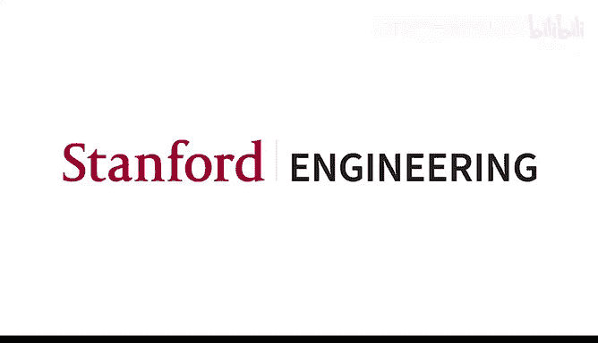
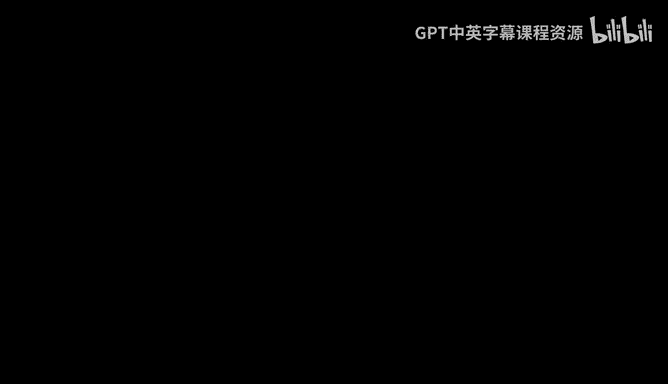
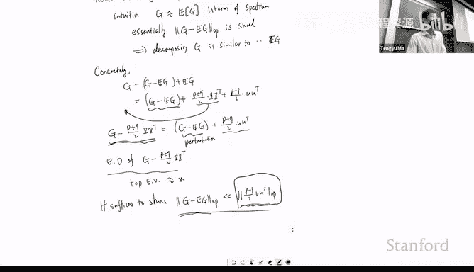
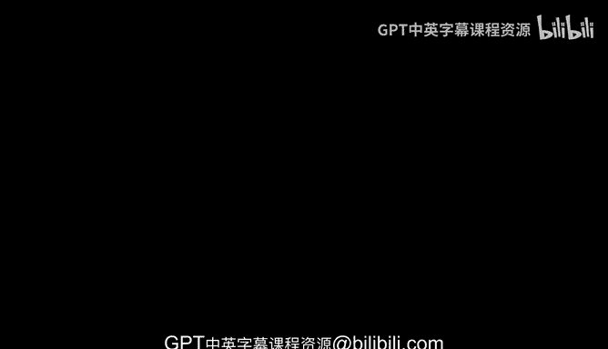

# 斯坦福大学《机器学习理论｜CS229M Machine Learning Theory - Fall 2021》中英字幕 - P18：-18-19_ Mixture of Gaussians, spectral clustering.zh_en - GPT中英字幕课程资源 - BV1jT421r71m

Okay， I guess let's get started。 Let's see。 Is this working， yes。嗯。再开首。Last time。

We have talked about enterprise learning。 And today， we are going continue with enterprise learning。

嗯。So guess。So。And first， we're going to continue with the moment method。

And here we're going to talk about higher。All there moment。And then next， we'll talk about some。

It can cause cluster or spectral classroom in more。Take course。

So these are different type of unial algorithms。😊，So I guess just to continue with the what we had last time。

 Last time we ended up this mix of Gausss。The setup was that you have some X。

 which is sampled from a mixture of K Gaussians。With me new I and covariance an。And。So at last time。

 I think at the beginning， we talk about， you know， case 2， We have two mixture of two Gaussians。

 and in the。In that special case， you can just take the second moment of the Belusian to recover the muise。

And then we moved down to talk about case bigger than two。And in that case。

 we have argued that if you take the second mixture， right if you take the second moment。😊。

Then this is something like one over k times some of mui mui transpos， and this is not enough。😊。

To recover you。M eyes， because， you know， given this second moment。

 you still cannot identify the mu eyes precisely because there are multiple mu eyes that can make。

Can have the same second moment。So， so that motivated us to consider a third moment。So。

 the third moment is。As we discussed， is the more expectation of x tensor x tensor x。

So this is the third of the transfer in dimension。D by D by D。

 And let's compute what's the third moment。 And with the hope that the third moment will tell us enough about new eyes so we can recover new eyes from the third moment。

 And that's indeed the case。 So what we do here is the following。 So we compute the third moment。

 And I guess the。😊，The the initial step is always the same because you have a mixture of K clusters。

 so you do what you do is you have more over a k times。On the sum of the moment。

Conditioned on each of the cluster I， where I is the。ACl their ID。

And now the question becomes that if you have a Gaussian drawn from if you have an X drawn from Gaussian。

 then what's the third moment， What's the expectation of third moment。Right， so what is this。

Expectation of x tensor x tenor x conditional I。So。So let's do some kind of like a simplification。

 just to。This is an abstraction in some sense， so that we can make the not simpler。 So suppose。

Z is from some Gaussian with new mean。 Let's call it a。Just to distinguish it from the。

你A and口口 identity。And the question is， what is？You have thislema。

I guess the condition is this and then。A question is， what is the expectation of Z tensor Z tensor Z。

And the claim is that this is。Pretty much。Equals to a tensor A tenor a。 But with some caveat。

 theres some。Other terms。Which are something like this。 Let me write down and explain so this is。

L from1 to D expectation of x。看始。E L， tensor， E L。Plus。From the expectation。E。

 L tensor expectation X。So this is a formula。 Oh， sorry， my back， this is not X。 This is Z。

There's no x in thislemma。 We already change our not to Z。嗯。So， so know that。

Expectation of Z is really literally a。 So basically。

 you have already have a formula that express the third moment of Z into a function of a， right。

 Thats make sense because everything A decides everything。 So everything again。

 A should be a function of a。Right， so the reason why we still use E Z in this pharma is because we want to。

In places say that， you know， this is something。Or iss something that is about the first moment。

 So maybe the， the more important thing is that。This means that。You can， you can compute。

 so we can compute。A tenor a tenor a from。Ling combinations。你上次。In combinations。

Of the third moment and this first moment。Why is useful to get this？ I think that will be clear。

 Why is useful to get A tenor A tenor A。It's useful， or we'll see it in a moment。😊。

But the dilemma tells you that if you know the first moment and third moment。

 you can get a10 or10 or8。From sorry， I keep messing up with the light here。 So here is the。Okay， so。

And。I think I would Any questions so far。I guess， it's not exactly clear why dilemma is useful。😊。

You know， at the current point， I guess the main point is that you can compute out what's the third or third moment when this is just a Gaussian。

And I think the proof， I'm gonna show the proof。 I think the proof is， you know。

 not nothing super interesting， but it tells you how to do this kind of the derivations for the moment。

 And once you see it once then all the others becomes you know kind of trivial。

 So how do you compute the third moment。 So what do you do is you do it for， actually。😊，So you say。

 look at the IJK entry of this thing。 Then this is just expectation Z， I， Z， J， Z， K， where Z。

 I dens the coordinates， the I coordinate。And。嗯。I think there's something。Sorry for the note takes。

 I think I changed my notation to V here。Just to be consistent。I mean。拜拜。Chnge this to be。

 it's just a generic variable。 Its just somehow later I use V。 So let's change this to be。So。😊，嗯。

So what we do is that we just， you know， to compute this moment。

 we just sometimes do this in a brute force way， right， So what is， what is Z I， D J， Z， K。

 You can write Z I with V I plus some casia。And Z VJ， CJ can be VJ plus CJ。And these K VK plus。Ca K。

 this is we are using a fact that Z as a vector is equal to V plus on Ca C， where Ca C is from。

Sypherical Gaus。 that's， that's my definition of Ca C， in some sense， Ca C is equal to Z minus B。

 and which has， you know， spher Gaussian distribution。And then， you can。And we， by the way。

 VR is the I current。Just to， to be clear。So， and then we can expand this。

 So there are eight terms in this product。 So so what are them， So one of the terms is via VJ VK。

 That's easy。 V is deterministic because C is random。

And some of the terms will look like expectation。V i。VJ Ca K， one term is this。

 and another term is expectation V I。VK K C J and plus expectation。VJ V K， K C I。

And these terms will be equals to0。Because， you know。

 the expectation of Ca C is0 and V is a deterministic quantity。

 So that's why they're going to be zero。😊，And then we have the other three terms that looks like expectation V I K C J K C。

 K。Plus， expectation， V J Q C， I Q C K。Plus。Expectation， V K， Q C， I Q C， G。

So this terms is a little bit different。 Let me deal with it。In a moment。

 and the last type of term is the product of the frequencies。So。

How do we deal with the the rest of the four term。So the thing is that if you look at expectation could C I could see K。

This is equals to what。This is equals to 0。 if I is not equal to K。

 because if it's equal to I is not equal to K， Caci I and Ca C K are two independent random variables。

 and you can factorize it to get expectation Ca C and Ca C K。 Theyre both0。 So you get0。

And this is one if I is equal to2 because okay， maybe let's have more steps。😊。

So this is equals to expectation because the I square。Which is equal to one。 If I is equals to k。搜。

So in summary， expectation of K C I， Q C K is equal to indicator。That I is equals to K。

And you can also try to do deal with K C I Ca C J， K C K。 And here you can still， you know。

 try to do the same thing， like try to divide it into different cases。

 whether IJP are all the same or maybe both two of the I and Js are the same and K is different。

 there are few cases。 And actually， if you knew all of those cases。

 it turns out that it's always zero。Like regardless， regardless of。The choice of I。

But for different reasons， for， for example， when I JK。Are all the same。

 And this is the third power of Kcii。 So it equals to expectation Cacii cube。 And that's 0 because。

Gussian， the third moment of Gaussian is 0。And and when I is equals to J and but not equals to pay。

 you can do another different， you know， calculation。

 but generally you can do all of calculations and they all equal to zero。😊，In some sense。

 I think the reason， fundamental reason is it's not so helpful。even也这样 for all degrees。😊，Pommial。

 all degree mononomial of this class ice。It doesn't matter like it's always going to be zero。

 The expectation is always going to be zero。So， so these are all in some elementary calculations。

 And then if you use this， then you can continue here， you can get， this is expect equals to V I。

 V J， V K plus VI times indicator J is equals to K plus VJ indicator I is equals to K plus Vk indicator。

😊，I 수제。And this is pretty much complete proof。 so then you just have to rewrite this。😊。

In a in a test form。 So if you verify， I guess how do you write it， I guess。

If you verify this equation， the target equation。Entry by entry。

 then you see that this is exactly exactly。嗯。四。So， this is V L。看是EL sorry。好吧。Al， so。

 so this is our target equation。 This is what we got。For every entry。So let's just verify these two。

 you know。Verify that they are the same thing， it's just a reorganization。How do you verify that？

 It's kind of like if you take the IJK coordinates， do you see that。

So the question is what the IJK corner of this guy is， right？V tenor E， L， tensor E L。

The IJK coordinate。Its equals to it always has a VI there because， you know， V is always there。But。

The J， the J K coordinate of this。E， L and E， L depends on。 So basically， you have to， this is。

The only possibility is that this is E。So the only possibility that。 So basically， this is cycle。

I guess maybe one way to write this is that if you really do it。This is V。I。Times E， L。

 the J scoring of E。And E L， the case corner of E。Right。So， and in what case this。

 the J corner of E L and case corner E L are both non0。 The only case is that。L is equals to J。

 and L is equals to K。 That's the only case that this can be non0。 So that's why this is equals to V。

 I times 1 when。LE equal equal是JL is。Equals to K。 And the only way this D happen is that J is equals to k。

When J is equals to K， otherwise going be 0。So that's how you verify， you know。

 the the I don't I don't expect you to kind of verify completely， you know， on the fly， but you know。

 in some sense， the exact formula doesn't matter that much either， right。

 you only need to have a formula that depends on the10 third moment of V and also some like formula。

 basically you just need a formula for me。😊，Okay， so so any questions so far？

So now let's see how we use it， right， So how we use it is the following。 So and you can kind of see。

嗯。What kind of things we exactly need。 So you need。 So you now you look at the X， right。

 X is a mix of Gaussians。 Z was， only a single Gaussian。And you use the single Gasian thing。嗯， on那。

The single Gaussian has a building block to compute the moment of the mix of Gaussians。

And what you do is that， okay， when condition I becomes a Gaussian and you apply the the lemma and you get one over K times。

Some over I from1 to K。 And then this is new eye tensor。

M I test a new I because new I is taking the place of me。And then， you have。

The additional three terms。M I tenor E L tenor E L。And E， L tenor， new eye。Canor E L。Cl。EL衬衫EL。有爱。搜。

For。Okay， so， and。So basically， the， the third moment of x is a function of new eyes。

It's still a little bit messy。 So what you do is you say， I'm going to get rid of all of these terms。

By using the first moment， the first and the the moment。Right， so。

 so what you do is that you first reorganize a little bit， you get。

This somewhat cleanly looking term， mu eye tensor。MI探or mu I。

And then you switch the K with the the two sums for the rest of three terms， you get sum over L。

From one to D。1 over k times sum over I from one to D mu I。Tsor E， L， tensor E L。

And you have the two other terms， which。I guess so。You can feel it。

 you can imagine what they look like they just there are promotingutation。

 there are rotations of these terms in some sense， changing the order。And now this one。

Because becomes the first moment of X。So you get one over K。If you get the same。 this is I， sorry。

 this is I。哎。Plus。Something that depends on the first monoleex。Right。

 so what does this mean is that you can move this。3 things。The来反 side。Right， so so basically。

 this means that we can compute。This tensor。From。The third moment。And the first moment。So。

That's basically our interface。 right， Once you have this tensor， then the next step will be。

Next step。 So well go from here。 So from。This thing， I guess， let me write this。

I think I should have introduced this to Mi wise。So， and just for the notational purpose。

 So a to the tenor 3 is just a short time for a， tenor A， tenor A。So basically。What what this。

 you know， what the whole， this whole competition is saying is that now you can compute this。

Expected this some of the third moment of in U I。 And then you need to design algorithm。

To compute newwi from this。And and if you can do this in your question mark， then you are done。

 the whole thing is soft。Because you can first use the moment to compute a third order。

The third answerr from your eyes。 And then you can run this algorithm。

There are some you know there are actually some cleaner ways to deal with this way you don't have to deal with additional terms。

 you know to get there are some other ways to get this exact circular of tensor just directly in a cleaner way。

 but that requires a other machinery so that's why I'm kind of like only using this relatively Bo force way to get a third of tensor but the point is that you can always get something like this。

😊，So now the problem becomes the so called tensor decomization problem。

So abstractly speaking this tens composition problem is something like。有。So， abstract。

You have a sequence of vectors， A 1 up to A N。 These are all in dimension。 Okay K in a dimension B。

 So these are unknown。And what are given。Is a vector。I look like this。 I from1 to K。And then。

 you'll go。Is to reconstruct。AI。And you can also ask about this， you know。

 for different orders of cancers， you can also ask the same question， you know。So questions。Also。

 for for example， we can have。Some other R or the tenor for some other the dis possibly bigger than three。

And it turns out that you can also get the fourth out the 10。The false order kind of power。

From this moment matter， right if you take the fourth moment of a data， you can get AI to the tenor4。

 You know， with some real arrangement， like like have。So， so basically， this is the， the kind of the。

嗯。A kind of interfaces， right， you basically reduce the moment you reduce the uning problem to this so called tensor decomization problem。

😊，And this tensor decom problem also has certain kind of like。Some words not like a。

 Let me also give you some notions for this threshold notation。 So this。So the rank of the tensor。

So some basic。No。So， the rank。诶 suggest机 let say。A tensor， B， tensor， C is a rank one tensor。

This is the definition of Frank tensor。And then the rank of a tensor K。呃，探测T。Is the minimum。

Hey such that。T can be。Written。诶。A sum of rank， a sum of k。Runlines。

Sometimes this is also called CPT conversation。So in some sense。

 the reason why this is called composition is that you observe this， you know sum of these rank。

 you want to decompose it into components and each component is rank one。

So and and this question is also sometimes called CP decomposition。

 because there are some other decompositions for cancer that could also be meaningful in other cases。

嗯。But， but， but actually， you know， it's also fun to just call it ten decom because this is the。😊。

The men， the most popular decomposition for tens。Okay， so， okay， so now becomes， so okay。

 So I guess now it becomes a very modularized question。 Its I read my question， right。

 how do you figure out。The components from given a low rank potential。

 how do you figure out the lower rank components？So， I'm going to。

What I'm going do is that I'm going to basically list some of the existing results。

 but not really talking about details， because this is a。Actually， what happens you know。

 in this area， you know I think this area becomes kind of like very popular around 2013。

 2012 and the very beginning， I think a few papers kind of lay out the framework for this kind of hosting right so how do you compute the moment。

 how do convert into tenor the conversation problem？😊。

And then those papers provide somewhat easy tensor decom problem。

 or they actually invoke some of the existing tensor decom problem。😊，And that's those early papers。

 And then this field， you know， somewhat kind of like a。

Because you have this this question becomes two parts。

 right one part is about how do you do the moment， right， how do you turn the moment into a tensor。

 And then the second part is how do you decompose a tensor。So， so people have， you know。

 there are a lot of papers involving some of my works as well， you know。

 but there are actually a lot of works that tries to understand how do you decompose all different kind of tenss like and what connections you can。

 you can decompose。So， so maybe what I'm going do is I'm going to list a few conditions that you can decompose this tensors。

 you know。😊，嗯。Compplication efficiently。 and those conditions。

 you will turn into a condition for the upstream problem。For example， the mixture of Gausian problem。

 I'm going to have some conditions。 So just to set up the the connect the conduct basis。嗯。

Let see where I wrote this。是。Some I didn't notice this。 So the maybe the number 0 is that in in the。

 in the most general case。In the worst case， you know in the more TCS language。

 right you call it worst case or in the most general case， this problem is not solvable。So。

 finding the。AIs。Are computationally hard。Actually， actually， there are several layers here as well。

 If you want to discuss the details。 You know， you know， you know， in a very worst case， actually。

 the， the AI stand not unique。 You don't have a unique decomposition。😊。

And when their composition is unique， you can also there are also places where the decomposition is unique。

 but you cannot find them in a computationally efficient way。😊，I think there's a question。对是说是。他会不。

So。If you take。3 you replace 3 to be 2。 then is's pretty much like symmetric。 this。

 this here is symmetric， but you can also make it asymmetric。 But yes， you are right。

 It's basically linear linear algebra stuff like F。嗯。And， this is a very good question。 So I think。

In some sense， as you will see， like in some of the discussions below， like in some aspect。

 the tensor decomization is kind of close to matrix decomization。😊，But。1， there。

 but there is a one fundamental difference。So then that fundamental difference is what enables。嗯。

That makes this kind of tools powerful， but also challenging。

Like it's powerful in a sense that it's fundamentally powerful because。啊，那。Because here， this is no。

 there's no。No rotational environment。I guess this， this no rotation environment。

 also you have to interpret in a careful way。 So what I mean is that。Some of a i。

Canancecer 3 is not the same as sum of rotation of AI。Chanceer 3。However， this is true for。Marices。

 so if you have some of AI， AI transpose， this is the same as some of R times AI or R the rotation matrices。

嗯。I guess this is。I guess it depends on how you rotate it。My， my bad。 I think this。

 how do I say this， I probably shouldn't say this on the fly。

Without thinking about what's the best way to。I guess。

 I guess technical should rotate rotate on the right， so。So嗯。So maybe let me not make it precise。

 But I think maybe one thing to to， to， to realize is that if you have matrices。

 you have eight times a trans， something like this。

Which is kind of like a sum of AI AI transpos if you put all the AIS as columns of capoid。

So then this is equals to a times R times R a transpose if R is a rotation measures。Ms。

 and you just cannot do this， you know， for the。For the cancers that often。So， so。

 but what happens here is that if you permute， if you have AI。And you promotemute it。

Commuted indices。To。AI primes， where AI primes are just limitationss of AI。 Then this resulting sum。

 the third third answer is still。So you only have not symmetry， but no。

You only have permutation symmetry， but no no rotation symmetry。

 And this is actually make it somewhat powerful because this， in many cases， this is the case。

 Like for mix of Gaussians， you can， you can permute all the centers and that' still the same Gaussian。

 but you cannot rotate the qua systems to to make it the same。 You cannot rotate the。😊。

At least you cannot take linear combinations of the centers to still maintain the same mix of Gauss and I think this also applies to neural right works。

 I think for neural right works， you have the chromutation symmetry where you can permute the neurons in intermediate layers and also the social edges。

😊，And you can still maintain the functionality of the neural2， exactly， the same。

But you cannot do arbitrary kind of rotations in it because you have the known narrative。

With the activations so yeah， but I guess this this part is supposed to be somewhat abstract because you know。

😊，Once you if you see a lot of tech math， then you kind probably understand this a little more better。

 But anyway， so so there's some fundamental differences between this and and linear algebra。

 So that's why tensor composition becomes difficult。😊，嗯。Especially the world kids。Okay。

 going back to the， to the list of， you know questions。 you know， So in the， as I said in the。

The starting point is in the general case， you can， You cannot hope to do anything。

 but there are many cases where you can do something。 So the easiest case is the orthogonal case。

So a so case means that if a1 up to a K。Are orthogonal。So， and in this case， actually。

 this is the closest to the eigenlctor case。 this is a so here you can say that then。

A I is actually the global。Each of these AI， each of AI。Is the global minimizer。

 There are multiple global minimizers。 So that's why each of them is a global minimizer maximizer。

 actually。😊，Of this objective function， where you maximize。The L2 norm， the maximize this。

Tenscer paid by a work canceror。So guess， if you're not familiar with an notation。

And what I really mean is you take this。Some of T， I， J， K times X， I， X， J， X， K。搜。

This is the extension of the cadraive form for matrices， right， So suppose you have matrix。

 then this is the cadraive form。And for tensor， this is this tensor form。And。😊，So， so， so。

 so eigenvectors can be defined in this way。 You know， if you change the tenor to the matrix。

 because eigenvector is what maximizing the quadratic form for the matrix。

 So sometimes in this sense。The components are some kind of like eigenvector。

And then you can find this。So this is a interesting property。

 So this is saying that AI is kind of like。Kind of like eigenvectors。Of tea。And， and also。

 we can find it。 You know， it's not trivial real to find it， but we can find。

AI is in parallelormmal time。And and actually， the way to find it is that you try to solve this optimization。

 and leasts one way to find it is that you try to solve this optimization problem by when research。

So that's one way， one case， and。Another case is that okay。

 more more general case you can have the independent case。So it turns out that if a1 up to a K。

Are linearly independent。Then this is also a good case。 You can find this in polynomomic time。

 I think the algorithm is called generate algorithm。

I'm not going to describe all of this algorithm just because they will take too much time。

 and in sometimes， these are things that you can as long as you have some kind of like。

Basic knowledge， you can search over the literature and there are many papers about this。嗯。So。

 but these are so one， two are both about called undercomp case。1，2。And the so called。Under complete。

Case， which just really means that K， the number of components is less than D。You can see that。

Number one， number two can only happen when K is less than D， because if K is bigger than D。

 there's no way that AO N up to AO R。Leenally independent。

Because your number of components is speaking on the mentioned。

 so they cannot be linearly independent。😊，But actually you can also do this for overcomp case。

 overcomp case are still possible。😊，But still possible。In certain cases。

So there are several different ways to deal with overcompte case， which means K is bigger than D。

 So the first one is that you can look at high order tenss。So you can say that， suppose。A1。

 tensor 2 up to A K， tenor 2。Are independent？This is a much relaxed condition than a1 up to a KR linearium pen。

 because now you have higher dimension。 So， so now this， this only， this only requires， you know。

 K needs to less than D square， right， less than D squared to to make this possible to happen。

And suppose this is true。Then。You can just replace AI by AI channels 2， so you can recover。AI from。

The six other the tensor you recover from A ten power 2 to the tensor power 3。I from one to K。

And which is still the same as the six of the ten。And how do you do it。

 you just invoke the third all tensor on AI to the power2， and then after you get AI to the power2。

 you can get AI by just taking a square root。So this relax the restriction on the K。

But but you know somehow with the cost of estimating six moment， because how do you get this。

 this is a thing with in R to D to the6， So you have to somehow do something with the six moment and it will be less simple efficient。

And well， another slightly clever way to do this is that you can do false other tenor。

With the same condition， so。So， you say that。S order generic cancer。

And what does generic cancer really mean， it means that。You exclude。嗯。Excluding。LG Brexit set。

Of measure 0。 So you you exclude。A small set of， you know， a measure0 set of tensors。

 and except those kind of tensors， you can do this。And。And this is saying that， when。

K's less than D square。You can recover。a i from。The false answerr。Right。

 so before if you do the trivial reduction， you get， you get the third。

 you need to it is the six out tensor。 But now you only have to use the fourth out tensor。

 And this algorithm is called fubi。嗯。And you can also have robust version of this。

This algorithm by itself is not robust。 You can also have robust versions of this。

I guess let me not write down those references， I'll add the references later I guess。If you just。

 if I could just get the。Innitiallys， I think these are some references like this where you can get a robust version of these algorithms。

And， and， and if you want to be。More ambitious， right。

 So you want to say that I want to even deal with third ten。 Then you。

 what you can do is you can say， have random。😊，Tsers。And by random， it means that if you assume。

A eyes。Are randomly generated。嗯。But for some unit vectors。

I guess whether it's union vectors is not that important。

 but know for convenience say they are all union vectors and they're all randomly disputed on the Uni spheree and then。

😊，For even third of the ten。啊，我。K can be as large as。D图 was about5。

So so you can kind over complete case， even with third other ten。And there are some references here。

 which I guess。I added to the nose， eventually。Okay。Okay， cool。 So this is just a very quick list。

 kind of probably a little boring list of like references。 But I guess you see the rough idea right。

 So you can from various conditions for the component AIs。

 you can you can have various kind of algorithms and different results right。

 So typically if you have more restrictions on AIs， you get stronger results right。

 So the strongest one would be you have， you assume they are random， then you can get。😊。

You can even decompose over complete tens。when when the order is only three。

But if you don't have that strong assumptions， you have to go with the four o tensor or even six o tensor。

If you don't use the right iPhone。So this is basically what's going on in this area and and you can see there are many。

 many papers that deal with different kind of like setups。

 So so I will add some references to the the to the lecture nodes。

 but generally this is something you can kind of search。😊，On on Internet。And they are just a。

Before we conclude this part， there are other latent variables that can be done。啊。Can be done。

By moment method， a matter the moment moment。Using this same strategy where you first complete a moment。

 you turn it into a tensor de problem so you can do the so called ICA independent component analysis。

 then do the hidden markov models。😊，And you can the topic models。

I think they are even more than this and I'm just listing a few that are most prominent。

 so these are all leadinging variable models for NS learning and you can for each of this you can try to compute certain kind of moments and rearrange your moments so that you get a tensor and then decompose the tensor to construct the two pair。

Any questions so far。Yeah。最有的开始。所回。我不知。Right。It was more general。As large。所是。我告有异议。是。One piece。不是不是。

嗯。I think let let me， maybe I didn't let me try to answer。

 and then you can clarify if I didn't answer the question。

 So I guess the flow just is something that you first start with the data。 you compute some。

看a maybe this。Or maybe false all， maybe I say four here， and you， of course。

 you cannot compute this exactly。 you compute this approximately。

You you have some error in isating this false moment and you know that if you don't have any error。

 then this will be something like some of AI to the Tensor 4 iPhone 12 k， and then you decompose。

They get AIs。And I guess how does the dependency。 So where like what the。

 I guess one thing is whether it's overcomp or undercompte， right， so。Why does that matter。

 That matter is because this K is what is K in the mix of Gaussian， K is number of mixtures。

So if you can handle over complete tens decomposition， that means that for the original problem。

 you can handle。More than D mixtures， right， your number of mixtures you can handle is more than dimension。

And if you can only do undercomp tens， then your number of mixtures has be less than。

 that's why people care about overcomplete sensors。你我说。我只是需。So。W more and more。With larger K。

 The K here is something fixed is not about。 Okay， So I guess there is another thing， which is。

He is the something near。In number of mixtures in your data is something fixed consider。

 right so what is。I guess maybe what you're asking is this is the。Is this empirical thing？Right， so。

 so， so the the real thing is that you， you work on the。

And then you say this is approximately equals to the sum of Ax the ten of 4。

 and you decompose that approximate version。So you also need your algorithm。

 your the composition algorithm。To be robust to some errors， because you don't know exactly。This。

 this thing， this low answer， exactly。 You only know approximate version of it。I'm answer。

 I'm not answering the question。Perhaps ahead， you know。

 maybe I'm not answering the the right question。我。喂喂。对对。Right。

 you can think of as a low rank approximation for the tensors。Yes。是不是？S装。别总。

So all of these theorems so far， I listed， you know， they all， they are。

 they all work for proximity version， even though I didn't really talk about the approximate version。

Yet， like， I didn't talk about the approximation， especially right。 So so。

 so in sometimes the kind of the the first out bit is that even you don't have any approximation。

 you get exactly a lower rate of cancer。😊，You have to be able to decompose it。

That's even that's not trivial， right。 So for for matrices， it's trivial because you just take SVD。

 But for tensors is not trivial。 So that's why the first all is to say I get the exact low rank tensor。

 I can decompose it。😊，And then the second question is the socal robustness。

 which means that you get approximately lower rank tensor， how do you decompose it？

I think all of these algorithms， I think， are robust， there are some robust version of them。😊。

So and and， and typically， the， if you don't cover the optimal sample efficiency， then。

They're all robust just for tribute reasons。But but if you really care about exactly how many samples and how robust they are。

 it becomes a tricky because you have to talk about it。

Sample efficiency like the how the the concentration works。こ用。这保是。But。Yeah。

 you can kind of think of the AIs as the largest eigenvectors。Yes。嗯。

You can roughly think about that year。Okay， cool。 Okay， sounds good。 So I guess okay， cool。

 So then I'm gonna move on to the last。😊，Subtop， you know， in this， in this course。

 I guess is's still about enterprise express learning。

 but it's about slightly different type of ice learning， which is a more like cluster。 And。

 and you can see that is we are still doing spectral a。

 We are still doing some kind of spectral decomposition， but， but it's decomposing in a。

Slightly a different way。 like you are， I guess， I guess I， youll see once I I formulate a problem。

 and then you can see that before when you do tens method。

 you are building some priorwise information between the coordinates。

 or three ways information between the coordinates。Of the data， right so here。From now on。

 I'm going to talk about a different type of approach where you build。

Paraise information between the data points。And then you do something on top of that。哦。

So I guess Ill specify more clearly。😊，Spectual。Cllossterory。

So I'm going to discuss actually a bunch of different algorithm or setups。

 you know under this this broad framework， this kind of whole spectral classic kind of framework。

 I think is proposed by。诶。She and Malik。ro 22000， I think， also。啊，喂。And in Mac Jordan。And wife。嗯，就大管。

Maybe maybe this is21。 This is2。 I I will have the the references in in elections。

So it has been like 20 years old。 So， so I'm going to kind of discuss， you know。

 a bunch of like classical things like about this。 And also next lecture。

 I'm gonna to talk about one of my own work， which kind of build on top of this to get it to a deeper learning case。

😊，So to extend it to the B case。嗯。the general idea is that suppose you have。

So we are given n data points。Let's call them X1 up to X N。And let's say we are given for the moment。

 let say we are given a similarity matrix。And don't ask me how to get this。

 let's just assume that we have a similar matrix G。😊，Which is。Of dimension N by N， you know。

 actually， is gonna be a problem， you know， to construct this similarity matrix to some extent。

 But for the moment， let say we have this。 In some cases， we do have this similarity matrix。

And this G where。Each of these entries of this matrix is。Doing some。

Similarity is con a similarity between two data points， X， I and X J。Here， you know。

 you can interpret this as similarity or something like some or just generally some matrix that capture some relationship between data points。

I think it's reasonable to think of them as similarity。😊，So， and， and the larger the more similar。

But this is not that important。So I guess you can see that this is what I call the paragraphverse information between data points。

 but not paragraphverse information between the coordinates。Actually， if you do。In certain cases。

 they are kind of the same。But in some other cases， they're not same。嗯。So， so， for example。

 one example could be that。You have X I images。And then， row X I。Xj。Measure is the semanal。

The seman similarity of the two images。How do you get this。

 I think it's a little kind of tricky because， you know， typically。

 you cannot just take the L2 norm to measure the semantic similarity。 You know， you。

 because there could be two images that looks pretty different， but they are seally similar。

 But but for the moment， let's assume we are， we are given such a matrix。Such a simulator matrix。

 example two， which is probably more。Kind of like classical usage of these kind of like models。

 So where you can say， think of Xs are users。Of social network。And， and role of X I。

Xj is equal to one。If they are friends。Like on Facebook， I see。So， so， and when they are friends。

 it means that they share some kind of like similarities， maybe similarities in jobs or interests or。

Or some other things， right so you can think of this as a similarity measure between two users。

And eventually want to classify in this case， you want to eventually want to classify the users into groups。

 so you want to say， I can， I can detect hidden communities between users from this unlabeled graph。

😊，And so so basically， the goal is to the go。Is to do some classroom。With some kind of cluster。

I guess maybe I should just just classroom。Clluster window。The data points。I guess， in the。

In the social network example， maybe you have like all of these users where you have to say。😊。

So many users and some friendship relationship h， something like this， maybe。

And then what you want to do is you want to。They take some so called hidden community。

 So for example， you can say this is a cluster， this is another cluster and maybe this cluster corresponds to people at Stanford and this cluster corresponds to people at Berkeley。

😊，And right， so of course， between Stanford students。

 you have more connections and between Bley students， you have more connections。

And there are some connections across the groups and so forth。And， and in， and in this case。And also。

 you know， for example， for this example too， you can think of this also G as a graph。

I think even in general case， you can view G as a graph。

 but it will be a weight graph here G in a social network case。

 G is binary because GIJ is binary so you can view G as a graph and GIJ is an edge。😊。

And your goal is to kind of。Partition。There are many ways to say what your goal is。

 right So you can say you can you are clustering the data points。

 or you can say you are partitioning the graph into different parts so that each part has more connections within each part。

 you have more connections compared to across different parts。So。So以 Sam， you know， this is。

You you can now view it as partitioning。The graph。Into kind of， like。componentsent。

That are separated from Egypt。 That are separate。Each other， to some extent， there's no waking。

Completely decomposed into completely destroyedjoed parts。

 but you can somewhat kind of decompose them kind of like partition graph into more or less destroyedined parts。

And so this is kind of the general type of setup。😊。

I'm going to kind of like discuss probably one or two instantiations about this。嗯。So。I guess。

The general theme is that。Is the following。 So this is a， I。

 I feel like this is a pretty deep kind of like。Observation in math and the general can for to think about to say this is that eigen decomposition。

😊，Of this graph G。Really relates a lot to the graph partitioning。 So I again。

 the conversation of this agencysymmetric G。Here by you。Reellate。

To very well to the graph partition problem。So you see that， you know。

 in all of the examples I'm going to give， you know， the main approach is to do some e deformization。

嗯。And and actually， sometimes it's not a composition of T It's agon composition of some。

Transformation of G。But the key point is that eigencomposition seems to relate so much to partitioning and clustering and it's not that obvious but eigen decomposition is a very linear algebra to。

😊，Thing and graph partitioning is a very commatorial thing。

 and this is why it's kind of like useful because when you deal with combatorial stuff， right？😊。

Typically the way at least my kind of。I'm not really a commatatoric person。

 but my way to think about it is that you many commatatorial stuff， know。

 once you can relate it to algebra brickic or linear algebraic or other kind of hypo polynoms then。😊。

You get you get exposed to a different type of tools and you can do a lot more things。

 sometimes a lot more things than you expect it。嗯。So this is the general thing we are going to see probably two of three examples to see why this is the case。

So I'm going， so now I'm going to do something more concrete。 So this is called stochastic model。

It is a very concrete setup where you can do math and you can say what what I mean。

 You can instant what I mean。Clearly， so， this stochastic ball model， I think this is。

I will be ready to SM。And so， G。Is assumed。To be generate。关到你。From to。Sometimes they could be more。

 but I I'm doing only two groups， two hidden。哦。Comitities。A groups。So。

So the setting would be something like you have an vertices or N users。

And you assume that there are two hidden groups。S and S bar。And this is a partition。

Meaning S and S bar are disjoint。And then you assume that if you are from two users are from the same hidden community。

 then they are more likely to be connected via an edge。So if I and J are both from us。

Or I and J are both from aspar。Then。The probability， G， I J is one。With probability P。

And 0 with probability 1 minus P。And then if I and J and otherwise， if IN G are from different。

Otherwise。Which means that they are from different community。人机IJ。

Is one with probability Q and 0 with probability 1 minus Q。And here， importantly。

 P is much larger than  Q。Maybe that's say much larger for the moment， How。

 how much larger will will quantify it in a moment， but you need P to be larger than Q。

I guess maybe I' just read larger， but not much larger。So basically。For from the same hidden group。

 you have a higher chance to be connected by an edge compared to from a different hidden group。

I guess， you know， if you draw this， I guess I don't know how to draw something a random graph。

 but I think you can think of theres a S and there's a S bar。Some edges。

 and then if P is something like probably close to one。

 then you're going to have something like this。Within the group。

 you have high probability to connect each other and across the group you have some sparse edges。

 maybe just some edges。Okay， so I know you now the goal becomes。So go。Is to recover。2。And I far。

If you cover ice， you can recover as far。From the graph。Right so。So。

 so this is a well defined data generation model。 And you want to basically want to discover the the hidden groups。

 right You want to do the classroom。And our approach is going to be eigendecomization。

So maybe before talking about eigent。For some extreme cases， you don't have to do e conversation。

 right， So suppose let's just do some kind of like some attribute warm up， right， So suppose pe。

5 and Q is 0。 Then you don't have to do any。Kind of like。

 I think you almost like you don't have to do anything because you're gonna see too disconnected。

Parts， right， So if p is 0。5 and  Q is 0， you basically have some S and S bar。

And you have some ideas， not complete connections， you have some ideas here。

And then there is a clear two sub sub graphs you can just basically kind of like for example you can say I start from this I look at all my neighbors and they put them all in us and then because if you see the edge。

 you know that they are from the same group right because if they're not from the same group。

 you have zero chance to see an edge right so basically you just need to see all the。😊。

All the points you can reach from this a single point and you've got all of these four three points and then you declare that to yes。

And the same thing you can do it for the other side， You can do some kind of like a just。

 you can just try to。Does makes sense。 I saw some confusions。 I don't know。 Like basically。

 the algorithm I'm going to do is the following。I start with a node and I see what this node can reach to。

And I put it into my site， and then I do that repeatedly to see what other nodes I can reach to。

Until at some point I reach the boundary， I reach a closure。

 I cannot reach any new node declare this and then I declare this to be us。

So and and and the rest of the metric to be as far， that would work pretty reasonably well for P。

5 and Q0 and that' just because you know。First of all， you don't have any false positive。Because。

 you know。Like all the notes you discover should be belongs to the same group because if you're and second。

 I think you can also try to show that。You， you can find all the more notes because if somebody is in your same group。

 should connect to someone。Right and then someone you know。

 like this is the so called small words kind of phenomenal right if。😊。

If this other user is from the same group， they should be connected with you via some passes。不也很怕。

So anyway， so this is， but you can see even for me to convince you。

 this is algorithm is worth working for P。5 and  Q0 is not that trivial where you have to do。😊。

Something where。 And this is a common total algorithm。

And what what we are going to do is that we are going to do a more kind of like。

linearbra type of algorithm， and you can see everything becomes kind of even clearer。

 and this is a more powerful algorithm and you don't need those comments reasoning。😊，So。😊。

So what do we do， So we basically just do a de。 And as a warm up。

 what going to do is that we're gonna to do e de foundation。I going decomposition。

Because how do I simplify identify composition。What's the right acronym for Ay deposit。

Iigen decomization。货。For G bar， which is the expectation for G。So clearly。

 so what is G bar G bar is the expectation of G。 So you you you have a weight and the weight is the expectation of。

The the you just take expecting of GIJ。So clearly you don't have this P bar。

 but that's just for the starters， that's look kind this expected version。😊。

Right so and what is the expectation of what is this G by IJ？This is going be equals to P。

If INJ from the same class， from the same community。And equals to Q otherwise。

So that means that basically if you look at this G bar。So suppose。This is the indice for S。

 This is the indice for S bar。 This is indice for S for S bar。 So when you have both I N J from S。

 you get P。 So you get P P like this。😊，And here you got two。So this is E。So， and my claim is that。

In this case。Suppose you have to access to Gbar。So the top eigenvector。Of the bar is。嗯。

And is the all one vector。And。Second， the second eigenvector。Of G bar is interesting。

Is this vector where you have one。On the coordinate in S and minus-1 on the coordinate in S bar。

So basically， if you got the second a vector T bar。

 you solve the problem because you can read off the community membership from。From this argument。

That's the click。Okay。So。😊，So sounds a little kind of interesting， right， like can proof。

I guess what's the intuition here， So I guess the intuition。Probably come。

 partly come from the proof。 So let's first do number one。 Number one is kind of like a。

Almost always true for， for any。For the cases， it doesn't even have to be such a special G bar。 So。

 so what you do is you just say you at G times all one vector。😊，And what is G times all one vector。

 Basically， you multi G with all one vector here， right， something like this。 when you modify it。

 basically， you are just the。Looking at the row sum。

 looking at sum of the anchor in each of the rows。That's what' G times1。 right。

 So what's the sum of the entries of each of the rows， The sum of the first row is。

Something like P times n over two plus Q times n over two because they are n over two entries。

With P and L of two entries with V Q and every row has the same thing it's just。

So this is equals to basically。Simplify this P plus Q over two times n times all one vector。So。So。

 and you can kind of see that。When is the top eggor。Action， even for more general。

For general kind of graphs or weight graphs， so far。For any matrix。With。Fixed。肉心。Or for any。Graph。

With soccer uniform degree。Right， the degree of a graph is really literally the row sum of the distance images。

 right， So how many ideas you have。😊，Connecting to each of the node vertices。

 that's basically the rule sum。I mean。So， so if if all the degree of our vertices。

 all the vertices is the same。 that means the row sum of the o matrix is constant。

 and that means that all one vector is the top egg vector。😊，So this is a very interesting fact。😊，So。

 so basically， top egg market doesn't really tell you much。

You have to go to the second a to see the interesting thing。So now let's look at the second a。

So what I want to do is there are many ways to to to evaluate better。

This' I think let's call this vector U。 There are many ways to verify U is an eigen vectorctor where you can directly you know multiply it and see what's eigenvalue。

 I think probably the most intuitive way to think about is the following。😊，So， let's look at G bar。

A subtract from Jbar a background thing。Oh。ははい。Where would one you talking about， sorry。Oh， sure。

 sure。 But the cognitive S is is an。N over two。Oh， I guess sorry， I didn't。 I didn't assume that my。

 I didn't assume that this is a equal partition。 I should assume that。😊。

So this is also possible place to assume。我想笑。As is N over two， as bar is N over2。You know。

 if you're not equally weight， I think you have to do a little bit。Other things to deal with it。

 not super important， but。Yeah， so if， if， if the I and X bar are not exactly the same。

 I think all one vector is not the。It back to anymore， so you have to reweightit。

 you have to kind of massage this matrix to you a little bit to make it still true。

 but that we'll get to that in a moment in that lecture， I guess。So。😊，But so far， okay。

 so let's assume ice and aspirra balanced。😊，And now how do we see the second a vector is this vector U that we want to look at。

We what we are looking for。Right， so so what the my way to think about it is that you you subtract E bar。

You subject from G bar this background matrix。11 transpose times  Q。

 so basically the structure  Q from this every entry of this matrix 11 transpose times  Q is really just a matrix with all entries being  Q。

And then what's left is this matrix。 Let's call it。As say r is equal to p minus Q， you get R。サなくです。搜。

So this is us。 this is us as far， as far。here we have zero。Okay。

 so now you can see that this matrix becomes nice because it's a block diagonal matrix。😊。

So for this matrix， if you want to verify， maybe let's call this matrix D prime。😊。

So we can verify G prime times u。Is equals to U。 And how do you verify is good to modify of U。

 How do you verify this， This is just because you can do this。For the two blocks separately， right。

 so。So， so this is really just a。Some kind like R R。Times in one。one。-1， minus-1。Alright。

 so when you do these two things separately and and basically， you get。

R times over two for the first。of two coordinates and you get minus r times over two。

For the second set corners。 So this is r times n over two times u itself。So， and also。You。

Is orthogonal to all one vector。Just because half of them are positive， half of them negative。

 So you take the inner product， it becomes zero。So。

 so that's why if you even you look at G time G bar times u。

 this is equals to G prime times u because the。The background you subject of。Is a soft no to to you。

So that's why this is equals to r times over two times u， which is。

P minus Q over two times N times C。Okay， so that's why you has。I can value。

P minus Q Q over two timesson。So， this is the。So， so I think the main point is that after you subtract off this background thing。

Then this G prime。Is Bullock diagonal。And this means that。The eigenvectors。嗯。Alliance。

With the with the blocks。I think this is the kind of the fundamental things that we are looking for。

Maybe maybe just to generalize this to make it。Looks a little bit kind of like。More。Convincing。

 so suppose you have a matrix A， which looks like this。Suppose you have some。Enries 1，1。

1 here in this block。 and you have。Hello one。And you have a lot of ones here。

Suppose you have three blocks now， instead have two blocks。Then because you have block diagnose。

 right， you know that。For every block you can， you can do your own thing。Right， so then。

If you look at。If you look at the eigenvectors， you can see that。You can see that this。

So I guess each of this。3 vectors。Are in vector。Because you can do each of the block you separately。

 right so。Right， so I guess there is。So， so basically， you can， you can say that。So， so。

 so you can say that I'm gonna choose the all vector for the first block and then0 at all the other places。

 thats still aigenve。😊，O。😊，So， and then。When you have this， then you you have that。

If you have these three eigenmas， then a rows。😊，If you look at every row here。Right， so this is 0。

 this is 0。 This is one， right so。His role gives the。呃，Clster I。Of the vertex。

So each row gives a the cluster idea of the vertex。

So I think this is the fundamental intuition about why eigenvectors。Are useful for capturing the。

Capptture the the kind of factor。The constant structure in the graph。

It's just because in the extreme case， when you have extreme classroom， where so every。Every block。

 every subset of the like in this these three blocks or three subsets。

They have been like really just the strong inner connections and no any other cross groups connections。

 In that case， the eigenvectors is just strong， strongly kind of align with。啊。

Strongly aligns with the。With the block structure。So and here。

 I think like and then you see what it was complicated was makes things a little bit more complicated is that you have some background right you have some more things here and here。

 right so some random entries， you know small entries。

 other places and it will change the it will elevate the entire matrix a little bit。😊。

RightBut they wouldn't change the i space fundamentally。That's pretty much the intuition。嗯你。

Questions。会い。No。就该证他那个。呃、と这。对。right。对好他问。Yeah that's a great question。

 actually that's exactly why this is working， right because so the question is that what if you permute this right？

😊，So if you permute it。It's kind of like you're promotinguting the the your een vector will promote accordingly。

So suppose you have。I'm not sure whether that makes sense。So， so for example， suppose you have。你。😊。

You said you declare this part and this part will be the first block。Right， and， and。

 and then this part。And this part will be the second block。

 I think your eigenvectors will promoteute like the coordinates of your eigenvector will permit accordingly。

 and that's why it's aligned with。That's why the a alignmentni is kind of maintained and you can discover the。

😊，大。Okay， so。Okay， sounds good。 So I guess maybe， maybe another thing。

 I'm not sure about it is a confusion for you， like。😊，It could be a confusion could be not like。

 so here the eigenvectors。There's no negative values in this construction， right？

But but it kind of like the reason is that the reason why I didn't have negative value was just because。

It makes simpler because so for example， let's say even this matrix， this vector。

This is also agggama because it's the sum of two aggenmas and all of these agama have the same eigenvalue。

 So any combination of aigmas do agamactor。 that's how you get negative values。😊，So， and。

 and there's something special about all one vector because so here there's like in this example。

 in this a example， there's nothing special about all one vector because there's no this background noise。

😊，But you so what happens is that when you add。Or kind of a background noise to it。

 then the all one vector becomes stands out。So， so。

 so here you have three emas that are equally same。😊。

But when you and all one vector is in the subspace of these three vectors。Right。

 so like all my vector is indeed linear combination of this races。😊，嗯。

And when you add the back of noise， the all one vector direction stands out。 And。

 and then you are left with two other directions， which are still the same。

 And those two other directions will tell you the， the， the， the block structure。😊，So， so maybe。

 maybe another way to think about this is if you have two blocks， suppose you have two blocks。

So if you don't have any background noise， then the eigenvectors will be 1，1，1，0，0，0。

This is distribute will be a two eenmas， but then when you either bygon can you can represent this eigmas in two different ways。

 right this is an eigenmas eigen system， you could also write it like this。😊。

Just because you have different ways to represent the two dimensional subspace of econaps。

But when you add the background noise， then this one will stand out。

So that's why you can only use this system to to see it， but not here because。

I'm not sure whether that it makes sense。走。So， so basically。Without adding a background noise， two。

 you have this direction。Which is this one or1000， and there's this direction。000 one1 one。And also。

 you can， you can have this direction， which is the all one thing。And this direction。

 which is the 11，1 minus1 minus1 minus1。So they're both。 So， so， so you have this a。

Two different set of current systems。And。😊，When you add background noise。

 you're gonna to elevate or you're gonna to increase the the strength in this direction。

But the subspace doesn't really change like like this direction becomes the top eomactor and this becomes the second aomactor。

But fundamentally， nothing really changed that。I hope this only clarifies itself like computers。😊。

Okay， so I guess I'm running out of time。う。So I guess Ill take。2，2 minutes to。

Kind of gave a quick overview wrap up and gave a quick overview what what we do next， so。

So basically。You can also actually， if you read one， you can verify。

G is actually equals to P plus Q over two times 1。When transpose plus p minus Q over two times 1。

AUU transport。This is the eigen decomposition of these matrix。嗯。So， and。Okay， tea bar。 So next。

 so next。What happens is we only have access。 So in reality。We only have。G。So what do we do。

 What we do is we just say the intuition is just that。

G is approximately equal to expectation of G in in aspects。

 It's not true that every entry of G is close to every entry of expected G。

 right because you take one entry， G is binary and the expectation of G is P or Q。

 There's no way they are close。But this is in terms of the。But in terms of the spectrum。So。

 so essentially you want to show that essentially， even though we need a little trick to make this work nicely。

Essentially， you want to show the operator norm between the difference between these two is small。

Then。If even you use G to do the decomposition。 So this means that。Dcom。Posing G is the same。

A similar。To decomposing。Ex大ation。That's pretty much and now you can see that the concentration of quality that we discussed in the early lectures in this course becomes useful。

😊，So concretely， what you do is the following。So， you take your。You G is G minus。Expectation G。

Plus expectation G， expectation G is just G bar。I说 this是 g吗个。Expectition， plus。P plus Q over2。1。

 when transpose plus p minus Q over 2。我们全都。啊， sorryorrry， new有trans。

RightSo you want to say that this part doesn't matter too much f。

 doesn't really change your spectrum。Its the to make it cleaner， what you can do is that。You。

 you subtract this part。Because you is something you want to discover top ema is something you already know so so you probably shouldn't estimate a top eigma。

 you should just directly look for the second eigenma。

 What you do is you you move this to the life hand site。😊，所以在 thisP。You look at these metrics。

This is something you know。 It G is something you know。And then this matrix is equals to。

This plus p minus Q over 2。So you can view this as a perturbation。Right， and this is something you。

 you are really looking for。 So basically， you start from the left side。

 you take an elegant conversation。😊，So you do identity decom。Of g minus p plus Q over2。

When1 transpos， and you hope that the top eigenac。Of this matrix is close to。

And the hope is that top ama。It's close to you。That's basically our goal。 And， and。

 and how do you make sure that this is the true true， The only thing。 So it suffice is to show。

Its G minus E G in terms of the spectrum norm。It's much， much smaller than。

The noise is much smaller than that signal。In terms of the optional。And this so。

 so in some you need some robustness of eigen decomization。

 I guess I didn't really discuss any of the existing theorems。😊，But essentially， if you have this。

 you can prove that eigenvectors of the sum of these two matrices。

It's very similar to the eiggonactctor of one of this matrix。And this is called Davis calledhan here。

 I guess。Now， I wouldn't have time to talk about all of this。

 but but this intuitive sounds makes sense right so if you noise it's small enough in terms of the spectrum。

😊，The option norm then you get the signal and so and how do you get this。

 I think we're going how do you show this is true， I think going I'm going to discuss that。😊。

In the beginning of the next lecture， it's essentially you just have to prove some concentration color using some of the tools we had in lecture three or four of these course。

Okay， have any questions？我不敢。没有。So if you have more clusters。

 the noise will hurt the entire spectrum， right， So， and it becomes a little more complicated。 So。

 first of all， if you have no noise， then you can still prove that the eigen vectorctors are enough for you to recover the blocks。

But this robustem will be a little bit tricky because now you have more eigging vector and your noise has the influence to each of them and you have to control。

😊，You have to again， control some noise signal ratio using some more a little more advanced techniques。

But but essentially the。Yeah， I think it's just really the mathematical part it's a little bit more complicated。

 but fundamental is still doing the same thing。😊，过去。还有。My impression is out of this noise，So会。

The second， the new second I vector， we want to show that。分す。过来。发过书系哦。

The analyze offer it all few minus。手机本是比所。like。当后。一问。go out。我1把号。Yeah， so I think that's， that's a。

 that's a great question。 I guess you just refresh your question。 You are， you are saying that。

 do you really need to say that G minus E G is small in all directions。

Do you just have to say that G minus EG is only not mess up with the direction to you？

I think you do have to say。To some extent， G minus EG is small in all directions。

Because if G minus EG is very， very big in one direction。

 I think even that direction is completely oal to USA。

And that direction will be a new top egg investor。Right， so because you are talking about the max。

 right， you are not right。But I think like how do you exactly measure this， you know。

 there's there's still some room to negotiate， but but you do have to。In some sense。

 say something about all directions of the noise。Okay， okay， thanks。

 I can see you on Monday Wednesday。😊。

