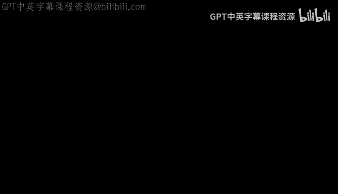
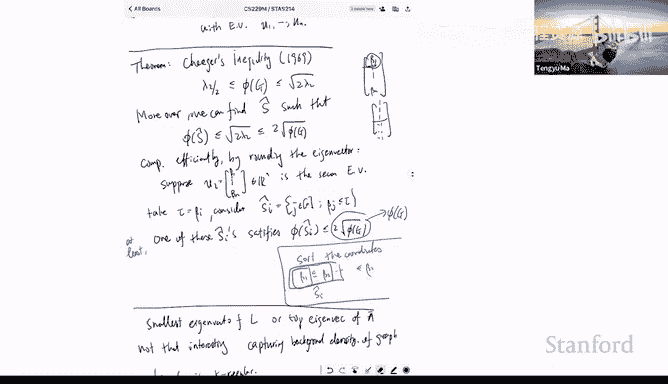
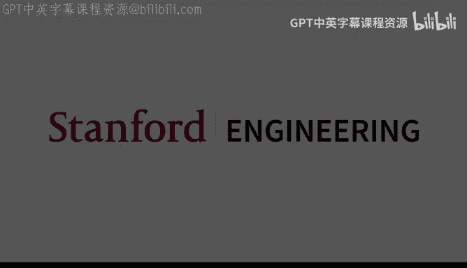

# 斯坦福大学《机器学习理论｜CS229M Machine Learning Theory - Fall 2021》中英字幕 - P19：-19-20_ Spectral clustering.zh_en - GPT中英字幕课程资源 - BV1jT421r71m

Okay， I guess let's get started。 This is the last lecture。Of this course。

I guess we' going to continue with the the special approach for clustering。

 So I pre some of the reviews of the last sectors， I guess。So last lecture。

 I think we did the sasing block model and one of the minutes。

Fs is that if you do eigen decomization。 So our goal was to do eigen decom on the graph G from the sarcastic block model。

 And we have shown that if you do eigen decom on the average graph G the expectation of G。

 then it just gives the hidden community S and X block， right。

 the I think last time we showed that the second eigenvector is something called U。

 which we look like 1，1，1 and minus-1-1。And this is S and this is S4 so basically if you just take the second eigve of the expecting graph G。

 then you get the hidden community。So and and we have argued that it's a bias to show that the graph G and the expectation graph expectation G are close enough in the operator norm。

 and this is because if you consider this equation right so you subtract the first eigenvalue from G。

 and then what you get is that G minus the first eigene component is equal to this perturbation matrix plus the contribution of the second eigenma and if you take the eigen decompositionization of this matrix。

 which is something you can compute easily， then if you take a top eigenvector。

 the left hand side of this equation， then。And then you are expected to find something close to you And as long as G minus expectation G is something small。

 and how small it is， I didn't really formally do this。

 but essentially you need this perturbation to be much smaller than the signal right So you need a perturbation in operator norm much smaller than the rank1 signal in operator norm。

 and you can compute operator norm for the rank1 signal very easily。

 which is something p minus Q over two times So basically we are trying to show that the concentration。

 right， this is a concentration in the quality because you are trying to prove that G concentrates around expectation G in the spectrum norm。

I' like to show this proof this is a little technical proof。

 but the proof is not very long and also it kind of relates back to what we discussed in lectures three or four where I guess probably remember that I said that this constitutional code is probably one of the most important thing or discussed because this is the。

of one of the， if you pick one technical tools in statistical machine learning。

 I think it's probably concentration quality， in my own opinion。

 So it's probably useful to just review why the concentration quality can help us to do something like this。

So Ill， yeah， I'll give a proof for this。 So the proof look like。So we're going to prove that。Yes。

So our lemonma is that。With high probability。G minus expectation G in alpha the norm。

It's less than screw and log and up to a constant factor。So。

And at the first side is this is not exactly the type of concentration quality we have talked about before because before were talking about scalrs。

 we are saying that if you have the expectation of if some random variables you have an empirical samples and the empirical average concentrations around the population on average。

 so here is a little bit different because G is the matrix and expectation of G is also a matrix you are doing some kind of like matrix concentration to some extent。

And your measure of the similarity is not just the absolute value in the difference of the absolute value of the difference。

 but it's about something like the operator norm of the matrices。Of the differences of the mats。😊。

The however， you can actually turn this into something that we have we are familiar with very easily。

 So what you do is the following。 So you say that this is still uniform convertence， as you see。

That to man are you。And why this is the case， this is because you can easily interpret algorithm norm as follows。

So G minus expectation G。Oper norm， this is equals to。The max。Over some。We。

 let me write it down and explain。 So what this。嗯。This is just because the operating norm for symmetric matrix。

 I think the definition is， you know， if you have a symmetric matrix A。And then the operator norm。

 I guess there's an absolute value here。So the optimal norm of matrix a is exactly equal to the maximum quadra form that you can achieve。

Re it。Without not one vector。So and once you do this。

 you see that this becomes a scalar now because this quantity is a scalealar。And you can。

 you can host this into Max。Be to non square。 And then you get。

V transport G minus V transports expectation G。And this is a sum。 So what is this。

 Maybe let me write down more explicitly。This is max。This is some of V I V J， G， I J。I j。

Both are areN。Mus。The expectation of this random world。And now this becomes a some。Of independent。

Random variables and this becomes the expectation of this sum of independent random variables。

So now you can use concentration， if you don't have the max， you can use concentration for it。

 right this is what exactly half thec is for。And how do you deal with the max， right so then the max。

 this will be the part about uniform convertence。Right recall thats the whole point of this。

Like uniform convergence is that if you fix the parameter， suppose you think of me as the parameter。

So the point of uniform from convertver is that if you fix the parameter。

 you can use whole inality to prove the concentration。

 to prove that empirical is not far away from population。

And the challenge of uniform convergence is about how do you take the max and here you still have a max。

So。So， so I guess， you know， there are multiple ways to deal with this concentration。 Of course。

 the easiest way is probably just invoke some existing theorem。

 There are this in the literature as well。 But if you do it yourself， I guess there are two ways。

 So one way is that you can use。Use the rather market complex in machinery。

provide more complexity machinery。I guess it's probably it's a while back like we have we discussed this like probably 10 weeks。

 five weeks ago， and I think one of the techniques is that you do similar transition。

Right so so so far， this is not asymmetric form and you introduce some random mark red marker variable and you symsymmetricize it and then you can proceed with the all run。

 you can essentially view this as a red marker complexity of some function class。

So you can go with that I think that's actually pretty clean and nicely way I'm going to leave this you know if you're interested you can do it yourself I believe it's not very difficult What I will show here is that I'm going to show us。

😊，Even more bru force methods， which use actually the the first technique we introduced in in our class。

 the bru force。Disoritization。Recall that before we talk about weather mark complexity。

 we said that in many cases， actually you can deal with the continuous function class。

 the uniform congence for continuous function class with a very simple。Discrtization， so， and。

 and what we do is that so what we do here is going to be just that you。啊。For fix me。嗯With。

Two norm equal go to one， we can use housing inequality。Is talking inality。So what you get is that。

With probability。At most。Ex minus。Atons World War two。

 I guess I'm not expecting to check it on the fly， but you can just basically plug in off pop the quality。

嗯Without much without any modification， you can VIVJGIJ。Is close to the expectation。嗯。Okay。

 so the probability that it deates from expectation is at most exponential minus epsson squared over two。

And then要听。Ibs soon to be something like。Being O of scroll and log n so that you fail that probability。

 then this means that exponential minus absence square over n。

 this is something like exponential minus being O of n log n。This is做。

Pretty small failure probability， and then you take a deization。嗯嗯。Disquization。Of the union ball。

Of with。关掉那瑞群。三点 like。啊，Some overpoan。Right， this is what we did， you know。

 it's a long time ago I know， but。I think this is what whether have a lecture story。

 I think you take a very， very， very， very icon。😊，Precise of like a you use a very small granularity。

 But it doesn't really matter because at the end of the day。

 the the dependency on the granularity is only logarithmic。 So your size to the size of this。

Of discover cover。Is an exponential log。And then you can take a reading box。Over this。This。

 this screen。So and then because your granularity is very small， but it's only inverse poly。

 so you only lose inverse poly and inverse poly is smaller than N of these quantities。

 so then basically eventually you get that you take a uniform bond we get with high probability。

 you have this。Is less than epsilon， which is chosen to be screwed and organ。

So I guess I'm giving a lot of details because I think today we don't have a lot of time to complete。

All the materials， so I'm making a little brief， but I think you kind of get the rough point and if you work out。

It won't take too much time to work out details。and I kind of like this matter too， you know。

 if I I to say my preferences between these matters， sometimes I like the matter too because。

You can do this very quickly yourself and you know exactly what the dependencies。

 where the pen come from and you can do the right more complex， it will be much cleaner。

 you get by the constants， you get cleaner proofs， but sometimes it's a little less transparent because you have to go through this whole machinery。

嗯。And why this is useful， right this is useful because now we get dilemma。Right。

 thelemma is that the。The the G and in expectation G is only different different on the order of growth。

 And， and you can compare that with the signal。 So now， so compare。A nose level。

 which is of an square log versus the single level， which is。PO P times N。

And the P minus Q over two times N。 so then this means that if P minus Q is much bigger than。

W was from then then。Can recover。不性了。The back you。Approximately。So， so we can see that， you know。

 you only need P andQ to have some separation， but not lot of separation and the separation depends on the size of the graph。

 which also makes some sense because the more no urgencies you see。

 the the clearer the structure is in some you have more kind of。Like suppose you see a very。

 suppose you just see two users where everything' is kind of two randoms for you to tell who which one is from which community。

 But if you see a million users， you can use a lot of different users to cross validate in some sense yourself and the two communities。

All， so I guess this concludes the。The sarcastic plot model parts。

 I guess there are some other small remarks， which are not super important。 So。

 so you can also actually。Can improved看。Rere covering an exact permiting。By by some post processing。

So so here， what I showed is that you only can recover the U the vector U approximately。

 but actually you can post processing to get the exact nuity in there certain conditions。

 I think under the conditions that I'm giving here you can do it and actually because this is a very precise mathematical structure here so there are a lot of works that in the literature on this and you can actually get the exact even the exact constant here so here I'm writing p minus q is larger than one absorption so it's definitely very very loose you can get the precise dependencies that you need to recover and then you can have the precise threshold below that threshold。

 you can' recover anything about that threshold you can recover something and about another threshold you can recover exactly all of these are in the literature if you're interesting。

And you can extend this to multiple multiple blocks and so。Okay。

 so this conclude with the sarcastic ball model and now I'm going to move on to another kind of very。

 in my opinion， pretty important literature， which is about you know clustering the worst case graph。

And still the thing is that if you do aic composition。

 you are going to recover some approximate structures in the graph。

So we are still going to use agoic connotation， but the analysis will be different because here we don't have the srcchasticity from the graph。

So and because you have a worst case graph， you have to also somehow define what do you mean by the hidden community right so because before in the satochastic graph you start with community in general graph and now you are just given the graph the graph is just some edges you have to say what you're trying to recover let's start with that what's our goal so this requires us some definitions so let's say given a graph。

G， as the vertices is called E and Iius is called E sorry。

 vertices is called B and I this is called B。So let's define this so called conductance。

 this is actually a pretty。Important notion， which shows up in many different areas of mass。

 so of course in slightly different forms so here is a multiple edges of a graph and edges in other cases you can different conductors in high dimensional space as well。

 which are essentially the same definition， but it could look little different。

So the conduct is for a graph， so it's supposed have a cut。Let's called S and S for， right。

 you cut graph into two parts， S and S4 and the conductance of S is defined to be the following。

 So you have。The number of edges between I and S far。Over the volume of us。

Let's define both of this more。Clearly， so E S S bar， this is the total number of edges。

From S to as far。 But this is an undirected graph。 There is no。

Maybe I should call it between as and well。So be precise。So， and which， you know， mathematical。

 this is really a sum of I。Over I I J in I bar GIJ， if GIJ， if I use GIJ as the G C matrix。

 I'm over using an location a little bit， G both denotes the graph and also G matrix of the graph。

And the volume of us。This is the total number of age。啊，抽图。后 to的不。Ages connecting。To us。

 So which means that。You look at how many edges sat that one any point is in as。

So I is needs to be S and J can be anything。And you have key idea。So if you draw a graph。

 something like this， suppose you draw a graph。这。I did this and this。And you， you define this card。

 Supp this is S。 then what is E S SR， So E， S S bar will be counting。There' two bright ideas。

Because this is from us to us for。And and the volume of that will be counting all the edges connected to us。

 So which means basically all the edges drawn here。All the green edges are common。So。

 and you can see that by the definition， it's true that the volume of us is always。Okay。

 so what this definition is for， This is trying to characterize how。I guess the word conduct is。

In the case， it's kind to trying to characterize。How， how good to cut this in some sense。

 like how separate as and S bar， the smaller it is the the more separate as an S bar is。

 but you do have to normalize by the model So So in some sense。

 the number of edges is already between S and S bar is already capturing。

How separate and nice and far are。 But you want to normalize with the volume to make it more meaningful。

 I guess that's what I will argue in the next。 So I guess before that， let me just。Get some。

Basic information， the volume of us is bigger than。The the number of edges between us and S far。

 that's trivial。 So this means that。The conducting is always less than one。

 and you are trying to make the conduct as small as possible。

And another thing is that the volume of us。Plus， the volume of icepar。Is inal volume of me。

This is the total number edges， right， So， and that means that so this means that。嗯，第一。嗯。

The volume of S。It's less than the volume of V over two then the volume of S is also less than the volume of。

As far。And this means that the conductance of S is bigger than the conductance of viceparR。So。

 so there's something。 So， so you should have a definition that somehow doesn't depend on。

How do you name S and S bar S and S barssymmetric， But here the conducts of S and S bar are different。

Right so that's why to kind of like remove this symmetry confusion between the symmetry。

 you just insists that you are always talking about。So we will insist。That we always talk。

 only talk about。As such that。The conduct of us sorry， the volume of price is less than the。

It's less than the volume V over2。So you're only taking a smaller part of S and use that to define the conductions of the cut。

Why we like why' we just define conductance to number one is5 the volume of D？Why don't Yes。

 So if you' not not but about V， first of all， the problem is that it means that you didn't normalize because V is a constant。

You have to normalize against something， I guess I'm going to tell you why you have to normalize。

 but if you want to normalize you have to normalize with something that changes as change。Right。

 so here I'm only trying to deal with the symmetryries but so far。

 it's like a youre kind of conducting on the smaller set。

This is not really that much because you don't want to teach by saying that I have a very。

 very large side that I only have like one。One point in ISPR and it sounds like my conduct is very small。

 but actually it's the issue mentioned the other side。Okay， so but now let's go now let's， okay。

 so maybe。Maybe before proceed answer the question why we have to normalize。

 so we can define the field of G。 This is the conductance of the， this is the sp card。

This is the first。The so called S is cut。啊，我 g。A process cut value is defined to be the minimum possible conductance。

But again， you require that S is less than is the smaller side of the。The嗯 the two the two costs。

So you minimize over the conductance of S and you minimize the conductance of S with the concern that the volume of S is less than the volume of B。

So， you know， we basically you just want to find a cut that he has smallest conductors。And okay。

 now let's talk about normalization， so why we have to normalize。

I think the reason is pretty much just because if you don't normalize。If you don't normalize。

Then if you just minimize right， if you just look at。一。As far， is somewhat minimize。

 iss typically minimized when S is small。So suppose you draw a graph， for example， I guess。嗯。

So mean if you don't normalize， basically， you prefer to pick a set S that itself is very small so that it doesn't connect to the other part。

So so博生我来 see。Suppose you have a graph like this。Okay， I guess I'm I'm okay。

 what I'm doing here is that I have a。Suppose you have a completely connected sub。Right。

 so do you have N over two nodes and over two nodes。And within each of the sub graphs。

 we have complete connection with each other， and they have some connections。

Some very small number of connections between them， maybe every node is connected two of them。

Com like this。Okay， so it sounds pretty clear that you should just really the best cut you should get this is this bumper。

Because within the cluster you have full connection and across the two clusters。

 you have some number， let's say two edges per per note。So it sounds pretty clear we should do this。

 but if you look at。If you use the magic E。As far， then you see that some other cuts will have smaller number of edges across the thing because you can just take。

This to be S1。Because so S1 just上 one node。 So then E of S1。E S1， S1 bar is basically how many edges。

Comes from S1 to S1 bar。 Basically the number I just connected to S1。 This is N over two。

But the the the good cut， let's say say the good cut is S 2。

 So E S2 S two bar is definitely something bigger than n over two because you have N over two probably times。

The the number of。G I， the number of bluelu edges are something like two here， but I'm drawing。

Basically， two two edge per per note。Something likes right。 So， so， so。

 so basically even it sounds like you should get S to。 But if you use the。

那 I know last version you would get as one。So however， if you normalize， then it's a different game。

 right So if you normalize， if you look at the conductance of S1。

Then this is E of S1 S1 bar over the volume of S1。This is n over two times over N over two。

 I think the model one by lines。呃。And over two。 So this is one。 So if you look at。费有。哎。2。Then。

 this is。This is a。Then over two times。To something like this and then you have the total number of edges connected to S2 that's actually a big number there's probably something like over two times n over two minus-1。

 This is a number of edges within S2 and there are some edges between S2 and S2 bar something like this and this would be something like roughly。

I think two over N。So the conduct of2 is much smaller than conduct of one。非ノ意。把说走了。Okay， who so。So。

 so now we have kind of defined a goal， right， because you have a worst casecraft。 your goal is to。

So we have set the goal。Is to find。Approximate。Spare is cut。At fact， meaning。That you want。

As had to satisfy that the field as had is close to the sparseest possible field of G。

And the approach we're going to describe is still agony conversation。So。How do we do it。嗯。Okay。

 I need a。Okay， there's。For us to even say what we mean exactly by aggregate conversation and what cannot like of results we have。

So， first of all， let's。你 i。啊，特别的volume。Of the。The known eye， right， You take a single node。

 You take the morning。 This is the I。 And this is really just the degree。Of no。

So the volume of the unknown is really the degree of unknown unknown。Unless can地。特别。

The diagonal matrix that contains Ds S engine。And let's see find this。

Sove got normalized adjacent images。It's called a bar， which is a C minus half。G他面啊。

So where G is a distance image， recall this is our notation。Withhich a of beautiful foundation。

 So what is this which， What does this really mean， This really just means that。

I guess you have one over square D I D1 up to one over square DN times G times1 over square D1 up to one square DN。

And a diagonal which is much on that means that you。

Normally you will scale all of the ropes and the algorithm matrix on the right and size。

As a right hand multi means you scale all the columns。

 So basically scale the columns and row simultaneously with these my numbers。

 What if you do the exactly， what really means is that。The AIJ。

 the IG entry of the normal a matrix is really just the。

The adjacent matrix over square D times square DJ。So this sounds a little bit complicated， but。

In most cases， you know， I'm almost taking this mostly for formality because， you know。

 in sometimes the key thing can be seen。By assuming the graph is regular。 So， so in most cases。

Suffices to。 think of。She is a regular group。A record graph means that all the degrees。Are the same。

So lets say suppose I she is。Co好 right wrong。Meaning Ds is equals to carbon for every eye， then。

It's aency matrix， it's really just a one over k， normalized ay matrix just one over k times GG。

So in some sense you really didn't do much except just changing the scaling of this but this game is kind of like important in the formula sense because it can make the formula very clean。

 but it's not fundamentally super important。So this is pretty much the like if you don't want to think about the D I DJs。

 you pretty much can think of this simple case where you have a regular graph。Okay。

 so and once you define a normalized aency matrix， you can also define the so called La plaian matrix。

Which is I minus the normalized O system matrix。I think you'll probably see that one of the reasons why we have to normalize is that if you don't normalize。

 it doesn't make sense to subtract， take the differences between it and identity。

 identity is something that doesn't have a scale， so you have to normalize it so that you can kind of take the deep with identity。

And this Lalaian matrix is really not doing that much。

 it's not that different from normal matrix anyway。

 because they are pretty much like everything corresponds to each other， right like the IU vector。😊。

Of I is the same as。The id。Of a bar and， and the spectrums are just flip with each other。

 So let's say， suppose， suppose。I has。他一个人。value you longer one up to London N， lets is suppose。

I think in this literature， you always want to。You always want to kind of like。啊，alder的。And then。

 with。The eigenvalue， eigen vector。食 you弯 after you。

Then then this means that this is equivalentval to a bar。I I value。1 minus number one。

Up to limit is sum the N。 now I'm starting in then。This decreasing order and with I vector。

The same megametrics。Right， so as you see， like the the so far So you don't even have to think about the the Laian。

 right， the La will come into play as some。But later。Places。

 but so far you can just think of like like machine it's a flip version of an normal nothing really。

So。Okay， so these are some a abstract preparations。 And now let's see what we can do with this。是的。

This is the one of the。今晚给你 put啲。Important theory is continuousiguous inequality。

I introduced the base back to 1969 by Jack Chiger， So assess the following。It says that longer two。

 this is the second item value。Over two is less than the conductance of G。

 which is less than4 to longer two。So it connects to why this is a very important thing。

 It connects the conductance， the cuts， the spousersest cut to something linear to the i vector。

 right， So so the spousers cut is a very commator stuff。 where you have to。

 if you really want to find spousers cut。 you probably want to enumerate all the possible cut something by spars。

 at least the definition requires it's a commatorial thing。

And but this inequality is saying that somehow the， the smallest。

 the smartest type value has a lot to do with the eigenvalues of the lapusian or the agency matrix。

 and in particular， it has， it's very close to the second eigenvalue of the lap plusian matrix。

And moreover， you can also find the。You can find。Find the approximate cut as hat。Such that。

This card as as， the conductance is less than square root to lambda 2。

 which is less than two times square root phi of G。嗯。Efficiently computational efficiently。

And not only competition efficiently， but also actually pretty explicitly。

 what you can do the following。嗯 by。Rounding the eigenlects。

 I guess rounding really is the following。This is the wronging in the。

The approximation algorithm says， I guess， you know， if you don't know where the term comes from。

 doesn't matter。 So here's the procedure to find such as set by。 So suppose you take you to， suppose。

The U2 is equals to。The coordinates are beta1 to beta1。Is the second ama is the second。I go back to。

And。收一 can。Take。Aff firsts， which is。And shouldn them to be a greater I and consider。

The said I had I to be。All the coordinate。That satisfies the ability is less than tall。

So take a threshold， but you don't have to consider all the possible threshold it's not。

That's three because and you think so you take a threshold tall and a threshold is chosen from one of these corners and you say you look at all the coordinates that are smaller than the threshold。

And that's your status as satisfied by。And then one of this。

 so you have basically none of these that right as one head， as two head。

 as three heads on and so forth， so one of this。As had eyes。Satisfi。

F of S head is less than two times square fee。So one off this side will be a good cut。

So I guess I'm thinking this in a formal way so that it seems a little confusing。

 So what you really are doing is the following。 So you sort。

 So I guess in in plain language or in more click。Informal language。

 you first the sort to the accordances。Suppose you sort accordance first。 and you get beta 1。

 less than beta 2。 So on so less than beta n。 And then it's saying that if you take。This。

 this will be I up right This will be the first eyecor and that would and one of this cut will be a good cut。

So you can try one card， which is like this， you can try another card which is beta 1， beta 2。

 and you can try another card which is beta 1 beta 2 up to beta I。

 and one of these cards will be a good cut on the graph with small conductors。And of course。

 you have to restart you have to re the coordinate back to the original coordinate system because you have Southern the coordinate。

So， but this is the man。Any questions。So， so like I guess， you know。

 another way to think about this is that if in a stocktochastic block model case。

 the second amactor was something like this。Right。And and and pretty much in that case。

 if you take a threshold here， you know the smaller values correspond from one card and the larger values correspond for another card。

 but here you don't know where the exact threshold should be。

 you should try all the thresholds beta 1 up to beta and all of the。Okay， cool。

 so this is a pretty know magical theory， in my opinion。😊，嗯。I'm not going to prove it。

 I think there are you know if you are interesting。

 I think there are a lot of lecture notes that can prove this。I guess what do going to。

SoI't it there that exactly one of these SII that or manage at least？Yeah。

 and and if you are able to， you know， I mean you can enerate all of them the file of them I see which one site and they are done。

So。The， the proof is plain down to you。 you know， it's not very long， but it's kind of known to you。

 so I'm gonna skip the proof。 I'm， I'm gonna leak。I see some questions here。Yeah。

So the question online here is that the head SJ found this way isn't the best possible cut， right？

Yes， so you。You are not guaranteed to find the best possible card。

 You are only guaranteed to find a cut such that the cut value film as。

 I sates that it's less than two times the root field。If you got to feel of free here， suppose。

Suppose you magically change this to B of G。Then that means you get the best off because P of T is the value of the best part。

Of course maybe there are multiple more best cut as well。

 but you definitely find one of the best cuts。But however， we don't have that drama of theorem。

 we only show that it's square two times square root v of G because。

U so you lose something where squ POT is bigger than POG， right away。Because C of G is less than one。

 So so so you lose some some factor in terms of like the best possible vector conductors。

I hope that answers the question。And in some sense。

 you have to lose a little bit some extent because to some extent because。

And I guess this is in sometimes postmo and like like a。But if you think about it， you know。

 like in retrospect， you know， one of these qualities is very combinatorial。

The sparse is constant and the other point is very linear to bright。

Sounds unlikely that they can be exactly the same right so so it's it's already unfortunate that they are somewhat related in my opinion。

😊，And I want to kind of like mostly discuss some of the intuitions or kind of kind of like more basic。

Quities like some of thetu is why this can be possible to， but I want to give the the full group。

The statement of the so that we can find us not such that less than square2 limit2。

 which then is less than。Is that what we're actually finding and we're saying that oh by this t partner？

Then that's less than two sp in that case。我。I ask， we just care about relationship。

You just care about the comparison of our。It kind of G， as it could， like it's our significant。

P it wants to qualitySure， okay， so， yes， so first of all， yes， you are right。

 So how do you get this inequality， This is just by using this part。 right， so that's true。

 And second， yes， probably the first of video care about is comparing with field G。

 and this is just some media things。 Yes，嗯However。嗯。Yeah， that's the， that's the first on bit。

 But I think if you look at the proof， you do have to like somehow the you haves have to show up somewhere。

 So so do do like lose。Do you not do anything at the amount of that second happening quality So like maybe your is actually pretty good because for to lambda to can actually relatively small。

 but then you use more in that second quality。 I think it's possible。

 but we don't really know like it， it's kind of like quite hard to。

I think I think there are hard instances in both cases like in like this thing can be both close to to over two。

 or it could be very close to this this site。Yeah， cool， so。

I guess I'll focus on some intuitions and why like the first thing I'm going to discuss is that。

I think this is again about the scaling and and and and for some extent。 So， so first of all。

 the smallest argument matter， why you take the second argument matter。

 I think that's always something that seems to be magical to me at the first side。 and then。

After I spent some time here when first started is I realized the the the， the top een factor。

 like I say kind of like say last time， the top event is kind of like a background。

 So either the smallest een factor。Of L or the top a。是。Of a bar。

 this is kind of like not that interesting。And why is's not interesting is pretty much only trying to get the。

Only capturing the in。I call it background。 It's kind of like a background dancing。

So what I really mean by this is that of the graph。What I really mean by this is that。

 let's say suppose when G is Ka regular。Then we know that I think we actually have stated this in the previous lecture。

 so all one vector is top eigenact。哦。A。Of the of of g。Of the J matrix and does。Also。Top item vector。

Yeah。哦。A bar， which is just one cup times。So。So when this is regular。

 then the top a is really just about。It's just a all one vector。And when in more general case。

It really just involves the skating based on density。So what more generally。

 what happens is that the top a is really just this one。Its scroll D1 up to scroll D1。

The scaling doesn't matter here because the eigenvector signal。

 and multiplication of this is also eigvector so I didn't care about the scaling。

 so this is the top eigenbactor。Of a bar， so smallest， which means the smallest egglect。哦。哦。Of of la。

Right， why this is the case， You can verify this relatively easily。 So a bar times。你要玩。

This is the mission location and you look at the J coordinate ice for it。

This is equal to a sum of J over J。Some of AI J bar times U J。

And AI J bar is a scaled version of the graph， So GI J。Our square D I square DJ。And UJ is Sc DJ。

And it is a sum over J。 So， so your first。Has all these two。 And you get。Ws for D I in front。

 you get this。I recall that this is actually precise definition of the degree。 This is the。

totaltal number of edges connect the graph so get1va square DI times DI， which is score DI。

But that verifies that U want is id。This means a bar于1 is equal to u1。

So basically as before the top eigma is not doing much， it's really just capturing the density。

 the degrees of the world and the second eigma starts to talk about the interconnections it it more about the relationship between ideass and kind of hidden communities。

And now let's look at some。Intuitionions about why this。啊， why。The Laian。

 like why the the why like somehow this aigen factors is related to the cut。

 So here is another way to think about it。So， if you look at the。Contracted form of the Laplace。

So what is this， This is the V transse I times V minus v transpose A R times V。

As that's beautifully putly write this， this is sum of V I square I from one to n minus。你三号。系 j。嗯。I。

 let's do it。 V I V J， any bar I J。他就是。Some of VI square。minus some V， I B j G。

 I J score D I score B j。And GIJ is one when the I is one。

So what we got is that some BI squared minus。IJ is edge。I guess G but IG and JEI are both episodes。

 So that's why you get the two here。2 times V I over D I。Ha VJ oversp VJ。

And now you can break this first thing。I， and then you think。j v i。呃。Okay。

 I guess maybe let's spread this way。 So I'm claiming that this will is equal suit some of V I over square V I minus VJ over square DJ。

Square andIJ。And and why this is true， This is true。 You know。

 you can expand this inequality this this equation into terms。

 and you can see the cross term match this one。 The only thing is see know the other terms match the B。

 right， so we can verify that by looking at some IJ。And E， we are for over。Did I。😊，呃，As this is。啊。

Some over I， some of J。Such that。I正 e。Number， I guess I think this is probably obvious， but。

I'm making a little bit too complicated。 So V square over D I if you sum over I first and sum over J second or you first sum over J and then sum over I。

 So how many edges are connected to I， that's basically D I。 So you guys。This V I square。

Over DI times CI。So。That's buy some some of the。So。Okay， sounds good。So the point here is。

 I guess I'm somehow missing a constant somewhere， I'm not sure what。I that least a constant order。

I will double check， I think the constant might be off by two somewhere， but get it just right。嗯。

Okay， so and if this is regular wrong if。If G is regular graph， say copper are regular。

Then you can ignore the eyes。 You can just say Vtransse LV is one over a couple times。IJ and e。

VRMSBJ吧？Okay， so， but why I terrible why I did so much work to kind of get this equation equation is very important。

 because this is how it links to how this algebra B quality is linked to the conductance， right。

 So then't still a larger algebra is something like linear algebra， it's called form。 However。

 if you here， suppose now you you restricts it you me to be binary。 So suppose。We is。

 I think B to be binary。Is a binary vector。And you take us to be the support of me。P stone。

The the indices where the answer， the V is one。Then you can see that from this。

Farmermertrans LV is one of a couple times。一营。呃，VIVJ square。And when this is one。

 this is one when I and J are in both indi。 So this is only one。え。

I in S and J is in S far or I in S far J is in S。RightSo so basically， you know。

 the sum is the number of edges between ice and ice bar because only when the INJ is an edge across the groups。

This this VM SVJ square is minus one， otherwise it equal to zero。

So this is why is's one over a ka times the number of edges across as far。

So the project form connects to the。The necras across the two groups， when V is not binary。

 if V is not binary， of course， it's not true， but if it is binary， it true。So and now。

 all the other words， you can write V principles LV is。我 a cup。The's part of me。The support。

So I now suppose if。That's a part of me。The size is less than over two。

 So you have the volume is less than。 So this means that。

The volume of this S is less than the volume of。Oh you were two。

Because this is a regular of the model it's really just the size of the set。 And then in this case。

 B trans LV over。This ratio wind transport Lv over the norm of v square。

This becomes one of a couple of times number I just between S and S bar。

And what is the volume of what is the Vn square， this wen square is really the size。

It is just equal the size of us。The side of us is really just the volume of us。Overcome。

RightThe volume is number of edge is connected to us and it regular graph。

 That's why the volume is just copper times the side bus。 So then you you cancel the copper。

 you get S bar over the volume of us。So this is the conductance of us。

So based conducting files can be written as this form and this form is some kind of linearage platform and I think this theres this is we transse LV over normal V。

 this is called。Really。cosient。And I think this is the name of this， this is named really quotient。

 and the point here is that this really quotient connects to the conductors。But of course， it' not。

Exact， because it requires when these battery。Right， so if you do eigen vectorctors。

 you are trying to do eigen vectors。Means you are minimizing。Really cautiousient。

without any without any constraints。Questions。奥咪。Right。But the minimum conduct， the spousersees cut。

Basically means minimize。Really cautiousient。With the binary constanttrain。And in some sense。

 the trigger aology， the core is really nice。Email without con，win con without con，你 don't read。

The inform that much。So actually， the proof works that like something like you first try to。啊。

The find eigenvectors and then you somehow you get some real number means the eigenvectors have real numbers by in V and then you round。

 you round it into binary vectors and then you say by rounding rate。

 you don't lose too much of the really coefficienttient and that's how the proof roughly speaking works。

So。I guess that's someone in tuition。And all of this， you know， can be extended to weight graph。

 like the intuition is the same for weight graph or for none by non like for。

For graphs that are not similar， not not regular and also for graphs that are weighted right so here the graphs are just somewhere like 01。

 there's no one in other words， you can also do it for weighted graph。嗯。先走话。Okay， so great。

 so I think I hope that I'm convinced you that the eigenvectors are very related to the graph cluster。

😊，By this two example， stochastic block model and and this worst case situation。

 And this kind of like algorithm has been used。 So if you do this on spectral classroom， this is。

Thank you。You can actually use this like a okay， how do I say this So the materials I presented this mostly come from the theoretical Comp community and and there it that doesn't have much to do with machine learning right so what the people para about that you just want to partition graph into two clusters so you don't have to know machine learning can a problem to study this And I think like there there's a so called spectral classroom approach。

Special classroom。This was bring to maturity sharing community， I think around 200， I think by。

 I guess I said this paper by X and Maik。And in Jordan。Where。你。玩。反人。

And the way that you do it is that you you define graph from the machine learning data。

 and then you apply this algorithm。So basically this brings us the question of how to choose this graph。

So， how to choose。哦， design graph。Because the graph， you know， inia， the graph is given to you。

 maybe some some graph that somebody gave you。 But in machine learning。

 you have to somehow choose your graph， right， So in the in the Andrews paper。

 the definition of the graph is something like this。 So you first say。You， you given some raw data。

The x1 up X1。 So these are n tri data points。And then you define a graph G。呃， to be。

Something like G I and J， this is a weighted graph， you know。

 when I didn't really discuss the weighted graph， but there's a natural extension to weighted graph。

And at the weight where the weight between IJ is something like exponential minus X I minus X J to norm over two sigma square。

I guess this is probably something that is very familiarative to you， this is just the RBR。

 the Gaussian kernel。So you this with some training parameters。

 or you can have some other virus right。I guess you photograph based on some distances between the draw examples。

And then what you do is you say， you do this， you get a spectral class， you run the。

 you get the e mark。So， the first that will depend on curve and you get eigmas of the Lalaian。

And normalize reducing matrix。And and here you know it's not only two clusters。

 you you can do multiple clusters and when you do multiple clusters。

 what you do is you say you get IM vectors。Say you one， you two up to UK。

 suppose you want to have K closer。And this is a matrix of dimension。R of N by K So each column is a。

Is the eigen vector and you have pay of these eigenlects。

 and now what you do is you say you take the rows as the ems。

in the modern world you call representation because I probably some of you heard of representation learning。

So。And for the for the the IA example。So basically， you can like。 So for every example。

 X I now it becomes represented as。That mean let's called this VI。VI which次 the上系。

And K is K it corresponds how many abacks you take。

And then you can this look dimension organizations， maybe K you something like two or three。

 and then in the original paper of Andrews paper， I think you do some kind of other another came in classroom。

 some other classrooms。食平面。I'm not I guess probably you heard of means on the representations。处理啊。

And to cluster them again， so this is the sopect cluster algorithm and they were actually later。

 I think around 2014， 2013， there were a few papers analyze this。嗯。

And show that you can actually get reasonable verations and clusters by using this approach。

Any questions for？是。So， so what are the what's the issue with this， The issue was this。

Is that the graph gene could be not very meaningful。So， in hand mentioned。

So all the data points far far away from each other。Or all the triming interval I should be precise。

发规什一下。So， so this， and Ukraine distance becomes， you know。

 like Ukraine distance between China and of course becomes pretty much meaningless。Because。

Because if take a Euclin system of a cat and dog versus the eucanist difference between dog and a dog。

 you probably wouldn't see much differences because two dogs could still have very big Euclidean distance。

Two random knocks。So and I think this is the in some sense。

 the problem with with approach the graph itself is not meaningful。

 So even you find the sparses cut for the graph， if the graph itself is not very useful。

 even finding the sparses cut is not that important is not that useful for you。

 So that's why the theory analysis for this special custom algorithm， know。

 doesn't really deliver that much because it didn't really consider how the graph was generated right all of this theory says that if you're given a good graph。

 you can find the sparse is cut for this graph using this approach。

 but it didn't really say anything about how the graph is generated。

So I think for the last the last 15 minutes， I'm going to discuss briefly discuss one of the my。

 this is what've been work in my in my group recently， So where we try to reuse this class idea。

 but use it for in a different way。 So so this is。So this is in his paper by Hao Cheg at all。

In my group， So what we are trying to do is that we say you consider infinite graph。So G VW。

 So this is the vertices。This is the weight。我的安。And where will take me to be。All the possible inputs。

So the this is the all possible。嗯Data data。So this graph is defined on the population space， right。

 So， so X is the basic space of all possible， say images and your graph defined on each each image correspond to ver。

 So before the graph has says little N where sorry this is。So before the graph has says little n。

 it's a little n by little n matrix。And now the graph has much bigger sense。

 the size is the same as the he of all possible points， which could be infinitefinitive。So。

 so possibilities maybe let's say。For simplicity， let's say。

 you have finite a number of possible images。佛登。Could be exponential。So possibly。

 let's say we have exponential size growth。So， then。What you can So on this graph。

 what you what you do is you define W X X prime the。The weights between two nodes， two vertices。

 let's say we find this to be large。帮你。问。X and x prime close。Are closing。Oh to distance。

So I'm still using how two distance， I'm still probably using。

 you know I didn't I'm not specify exactly what's the definition here because I think there requires too much dragon which I can offer in 10 minutes。

 but still we are using pretty much you can think of this as almost the same as the previous definition of the graph when X x to prim close。

 but I guess the point is that this is very close。So before you have to choose the sigma very very。

 very subtly because all the points are very far away from each other， right。

 so by now you say that I don't care about those points that far away from each other。

 I just care about those two points that are very close to each other right So suppose you have two dogs。

 random dogs， you say they are not close， If you only have one dog and you have a perturbation of that same dog。

 You say they are two there are dogs that are connected with each other。

So then this graph becomes more meaningful because it only connects very nearby cats and do very nearby images。

And then the so the graph becomes more meaningful。 So the process is that。

The graph is more meaningful。I guess the cause is that it becomes infinite dimensionmenal。

And you don't have this graph because you don't know all the possible data points。

 you only have some sample data points。 so infinite or exponential exponential。根本身。

And you don't have access to this graph。So what we do is the following。

 So the way we fix the counts is the following。 So。

 and also maybe another way count is that the even the eigenvector itself， right， the eigenvector。

Is also high dimensional， it's infinite dimension。Because the eigenmctor。

 the dimension of the eigenbacterctor is the same as the dimension。Of the of the graph。So， however。

 here， what we are doing is that we use the。The new ideas， the deep learning ideas。

 you know to kind of actually the real research is the reverse we somehow try to explain the deep learning ideas。

 but here in this context， you know， you can think of this as you use the parametric new kind of ideas to try to deal with this theses。

 So what you do is you say suppose you have matter you， this is the adding。So this。

U andque eigenvector is a high dimensional vector， so you can say this is UX where is index by all the post points in the capital x。

Right this is of dimension， something like maybe R to to the capital N or R R to the infinity。

 depending on how many what is in your set。 So， and you don't even have， you know。

 space to save all of this。 even a single item， you don't have even space to save it。

But what you do is you say you represent。诶 this you。You sub x by。诶。Your work applies on the。

嗯On a raw raw data context。So where。F theta is。A para trust model。So if you do this。

 then at least you can describe diagramig matter by theta。 Now。

 you don't have to specify all the capital N numbers。嗯。To specify the aromactor。

 you only have to specify the theta to describe this aromactor。

Of course you knows if you believe that F is powerful enough then you can express end vectorctors。

 but of course you know F problem wouldn't be enough so you have to make some assumption that neural networks can represent these kind of id vectors。

 but suppose under that assumption， then you can at least represent the eig vectorctors by theta。

And now basically， the question becomes like so the question changes to you want to find the theta。

Such that。This vector F theta x is very high dimensional vector。Is。AnI lecture。Of on。Of the graph G。

So at least you are trying to find a load dimensional， you're trying to find a parameter set。

 right You are not trying to find a high dimensional vector anymore。

And it turns out that if you do this。I guess need I。那不大し。seeI think I have time to。嗯。

It turns out that if you do this， then this。啊， is。Basically， trying to do the。This gives a。You can。

 you can design algorithmm going try to achieve this。

 I guess I'm trying to let me see whether I have time to。I guess what we can do is the following。

 So what you do is you say， I'm going to， how do I find an eigen of L like this。

 So suppose I have the access to the to the core， which I don't。 But suppose I have it。

 What I can do is I can minimize。The following thing， so I can say I'm going to minimize。啊。

那 me write到IOM。So。Thank youら this interesting。给包。啊，诶。And by image。 So first of all。

 I claim that this gives。The top a。哦废吧。This is because this is。

Something that I probably wouldn't have time to explain that much。

 but if you want to create a lower matrix。This is unlikely the top K a。

So if you want to fit N low rank matrix to the matrix a bar。

The best fit would be to use actors on Pay。So， so， so this is。

This is there you can you can invoke a theem to show this。

 So F basically F is going be some version of the minimizer of this will be some version of the itemigenbacter。

 So I think F will be the minimizer of this will be some scaling of the itemigenacts。

And then if you use this objective， then you can replace the capital F。

 which is some parametermetric is a very big matrix by so you can say the capital F for now is supposed to be something like this So and then you read it as this you read it as F theta X。

呃。Transpose X1 up to x theta X 1。So you replace the role by the parametric version。

 So you say that every row now is a new of the raw data。

And then what you can get is that this will be。If you write this as。And this version， this is like a。

 first of all， you write the for business norm as a sum over IJ in N a bar IJ minus。So。F。

F transports I J。 The IJs entry is。The I throw in a product with the J throw。

So that's why this is equals to。I have certain X， I。Time F theta X J。つか。

And now you can change this to instead minimizing up now you are minim theta。And。

I guess I don't have time time to go through all the details， but you can， this is basically。

 this is not objective function that you can optimize Of course。

 the problem is that you still have this sum， this big sum。

 you can replace this by the empirical version。So you can get minimize over theta， you can take。三。

Branandom samples。So， you can take。嗯。Okay， I'm not sure whether。I'm going to simply write this。

So you can sub， okay， maybe I would just say you can sub for this。啊。

So like estimate this using an imp estimates。就是。In herical examples。

And actually it turns out that if you simplify this formula。

 this will be something similar to the contrastive learning algorithm that is used in practice。

 I guess this part I don't really have time to show， I guess I'll refer you to the paper。嗯。

I think probably I should just。Stop here Any any questions first。

But I know this part is a little kind way feel free to ask any questions。The paper。

 I think it probably is good to register， I think like the loss is not exactly the contrast frame loss use in practice。

 So we're going have something we call spectral contrast laws So which so basically actually this step。

 you know if you have all the set up， then this step is pretty trivial。

So eventually if you simplify this a little bit， what you want to get is that you get one term。

 which is minus a half F theta X I。I have sayta X J。And this is something like the。

The term that tries to make two。Examples close to each other。

 and there's another term they turn to contrast them。 there's another so。Anyway。

 so I guess I probably just refer we refer to the paper of our paper。

 I think the title of the paper is that。Some appable。都好。Solf supervis learning name。

Vi contrast special contrast loss。Sexual constructive loss。三0で。I think from this， you can search bad。

So before the second just for this one， you mentioned looking at like。

They can want to be argument by vector。lot involved tenant people like the first word about nuri。

ISa that corresponds to like the first eight points and the point。

 and what exactly is the correspond at？How come if the first and the second row are similar。

 then the first two period points should be similar。一。嗯。I think I got the question， so。

I think theres something that I kind of like I understand why there's a lot of a confusion because I escape something like about the the K。

 How do you deal with K clusters， but I think this could be seen when you have only。

Like if you take a little lip space between pay passes and two passes， you just say this two pass。

 And then if you look at the。Let's see。 So where did we discuss this， I think we discussed this。

Somewhat implicitly in several times。 So I guess for example'm supposed to go back to here。

And we call that the second metro looks like beta 1 up beta n。Right。

 so and we discuss that you take a threshold and then you can separate to work right your threshold。

 So， so， so in this case， basically suppose you have two classes and。In this case， basically。

 the beta I is our representation of the I projects。So。

So so that's the that's the role where the beta1 is the first row where。

 Beta2 is the second row where。 So beta I is the representationition of the is vertex and y beta I is better than the the the the raw data。

 I think this is because。At least if you threshold with beta I you get the group threshold。

 so basically in some sense， beta I。In some maybe maybe the ideal thing is at the problem。

 so you suppose you in the model get this。And then I guess you probably can agree that。

These numbers are better representation than original data， because now you map all the。

Vernesses in the same group to one， right， So just the you lost all the other information。

 you just get the representation just exactly tells you about the group membership。

And you don't know anything about else right， so the group membership is the only you care about。

So that's why these numbers are more like better representation than that's just better representation can be kind of taking the most important course representation exactly and and what's the most important one。

 the most important one here in this case， the most important one is the cluster structure right so which group you belong to right so that's why the only thing like suppose think that's the most important information that your presentation should just be that you ignore any other information you just to say the ID is my representation and that's the best representation in this case we there's cluster。

But then。We wna。You turn around play do。The two cluster kind of representation。

 we also declare care legal like three cluster representation and like how close things are based not。

 And so by taking multiples， we can kind of get a bigger picture than just like。

In your sponsor or not exactly exactly。 So if you have more item that first。

 then you can get three cluster information or even more information and also this can be some of this information can be recomwined to get even richer information right so because eventually you probably use this representation。

By a linear cost。Useer lean your head on top of it。

 So so suppose you have two type of information in your system。

 Then you actually combine them to get more information。 Yes， but you are right。

 So basically you get more a you get more winter information from the。Yeah。

 so essentially you are is kind of language sandwich you dised the information。

In the graph to smaller amount information。 And kind of the question we are trying to answer is what information you keep in the a right。

 So it's not that surprising that the a market has smooth。Has like个。

More sustained information about the graph， the question。

 what kind of information keeps and and kind of the graphtuitions that it does keep the。

The classroom structure。In a graph， but not other things right like I least the low low the like the smaller secondgraph are trying to keep the the classroom draft of the graph。

是。是。Okay， great。 I think this， this will be the the end of the quarter。

 I guess I hope you like the course。 I guess we discussed。P a bunch of topics actually this quarter。

 I think we covered the most compared to all the previous quarters because partly because we have more than we have 10 minutes every every。

Every class and every lecture and also we have two more well two more lectures because we have fewer holidays in this quarter yeah I guess I hope you like it thanks so much for attending。

