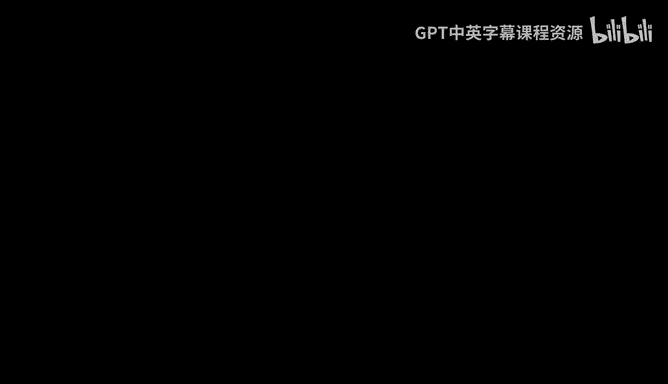

# 斯坦福大学《机器学习理论｜CS229M Machine Learning Theory - Fall 2021》中英字幕 - P1：-01-1_ Overview, supervised learning, empirical risk minimization.zh_en - GPT中英字幕课程资源 - BV1jT421r71m

Okay， so let's get started。 So so the formulation。 So most of this course will talk will be about super learning。

 So in some part， we're going to talk about un learning。 but like I think。Maybe like。

18 of the lectures will be about supered learning， so this is about supervised supered learning。

So let me just， so we are， we' gonna have some definition。 So input space。

This is the the data that you want to。Classify or kind of like you want to do regressionional。

 So under a label space。Yes。That's called， why。And there's a joint proper distribution。

P over the space of x times y。嗯。And and there's a， let me see how to。

I guess probably I will still try to do， maybe I should do this。I think this is better， right？So。

 and。We're going to have some training data points。So， these are x1。Y1 up to x and Y n。

Each data point is a pair of input and output。And we're going to use n for the number of examples forever。

 so n is reserved for the number of examples。For this course。And each of these data points， X， I， Y。

 I is assumed to be drawn IID from this distribution P。 So P is the distribution we are interesting。

 and we have some examples from it。So， and we have some loss function。

And this loss function takes in two labels， so。And it outputs a number that characterize how different these two labels are。

And I think typically， the convention is that the first one is the predicted label。

And this is the true label。Oh， this is the observed the label。And， and you assume that。This is。

 if you have。The loss is always unactive。I think in some cases， the laws can be negative， but。

In most of the cases， the loss is not negative。And。Now。You have suppose you have a。

You can also have a predictor。Because this is what you are interesting。

 You want to have or sometimes it's called model。 Sometimes it's a product hypothesis。

We're going to use all of these interexchangeably， all of these you know。

Are used in some different slightly different contexts。

 but they all mean the same thing it means the function you want to look for to predict your label。

So， this is a function that's called H。 It's a mapping from y to x to y。And you can define the laws。

Of the predictor。嗯 on example。X comma Y。And the laws will be。You first plug in H of x。

 which is your prediction and you have Y， this is the loss。And then after you define all of this。

 you can define the so called expected。啊哦 population。Risk。哦老。

This is kind of the this interesting thing about machine learning。 like everything。

 everything has like two names， at least I think two is a lower bound。 sometimes you needs three。😊。

So and also like my brain is kind of like kind of like a for different kind of situations I use different name for this。

 be prepared for that just because like when I when I learn these part of things and those literature use that name。

 And then if I if you learn something else and you like those part of those kind of papers use a different name。

 But so so my brain just like these names burn in into my different part of my brain。 So。

 so I might use inconsistent。😊，termminologies a little bit。 But， but all of these are the same。

 like they are the same。 Like， expect it just means population and risk just means loss。嗯。And。

But of course， I will be try to， I will try to be consistent as much as possible。 So。

 and this expected risk of population risk is defined to be the expectation。😊，Of the laws。

And here the random variables are x and y。And they are drawn from this population distribution P。

 and that's why it's called population risk。And this is your final goal。

Your your final goal is basically to minimize。So， find。H。That。Minimize。The population risk。

At least this is the goal for the， for the first， at least。15 lectures， right。

 so like a this is the goal for surprise learning you just want to predict as as well as possible。ok。

Okay， so。Okay， so to achieve this goal， you also have to introduce more concepts， right， So。

 so one concept is this so called hypothesis。Clas。😊，Sometimes a hypothesis family。

And you can also call it， you know， predictor class， predictor family， model class， model family。 So。

 and let's call it capital H。And this is a set functions。From。X2 y。Right， so。

 and you can define the so called access risk。Because at at the end of the。

 you are going to search over a set of functions， right。

 So and maybe these set of functions is very bad。 For example。

 these set of functions only contain one function。So。

 so that's why people define these so called accessories， which tries to kind of like。嗯。

Define your error relative to the， the power of this hypothesis class or these set of functions。

 Right， So these accessories with respect to。Capital H， So this is defined to be。

Your population loss or population risk， minus。The best。You can find。In this family。Okay， so。

 so basically this term is the best model。嗯， inH。Which page， sorry the inf Oh yes， So this is a。

 this is a good question。 So iff。Basically， you can be me。I I guess so we just。For this course。

 let's say they're exactly the same。 So， of course。

 they are not exactly the same just because sometimes you don't have the a unique minimizer， right。

 So you have a sequence of。Like， you can， like a。Maybe I I'll have a post to explain a a set of differences between these two。

 but for almost。I think for exactly for this entire course， you can assume if is the same as minimal。

😊，嗯。Cool， so， and this is larger than 0 because this is the minimum。

 And so that there's no way you can get better than the minimum。 So that's why it's larger than 0。So。

 so in some sense， this is trying to kind of to， to think about access is one way to kind of like a。

Only think within the family of age， right。 So so now if you get zero access。

 that means that you cannot do anything better within this family， right， Of course。

 if you change your family， maybe you can get something else， but at least within this family。

 there's no way you can do better。Okay， so。So this is the basic language we are going to work in for this entire course。

Any questions so far。 In any case， like， just feel free to interrupt me at any point。

 You don't have to wait until I pause， you know， in either the zoom meeting or here， so。

So some quick， you know examples to make it less abstract。 So this is。

 I assume this is relatively abstract。 So one of the typical questions regression problem。

Where your why the label set is real number。So there are continuous labels。

And oftentimes for regression problem， you have the so called square loss。

So this is LY hat y is equals to maybe something about half times y hat minus y squared。For example。

 if want to predict a temperature， it makes sense to use the square loss。

 of course there are other different kinds kind of laws。

And another possibility is classification problem。嗯So。In this case， the Y is a discrete site。

You have a set of K labels， maybe it could be two labels tied versus a dog。

 or could be like multiple four labels。And。And then your laws， you know。

 the final loss you care about often is this so called 0，1 loss。 So basically。

 you say that if you didn't get the right label， then you。You are equal to1。 Otherwise。

 you are equal to 0。 This one is the indicator。 So indicator E is one， if E happens。

An indicator of E。Is 0 otherwise。So you'll see that， you know。

 when you really do the practical machine learning algorithm you are not going to use this loss because of the other issues。

 but this is the loss you care about eventually。 at least this is one of the losses you could care about eventually。

 this is the so- called accuracy or the error right but when you tune it。

 you maybe use cross quantumtropy。 that's that's a slightly different question。So， okay。

 so now this is the setup and the goals。And now， let's talk about one。啊。Important algorithm。

 which is called empirical risk minimization。This is the algorithm。

Or type of algorithm that we can analyze for quite some time。So， so the algorithm is very simple。

 So I guess this is what you do in practice every day。 So you have some training laws。

sometimes it's called empirical laws。嗯。And sometimes it's called empirical risk， so。

So this laws we use our hat。 our hat means it's empirical。 Every time you use a hat here。

 it's kind of like it pretty much means empirical。So you have the finish the sum of the the average of the laws on all the examples。

H IY I。From one to n。And then you do the so called empirical risk minimization。

 ERM empirical risk minimization， where H hat。If you find the。The best model。In this family。

I guess here I'm using our。 So， so me and in is just exactly the same for this course。 So。

 so you find the best model within a family that minimize your empirical risk。And。

 and you can break tie arbitrarily like like a this kind of like a。

Like we don't care about breaking tie， you know， in many cases and and so so this is the algorithms using this algorithm。

 you may need to use some other optimizers to find the minimum right。

 but this is the abstract way of thinking of the algorithm youll find a minimum。And and the， and the。

 the the key question is that how do we。Why this this is a good algorithm。

 why this is doing something sensible。And one of the the key property of this is that one of the reasons why this is somewhat meaningful is。

 I guess， as you know， already from previous classes because X I，Y I。A I D from P。

 So then if you look at the expectation of the empirical laws over the randomness。Of the。Examples。

Right， so if you take expectation of the empirical loss of one example， let's say。

 and let's say the the examples are around。Then this is equals to the population right This is exactly the same as you draw X Y。

From P H X， Y， to verify this is just a change of notation in some sense， this is Io of H。

So the expectation of the empirical laws is the same as the s basically saying that expectation of the empirical loss I a head age。

Which will be an average of all of this， one over n times。Exation L H。

Right so this will be equals to L of H and here the random list comes from all the Xs and Y'。啊。So。

 so this is the technical justification we have for this kind of algorithm。

 because the empirical loss is a good is empirical is an estimate for the population loss。

 That's why minimizing empirical loss probably would lead you to minimize the population loss。

So in some sense， at least a good part of this course is to justify more formally why this is the right thing right so intuitively sounds right。

 but formally whether this is you know like we want to kind of prove that this is actually the right thing and it's actually not that easy because it does depend on。

Some other things， for example， how many examples you have and how large your hypothesis class H is。

 It's not that simple。 This is just a kind of like intuition。Okay， so。All right。

 any questions so far。And。And also， we're gonna have， I guess。

I that I assume that most of you know this this is just a formal definition。

So when you really do this， you know， you have a hypothesis class， when you really do it in computer。

 you have to have a parametricized family so you can optimize the parameters。

So you can also have a parameterized family。 So you call this age， for example。

 something like H subseta and where theta is in some space of parameters。

And maybe let's say theta is in RV or some kind of like， is the parameter。And then， for example。

 sayta could be， for example， sayta could be。Soors。So capital Theta is the formula of parameters。

This is the。I guess you know， sometimes you want to say that you only do it for sparse parameters or only do it for certain kind of parameters。

 so。And one of the example of this is that you can take H to B， for example， H theta x。

 which is equals to theta transpose x。Then this is all the linear models。Okay， so this is easy。

 And then you can also do EM。For parametricized。啊，family。So I guess here。

 this is actually probably the most important cases because empirically you do parametersmetric family and now your training laws。

 let's define this training loss still as L hat datata as L hat。

 but let's with a little abuse ofnotation， you say the theta is your input of the training loss。

 right say it is the parameter before we we say the training loss is a function of the model and now it's a function of the parameter because the model and the parameter I just。

One to one correspondence， in some sense， maybe not one to one， but they have a correspondence。So。

 your station for the。For the， for the model is really through the parameters， right。

 Each parameter corresponds to model。 And this is just the。I guess， I'm just writing。

What you're expecting probably。 So this is the empirical laws。

 And here I'm overloading the notation a little bit。

 and we are going to overload this notation in this course many times。

And and sometimes you write this this thing。Sometimes you write this as alternatively。Again。

 with a little bit notation， abusebuive notation， you sometimes write this as this。

And because just because theta is what and X and Y I are what you care about after you know the three things。

 you can compute a loss。These are just some notations。

 because we are sometimes going to use this notation。

 Sometimes we use this notation a little bit exchangeably。 So it's good to be aware of that。

 And you can define the so called E RM。Solution， which is the。

Argu mean of the empirical laws and where theta is in this parameter theta， capital theta。

And sometimes you just write it ahead。Has a short time for E M。Sometimes you can write this。

By the way， you don't have to remember some of these kind of like cases。

 Just we're gonna remind you later。 So and the go， as you can expect it， is really again to to。

 to show。The access risk。Of say had E RN。Its small。Because that's。

 that's the success kind of criterion。 right， You want to show that。You find something of hat。

And they say ahead is working and working in the sense that the excess risk。It not。

And this is kind of the basically the goal of the first probably a few weeks。And。And， and the core。

 in some sense， is really to， I guess just kind of like a。A trailer， in some sense， the， the。

 the core idea。Is to show that L theta is close to L high theta。Right。

 because you are minimizing L higher theta， but you care about L theta。

 So you have to show these two are similar in some sense， but it's not that easy。We here。Sorry。

 this is a， I guess that is me。 Sorry， my by。 This is me。 Mr。 the part。Actually。

 I have a typo here in my notes as well。Thanks。虽然就。So the goal is to show that your algorithm works。

 right， So and the this Theta had E， sorry， the Theta had E M。Is doing something right is's good。

 So and， and what does it mean by a model is good， right。

 a model is good in the it means that like at least in our definition。

 it really only means that accessories is small， right。

 right if you can make sure that you are kind of close to getting the best model in this family。

 then that means you are you are doing。😊，doinging well。 So。

 so that's why the goal is to show that accessories is small for this model。没有。后。Eventually。

 you care about the the the learning algorithm。 But the， but， but to show this， it does depend on。

 you know what the family of the hypothesis is。 But。

 but the final final goal is that you show a learning algorithm using these family of models can work。

1月份来提的找因为。だう中は。こ。后。So can you evaluate L empirically， I guess， yeah， So yes。

 you can evaluate L pretty well in the sense that you can have a hold data。

 So that's why the validation data is is used。 of course， there are some subtleties about you know。

 Okay， so so how do you evaluate L。 So if you want。

 So the ideal scenario is that you collect some new data。

 and there are fresh data and then you use the empirical estimator for it。 the subtle would be that。

 you know whether this， you have seen this data before。 if you， if you haven't seen this data before。

 then you are all great。 But if you have seen this data， then becomes tricky。

 So that's actually exactly what we are doing here because。😊，I'll had an L， right so。

This is kind of like intuitively very much correct， but the question is that this is。We。

 we will talk more about this。 Like the the subtle is that whether you have seen the data before or not。

Any other questions？O， cool。 Okay， sounds good。So。And， and。So。

 and this is the kind of the main kind of topic in this course， although they're gonna be more。

 more subtleties before about this。 For example， you know， like in the first few weeks。

 we're gonna talk about this。 And then other things in this course。So we'll talk about how to。

For example， one thing is how to minimize。I will have the Theta， right， So suppose， you know。

 you know that all of this great is great， but you， you still want to know how do you do this。

 you know。In a computational， efficient way。 right， That's something we going to touch on。

For few lectures。 And， and also， we're gonna talk about， you know。

 kind of like additional complications in some sense。In deep learningening， in some sense。

 this framework becomes kind of questionable when you do deep learningening。 Of course。

 some part of it still kind of survives。 Actually， most of the part survives。 But some of the。

 if you really go into the low level technical stuff。

 then some of the technical stuff stop kind of making sense and。

And there are a lot of additional complications， right， So until so far。

 the everything is still kind of okay。 But that once you go one level lower。

 then some of the classical techniques don't apply to deep learning。 And also。

 we are gonna talk a little bit about uned learning， which is。看到。Some were different， but still。

 like some of these losses are involved。 Of course， and anization， all all of this kind of。

Like the the notation still like mostly applies， but with other differences。Okay。

 so that's the formulation。And now， let's move on to。Like asymptotics， which some。Before that。

 any questions？O，酷 so。So what， what does aymotic analysis means， right， ay analysis。

So this is a type of analysis。Will you assume that。N goes to in infinity。

So let the number of examples goes to infinity。And you were so abound。Like this of the form。

Something like access risk。This is our goal， which is L theta hat minus。Aguing。So minus min。

This is less than。Something like C over N plus little phone comes more。And here， this constant C。

Is a constant， but it's not a universal constant。 It's a constant that。Of course， that't depend on N。

But could depend on。The the problem。发 the我 dimension。Right， So， and。

 and a little of n is kind of like what you learn from cculus。

 This is like a lower term compared to one over n。嗯。So。

 so this is kind of the general kind of approach。 And， and after we talk about this。

 I' will talk about， you know， Ill， I then we're gonna move on the so called non asymptootic approach。

 which you know， I， I'll discuss that after we talk about this， so。Okay， so。shall we close。

Close door mean， I don't know。嗯。我不。그条比较백块。Yeah。I think that's one probably fun。 Okay， anyway， yeah。

 that's a， that's， that's a。😊，OhThat's a good question。 Yes， so I think。

Why we care about this kind of like a bond。 So we want a bond that goes to 0 S and goes to infinity。

 because you want to say that if you have more and more examples， you can do better and better。

But whether it's one over or one over squared and or one over n squared。

 that depends on what's the truth， right， So it just turns out that。The right bound is one over。

 as we see， you cannot get better。 You cannot。You shouldn't get worse in in of course。

 it still depends on the setting a little bit。 But for the setting right on top about one over is is。

 indeed the right thought。Yeah， so。Cool。Okay， so now let's get into a little more concrete setup。

 so concrete。So I guess we are going to write this theta is RP P。 This is our family of parameters。

And fit hat is。I guess I'm writing this again。🎼Again， so but's just rewrite it。

 This is the the E RM solution。And let's just for notational convenience let define set star to be the best。

冇到。In his family。RightBut this is the population risk， but not empirical risk。

 say that star is the best in terms of the population。And。And our goal is to bond excess risk。

 which will be just L theta minus L theta star。Okay。Access risk。

So we're going to show l theta minus l sorry l theta hat minus l theta star is small。😊，So。Okay。

 and I guess as。The consequence of attribute trivial consequence of this is that L star is the mean。

Of our。So okay， so here is the theem I will improve so I'm going to typically in this course I'm going to take this approach that we state the theorem first and then talk about。

 you know why we want to prove it or how do we prove it。So， so we。We assume the consistency。

By the way， this is like a， as with what I said in the beginning， this part of the。

Lecture is a little informal。Just because I don't want to get into too much too many。

 so what does the consistency of theta hack mean so this means that theta hat eventually convers to theta star。

In probability， as N goes through infinity。If you' are not familiar with what。

 what converg in probably mean it doesn't really matter that much。 So the reason why you have to。

Have something slightly different is because this is the random variable。

 So the head is the random variable。 if it's just a some。Deterministic variable as a function of n。

 Then you can define a convergence in the trivial way。 But here the head is a random variable。

 So technically， this means。嗯。Converdency probability。Ca in case you are interested in this。

But it's not that important。 So coning probably means that if you take a limit。

As n goes the infinity， you look at the probability of。To the heart made the star。

Its loud than some epsilom。This probability will goes to zero as in goes to infinity for any eson its larger than zero。

But it's not very important for this course like for this course。

 it's perfect fun that you just understand this intuitively。

The food remember variable because it ridiculous。あの社。Yeah， exactly， exactly。不。

It is like the map for the samples that data happens。s平先再见你。Sure， yeah we we have all of those。

When you already in market。这这中。Yes， but I think the， the issue is that it's going be。Smaller。

 vertically。So I felt that if this is better， I think， because you have more。

 there's more things shown on the board。미국一 that。And maybe I should also repeat a question for the Zoom meeting as well。

 Yeah， next time。 Okay， cool so。嗯。And also， this informally， you know， like a， okay， sounds good。 So。

 and then let's see， so。We also assume that。The hasing of the laws at the star is。Fra。

And what does the has mean， The hasing is。I guess probably most of you have seen hassing if you have taken CS29。

 but the hesing is just a second or derivative， but you organize it in the matrix right so the hesing of a function F is a matrix and this matrix。

 all the entries are。The partialial derivatives。this is a matrix of dimension P by P if F is a function that maps。

2RP two错2。Okay。So。嗯。And there's also some other。Regularity conditions。

Which I'm not going to even state， because。Like， it's。

 it' probably not super important for this course。And。For example， this involves something like。

 like the gradient is finance， you know， something like that。And， and these assumptions。

 then you have that。A few things。 you， you can know a lot of things like about the failure hat。

 So first thing you know that is that。哦。Forally， you have to write this。

 So square root N time set hat minus star。This is ont。This is OP of one。

I'm going to find opO1 in moment， but this is really roughly speaking。

 just the saying that Si had my star。Is roughly on the order of Le。While we're squed。

Something like this。So if you multiply it the high star best growthroton。

 then it becomes on order for constant。So the what is this OP of one here again this is not super important for the course you can if you don't think of as constant you can just think of as O of1 as in in most of the standard CS courses。

 but the details here is that bond in probability。Like X。

 N as a random variable in and index by N is O P of one。 This is means that。miss。For every ailon。

It is larger than 0。 There exists a bond M。Such that。

If you look at the probability that X N is bigger than the bound。This would goes to zero。

I guess this。For soup， you can think of it as Max， you know if you are not familiar with the soup。

 this is going to be very small eventually as n goes to infinity。But you know。If you're。

Not familiar with all of these dragons just to think of this as oh one。嗯好。

Hes looking at direction is full right。some orders the minimum。Yes， it actually。

 the minimize is unique is already assumed when I define this in some sense。 Like so again。

 I'm pretty informal here， but I'm already assuming that the minimize is unique。 But indeed。

 if the im minimize is unique， I think you need a h to be full rank。😊。

But I think Ha's full rank doesn't mean the minimizer it unique。Okay， sounds good so。

Any other questions？So， so but the most important， the most important thing here is that you somehow know how far Sa ahead is close to their star and。

 and how far this is kind of something like one Ston。And as N goes to infinity。And also。

 you know that how different。I say hat， the population risk of the minimizer said hat is close to。

The， the population risk of the， the best model， say the star。And how different they are。

 so they are different。嗯。In this sensor， if you multiply the difference by n。

 then you get a constant， which pretty much just saying that L C hat minus L C star。

It sound like one。Okay， so， and actually， you know more than this。

So you also know that what's the distribution of the C Ha Se star？

So sayta height minus star is a vector， right， So， and it， if it multiply by squared n。

 it's gonna be on the order of constant。 But also， you know what this distribution of this random variable is as n goes to infinity。

 I think this distribution is in distribution is converging to。A Gaussian distribution with mean 0。

And some covariance， and this covariance is complicated。 Let me write it down。嗯。Something like this。

 By the way， all of these are in the lecture notes。 So you don't necessarily have to take notes if。

 if you don't want it， anyway but。Like。嗯。嗯。All right so。So like how to interpret this core。

 I think that's kind of like。It's not interpretable for the moment。

 But the point is that it's a Gaussian distribution。And after scaling by square N。 So it's a。

 so if you don't scale by square N， it's gonna be smaller and smaller。 But if you scale by square N。

 then it's gonna be a Gaussian distribution with a， is with a fixed core。😊，And at it means zero。

 so say ahead is centered around the star。 So that's very good news。😊，And also， the first thing。

 you also know something about how different your what's the distribution for access risk。

 We have talked about this access risk is as a random variable it's on of one over square one over n here。

 right， So this would have talked about。 But also， you know exactly what's the distribution。

So the distribution is， you know， it's actually complicated state， but lets let me do it。

So you first you define random and variable， and let's call it。嗯。A Gaian random variable。

 with some covarience。The exact detail here also doesn't matter that much。ItBecause it's。

 it's come from the derivation， right， You deragrate， you know。

 and you found that this is exactly the right thing。 So but the point here is that if you。

To find this random variable， then you can know that。S risk。Which is L C hat minus L C star。

 If you multiply that by one over n by n， then in distribution， it converts to。This random variable。

 the norm of this random variable S S is the Gaussian distribution。

And you also know what's the expectation of this， if you really want。

Which is something like on the order of over 2 N。 And you also know。Was the was the constant。Okay。

 so all of the， all of these formulas don't necessarily matter that much because， you know。

 you derive it。 You got this， right， But the point is that you almost know everything。

 So you know everything about L set hat。 You know the distribution of that hat。

 You know L of that hat， You know the distribution of L set hat。😊，And it's very powerful。😊，So， and。

 and you can make all of these formal if you want。Any questions so far？不是少片。

Is that a property of what？私すぞ？Yeah， so I guess my understanding is the question is that what the consistency assumption was。

 I that the property of something， right， So what， what， what property like a， like。

 is this the property of the problem。 Yes， that's， that's correct。 So it's a， It's a property of the。

The problem mean that it's a property of the model parameterization。嗯嗯 yeah。O我没关进去个还是。I can how。あ。

I know how。说问题。Of还 sorry。Sorry， you are not following the why this is true。就5点条好的。嗯。

I guess maybe you can talk about this offline is okay。 Yeah， yeah。 Just come me after the course。

 Yeah， yeah， but but you are not expected to just one thing like for anybody。

 you are not expect to see why this are true。 right these are just some statements saying that okay。

 this can be done mathematically。 I'll show you something about how to derive this。

 at least somewhat informally。 And and the proof techniques is pretty simple。

 The calculation is a little bit tricky。 It's a little bit complicated。 You have to work through it。

 but the fundamental ideas is very simple。 Yeah， so far， I'm only stating that this is a。

 this are all correct。 Like you can prove all of this。 that's the only thing I'm saying so far。😊。

least the factors。好。Yeah， so， for example， the the consistency assumption， right， Yes。

 so that's a very good question， right， So like so far we see this very strong statement。

 You know everything about hat， right， So some things probably should go wrong because otherwise。

 we probably solve all the problems。 There's no linear assumption。 It works for non nonlinear。 right。

 So I think the problem is that the consistency assumption is tricky。

 If you don't have n goes to infinity。 Like like you have to really have to have n to be really。

 really big。 Then you can somewhat kind of like have the consistency。😊，And， and I think basically。

 the whole thing， kind of like。The whole， the whole problem of this kind of the。

 the limitation of this theorem is that you need to let n goes to infinity。 And you really need very。

 very big N。To potentially see this effect。So we're going to discuss this a little bit after we move on to the non isymetotics。

 but the limited， but yeah， that's a kind of like a trailer， yeah。😊，So， right。

 So so when you let N goes to infinity， you have super powerful tools in some sense。😊，嗯。

But still like this， these are actually reasonable characterizations for many cases。

 So it's not like they are completely of the reality。

 I guess they are not necessarily that applicable to the modern practice， just because in these days。

 we don't have n goes to infinity。 right， Like you have a million data points in your image now。

 But your parameters is like 10 million。 So， so N is not going to infinity as you fix the parameter。

 So， so that's gonna be the next half of the lecture to some extent。this from who。我还做一就。Yeah， yeah。

1 to our consequences of3 and 4， yeah。And actually， when we really prove it， we are going， you know。

 if you do do a very formal proof， you are going prove three and four first and then do one and two。

😊，や。Okay， I think I have 15 minutes。Right， yeah，5 minutes。So。Yeah， okay。

 So what I'm gonna do in the next 15 minutes to show a kind of informal proof for1，2 and。

And next time I'm going to do a little more formal proof of  three and 4。

 And then we're gonna get done with this asymptotics。

 And then we move on to the more like a non asymptotic stuff， Okay， so。😊，So this is actually the。

 the the proof。 right， So a key for the proof is two things。

 One thing is you want to do tailor expansion。Around H star。

And second thing is that you want to somehow use the fact that our head is close to L。

And Nablla L hat is close to Nala L Nala L hat is the gradient， the empirical gradient。

 and Nala L is the population gradient， and this is by law large number。嗯。Okay。

I will elaborate on this。But I guess the， the most important thing is really the tail expansion。

 Right， So once you can work in a neighborhood of something， then everything becomes somewhat easy。

 Okay， so now let's talk about how to really do it。So when you do Ted expansion。 So。

 so the starting point is the following。 So you care about hat， right， so。

 and what you know about hat is that0 is equals to numberla hat L L L。0 is equals to the gradient。

Of the empirical loss X say the hat is equal to 0。 This is because that the hat is the minimizer。

 right If you are the and a minimizer， then。The stationary condition tells you that the gradienting is zero。

But you want to relate this to L， because everything is， you know。

 is easier when you do do it with L， because L is the the population。

 So you somehow first relate this to。嗯。Sa the star。 So you want to relate everything。 Like basically。

 the， the whole idea is that you want to relate to their hat to say the star and L high to L。

 So the first thing is that we try to relate this to say a star。

So you can write this as detailed expand around set start。

So say the star is a reference point so and then you the first auto term。

 this is a zero out term and the first other term will be the hesing of the empirical loss。

Time出来 하지没 되었어。So this is the higher order kind of like tail like this is the tail expansion form。

For multi dimensionsal function。 but it'， it's a， it's exactly the same as。

One dimension case is just so that you have to deal with some of the matrices。

 so maybe just a small remark here。So what I'm doing here is that I'm tail expanding something like gradienting of G Z plus epson abstractly speaking。

 I'm going do a lot of these abstractions in in my for for small things， right。

 So suppose you care about this。 and Eil is your small thing。 And Z is your reference point。

 You can show that this the tail expansion for this is really something like。

Nla Z plus nola square G Z times Epsilon。 And this is a matrix。And this is the vector。

And how do you verify this you can do this for like each dimension simultaneouslyim like individually and and and you get this equation it's kind of like a intuitive as well where because the the housing is the gradient of the gradient so so so this is the the first order tail expansion Okay。

 so now after any questions。😊，Okay， so now after do the tele expansion。

 then you know that this is the life size size 0。And then， you can。Real range， right。

 So put this on the left hand side。 So what you get is that。W in the store。Ha I had my sales star。

Is roughly equals to。Mus。Sorry， this is equals to minus screen。 Oh how say the star。Plus怎还有多 term。

And then now you have setta headman set star。 You can take the inverse of the hessing。

 So you have set the heman setta star。😊，It's equals to。The inverse of the has times。

The empirical gradient at the star。Plusus， high audit terms。好的 terms。O。どか？Sorry， I I， that's my bag。

 It's still a hat so far。Okay。😊，Cool， okay， so and youre exactly， that's exactly the right point。

 So now I need to。😊，Ma change all the I hat to L。And what I know so。I know that。

Basically I want to kind of like change this to L。 I want to change this to L hat to novel L as well。

 And and also， I need to consider the the the the the kind of differences between them。

 So how do I do that。 So I'm going to so at least I know a few things。

 right I know that expectation of L hat to the star。It's equals to l hereta star。

I know the expectation of Nala L H their star is also equals to the Nala L their star。

So you assume enough regular conditions so that you can switch the gradient with the expectation and you also have something like that。

So， and this is equals to 0， because the。Saial star is the minimizer of the L。

 So that's why this is 0。And this is a P by P matrix， which is for work， as we assume。So， and。So。

 so basically， this is saying。 And also， you can because this this。I。呃 average。Of N IID terms， right。

What is because this is one over n times sum of Nala square L X I。喂爱。非腾。So it's。

 it's some of I D terms。 Then you can use law flash number。To say that。です。It convers to。啊。This。

And you also know that。 Okay， similarly， you also know that。What I'm sorry， what I'm doing here。

 my back。拿不到LL。This is converging to。Yes。Okay， so。嗯。😊，Okay， so if you want to just get the。Okay。

 and also in in more， by law large number， you can also get something more con more kind of like accurate about this convergence。

 So here you are only showing that it's converging。 but also you can know that。😊。

How much difference they are， You know that if you look at the difference between。This， minus。This。

 should be on order one。more more accurately， this will be a Gaussian distribution。

With mean 0 and covariance Nablla。LI test star。能不冷啊。😔，X， Y， let's start。I guess this is because。

 you know， if you， I guess I'm using central lemon theorem here。

 maybe I should first review central lemon theorem。So when you have simple， you。

 you know that suppose。X hat is equals to one over n times sum of X I。An X， I， R ID。Com from第D。

An X isla is in D dimensional。Then let's say sigma is the covariance of X I。Then。You know that。

As N goes through infinity。You know， a。Exhat。Conver this in distribution in probability to the expectation of x。

I， that's the。That's law flash number， it's called large flash number and then。

The more accurate thing is that you can look at the difference between X height and expectation facts。

And you know that if you scale a difference by square N。

 then this convertges to a Gausian distributionusion。First of all。

 it's on the order for constant and second， you know the distribution。Is。Mean 0 and coex。

And in some sense， this is saying that x hat intuitively， I guess ill informally。

 this is saying that x hat minus e of x。It's on the order of over Scton。so。

This is central lemonotherem， and what we are doing here is that in this equation。

What we're doing here is basically apply in the central limit theorem where you apply。X， I。

 it corresponds to gradient of L at X I。W。yeah， this is the green of the loss at the example R。Okay。

 so， so basically we have done some of these preparations。

 So we know that how different Nala L is from Nala L Nala L hat is from Nala L。 And also。

 we know that the hasing converges。 And now we can come back to this important equation here。So， and。

 and we are kind of ready to kind of get something real。 So let me。😊，I mean， remember that。

 So say the hi a star。 This was novella。Square， Ill had see the star inverse times。那不 I had。

That's doubleL take a star wait right。Copy， this is not。Number L theta star X plus high order terms。

So this one is close to Nala L Nala square L C star inverse。 That's the first thing we know。

 And also we know that this one is roughly speaking Nala L C star plus some more over squareroton。

Right， so。嗯。Suppose you do both of this。 Then you get something like。嗯。And this。

This is roughly equal to0， so then you get one was scoredd。嗯。We are ask the question first。

 because this takes a bit time。啊 갈색은。Is there any different。Under names there。X， hat and X， O。Sorry。

 my by wait why？Oh， I guess yes。 So I'm thinking X is also drawn from D。嗯，什么必要去。

Maybe maybe I should either use X I or let's， let's say X is a generic variable that is drawn from the same distribution D。

But the expectation of x is the same as expectation of x X， that right。不是我个这方。Here。Yeah okay， yes。

 yeah I'm missing that。嗯。Okay， so maybe maybe like I'll just do this a little bit more carefully so so I'm I'm basically trying to kind of replace the L hat with L right so the first thing is that this。

The， the gradient。嗯。This I guess using this equation， maybe that's quite one。

So this is roughly equals to one risk and plus。Numb L setta star， which is 0。

 So this is roughly equals to our square root。So if you don't care too much about the vector versus real number of the distribution。

 then you get oneverse sc。And this one is kind of close to a constant。Inverse converts to。

Which is a constant。 So that these two things together will give the。

Maybe I see the yellow color to continuous minus something。1 versus squared n。

On this order of one or square。 So something like maybe more， especially you get。W score L the star。

Inverse times fromscript， and this is on the auto form Sc。

So that's how you got that set hat set star is on all of one screen。 Of course。

 this is not just to clarify， this is not exactly formal because I'm。I'm ignoring a lot of things。

 for example。This is a vector this one of is really a vector it's not a scalar。

 but it's not like older so。So that's how you get that Theta hackta stars on the all form of square。

 And also， heuristically， if you really care about L theta minus L Theta star。😊，Then you can。

 this is the access risk。 You can also do the tele expansion。

 You say that this is you tele expand around say star。 You get that this is L。

Sa a star time set might I系 a star。Sorry this is maybe a why have so many attacks closing my notes？

Sorry， my。嗯。So this is say heart。嗯。This is the okay， so plus。Here。

 the interesting thing is that if you do a first auto expansion， you're gonna get0。

 So you'll have to do second order expansion。😊，Som guys said a hat们 say a star。下下线。Plus还。Okay。

 so the reason why I need to do the second of expansion is because the first O expansion is 0。

 because this is 0。 See the star is the minimizer of L。

RightSo that's why we have to look at a second autotel expansion and if you want to roughly see what how large the second o expansion is。

 you can see that each of this term， this is one was square of n this is oneverse squared n so basically the second term will be something like one over n。

😊，Plus， have other terms。Okay， so， so this is a heuristic。

 some kind of heuristicical proof to show why， say the high Minister star is on order of one over squared n。

 And in terms of the loss is on order of one over n。😊，Any questions so far。So啊。う。Yeah。

 so consistency is needed in almost every step。还是是。かけ。

I'm using the central central the on the random variable， not a function of it， because。

I'm not sure whether that's。Like。By the way， I forgot to repeat the question， but anyway。

 I remember that next time。 So so the question was that whether the central limit theorem is applied to the random variable itself。

I think so， because X I。Is this Xi， right， so that corresponds to the gradient。

 so gradient of L at that example， I is my random variable。So， so that's how I got。 So。

 and then the sum of X I。This corresponds to the empirical gradients。And。Right。

 so and the the expectation corresponds to the population growth。You come the。万多啊。で算。Yeah， yeah。

 I think yeah。 You need a lot of like different kind of like regular conditions to make all of this work。

 because， for example， also you need use。There's an implicit step that I didn't go through。

 which is the inverse， right， So like I only show that the hascin is conversed to， for example。

Where I I did that。 So I only show that that has inverged the。

The empirical hassing conged to the population heyasing。

 you also need to show that the inverse of the empirical hasscin cons to the inverse of the population hesing。

So that's another thing you want to formally deal with。So。Yeah， every time I give this。

 like I've taught this like a。2 or three times， and every time there are a lot of questions about this first lecture。

😊，I still haven't forgot a better way to teach it， but I think maybe the better the。

 the thing is just that。Like， I really want to convey this convey this idea。

 Like the idea is that you can do tight expansion。 and you can pretty much do a lot of heuristicical stuff。

 and all of them can be made formal and how do exactly make it formal。

 It's a little bit tricky as you know， these are all great questions， right。

 all the questions are welcome， but just， just to set up expectation。

 This is not mean to have a very formal irrivation here。😊，Okay， so I think that's。

 that's all for today， so。Next time we are gonna make this element bit formal， maybe for 5 minutes。

 and then we' gonna move on other。

