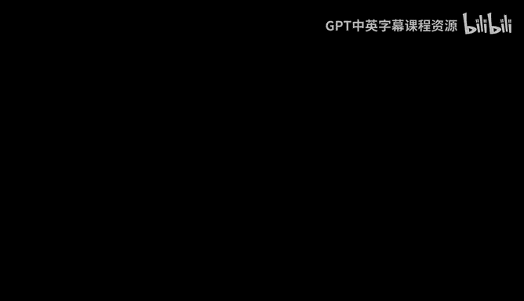

# 斯坦福大学《机器学习理论｜CS229M Machine Learning Theory - Fall 2021》中英字幕 - P20：-20-12_ Non-convex optimization, Non-convex opt for PCA, matrix complexion.zh_en - GPT中英字幕课程资源 - BV1jT421r71m

Okay， cool。 So I guess let's talk about。

The the material today。 So I guess last time we have talked about some of them。

Kind of the bigger questions， the conceptual kind of bigger questions in deep learningening theory。

 And today we are going to start talking about the optimization perspective in deep learningening for one。

 maybe like for two lectures。 So and here， I guess I'm going to explain what optimization landscape means。

 it really means the surface the surface of the loss function。 So but I guess you will see。

 so we are going to introduce some very basic things about optimization。

 but the main focus is actually not about how to update how do design algorithm。

 The more focus is to analyze what the functions， your optimizing look like so that you can use some trivial or some standard optimization algorithm for it。

 So if you don't need any background about optimization。

 you probably need to know what gradient design is， I'm going to define gradient design again。

 but you probably need to know what algorithm is。Opposition algorithm is。

 but there's no any kind of concrete requirement about the details like what momentum look like。

 you know what stochastic wind exactly is you don't really necessarily have to know them。Okay， cool。

 So I guess the， the， the bigger the the the question we are trying to address， you know。

 just to quickly review。To connect to the kind of the the last lecture。

 the bigger question we are trying to address here is that why many optimization algorithm。 So。

 so many optimization algorithm are designed for。For conx functions。But why they can still work。

For non convex functions， right， So why they can still not can， why they can still work。

And I know actually pretty well in practice for non Kong X functions in deep learning。

Not that it's not like this algorithms like green descent or stochastic withinscent can work for all functions like that you may optimize So definitely there are many functions that they cannot optimize and there are this examples in many areas of research。

 but in machine learning typically know people assume that you can know people assume and also somewhat observe that you can optimize your function pretty well。

 even though the functions not complex。 Of course， even in machine learning。

 there are atypical case or all players， whatever you call it。

 especially if your parameterization of your model is very complex or kind of somewhat weird。

 So you could face some difficulties。 For example， one simple example is that if your。

You have a very deep network like feet forward standard deep networks then it's actually pretty hard to optimize because sometimes you have vanishing gradient。

 sometimes you have exploding gradient so on and so forth。

 So however some of these are solved by changing the architecture which changes the landscape the optimization landscape。

Anyway， so so the the bottom line is that in most of the cases。

 people observe that non con wax functions in machine learning can be optimized pretty well in by green descent or stochastic wind descent or their variant so and we are trying to understand why we can optimize reasonably well。

So， so that's the， that's the question。 And maybe just before talking about more details。

 let's first quickly review the the kind of like what gradientingcent is。

 right just in case this is very quick， I'm just going to define some nots here。

 So suppose G theta is the loss function。I guess I'm using G here just because you know I want to use a generic collector instead just instead of use L right so L probably should be a better letter。

 but here I'm using something that is more generic so and the algorithm is just something like sit zero is some inization。

And， and you have something like theta T plus one is equal to theta T minus Eta times the gradient of geo Ota T。

 This is a good。And。And you can have stocktoastic versions of it。 many of you probably know them。

 So and the I'm going to list a few facts， you know， just to kind of motivate。

AndThe discussions here， right， So so when we're looking at non convex functions。

 Maybe let me draw non convex functions， something like this， right， So， and the the first fact。

It's a fact of it's just， you know， some observation。 So maybe let's call it observation。

The first observation is that so GD cannot fund。Always cannot always find local global minimum。Right。

 this is for continuous functions right this is kind of obvious because， you know。

 depending on where you neutralize， depending on like how the function look like。

 for example in this case， suppose initialize here and green send will go no right word and maybe it overshoots a little bit and it go back so and so far but then at the end of day。

 it converts to this local minimum right if you're learning writing is somewhat small。

RightSo it was stuck at its local minimum and stay there。 and even you have storcchasticity。

 if your storcchastic is not big enough， you are not going to go to another local minimum go to the other global minimum right so。

So， clearly， you cannot hope that good sent to work， you know。Like in the worst case。

 when of possible non conve functions。 right， so observation 2。嗯。Actually， this is a。

 this is a theorem。 know， so finding。啊 global minimum。Of general functions。

 general noncom X functions is NP hard。I NP heart。I assume some of you have statistical backgrounds which who are not exactly familiar with NP hard you it doesn't really matter this is just really saying that it's computationally intractable to find global minimum but just to clarify what does that mean that means that there exist a function that you cannot solve it doesn't really mean that so basically this is only saying that you cannot in polynormmal time solve all possible functions with gradient descent or with any algorithm。

But it doesn't really mean that there's no subset of functions that you can easily solve， right。

 So for example， a convex subset of functions can be solved in polynommeter。Okay。

 so and the observation 3， and obviously， this is opposite observation。 So winning design case of。😊。

哦。Convex functions， as I said。And， and I guess observation for。Is that， you know。

 objectives in V learninging is non complexvex。This is， you know， probably not entirely trivial。

 You know， it's almost trivial， but not entirely trivial。 So you have to， you know like。

You know its probably can true to see that you cannot prove that they are convex。

 but you probably need a little bit kind of calculation of some kind of constructions to see they are not convex and generally they are not convex just because there are so many nonlinearities and most of the convex functions we know are somewhat kind of like simple functions that a linear function composed with a convex loss。

 for example， and as soon as you go beyond two layers you have is not convex。Okay。

 so an observation 5， I think this is I mentioned it， you know。

 So like a it like greeny descent does work。 You know。

 green decent or stochastic winning descent does works。So， finds。

Let me be precise about this funds approximate。Or even sometimes you can claim it's almost exactly a global minimum。

Of of of like， a loss functions。InOf course， this is not like a 100% rigorous statement because it depends on which loss function you talking about what data are set you have you have and what architectures you have so and so forth。

 But I'm just saying like for most of the cases in deep learninging with gradient and seems to work pretty well And why you know they are finding the global minimum So you know that because you know the loss function is not negative So suppose you run image or you do some kind of like a vision experiments。

 And you know the global minimum has at least the loss function is always negative and you can see how small lossD or GD can get you and often the loss function is pretty small。

 something like1-2 or something like that or maybe sometimes depending on whether use regularization。

 sometimes it could be1-41-5 depending on situation。

 So you kind believe that you get at least an approximate global minimum。Cool。

 so so what what's going on here， right So it sounds like this， you know。

 there are some positive results， you know， empirical observations。

 there are some negative results about the NP hardness or the intractability of the of optimizing non convex functions。

 So so the way that they that can reconcile this is really just that you know the lower bound。

 you know the impossibility results is about worst case functions and actually we are not optimizing worst case functions right so so I guess the kind of in my mind。

 the kind of view is that you have a family of all functions right So in this family the are functions that are super hard to super hard to solve right so like very hard functions。

And there's also small subset of functions。 Let's call it convex functions。

 right these are not not we call it convex These are just convex functions。

 and these are easy to solve right Socent can solve can solve them but actually we didn't identify all the functions that we can solve there are actually more functions than conx functions that green descent of some other algorithms can solve。

 and that's a slightly larger family in between and today we are talking to talk about this kind of functions right So of course we cannot identify all the functions that are beign enough for us to solve。

 but but we are going to identify a subset of the bigger than convex the convex subsets right So these are nonconvex。

But somewhat have have but has have benign properties。

 some benign properties and and the kind of the task is to figure out what properties that make them somewhat nice and easy to optimize。

Alright， so， so， so here's our plan for this lecture。

 and maybe the the first part of the next lecture， so。

The first step is that we're going to identify a large set of functions。A larger set of functions。

That。I g d我 g d can。AndSo up to global optionality。And。2， we are gonna to prove that。

For some special， some。啊 machine some。Some of the loss function。In machine learning problems。嗯。Can。

 you know， belongs to this set， belongs to。This set we just identified this larger set of functions we just identified and most of them。

嗯。So most of the effort will be spent on the second bullet。 the first bullet， you know。

 you do need to show why actually can solve these set of functions but I guess I'll tell you what people can show in the first bullet along the line of first bullet。

 but I wouldn't tell you anything about other details。

 The results there are actually in some sense kind of like intuitive so and but they do require a lot of backgrounds to to talk about the details right so like you need to know like a lot of things about how to analyze this iterative optimization algorithms So that's why we don't focus on that。

 we mostly focus on the second part， which is more about the statistical properties of those functions used in machine learning。

Okay， cool， so。So the， so the the very basic idea is the following。 So the， so it's。

 it's very simple。 So， so basically， you say that， you know。

So you you know that so you know that green decent。Can find。Local minimum。

This is somewhat easy to believe， but actually， there is some caveat about it。

 maybe I'll put a start here just just to remind you there is a caveat。

 but you kind of believe that roughly speaking， we design can find a local minimum right and suppose if you know。

 in addition that all local minimum。Our local minimum。Of F are also global。

Then this two means that GD can find global。Right。So basically， you know。

 the first statement is about the first。 so， so basically。

 so basically the the set of functions that we are going identify to be solve by GD and SGD is just the set of functions with with the property that our local minimum are also global minimum。

And then we need to characterize， you know， we need to show that。

 you know the functions we are actually using in machine learning have this property right。

 of course not all problems have this property， you know。

 we're going to show some very actually simple cases where you can prove this。Okay， so。But I guess。

 as I mentioned， there's some caveat about whether you can even converge to a local minimum。

 So this is actually somewhat nuanced。 So and I want to be kind of like as clear as possible about that。

 So I'm going to formalize this， you know， converging to a local minimum and I'm not going to prove any of the theorem here。

 so the next part is about convergence to local minimum。Right。

 so I guess let me start with some definitions to formalize it。 So let F be。Twice differentiable。

As for simplicity， we are。Like sometimes you can extend this to， you know。

 maybe like only defiable maybe not twice differentiable， but just for simplicity。

 let's say if it's twice differentiable。 And what's the definition of local minimum。

 I guess you have。嗯。Send this ins class So X the local meaning of the function F。

If there exists open neighborhood。Let's call in around。A， such that。啊。In this neighborhood， N。X。哦。

 the function value。I'm using a lot of text here just to make it easier to understand。 you know。

 alternatively， I can also use just math。 but so but let me use the text。 So in the neighborhood end。

 the function values， all the function values in neighborhood N。Or at least。F x。Right。

 so basically FX is literally one of the minimum in this neighborhood。

So that's a definition of local mean。 And so I guess， you know， from the Ca class。

 you probably know that， you know， if X is the local。啊 mean。It means that green of F X。Its zero。

 the green square of the hecin of F is PSD。Okay， so。

 so these are necessary conditions for being a local minimum， but not vice versa， right。

 So it's now like if the green is0 and。And has since PD， then you you are local right， So why。

 you know， I guess a simple example here， I came up， you know。

 it's easy to came up is that you just say maybe actually。

 Im I'm not taking the simplest one just for some reason because I'm going to use this again。

 So let's say suppose you have x1 of X 1 X2， which is something like in the x 1 square plus x2 cube。

Okay， so I mean in this case， you know， X1。X2 is0， the origin。Satisfies。

The gradient0 and satisfies the hecin is PSD。Actually， it has been zero， right。

 So that's why it's PSD。Right just because if you take the second order， wait。

 the hassing is not zero， sorry， the hesing is PD， right， because the hesing is a matrix。I guess。

 you know， in one direction is two and the other all the other things0 HPS。く。All right， so。

But x is not a local minimum， as you can see， right， Because， you know， if you change x2。

 you can make， you know， the function value smaller in the neighborhood。Right， right。

 because x 2 is the cubic function， right， So you can always make make it smaller than0 in the neighborhood of zero in the neighborhood of0。

Okay， so。So basically， from this example， you can kind of see that， you know。

 what happens is the volume。 So， so why this is a problem， right， So what。

 fundamentally what what what， what's the problem here。

 The problem is here is that when the green of F X is 0。And also， the hasing。

It's not strictly positive semi definite。 It's just a positive semi deffinite。

 So supposeian vanishes。In some direction。Right so if Ha manages in some direction and so that means that in that direction。

 you don't have the first out gradient， you don't have the second other gradient in that direction。

 youre pretty flat。😊，Right so that makes it tricky because then the higher order gradient start to matter。

Drratives。Starts to matter right because if your second order derivative is actually non0 is curved。

 then the third order derivative is always killed by second derivative as long as your neighborhood is small enough。

 However， if your neighborhood， you know， but if your second order derivative is literally zero in some direction。

 then the third hour derivative starts to matter。So that's why， you know。

 local minimum is not only always a property of the first and second or derivative。

So and when you look at this and on Wednesday it becomes about the third derivative or false derivatives。

 things becomes much more complicated and actually you know if you look at the hard instance know of the NP hardness or the intractability results about optimization so like once so basically all the hard cases happens when you have to deal with the hell of derivatives。

 like false derivatives and then basically in the I'm not I know this is probably not making that much sense for all of you if you don't familiar with not familiar with how you prove NP harnessness。

 but basically you can invitebed hard instances of like like some kind of like set instance to the false derivatives so that you know solving knowing whether the false derivative is positives is a positive operator。

Is equivalent to knowing whether you， you solve the site problem。 Anyway。

 So this is only for those people who know a little bit about the the computational intractability results。

 anyway， so， so， but but the intuition is that hard， higher derivative is is。

 is's just hard to deal with。Especially higher than a false order and and there is a there's a the。

 which is the following。 So the theorem is that verifying。Ving if。X is a local minimum。

Without any assumption。Of a locomy of F is actually NP hard。

So finding a so that finding a local man is also going to be hard。

So I've told you that finding a global minimum is MP hard。

 but actually finding a local minimum is also MP hard。😊，And。And this is， know， you know。

 this is the caveat I was referring to because in most of the cases， if you talk to somebody right。

 if you talk to me about research， your meeting know we will think about know finding a local minimum is easy in general。

 like that's the right intuition。 but it's not exactly true。

 right So you have to consider this kind of pathological cases。

 which makes things harder So so how do proceed So if finding a local minimum is harder than with this plan doesn't work right So so the way to go beyond it is that there is a way to also remove some of the pathological cases as well so that you can you can find a local minimum in paranoormmal time and then we can execute our plan So this is what will happen so。

嗯。So。So， so here is a a condition。Call strict settled condition。 And if you satisfy the condition。

 then you remove those pathological cases， which requires higher order derivatives， so。Sorry。

Stret side of condition。 So， and let me。So in some sense， I guess， you know。

 I'm not sure whether this makes sense before I define it， but generally。

 you are basically saying that you want to rule out。

 you want to say that you assume your function doesn't have this kind of like。

Somewhat subtle possible candidate of local minimum， right， So， so every point。

 whether its a local meal or not can be tell can be told from examining only the first order gradient and second order gradient。

 Second order derivatives。 So there's no subtle cases in your in your your function。 right。

 so how do we formalize。This is strict。细度。嗯。I guess the paper to set is Li etal。 By the way。

 I think I wrote a book chapter about this kind of optimization thing for a book。

 so I can send that to the people， the person who take the scrap note and that probably help you to to have some references the materials are not exactly the same as the book。

 So you still have to do the from scratch in some sense。

 okay cool So the definition of abstract side I'm settinging this paper just because it's not like every paper use exactly the same definition。

 the very， very original paper that introduced this term and this notion is called is by Ro and at So in 15。

 So so that paper has a slightly different definition and but I think this one the definition Li et is a little more。

Eas to use for for for， for done for the future research。

 So so I think people are somewhat con converging to this。 So we say。So here's the definition。

 So we say F is alpha beta gamma strict cell。If。For every。X in2D。诶。Every X in R D。Satisfies。one。

Of the following。So the first one is that， you know， for some of the x， it just sisifieses that F x。

 the two norm of x is larger than alpha。Right， so， so you see that you know， of course。

 some of the accessifies this right， So your green is big。

 So these points are not local minimal right， So these are these are not stationary points They are not local and minimal。

Okay， by the way， by stationary point， I mean， first other stationary point。

 meaning those points with equaling0， right， So so if you satisfy number one here。

 you cannot be a local minimum。 You cannot be a stationary point。

 and alpha beta gamma positive numbers。 And the second thing is lambda mean。Of the housinging。

At x is less than minus beta。So if you satisfy this。

 you cannot be a local minimum right because your heing is not positive semi defite right。

 so you cannot be a local minimum。And in some sense you can think of alpha beta and gamma to be something super small or even close to be0。

 which just require them to be strictly bigger than zero just for technical purposes so so basically and the third condition is that x the third possibility is that x is gamma close。

To a to a to a local meal。hel look佢咪。Let's call it X star and in Euclidean distance。

The distance in metric here is probably not entirely important because we are not going to be very quantitative about this。

 so everything is polynomial so this's not that important so。So basically， this is saying that。

 you know。If number one rules are some kind of like local minimum。

 number two rules or some other kind of local minimum。 But note that number one。

 number two doesn't rule at all possible local minimums because there are even local minimum。

 which has gradient 0， which has0 gradient and positive。 some definition has。 Sorry。

 theyre also my right。 So one and two doesn't tell you。

Exactly whether the point is local minimum per se， if you don't have this assumption， because。

 you know， you can have a point that does not satisfy one or two， right， for example。

 if you have a point with。Greding 0 and has is PSD， right， It doesn't satisfy 1 and2。

 but it could still be not a local minimum， right。That's the path case。 And this assumption。

 this definition is basically saying that。If you don't satisfy one，2。

 then there's no dis pathologicalal case。 You have to be close to a real local minimum。 right。

 so that's what the strict settle condition is say。

Maybe let me take pause for a moment and see whether there's any questions。Actually。

 I'm looking at the query border， I know its it's up tape， but if you have any questions。

 feel free to ask。嗯。Is alpha and beta are positive。 Yes， that's try。

 So this definition only makes sense when alphapha beta and gamma are positive， I think。嗯。Right， yes。

 exactly。So阿法贝ta。酷。Any other questions。The third three set condition sounds hard to check。 Yes。

 that's， that's， that's a great point。 So you cannot check。

 There's no way you can check whether empirically。Your function is。诶。Satisfies this connection。So on。

I think it's even。I'm not 100% sure about this， but I think you can prove that if you are just getting an arbitrary function right defable functions。

 you shouldn't be able to check whether it says by strict cycle right it should be as hard as finding a local minimum in some sense right so this condition is not supposed for is not something that you' are supposed to check numerically。

This is something that you are supposed to prove theoretically in some sense。If you can， you know。

 of course， I know in many cases， you cannot like not you cannot like nobody can can can do。

 but but but but I think the condition itself is not supposed for people to to numerically check。

That's a good question。Okay， cool。 So， and by the way， always feel free to ask questions。

 just even as I'm speaking， so。😊，Okay， cool。 So let's see。 what's okay， we have the condition， right。

 so now。What you can do with this， right， so。So here's a theorem。

 The theorem is somewhat kind of like a informal。Just because I'm not， you know， it it'。

 it's pretty formal in the sense that， you know， all the bonds are correct。 It's just that I didn't。

 I wouldn't specify that some of the details。 So， so suppose。哦，F。is alphaphabeten噶吗？嗯。诶。Stake hell。

Then。Many optimizes。For example， GD， IGD， if you use the learning rate correctly and。

 and there are many other articless like Quebic recognition， I guess you know。

 many algorithms can do this。 So， so and so far as， you know can。Converse。To a local meal。In with。

Epone error。诶 in。Are you clean distance。啊 in time。啊后你。

Poly DD dimension 1 over alpha1 over beta 1 over gamma and one website。

so so this theorem is very coursearse green， of course you know different optimizes have different conence on rate。

 but we are not you know， at least for the purpose of this course and this lecture we are not interested in which one。

It's faster， we are mostly just as interesting whether it's polynommal time versus exponential time。

 and the point is that if you have the strict set of condition。

 then you can converversege to a local minimum， you don't have those path minimum pathological cases。

 then you converge to a local minimum you can conversege to a local minimum in eucide in this polynomial time。

Allright， okay， so by the way， I think just to explain the name of strict Sa。

 I think this is just because the pathological case is a saddle point， right。

 So when you have this kind of like cases where the gradient is0 and has since PC but not strictly positive some defite。

 So you have some direction where you can potentially have a negative curvature negative like you can potentially you have a flat curvature。

 but potentially you can have。Like but third order derivatives。

 And these are kind of like kind of saddle points。 So so this is， in some sense。

 thats explain the name for this。 right so， so the in other words。

 the the condition saying that if you are if you are saddle pointing。

 you can tell the it's a saddle point from the negative curva。

What is the third optimizer inside the the processes。 That's a good question。 Oh I。

 this is called cubic requisition。 I guess there are so many others。

 I like cubic requisition is one of the early。😊，An early work in 20th2006 by Nssterov So but there are many other optimizes like I publish a paper on this。

 like many other papers， like many other people publish know papers on this。

 I think I can add more references in the in the in the scrap notes in the final scrap notes to to set some of the recent works。

So。Right。Okay， cool， so。Alright， so， and now。We can convert a local minimum with this condition。

 And now suppose you make additional assumption to say that。All the local minimum global。

 then we are good， right， So， so basically。The next theorem is trying to say that。啊 global。

And you have the strict sideal condition。Then this means that optimizers can converge。To global。

Right so here is a serum that's formalized this。嗯。I guess I'm。

 I'm I'm writing it a slightly different way， not because。Just， you know， in some I I。

 I unpack it a little bit。 just I thought that this is either provides a slightly different way of thinking about this or it's just a more explicit。

 So basically， you say that you assume the strict cycle of condition。

 but let's let's rephrase the local global plus strict cycle condition like this。

 So you say that the exist upon 0。And tall zero。And see。Such that。If。X in R D satisfies。

The gradient is small。And the aon。And。The hecin is larger than minus-20。 So basically， this is like。

 you know what does these two condition means， This is saying that you are a somewhat approximate local minimum。

 So you are your have pass the sanity check for local minimum right but of course。

 you haven't passed you cannot rule out the pathological cases。

 but at least you pass the first other condition。 The first other gradient is small。

 you somewhat pass the second condition approximately because the hcin is somewhat big。

 almost kind fluter than zero， and then this is saying that suppose you pass this two condition。

 then。X is epsilon to the power C close。To a global minimum。

 the power C is just like to relax the condition so that you can， you can have square root appsson。

 for example， close something like that。So then access the close close to a global minimum of the function I。

 So， so this condition is just a a slight different way to say that you have all local minimum global and strict side。

Alright， so and then under this condition， then。Optimizeizers， again， the same type of optimizers。

 which can con local minimum can many optimizers can。Converge to。Converseged。To嗯。A global man。of。F。

Up to say Delta error。And you could in distance。in time。后嚟。1 over delta啊 one over tall0 and D。

All right， so。😊，It's not the exactly the same as we did for the strict title。

 but if you think about it， it' it's basically the same statement。Okay， anyway， so。Cool。

So we are we are basically done with the first part right so like about the identifying these subset of functions that are that are easy to optimize but these are all local minimum global minimum functions So and and next we are going to show some examples where this kind of properties can be proved rigorously for machine learning situations this you know examples are pretty。

Pretty simple。 They are not deep learningening， right。

 so these are you know still roughly the best people can do， you know， in some sense。 So。

 so so this is just to give some examples for which this kind of properties can hold。Okay， so next。

We have two examples。The first one is the PCA。o matrix factorization。And fundamentally。

 this is more or less the same as the。😊，The linearized new work。

 even though if you do new linearized network work， there is a little more things to do beyond that。

 And the second example I'm going to give is。W whichch is completion。

This is a important machine learning questions you know by itself as well right so before deep this was you know one of the most important topic。

 maybe machine learning like especially nonlinear if you think about nonlinear cases and now still I think it's used image in recommendation system so。

So， we're going to talk about that。Okay， cool。 So any questions so far。I guess， let's。

Let's talk about PCA， okay。First。So I guess， you know， or maybe more precise matrix factorization。

 So we we are assuming that。诶。We are given a matrix。 I in dimension D by D。

 And you want to find the best let's， let's talk about the rank one case， right， rank one case。

 So we want to do the rank one。B'est the rank one。啊，R one。So， best。Rannk one approximation。

Of the matrix。I think probably from other classes， you have know that the best best prime approximation is basically the kind of the eigen decomposition or the singular value decomposition of the matrix here。

 let's also assume just for simplicity， let's also assume this matrix M is symmetric。

As' also as you assume it PSD just for simplicity， so in this case。

 the best rank approximation is basically the eigenvector times the eigenvector transpos right up to some scaling。

So， so this is not a hard problem， right， you can just run any eigenvector solver to find eigenvector and scale it properly。

 Then you get the best best rank approximation。 So， but just for the purpose of this class。

 we are interested in this non convex objective。Function， right。

 which is like a literally you know like interpreting this in the in the most straightforward way。

 So you say I'm just literally finding this back by the rank one approximation。

 I know the best rank one approximation should be symmetric。

 So I'm just trying to find M I's find a vector X such that。

M minus X X transpose in forbining storm is the smallest。

 so you are proing M and the matrix M with the the matrix X X transpose right。

 So X X transpose is the ramp approximation。 And you measure the error by forbining storm。Okay。

 so and this becomes a non convex objective function because you know。

 you have a quadratic term here and then you take the square of that it becomes like degree four polynomial and it's non convex。

嗯嗯。Right， so， so and our goal is to show that。Even though it's now convex， like all local minimum。

Of this g。Are global。Under the assumptions that we have mentioned， right， So I could rank one PSD。

 so and so forth。Okay， so。I guess， you know， I think I forgot to pass a figure here。

 So if you look at the rank the one dimensional case， this function look like this。

So one dimensional。 So these one。So D is one。 then you just have a scalar M minus x square squared。

 This is a function， G of x。 and you plot this function， this function looks like this。

And there are two local minimum and they are both global minimum because there's some symmetry here。

And if you have like a higher dimensional， it becomes a little bit more complicated because you have actually not only necessarily。

 you know， in some cases， not only necessarily one like。😊，Not necessarily。

 only like two local local minimum。 or， I guess if we rank1。

 there are only two on local minimum and but it looks more complicated。But generally。

 you have some kind of rotational kind of symmetry here to make this happens。Okay。

 so let's talk about the proof。 Where， how do you prove this。 So as you can imagine。

 the proof is pretty simple。 The the the the plan is very simple。 You first find out。哦。

Stationary point， the first other stationary point。And then you find out all local minimum。

And you prove that they are all global so。So basically。

 it's just more or less like we solve all the equations of the。嗯。

So of all of these equations and and see what are the possible local mineral you can have。All right。

 so。So let's first use the station upon the gradient condition。

 right so green of x is0 and what is the gradient of G of x right so gradient of G of x。

I'm not going to give a detailed calculation here， but believe me， this is equals to。Minus is T sex。

I think this is actually a question in homework zero， maybe question two。

 or question three in homework zero about how to compute a gradient so and you have the gradient and then you say let's some。

Let's write out what， what does what is zero means， right， So this means M times x is equals to。啊。

The two normal x square times x right because these three things together。

 the two the last two things becomes the two norm of x square and that's a scalar。

 you can you can switch the sign。 You get two norm of x squared times you can switch the order you get this Okay。

 cool。 So and this is a scalar。And this is a matrix vector multiplication。

 so basically this is saying that x is a aigen vector。😊，Right， so x is eigenvector。

And an x squared corresponds to。I can value you。So basically， you have to you know。

 maybe one way to think about this is that you first find out the unit eigenvector right so eenvector doesn't have a scale right。

 So you first find out the unit vector eigenvector， let's say。😊，The unit eigenlect。Are we1 up to V D。

 And then if you have unique evectors， then and。So suppose， let's say。

Let me just be specify because so this part just is follow some intuitions I suppose。

I give values are distinct， even though we don't have to assume this。

Then you have unit eigenactctor B1 up to V VD， and you have lambda 1 up to lambda D。

These are the eigenvalues。And then basically， all the stationary points are of the form that x is equals to plus minus。

Square root lambda I times the eigenvectors， right， Because if you measure a norm of x square。

 then you get a lambda I， and that is the corresponding eigenvalue。

So these are all the stationary points， the first other stationary points of this problem。

And now let's look at which of this is global minimum is a local minimum。 And then we say， okay。

 all the local minimum global right。 So ideally， we just want to。Say that the only the V I。

 the V one the V one thing is is is the local minimum。

 right because that one is also a global minimum， right Soda one v1 square root one V1 is the global minimum。

Okay， so how do I do this？So and also， we don't necessarily want to assume all the eigenvalue are distinct。

 So， so there's a small things to be done regarding that as well。 So， so let's compute。

Haing right so we need to use the hasing。 So I think， you know。

 this is an actual typical question I got， you know when people start to think about this kind of like optimization problems because and the typical question is that how do you find the has。

 how do you write out the has sometimes the has sometimes could be very hard to to be written down。

 So here is actually not that hard because the hasing is dimension D by D because you have parameters。

 sometimes your parameters has like is a matrix。 And then your hasing becomes a fourth or the tensor and it's kind of very complex to be even just written down to just write down the heing。

 So here is a is a kind of a very useful trick。 and which actually also has some fundamental reasons that this is useful。

 So so the useful thing is that if you look at the quadra form regarding to the hasing。

you look at V transpose， you know Hacin V or V in the product with has in times V。

 this is a quadra form related to the hecin， this is much easier。To compute。

So why this is much easier to compute because the methodology is the following， so this is。

In some sense in the homework solution of that homework that ask you to find a gradient of this function。

 right？I guess we have the homework homework zero has this question to ask the gradient of this function the same methodology also applies here so when you talk about the heing。

So， so the methodology， you know， I'm not going to go to all the details， but the roughly speaking。

 what you do is the following。 You say I'm going to consider G X plus Epsil。Right， so on end。

I I'm going to tailor expand this。 So I'm just going iteratively Tayloror expand it whatever this G G is。

 right G net needs to have a analytical form。 maybe it's a composition of several functions。

 you just iteratively。Expand it。Taylorlor expandedit。So that into a。

Into something like G of x plus some epsilon time， some vector。Plus， some E time， some matrix。

So okay， I guess maybe I shouldn't even write this。 So G of x plus some linear term in E。李尿春。你 앞서。

Psom's cadratic term。And so and so forth。 pass how。 And then if you have this。Then this。

Basically correspond。 If you replace Epilon to V。Replace option by V， then you get V。

 then you get v dot G square G x v。So I guess I'm not sure whether this is too abstract。

 you know when I say this， but you know if you are didn't get exactly what I mean so just look at the homework zero solutions。

 it's basically doing this so this is a very simple way to compute the heing and the cadra form over the hecin without you know writing the hecin as a complex know matrix or tensor So if you apply this kind of techniques you you can get the heing like this So the cadra form of the hecin。

Its equals to something like this。So I guess you can see that here I'm not writing it I still don't necessarily have exactly a representation a characterization of what the hassing is right I'm only writing the cadratic form as an analytical formula of x and m and V so and so forth right so you can in this case you can still from this quadratic form you can figure out what the corresponding matrix is you can write it as a matrix application that's okay but for many other cases actually it's very hard to write out that matrix of the hessing right by the cadratic form is just some analytical formula and as you will see。

 actually the only thing that matters is the cadratic form because anyway even you are giving for example。

 a hassing which is kind of complex there's not much things you can do with it pretty much youre still looking at the different specific cadratic form。

Anyway， okay， so， so we have the， we have this quadratic form。

 and we know that the hasing is large 0 is in equivalent to that for every V， the quadratic form。😊。

Of the Ha。Is learning 0。Okay， so so here's what I mean why you only care about a cognitive form。

 this is just because you only care about basically if you plug in different ways。

 you get the same thing。And by which we we want to plug in。

 shall we plug in all of the be or shall we just use some specific bees？

It turns out in many cases you only care about a few special Vs because some of the theses are more much more informative than the others and which so you want to choose some informative vs to evaluate this formula so that you get some important information about what X can be right because at the end of the you care about what x is because you are using this to pin down what at a local minimum。

😊，So so what are the informative Vs， So it turns out that。

 you know the Vs that are informative here is the top addor。How do you know this。

 you know it requires some intuition， it requires some trials and errors and so forth。

 but but I guess you know it also probably makes sense because the top amatic direction is the global minimum right so you somehow。

You you try whether you can move in the direction of the global momentum to see whether your function value can increase in a second order sense and and to some extent。

 it's intuitive to sometimes extent， it's just the trials and errors。 So but anyway。

 so v equal to V1 is a good choice because if you plug it in， you get V1 times the。Of x times V1。

 and you plug into this formula you get。Two times X V1 squared minus B1 transpose M V1。Plus。

 x 2 norm squared。And you say this is large zero and you can probably see why this is informative because this term is negative right so it makes the it the it's the hardest test in some sense because the negative term is maximized。

 So and now let's look look at what we can get from this equation， right so。

So realize realize that we don't care about the hesing for every point right so we only care about the hesing for the stationary point the first other stationary point because only those points can be possibly a local minimum so we only look at x eigen is the eigenlect right because we are only filtering local minimums from the stationary points。

So because x is the eigen vector， we have two cases。 So the first case is that x。Has egg value。林德玩。

So actually has the top eigvalue then。Acc is is a global minimizer。

And we are done because we know the top eigen the top， you know。

 the global minimum is basically using the top eenvalue to fit right that's the by the by the the standard results in PC A。

 you know that the best one of approximation is the top one top1 eenvalue een with with the right scaling So the second case is that x has eigenvalue。

Let's say lambda， which is strictly less than。umbm number one。

 So it could be the second eigenvalue could be the third eigenvalue so and so forth。

 right So and then because x is the eigenvector and also the eigenvalue of x is orthogonal to the eigenvalue the eigenvalue of x is is different from the eigenvalue of V1。

 So you know that x is orthogonal to v1 because different vectors different eigenvectors with different eigenvalue will be orthogonal there's no guarantee that two eigenvectors are always orthogonal。

 because they could be， they could have the same eigenvalue， and they are just in the same subspace。

 But if they have different orthogon they have different eigenvalues。

 then they have to be orthogonal。 So that's why x1 is orthogonal to v1。

 And then if you evaluate 2 is equation2， the two means what So two means that the first goes。

Goes away so you get just x2 nu square is bigger than v1 transpose mv1。I recall that。

The V1 transpo MV1， and this is just lambda 1 and x2 square we call that that's equals to lambda。

recall that by the first other condition， you have that here the x2 norm square is the scalar that corresponds to the eigenvalue of that vector。

So basically， we have lambda is bigger than lambda 1， and we have a contradiction because。

Because this is contradictory with the assumption that Lada is less than Lada 1。So。是是讲。Okay。

 any questions about this。So guys， maybe just a very quick summary。So basically。

 this is saying that if you are。Ifve ex stationary。

My station point always means first order station point。

 So I'm not going to clarify that in the future。 So if X station point and x。

Its not local men and X is not global mean。Then。冇永。In V one direction。

So moving in V direction doesn't really wouldn't change our function very much right because you are stational point。

 that means your point is flat。 So changing in V direction wouldn't change it by a lot would only lead to some would lead to。

A second order improvement。Improvement。That and that's why it's not a local minimum， right。

 Because if you our local minimum moving a V band direction shouldn't give you any second of improvement either。

 right， So so so that's basically the the gist of the analysis。All right， so。Cool。

 so I think we have to talk about。 Okay， so now let's talk about Mitch's competition。

 which is kind of like an upgrading version of。Of PC。 And， and as I said。

 this is actually a pretty important question in machine learning。

 So let me define the question first， And then I can briefly talk about why people care about it。

 So let's also talk about the one command version just for simplicity。

The question is that so let's say suppose。 And also， we are， we are assuming that we have。

I guess we assume the ground truth matrix。Is also a rank matrix， like and a rank matrix。

And ansymmetric。And PSD just for simplicity。And so in other words。

 you can assume M is equal something like Z Z transfers， right。

 and these is the kind of the ground truth and these is in direction D dimension D。

And the setup is the following， so we are given。😊，Random。Entrees。不烦。

So you pick some random inice in the indices of M， and you review the corresponding entries。

 That's the only thing you know from about M。And then， the goal。Is to recover。The rest of countries。

Right， so， so more more formally。 So you see that there's an omega， which is a subset of。

 you know the entries。Subtype of the indices of D times D。

 And you say this is actually random subset in the sense that every entry。Is chosen。

It's included omega uniformly， randomly。 It's included。有咩个 uniformly。Randomly呃 independently。

With probability P。Okay， so each entry is included with some probability P and you reveal so what we see we observe。

The so called p omega of m p omega of m is basically okay， so let me define p oomega of m。

 so p omega of a。is。The matrix。Otained by zeroing。Out every entry。Outside。欧米伽。

So so you get this matrix A and everything that is not in omega。

 you make them you make those entries0 and you are given this you know sparse matrix p omega a。

 so we observe P omega of M and our goal is to recover M。

And why people care about this question a lot， you know， in the past。

 one reason is that it it has this。Relationship with recommendation recommendation system so so here I'm assuming it's asymmetric matrix and so on and so forth。

 but if you relax those a little bit which doesn't necessarily change the essence of the problem so suppose you think of you have a matrix。

And in one side， you are the， the columns are indexed by the users。

 So let's say suppose this is a matrix that Amazon maintains。 And the other side is the item。

And and each entry is the rating of the user to the item。So。

 so so and and and every user probably have an opinion about every item right either they like it or not so and so forth。

 but it's not like every user buys every item right for sure。

 So every user only buys a very small subset of the item and that's why you only see some entries in this matrix right Amazon only see some of the entries and Amazon wants to understand each each user's preferences。

 you want to know that each user likes which item right so so the Amazon has an incentive to just fill in the entire table I'm just only using Amazon as an example but but the same thing probably applies to many other situations where you have to recommend items to users so。

So， so that's why you have to recover all the rest of the entries to serve the users better in the future。

 And that's that's why this problem was important。 You it's still kind of important these days。

 But I guess there are many already existing methods to solve this and the most the most used method to solve this is basically non convex optimization to find this best this ground truth matrix are using the fact that you have a low rank structure in because you know。

 how come you can recover the rest of the entries if there's no other structure in in this matrix there's no way we can recover the other entries because they can be arbitrary。

 So that's why you have to assume that the matrix has some low rank structure or some other structures。

 So maybe just to give you a quick。Kind of like sense about， you know。

 how does this the structure matters here， right， So。

 so we have a if you count the number of parameters， we have D parameters。Right to describe。

I ran five metrics。Of dimension D by D， right because you can just write it as X x transpose and。嗯。

And， and how many so how many entries you observe should be probably bigger than the degree of freedom here。

 right， So， so the number of observations。Its roughly equal to p times d squared right because each entry is observed with probabilityative p so you have p times d square entries and this should be bigger than D right if this is not bigger than D is it's unlikely you can work right so basically that is saying that p is bigger than roughly one over D and and this is actually the regime we are going to work with right so we're going to work with the regime that P is no。

Much bigger than what D， for example， a log factor or something like that。So that's the。

 that's the setting we're gonna be and。Speaking of the。Objective functions。

 This is actually a pretty commonly used method in practice， so。

So you just say I'm going to minimize this function that's called Fx。

 which is defined to be that you basically you have a parameterization called Xx transs。

 this is your target this is the the parameterization for target matrix and you want to say this matrix actually face all my observations right so so you are taking a sum over all possible observed entries because this is the only cases you know what the entries are。

 you know those MIJ and you minus this with X times Xj。And you take the square。

 this is your prediction， this is your observation。

 and you take the square and take a sum over all the observation or observed entries。

And just for future notal。Easiness， so this is actually you can write this as Pome of I minus xx transpos。

Right because this is the matrix， you look at the error matrix right and then you zero out all of those that you don't know。

 right because all omega you have no information to zero out all of those and you take the sum of squares of the rest of the entries。

So that's another way to write this function。Right so and just a side note。

 I think actually there are many other methods that can solve matrix completion。

 so there are convex transition methods and so on and so forth right so however those methods actually often have stronger guarantees for example they have tighter sample complex and so and so forth but in practice just because the con transition takes too long time people actually are using objective functions or methods like this and then they just use green descent to optimize these kind of functions and that's why it's kind of also practically relevant to analyze this kind of objective functions because they they are indeed used in practice。

All right， so our。Our main goal is to prove that this object function has no bad local minimum or local minimum global。

 There is one assumption that I have to specify， but it's not going to be used much in the in the in this lecture。

 in the proof because we are going sweep some of these things under the rug。

 but I I do have to mention this assumption It may not sound very intuitive I wouldn't spend too much time on it but just let me mention it So this is called incoherence assumption and this assumption is necessary people know it。

 So we assume that so I guess we assume， for example， first of all， we assume that。

The ground truth has norm one， this is without a generality just which is for convenience fix of scale and then after you fix it still you assume that the ground truth。

On vector Z。 So we call that M is equal to C transport。 So z is the ground choose。

 So the infinitefin norm is less than mi over squareity。And meal is constitute a constant。

Or a log logarithmic。边啲。So， so what is' saying is that this vector Z， the norm is one。

 and also the the entries are spread out， right， You cannot just have all the mass concentrated on on one entry。

 right， So the reason why you don't want that is because， for example， a counter example is that。

If z is just E1 then your M is just E1 E1 transpose。

 which is just the top left corner of the of the matrix。 You just have a very。

 very sparse matrix and top top left corner is is the one。

 and then there's no way you can recover this matrix unless you observe that top right top left corner。

 So， so basically all bes off。 you have to see enough entries right So so this this incon conditions in some sense。

 trying to rule out this kind of like pathological cases。 but I'm not going talk too much about it。

 It's just for the formality。 Okay， cool so。No this is just for the for the rigorous of the proof。

 So， so here is the theorem。 and I guess I'm going to stop after I state the theorem and then prove it next time。

 So the theorem is that。Suppose。P is something like poly。M and log D。Over the Epson。

 we call that we are in a regime like P is roughly one over D。

 and this is the same regime where Epson is is something like larger than0， kind of like a constant。

 And this is a poly factor in mu and also polylo in D。 Okay， so suppose P is on this order。

 and then we assume the the incoherence。And then。哦 look酷。Of F。our。

When we are so actually you can prove that they are all exactly global mineral， but for the moment。

 we only prove that they are close。Of square epsilon， close to。啊。either。Z or minus z。

And Z and M Z are clearly global minimum because the error will be exactly0。So嗯。Alright。

 so that's the statement。And also just to mention， you can also have strict settled conditions。

So can also。Have strict settled conditions。You， you can also prove that。 I it's just that I didn't。

I didn't include it just for the sake of simplicity and you do have to prove that to have the rigorous result。

 and if you don't prove it， you just prove that all of global。

 sometimes you may get somewhat misleading results so I think there's a paper that shows that actually in some kind of like somewhat weird cases。

 you can show very strong looking results like the results looks very strong in a sense that all economic global。

 but actually the reason why they are so strong is because somehow in that setting you ignore the strictidal condition which is problematic。

Al right， so I guess。🎼The proof is obviously too long to cover in one minute。

 So I guess I'll leave it to the next lecture。嗯。I can take of some questions if anybody has any questions otherwise。

 I think。We are good today。Okay， there's a question。 Sounds great。

 So are there any new artwork models where these are known to be hold。嗯。The answer is， no。

 especially if you look for a global property， like， you know， globally or looking on global。

 I don't think we have any proofs for any。诶。Real network models。

 I guess there is a proof for linearized network models like all the activation are linear and actually in that case。

 if you have more than two layers， you don't have the strict set conditions。

 you have a lot of bicycle points。So so basically the short answer is that I don't think there are any real cases like satisfactory cases where we know how to prove this。

嗯。I think they are for twoular networks。 If you assume some conditions on the。Input， for example。

 if you assume that the input are legally separable， then there is a proof for this。嗯。Yeah。

 and there are a bunch of other cases where you can have some partial results。Next week。

In the next lecture maybe the second half of the lecture lecture I'm also going to give another results which is somewhat more general like it applies to many different architectures。

 but it has other kind of constraints you know it also it doesn't really show this kind of exactly this kind of landscape properties it shows that this kind of properties holds for for a region for a special region in the parameter space and that's a so- calledled NTK approach I'm going to specify more details but there are also other kind of like problems with those kind of approach as well as I'm going to talk more about it next lecture。

