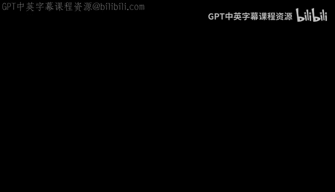

# 斯坦福大学《机器学习理论｜CS229M Machine Learning Theory - Fall 2021》中英字幕 - P2：-02-2_  Asymptotic analysis, uniform convergence, Hoeffding inequality.zh_en - GPT中英字幕课程资源 - BV1jT421r71m

O， cool， let's get started， so。😊，呃。Okay， it's kind of complicated， right， Like， it's kind of amazing。

 right， Like this technology so advanced so that you can do all of these things together。

 but I still have to do them one by one。 Like， I have like 10 action items。 maybe more than 10。

 I need also connected Wiifi。 That's that's actually something I have to do。 Okay， so， but oh， let's。

 let's get started。 Oh， I need to have my notes。😊，So。😊。

What we're gonna to do today is that we are gonna continue with the asymppootics last time a little bit for like about like 15 to 20 minutes。

 This is just to wrap up what we have discussed。 And as I said。

 this first lecture is always kind of like a little tricky to for me to teach it because。😊。

The tools there， you know， if you want to make it formal， it requires some kind of backgrounds。

 And if you don't want to make it formal， sometimes there is a lot of confusion。

 So from from the this lecture， the second half of this lecture， I think we are going to talk about。

Things that require less background in some sense， and it more self content。Okay。

 so the plan is that asymps。And then the so called uniform convergence。I'll define what it is。

And uniform convergence will be the main focus for the first few weeks of the lecture。Okay。

 so let's start by reviewing what we have done last time。

 So what we have the last time was this theorem where we show that。嗯。If you assume。Consistency。

Which is something that is kind of like we basically just assume without much justification。

 You know， it's not always true。 And it also depends on the problem。

 The consistency basically means that setta hat will converge to set star。

 recall that C hat is the ER RM， the empirical risk minimizer and setta star is the minimizer of the population risk。

 So you care about recovering Cta star or recovering something as good as the star。😊。

And we also assume a bunch of other things like， for example， the hcinne is full rank。😊。

And also some regulatory conditions， which I didn't even define exactly。 for example。

 this requires something like some of the virus is finite so you can apply to zero。

And then under these assumptions， we have that。Actually。

 it's kind of challenging for me because this。Podium after rigid， it becomes unstable。

It's kind of like I feel like I'm writing when I'm on a boat。

That is probably good for me to practice。M kind of like what is this like。

 I will be better with some of the sportss。 I guess， after we do this。 By the way， Okay， so。

 so I guess we have discussed that， you know that the distribution， you know。

 the order of the difference between set head and star。

 The order is on the order of one over square N and formally write it like this。

 you scale best word n， and you know that it on the order one。😊。

And you also know something about the laws。You know that the excess risk。

 LC C hat minus LC C star is on the， on the order of one over。N， and if you formally write it。

 you're going to scale by n。 and then you say it's on auto constant。 And also。

 you know that the distribution of sayar hat minus star。

 this is converging to a Gaussian distribution。With mean 0 and some covariance。

 And this covariance is kind of complicated。 But let me write it。Something like this。

This is just review what we have wrote written last time。And4， we also know the， the distribution of。

The access risk， this is a distribution of a scalar because the access risk is a scalar。

 If you scale it by n， then you know the distribution is converging to the distribution of this random variable。

 and this random variable S is a Gaussian random variable with covariance。Mean 0 and covariance。

 something like above， but not exactly。You don't have to remember exactly what the covariance here is because。

 you know， I don't even remember them if I don't read my notes。These are， you know。

 there are some intuitions about this， which I'm going to discuss。 But generally。

 this is just what something you got from derivativerivations。So。

 so last time we have kind of like roughly justified the number one number two。 And today。

 I'm going to， again， give a relatively heuristic proof for3 and 4 just very quick so that we can wrap up this。

😊，So I guess just a， very quickly review what we have done last time。

 So the key idea to kind of like derive all of this is by doing tail expansion。 and tail expansion。

 I think the the key equation。 Let me just rewrite it。 What we have done last time is this。

So you look at the hit the hat， the gradient of the empirical laws I say the hat。

 This is guaranteed to be 0 because hit the hat is the minimizer of the empirical loss。

 And you Taylor to expand this around to the star。And you get something like this。Plus。

 higher order terms。And then you rearrange this， and get。T the h minus star is equals to。

TheThe inverse of the empirical has， I say the star times。No b air hat， F hat plus high order terms。

And then you say that I'm going to replace all the hat by L， like L hat by L。

 using some kind of law of large number or uniform convergence。 And last time。

 we have roughly discussed that this is on the order form overscript because you have a concentration。

 This is the average of this is roughly on the order form screen per plus novel L data。

 Sorry this is star。😊，I will see the star， which is roughly on the order onescript。 And。

 and this is when is converging to a constant。 So that's why the whole thing is converging to something on the order of one square。

 And this time， we are going to make it a more formal。😊。

So to get the exact distribution of high me star。Ill be make。

 I will make this part really quick just so that you know。

 if you are not familiar with the background， you don't get confused too much so。So the idea is that。

 so if you look at what， what's the distribution of this， if you think about this。

 this is the product of two random variables。 And you roughly know what the distribution of each of the random variable is。

 right， So this one is gonna converge to a constant， which is， its gonna converge to na blood。

I'll say the star inverse。 And this one is gonna be a Gaussian distribution。

 if you scale it correctly， right， So， and and basically。

 what you need to know is that whats the product， What the the product of these two random variables。

 What's the distribution of the product of two random variables when you know each of them what happens with each of them。

 And what happens is formally， what you know what you do is your first scale by burdenton so that each of these two random variables on order of one So that you can reason about them。

 easily， So you scale by one by burdenton， you get this。😊，And then， you have。Inverse。

And now you give with this empirical greenback square root N。 And also you get。😊，Squared N， and also。

 let's fill in。The population gradient， which is 0。 So this one is 0。

 I just write it here to make it closer to something， you know。 And then this plus high order terms。

This is still higher terms， even you multily by squared N。

 because I think there's a typo introduction of something pointed out， which is really nice。

 But still， you know， no matter how you multiply， it's still higher terms compared to the other terms。

😊，Right， so。And now， this one。Let's call them， let's call Z。 this Z。

 by low flash number or I think by central limit theorem， Z is a Gaussian distribution because。

 and with some covariance。 and what's the covariance， the covariance will be。

The covariance of Nabula。还有。对。X， Y theta。Why this is just because what is L had datata star minus。

This。😊，This is really just。This is the empirical version of the， the， the right hand side， the， the。

 the population gradient。 So this is really some one over n time some of Nala L， X， I， Y， I。

Pa the star and minus expectation of this way。Of the same thing。 Maybe you can。For simplicity。

 it's just write X Y， here'll start。Right， so you apply this， you apply central limit theorem。

 You know that if you scale this by square N， then you get a Gaussian distribution。RightSo。

 so that's why we know the random variable Z has Gaussian distribution。

 And we know this one will conversege to a constant as n goes to infinity。

 And there is a theorem that specific deal with this。 But actually， you know， if you think about it。

 this make a lot of sense。 So if you want to know that what's the left hand side， basically。

 it just becomes the distribution of the right hand side。

 It's a constant times a Gausian distribution。 It's a this constant times a Gaussian distribution。

 So basically， we have to figure out what's this， what's the distribution here。 So like what。

 what is the distribution of a constant time Z。😊，So。So basically， abstractly speaking。

 what we are dealing with here is that。So the the question were dealing here with here is that。

I really。So different color by abstraction。 So basically， you are asking。

 what is the distribution of A times Z if。A is a constant。

And these from some Gaussian distributionusion with covariant sigma。Right， so， and。你好，你没行了。

And you know that there's a lemma， which says that。If in under this case。

A and Z also is also gaugeutian distribution with covariance with mean 0 and covariance a sigma a transpose。

🎼I think this is a homework question， homework zero question。 I'm not sure but I still there。

 I forgot to double check， but。This is something you can do like a what's the transformation of a Gaussian distribution。

 still a still a Gaussian distribution is's just the covariance got transformed。 And actually。

 the way to transform the covariance is that you like to multiply the transformation and you right multiply the transpose of it。

 you get a new covariance。So this is something， you know， it's not that trivial to derive it。

 but this is something you can either look up from a book or you can derive it yourself。

So with this small lemma， then we know that the distribution。嗯。

Of the having C star convertverges to you replace the convertvers to。

A Gaussian distribution with mean 0 where a。 So here a corresponds to。The Nala I'll see star， right。

And， and sigma corresponds to。Sigma corresponds to this one。 And you just plug in these two choices。

 then。What you have is this。别ase给我推。Intended to prove。We got。拿不来哦。

N plus squared l is the star-1 times covariance。Of Nala L， X， Y， C star times Nala L plus star。给 was。

Okay， this is convergency institution。Any questions so far。I realized that my camera is frozen。

 I wonder't know why。Something seems to be wrong。For those people who are on a Zoom meeting。

 can you see my video。It's kind of frozen。I see。 Thanks。

 Maybe let me turn it off and then turn it on。Okay， sounds working all。Okay， cool。

 And you can see iPad。 You can see everything now。 Okay， thanks。Okay， cool。 Any questions。 Also。

 if you are in a Zoom making also feel free to just unmute and ask any questions。なとだ。かしよ。呃。

This is inverse。Yeah。Sorry， which term you are which term are you asking this one。Here。Yeah。

 this is the， the same。Yes， it's， it's exactly the same one。

 it's supposed to be the same thing Transs， right， But this is asymmetric matrix。😊。

So the trans is the same as。 So this is minus-1。Okay。

 so I guess what I'm gonna do is I'm gonna skip the proof for the， the derivation for the number 4。

 It's kind of like the same thing。 It's just that you have to。

Kind of like because you rather know the distribution of theta hat。

 You should know the distribution of L of the hat。 And what you do is you do some tele expansion to make it a polynomial of the hat。

 And then you can use the what you know about the hat。 All of this in electronics。

 I guess I'm gonna skip this part。So we were looks white。にがなて。The歌。You mean。

 the covariance seems to like the new。最初あレビただて。Very much。I think theres a connection， but。

But I don't feel like。Is， you know， I think all like this hass shows up very often in many different cases。

 right， So there， there， there is some connection， but I don't feel like it has to be like。

 it's not like super closely related to that。 It's important enough to， to know yeah。嗯。Yeah， okay。

 so I guess Ill skip the proof for number 4。 If you're interested。

 you can look at the proof in electron notess。 And what I'm going do is that I'm going to spend another 5 minutes to talk about。

😊，An a a corollary of this theorem， which is in a more。你有 more。Typical setting， like here here。

 this theorem is very general because it doesn't say anything about the loss function。

 It doesn't say anything about the the model。 It works for almost everything。

 As long as you have the consistency。 And here， let me instantiate this theorem for the so called well specified case where you use log likelihood。

 And then we can see the the all of this covariance becomes a little bit like more intuitive and。

 and things becomes a little bit easier。😊，So this is the so called well specified case。So I guess。

 in addition。Who Theorem one？Let's also assume that， I suppose。There exist some。Probabilistic model。

Per matrix by seta。So。Such that Y is given x and theta。 So。

 so you you assume that y is generated from this probabilistic model。Right， so。

 so so what does it mean。 So basically means， So let's say， suppose the exist set star。

 I'm using the super the subscript here to differentiate to differentiate from the set star defined before。

 which was the minimizer of the population risk。 and actually they are the same。 But for now。

 they are the difference。 So you， So basically， you assume that the existing set star such that the Y I the data is generated from。

Condition XI is generated from this probabilistic model。Right， so， so you assume so this is well。

 this is why it's called well specified。 It means that your data is generated from some probabilistic model。

And also， in this case， suppose you use the， the loss function is the log likelihood。

Right before we didn't really say what the loss function is to be。 right， it could be anything。

 And now， let's say the， the loss function is the log likelihood of this probabilistic model。

Think of this as， for example， logistic regression。嗯。Or linear regression with Gaussian noise。 So。

 so your like likelihood could be cross entropy laws could be like mean square laws。

 depending on what probabilistic model you have。Right， so this is your loss function。

 And when you do this， then you know， a bunch of things which are nicer in some sense。

 So first of all， you know that the theta star is equals to the theta sub star。 right。

 So recall that this is the minimizer of the population loss。And this is the ground truth。

 This is the one that generate your data。And， and in this case。

 you can prove that when you have infinite data right say the star is the minimize of the infinite data case。

 you can recover the ground truth， say say a sub star。 So they are exactly the same thing。😊。

And you also know a bunch of signals。 Other things， for example， you know that。The the gradient。

This is kind of trivial。 I'm just writing it here because it used to be that I I need to use prove this in the in the proof。

 But if you don't care about the proof， this is just an in step that， you know。

 So you know that expected gradient over the population。At say the star is 0。And also， you know。

 what's the covariance？Of the gradient。This is， the covarience of the gradienting is the quantity that we care about。

 right， because， you know， in the previous。Theorem。

 the covarience of the gradient shows up in the virus of the O Heman C star。

The covarience of the gradient。Is。I feel sorry。I guess from now on。

 we don't distinguish say a superstar and say a superscript star and see the subscribescript star because they're the same。

And， you know， the covarience actually happens to be the heing。

And when the covariance of the gradienting happens to be the hecin。

 then the covariance of the height manifest the star can be simplified。😊，So， this。

We that this used to be a Gaussian distribution with with something like。Thats right。

The covariance of the cellular manifest is used this。Product of three things，3 matrices。

 But now what's in the middle is the same as the hesing。That's what we claimed in number 3。

 So that means that you can cancel。This with this。 And you get only one term。

So what left is that just the inverse of the has。Maybe I should just use black forever。Yeah。

 and you also know， if you plug in your like this， the covariance of the the， you。

 you basically plug in3 into all the statements that you had before。

 Then you can also get something like， for example， one of the important thing。Access risk。

I guess we have claim that is on auto of theta star。 But actually here， you can be more precise。

 You know that this is converging to basically a half times k square distribution of。😊，With degree P。

 So P is a dimension。Of datata。So suppose you have P parameters。

 then this is the distribution of the excess risk。And if you take expectation of this so that you get get all the randomness。

 then what you get is the expectation of n times access risk。Its equal to the expectation of the。

The high score distribution that this is equals to。A half times P。

 by the way high square description， if you， you don't have to know anything。Detailed about it。

 This is basically the。The distribution of a sum of P normal Gaussian square。 So you， so you know。

 a lot of things about it。 like， you know， it's it's positive。

 And you know that it's mean is like if the case P， the mean is know。

 if you need to know more about this， just Wikipedia。 it's very easy。

 we don't need anything deep about it。 So， so the important thing is the the last equation。

 So basically， we know that the access risk in expectation here。

 the expectation is over the randomness of the data set。Alright， so in accessories。

 if you don't scale scale by the star。 Sorry， if you don't scale it by n。

 then you get this is equals to， I guess I should write converging to。

Because it wouldn't be exactly equal。This is a half times P over it。So basically。

 you don't even get the dependency on N， but you also get the dependency on P。 So on dimension。

 So you know that。What's the order of access risk， Of course。

 there's a high order terms laid off one over。And。Actually， you know the variance of the excess risk。

 which I don't think is super important。 The variance is smaller than me。Okay。

 so in electronic notess， I think we have proofs for all of this。

 But I think I'm not gonna to discuss the proof。 The main， the， most important thing， I think is。

This one。And， and this one。You know， so the number， the， the first thing is saying that。The cover。

 the， the the shape of the Haman star， The randomness you you is。

The shape is kind of like the same as the inverse of the hessie。So。

 so in those directions where your housing is you know， steeper。Then you have less stochasticity。

Right， so and in those directions where the has is smaller， then you have more storcchasticity。

And the last one is saying that it doesn't matter what he is the only thing that matters is the number of parameters。

 If you care about this kind of like asymptotic regime。

 the only thing that matters is the parameter P， the number of parameters。

We're going to discuss the limitation of all of these theorems in a moment。

 but this is what we got from this asymptotic approach。😊，Any questions so far。Okay， cool。

 So I guess let's if you are interested in more details， you can take a look at lecture notes。

 So I guess now let's move on to uniform convergence。

 And in often people call this kind of line of research called non athmet topic。😊。

So let's first discuss that。 This is actually the。The kind of like the。

 the the approach we're going to take for the rest of the lecture。

 we are going to care about non asymptootics instead of asymptotic ones。 So the reason。

 so let me define let me motivate what， you know what define what it is and and motivate why we care about it。

So recall that when you have asymptootic bonds， just。That's like what I wrote about。

 You know that this L C has L C stars。 The final outcome is something like this is equal to P over 2 n。

Plus， little one over。A of little of w。However， the problem is that here you are hiding。

A lot of things in this little little one， little， little one over N。 So you hired。All dependencies。

Other than the dependencies on N， other than an。So what does it mean。

 So in this little little old notation， you also have tendencyency on P。 So。

 so if you tell me in a sym regime， you get this bound。

 what happens is that you could either have P over 2 n plus one over n square。

 Maybe the real rate is this this。It could also happen that the real route could be this。

So both of these two cases would be a possible situation。 if you tell me the bond above， right。

 I wouldn't have ways to distinguish this because。Right， like this one is hidden in this little。

 little little notation。Because the later old notation doesn't care about any dependencies on anything else。

 It only cares for the dependencies on variable， and at least in the context of asymptotics。So。

So this is the， the problem， because clearly， if your rate is on the right hand is something on the right hand side。

 then this is very bad rate。Right， very bad。 by the way， by read， I mean the whole。

How does this depend on how。I guess maybe that's just call it bond。 right。

 So you suppose your bond is on the right hand side。

 Then it's a very bad bond because this requires N to be bigger than P to the 50 so that。

This bond is smaller than what。Right， because you need a second term to be smaller than one。

 then you need n to be bigger than P to the 50。嗯。This definition will。保ing goes。Yes， yes。So the。

Exactly。So， okay， and going back to this。 So， so the bound on the right hand side is gonna be very bad。

 And the the， the bone on the the left hand side， this one is kind of pretty good in some sense。

 right。😊，But you have no ways to distinguish them because these two things would be counted towards P over2 n plus little one over n in the in the asymptotic sense。

So， so that's the， that's the biggest problem and。And also， in some sense。

When you have other dependencies on the， for example， the dimensionality。

 even the dependencies on N is not the only thing that matters。 For example。

 another kind of like more extreme situation is that supposed to compare。

P over squared n versus P over2 n plus。This。Right， suppose you have。

 suppose in the you have two of these bond。 And if you use asymptotics， right。

 If you write in the asymptotic way， then you are gonna conclude that this is P over 2 n plus little one over n in the asymptotic language。

 And this one will be something like P over square N plus little one over square。

 So it sounds like this is bad because this one has high order dependencies on on n， right。Its。

 it's indeed too， When N goes to infinity， the right hand side is smaller than the left hand side。

But if you think about the more moderate regime of N， then it's not really true because。For。

 for the bond to be less than one， right， So if you want P over squared n to be less than1。

 this means that n is bigger than P squared。 But if you want this P over2 n plus P100。

And squared to be less than one。 This means n is， is to be at least equals rather than。P to the 50。

 right， so。So， so when n goes to inity， then the the left hand side， you know， its worse。

 It's the worst bound。 But in most cases， the left hand side is actually a better bound。

 So if you want P to the left hand side to be a better bound on the right than the right hand side。

Ex， if you solve this。Maybe you can even ignore this the， if you solve this。

 this is kind of roughly saying that N， if n is smaller than I think I did this calculation at some point。

 If N is that smaller than N to the。P to the 66， then。Actually。

 the bond on the left hand side is better than bound on the right hand side。

 just because this P to the10 is too big， right， So， so basically， the comparison。Basically。

 if you use this asymptotic language， things becomes a little weird。

 if you consider other dependencies on， on other parameters。 For example。

 if you have a dependency on the dimension and the dimension for machine learning for modern machine learning is very high。

 So so this is why I think asympotics， even though they are very powerful。

 they don't necessarily always apply to the modern machine learning。

 just because it has a dependency。 for， for other terms， right， in in the， in the， in the。

 in a higher case， right， So like this one has。Like。This one has色。This one has the dependency on P。

 So that's the， that's the main issue， basically。Okay， so， so what we do， How do we fix this， right。

 The first thing we need to do is to fix the language in some sense， we need to。

Not only consider N goes infinity， We have to also consider other quantities in this world， so。

So basically， what non is does is that。要。Care about。

 this is just a term or kind of approach approach。 This is basically saying that you only。

 you only had。Absolute concept。In your bank。You have to hide something because， you know。

 if you have to care about every constant， it's gonna be too complicated for theory， right。

 It's gonna be a lot all of calculations。 But here we allow us to hide absolute constant。

 but we cannot hide any other dependencies on any other things。 So。

 so youre not allowed to hide dependency on P when N goes to infinity。So， and by absolute consent。

 this really means that this is a universal constant like something like 3，5。

 something you can replace by。😊，By a real numerical number。 So， and actually。

 to kind of like make everything easier。 So we are gonna introduce this notation。 big old notation。😊。

This is actually sometimes this big old notation has a little bit different interpretation。

 So I'm going to。I'm not。 I wouldn't say I I， I'm redfin it。

 but I'm going to just be clear about what the big old notation means from now on。

 So now big old notations from now on， only has universal constant。And， and。

 and let me have actually a kind of like more technical definition。

 which is actually useful in some cases。 when you really do a lot of theory， sometimes。

I'm not sure whether some of you have this confusion about whether you should use big or or Oomego。

Omega， like the big omega。 like sometimes it could be con confusing。

 So let me define what this big O really means。 It really means that so every occurrence。

At least this is what it what means in this course。

 It may not be exactly always the same for every paper。

 but I think people are converging to this kind of interpretation。

 So every occurrence of big of acts。Is。A placeholder。放 some function。I say F X。Such that。

For every x in R。F， X is less than C X。放心。Absolute。Constant。C。😊，Take dance zero。So basically。

 this is saying that if you replace， so maybe more explicitly。Is saying that you can replace。

All occurring。Replace all facts。By F X， such that。The statement is true。So。So basically。

 if you see a statement with a lot of of X of something， right。

 it means that you can replace all of these occurrence of big old notations by something more explicit。

 such that the statement is due true。😊，So it may seem to be overki as a definition of big O。

 you know， which youre probably already familiar with。 But in some cases， you know。

At least I've I've， I've seen so many cases where I I got confused。

 I have to kind of really literally verify whether this。I satisfy this definition。Anyway， okay。

 so and also just for for notational kind of convenience， sometimes we also write A is less than B。

 This is just equivalent to the exist absolute constant。C， not than0， such that。

A is less than C times B。 And， and， and technically。

 if you really wants to be kind of like very solid。

 this statement should only apply to positive A And B。Possitive and because for negative ones。

 you have to。You you probably， you know， ideally， you should just write this only for positive And B。

 That's my。That's my suggestion， because for negative science。

 its just becomes a little bit confusing。嗯。So， so the point here is that there' is no。

 like when you define this big old thing， Right， So it depends on the literature。

 Sometimes when people define big O， they have to define some limit。But here in this course。

 you know， the big O just really means this， there's no limit taking。

 You don't have to think about any limit。So functions here。

So A and B could be functions or other more complex quantities。Okay， cool。

 So these are just some notations to。Okay， so now。The kind of the bond that we care about is that。So。

 so， so we are interesting。In this notation， we are interesting。帮。Of the form。Like the access risk。

还有。Such you bond access LC C height minus L C star。拜。Something like。

Big O of some function of maybe P and N。Where P could be a dimension and N could be the the number of data points。

 Of course， you can replace this by a function of other things。But the point here is that。

After write this， there's nothing else hidden in a big Oh， only a universal constant。

And this will will， you know， once you have this kind of language， you can compare things you know。

 in a more proper way。And in the next few lectures。

 our goal is to basically show how to provide bonds of discount form。

Sometimes the bond could be more complicated， not only depending on the parameters。

 number of parameters and number of data points， it could depend on the norm of the parameters so and so forth but the point is that we always only had universal constants。

Okay， any questions。不上天。For some， yes， that's very important。 because if you replace it for off。

 because here， there's also。那个。嗯。No， I think it's for some。 So you。

 you literally only need existence of one function that satisfy this such that if you replace that。

 you， if you replace your statement by F X， the statement is true。 So yeah。

 I think this is actually very good question because I got confused by this many times。

 So maybe let's， let's let's give an example， right。 So you say the excess risk。😊。

It's less than all of one over scton。What does this mean， This means that you can replace this。

 This is your F， F， I， F N， right。You can replace this by for some of five overscript and such that this is exactly true。

😊，But you don't need to say that for every F。 right So if you say for every F。

 then it means that if you， if you place by point1 over square， it still has to be true， right。

 that's too much， right， You only need the existence of one。But， of course， you know。

 if you have existing one F， then there's always， there's always other F， which。

 which is bigger that can also be replaced。 But you only need one one of。And also， actually。

 maybe this is a little bit advanced。 But some this。

 this kind of like interpretation also allows you to have big O in your condition， even， for example。

 you can。😊，This is a， this could be a lot advance。 But for example， you can write for all。Like， when。

If n is bigger than of P。Then。啊。Access risk。It's less than what。This is， you know。

 I'm not saying this is a correct statement， but this statement would be interpreted as if you replace this O P by 2 P。

 that is gonna be correct。 Or if you replace this O P by some。Function， some constant times P。

 It's going to be a correct statement。And it it's not oomega here。 it's really big O。

 which is sometimes confusing。Okay， who。 So now let's move on to the。

 the key idea that we are gonna have， right， so the。So to bond this accessories。

 how do it achieve bond like this， The key idea is to。

To somehow say that L has theta is close to L theta。Right， in some way， in some sense。

 this is a if I need to specify what we I really mean by these two functions are close， right。

 Are they close at every or are they close at a specific。 So here is a small claim， which。You know。

 tell you what you really need。So what you need is that So suppose。

I has Seta star is close to I Cta star。Suppose these two loss functions in Per population loss are close。

 actually a star。And also， suppose。They are close。I said的 hat。

And here actually only one set closeness。 So， so suppose youll have both of this。

 Then this implies that。I'll say ahead。Ma I see a star。It's less than two alpha。So basically。

 you just need to show that these two loss function。 The imperlocent population loss are close。

 I feel star and I feel head。Then you have can combine the accessories by two times alpha。

And the proof is actually very simple。😊，What you do is that you know that this is comparing theta hat versus sayta star。

 right， and your condition involves comparing L versus L hat。

 So you have to do kind of flexible regimen to kind of victim them。 right， So what you do is you say。

I want to compare。This two。 And I write this as a sum of three terms。I also say the hat， minus。

Ill hat that hat。 You first。Compare this l of the hat by L height of hat。And then you have ahe hat。

 You compare this with。Ill have the store。And then you compare iPad to the store。By with L。

By the way， let me， I don't know why the videos。Freeer again。Let me restart it。any reason why。ok 嗯。

So。So why you want to do these three things， right， It's kind of， you know， once you see it。

 it's kind of obvious because this one。Is the condition one of the condition， right。This why。This。

 the second condition。And this one。Is the。The first condition。And you also have this one。

 which compare directly to the h and say the star。 but this is comparing them at L hat。

 And you know that L hat says hat minus L hat say the star is less than zero because hit hat bes the minimizer。

😊，Of I。 So this term is less than 0。And。This term is less less than alpha。

 This term is less than alpha。 So in total， you get。So continue get to阿。O。So basically。

 this is saying that it suffices to show the two conditions。

The first condition is that L hat and L is close at the star。

 The second condition is that L hat and L are close at the hat。

So it turns out that the kind of the the challenge to prove these two inequalities are like the difficulty are completely different。

 So let's say if this is number one， this is number two。 Number one is much very， very easy to prove。

 And number two will require， you know， a lot of work， which takes a few weeks。嗯。

Maybe not so a few weeks， but two weeks。嗯 my。But in the its。There is， it's just a。

The only reason is that you know。Like， of course， if you put apps value here is still true， right。

 And actually， you can also bond apps value if you want。

 The only reason is that if you don't have apps value the。

To show this set conditions satisfied is's a little easier。 slightly easier。 you you need。

 you need one fewer step。 That's why in most of the books， you don't have that step。

 And also you save a constant effective of two。 So， so you know， in my， actually。

 this is a very good question。 In my first time that teaches， I just have absolute value。

 And then later in the lecture， I have to do additional steps to fix that constant。

 which makes a little bit a little annoying。😊，Like fundamentally， you are right。

 There's no real difference。审核谁光。You don't run into that problem when you show the first thing。Yeah。

 which I'm gonna show the first in call very just right now。 The The first in theality is very easy。

 And I I， I'll tell you why they are different。 It sounds like they are very similar， right。

 So the difference is that I guess let let me see whether it's ready for me to talk talk about a difference。

😊，嗯。Maybe， maybe， let me not talk about the difference first。 I mean first show the。

 the innerequality one and see what， why is very easy。And。So to do that， so。

 so the goal is to show one。And。The the main tool we are going to use is the so concentration inequality。

So， and this is， in some sense， a non asymettotic version。Of the law flash number。

So its it's trying to prove the same kind of things。

 but in a different language and with a stronger form。 So this is known assumption version。

I guess of of central limits here。And now you don't have and you don't have to deal with the limit。

 you just have a bond that depends on it。And I think probably some of you have。

Heard of this inequality called ho inequality。I think this thing probably is going to be is taught in Model9。

 CS09。Or some of the statistics class。 But anyway， you don't have to know it before as perrequisite and let me define the inequality。

 So this is trying to deal with a sum of independent random variables。 So let's say X 1 up to X， N。

Be independent。Granom variables。And suppose。They're bonded。Each of them is bounded by AI and B I。

 You can think of A and B I just constant maybe0 and1。 and almost surely， for every eye。And。

So we care about the the mean。So the meaning of this random variable。It's defined to be X。

 Its It's defined to be mu。And so the， the， the central question is how different。

Is the empirical mean。From the popular， the average， from the， from the the expectation。 right。

 So care about how small is this。And this is a random variable。

 So you have to have a probabilistic statement。 So the claim is that the probability that this。

Diffence is small。It is very big。Alternatively， you can say that the probability that this difference is big is very small。

 They are just the same。 So you get how big it is。 It's very close to one。

 And the difference from one is this exponentially small number。

 And what's in the exponential is something like this。😊，Okay， so this is the formal statement。

 Maybe let me try to interpret it a little bit by instantiateated at special case so。

If you define sigma square to be one over n times sum of B， I minus AI。Square I from  one to1。So。

 then the sigma。Can be viewed。As kind of the virus。Of。What some of X。You know。

 this is not the exactly the virus， right， because。

 but it's kind of like a some kind of like a upper bound of the virus， Why。

 Because if you look at the virus over an。Times the sum of Xi。You know that the variance is linear。

 So， so first of all， you get one over n square in front because the variance is called in scaling。😊。

And then， you have the。In your relatives， you have the sum of the variance of fi。

And then this is equals to one n squared。By definition， X， I minus expectation， X I。Square， and now。

 because each each of these X I， X I is always between B， I and AI， right， So X I is between B。

 I and AI。And expectation of X I， you know， as a consequence， also is between B I and AI。

That means that this thing， the this thing is。呃， smallermaller than。诶。BI minus AI。

 because both of these two quantities are in this interval。 So the difference of them is also。Sma。

 smaller than B and AI。 you get B I and a square or each of these term。So。

 so that's why the the the the total， the whole thing。

Maybe maybe I guess also including the one over in square。 So the whole thing。

It's smaller than one over n square times sum of B， I minus AI。Square away from one to it。嗯。Wait。

 let me see why I'm missing her。应该 have个。I think I have a。啊，太普皮。見。Okay， so。

 so basically you can think of each of this。B and AI square is the virus。

 And then they you take the sum of them and you divide by over n square。 That's kind of the。Yet。

 the variance of the， the whole X。 And， and suppose you take this view and you can see what is this is saying。

 what this inner code is saying is the following。 So if you take epsilon to be。😊，Square root。

 some constant C times sigma square times logan。So this is something like a constant all of sigma square root log。

So you take Epson to be something a little bigger than environment。By by square loggan。

Then you know that you plug this up into the hosting inequality。

And where where C is a large constant。Then you plug in this to the， for example， C is larger than 10。

 And if you plug in this epson to the pop inequality， what you get is that。So。

Probability one over n times sum of X I minus mu。This is actually the most interesting regime of thisequality。

 When you plug in Epson to be on this level， that's the typically when you use it。

 you always use Eson to be this level because this is the， the useful regime。 So when you apply it。

 you get this is less than all of sigma loggan。😊，Because I replace this by Epson， it bigger than 1。

Two times exponential。 Now， let's plug in Epsilon。 So so you get this is。To。

Maybe let's first not replace Apple。 let's first replace sigma。

 right you can see that the the right hand side， by by my definition of sigma square where。

 So this is the same as the hop inequality。 And then plugging eon， I get 1-2 exponential。😊，啊。log。Two。

 two times big old v。I guess who is also in the big O。 So you got。Right。

 so and now you choose this big O to be a large constant， right， So we call that。

Like like the Sp is you can replace the biggo by a large constant， right。

 So so then you get this to be something like。我。Maybe， let's say。

I guess maybe it here is it's easier to if I just keep the sea。Especially， I get 2 C here。This is。

See。Then you get n to the -2 C， two times n to the -2 C。

 And if you pick this constant C to be something like 10。Then you got one minus。So to the n minus。20。

 right。 So， so so basically this is saying that you have a very。

 very high probability such that the difference is smaller than sigma log。So in other words。

 with high probability。So with probability， let's say， rather than 1 minus n to the minus-10。

You have that。The面。Is the empirical mean is。Close to the expectation in the sense that they are close in。

呃。In this sense， right， they are， theyre bound。 The difference between them are bounded by big O of sigma times slot。

So， so basically this is saying that if you think of sigma as the as the variance as the code code variance。

 then you cannot be， it's very hard for you to， for you to deviate from the mean by something larger。

 much larger than the virus。Right， so you you， this is the deviation from the mean。

 And this is the virus up to times square loggan。 Often log factor in this course is not very important。

 So this saying you cannot deviate from the， the mean by a large factor of the of the virus。

 Of course， this variance is not a real virus is the the。This is perceived violence。

 Yeah actually we're going get back to this concept。

 This is sometimes times called there's a concept called Vi proxy。

 so which we're going to talk more about it。So。😊，So in some sense。

 it's kind of like if you draw this， it's kind of like you are saying that it's random variable。This。

Suppose you call this X hat the random variable。 if you look at the distribution of this random variable。

It's something like this。And， and the mean is meal I suppose use is the meal。 and you look at。

呃 something。Diviate from the meal by six month square logan。

And then you are saying that the mass in this part is extremely small。 How small they are。

 They are smaller than inverse polynomial of anywhere。 So the mass here。

Its smaller than n to the minus-2 C or maybe inverse poly in。So。

 and you can see that this bond cannot be much， much smaller。 So， and。

 and one of these ways to see it is that if this is really sigma is really the standard deviation。

 then your bond cannot be improved much， right because。For any random in variableable。

For anyone we always have some probability。So the the bonds。看not。Be improved。Notuch。Of course， this。

 this is a somewhat kind of like a just intuition， right。

 because I need to define what they mean by not improve much， but intuitively。

 this bond shouldn't be be able to improve much because for any random variable。

You always have some mice。 There are always some mice。回电。Mein plus minus-1 deviation。Right， so。

If you really cant。Can look at the interval。嗯。Defined by the standard deviation。

 there is always some mass in in that， right， Theres an actual constant one of mass in that。

 So you cannot say that。So you cannot kind of like make these intervals much。

 much smaller and get the same bond because you know， if you get me too small。

 then you have a lot of math in it。So， okay， cool。 So now let's interpret this a little more。

 So let's say we take a and we even more。 Let's take a to be on the order of。😊。

Maybe-1 is's a negative number。 And B is on out of one， right， So this is typically the。

 the important thing， right， So your variable is between-11， maybe minus- a constant for constant。

 Then what you have is that。The empirical mean minus。Expectation is。

Smaller than big of Sigma square loggan。 This is the same thing I have written。 And what is Sigma。

 Sigma is。Square root1 over n square root times the sum of BI minus AI。Square。

 and this is something each of the B I and AI is on out of one。

 So you get one over n squared times n because they are n of these terms。

 So this is one over squared then。So， so sigma is on order of one square。

 That's the variance of your。🎼Man estimate of the empirical mean。

 So that's why if you plug in this choice of this sigma， you get squ and skirt and login。

So basically， you cannot deviate by and sometimes people write this as。

And sometimes people write this as oh tiodo of one squareroin just to hide all the log factors。

 So if you don't about the log factors， basically saying that you cannot deviate by more than one oververse squareton。

 And this is something it sounds very abstract for the moment like but in the long run。

 you see that this is this kind of kind of thinking will be used many times。

 And this actually useful to kind of to spur this in your head。

 if you really do machine theory for life， but you don't have to for me， this is something like。😊。

m basically it's like， you know， I already kind of burn this into my head in some sense。😊，嗯，你快心速。

Okay， so， so， so this is a kind of a a short， kind of like a。A review， I'm not sure whether how。

 like， I I， I think probably C S 1 Oh I doesn't get into this kind of details。

 But this is just a kind of a review and of hopefully inequality with a little bit kind of like additional interpretation。

 And now if you apply ho inequality。To our case。Let's see what we can get。To the empirical。Right。

 recall that our goal is to to deal with this。The difference between this and this， right。

 And this one is one over n times。The sum of。The laws on each of the example。哦。And。

 and this one is really， literally the expectation of the。Of the sun， right？

And so this is the perfect case to use health inequality because this one corresponds to X I。

And but hopefully color requires a bond on the random variable。 So we just assume that in many cases。

 the loss is still is indeed bounded。So， but here we just， we assume the loss is bounded between one。

0 and one， you know， if the loss is not bounded， you need a little bit more advanced tools to deal with it。

 but let's say for now the loss is bounded between0 and1， for example， if you use classification。

 your loss is01 loss， the loss can only be01， so that satisfies this loss。

So for every x and y and theta， let's see。Then if you apply ho the quality， what you get is that。

So this is a lemma， but actually， it's really just the application of inequality。 So for any。Fixed。

死他。😊，So suppose to。搜搜。没事嗯。So so Ill has datata， this is a。Basically， your sum of Xi， right？

Where are X I。Is this I X I。华人非腾。And。So you can compute sigma square， right， They kind of like the。

The， the fake virus that we are thinking about。 So the sigma square I defined was this the。

And its AI square I from one to n。 And I guess we have done this one over n squared times n。

 which is one over n。So， that means that。L has3 minus L3。Right， is's less than。O of。Sigma square log。

With high probability。Right， so and Sigma is one over N。Sorry， Sigma squared is one over n。

 So this is。Oh， of square login。Over score then。And you can also write this S O Tdo of one sc。

So basically， for every fixed data， the empirical laws and population laws。

Only differ by one over scripting with high probability。So。Sounds very good， right。

 So we show that they are very close and how close they are。 They are close by one。😊，The。

 the difference is one by squareton， which goes to 0， as in goes to infinity。

 So it's supposed to be a small number。 And there's no any other things hidden in here。 Of course。

 you had a lot factor。 You， you had a log factor in n。

 but you don't have any factor about for example dimensionality。Any questions？So。

 but there is a small issue。Wai， one part。想发告证。YeahExactly， so with high probability。So technical。

 I should write the probability that this。Its happening。It's lower than1 minus N to the all one。Okay。

And， and， and this is actually a good time to practice this big old notation。 Basically。

 this is saying that you can。😊，You can replace actually here I wait。miss事。I think。

Should big one an oome golf one。I think I should use Oomega 1。But maybe I say C。

 I say there exists a C。啊。Such that。A constant。There there exists a constant not zeros。

That that true。AB。Yeah， you you see that sometimes this is confusing。 like， no， I'm。嗯。On the fly。

 I couldn't figure it out， but。But this is what we mean。 Maybe I say。

Maybe that's just say this is 10。 I think， I think this is definitely a correct statement because there is all here。

 You can hide everything in there。 So that's， that's what I mean。Okay， cool。Okay， so， so theres a。

 there is this， this is a correct statement。 But there is a small thing that like there is a important thing we know。

 we should note here。 So what do I mean by for any fixed theta， What does this really mean， right？

 I have this header here。 So this really means that you you， you need to first take theta。

 And then you draw after you pick theta。😊，宇jo。I d。Right， X， I and Y， I。From this distribution P。

So that these are， so that well， why you have to do this because you want to make sure that L of X I。

y爱。死他。😊，These are independently distributedd。Are independent。For different eyes。So。

 so if you pick the first and then you draw the Xs， then indeed， this random variable X。

 which is equal to a loss， are independent。But this doesn't really mean that。You can。

You can do this for a theta that depends on X， which is actually what I'm going to talk about next。

 so。So， so， so， so first of all， you can apply this for theta。 You can apply this。😊。

For theta is equal to Seta star。 That's a lot because theta star is a universal quantity。 right， you。

 you know what theta star is。 You know， the Theta star exist even before you draw the samples。Why。

 because H star is the minimizer of the population risk。

 The population risk doesn't depend on the samples。 Its only depends on the distribution。

So that's why you can you can apply this with theta n equals to the star。

 so that's why we got this inequality1 because we got Lhe the star minus L hitta star。It's less done。

O tde of5 square。So now the question is whether you can apply this to。Take a hat。And the answer is。

 no， you cannot apply it to it。 And it's not only just because you have some subtle kind of mathematical rigorousness。

 It's really just it's not even correct。 it's very， far from correct to apply to data hat。

 It's not a small kind of mathematical nuances kind of thing。And the reason is that there is a。

 there is a dependency issue。 right， So like as I alluded before a little bit。

 So the the dependency is that you have first have set a star， right。

 say a star depends on the the population distribution。

And data star is something you you that is kind of exist there before you draw the sample。

 and then you draw the sample。And then you get to say hat。And then you come， right。

 And then you can compute， for example， I'll say the hat or I'll had say hat these kind of things。

But say the heart depends on the samples。So， so that means that L of X I， Y， I。His hat。

Are not independent with each other。So， so you cannot apply health inequality because they are not independent random variables。

So， and， and this is kind of important because， you know， if you can really apply this， actually。

You always， if if， if you can apply this often quality ahead。

 You've always get one word version and there's no dependency on anything like then machine learning would be much。

 much easier。 Like we don't have to think about。Sample complexity is always small。So。So， basically。

 the next one or two weeks， we are dealing with this。 You know， how do we deal with say that hat。

Right， so。So， so the idea to fix this is called uniform convertence。

And the key idea is that you want to apply this。Apply host。是。Any。嗯That is。

Predemin before joining data。Right you can， you can apply this to any。Say that it's predetermined。

Before joining the data。I guess this， this might sounds a little bit kind of like。By。

 a little bit kind of vague。 So what I really mean is that。You want to prove that。So what we have。

 what we know now。Is that for every data。Probality。I higher theta minus。

 So for every theta that is has nothing to do with your samples， you know， this is true。For some day。

 for， of course， I didn't specify exactly what appson theelta is。 But。

 but this is the form of the theorem we are proving right now。 We can prove right now。

 and we have proved this for。😊，And you can plug in say that is equal to say the star。 That's fine。

 But this is not。the same as。放。The issue。So， so the second statement is what we I'm going to prove in the next or two。

 or two weeks。 But there's these two are two different statement。

 The second statement is saying that。You first draw the samples。

 And then after you draw the samples for all theta， these two functions。

These two functions are close。 Maybe it's kind of useful to draw a figure， right， so。

So there is a function called。E非。Right， and here this dimension。

 Theta and the y dimension is the L theta。And now let's look at what's the empirical laws。So。

 the empirical laws。嗯。So I guess maybe let me give example where these two statements are different。

So let's think about there are only two three cases。So。So this is a very tall example， right。

Consider the case birthday。 Ill say say down。嗯。This function。

So is's the right function with probability1 third。And it， and is the。Orange function。

With probability one third。And maybe I say， is a。Gri。This is a sign。

 I guess that you have different color。Green function with probably one third。

And so what you know is that。For every seat。 So if you for so for any fixed data。

 if you look at the probability that I has data。It's different from L theta。 let's say。

 they are just different。So what's the chance that they are different？

So this chance is something like。Something like two third。Right， because if you look at any。

Point any theta， you know， for some datata actually。

 it's always that the three functions always the same， right， They're always the same。 But maybe。

 for example， if you pick a。P a point here。Right， if you look at this point。

 then with probably a third。L he theta is the right point， which is different from L theta。

 And with this other two possibilities， right， with probably two third。

 L he theta is equal to L theta。Right， so。So， so basically for every the。You you have some， sorry。

 I should write this is equal to。A third， right。 So， so basically for every theatre you。

 you have something like this， right， like a。嗯。And on the other hand， if you look at。

Some statement like this。All right， so。If you look at this for every data。

 L heart datata is close to L theta。Then what's， what's this thing。

 This is saying that basically these two functions are the same you know， globally。 And clearly。

 in any of these red， yellow and green cases， this probability is 0。😊，Because。

 because in in both of these three random cases， right， So the two functions are not always the same。

 right， There's always some chance that there are some， there are some differences。 So， so that。

 so that shows that you cannot easily switch the probability with the for all quantifier。

 They are not just not switchable。😊，嗯。I guess， you know， probably have seen that also like。

And sometimes some of you probably would expect this。 stuff this is about union bond。 right。

 like when you do union bond， there is always this kind of things like where you whether you can switch the probability with fall quantifyfire。

 which we are gonna talk about in a moment。嗯。So， so basically， this is probably。

 I hope this is demonstrating that it's kind of more difficult to prove that。

To prove I all said hat minus。Ill hesitate to， to prove equality， too。So。More。

 the take home point is， it's more difficult。S不。Eal ，2， What's equal2。

 equal 2 was the difference between。I all say that hat。And L has the hat。

And the reason is that heart is a function of the data set。 and you do you lose the independence。

And so the goal of the。Of the many of the like the rest of the lectures is to show that this is indeed bond using the so called uniform convergence and by uniform convergence。

 let me just summarize， I hope you got some intuition here already like we we need to prove something like。

😊，Probity。That for all Sa has has。Close to L Terta， it's less than epson。

Is larger than one minus theta。 So we need to prove something like this using some， some techniques。

 And， and， and you see that。You gonna get much looser bounds when you prove something like this。

 The epsilon deelta would be different from the epsilon delta that you can get when the。

 the for quantifier is outside the probability。😊，So I guess Ill， Ill。

 I will show how to improve this kind of fund。In the in the next two lectures。But just。Just， I guess。

So that this suffices， you know， I guess as expected， if I have a claim too。So if you。

 so you know that。Ill see the hat， minus I see the star。It's less than， I guess。By claim one。

This is less than the differences between。I'll take the star， minus L' hit the star。Plus。

 l to the hat minus L hat to the hat。And this is less than two times the soup over all theta。

L set minus L has it。Right， so if you can show that for all theta， they are similar。

 then you have a bound for the excess risk。So， maybe just a。In some sense。

If you draw the picture here。 So basically， what you want to show is that suppose this is the population risk El theta。

 you want to show that with high probability， your， your your empirical risk is something like this。

Which is kind of like uniformly close to the the population risk。

 That's kind of the intuition we have。 And， and actually， I see。 So yeah， So， and actually， you know。

 if you， you know， in the second half of the lecture， like in after week  five or week 6。

We are also gonna talk about that。 It's not， actually。

This picture is actually not entirely accurate in the sense that this。

 this picture is actually in the sense that indeed。The in many cases。

 the empirical risk is kind of like bondage， you know。By some epsilon， right。

 within the epilon within the the population risk。 But also。

 it doesn't look like this kind of fluctuating。 So what really happens is something like。

Maybe you have a function population risk like this。 This is population。

And the empirical risk is something。First of all， close the population risk。

 But also in terms of the shape and the curvature is also close。 So it wouldn't be that fluctuating。

 It would be something like。Maybe this。So， so not only in terms of the， the value， they are close。

 but also in terms of some other properties， maybe the， the curvature， the shape。

 they are also somewhat close。 And， and this is useful for certain kind of like cases。

 when you especially care about optimization， right， So， for example。

If the the empirical risk is so fluctuating， then it becomes harder to optimize and when you care about optimization。

 sometimes you want to show that the empirical risk。嗯。Can also have nice。

Properties for your computational purposes。Okay， I guess that's， that's a perfect time。

 stopping time。😊，Okay， thanks。

