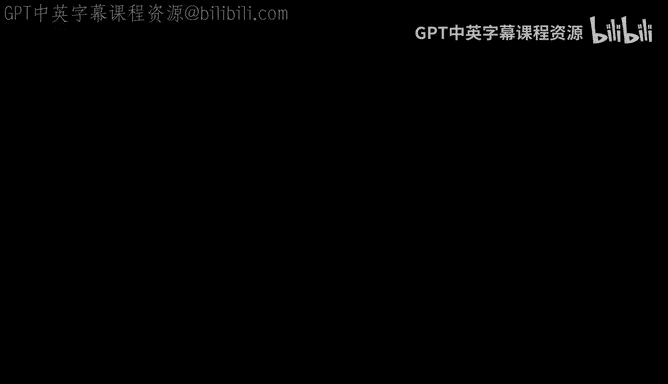

# 斯坦福大学《机器学习理论｜CS229M Machine Learning Theory - Fall 2021》中英字幕 - P3：-03-3_ Finite hypothesis class, discretizing infinite hypothesis space.zh_en - GPT中英字幕课程资源 - BV1jT421r71m

Okay， so now let's talk about math。 So last time where we ended was。

 we were talking about uniform convergence。 So we said that， you know。

 our goal for the next few lectures will be this so called uniform。Converence。

Which means that you want to somewhat prove that with high probability。If you take soup or maximum。

 I guess soup really just means maximum for this course。

 So if take soup over the hypothesis class and you look at the difference between。

The empirical risk and population risk。You want to show that this is small。啊。

In most like with high probability。So， so this is the， the general idea。 And。

 and we said that this is different from showing that。 So this is different。

From sewing for every fixed age with high probability。L height H minus L H。いスも。

So these two are of different nature because one， so the order of the quantifier in some sense is different。

 So one requires that if this event， So with higher probability the event that the entire population risk is close to the empirical risk。

 right， So the other one is saying that you just only look at one single age and you look at what's the probability that this population risk is different from empirical risk and you want to show that this event happens with high probability。

 So， so in some sense， the difference is kind of like a union bond in some sense。

 which I'm going to talk more next when we get to prove this kind of statement。 So。So。

 so this is the， so， I mean in this lecture， we are going talk about two ways to do this。 I actually。

 we are going to talk about two cases about H， right， So certainly this statement depends on H。

 You cannot hope to prove things like this for every possible capital H。

It does depend on the the family of hypothesis you think about。

 and the bond actually depends on the family of hypothesis you are talking about。

 So the first part is gonna be about finite hypothesis class。Where age is assumed to be。Finance。So。

fin。And the next part is gonna buy infinite case。Infinite hypo class。 And for infinite hypo class。

 there are many different ways to bond to achieve this kind of bond。And today。

 we' are gonna talk about a relatively brute force way to do it。 In some sense。

 you do a reduction to the finite hypothesis class。 You know， essentially， every。

 no matter what you do， you are doing a reduction to the finite hypothesis class。

 But how do you reduce to the finite case， you know， does matter。 So in today。

 we're gonna talk about the bru force reduction， which does show some kind of intuition。😊，And。Okay。

 so that's a brief overview of what we're going to do in this lecture。😊，So。So， I guess the。

Let me just， you know， start by。Yeah， let's talk about the finite hypothesis。

And here's the theorem we're going to improve。So there are some conditions。

 So the condition is as like， as we did last time， we call it last time we assume the laws。

It's between 0 and one。For every X， Y， and every hypothesis。This is true for binary loss。 It's 0。

1 loss。 You know， it's not true for every possible losses。 But， you know， if you have other losses。

 you have to do a little bit small， kind of like fixed to make this proof still work， you know。

 but this is not very essential。 It's mostly for convenience。

And what we will improve is the following statement。

 So we say that for every delta between 0 and half。This is not very important either。

 So Delta is a small number。 And you say that with probability。At least。1 minus the delta。

We have that for every age， L had H minus L H。In absolute value。Is bounded by。It's by bye。Skirt。来。

The size of H plus lo2 over Delta。Over to it。And recall that the reason why we care about this from convergence was that it's useful for us to bond the accessories。

 right， So we have shown that if you have this from convergence。

 then you can prove that your accessories is bounded。

 So using what we have discussed last time as a corollary。

We just we also get IO the excess risk of L H hat， H hat is the ERM minus LOH star。

So this is the ERM solution。LH hat minus L H star is less than you。

 you pay a factor 2 in that in that you know durationrivation。 So you multiply the factor2 in。

 So you get something like2。Times。来。Side of H plus lo2 over Delta。Over。Okay， cool。 so。Alright， so。

So this is the theoremm gonna to prove。 And maybe just before we prove the theorem。

 you can see that the bond to the right hand side of the bond does depend on the the size of the hypothesis class。

 right if you have a bigger hypothesis class， than your bond would be worse。

 So so it's harder to prove this uniform convergence when you have a larger hypothesis class。

And if you try to interpret this bond at the end， right So here。

 this is bounded access risk and we can see that you need n to be bigger than the log of the side of H so that the right hand side of the bond becomes meaningful So you want the access to be something smaller than one。

 at least right at the minimum， So you need n to be at least。

Lger than log of the size of the hypothesis。So so that's why you need enough samples。

 to have to make this bond you know meaningful and of course， as N goes to infinity you have。

 you know， you have better and better bound I'm going to have a little more discussion after we prove the theorem。

Okay， so， so now let's try to prove the theorem。So I guess the， the， the outline of the proof。

Is that first， you do individual。OnH。You prove this for individuals， you prove the simple version。

 basically like we discussed the last time。And second， we take a union bond。Over all。Okay， so。

So let's do the first step。So recall that last time we have。done this already for fixed theta。 right。

 So here I'm just doing it a bit more formally。 So last time we actually showed this， right， we。

 we did we use this soft inequality to get something like L Ha theta minus L theta。😊，This is。

 you know， something like on the order of。One of our sc， that's what we did。

Somewhat informally last time with ho inequality。 And today。

 I'm going to have a little more kind of like careful des to get exactly all the dependencies up to constant。

 And by the way， theta and H are the same H is just when you talk about finite hypothesis class。

 right you don't necessarily have a parameter。 You may you may just list all the hypothesis。

 That's why it's called H。 And， and when you parameter you have the parameter。 So， but。

 but for this purpose， they are， they are not different at all。 so。😊。

So let's apply this the last lecture。So let's apply hoing inequality。So， where。AI is 0。 B， I is one。

So the bond is 0 and1。Right， so， and so we guide that for every age in in age， right。

 So suppose this age is fixed and then you draw your sample。 You look at the probability that。

Lhead H。Minus L H。It's less than Epson。And here what's random。 The random is the data set。 The。

 the random needs come from the data， which you know goes into L hat。

And if you use the howney code you get this is larger than 1 minus2 times exponential minus2 n square epsilson square over sum of beta I B minus AI square。

And。Because B I is one and AI is 0。 So the sum of B I is minus AI square is n。

 So you get1-2 exponential。-2 and Epson squared。And right this is because BI is1， AI is 0。And。

So in other words， if you look at the other side of the bond， you look at。

What's the chance that they are different。The chance that they are different is less than two times exponential。

To n minus square。 actually， in many cases， hoing theality was stated in this this way instead of the way that I showed before。

 right， they are， they are exactly same。 It's just complementary of each other。 right you have。

A lower bound for some some events。 Then you have the upper bound for the complementary of the event。

So， I know this is for every age， you have this， right， So， so basically for every age。

 you have a some kind of failure event， which is this event。

 And this event happens with a small probability。And now let's recall that you have the So Union bond。

And union bond is saying that if you look at the union of a bunch of events。Maybe I say K event。

 then they are。Smaller than the probability of the sum of the problem of each one。And here。

 suppose you say the E。H corresponds to the event。That LH H is different from LH。By Epson。

 then you know that the probability that the union of the E I， which is basically saying that。

What's the union of the this further event， basically means that there exist age。

Such that this event happens， right， so。Such the L H minus L H， L5 H minus L H is larger than Epil。

 So this is the。嗯。The the union of all of these events。And it's less than the sum of。那。

Each of the events。Okay， so I know you plug in what you have prepared。 Maybe Is say this equation。

 Let's call it one。So if you plug in one， then you get， this is sum over。The all the Hs。

 and you get two times exponential minus-2 n eson square。So each of these event is small。

 and you you， you multiply by the total number of。The possible events， which is the size of H。

 So basically are two times H times exponential ands to an Epson square。哎。So。And。

 and you can see that this is basically what we wanted to have， because now we have the exist age。

 such that this。嗯嗯。Such that they are different。 So the compliment of this will be just that this is just the equals to。

1 minus the problem here that for every age。The flipped event is true。は。So。By the way。

 I I'm not distinguishing the ladder to equal or like a。In most discourse， like a。So technically。

 I probably should write， this is less than Epson。Right， instead of like less than or equal to Epson。

 But， you know， for， for this part， for this course， like I'm not。

Super careful about this because they don't really matter that much。And in many cases。

 actually the the the probability that you you actually。

 this is exactly equal to Epsilon is actually zero。 So。 So technically， they are even correct。

 But anyway， so so this is not super important for this course。好，So so吧。Right。

 when you so because of this， you can see that this is what we care about， right。

 for every H L head H is close to L H。 And we already kind of getting in there almost right。

 So the only thing we need is to know what this quantity is， right。

 We need to upper bond this so that we can lower bond。On this probability。Okay。

 so now let's choose epsilon， right， so that you can get。So basically。

 you want that you want this probability to happen。 You want this thing to。

To be bigger than one minus thelta。 So that's why you want。This。To be less than调。Right， so。

 so basically we just need to choose Epsilon so that this probability becomes theelta。

 So choose Epsilon。Such that。To H。Times exponential minus- to an epsson square is equal to theta。

And this involves you solve the equation， you know which is not too hard。 So if you solve it。

 you get epson is equals to。I guess exactly what I had before。 So Eon is equals to loan。H plus。

Ln to over deelta over。Over to it。So， so basically， if you take epsson to be this。

 then you know that the probability that。呃，for every。L has H minus， maybe let's。

 maybe let's start with the existence。LH。It's bigger than Epson。 It's less than。呃，A丝。

lesson one lesson貂查。Right， so and then if you flip the event， you get the desired the。

Any questions so far。Okay， so。Let me have a few remarks to kind of somewhat interpret what we have done and compare it to what we did in the first lecture。

So， if you compare。Will compare with the asymptootic results。You're gonna see this， right。

 So for athmettics results。What you got is that L H hat minus L H star。Right。

 the excess risk is bounded by is something like C over N plus8 of one1 over n。

And recall that this C。You know， can depend on。Demon。On the problem。The problem。

 And here you can hide。呃， any other dependencies。Depenencies。On the problem。So， and what we have now。

Is that L H hat the excess risk minus the。sorry， I I hat， not I hat。The excess risk。诶。Smaller than。

So here you don't hide anything。 you had some constant， of course， you had this is low long H。Over嗯。

Over， sorry， screw root。This。And of course， you also have something like of。Scot lawn。

Well over Delta over。So this term is supposed to be relatively small because you can take the autota to be。

 This is a logarithmic。 right， You can take the autota to be something like maybe n to the 10， right。

 So you still get log n over square root log n over square root n， right， So let's say take。

They also to be n to the -10。So then this one will be scrubed log n over scrubbed in。

 which is negligible。Or almost neable compared to the first term。So， so， so basically。

 let's say we ignore this for the comparison， so。Ignore this for the comparison。

 Then you can compare this and this。So you can see that the。

 the the first thing is that we have a worse dependency。dependency on an。Right。

 before the dependency， at least for the leading term， at least in terms of leading term。

 the dependency on n was one over n。 And now it's one over square n。 So it goes to 0 slower。So。

 however， there's no。 So， so this could be improved。 This can be improved。Or in certain cases。

Which we probably wouldn't do at all。I guess in of the homework question。

 you're going to be asked to improve this to some extent。In some cases。

 you can improve this to one over n depending on in various situations。

 but generally I guess you get relatively worse dependence on n in compared to asympotics。嗯。😊，And。

 and one of the reason why this is， the， the reason， one of the reason why this is happening is that。

嗯。Supparty。Because。We didn't assume twice defensibility。Lo function。Right。

 so here our loss function is only the only assumption we have on loss function is between 0 and 1。

 So it even works for like 0，1 loss。 the classification，0，1 loss。

 But before we did assume that the loss has to be continuous and defiable。

 And I think we also assume is twice differentiable。 So that does play a fundamental role here。

 So when you have when you don't have twiceability， we and。

 and when you don't have other assumptions it's very hard to it's kind of like actually impossible to get one over and rate many cases。

So， but here， you know， what I'm talking here is。All about the downside of our new bond。 So the。

 the pros， you know， we actually already kind of like mentioned。 the。

 the main pro is that now we don't have any dependencies about anything。 right。

 So before we report that last time we， when we motivated to have non asymptootic bonds。

 we are saying that this thing could hide a lot of things， right， this could hide， for example。

Something like dimension to the 50。 That's my extreme example over n squared。 right。

 So P to the 50 over n squared will be counted as little one over n。 right。

 So that doesn't make a lot of sense。 justs because if a dimension is too high and this is。

 this requires to be very big to be small， right， So so this， this was the issue。

That we we mentioned last time about asymptotics。 And， and now we fix that issue。

 And that's the main benefit we gain， right， So we don't have anything about the， the dependencies。

 And also， we expect see what' the。HowHow does this depend on the the complexity in some sense of the of the hypothesis class。

 You can think of this as a complexity。The long age。Can be think of for the complexity。

Of the hypothesis。So I guess probably if you have been to CS S 2 now， you know。

 like we have talked about， you know， if you， you can overfi if you have too complex or function class。

 but you don't have enough data。 And this is， in some sense。

 the mathematical characterization of that right， So if your function class is too complex so that the log log of H。

It's too， too big。 And， and you don't have enough data compared to log of H。

 Then you may have a worse bound。 And on the other hand。

 suppose your log of H is small and your N is bigger than log of H。 Then you have a a better bound。

 which could be meaningful。Okay， any questions so far。好多是。不。我对。可者是。We are doing。 Yes， you you no。

 this is the the different of the loss function。So the loss function is the function of。

So the loss function is a function of you know。Depending on how you think about it But by by the differenti。

 I， I really mean this function that takes in why hat and why。And output the scalr。

So taking the prediction and the real label and the optical scalar。

 So whether this function is defiable with respect to why and why h。

So we didn't assume that this function is differentiable here， but implicitly。

 you are assuming that this loss function is differentiable with respect to y by height in the previous asymptotic analysis。

 because there actually we assume the whole loss function。

 even you compose it with the model has to be differentiable。不。嗯对。嗯。不知道。I didn't hear very。35 number。

Use like the same ball。For， for practical implementation where you have floating。Once。嗯，对。不过。过程在。哦。对。

So， so I guess my interpretation of the question， maybe let me refresh the question a little bit。

 Also for the Zoom， people on the Zoom meeting。 So I think the proposal is that for example。

 if you really have a practical model and you have like a P parameters。And they are， you know。

 when you really implement this in computer， it's not continuous， right， So you can。

Think of like each parameter is described by， you know， maybe 32 B。

 And then you can count how many total possible number of different models they are and apply this spot。

 right， So， yes， and that's a good idea。 And and that will give you what that will give you that suppose you have P parameters。

😊，Let's say you have 32 bits。So one bit is。 So then what does it mean。

 that means that the total size of H。Would be that for every P parameter you have two to the 3 or two choices。

And you multily that to P。Right， so you， you， you take the risk power to P。

 And so that means the log of H。It's equals to。Something like 32， like O of P。

 right is's a constant times P。So basically， you going to get a bond that depends on number of parameters。

And and this is a this is reasonable in some， in some cases。 This is you know。

 not very reasonable in some other cases， but definitely is a， it's a pretty it's a， it'。

's a's a bond that that makes sense。RightSo in some of the later part of the lecture。

 we are going to see how to get a bond that doesn't depend on parameter。

 but if you are fun with getting a bond that depends on number of parameters。

 then this is indeed a good bond。And， and this is actually actual natural question that leads me to the second part of the lecture。

 today's lecture。 So， so this is a proposal where you the proposal to do this。😊。

Has a small cons or small problem， which is you basically have to say that I have to resort to。

Practical implementation in practice， I cannot really implement real numbers， right。

 all the real numbers。 I have to discretize in some way， right， So that's in sometimes。

 you put a additional restriction on yourself saying that， you know， if I can only use like。Like a。

 like a floating points then what bound I can have。 right， So what I'm gonna discuss now。

 right next is that you don't even need this。 You can even say that even for all the possible continuous models with。

 you know， suppose you have P parameters and each parameter is really a real number。 Like you can。

 for example， suppose you have automaticy computer， which can have like。

Infinite precision Still your bond would still look like something like this。

 You still have O P bond like a so， so， so then you don't have to like， suppose we。

 we have that infinite。Like hypothesis class proof。

 Then you don't need this practical kind of like a kind of like a like this this。

 this way of proving that， right， You can have a more genuine， stronger way to prove it。

 And that's what we're we're gonna show。Okay， cool， so。Okay， so maybe let's， let's。

 let's start to do that。 So let's talk about infinite。Hpo code。And as I suggested， you know。

 a little bit before。 So we are gonna have a bond that looks like P over N square root P over and and P is number of parameters。

 So this is something we're gonna have。Okay， cool。 So， and。So。

 so today we're gonna do this so called like a Bo force。Disquization。This is a technique of。

 at least this is how I name this technique， I guess because this technique is too too brutefor。

 I guess there's no really real name for it。And what you can do is the following， so。Maybe。

 maybe yeah， let me state the the that're gonna to prove first。

 And then I can tell you on what's the intuition and how to prove it。 So。

 so this is a the of suppose age is。Okay， I guess I'm still setting up。

Suppose  H is para much less by。第首。In P dimension。So H is， you know， mathematically， you write。

 H is a family of H subsator。 H H subator is a parametricized model。Where theatre is in some。

A set of theta， which is a subset of RRP。 So capital theta is the set of parameters you are gonna to choose from。

And in sometimes， this is for convenience。 So， but I guess you probably wouldn't see why this is only for convenience。

 you know， but doesn't really matter。 So suppose you only select models from this set。Where you。

where your normal of the the model is bounded by B。

Our dependency on B will be very will be the only logarithmic。 So in some sense。

 this is not really real restriction。 right you can choose B to be pretty big just because your dependency on B is very。

 very relaxed， where it logarithmic in B。So， so this is our setup。And。Also。

 let's recall that we sometimes gonna use this notation。This is really， you know。

 we you use all of the insert in。Exchangeably， so。Either this is really just a loss of theta。

 the model theta on on the data point X and y。 So it's really just you compare each theta of x and y and you get a loss right。

 these two are just the same thing。 Like we are a notation a little bit。

 And also recall that we have L theta L high theta。 This is all， as we define before。

And so here's the theorem。😊，So we still have to assume that the loss is between 0 and1。

This is probably always assumed in most of this lecture， most of this course。For every X。

 Y and theta。And suppose。This is additional assumption。Will you assume that。

This loss function is caipses。In Seattle。So。So， for every。X and Y。 So what does this really mean。

 This really means that you're assuming L of X， Y。Theta minus L of X， Y。A set prime。

 If you change your model to set prime。Then your laws wouldn't be deferred by。

A constant time say sentence minutes the prime into north。So maybe this is Kaa。So， okay， so again。

 this。The our dependency on Kapa will also be logarithmic。 So in some sense。

 this is also not assuming much。Like， because if you。If your loss is kind of con somewhat continuous。

 then you。Then you can have， it's gonna be Liious， you know， to some extent， right。

 its probably the Lius constant is not very good， but the lipus constant would be something reasonable。

 And if you take a logar rhythmithic of it， it's not very sensitive to the Liious constant。And then。

With this， then you get。With probability。At least。1 minus。X of e to the minus P。

 So actually you have even higher even lower failure probability。

 The failure probability is e to the minus p。So with so small failure probability。

 you get that for every Satan， you have the uniform convergence。

It's less than some big O of skirt roots。 P over N。Times max。玩。嗯来。Kappa B and嗯。So。So一般出嚟嗯。

The dependency on carbon and BR log rhythmmic， That's what I promised。

 And the main thing is really P over n。 So you get the。

The parameter dependency and the dependency on。And you still have the growth here。

 So this is still worse than the asymptootic bond。 if you compare with the leading term of the asymptootic bond。

But as we said， you know， you don't have the second other term in the asymptootic box。Okay。

 so how do we， how do we how do we prove this。So actually。

 the proof is very similar to what the what was suggested in the question。

 So you are doing a discreetization， and then you deal with the the disreetization error separately。

So， so what you do is the， the following， so。Let me start with a kind of a sketch in some sense。

 So the， the， the， the kind of the outline sketch is the following。 So you define E theta。

嗯Be the event。That you have this failure event， right， L has theta minus L theta。

It's larger than Eson。 And Epson is gonna be something TD， but Epson would be very similar to。

To this thing， right， Because you care about whether these two are different， right。

 How how like a this much different。 But anyway， So absolutely some number that is kind of like a placeholderer。

 So you care about this kind of event。And we know that this will be a small probability event right。

 as we have shown for the final case， right， So this E Seta is a small probability event。😊。

And before we call that， what we did is that which we say that the union of this E Theta is less than the sum of the E theta。

The problem of E。But now， because you have infinite theta， this is infinite。

Because each one has some， you know， small problem event， right， So to fail。

 And you take the sum over all possible events， then you get the in if number， at least。

m like like each of these will be some epsilon， and you take the sum of infinite of things you get infinite。

😊，So that's why it doesn't work， right， you can use exactly the same thing as before。So， but the。

 but the reason why this is， this can be fixed is because this union bond is very pessimistic。So。

 so if you think about union bond， right， So union bound is really just saying that， okay。

 I guess I'm not sure， depending on how you learn union bonds， you know， in in previous lectures。

 like what I learned about union bond is this following。 For example， you have a。

 this is the full probability space and each。Evan takes some part of space。 Maybe this is E Theta 1。

 This is E1。And this is maybe E2。 And the optimal， the when the un bond will be tight， It's， it's。

 it's when all those， all of this event。I call they call them failure events。 All of them are disint。

 right， so。Right suppose this is the case。 then the un of these events will be the sum of the probability of each of the events。

But。Here is not clear whether this event are distortt and actually may have a lot of overlap， right。

 So you have one theta。Very so Eta。 And and if you change your to your nearby theta。

 you probably have something like this， which is Eta prime。 And they have all of this overlap。

 And then your union bond starts to be very loose。嗯。So， so， so， so that's also kind of motivates our。

 our way to fix it。 Our， the way that we fix it is the following。 So we。Fix it by。

By first picking not all， we don't take un bond over all possible events。

 We select a subset of events， and we take un over them。

 And then we say the other events will be close to some of this， this subset of。Ptotyical events。So。

 so basically， the idea is that you， the rough idea is that you selected some。

Flalect prototypical events。Prototypical， sorry， like just maybe I should just say typical events。

 or you just take some exemplary events。 I I don't know how to。 I forgot how to spell that。

Some example events。 And this is subset of events。 you is a smaller set of events than what you finally care about。

 And then you use union bond on this subset。😊，And then you say that other events。

Are similar to the subset。For the examples。So， so then you， you cover all the events。

So that's the the rough idea。So let's see how we exactly do this。 So to exactly do this。

 we need to introduce something called。😊，Any questions so far。Okay， so， to exactly do this。

 we need to introduce something called disc created Epson cover。

 This is actually also a useful tool for other cases as well。So。😊，Let me。

 let me first define this Epson cover， and then。Say， why is。

It's kind of like it's a language to describe what are called prototypical events or prototypical kind of like parameters of models。

So， so Ab night。Sometimes it's also called Epilon night， sometimes it's called Epson cover。Of a set。

S and here S corresponds to the family of all models you care about and you care about a subset of models。

And if you're this and with respect to。Like when you really define it。

 you have to specify metric row。Row is a set。C， which is often a subset of S。

 but I think technically don't have to require C to be a subsetid of S。

 But I think in almost all cases， it's a subset of S。Such that。For every act in us。Right。

 so there exists a。Can a neighbor in sea。Which is close to x。So。If you， if you draw this。

 it's kind of like。You are saying that you have a set。Of models or parameters。 This is called S。

 And the Epson cover is a subset of S， right， So as you select some points。

 and let's call these points。其实 o in c。And then you say that this set of C needs to satisfy the following to be an eon cover。

 So what it has to satisfy， it has satisfy that for every point you pick in x in S。

 right you pick this point X in S。 There exist a neighbor somewhat con neighbor in C， right。

 Let's call this x prime。i guess sorry。ACcross and X seems to be the same。

 I'm not sure whether maybe I should。Anyway， you see what I mean， like the。

 the purple cross is just indicating a point。 But okay， so you have a point X here。 and， and you。

 you， you can always find some other point in C， such that X prime is kind of close like。😊，So， so。

 so that's basically saying that all of these points in C are protypical kind of points because every point in S can find a neighbor in C。

Good make some。And equivalently， you can also write this in the following way。 So equivalently。

This is， in some sense， more。ExExing why this called Epson cover。 So equivalent。

 you can write this as the S is。Covered by the union of the ball。Around all the X。

Yes let me write it down and explain what is this。 So first of all， this is the。

 So this thing is the ball。Surt。At x。With。Rius。阿普龙。And distance metric or magic。肉。So， so basically。

 this is saying the following。 So this is the equivalent definition of the Epson cover。

 So you are saying that if you look at all the the balls。Around all of these purple points。Right。

 so this is the the radius is absolutely。 So in some sense， you can say that this ball。

 So this point covers the entire ball because for every。Point in this ball， you can find。

 you can use the this point， the center as the neighbor。 right， So， so basically。

 every point covers some part of a space。And so the。

 the requirement is that if you look at all the points that can， if you look， like。

 if you look at the， all the balls around all the centers。Then this route cover the entire S， right。

 That means that every pointing S can be covered by sun ball。

 And that means every pointing S has a neighbor in sea。Any questions？应该条第款。C。C C might not be。

 we will in in in some， we will insist that C like， we will need to find a very small cover C。

 which is finite。 And also， hopefully we want the size of C to be small。 But by the definition。

 there is nothing about whether it's finite or not， but we will construct Epson cover that is finite。

Right， so this is so far， this is on a definition。Saying that C is absent cover of S。Yeah。

 but we will make try to make C to be small。And this is actually exactly。嗯。So。

 so this is exactly what you're gonna do next， right。

 So how do we construct a set C that is finite and also cover the entire set， right， So what is X。

 right， So for us。S is the set of all parameters， right。

 is's the set of parameter Theta with this L2 norm less than B。

RightYou want to construct a subset of parameters that can cover all the parameters。Right。

But here is a lemma that says that you can do this。And you can have vitamin and C and also actually。

 you can have a reasonable bond on how many Cs， how many points in C there are。So。So let's。

 let's define this to be， I guess for this lemma， I， I call this theta。 So， so。

 so theta is defined as as above。 So for every epsilon。In0 and B。嗯。For every radius。

 there exist on Epson cover。Of the says theta， the L2 norm with redSB。Such that with。At most。

3 B over epilson to the power P elements。So this is a cover and the size of this cover is bounded by 3 B over e to the power P。

Okay， so。So I think this is actually， we're gonna prove a weaker version。

 The full we're gonna have a homework question， which kind of guide you to prove this exactly this version。

 So for now in the lecture， we're gonna prove a weaker version。😊，Which is somewhat easier。

So this weaker version and also actually suffices for our purpose right。

 so like you don't really necessarily need a stronger version to prove the final theorem just because this like the weaker version is only weaker by a little bit。

So。I guess the homework will guide you towards the stronger version。

 which also introduce some techniques， which is useful。So so here's the weaker version。

 the weaker version is pretty much like you discreettize your own computer。

 right you just do a trivial discretization。😊，Uing some break。So what you do is you just take C。be诶。

A your great， in some sense。So what does that mean， it really means that you have this ball。

Any sweater。I guess if you have this ball。And you just say that you take that some arbitrary kind of like a coordinate system。

 you just take the natural coordinate system。And you discretize your space like this。

And then then you take all the the this kind of points as you'll see。And that's it。So。

 and then the question just matter of counting and how fine fun your grade needs to be。So formally。

 so C is taken to be out the points X。In R P， such that。X， I， the coordinate。

Is a a multiple multiple， I guess this is K。K times。Epson over square P。

 So Eson over square P is my great size。And K is the the integer multiply with it。For some integer。

K will K。Is smaller than B squared P over Epsil。Why I have this constraint on K。

 Because at some point， you don't need more points because you already。

You don't have to do anything beyond this part， right， it because you know if your case is too big。

 you are the outside ice and there is no point。So， and if you do the calculation。

 this is the rising thing。😊，And。Right， so now we have to do two things。

 One thing is we have to see how large C is。 And second thing is we have to prove that this is an eson cover。

So let's do the first thing。 So why this is Eson cover。

This is because if you look at any point X in S。You just round it to the nearest nearest point。

 right， So， so when you round it， you run it to， so you do some rounding。诶。See。

 I guess when you run it， you want it to。Let's call it X prime， right。

 Let me not write exactly what the roing。 You know roing really just means you take the any any vertex。

In this great and and wrong， the nearest， any reasonable nearest like what mean like you just to do。

The， the chip you run it， Let's say you run to a smaller number。 It doesn't really matter that much。

So， so if you run it。 So what you got is that x。I minus X I prime is less than。Epon over square P。

Because for every dimension， when you run， you in， you create eson over square P error， right。

 eson over square P is your grid size。And that means that the distance between x and x prime。

In the L2 sense， right。Like this is， I guess。Sorry， I think this is。 I should mention that the role。

L toor， the road。This， yeah， I should have motion this。So the metric we are using is role is L2 norm。

So， so then you look at the L2 norm of these two two things， right so。This is the song of。

X I minus X I prime。Square i from1 to P。And then you bound each coordinate。

 you get p times epson square over P square root， which is Epson That's actually why I chose the grid size to be epson over square P。

Just because I want to to make it up。So this proof that is the Epson cover。Right， so。

 and also we can count how large sea is。So C is what C is something to the power P。

 because for every coordinate， you have a bag of choices for K and how many choices for K there are。

Basically， this was in here is like K。 The absoluteps value of K is less than B square P over epson。

 right。 So basically， you got。B square P over epsilon。 And because you can be positive and active。

 that's why you must buy2。 And you can also be zero to you， you add one。

 So that's that's the total number of choices。哦 you see。Right， so， and。

One common is that eventually only logy matters， as you see。

 So logy will be P log2 B square P over epon plus one。

And that's why this weaker version is not super different from the stronger version， because。

The difference， right， So the stronger version was。The stronger version was。

3 B over epson to the power P。And the log。Becomes P log 3 B over Eson。

And if you compare the stronger version with the the weaker version。

 the only thing is different is this square P in a log。

 So that's why it eventually it doesn't change the bond too much。嗯。Okay， cool。

 So this is our proof for the， the weaker version of the dima。And now let's。

 let's use thislemma and the the Epson cover to prove the。The final bond， right。

 So as we kind of like a plant， what we do is that we first apply。嗯。Apply finite hypothesis case。啊。

啊嗯。The final hypothesis in analysis。to四。And then you say that。Then you somewhat。

 So this maybe I say this is number one。 And then you say that。On extent。1 to the whole set as。Okay。

 so the， the first step should be trivial because we already prove it， right， So。

 so if you want to do I， then basically you got that。If you。

The first thing is that you you do it for every fixedta in C。Then you have probability of this。

S than epsilon， if you use hoing quality， you get this is， I guess let's call it Epson tilde。

 because this epsilon tilde will be tuned to be decided later to make the the bond fit。

 So you get this is two times exponential minus-2 an epsilon squared squared。This is by hoing。

Exactly the same thing as we have done before。And then you take a unit bond。

You you got that probability that for every theaterta， I guess。There existence。睇到完诗。

Such that this is not right。Is small。And how small is you multiply C with this。

Exncial minus-2 and Epson， Theyota squared。Okay， so these two steps are exactly as we did and。

If you flip this， you got。You get one minus probability of。The goods。

Event happens with high probability。I'm just flipping。不。Okay， so now we have to do the second step。

 How do we extend this to for every in us。And嗯。So， second。And we are basically using ellipesness。

And you can see that this is， you know， not really anything super clever。

 it's kind of like a some blue bridge force。😊，Right， so， so。Okay， so just for some quick preparation。

 So because L X theta。Is。Carupon lipses。This is Ka。Lpss。In theta， it's implied that。L set and L has。

Are both couple elyses。Why this is just because， you know， if you average to function。

 to look couple optionss function， there are still couple optionss， right， so。If F is car elyipses。

She is couplelyses。F plus g over two is also couplelyses。

And you can prove this by a simple triangle inequality。And you can do this for multiple functions。

 not only just two functions， you can do it for n functions。Okay， so suppose we have this then。诶。No。

 so we， we， we also know that for So suppose we know for everything， so。

We already know that for every theta， right， So I has theta minus。

 So suppose we condition this event。Right， so， so with some chance， you know。

 with a very high poverty happens。 And suppose this happens， Let's condition this event。

 we won't prove that the same thing happens when you replace C by fate by S。

 right so this means that。If you have， for every seat in。I guess I call it capital C。

 but not S capital Cta the ball。You can find。Com 0 in C。Such that theta minus theta 0。

Now two is less than Epon。 This is by the definition of Epson cover。

 right C the Eson cover of capital theta。 That's why you have this。And then， this implies that。

L set minus l set0。It's less than couple times Eil。 This is biipciousness。Right， so。

And so in some sense， you just use see 0 as a reference point。 right。

 So you what you finally care about is L head datata minus L。Sorry， I guess you also know this。

 You don't only know this。 You also know。I will have it minus L。H a0。It's less than Kpa times epsil。

 This is also byipes。Okay， so and now with this two， you can。

 what eventually you want is you bound a difference between L has theta and L theta。Right， so。

 and we have seen this kind of triangle inequality， you know。

 this kind of like a manipulation already， right， because， you know， eventually you。

 you care about the difference between L head and L。 But you use say that zero。

 some reference points to kind of bridge them。So you， you do this。Thecomposition。

 you say that this is L h theta minus L hat00。Plus， Ill has0。Minus lta0。Plus， L 0，0 minus l theta。

And now， these two things。Are about differences between theta and theta 0， so。

This quantity is less than car times epsson。And this quantity is also less than car times epsil。

And this quantity is less than。Epson。This is because theta 0 is in C， right。

 So we have already proved that for every theta in C， you know。

 Lta theta is equals to is close to L theta。😊，So， so that's why we got these three inequality。 right。

 So， so in total， if you look at absolute value。Then you can do the tri quality to get the absolute value of the sum of the sum of the absolute value of each of them。

 You get two couple times Epson plus。啊。Abs， Eon Tu， so sorry， this is Epon Tudo。Because recall that。

 I use a different eson for the for the concentration， just so that I can tune this Eon tode一。Okay。

 so and if I know it's the time to sight。Epon to be Epon toda over two copper。

 or maybe you can do it under we want， like Epon2 to be Eon times 2 copper。Then you get。

You balance so so that you balance these two error terms。 So you get this is less than。呃。To up跳的。

Okay。So。ok。诶。Alright， so now let's look at the。嗯What's the。Let's go back to here。Right。

 because here there is something about cover size we havent deal with， right。

 We have to plug in the right cover size。So， and what is the cover size， So the cover size was。

So lock cover size。诶乐师。Is equals to log。3 B over Eson to the power P。

 And I have already said Epon to be epon Tiilde over two couple。 So I need to plug in that。

 So I get P Oh， let's first get this。 And then let's plug in the choice of Epson Tdo。这个P log。three。

比 car absent的。And you can see that Ka is inside the log。

 so that's why it's somewhat not sensitive to the choice of Ka。

 and also Epon Tiltor is also in the log。So which is also nice。嗯。

And and now we have to care about this failure probability， right。

 So we basically want to say that this is equals to some like the something like。Delta。

 right so we want。To bond。The failure probability to see exponential。us2 n epon tuor square。 right。

 So this is something wrong about。 I want to show that this is small。 Actually， in this case。

I'm hoping to show that this exponential minus P。Okay， so。Okay， so， so how do we show this。 And it。

 of course， it depends on what Epon tilda is， right， So you need to choose the right Eon Theilda。

 such that this is true。 And then that's your final， basically your final bond。

And so to get some input。 So you're gonna see that this， you know。

 the exact calculation of this is going be a little complicated。😊。

But just to get some intuition here， right， So suppose。嗯。Suppose， so this is a heuristic。

 which is not not even technical correct， but it's， it's approximately correct。So， suppose。

Like optimistically， the log C is equals to P instead of P time instead of。P times log 3 B Web。

So we be of our absentut them。So suppose you just have P。 you don't have the locker。 Actually。

 this becomes a very simple calculation。So， so what you got is that。You got。嗯。So basically。

 if you take the log of this desired inequality。You want that。嗯。没事。If you take the log。

 you get a log2， which is not super important， you get a log two times log C。

inus2 n epson tial square。 and suppose log is equal to P then you get to P minus2 n epson square。

And if you take Epsilon。T to be screwed P over n。Then you get this is equals to。呃。P minus。酥皮。Right。

A equal to minus P。Right， so， so which means that2 C exponential minus2 an epson score。

 If you take the exponential back， you get this is less than。エスパナーションマイナスピー。So， so this is a。

This is fundamentally how it works。Okay， but we did make this though。

Incorrect assumption that log C is equal to P， but this assumption is not very far， right。

 So it's only off by a log factor。 So if you want to fix this， you know， technically。

 you need to deal with the log factor， it wouldn't change much。

 but it would introduce a little bit kind of like complication。

So I did have the the calculation here。 I'm just gonna basically write it。rite it down。

 but I don't really expect that you follow all of this。

 It took me like one hour to even figure out all the constants so and so forth。

 It's not super important。 I think the intuition is already there。

 So but let me just quickly write this just to say what you do formally。

So if you suppose lockx C is equal， you only have this bond， right， So this is what we only have。

This is 6 B couple over Epson Tda。And then， let's take。Absolute to be。Square root。

 some constant times P over n times max。 This is actually this epom till is actually the Ep is the bond。

 is the final bound。 right， So that's why you're gonna see。And off the same thing。

And then final bond。 And C 0 is a sufficient， large constant。C0 is a sufficient large constant。

 which we'll choose in a bit later。So， and， and you plug in all of this。 And you just again。

 you take the， you look at the log of the inequalities we care about。 The log of it is this。

And you plug in this choice of C。 you get P log 6 B。Co over E Ti的。Mus2 an epon Taylor square。

 and you somehow know that if you don't ignore this log， it's already work。 It's just。

 if you have the log， you still have to deal with it。So you get。Something like P log。

 I'm not even sure whether， I really have to。rite down all of this。

 But just in case some of you want to。Have this hardcore calculation。好大家。Right。

 so you get this and then。二。Somehow， I guess this， the first term becomes log 6。The couple。

 you expand the first term。Srt C 0 P。I guess I decompposed this into。

That' I' decomposing the first term。6 over，0 p。Mus C0 p。老卡帕比。

I guess you know the way that I always kind of think about this is that， you know。

 when you do the calculation， you always send it to check with what happens if you don't have the log right So what if you don't have the log。

 then this term is a large constant times P and this term is P， So that's that's why it's nice。

So eventually you can if it takes C to be something like32，36。

 I think you can show that this is bigger than this one。And this one， I think， I guess I。

And this one is connected when P is an large。And then you got this is less than minus P。

 I guess the exact calculation， there is some more detailed calculation than notes。

 but it doesn't matter that much， right， so。😊，So that's， that's what we do。 So then basically。

 this is saying that if you take exponential， So you guys。Of this inequality， you get to see。

Exponential minus-2 an Epon T square is less than two times exponential minus P。

 So this is our failure probability。So basically with this probability。

 So with probability larger than one minus of e to the minus P。我 have l has setta minus l c。

It less than two uppson tu。Which is this。整日会啲会。We want it。II mean， not just not copy it again， so。

Okay， cool。 So， so that's the proof。And。This proof is a little messy。

 And this is probably what one of the reason why if you open up a classical machinening book。

 they would， they typically don't show you this proof。 So it's just because it's a little messy。 but。

 but actually。The reason why I always try to show this proof is that I feel like it's very intuitive。

And it demonstrates what's really is going on。 And， and also。

 this kind of things is actually useful for many。For money reason works， if you looking。

 if you look at your technical， low level details。 So。

 so the fancy rather market complexity thing that we are going to talk about next。

 they are very nice， but sometimes you don't apply。 And you have to really use this。

 You go back to the most force way to think about it。Right。O， so maybe just。A few quick comments。

About this proof。I guess if you really think about this。

 this is really saying that you have a generalization error。😊，Right， so it's less than。The log。

All this access risk， right。Up to constant factor of course plus epson to the K。So。

 so this part is from the finite hypothesis。 and this one comes from the this is not， this is Ka。

So this is the discretization error。And this is the finance。Hpo case。And in some sense。

 you are just trading all of these too。And， and what， what does it mean by treating office， too。

 It really means that what apps you choose。Right， so this one depends on Eil。So。

 so this one depends on Epson， but it depends on E in a very weak way because it depends on E in the log。

By logarithmic。 So that that make it， you know， very easy to trade off this because you can take epson to be quite small。

 So that this term becomes small and this term。This depends on sorry， I think technically。

 this should depend on log one app。RightSo the， the smaller eson is the better the second term。

 but the worse the first term。But the first term increase as epson goes to 0， very slowly。

So that's why you pretty much can ignore the second term in some sense。

 just because you take epson to be very small so that the second term becomes ingligible。

And even when those for those small apps on the first term， is still reasonably bond。

And that's why you can make this trade off really nice。But in some other cases， you know。

 as you will see in the later case， right when you do disretization。

 the first term wouldn't be as nice as this。 It wouldn't be log one of Eson。

 It would be something that goes to infinity as epson goes to 0 in in a faster rate。

 So it will probably you know， in the later case。😊，Later， sometimes this。

 this first term will be one of Epson square， then the the tradeoff will become a little bit more tricky and you have to be more。

嗯。More careful about the trade off。And finally， just for kind of like。

 this is a kind of probably all overview for。😊，嗯。Just is like a kind of like a from a some of the birdest view where so log age。

Or P in this case， right so。Or the the P， you can think of this as complex measures。

 I guess I've mentioned this。As well。 right， So these are complex measures of the hypothesis class。

So and， and the general like a phenomenon is always like you have a bigger age。

It means that you need more samples。This is always like you have worse bounds。

 which means you need more samples to learn。And， and in some sense， the the next one or two weeks。

 we are talking about。嗯。A more。Accurate。I guess actually may not be the right word， like a more。

Fagrant hypothesis， more f。Complex measure。 So， so what are is the right complex measure。

 There is no really。A super decisive answer was the right complex measure。 In some sense， it's up to。

 up to the， the theorem prover in some sense。 So， but we're gonna have a more fun green and more。

 in some， fundamental complex measure in the， in the next two lectures。

 which is called rather marker complexity and。And you can use that to derive many of these bonds you。

 in a more principal way。 So， and in general， I think one of the important question for。

 especially in the somewhat classical statistical machine learning is to find out what's the right complex measure for your hypothesis class。

😊，Right， so we're gonna discuss， you know， what does it really mean by right and wrong。

 Like there's no unique answer， right， So， but， but there are some kind of like。

 but this is kind of the， the central question， right。

 So you need a complex measure that really captures the。

The fundamental complexity of this of this class。 For example， if you have infinite about the class。

 right， So you shouldn't use log H， log H is not really the fundamental complex measure for infinite about class。

 You probably should use dimensionality probably in the later of the course we are gonna see you can use the norm of your parameters as the as the complex measure。

 So， and and it does depend on the the the specific cases。 And also sometimes depends on data。

 So this will be what we discuss in the in the next few weeks。

I think this is a natural place to stop。Yeah， okay， I think that's all for today。

