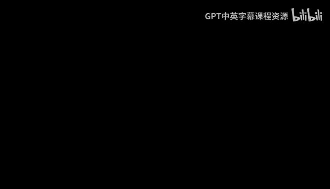

# 斯坦福大学《机器学习理论｜CS229M Machine Learning Theory - Fall 2021》中英字幕 - P4：-04-4_ Advanced concentration inequalities.zh_en - GPT中英字幕课程资源 - BV1jT421r71m

So。So last time in the last three lectures， we have talked about the。

The kind of the basics of uniform convertgence， I guess just a very quick review， so。

I think we have proved that the excess risk。This is in lecture 2， is bounded by。This。

This is the difference between empirical and population。 Can I sharing your screen to。 Oh， right。

 thanks。 Yeah， sorry， I forgot got。Yeah， thanks for reminding me。 It's gonna be a problem。反复告对不对嗯，好的。

ai， I didn't join the zoom meeting， yeah。Sorry。Okay， cool。 I guess now probably It's working。

Thanks for reminding me。So we have shown this。系 so this is a。

What we show in one of the claim in the lecture too。

 So basically this is saying that you only have to bound the difference between the population and empirical for all data。

 right so the most important thing is the second term， because the first term we have shown that。

It's close to it's something bounded by one verse sc so so the goal is to show the second term and we have discussed how to do it for finite hypothesis class and also how to do it for infinite hypothesis class to get with a relatively bru force discretization technique。

😊，And so， and in the next few lectures， I guess we are gonna， as I kind of like mentioned before。

 So we're gonna have some other techniques to deal with the second term so that we can have more informative bond。

And today， we are gonna take a small， in some sense， a small di or in some sense。

 a small preparation for some of the tools that we're gonna to use for the next lecture。 So。

 so in the next lecture， what we're gonna do is that we are gonna bound the expectation of this。😊。

So this is the next step， sure。And， and this is expectation over the randomness of the the data。

 right， So this quantity itself is a random variable， right， So because it depends on the the data。

 the training data you have， because L had depends on the training data。

 And next time we're gonna offer on this。 by some quantity， which is called rather mark complexity。

And so today， we're gonna do something that is useful for。 it's a useful preparation for doing this。

 I guess， so， so， so I guess here is the， the plan。 So next lecture，'re gonna do this。

 And then the next， the lecture。😊，We are also going to deal with the difference between。

This and its expectation。So so that's the， that's the plan for the next lecture。 So， and today。

 what we're gonna to do is we're gonna have some tools that。

Prepare us for proving quantities like this。And so that next time we don't have to kind of have a。

 have a small section dealing with the tool in the middle。 So， so。

 so I'm trying to kind of kind of prepare us with the， the right tool for the next sector。

So a more concrete overview is the following。 So the， the。

 the goal for this lecture is the following。 So suppose you have some random variable。X1 up to X。So。

 they are independent。And random variabless。So we， we are gonna to show two type of inequalities。

 So the first type of inequality is to show that。If you take the sum of these kind of random variables。

 they are。Concentrated around the expectation。 This is。Basically。

 half inequality is one type of space inequality。 We are going to extend half inequality to something more general。

 And second thing is that we are going to show。That for certain， for certain。Type of function。F。

 if you look at a general function， not necessarily just the sum of this random variable， Of course。

 you have to have some restrictions on what the functions F will look like。

But suppose you have the right restriction。 Then you can show that even you have a function of x1 after to X N is still concentrated around the expectation of this function。

And this will be particularly useful for showing this inequality。 Maybe let's call this。I hear。

 So because you can。呃。In some sense， maybe， maybe just the see one， you know。

 this corresponds to L high theta is close to L theta because L high theta is of the form like X 1 of two。

Plus x2 up to X， right， L theta is the expectation of LH。

And the second type of inequality will be useful for proving what I said this equality one。

 So because if you care about something like this。Is roughly equal to expectation。This is our hurt。

So then you can view this entireing as a function。View it as a function of your data of of your training data。

 of your ID training data。 So this is a function of x 1 up to x N。Where these are the training data。

So， so basically the， so these kind of inequalities are called concentration inequality。

 The key kind of like idea is that if you have a family of I D random variables， then。First of all。

 if you take the sum of them， they become like Gaussian。

 and they become concentrate kind of like Gaussian life。

 And they concentrate around the mean of this song。 And。

 and this the same thing also happens if you apply certain kind of functions on X。

 I will tell you what kind of functions will have this kind of properties。 And。

 and this kind of beequ， you know， not only useful for what we are gonna do next。

 but also generally pretty useful for。😊，For machine learning， like for statistical learning theory。

 because in some sense， if you think about， you know， what happens in learning theory。In many cases。

 basically you are trying to deal with the difference between empirical distribution and a population distribution right so these kind of things would show up in many。

 many different cases， and that's also one of the reason why I kind of like isolate this part as as a single lecture to talk about a technique if it's just some kind of like a tool that is only useful for one lecture then we can just invoke that as alemma but here I think is' more useful than that So that's why I want to can also show you how to prove some of these things and also what what kind of the language I'm not gonna to prove all the inequalities I'm going to show today but I'm going to talk about some of the advanced version of inequalityities so that you know that they exist then when you need to use them。

 you can kind of find the right tools。So that's the overview of the lecture。So。I guess。

 so let's start with the simple version。 right when you have a sum of independent wedding variable。

 and we have discussed this before about the in the， in the context of poverty theality。

 I'm going to have a， you know。Kind of like a a more kind of comprehensive discussion about this。

 So let's consider you have running variable Z， which is equals to some。Of x1 up to X。Right。

 Xs are independent。And so， so the a warm up is that。

What if you don't ignore what what the structure of Z is， right？ So obviously。

 you know that Z is the sum of independent random variable。 What if you ignore the structure。

So what if we ignore the structure？So you still have something that you can show you。

 you can still have some inequality that can show that Z is close to the expectation。

 So here is the inequality， which is called championship inequality。啊。

I think probably you heard of this， you know， in some of the probability class。

 So the inequ court is saying that the probability that Z deviate from the expectation of Z。

白 someone么 mon tea。It's less than this thing。The variance of Z over t squared。

So it's pretty intuitive， right， So if the variance of z is small。

 then you have less deviation from the expectation。😊，And of course， if T is bigger， right。

 if you look at a bigger window， then its there's a small probability。

 smaller probability outside the window。Right， so in some sense， if you draw this。

It's something like suppose you have a distribution that looks like maybe this and the mean is here expectation of C。

 and what this is saying is that if you look at the standard deviation。The。😊，Right。

 so suppose you and you look at this， then deviationviation。And suppose you take T。

To be something like standard deviation of Z times one over square delta。

 You plug into this inequality。 What you get is that the probability。That you will deviate。

But this T is less than。 Maybe let's just write explicitly。

And deviation of D over square root delta is less than。嗯。调查。Right。

 so this is saying that if you multiply standard stand deviation Z by some quantity by something like here。

 So suppose this is。So deviation of C times one over square root delta deelta is less than one。

 Then the probability in this tail。It's less than theelta。Right， so， so we we we。

 so this is in some sense， the， the the weakest form of concentration that you always have。

 like without using any structure about the random variable Z。So， however， this is not very strong。

 as we will see， because if you think about what happens with with Gaussian。Right， so。嗯。

Let see but I miss a constant here。Yeah， yeah， so if you think about。呃。

So if you think about the Gaussian distribution。Suppose you know these， Gaussian。 So Gaussian Z。

Then what you know is that。So suppose Z is something up from。Like 0，1， right。

 or maybe it doesn't matter whether the mean is 0。 Let's say suppose the mean is mu。

Then what you know is that Z minus expectation of Z。It's less than。standard deviation。我。Times啊。

Scr root。Log one over掉。I guess maybe let's say this is just a general gausian distribution where the standard deviation is sigma and this。

So， with probability。At least。1 minus theelta， you have this。So， so basically。

 if you have a Gaussian distribution， then what you have is that for the same failure probability Delta here you have a stronger bond。

 It's log one over Delta instead one over Delta squared。So， so in some sense。

 what's I guess I'm not showing this， you know， I haven't improved this for you。 like。

 but you can do the calculation。 So in some sense， this is saying that the tail。

 like you can the the tail decays faster for Gaussian。 So basically， for Gaussian。

 you only have to multiply a little bit。😊，So suppose it's a discussionsian。

 you only have to consider standard deviation Z times log one over Delta square root。

 Then you know that the the rest， then you know the rest of the。

 the part has probably less than Delta。But if you don't need no excion。

 then you have to be a little more generous in terms of the interval that you draw。Okay。

 so so in some sense， like the。The， the goal that were gonna have is that we want to show that if your Z is a sum of random variable。

 that is more like Gaussian instead of like a general。

 the worst case Z or or you have a better bond like this instead of like the。

 the bond like this from the chish of inequality。So嗯。So it， so and also， if you。

 if you see the in the， the， if you look at more kind of carefully on the consequences of these two inequalities。

 right， So maybe let's call this number 3 and this number 4。 So if you have number 3。

 then you can in， if you take。Delta to be something like inversepoon。

Then you know that with high probability。Right， so at least。1-1 overpoleon。

Z minus expectation Z is less than than a deviation of Z times square root log。So basically。

 you only lose a log factor if you want to make the probability very high， right so。

Right so if you want to make a high probability event。

 then you only have to multiply by square logan to the standard deviation。

 and then the rest of the probability becomes very small。However， if， if you use3。

 if you use the number， wait， this is sorry， this is number 4。 sorry for the confusion。

 So if you use number 4， If it discussion like， then you get this。 But if it's if you use number 3。

 then you， if you take the autota to be。if using。Check。They also to be inverse poly。

Then what happens is that with high probability， you have this statement with high probability Z minus expectation Z。

And select then。STD of Z over square root thelta， which is ST TD of Z times。poly诶。

So there's a big difference between the additional factor here， right。

 So if you compare this two factor， you have。You have a big difference。

So that's why we want the so called kind of the faster tail。

 so the smaller tail like in the inequality four instead of inequality three。嗯。

And a slightly alternative view， which we， we're gonna kind of like。In some sense。

Switch between these two views， you know， many。Like， they are equivalent。 but like a。

 we're gonna switch this， you know， very often。 So the alternative view is that you can say that Z minus expectation Z is less than。

So， for。What you have is that if you look at this， if you view this quantity like this。

 then you have this is less than expectation minus。To T square over。Varance of sea。Times in。

So now you can compare this inequality。 Maybe that's college 5 temporary versus the chapter inality 1。

So if you look at one， then this is。The right hand side is decay with T in in a polynomial way。

 right， So it's one over t square。 And if you look at5。

 it decays exponentially fast as t goes to infinity。 So that's another way to see the differences。

 right， So the the tail probability for Gaussian distribution is decaying very fast。

 exponentially fast。 But if you use the chip shelf inequality。

 you only get the polynomly fast decaying inequality。

 And that's the that's another way to see the differences。Okay。

 so we are going to look for the the faster tail， right， That's what we over。

So should the goal just to repeat。 So the。This。😊，It's like a Gasian。 That's basically our goal。But。

 of course， you know， how do you say， in what sense is like Gaussian， you know。

 that's there are multiple different versions。 We're gonna formalize that。

 What does it mean by it's more like Gaussian tail。So。We to， to do this formally。

 let's start with some definitions。So。Actually， we're going to define what is mean by Gausian like。

ToTo start with。 So let's say a random variable。X。我。凡人面。This is a one dimensional random variable mu。

 which is equals to expectation x。Is cause subgsion。呃，对于。With。海外美团。Sigma。一。The following is true。

Let me write it down。 Its it's not very intuitive When you first look at it。Right， so I don't。

 I'm not expecting that you can see what this is really mean。

 But this is a definition for something is close to Gaussian。 right， So， and the， the。

 this is not very intuitive， but the coroll is the following， so。嗯。So， a corollary。

Is that x is sigma subgosient。诶。The following happens。 implies the following happens。 So x minus mu。

Larger than T is less than。Two times exponential minus2 T squared over2 sigma squared over3。

T squared over two single square for every T。29。So the coronary is probably intuitive， right so。

If X is subgoutsion， if。You have this exponentially decaying tail bond， right。

 So this right hand side decays very fast in K in as T goes to infinity。

 It's actually not only exponential in T is expect exponential in T squared。So this is in some sense。

 this is a much more intuitive definition of subgosion。

 but the formal definition above will be more useful for the mathematical cleans。

 but you can basically think of these tools as equivalent actually they are somewhat equivalent。

Maybe， before talking about that。Let's say。If you recall that。啊。If x is Gaussian。

 it's really literally Gaussian。我。Viarence。Sigma square。Then this inequality， maybe let's call it 6。

Then this means six is true。I didn't I didn't improve this。

 but this is something relatively standard。 So if you have a Gaussian with variance sigma square。

 then you can， you know， if you do some kind of like calculation， do some integral。

 which is not super trivialbut， you have to do some calculation。 But believe me，6 is2。

 so and so basically sub Sigma subgussian is saying that you have the same property as a Gaussian random variable with variance sigma square。

😊，And also， because of this sigma square。😊，In the subgoian definition。Is often called。靠。

Various proxy。So in some sense， if you are sigma subgosian， then the sigma is kind of like。

 you can think of as sigma square。 you can think of as a some kind of like pseudo virus。

 It's not exactly the virus， but it's the kind of a alternative version of the virus。

 which actually is probably more important than the virus itself。So。So that's the rough intuition。

And also， regarding these two definitions of this corollary 6， maybe that's called this 7。

 So 6 and 7 are， in some sense。Equivalent definition。Up to some small constant， up to。

OnSome constant。Factor。So what doest that mean is that if you look at， if you use6 as a definition。

Then it means that suppose use 6 as a definition or suppose you satisfy 6。

 Then you know that x is all of sigma subsion。Under the definition， under the formal definition。 So。

 so， so in some sense， if you don't care about the constant factor in front of the virus proxy。

 then these two definitions are， you can in like 5 in7 implies 6 and 6 also implies 7 up to a small constant loss。

So， so basically the， the way that I always think about this is that I always think about six S。

As the intuitive that I think about it。But when I really use the。When。

 when I really need to use some properties about subgsion。

 and when I really kind of like want to prove something， I typically use 7。😊，And。And also。

 I didn't tell you why these two equations are some related。 right， It still sounds like mysterious。

 why they are related。 And here is the reason why they are related。

 I guess what I'm gonna do is that I'm going to show。Here。6 in price 7。 I'm not gonna show 7 in。

Sorry， my memory is， my memory is a a different from my memory in the notes。

 That's why I'm not confused。 I'm going to show。7 in plus 6。But 6 in plus 7， you know。

 would requires a different proof。 But if I show 7 in plus 6。

 you probably would kind of like get a little intuition why they are related quantities。So。

So the kind of the， the general ittuition is the following， right， So if you look at the chapter。

 right。So， Chaby chef。In theality。嗯。How do you prove chapter of inequality。So the。

 the way that you improve perception inequality of something like this。

 So the you say the probability Z is minus expectation Z is rather than T。

This is equals to probability that。Z minus expectation。 Z square is rather than t square。

And then you use the so called Markov inequality。You say that this is less than the expectation of in this random variable。

Over T square。So the last tab is using this Markov inequality。Is it called Mark， I think it is。

 So which is saying that if you look at the probability of some random variable。

 maybe that's called Y is' rather than T。This is smaller than。啊，的。Expectation。Of why less than。Right。

 because， you know， if you're， you have so much math。

Larer than T than your expectation has to be high。 That's basically the intuition。 So， and。

 and you can see that the， the， the way to prove inequality is that you risk to the power of two。

 you rise to the second power。So， so that means that naturally you can also consider higher power and apply Mark inequality again。

 you will get some other type of inequality。So。😊，So if you consider higher moment。

Then what happens is that you can， you may get something like this， right， So if for example。

 you can say， I'm going to look at。The false power。So the false power， this is， sorry。

 This is still equal to this， right， because you just raised everything to the false power is still same event。

 So this is equal to this。😊，And then you can use the Markov inequality to get expectation Z minus expectation of Z。

To the power4。Over T to the4。So now you see that you have a better dependence on T。Better呃 or faster。

 better dependency or faster decay， maybe。Faster decay。In T， right。

 which is something we are looking for， right we we。

 we are finally aiming for exponential decay in T。 But now we get something better than T squared。

 We get T to the4。😊，So， but of course， in the trade off is that on the top。

 right is quantity on the top。Might be bigger in some sense than the virus， right。

 This is the false power of the deviation。 In some sense。 So in some sense， you gonna get。

 you get a trade off， an implicit trade off right， So you get a better depend on T。

 but you get the worst dependency in the in the。In the， in the numerator。搜。So。

 and you can try to do this with higher powers like you risk to the power 6。

 risk power 8 so and so forth。 right， So actually， they are， you know。

 especially if you at the early works， you know， in in this concentration quality。

 people do rise to higher power。It turns out that there is a relatively simple way to deal with all the powers。

 This is， which is called moment generating function。 So this become this will make it you know。

 cleaner so that you don't have to deal with each of the power and see which one has the best trade off。

 So it so called moment generating functions。😊，Is。Exactly this， this thing that we defined in this。

Definition we use in this definition of defining subgosality。 So this is the expectation of。

Ex of the deviation of between X and its expectation。So why this is an interesting quality。 So the。

 the reason is that if you look at， if you Taylor expanders， your tail expand was inside。

Right this is exponential of something。 right， So Taylor expansion would be that one plus lambda。

Times x minus E E X。Plus， lambda squared over2 times x minus E X。Square。Plus so on and so forth。

 right？So， and if you write it more formally。 So this is something like some over。Okay， from 0 to n。

And the coefficient expansion lambda to the power K over K factorial times expectation。

 And you switch the expectation with the sum。 You get expectation of x minus E X。The power key。

So you can see that this moment generating function is really a mixture of different moments。😊，Right。

Like you have all the moments and every moment have a different weight in front of the。In some sense。

 this is saying that， you know， what we are gonna do is that you are gonna change the Lada so that you change the relative weight in front of all the moments so that you can choose。

 in some sense， the right trade off。嗯。Between the which moment you are going to use and and sometimes if you choose to the right Lada。

 you're going to choose the right focus on the right moment。And get the right dependence。So。

 so that's the， the rough intuition。 And formally， you know， if you really do this， you know。

 mathematically， you actually is even simpler than this。

 So what you can have is that if you look at probability x minus E X。20T。Then this is。

 so this is formally， the way you do the trade off is the following。 So you look at this and you say。

 I'm going to raise。Instead of raising to the power， I'm going to use exponential。嗯。

So this is equivalent to eat this。The the expond version is loud than。嗯Ex from。Right。

 and then now you use Markov inequality。For this exponential version。

 so you got expectation E of lambda x minus E。Over。This is Markov inality， into the lambda。2口。

And now you use the definition of the subgosian entity， so。You say that。

I guess I I need to review was the definition。 Maybe you are remember it。

 So the definition of subcoality is that。The moment generating function is bounded by exponential of lambda square。

 That's the important thing why。 So there's a lambda square in the exponent iss exponential of some。

😊，Cadratic function of Lada。So unless apply that， you got e to the sigma square Lada square over 2。

In the numerator and divided by e to the lambda T。 So this is E to the。

Sigma square lada square over 2 minus lambda T。 And now you can see that in the exponent。

 you have a quadratic。And this quadratic looks like。诶。Wait， am I doing the right thing， so。This is a。

 right。 So this is a quadratic that looks like this， right。Alright， something。 maybe not。

 There's maybe some。This is a quadratic that looks like this， right， And you can choose lambda。

 whatever you want， right， that that's a free parameter。

 So that's why you want to choose the minimum Lada and minimize this quadratic so that you get the best bond。

😊，So， so take the。The best lambda。Which means that you want to find the lambda and minimize this quadratic。

 That's relatively easy。 You can just take the the smallest Lada is the the global minimum。

 You just do the derivative and make the derivative to be0。 And at the best lambda。

 it turns out to be t over sigma square。 And you plug that in。

 Then this is equals to E to the minus t square。😊，Over two sigma squared。So。

 so basically we show this is equation 7， right， This is equation。 This is the second。

 This is the corollary， I think is equation 6。Qution 6。So， so basically， you start with the。

 the Gaussian。So here you use the definition。So basically use the definition of the subcoutionality and you get this tail bound for this random variable。

😊，嗯。And also， you can get the other side， right， So here you only know that X is not too much bigger than T than E X plus T。

 You can also get。Also， get。啊。The other side。Les than I T。 And how do you do that， The。

 the trivial thing would be that you just flip。You define x prime to be minus x。

And then probability that x prime minus E X prime is larger than T is the same as probability X minus E X。

Its smaller than minus t。Right just by the simple definition。

 And then you apply the what we have already got on X prime。 And then that implies the。

What you have the other side of the bound for x。But this is not super important。

 right it's just the two sides are basically the same。For our purpose。Okay， so。I think， okay。

 so what I' have done so far。 So I have defined this subcasian random variable and I've argued that the subcasian random variable is basically saying that you have。

 you have two ways， right， So one is that the subcasion random variable。

Basically means that you have a very fast tail。very like a fast decaying tail。 or the moment。

 some kind of moment， you can think of each to the Lada X mu at the moment。😊。

Some kind of moment is bound。 in all the moments are bounded by something in this form。So。So far。

 I only talk about one random variable， right， The， the。

 but the the reason why I care about this is the following theorem。

 which is the main gist in some sense。 So it saying that if you have read， if you have a。

All the X Is， right， all the independent random variables are subgulsion。

 and some of them is also subgsion。So you can compose。

 And that's the the biggest benefit of this subcasianality。Are independent。

Some goes and running marble。With。Viarence proxy。Sigma1 square up to sigma n square。Respectively。

Then if you look at the sum of them。呃。Also， subgosion。喂。Varence。Properxy sum of sigma I squared at1。

But。So， so this is and as a corollary， because the subgussion with this virus proxy。

 you know that Z might， you have the concentration for Z。Which is of this exponential form。Alright。

 so you know that you have this tail that decay exponentially fast。So。

 so this is very important because， you know， very useful， and very important because now。

 if you have a sum of independent variables， you want to know how fast the tail decays， you can。

 you can look at whether each of them is subgoion。😊，I'm gonna to prove this in a moment。诶。

And the proof is actually just the two lines， which is actually very cool。😊，So。

 but before approving the this the statement， let me try to give you some examples on what random variables are subgsion。

 right， So we basically this， the applicability of this theorem depends on whether you can show each of the X I is subsion。

 If you can show each of the X I subsion with very good parameter sigmas。Then this theem applies。

 and you get a pretty good bond for the sum of them。Right， so。

 so what random variables are subcasion， right， like a single random variable or subcasion。

So there are some examples here。By the way， whether your your。

 your random variable with subsion sometimes depends on what sigma you choose， right。

 So if you choose bigger and bigger sigma， there is at least is there more chance that they can be subsian。

 Of course， it's not like it's not guaranteed that if you choose sigma to be really， really big。

 you can be subsian。 That's not always guaranteed。 But at least you intuitively。It it's。

 it's not a binary question。 It's not saying like this one is subs。 This one is not。

 Sometimes it depends on what parameters you choose。So at least it's not always a binary question。

 For example， for rather micro complexity， this also for rather micro variable。

 rather micro variable just means that。Random variable。 let's say。 So basically means X is uniform。

From plus 1，-1。Right， so， so this one， I claim is sub gasion。 The reason is， you know， intuitive。

 the reason is that if you look at this random variable。

 if you look at the density is something like you have a spike at one and spike at-1， right。😊。

So basically， density decays very fast after you go outside P minus1。 it decays you know。

 extremely fast。 It becomes 0。 That's why it's a subsion。 And technically。

 you can say that you can prove this。老人提。It's less than。

To exponential minus T squared over a big constantancy 0 for。C0 to be of one， maybe let's say two。

This is because。If T is less than one， then right hand side。It's less than one。

 it equal to it's bigger than one， so that's always true。Right， I think I choose this so that yes。

Because this， the right hand side is equals to。Exponential -1 over。C0。

 and if you take C0 to be a big constant， maybe two， then this is rather than one。

So you verify this for T is less than one。 and then if T is bigger than one。

 then the LHS is just zero。So that's why it's always also true。So。

 so that's my sub red marker random variable。 So that means that。R marker。Random variable。

Is of one subcosion。Or subgosion with variance all one with variance proxy all one。So。And similarly。

 you can prove that。Similarimly。If。X minus e of x is bounded by M。So， basically supposed to helpful。

R variable where E of x is here。And if you look at a window of size。N plus n minus-1。Right。

 so suppose your density is literally 0 outside。 and you have some maybe some whatever density you we want and literally0 outside。

😊，Then。Once you go beyond the the window and， then the the density case， you know， extremely fast。

 the density just become 0。 So that's why this is。You know。Oh， I'm sub。It's not， you know。

 you still need to， you know， to formally prove it。 You still need to kind of like construct。

It used to verify the definition， of course， right。

 but I guess it's kind of intuitive that it subgootsion just because the tail vanishes completely after you have the window。

And there is a stronger claim。Which also get the right constant here， I only have all of them。

 but you can actually get a stronger K， which get the exact height constant。So they' saying that if。

A is less than x is less than B， almost really。 So your random variable is almost surely bond between A and B。

Then。The you can prove this。E to the lambda X minus E X。

This kind of flexible moment generating function is always less than E to the。

Lambda square times you want the quad directlyly in Lada square quadrely in Lada in the exponent。

 and you care about the constant because the constant is the virus proxy。

 and you can prove that this constant。BA minus squared over eight。And this is saying that。X is。

Subgosient。我。Varice。Proxy。B minus a。Overumber two。And this is actually a homework more question。

 It's not the attribute to proof it actually， if you want to get a right constant。

 if you just want to get some constant， you know， if I think if you want to get instead of8。

 you want to get two， it's relatively to get easy。 If you want to get eight。

 you need to do a little bit slightly more about it。

Um we'll have some hint in the homework as well to help you to prove it。嗯。Alright， so。

 so these are about all， so this is all about bond random variables。

 Basically saying that if you have， you have a bond random variable， it's gonna be subcasion。And。😊。

Also， this works for Gaussian random variables。 Of course， right。

 So Gaussian random variable has to be subgussian， right， as we mo it， right。

 So if x is from mi sigma square， then。😊，X formally， you can prove the following。

 You can show the E to the lambda X。Minus E X。You can compute this after this is equals to exactly E to the。

Sigma square lambda square over two。So that's why it's subgosion。With。Varence proxy。セマス square。O。

I think these are the， the， the bond event variables and the， and。

E Gulionment variables are probably the most。Important examples of subcsion random variables。嗯。

And just a small。In the homework， were going to talk about something called sub exponential random variables。

Whi is a weaker version of subGussian random variable so and this is precisely to deal with the fact that some random variables are not subgussion。

 whatever various products you choose。So just to give you a rough sense on what the homework is about so so here when you define a subgsian random variable you can see in this in this corollary view right so this alternative view。

😊，Here you have T square。So， so you insist that the decay is exponential in T score。

That's a relatively strong requirement。 And there are random variables that doesn't have this fast decay。

So， for example， I think one typical example would be。If you take the Gaussian square。

 if you square the Gaussian， which becomes a。And blanking on the name was called like high square distribution。

 right so。That one doesn't have this fast decay of of tail。 It's not T square is T。So。

 so for these random variables， you still want to prove something about concentration and， and。

 and you can still do， do them almost the same as subgion random variable with some minor tech with some technical kind of differences。

 And that's what the homework one of the homework question your homework one is about。😊，So。

 all right， Okay， cool。 So any questions so far。Okay。

 so now let's prove this theorem about this addivity of a subgulsion and variable， so。Proof。Of the。

So our goal is to show that the sum of Xi is subgsion。 right， This is the goal。Right。

 so we just used the definition。 We start with the definition。

 The definition is that if you want to be to prove it to be subgussion。

 you need to look at the moment generating function。嗯。嗯。I have some。Some tys here in market。O。

 so you look at the moment generating meeting function。

And so here you can see the nice thing about this， which is that you can。

 because this is exponential， it can decompose very easily。😊。

So you can write this as exponential lambda x1 minus E X 1。Right。And again， because it's independent。

 you can switch the expectation。 You can factorize。each of the exercise are independent。So you can。

Sitch expectation with the product to get expectation E from the X， Y minus E， X，1。

Times expectation of E lambda X 2 minus E X 2。Okay， so this is using independence。

And then you just say， I know that each of the this random variable is subcasion。

 So I just bound use my definition that each of the random variable is sigma I square subcasion。

 So you bound it by e to the lambda1 lambda square。

 sigma1 square over two times E to the lambda square sigma 2 square over 2。😊，This is by。Definition。

And then you get this is e to the lambda square over two times sum of sigma squared。And you get this。

 that means that some of Xi is some ofig minus square subculsion， right， so this is the virus proxy。

Oh。Some of exercise size。 And you can see that。The kind of the benefit of using this moment generating function。

 right， the the the the exponential is because you can factorize the exponential easily， right。

 So if you don't use the exponential， if you box them use the， the false power or the18 power， right。

 you， you wouldn't have such a nice simple proof。😊，Any other questions。Okay， so。

So that's the first part of the lecture， right， which is about a sum of independent random variable。

And now I'm going to talk about。A more complex function of independent random variables。So。

So now I'm going talk about。三百です。How does this kind of things concentrate？嗯。

And you can see that in some sense， you want to say that this function F。

 when F is kind of close to a submission。In some sense， right， in some weak sense。

 then you still have very similar type of form。 That's the spirit。 And。

 but what does it mean by close to submission， we will see。 So heres the the the theorem。

 one of the theorem。Which is actually something we're going to use。For in our future lecture。

Which is called Macdermot inequality。So there is a bunch of conditions。

So suppose you have a function F， I guess little F is the capital F I wrote before。

 So you have a function F。Satisfy。The so called bonded。Difference。Conンデシ。What does。

 what does the bo different condition mean， So it's say， it's saying that for every。

Choice of x1 up to X N。And。X I prime。 So you So I guess for every I and every choice of x1 up to X N。

By the way， here these X are little Xs because here I haven't got any random variables yet these are just the generic like numbers so for every I for every choice of x1 after X I and for every Xi prime which is which will be used as a replacement for Xi if you look at。

😊，These two quantities，1 is that you apply F on X a flex。 and the other one is that you apply F on。

X1 up up to X n， but replace X I by X I prime。 So basically， replace one coordinate。

By something else。And you look at， you look at what kind of changes you can make by doing this。

And you assume that the maximum changes you can make is by C。So basically。

 this is saying that you are not very sensitive to this function is not sensitive。

To changing a single variable。A single coordinate or single input。A single coordinated of the input。

And if you have this。Bonnet so called bonet difference condition， then。

You can say that lets x1 up to x N now that they are capital to x。Be independent， random variable。

And the， we have probability。That F x1 up to x n。I deviate。From its expectation。IT。It's less than。

This exponential。Saing。-2 T square over。Some of C I score I from one。So， so in other words， I guess。

 you know， equivalent， you are basically saying that。You are essentially saying that F X1 are flexin。

 this is。啊 subgosion。Where。Var proxy。Something like sum of C I square。

Maybe a big over if there is some constant that you may lose by doing a little bit。嗯啊。

Like like your virus pro。 like this is using the equivalentvalence of the two definitions， right， so。

So this is the more intuitive definition of subcoption and if you change to the formal definition。

 you may lose a constant。😊，Of you suggest that。Remoning。

 this is like functions have the kind of behavior like sums。

Would you say that this condition sort of like looks like a song you could have。AnEx from exciting。

关注C2。Yeah， so。Yeah， yeah， that's， that's a very good question。 So， so I think I。

 before I forgot to repeat the question now， I So from on， I should try to repeat the question。

 The question was that I mentioned that you want to make some conditions on F。

 which make it similar to the song， right， So and why this is similar to the song。 Yeah， so。

 so  first of all， I think a small colorification， I guess by similar is it actually a very weak sense。

 You see that， you know， in some sense。😊，All of these conditions becomes， you know， in some sense。

 not very similar。 But I think they are only similar in the sense that you want to make sure。

That no coordinate is very。Strongly influencing your final outcome。 So when you have a sum， right。

 So if you change one coordinate， you wouldn't influence your final outcome much。 And。

 and here is the is the same thing。 So basically， I think whether it's a sum or not。

 it doesn't matter it's really about whether you have certain kind of luness property。 So。

 so maybe just briefly also we can verify that this condition contains the sum， at least right。

 So that probably would be useful。 So suppose you have。F X 1。Up to X， N is equals to sum of X I。

And each of the X I is bounded by。Something like B， I and。A line by AI。

And now suppose you change one of the Xi。 how much you can change。The final outcome。

 So then you can say that this， you have the bond。Difference condition。

Where C is equals to BI minus AI。Because that's the only that's the biggest change you can make if you change one card。

X I， right， So， so that's the maximum kind of like range of like changes for the sum。 And， and。

 but you can see that， you know， you can imagine many other functions that have this property。

 which doesn't look at some at all。RightSo， so， so， so， so indeed more precisely， I think the。The。

 the kind of the intuition is that you want this function F to be。Someone e lipses。

Like a in in like e lipses are not super sensitiveitive to individual things。

Yeah that's the general intuition。我你这份多子。Re I additional。🎼Right。

 so the question was why you just don't， Why don't just assume that effort is luious， Right。

 So this is a very good question and。The， the very short answer is that we don't know how to prove that version。

Like like we don't know how to prove that if every is slipious， then it you， you have this result。So。

 and a longer version is that people have been actually trying to。嗯。Kind of like this is very like。

 like a lot of researchers， especially mathematicians， have worked on this area and。

And there is a question about what is the right definition of lipsness。Like， I guess you you。

 you'll probably see in a moment， like， I'm gonna show two more general version and they have slightly a different definition ofiousness or like the inition ofiousness and。

 and， and there are somewhat complicated is not like as clean as you expect just mostly because there are some technical challenges in those cases。

 And you will see also a case where if X eyes are， then you have a very clean theoryorem。

 you just later， as you said， you just assume itious we'll get to there in a moment。😊，诉讼。就是他说。

用さということ。个放一个。Right， so， so I guess your question is that here you need this absolute bond in some sense。

 So， in some sense， to make to make sure you have this boundary a difference condition， right， so。

It's you need some kind of something that kind of to be absolutely bounded。 For example。

 in the some case， or in the exercise to be absolutely bounded between A and B， right So， so。

 and this is not very this is a little different from the intuition we had about subion。

 right before we are saying that if each random variable has a fast tail。

 then the sum also has a fast tail。 But here you have。

 you need absolute some kind of absolute restrictions， right。

 So this is actually related to the the answer I had before like if you look at into the all the technical details actually is not that easy to deal with the tail that can go to infinite。

 So， so there's some technical challenges here which prevent us to to have something super clean。

 I would say so。So， so， so， for example， if you know X I are Gaussian。

 we will see that you have a very clean theorem。 But if you don't know X I are Gaussian， then it。

Its it's kind of like technically very complicated to deal with the the tail of each of the exercise。

And in some sense， you can imagine myself。Maybe this is a to advanced。 But like， for example。

 if you have。X I， right， So the tail is subsion。 suppose X I is just Gaus， right， so。

And if F can square it。Right， so suppose in in the function I you square X I inside somewhere。

 then X I becomes X I squared and the tail becomes slower。 as I said。 So like the when you square it。

 it becomes K square distribution， the tail becomes slower。

 And if you take the false power becomes even slower。 So you have to somehow。😊，Falance this， right。

 Like it's not only about the input。 is's also about what F does。 right。

 If F does something super bad to， for example， squared Gausian or raise the Gausian to the higher power。

 then the tail becomes slower and， and your concentration becomes worse。

 So that's the kind of the challenge。啊。Okay， so， yeah， so let me proceed with a more general version。

 And then I'm going talk about the Gaussian version。 And then at the end， suppose I have time。

 I'm gonna prove this theem。 So this， this theoryem is something we can prove ourselves without doing a lot of hybrid work。

 And， but the， but the the I'm going introduce next is， is somewhat kind of like。😊。

Very challenging proof。 So this is a more general version。So I think this is theorem 3。

18 in one of this book by。I guess if you look at lecture notes， there is a formal。

 this is one handle。Yeah， so we saw it's a book on probability theory。 So， so， so in this book。

 they basically， what happens is that they extend the， this amount of difference。

Condition to something milder。And the definition is， so you start with some definition。

 This is D minus I。Let's define this to be F x1 up to xn。Minus a take the in over z。

F x1 up to x minus-1 V。So， so basically you're saying that if you look at X and you change one of the one。

 one of the coordinate and you want to see how much you can。Make it smaller。嗯。Right。

 so because this quantity is always than 0。 So basically you are saying that。

How much you can make it smaller by changing one quantity。Right if can。

 you can just think of if as mean。 So minimal， right， So。

 so the difference between between this and before is that before you require。

So basically before in Macderermot。You require。D I minus F X to be less than C I。For every X。

Right here， you don't make that。You don't insist that no， you， you。

 you have at least you have an X as a， as an argument of this D IF。

 So we define a sensitivity at every point。You have， you didn't assume a global sensitivity thing。

 You talk about the sensitivity at X。😊，Right， that's a that's a quantity。

 And then you can also define the sensitivity on the other side， which is just soup。

And now these are two functions that measures the sensitivity at every point。

 but they are not global sensitivity。 And now you can define a global sensitivity， D plus。😊，Which is。

The soup。Overall all expense。 now you take soup。 But before taking soup。

 what's inside the soup is the sum。Of this。Square。So。

 so basically the the and maybe let me first write down the all the definitions and then interpret them。

啊。Thisマ non minus1。So。And then maybe let me write a conclusion so you get that probability。

I have x1 up to x1。Minus expectation F R than T。Its less than expectation。

 It exponential minus T squared over4。The minus， so you have a little bit different bound for upper side and lower side。

 which is probably not important for many cases， but just for the sake of completeness。

 let's write both of them。4D plus。So I guess X1 and up X are independent， of course。Pdent。Okay。

 so that's the so this is the theory。 So I guess the important thing is that what is this D plus and D minus and how does it different。

From academic， right， So， so basically。I think the difference is that when you do the， the。

 the C I in a mdermate is you take soup。Over x1 up to action and D I plus。F x1 F to X。

Your first tech soup。Right， this is a C I， right， which is a global sensitivity for the ice quality。

😊，And then the sum of C square， the variance proxy in the mderit is if you take sum over i from1 to n。

 and then you take soup over x up to X。D， I plus F X1 up to exit。I square。So basically， you。

 you look at the global sensitivity for every coordinate。 and then you take the sum over it。

 And here， the difference is that this D plus or D minus， right， So they are， you are first looking。

 you are taking a sum of their sensitivity over all coordinates。😊，At this point， X。

 where you first take the sum。And then you take the soup。So， so， you know。It's probably。

 it's not that easy to find a concrete example to see the differences of this two。

 But I guess you can imagine the the the。The order of doing the soup and the and and the sum is does matter。

 right， So it's possible that， for example， you have a point X such that only for one coordinate。

 you are very sensitive and for other corns， you are， you are not very sensitive。

 So that then you take the sum and then you take the maximum is， is' more advantage to do that。Right。

 so。And in some sense， I think the， the mathematics like spend a lot of time thinking about how do you change the order。

 so。The， the best thing you want to do is you take the soup。 I be very， very right。

 Select like this one。 Like but this one， actually。

 there's a small soup somewhere in the in the middle， because in a definition of D IF。

 you still have this in。😊，🎼So so the best thing you would be that you just define a sensitivity for every thing like like a gradient and then you take soup at the very。

 very end， which is what I'm going to show for Gaussian distribution。

 but this is the best we can know for general distribution right so you look at a sensitivity at every corner and you take a sum of all of sensitivity and then you take soup of X。

😊，But the sensitivity have to to be defined in this in a sense。啊。Does it make some sense。 Yeah， I I。

 I， you know， I， I'm not expecting you to understand all the nuances。 Like。

 I don't even understand exactly all the nuances。 Like， I need to open a book to see。

To find the cases where there is a difference， I think there are actually indeed quite some differences like between these two inequalities。

 but but it's not like you probably wouldn't be able to actuallyly see the differences。😊，Okay， so。

 and。Now， let's answer this question about， you know。

 what happens if all the exercise are are unonic， right， So what happens。

If x1 up to accents are unboned。If these are unbon， like Gaussian right and variable。

 even if take F to be a sum， you probably wouldn't satisfy the bo difference condition。

 You wouldn't satisfy this condition here either in this improved case。

 because here there is an in here， right， So， So even F is a sum and X size of Gaussian。

 this one would be infinitefinity。Rightright， because there's no bound for any individual variable。

 There's no absolute bound for any individual random variable。So， so， so that's the next question。

 How do we deal with the case when x 1 after x 1 are not bound it。

And there are some existing results along the line。 So the first result is calledi inequality。

 which is one of the very beautiful results on。😊，Also， for other reasons。

 not only for the con reason for concentration the quality， but also。Like for other。

 which is not related to this course。 So， so this is inequality thing a following。 So if。

X1 up to X N。A I ation。Which means 01。So， and you have some function F， right， So。

 and you can look at the variance of this function。You didn't improve that this is subion。

 You only show a bond on the virus， which is something necessary to have。

 So if you don't have a bond on the virus， you probably wouldn't be able to show it subsion。

The virus is less than this is exactly as suggested before in the question。 So this is less than。

The gradient square。 And you take expectation over the random variable X， right， So this is。

Expectation of the gradient of this random variable， so。So this is， in some sense。

 the ideal type of retro site that you would hope for。 So， so the。

 the concentration of this random variable F is somehow controlled by how sensitive。

 how how lipssious the function F is。So this is the idealistic and the basically the best kind of like thing you you can hope for。

 but the limitation here is that on life hand side。

 you only control the virus you didn't control the tail explicitly。😊，Right。

 so if you want to turn the virus the to a tail bond， you have to use the chby shop。

 you get one over T square bond。So and you can also deal with this like with other kind of like a Gaussian random variable。

 It doesn't have to be like mean0 and one。 that's easy。And。

And and the strongest thing here is the following， so。So here is the the stronger theme。

 which we can deal with the tail。So， so here you suppose。F is e lipses。

And with respect to UKian measure。E in Eucide in distance， sorry， distance。Which is saying that Fx。

Mus FY。It's less than l times x minus y squared。For every X Y。So in some sense， this is saying that。

Basically， this is saying that the gradienting of Fx。Is uniformly bonded by out。Right。

 so you can see that this is different from this one， because here you quite the gradient。😊。

For every point to be less than l。 and above， you require the average gradient to be something small。

So here we make a stronger assumption to say that this function is just a global ellipes。😊。

And then you can have a stronger bond on the tail。So now lets x1 up to X N。嗯嗯 VID。From高hen。

And now you can have the tail。呃，帮。That would we would like to have。

So this R T is less than two exponential。mininus t square over two l square。So basically Fx。

Is I subcasient， maybe O file subcasient。But the， but the L is not expected gradient。

 The L is the absolute bond on the gradient。So so you can kind of see the the flavor of all of this concentration quality。

 It really depends on when when you take the soup， when you take the expectation， you know。

 like for different kind of conditions， you can have different the with different strength。😊。

Any questions。嗯，还是。通知。They dont。と国？Oh别。你他个好有。那如果。你四是。诶， i。I。

 I don't think I know on the the exact result off the top of my head。 I， I think。嗯。

I think the higher moment。Could you get a higher moment from the one below。

 I guess I think if you want to have higher moment， you have to assume something stronger。

That's my hunch。 So like， for example， this one below will give you a higher moment bump。Right。

 so I'm not sure whether you can have a higher moment bound。That has weaker conditions than this。 I。

 I don't know。 Also， I I， I， I don't know too much about P E。 so so I could， I could miss I。

 I don't know everything。 Like this， this is the only thing I know。Yeah， but， but indeed。

 this writing inequality has a lot of different applications， not only here。Okay， so we have。This is。

 we have 150 minutes。 Oh， we have 10 minutes。So。It's a little challenging for me to give the foolproof for the Mcder inequality in 10 minutes。

 But I think I will try a little bit to， you know， if I couldn't have the foolproof。

 I can give you a sketch。 right， So， so that's the last thing I I was planning to do。 right。

 So like for all of the inequality above like this on inequality， this tail bound forussian。😊。

I think they are beyond the scope of this course。 Like we we don't。

 We're already pretty We're already doing a lot of things like in the technical part。

 So so these things probably even I do it， I I would just invoke a theorem from a book。 So。

 so you don't need to to know the proof for the Mcderman and quality。

 I don't think you need to know the proof。 But I think a proof is kind of interesting to some extent。

 So it's probably worth showing。 So let's try that in the next 10 minutes。So。So we care about。

 you know bonding， we care about something like this， right。

 and we have the bond difference condition。And the。

 the high level kind of like intuition is that you want to。So this one can correlate， you know。

 F of X1 up to action is kind of like something。 It could be a very complicated function。

 complicated function of X one after to X。Right， in somehow。

 you still want to reduce it to a sum in some sense。 But， but。

 but the reduction is is not that is's not like。Sweight forward， the reduction of this。

So the way you do it is the following， so you say that you define a sequence of random variables that define z0。

To be the expectation。Of x1 after action。So this is just nothing is just a scalar。

 which is a constant。And， and then you define Z1 to be。Expectation of Fx1 up to Xn。Conditional X1。

So what does this mean， This is a function。 This is a function。Of X1。 So basically。

 Z1 is a function of X1， but you average out all the other X I， Xs。Right， so。

 and you can also define the I， which is， you know。

The expectation of x1 after xn condition the first iron random variable。So， this is a function。

Of x 1 up to X I。So giving X up to X， this becomes a scalar because all the other randomness got average thought。

So in some sense， you can see that Z 0 doesn't have any randomness。

 And Z 1 has a little randomness because it's a function of random variable X1。

 So its a random variable。 And Z， I has more and more randomness。

 And Z N is finally what you care about。😊，Which is the。The fully random。

And the important thing is that you care about Zm minus d0， right F x the F minus the expectation。

And you can decompose this into a sequence of things， right， So luckily， it's telescoping some。

And this is what I mean by reduction to the sum。 So basically。

 now you have a sum of random variables， and you somehow kind of think of them as independent in some sense。

 Theyre， they're definitely not exactly independent。But， but you haven re reuse the。

The the proof that you that you use for the summation that that's what I'm going see。So。

And if you see link， look at this way。 So this is a， this is a function of。X1。

 and this is a function of x2。Of x1 and x2， so and so forth。 And this is a function of。X1 up to x。

And yeah， this depends on all the random variables。 Okay， so。

 and now let's try to see what we know about each of this Z N， Z， M and Z M S1。Right so first of all。

 we know that for every ZI， if you take expectation CI。😊，This is the expectation of。

Expectation of F X1 of2 X， N。Right， so， so in the inside， you have a function of X 1 up to X I。

 And then outside， you average out all the randomness of X 1 up to X I again。

So this is so this is equals to。That's an expectation of F right by this is called。

A total law of expectation， right。You can take an expectation of the conditional thing。

 then you get the expectation。So this equals to this。Which is equals to basically Z。Z 0。So，啊。

And then this means that expectation of Z I minus Z I minus-1。Is equal to 0。

 So each of these random variable in this decomposition is mean 0。Unless you have。So basically。

 the intuition is that this you define Z D I to be ZM and Z M S1。

What gonna do is that you're gonna have。In some sense， you， you want to kind of like bonds。

The moment generating function of each of the DI。 And then you say that because your final thing is the sum of the DI。

 you can bound the moment generating function of the sum of the DI。

So let's work on each of the DI first， right。I guess I'm gonna claim that。Z， I Z， I -1。Is。

Always listen。CI。Where the C is the bo difference condition in the。啊。In the， in the condition。

Of the Mcder inequality。 So how do I do that。I guess let me see whether I can simplify this proof a little bit。

嗯。Since the sake of time， for the sake of time。Okay， I guess doesn't okay。 So let's。

 let's only prove for Z 1 minus Z 0 just the in the inches of time。 So if you look at Z1。1万 is。

Expectation of x 1 up to X， N。Condition X y。And。If you。So， I guess。

You can replace the first one by the soup。Over。All the possible choices of X。Right。

 so and after you do this。不是。The this quantity is not a function of X anymore。

 So it doesn't matter whether you condition X or not。So you literally just get。呃Ex。Soup。After the X2。

 up to exit。So。你 see。And also， you know that Z1 is bigger than expectation。If for the same reason。

Allent。So in some sense， you have kind of some kind of upper bound and lower bound for Z1。嗯。

I guess these two quantities are not exactly useful for the bond。 The what's really useful is this。

 So if you look at Z 1 minus z0。This is then。So this is， you know， expectation。F x1 up to xN。

Conditional X， Y minus。F X1。Aation F X1 opt to X n。So。

 so you can bound this by expectation soup using what we have done above。

And minus expectation of F X1。く슨。So， so here both the the， and then you can put this inside。

It's it's like， I think it's slightly confusing when you really look at the map。 But intuitively。

 what you're saying is that。What， the difference between E1 and C0 is only one coordinate， right， So。

 and， but we know that if you change that one coordinate。You cannot make much difference。So， right。

 so that's what we know。 right Like if for any X 1 X2 up to X N， if you change only x1。

 you wouldn't make much of difference。 That's why Z 1， Z 0。

Wouldn't make much of a difference because the only thing different is x1。So， but， okay。

 but maybe let me have the formal proof。Like so on the other hand。

 you can also prove that the same thing。 So you can prove this is larger than in。喂。😊，So basically。

 I'm I'm basically trying to say that， you know， the difference between E and C0 is。

U and lower bounded by the the extremere case， right， where you you pick your Z in the。

 in the in the worst case。And this means that if you define this to be A1 and you define this to be a2。

Then a maybe I's call this sorry， let's call this B1。And this a1。

 So you have a upper bound and a lower bound on Z1 and Z minus z 0。 And。

 and you can show what's the upper bound and lower bound。 So the B1 minus B a1。

All right so this will be expectation soup。This's the extreme case。us in。Right。

 so this is exactly the C is that we define。 right， So if you change your random variable in the。

You you change your input in the first coordinate what what you can change， right。

 So the maximum changes is C1。 So this is less than C1。By嗯 condition。So basically。

 this is saying that z1 z0。It's between。B1 and A1， and B1 minus a1。Its less than C1， so。

So this is saying that each of the random variable V has00 is bounded in your small interval。

And similarly。You can also show that Z I minus Z M1 is bonded between。

iss by between something like BI and AI。And BI minus AI is also less than C。So。

 so so recall that our final goal is them minus z0， which is the sum of the minus the M1。

And we have a a prove， prove that each of this random variable is somewhat bounded。

In some small interval。 And now we can use the moment generating function。

So what you do is you say you take expectation of。嗯。Ldon。Does the n minus e0？And this is expectation。

E of lambda sum of Z I minus Z M1。So first thing we have to do is to deize them in some way。Right。

 so how do we factorize them， We just use the， the conditional。呃嗯。We， we。

 we kind of like do the change in some sense， kind the change rule。 So what you do is that。

Your first condition done。啊。X1 up to X n -1。 So then you have this expectation E。

Lada Z M minus E M minus1。Conditional X1 up to x n minus1。And， and when you condition on it。

 you get this。 And then the rest of the things， it's a function of。U to x in minus1。Right， so， so。

 so this is a like what's inside your condition X1 up to X1。 And this one only depends on。嗯。呃。

Alright， so this is a function of X1 up to X S1。 And this is a function of X。

 So that's why it's instead expected。And then this term。Because D minus E minus-1， a is bonded。

And and it's bond in a strong sense in a sense that for every possible choice for X。 So like。

 you know that this is a absolute bond for for Z M S， M S1 right， So we so we know that this。

Under the the。This one。This is less than。Expected exponential。Of from the square。啊，sigma。A C。

 N squared。Or two， it is because if you have a boundary random variable and we know that it's subgyion。

 right， so you can verify this in various ways。 In one way to do it is you just。嗯。Actually， actually。

 this， this will show up in the homework。 This is the one of the homework question we we define right。

 So like if you have a bo random variable it's subcasion， right。

So and you can find their moment generating function。So， and， and then you can replace this term by。

This absolute quantity C in square over two and times the sum of the other terms。I think this is n-1。

And then you peel off the second term again and again。 So you do this iteratively。

 I guess I given the we are already running out of time， so。Look at this。 So if you have this。

 you can。たなです。I guess this is actually eight。If you really do it carefully。So， so， so， so， yeah。

 I guess I would just sketch this。 So this means that I have minus。

Expectation up also is equals to some of Z I and Z M S1。Is subcosion。哦对。Viarence proxy。まこ。Okay。

 I guess so that's the end of the proof。 But this proof is optional。

 It's just that we have more time。 So that's why I show the proof。Okay， any questions。

step before the circle that just here。Yeah just based。you mean this one。Oh， yeah， yeah。

 So from here to here， this is just。Yeah， it's just a triple step like。I guess。Maybe technically。

 what I should write is。Maybe let me， let me do this here。 just So the if you want to do two steps。

 the first thing is you do this。sorryrry， you do。You just do do this。

 you do to the total expectation。 You condition you， your first condition X to up to accident。

We do this， right？So this is the law of total expectation。

 And then you found that this term is a constant。When you condition on x1 up to xn minus-1。

 so that's why you can move it outside。嗯。Yeah， there's nothing deep there。Okay， sounds good。 Okay。

 cool。 So I guess see you next Monday。😊。

