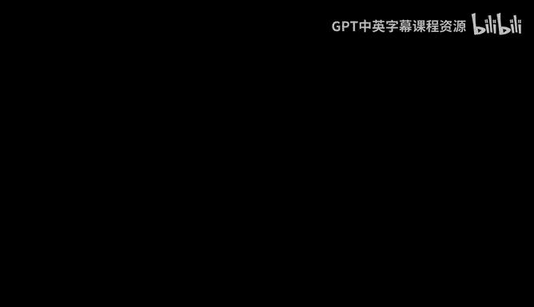

# 斯坦福大学《机器学习理论｜CS229M Machine Learning Theory - Fall 2021》中英字幕 - P5：-05-5_ Rademacher complexity, empirical Rademacher complexity.zh_en - GPT中英字幕课程资源 - BV1jT421r71m

So I guess yeah sorry for the delay a little bit。 I， I couldn't find water somehow。

Anyway， so， but okay， let's get started。 So last time we talked about concentration quality。

 which was for some preparations for what we need today。 or maybe the like sector。 And today。

 we are gonna go back to the uniform convergence。 So recall that our goal was to。😊。

Do the uniform convergence。And we have proved some results。 For example， we have proved that。

I guess we， the first thing we had is that we say the excess risk is bounded by this uniform convergence。

 right， So we basically care about something like the soup。Of the differences。嗯。So guys。

 we have shown that the excess risk。I don't know why I'm。Something wrong with my opinion， okay。

Assesess risk。 This is funded by， for example， something like L。H star minus L has H star。Plus， silk。

 I O H。Mus L head H where H is。Cle H。And we have used this to get certain kind of un from convergence results。

 For example， we have shown that for。B hypothesis cross。We've got L H hat minus。嗯。L of H star。

 this is bounded by。I guess we have shown this technically， but this can be turned into access bound。

shown this is less than。嗯。This。It less than。Square root， long H， roughly speaking。Over in。

 if you ignore other log factors。And you can take soup over age。

In capital H and also for hypothesis class parametricized by。Cls with。P牌美腿。

We also have got something like， I'll fade ahead minus。Ill had。

 or I think there's something wrong with my。clolothe。SoLet me take a quick。好听。

So we can get L so theta in capital theta L theta minus L hat theta。

This is bounded by something kind of oh tilial squared P over。

 this is what we did like two lecture cycle。So， and you can think of this， you know。

 I guess we have discussed this briefly。 So this point and this quantity， these are， in some sense。

Complexity measures。Of the hypothesis。And this is generally the type of new results that we're gonna get。

 right， So we're gonna have something that decreases as then goes to infinity。

 And also there's another constant， which is there's another factor， which is the hypothesis class。

 right， So， so basically eventually， you can say that you know。

 if n is bigger than the hypothesis class， then you can get non trivial error bond。😊。

So the problem with this two bond is the following。 So the limitation。The limitationation。

I think you can talk about， you know different limitations from different perspectives。

 but I think the basic limitation of the this P H parameter bond here is that it requires。

And to be much bigger than P。 so that this bond is going is small。 So。

 and this is not necessarily feasible in many cases。 And also。

 this is not really what happens in reality， right， So in reality， like in many cases。

 N is smaller than P。Is quite often。It's not always the case， but， you know， it's pretty often。's。

 it's more often in in a modern situation where you have a so called over parametermetric in by over parametermetric choice。

 I guess I would define that more carefully in the later course， in the later lectures。

 but basically in the modern setting when you have a deep art。

 your image night has like a million examples。 but your parameters could be something like 10 millions or maybe 100 million。

 sometimes could be billions。😊，So， of course， this is not necessarily。

 always the case where sometimes you still have like N is bigger than P， depending on the situation。

 But generally， people found that it's useful to make your network， your P very large。

 So definitely it's not the case that you want N to be much， much bigger than P。

 That's definitely not true。😊，So， and， and the reason in some sense。

 why this is not capturing what happens in reality is that this is not precise enough， right。

 So not precise enough。In the sense that your complexity measure is， in some sense， two worst case。

 right your complexity measure is measuring the complexity of all possible parameters with all possible models with P parameters。

 But you are not special specializing enough to some special kind of models among all the models with P parameters。

 For example， you cannot a trivial case， you know， especially in the kind of more classical language。

 you cannot distinguish。😊，A sparse parameter from a dense parameter。 You cannot distinguish。

 For example， you have a parameter class where theta has one normal。

Versus some hypothesis where theta has some two normal。Right， so in in either these cases， the。

 the parameter P， the P will be showing up in your bond。 So， and but not necessarily the the B， the。

 the， the control of the norm of the parameters。 So， so that's why we are looking for。

Something that can be more precise that can not， that can not depend on P。

 but depend on some more accurate characterization of the complexity。So， so， so today。

 our next lecture。And next few lectures， in some sense。So what we're gonna say say。

 our goal is to prove something like I。Take a hat minus L height a hat is less than something like。

Some complexity。off data。And over and。AndBut this complexity measure could be more fun than just a single number P。

And this complex measure could possibly also depend on distribution。 So this complexity。

May depend even a distribution。Distion P， right P is the distribution of your data。

 So maybe for some distribution P or complexities， you know， smaller for some other distribution P。

 your complexity is higher。 And we are trying to capture the intrinsic kind of like difficulty of the learning problem。

 But of course， you know， like you know， is this is somewhat subjective because you know， you know。

 like this is depends on a little bit on what you believe that it is happening in the real life。

 right， So if you believe that the real parameters is farrse。

 then you probably should have a complexity measure that captures the L1 norm of the of the of the parameters right if you believe that the the ground truth parameter。

 you。Have other properties， then you probably should use a different complexity measure。So， so。

 but this is the general goal。 And also the practical kind of like way of thinking about this is that you can think of the right hand side as。

As something that motivate your regular， right， So the， the practical impact。

 I guess maybe or the practical implication is that you can use this complexity。

Of theta as a regular。Because if you just optimize your model。

 where you're gonna find some parameter data， especially if you don't have enough data。

 you may have multiple global minima among the search space， right， So。

 but if you know that certain complexity measure will make the bond better。

 then you can actively find。😊，Models with small complexity。

 So you can use this complexity measure on the right hand side。 like。

 you add this complexity measure multily by Lada to your training laws。 So you get a regular loss。

So that you are more likely to find a more complexity one which generalizes better。Okay， so。

I guess that's the， the basic idea。And。嗯。So。What we're going to do is that so we are gonna to today。

 the first part is we are going to talk about。A week ago。

 where before we were talking about the soup， the。The uniform convergence， right。

 So this is our tool。 Right you want to prove that L H minus L height H。

Its small for all possible age。And。And in the first part of the lecture。

 we're going to bond the expectation of this。As a， as a some kind of like weaker goal。

 And in the second part of the lecture， if， if we have time。

 we're gonna bond it with high probability without expectation in front of it。

 And what's the expectation comes from， this randomness come from the data。And the确 date。Right。

 because L height depends on the training data and training data， random I D join。

 So that's why you whats inside the expectation is a random variable that depends on the randomness of the training data。

 And then you take expectation of this random variable。And that's the， that's the goal。

 So we're gonna bond U bound this with some other quantities that we think are more intrinsic and convenient for us to use。

😊，So。I guess I need to start with some definitions。So。This is， this definition is called。

 this is a definition called rather micro complexityplex。Which is the moon。

Object we're going to focus on in this lecture。 So the definition is。Let F be a family。Of real。

V functions。So far， F， in this definition， F is just abstract family of functions。

 and we are going define a complexity for these family of functions。 F。

 And then we're gonna say what functions of F we are gonna care about。

 We care about actually the functions of the losses， the， the， the family of the losses。But for now。

 F is just the abstract family of functions。 and youre gonna define a complex measure for this abstract family of functions。

😊，So let's say this family functions maps。Some input space。 let's call Z to real number。And。诶屁。

be a distribution。Over this input space Z。Then the average， the so called。

Often you don't really necessarily have to specify average rather mark complexity。😊，But technically。

Is the average rather marker complexity？Of F。Is defined as。The following， so this is R N sub F。

 where N indicates how many examples you have， how many training examples。

 how many empirical examples you have。R N F is defined to be。You first draw some examples。

You can think of this as tri examples， I D from the distributionusion P。And then， you draw。

Some so called rather mark random variables recall that rather mark random variables such as binary plus 1 -1 uniform。

You you draw Sigma1 up to Sigma N。I d。Unniformly from -11。And then， you look at。Thiss this quantity。

 you look at the soup。Over this function class capital F。 And you look at the quantity。

The average of sigma， I， F Z， I。And from one to。this sounds like a kind of like a pretty complicated。

Definition， but let me try to interpret a little bit。嗯。So。In some sense， maybe， first of all。

 only think about this quality， right。Just think about what's inside this soup。

So this is the correlation。You know， the one over and is is， it' just normalization。

 which is not important。 This is the correlation。别村。The outputs。Of F， right。

 So the output of F is F Z 1 up to F Z， anyway right。And some random variable Sigma 1 and Sigma 1。

Of course， if you just look at this， right， the correlation should be in typically very close to 0 because you shouldn't toilet it with random variables。

 right， But there is a soup。😊，Right， so you are first joining the Sigma 1 up to Sigma N。

 and then you take a soup over F。So basically， you are saying that what's the maximumim。

 So basically， this whole thing。It's the maximal correlation。Between。F。

 the output of F and sigma went up to Sigma n after you draw Sigma I， right。

 So you can you first draw Sigma I， and then you try to find something that correlates with sigma I。

You try to find such that it can output something that looks like the random things that you have do。

We have done。So， so in some sense。If you have have a high complexity。Means that。

For most or for almost all， for most binary patrons。

But binary patterns just means that you have the sigma 1 up to Sigma N， the exist F。

In this hypothesis class， such that。The output on this family。Is。Similar to。Or similar or correlate。

With。A random pattern。Right， so for any random pattern， if you join it。

 then you can find post ho or function F in this family class， such that the output on this on。

 on Z up to the N。😊，Looks like the random page。 You have drawn。 You have job。So in some sense。

 this is saying that how diverse。The outputs。You can have from this family of functions F， right。

 So if you， if this family of functions F can map your Z up to Z into any possible patterns。

 then this red mark complexity will be the largest。Right， so for example， suppose every report。

fininary pattern can be somewhat output by these family functions F on Z。

 Then you get the the maximum rather mark complexity。你究机会。Any questions so far？表示说。嗯。这是在6条。

The question is， is this necessarily a non increasing function of N。嗯。I think it should be。

 but it shouldn't be， but I don't think it's triviale to see why it's。Why is non increasing。

 at least off the top of my head， I don't see a super simple argument。嗯。But I think you can。

 you can prove it without too much effort。 I think roughly speaking， how do you prove it is that。

You can， because you take the soup， right， So you somehow can。I think you can。

 you can prove it by switching the soup with the expectation for one。😊，The， for example。

 the last example。 And then you got the roughly speaking definition of the n-1 version of the random market complex。

But maybe let me not do it on a fly just in case I missed something I got stuck。😊。

So but off speaking， I think that should work。Any other questions？By the way。

 I never got any questions from Zoom。 So you should feel free to speak up。

 I I I just unmute yourself and ask questions。 I sometimes I'm not even sure whether the zoom is working。

是呃。Not like find。对反规。可有。ThatThat's a great question。 So F is not required to be mapped to plus 1-1。

 And it's true that this can be unbounded， right， So this is actually sensitive to the scale of F。

 right， If you scale F by a factor of two， then you're gonna have two times the rather mark complexity。

And this is actually somewhat useful in certain cases， which we probably talk about later。😊。

There is a question。Okay。Okay， cool。 so。So， okay， now let's see why we are care about this。

 So why we care about this rather mark complexity。 The reason is that。You know， the following。So。

 you know that。Let me write down whats。What is the the theorem。

Suppose to this hypothetical experiment， you draw an examples from distribution P。And then。

 you look at。This quantity。The average of F of Z I， I from one to n。Minus the expectation of F Z。

 right， This is kind of the quality we have dealt with in the last lecture， the concentration。

 how much you deviate。From your， from your mean。 But you take a soup here because you carry， in some。

 care about the maximum possible deviation post ho after you draw the examples。

If you look at this quantity。Then this quantity is blinded by two times the rather macro complexity of5。

I guess to appreciate what this theorem is really doing。

 I guess it's probably time to say what exactly what kind of F we care about， right。

 So F so far is abstracting。 But now let's try to instantiate。😊。

So suppose you take F the capital F to be the family functions that maps Z。Which is。

Taken to be a pair of X and Y， the input and output。 and we make it to the loss function。

 The loss of X， Y on the hypothesis age。For any age in the hypothesis class。 So basically。

 this is the family of losses。For every model， every model is a function， right。

 And given that model and you， you get a loss function。😊，Right， defined by the model H， right， So。

 so basically， this is the composition of the of the model function with the， the， the， the， the。

 the loss function。The two dimensional loss function， right， the， the little。 So together， you know。

 basically， you get the， this is a map from the data point to the to loss of the data point。😊。

But you can vary what functions what models you care about。 So you get a family of losses。

 So so in some sense， it's just a slightly it a slight extension of the family of models in some sense。

 But， but here is， it's about the losses。 And suppose you care about this， you take F to be this。

 And you can see that the left hand side is exactly what we was trying to to bond right。

 just because， you know， F D I。😊，Is lots of。X I， I guess we write X I， Y I like this。X， I，Y， I。

At age。Right， so then the sum of。The empirical sum is just the empirical laws。Right。

 so one over and some of the F I。This is just the one over times the sum of。L of X， I， Y， I。H。

 this is just the loss， the empirical loss of the hypothesis class， the hypothesis H。Right。

 and expectation， F C I， F Z。Is the expectation of the laws。And where x and y。

Are drawn from the distribution P。 And this becomes the。Population loss。Right。

 so that's why the life hand side of this the is really just the soup over H。L had H。Mus LH。三タです。

questionAnd and you take expectation over the randomness of the data。So that's the。

 that's the weaker version of uniform convergence that we outlined in the beginning of the lecture。

Right， so， and you can bond this by the rather mark complexity of this function class F， right。

 the rather mark complexity of， of this family of losses。Right， so basically。

 the theorem is saying that。The generalization error。

It's less than the rather market complexity of it。Like。

 I think technical expectation of the generation。I think there was a question here。I this is super。

Now there's no absolute value here。Yes， there's no apps value。 That's a great question。

 So there's no apps value。 and it becomes a little bit trickier if you add apps value。

 I think if you add apps value。First of all， need a different proof， a slightly different proof。

 And second， you're gonna have a different constant instead of two。 You're gonna get probably 4。And。

 and the cleanest way to do it is that you don't do apps value in this theorem。

 You do the apps value in the， in the， in the upper in the in the alterer layer。 actually。

 you don't even need apps value， actually， technically， because eventually。

 you only cover one side of the bond when you do the generalization error you。 So so technically。

 you don't even need apps value anywhere。Okay， so。And if you really think about this R And F in this context。

 context， right， so， so。For this particular F， what does it mean， It really means that how well。

The family of losses， right， So the losses of data。end data。Can correlate with random pattern。

Cant correlate。I don't。So this still sounds a little bit kind of like not super intuitive。

 We can further， you know， for a simplified case， we can further simplify this a little bit。So。

 so suppose you have a binary classification。So suppose， let's say your Y is between plus 1 and -1。

And L is 0，1 loss。So， L of X， Y， H。Its equals to the indicatorator of H of x is not equal to y。

There are done equal， you have lost one。 Otherwise， you have lost 0。And in this case。

 we can further interpret this a little bit more。 So what you can do is the following。 First of all。

 you re this indicator into this form。Weread as a half。Times y-1 times H of x。This is assuming。here。

 I'm assuming H f is also in plus minus1。So。By the way。

 and what I'm doing here is to try to instant this into a special case so that you can interpret the rather marker complexity more in in a more intuitive way。

😊，And also this this whole thing is also useful by itself as well。 So。

 so where when h of x is plus one minus-1， then y is plus1 minus and also y is plus one minus-1。

 then the indicator that they are different， you can write this as this because if y and H are different。

 then you get Y H X is minus-1。 and then the whole thing will be one。😊，And if Y and Hx are the same。

😊，Then y times H X is one。 And then this qua this quantity is 0。 So you can just verify it。 right。

 So the reason we do this is we somehow make it more linear in y and H X。

And then you can look at a rather macro complexity。So， the R and F。Is this expectation of soup？

Sigma I。Alright， so and let's plug in the laws。So here are the expectation。

 So some in the definition， I have two expectation， right， So by now I。

 I put2 of the expectation into one， like we just emerge them so that randomness come from both the data and the random marker pattern。

😊，And they get soup over age in age。See you plug in this formula a half times 1 minus Y， I， H X I。

Times sigma。And now let's do some real real arrangements。

It's a very simple rear arrangementrangement。Plus。1 over n times a half。食埋。So， here。At this quantity。

You know， it's inside the soup， right， but actually it's a constant that doesn't depend on H。

So you can pull it outside of the soup so you can technically write this。

Justs because this sum of sigma I is a constant。And then because now。

 now you can switch the expectation with the sum and get。😊，Expectation。Soup， of the first term。

And plus， the expectation of this。1 over two and sum of sigma。And this term becomes zero。是错。哦，这。

And this thing becomes0 because the expectation of the rather marker variable is 0。

And so then we are only left with the first quantity。And if you， if you look at the first quantity。

 then you realize that。Because so sigma I is a random variable， Right， So H。W。

Y I sigma I has the same distribution。sigma。Right， no matter what y is right。

 So for even for y is1 or for y is -1， they have the exact same distribution。😊。

So that's why you can replace Y I Sma。 Actually， you can also have minus here。 That's still true。😊。

Right， because you I random reflect flip the sun。Right， so， so basically。

 that means you can replace y Sigma minus y sigma I by sigma itself。 I still。

 you don't change the expectation。😊，Right， so you， you can replace this by maybe。

 maybe let's define this， you know。I guess you can saying the easiest way to check this。

 I saw some confusion。 Eas way to touch this is you just define sigma I prime to be minus y sigma I。

 Then you guys soup more and sum of H X I。😊，Sigma pro。But still。

 sigma prime distribution is still plus 1 minus by uniform and independent。

RightSo Sigma prime has the same description as Sigma I， so you can just write this。😊。

The same way as。Yes。小埋。Okay， so， so what we have achieved here。

 What we have achieved here is that this seems to be a strictly simpler quantity than before。

 Why this is basically the rather macro complexity。Of the hypothesis H。But not a family of losses。

Right， before we are talking about the hypothesis of the family of losses。

 And now you are talking about the executive。R mark complexity of the hypothesis class page。

So basically， this is saying that。ForB。I think I'm missing something。 I'm missing a half here。 Where。

 where is the half go。Yeah， I think I lost a half， sorry。嗯。I think I lost， oh， I have the half in。

 It's that I forgot to。Copy it， so。So basically， this is a half times the random markov complexity。

 So what we achieved is that the rather markov complexity of F。

In this special case of binary classification and and 01 loss is equals to half times the rather macro complexity of hypothesis class。

😊，So。So that's a slightly simpler。 You know， We thinking about this because what's， what's this。

 This is basically saying that。How well it can memorize。Memorize嗯。The random random label。Right。

 you can think of sigma 1 up to Sigma N as random label and R， N H is big when。

You can exist of H in the capital H。Such that。H of X eyes。It's equals to sigma。

 this is the best situation， right。That this has the strongest correlation。 So basically。

 if you can memorize all the random label with some。Hypothesis in your hypothesis cross。

 That means your radarmar complex is the biggest， And that give you the worst gization bond。😊。

And vice versa， if you cannot memorize， then you get better optimizationable。😊，好的。Right， okay。马上后的。哦。

我这个。嗯。我是。I see。 Okay， that's a， that's a good question。 Let me repeat the question。

 So the question is。Sigma prime is equal to y times actually there's a minus0。 So。

 but it doesn't matter。 So sigma prime is minus y times sigma I。😊，But Y I itself is random variable。

 So can we still claim that Sigma prime has the same distribution as Sigma？Right， so that's indeed。

 that's a good question。 So it's so technically， I think what you should do is the following。

So if you are really careful about this。 So there are two randomness， right。

 So one is from the X and one is from the sigma。 So you first。😊，Condal randomness of exercise。

Just' say that。So you first in the first expectation， so basically。How do I say it？

 So you can write this as the following， right， so。The conditional X I。喂爱。

And then you look at the randomness of sigma。Right， so now after condition on X I。

 then this is absolutely clear， right， So like for any choice of Y I， right。

 Sigma I and Sigma prime has the same distribution condition any choice of deteristic choice of Y。

So then， so， so you do it inside。 And then why it's gone in your formula。

 So then you don't have to care about the， the outside。你没看。coolol， so it sounds good。

And let me kind of like a So， okay， So the take home away here is that， you know。

 the rather mark complex of F is similar to random mark complex of the model。

 and the rather mark complex of the model is basically saying how well you can memorize random label。

Right， but there is a small caveat here， which is that this relationship is not always true。

This relationship is true， exactly true for binary classification，0，1 loss。

 but it doesn't is's not even true for， for example， some other loss function。

So I think the intu largely is still correct。 but， but you cannot take this， you know。

Literally or rigorously， like religiously for every situation。 And， and in some cases， actually。

 there could be a confusion because。There could be cases where。These two mismatched。

 especially if your loss function can do something differently。 For example。

 your mouse function could change the binary number to real number or the loss function has other kind of properties。

 right， So for example， your loss function is often nonlinear， Right。

 So suppose you take exponential laws。 So and actually， they are， in some sense， like in the。

 in the past， they were this kind of like。In some extreme cases， you could some papers or some。

 some some papers actually misinterpret this in some sense， like。Like。嗯。I。

 I guess I'm just giving a warning in some sense。 Don't like always apply this every time without even thinking about it。

 The intuition is roughly true， but it's not all exactly true。At the all time， you know。

 I guess there there will be a place where I'm gonna mention this again like in the later the later of the lecture。

like in in some of the later lectures。啊， ok括都。嗯。By the way。

 just and what we're going to do next is that we're to improve the theorem。

And just a small kind of overview for what we will do next lecture。 So， so in this lecture。

 we are gonna to deal with this app just measure， the rather mark complexity。Right。

 and you may wonder probably some of are wondering why radarmar complexity is。

Is something measurable or something like that is useful， right， So we don't answer that today。

 We are gonna answer that， you know， in the next few lectures。

 So today we are just introducing this red mark complex and say this is bounding the uniform convergence and this rather mark complexity something intuitive。

 I hope you found that， right So like it's talking about how well you can memorize labels right。

 So it's something at least make sense。 And in the next few lectures。

 we are gonna instantiate this to more concrete models where you can bound the rather mark complexity by something more concrete in the next few lectures。

😊，系嗰心。Oh。Did somebody ask a question I did， I didn't hear。Yeah。

 I think a couple of people have chimed in。you answered my question in the meantime。

 but someone else might have a question still。Yeah， sorry。

 I forgot to open my have volume on if yeah， please please ask questions， you know， if you， yeah。

 now it's working。 Okay， thank you。Oh， actually， there is a question。 What is the connection between。

They rather more complexity， and a degree of freedom。Right。

 I think I assume by the degree of freedom。You mean the number of parameters right， So。

 so I guess that's kind of like what we motivated in the beginning。

 So using this radarmar complexity， we will be able to prove more precise bound。

OnThen on the number of parameters so。Probably so far， you haven't seen that。 I I， you know。

 like I don't expect you to see that。 But in the next lecture。

 we are gonna to see you can prove feather bones that depends on something more fun than the number of parameters。

你 hope that answers this question。Please feel free to unmute yourself and ask。I mean follow up Okay。

 have I guess conceptual question， how you generally think about the distinction between the。

The hypothesis family of hypotheses versus the family of losses over them to me they because they have the same cardinality right they seem like a direct map in between one like how do you distinguish I guess in your mind between those two how do you think about them。

Yeah， that's a， that's a great question， so。In my mind， they are very similar， except that。嗯。

Except that I think this will be a little more。Explicit in the next lecture or maybe two lectures later。

 So except that when you talk about the models， the models oftentimes output the real number。 So。

 for example， if you think about logistic regression， the models output the logic。

 which could be anywhere on a real line。 And then you turn that into a probability and then use that probability to compute a loss。

 And the loss becomes something for non negative， and often sometimes the loss is you know reasonably is' between0 and1。

 for logistic loss is not between0 and1， but I think the most interesting regime is that it somewhat small。

 right， So it's between 0 and1。And， and if you care about classification loss then this literally between 0 and 1。

 So， the loss function sometimes has has a scale in some sense， like is， is something on out of one。

 And， but your model could be sometimes outputting some bigger numbers。So。

 so there is a conversion there， which will be more explicit in the future lectures。

 But beside beyond that， I don't typically， I don't distinguish them very much。Goa， yeah。

 I find it interesting that in your in the example， at least for binary classification。

 the the complexity of the the lost family was less than half of the。

Complexity of the model family is that is it common that the your complexity goes down when you compose it with the loss function？

I think it's common that they are related。 We will see that in many cases， they can be related。

 but I think I wouldn't read too much from that constant half because it's a half does depend on how you。

Define your labels， for example， if your label is 01， I think you wouldn't see the half。

So there is some small artifact there， right， the constant， So it doesn't really matter that。Okay。

 cool。 Okay， let's continue。 So， so we're gonna prove this。

 And this is called symmetricization technique the proof。 And this is a very。😊。

This is a technique that can be used in many other cases， not necessarily in this course。

 but in other kind of like。😊，Areas of probability， I say。So symsymmetricization technique。

 I think it probably comes from those kind of risk probability anyways， at the first place， so。

So the technique is that let's write down what we care about。So。

Because what we care about is the soup。I may I'll take expectation for now just so that it's a little bit cleaner。

 we will take expectation。You that。So this is not symmetric in some sense， because you have。嗯。

You have this in subtraction here and。So so these two terms don't don't look the same。 right that's。

 that's what I mean by not symmetric。 So there's a way to make them some somehow more symmetric。

 So what you do is you is that。😊，If you fix， for now， let's say， we fixed。X 1， Z1 after Z。

And we let z1 prime and z1 prime to be a different draw， another draw。

From the distribution P and R I D So draw a sequence of copies of the even up to Z N I I D。

And then what you can do is that you can say。Con write this。Second。The expectation in this quantity。

Using this EI prime。You know， just because by definition， you know， all the Z I have the same。

D from P。 So expectation of F is really the same as you look at。Expectation of sum of F of Z I prime。

Because each of these term has expectation the same as E EF and you average them， so you get Eo5。

Right， so， and you see that， you know， this already makes a little bit more symmetric。😊。

For whatever meal， like just looks on the surface， looks moresymmetric because this is the sum of things。

 and this is sum of things。😊，Of course， it's still a little bit different because the expectation。😊。

Is in front of the list thing， but there is no expectation in front of the first。So。

What you can do is you can， of course， one thing you can do is you can put the expectation。😊。

In front of the boer。Which is not doing really anything， because。For now， Z I is constant。

 and Z I prime is random。So in some sense， you are just putting some constant inside expectation。

And now let's what happens is that you can switch the expectation with the soup。😊。

Maybe let' ask the question first sure， Yes， sorry。Is this one。 Yeah cool， thanks。 yeah。

 so now we will make it more symmetric， So we will switch。😊，The expectation with the soup。

So I'm claiming that if you switch them， you get a inality。The imp primeme。是。Right。

 so why this is true。 and this is just， this is just a very generic inequality where。

 which claims that you can。Replay switch to and expectation， get inner quality。 So generically。

 this is the the claim is that suppose you have a function G that takes in two variable and suppose you are taking expectation first。

Over the randomness of the first， the second variable。 and then you take soup over the first。

 the and you take soup soup。😊，On the first variable， suppose this is the quantity you have。

 then you can replace this by。😊，Eventually by first taking the expectation and then actually by first taking a soup and then taking the expectation。

Right because when you do the math， you are doing it。From the right hand side to the left hand side。

And why this is true， this is because。You can have intermediate step， which is you take soup。

Were you。Take expectation over be。 And you bound this G U V by silk。Over you do you。

Maybe that's call U prime。Right， so。This when you call is very simple。

 just because this term is termwise bounded by the soup。And， and once you do this soup。

 then you see that。This whole thing doesn't depend on you anymore， right。

 So maybe I should have another step， so。Actually， I'm claiming that this is just equal to this。

Because this term。Doesn't depend on you。 You already got rid of you。Right， so。

 so so the soup over you just can be gone。 And then the green term is equals to the term below just because you change the variable name U to U prime。

 That's not nothing。So that's why I see equality。So in general。

 it's kind of like just probably useful to kind of know this as a effect so you can switch the soup with expectation and get inequality。

嗯。sometimes I do I don't remember which direction in the car it is。

 so that's why you still want to probably somewhat know how to prove it so that in case you got confused which direction it is。

 you can still recover it。嗯。Okay， cool。 So， okay， so that's the， that's how this works。😊，And now。

 if you take expectation over Z， again， we， we already condition on Z。

 But now suppose that's take expectation over Z。 Then you see that this is kind of like very symmetric。

 So what we got is that。It takes expectation over Z1 to Z。

And it's bound by now you have two expectation here one is over Z prime and the other is over ZI primes。

And then you have soup。Let's put it into a single sum， by the way。MusF。P。O。

So now it becomes a little bit more symmetric。 And I'll do some one more thing to make it even more symmetric。

😊，So。This one。It's metric in the sense that actually it's a mean0 random variable。Right。

 it's not going even mean  zero。 but option in terms of distribution is is。

 is the distribution is symmetric in the following sense。 So F I。Minus FD I prime。

Has the same distribution。As FZI prime minus FZI。Because these two things are just the renaming of each other in some sense。

 so they have the same distribution。Or in other words， this has the same distribution as sigma I。FZI。

Minus F at prime。For any signaligma， for any signaligma eye。It is binary。Right if its minus-1。

 if it's plus one is the same thing if this minus-1， you just flip the order and。😊。

So could that means that you can。For free， introduce this random variable Sigma I and I not not change anything。

 So that means that if you introduce this random mark random variable。

And you take expectation over sigma I。You multi the Sigma I。This FDM is FDM prime。

So以 this is still in equality。Actually， like here， even you choose any Sigma I this is equality。

 Of course， if you choose random sigma I signal， and average them is still equality。😊，ok。

So I think technically， you you like you claim that for any sigma， this is equality。Technically。

 the first step is this is equality for every sigma I， for any sigma I。

And then you say that even you take another expectation over sigma I。That is still true。

This is still true。 And then you can switch the expectation in whatever you want。Okay。

 and and I'm gonna to switch it just because it's a little bit convenient for me to。Do that。O。So。Now。

 what I'm going to do is that I'm going to。呃。Bak this， break this into two sum。

So I'm going to have expectation here you have all the randomness。IThis is just a simplification quo。

 so。I'm claiming that this is less than soup of。The first term。Plus soup。Of the second term。And here。

 what we are doing is essentially exactly the same thing as the， the switch of the expectation。

 the s of the expectation and， and the soup。 But here we， we only have two terms。

 So it's the s of sum and soup。 So here we are。😊，We are doing something like soup of two terms。

 So something like a function of F plus another function of F。Over F。

 And then you can say that this is less than。Soilup of F， U of F。睡不。😔，要烦。I guess you can prove this。

 you know， almost the same way as we have done with the expectation but just so you need one step in the middle I will this says。

As a exercise for you。So。And now。Probably have seen that we are getting closer and closer to the definition of the radar mark complexity。

 The only thing is that we have two terms and the rather mark complexity have just only of this。

 So now we can change this to。The we can swap。 the expectation with the sum。 So you got soup。See I。

And here， and plus。Expectation， soup。Mus signal line F I。And here， the randomness is。

Z1 up to Zn and sigma 1 up to sigma， so this is exactly the first time is exactly rather more complexity。

😊，And I'm going to claim that the second term is also exactly rather more complexity， because。😊，Here。

Now my randomness is Z1 Z1 prime up to Z prime and611 up to61。But again， because minus sigma I Fzi。

Prim has the same distribution。As sigma I， F Z I。Right。

 because minus sigma I has the same distribution， Sigma I and Z I prime has the same distribution as Z I。

😊，So then the second term is still。This is equals to the first term。So basically。

 this is just equal to two times。真是。Two times the right mark。Any questions。你看用或者就。有不说这么。えと。どそこい。

That was a little really good improvement for dog。That that's， that's a great question。

 And that's exactly what I'm going to remark on。 So the question was。You know。

 if I freeze it slightly differently。 So what we have really done here。

 did we do anything kind of like powerful or did we do something。

 Because the left hand side is has a soup， The right hand side still has a soup， Right。

 So did we really do something really useful or did we just do a bunch of algebra， right， So I'm。

 I'm gonna claim that。😊，We did do something useful。 And the reason is that the left hand side。

 you know， is something like a soup。😊，Is what we care about， right， the。

 the difference between the empirical mean and the。And and the the population， right。So。

 on the right hand side。Roughly speaking the the most important thing is this， the thing。

So what we have achieved here。So。So one， we have achieved that。We remove。那个。Yeah呀。Right， so we get。

 we get rid of the yeah。And。It's probably， you know。

 not super clear why we should appreciate this fact that we get rid of the E F at the first act。

 But I can say that this E F is， you know， is somewhat of annoying because you don't have a good control on it。

Right， so when you look at this， in some sense， this quantity doesn't depend on the relative。Like。

 for example， this quantity does't depend on E E F。 So if you shift it a little bit。

 it wouldn't change。 Actually， we were gonna claim that this point。

 the right kind side is translation environment。 So since sometimes， you move the， remove the。

 the translation environment part。So maybe let me just claim。

The right hand side is translation environment。Or maybe the mark they rather mark complexity。

I'm going to claim I prove this in in a moment。Let me see what I plan to do this in today's lecture。

I think I didn't plan to do it today lecture。 but， but this is a claim。 So in some。

 you remove the the translation environment part， you remove the E F， right。

 so which is useful in many cases。And。Second。You sometimes introduce more randomness。

Sigma 1 up to sigma 1。So why introducing this randomness is useful。😊，It's probably still unclear。

Right now。 But eventually， what we're going to do is that we are going to have。So， so so currently。

 what we really have is we have expectation of this， right。You also have an expectation of this。

And here， the randomness is Z1 up to0。And sigma went up to sigma。Right。

 so we will introduce additional randomness。 And this allows us。 This will allows us。😊，To job。

The randomness。From Z 1 up to Z。This will this will be something we'll see， I guess， probably。

In the next lecture。So， so eventually you don't have to care about the the the you don't have to take expectation over Z up to the end。

 You can， you can claim with higher probability。So the red class wouldn't have to run like Z up to Z N you don't need to take expectation over Z up to Z N。

 And the only random is come from the sigma I。Which。If you eventually I guess probably you。

 you you don you don't see exactly what I mean。 But if you eventually。

 you only care about the randomness of Sigma 1 up to Sigma I Sigma 1 up to Sigma and that's， that's。

 that seems to be a a benefit because。This is a very much simpler randomness。Right。

 so Sigma after sma N has a very simple distribution。 They are just random mark random variables。

 So they are much comp less complicated than the distribution of Z up Z N。

 which is something you don't know。 right， You just assume there's a distribution P。

 but you didn't really know any other properties about it。So， so I think that's the。

 that's the second benefit。But of course， the limitation is that we still have the soup。

 which is a still problem， but I think you probably wouldn't shouldn't expect that you can remove the soup on this level when you have abstract family class。

You probably shouldn't expect you can remove the soup completely。 right， So it。

 it should be the next level where you remove the soup when you have a concrete hypothesis。嗯。W。直す。So。

 the next part is another。Useful。Property， all kind of useful thing to know about radar mark complexity。

 which is that this radar mark complexity can depend。On the distribution P。

It still can depend on distribution P。Even though， you know。

 our goal is to try to kind of like use the new randomness， right。

 They deal with the simpler randomness。W this is the case？This is just because。

In this definition of random mark complexity， you do have to draw some Z1 to Z from the distribution P。

Right， so this is a gym example where you can see that。Where P is a point mice。

So let's say Z is always equal to z0 almost right。 So whatever how you draw it。

 you always just draw a single point。And in this case， actually。

 you can have a good biomarker micro complex bond for any bonded function， so suppose。😊。

你 say minus one。Suppose you care about。Yeah。And this is the only constraint on the family app。

 So basically， you care about F or maybe more tech。 I say F is the family of functions F such that。

F C，0。Its bounded by one。 So you just have a bo family of functions。

 You don't even have any parametric form。 Still， you can prove that the rather more complex of this family of this family is small。

So you can say that。Look at soup。So， this is what。Because FZ I is always the same。

 So this is literally equals to one over n times F Z 0 times sum of sigma I。And because， you know。

 F Z0 is just a constant， It doesn't depend on what F is right， because Z 0 is wait， sorry， my。

 So F I'm wrong with that。 see so。F 0 is still depends on Z 0， right。

 But F 0 is bounded between 0 and 1。Between -11。 So that。

 that means that this is less than or equal to expectation。If you just bound this F Z0 by1。

 you get one over n times sum of sigma I absolute value。Right， so， and。This is actually。

And then use coffee shores， or use the。I think this is called culture shores。

The expectation of this random variable is smaller than the。

It back to of the square of the random marble。To the power of health。And then， you can。Actually。

 this deris， we're going to see this kind de several times， so you get。😊，嗯嗯嗯嗯。A half expectation。

S of sigma I sigma J。I is not equal to j plus sum of sigma squared。Time small n square， right。

 I'm just expanding。Expanding it。 So you get one n square。Sigma sigma J has mean 0。 So you got。

S over I from one to n expectation， sigma i squared。A， so this is。Each of these is one。

 You take the sum might get n。Get one over and the power half is one over square。So。So in some sense。

 this is kind of like interesting， right。 So like for very。

 very large family functions without even parametric form。

 you can still have a good but mark complexity。 And the reason is that a distribution is so simple。😊。

So in some sense， this is this is the indicator that you the rather mark complexity can capture something about the distribution。

 if a distribution is generally simple， then rather mark complexity can capture that and tell you that。

You it's very easy to generalize， right？Right， so， so。

 so basically any F on a very simple distribution should be considered very considered as very simple。

 even though this。In sometimes this family of F is just you have basically no assumptions on F in sometimes there is no parametric form is's a very large family of functions。

 but with respect to the distribution， a simple distribution it should be considered as simple and this is what weather mark complexity can tell you so that's saying that red mark complexity can take into account the distribution P。

😊，嗯。But how much it can take into account of the distribution P， That's a question marks， right。

 So in many of the other analysis， you don't， like in many analysis， you don't。Have this property。

 Like you don， you don't really。Used too much about the tuition P in many of the concrete bonds for random complexity。

 But in principle， it can capture something about P。哦。I have 15 minutes。

 I think there's time for me to do this next part。Let's see。I think I have time to do this。Okay。

So the next part， if there's any no questions。と。联系中的。就是。いて。对。没哎你。这个保。So， so your question is。

 whether， for example， when the features X， the， the coordinates of x have correlations。

Or or maybe have independence。Independence is a probably it's more like a simplistic thing， right。

 So can you get a better bound from rather mark complexity。嗯。I think this， to answer this question。

 we need to zoom into concrete settings。Right for linear models， I guess。

You see that you would get bonds， at least in a if you compare to extreme cases， where in one case。

 all the colonies are。Corre it。And the other case is that。Actually， it's unclear， right。

 So because if all the colons are correlated， actually， you probably should have a better bound。

Because if folks I in a very， very extreme case， right so all the corners are the same。

Then you effectively have a one dimensional problem。 So you should have a better bond。So。

 so it does depend on a particular situation， I think。So， so yeah， so it's interesting。

 right It's not clear that independence means really simpler。

Independence could mean that it's more complicated。

It's because we have independent input distribution， right。

 So you have a diverse set of distribution， diverse set of data。It might be even more hard。

 It's harder to general in some cases， right， So for example， here in this one point My case， right。

 you have a。Very narrow family data。 It means you can generalize easier because you can just memorize that Z 0。

Right， so， so independence might make it harder。Okay， so the next 15 to 1010 to 15 minutes。

 Let me try to。Defin its socal called empirical random macro complexity。

And the goal here is to remove that expectation in front of the。In front of this soup， right， So。

 so currently the average version has two expectation， One is。Over the randomness of Z U up to Z N。

 And there's another expectation of the randomness that we created。😊。

Right over sigma went up to sigma。And you have this soup。嗯。

And we're going to claim that this is basically similar to。This。Without expectation。

With high probability。So， with high probability。And the probability is over the runness of Z 1 up to Z N。

 right， So you still， you have to draw Z1 up to Z N。 But for most of this choice of Z 1 up to Z N。

These two things are similar。Right， so this is a random variable that depends on Z up to the。

 This is a random。 This is just a constant。 right This， this number is a， is's not a random number。

 It's a is's a。Yeah， I probably shouldn't call it constant This is a deterministic number， right。

 so this number depends on C to the end。😊，And I'm claiming that。The second one， the rec hand side。

 is concentrating around the the first one。嗯。With high probability。So I if you can do this。

 then that's what we I kind of alluded to before。 right， So now if this is defined to be。Empirical。

 rather macro complexity。I guess let me have an notation for that。嗯。This is called。I think。

 let me just。I think in the notes， there' is a formal definition， but here。

 let me just for the sake of time， let's just define this to be R S of F。Where S is。

The set of0 after 0。And this is called empirical rather marker complexity。And。

 and you can see that the original radar mark complexity。

 the average red mark complexity is the expectation of the empirical radar mark complexity。

Where you take expectation over the set S。Right。So just because these two things only differ by a single expectation。

And so if you can do this， then。You have a。You have a high problem bond。

 You don't have to average over Z1 to7。 And also， you can do the same thing for the left hand side。

 for the uniform convergence thing。 right， So recall that。Before， we only prove that。

The expectation was even after the year。Soup。This minus EF， right。

 we only prove that this is less than rather macro complexity。Right， so this one， we。

 will also show that this is。Approximately。Equs to this with higher probability。

 Like I guess I I should say。The later one。This one， later one is a random variable， right。

 that depends on Z1 to Z N is approximately equal to the expectation with high probability。

So if you have both of this， then you basically remove the expectation from your equation and you get a higher probability。

😊，Does that make sense。那 questions。So basically， eventually， we're gonna to prove this。

 So let me state the formal theorem。We can prove that。You assume all the efforts are bounded。Then。

With probability， at least。我们的貂elton。We have this soup。So here I don't have expectation。 This is the。

But there's a random over the randomness。They1 up to 0。soup。This。Its lesson。是的。Stime。

The empirical red complexity the。I will draw more complexity， plus， additional cost。Additional term。

 which is the log loan。Of two over theelta。Over to it。 So you pay additional small term。

 which is on the auto flow over square root n times log something logarithmic。

In a probability deelta。嗯。So and but basically， by paying this。

 you get a high probability bond instead of an average version。I think the proof here。

 the proof is actually relatively。Straightfor is basically， just applying。My government inequality。嗯。

And maybe let me do that in the next lecture， I think it takes probably 10 minutes。嗯嗯。

Maybe let me start with the remark， right so。So I guess， typically， this。Lan to delta over n。

This is typically much smaller than。Either the rather mark complexity。

Or the either empirical one or the population1。And。

And the reason is that these two things will be something like square root， something over N。

 And if something depends on。The complexity of F is something that is not negligible。

 But here you have square root， a log rhythmic， some logarithic term over n。

 So that's pretty much the smallest thing you can think of。 right。

 So like like rhythmic is kind of like a constant。So， so， so your。

 your complexity of F wouldn't be on the log grid。Of of anything。

 it should be something bigger than that。 So that's why typically this additional term is negligible。

 So that's why basically you can think of this。 you didn't lose anything by doing the empirical。

And and it's interesting that what you lose here at least on this level。

 what you lose here doesn't depend on complex of that。Right， so basically if you。

So so this term depends on complexity life， but what you lose here between the expected empirical and population don't depend on complexity life。

嗯。And maybe， I think this is the perfect time for during the second remark。Mar 2。So， I guess， R N F。

Or R SF。They are both translation environment。So what does that mean， That means that suppose。

You have F prime， which is equals to。A translation of F。

 which means that this is a family of function。F prime Z， which is equals to F z plus unit。

The universal constantsancy0。So for every function in capital F。

 you have got the function in capital F prime， which is just a translation。

 You just add some C 0 to it。Then。They have the same。Empirical bio complexity。And in some sense。

 we have seen this derivation somewhere in the， in this。In one of the deres before。

 but let me just make it more explicit。So。The the rather more complex of this is you look at the expectation of sigma。

And you take the soup of。Some色爱 f。I prime。At friend。思维。And。You plug in a definition。Plus zero。Right。

Right， so now you can。Put the part about C 0。 I think we have seen the same technique before。

 because C 0 is not a function of little F。 So you can put it out。 So you get。Plus。

1 over n times sum of sigma I times C 0。And then you can swap expectation with the sum。

 So you get expectation sigma。It's soup。Plus， expectation of。1 over n times sum of sigma I C 0。

And this becomes zero because sigma I is a binary or is a random marker random variable。

 so then this is Rs of F。搜。So in some sense， this is a property of the radarmar complexity， which is。

Like克。Somewhat interesting， right， Like you don't care about the translation。

 but you do care about the scale。 So if you scale everything by a half or by two。

 and you would change the random complexity。 But I wouldn't change when you shift things。

 So it's about the relative differences between functions in F。 It's not not about absolute。

Size of five， right So， so， for example， if the the function of F always takes values between 1000 and 1001。

 that's not very different from taking values between 0 and 1。Okay。

 I think this is a natural stopping point for today， Any questions？😊，共住个。好不。す候。呃， first of all。

 its not always the case that。Right， that is a good question， So I I claim this， you know。

 vaguely without any justification。 So why the rather mark complexity should be like this by one over square。

😊，So I think it's not even。So I， I should say it's not actually exactly true。

 Like so for most of the case， actually for all the cases we， we are gonna see in this。😊。

In the lectures， it's one of a sculton。 but in some cases。

 it could be the the dependency on on could be a little bit different。So yeah。

 so sorry I was not quite clear and I think I'm not sure whether this question is still in the homework。

 I think in the homework question there used be a question where you have other dependency on I think I probably removed that question for this year I remember I removed it just because it's not。

😊，That relevant to the overall goal。 But， but they could be other dependencies。 For some reason。

 it's always like。It's most。 the case is one of a scton。 I think the reason is that。

The even you look at the single。even you look at a single example， you don't take the soup。Right。

 you just look at the like like you you you， you do the the wrong thing， right， So you。

 you say I fixed my function and then I draw my data。

 I look at how different the empirical one is different from the population 1。Right。

 that's always one of a scton。Like without any doubt。Right。

 so so that's why you can never go better than Javavascripting。

 but you can be worse than Javavascript。I'm not sure what it makes sense。 right。

 So even you look at a single。The concentration of a single at a single F， right。

 Like you fixed the the function H， you draw the random variable Z1 after Z， N。

 you still have some fluctuation on auto form of square。 So you cannot be that。😊。

But you could be worse than that。Okay。好对对。From definition of the running marker。

I think you can still see that to some extent， because if you look at the sum of sigma I I find。

Maybe that's just。你哼。Right， so this is still a sum of N termss。Right， and， and each of。

 so like even you don't take the soup， this term would be something on the order from our square。

Just because of the Constitution。You have sum of n terms。 each of them is on the all of one。 anyway。

 so the sum of the n termss is on all of square root n。And then you divide by n。

 you get one over squares。We can talk more often， maybe。Okay， sounds good。

 I guess Ill see you Monday Wednesday。😊。

