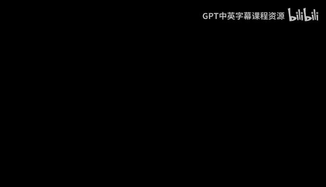

# 斯坦福大学《机器学习理论｜CS229M Machine Learning Theory - Fall 2021》中英字幕 - P6：-06-6_ Margin theory and Rademacher complexity for linear models.zh_en - GPT中英字幕课程资源 - BV1jT421r71m

Hello， everyone。So， I guess。So in the next of two， I guess in this lecture。

 what we're gonna do is that。We are going to bond rather mark complexity by some concrete。啊，放了。

For concrete models。And by concrete models， I really just mean linear models for this lecture。

 And in the。A few lectures later， we're going to talk about new networks。

And just as a review to connect to past lectures， we have proved that generalization。Error。

 the excess risk or the g error is upper bounded by radar mark complexity。

 That's what we have done last time。 although in the last few lectures。 And in the next few lectures。

 we're going to talk about how to upper bound rather mark complexity for exactly for concrete models。

 like models or new networks。😊，So， and also， we are going to deal with the classification。嗯，老师。

So there is something to do to do with classification loss because it's a binary loss。

 it's not continuous， so we have to deal with it using some special technique。

So that's the overview for this lecture。So let's first set up the basic things in classification。

 So we're going to deal with binary classification。So。I guess as you probably would expect it。

 you know， you have Y， which is in -1 and1 and classifier H。

 which maps the input space X to real number R。 So here， the classifier maps。

Maps the we think of H as the function that maps。The input to the， to the real number， the logic。

 for example。 And when you make the prediction， you take a sign。嗯。Of the output of the classifier。

So you take the sign of H O X。And this gives you the the classifier where if the H outputs positive numbers。

 you output one， and otherwise you get negativeified。And H is the family of H。Of age。

That's orientation。 And the loss function。On each example， x comma Y。Is equals to the indicator。

Of y is not equals to the true exam。 Tru label is not equals to the sun。Of h of x。That's our setup。

So， the。嗯。Right， so I guess。The first thing is that I'm going to very briefly mention this finite hypothesis case。

That's just a。A very quick kind of note。 we have already done finite hypothesis class， right。

 So it's probably useful to know that you can recover the same bond for finite hypothesis class using this machinery of rather market complexity。

😊，That's a kind of like a probably reasonable requirement。

 If you think that rather mark complexity is a powerful tool。

 So there is indeed such a theorem which I'm not going to prove today because the the the way to prove it actually is more related to something。

More advanced later。 So I'm just gonna say the theorem。 So saying that if。Have satfi。That。

For every F in F。The sum of FZI square。This is。It's less than m square。

This is a foundation that is a little kind of like a not super intuitive。

 but actually what really this is saying is that， you know， this is。Implied， you know。

 this is a weaker version。Of just assuming F Z is bond less than。So if Fc is bound by M。

 then of course， the average of the square is bound by m square。Right， so it's just， I'm assuming。

 I'm stating the state the weakest version of this theorem for generality。 And if you know this。

 then you have that。The empirical rather macro complexity on this example Z1 up to Z N， right。

 So S is equals to。As is equals to C up to C。so iss bounded by。

The something by the size of this hypothesis class。

And the and it's bound by the logarithmic of the size of the hypothesis class times something like I'm square。

 The the range of this function class M， function class F。 And also you divide by n。

 you take square root。So so this is， you know， essentially basically it log F over and square with log F over it。

And if you apply this to the finite hypolasts that we have talked about， for example。

 if you apply this to the loss function， the binary loss function。

 you get what we had before like it's kind of it's almost exactly the same bound eventually。

So and and we are not going to prove this are but we are going to prove it know in the future lectures today we are not going to prove it because the techniques is more related to something what we are going to use later so but this is not you know。

 this is just saying that we can achieve what we had。

But it's more interesting when you apply this red mark complexity for continuous function class。

 right， So and we have also talked about， you know。

 what's the limitation of having finite hypothesis class， For example， the limitation is that。

 you know， if you， even if you do this， you know， with some kind of like distization with continuous models。

 you're gonna lose a parameter P in your。 right， So if you do this plus some disretization。😊。

Then what likely you get is something like P over N。

Where P is the dimensionality of the of the the of the model is number parameters in the model。

 if you do some disization。So， and it wouldn't be super， you know， impressive， you know。

 given that we already have done those， you know， brufor disization that we had done before。Right。

 so， so today what we're going to do is that we are gonna have a different way to upper bound rather mark complexity。

 not using these kind of tools。 And the the the way that we do it is actually more algebraic and analytical。

 as you see。😊，So。So before doing that， so we are gonna so first deal with the loss function， right。

 So if you look at the loss， right， this is L 0，1 X， Y， H。Its in is this。

So the thing is that the tricky thing is that there's a sun here。Right。

 so if you don't have the sign and H of X is output puttinging something like binary。

 right recall that we have done this in one of the previous lecture， right， So in that case。

 we assume H X is。So， in previous lecture。We have shown that if H X is outputing something like binary。

 right， is outputs。Plus， vitamin1。 Then you can show that the rather mark complexity of F。

 the rather mark complexity of the lots functions。 The losses is basically on the same order as the rather mark complexity of the hypothesis class H。

Right， that's what we did last time。 But now we are doing a slightly different definition of the H。

 right， So the H is the function that outputs the real number， right。

 is's the one that before the sign function。 So then is this kind of like a。

This kind of like reduction doesn't work anymore。 right， So of course。

 you can still apply the same thing to the signine of H。

 but then you're gonna get the biomarker mark complexity of the signine of H， which you know， again。

 it's also it's kind of like you didn't solve the problem。 You had the problem in a different way。

 So So so we're gonna express it deal with the this issue first。

 And that's called sometimes I think people call it modern theory。

 So we're gonna introduce a bunch of tools to deal with this sign issue。 In some sense， you are。

 you have to convert the real number to the the binary number in some effective way。

And then we're going to bound the rather complexity of linear models and using analytical tools。

So that's the， that's the plan。Okay， so。So I guess the， the kind of the intuition is that。The。

 the scales in some sense， like matter in when you do classification implicitly。

 But even though at the end of the day， your scale doesn't matter。 right So， so kind of the the。

 the kind of the motivating example is the following， for example， focusing a classification task。

 right， I'm using right for positive data。 and you have some kind of like。It。

 it kind of have the I use circle for for negative data。

 And if you think about different classifiers， for example， this classifier and。This one。

Right so these two classifiers， you know， just intuitively。

 I'm not claim anything mathematics rigorously。 If you。

 if you intuitively think about these two classifiers， the。😊。

The pink  one probably should generateize worse。Thenhan the， and the blue 1。

 because you only see these8 examples。 you know， maybe if you kind of like draw a new example test example。

 maybe it look like maybe it's here。 Then the pink  one would have would have a mistake on this test example。

 right， So but the the blue one sounds like I less likely to make mistakes on test example， so。So。

 so intuitively， you know， like the blue1 seems to have， you know。

 somewhat better generalization just because it's kind of like separates the two clusters more clearly and more confidently。

 So the confidence all the， So in some sense， you can think of this H of X itself as the confidence。

 right， because this is a real number。 in some sense， this is。😊，TheThe bigger it is， you know， the。

 the the more confident you are about this example and， and。And and this does matter to some extent。

 And this is what we are going to say。 So like how do you somehow reason about this and make them matter in some sense in your analysis。

嗯。😊，So， so here is the， the more formal approach towards this。 So let's first define， Okay。

 so I guess。Let's first， assume。This is a assumption throughout these lectures。

 We assume that we classify all the examples correctly。 So assume the training。Ever。As 0。So。

 perfect chining。Perfect classification。Forning data。And and you can see that this is in some sense。

 in a reasonable， especially given the more than kind of like success of the large network， right。

 So typically you can make the training error very small。

 And this was actually a reasonable assumption even before deep learning came into play like before deep learning what people did was that you add more and more features。

 And your dimensionality of the features becomes higher and higher。 And at some point。

 the dimensionality of the features becomes bigger than the number of examples。

 And then you can always fit a training data with0 with zero error。😊，So， so formally。

 what that does mean is that。If you look at a tri example， its always equals to some age of。

That's what I mean by training our zero。And under this kind of like training error。

0 hypothesis class， you can define the so called margin。So this margin， technical， I think。

 is only defined for， at least， you know， if you don't do any modification of it。

 you probably should only define it for zero error classifier。

 and this is the so called anized margin。So， and so the margin。Of， you know， X， you know。

 this is really just y times H theta of x。You multiply x with Y just because， you know， like。

 you want to make it a positive number， right， So if。Y is positive， right。

 which you have positive class， you want H X to be big。 And if y is negative。

 you want H X to be small， right， So， so in some sense margin is kind of like a a very inform informal version of confidence。

 iss not a probability， of course， is between 0 and infinity of right。

 So this is always non negative。 if you class are exactly on the changing data。 So， so。

 so this is always non negative。 you know， when you are correct on this data point right when why is why and H data X。

Y is equal the sine of H x x。Okay， so this is the definition of the margin of a single example。

 And then you can define the margin of the data site。Right and margin for a data。

Margin of the classifier on the data set。 So this is defined to be you look at the minimum margin over all examples。

 So you take the minimum over I Y I times H theta of X I。Of course。

 this margin is a function of the classifier。 You know， if change the classifier。

 you have different margin， right， in some sense， the。那那不录啊。As I I I drew there， right。

 like has a bigger margin， a pink one， because。In some sense， this pink one has some example。

 which has very small margin and the blue one， for all the examples， you have big margins。

 So you take the minimum， then over all the examples， you still have relatively big margin。

But I guess， you know， here， I'm defining the unized margin。 So， so if you look at anized margin。

 It's not exactly a distance from the example to the hyperplane。

 So you have to normalize it so that it becomes the distance to the hyperplan。 but I think we。

I think in this course， we don't need to actually define the normalized margin per se so if you so for linear model。

 I guess probably you have learned this from CS S 299 right， so if you for linear model。

 if you normalize this margin with the norm of the theta。

 then it's gonna to be the distance between the example to the linear separate to the hyperplan so and and the minimum margin would be the minimum distance of the of all the examples to the to the hyperplan。

So and our goal would be something like。You will basically you are gonna to bond the g or all the rather。

I guess we bound the g。 I buy rather mark complexity。 That's what we did in the past。

 but a rather market complexity。 And then this by some function。😊，Of the parameter。And the。

 the parenton norm。So the normal theta and some function of the margin。

That's what we will eventually get out of this lecture。So， and why we need to define these margins。

 The reason is that this part come from a technique to deal with the loss function。 so， so。

We're going to introduce a surrogate laws。functionction。

That takes the margin that takes the margin into account。阿 got先 know。We， you know， at the end of the。

 all of this will put will be altogether intuitively。

 The reason we want to do this is that we somehow believe that margin matters for the generalization。

 Then you probably want to have a balance that depends on the margin and you want to have a loss function that also depends on the margin。

 So so far， if you you look at the 01 loss， It doesn't depend on margin， right。

 how large H X is doesn't change your01 loss on an example， right。

 So as long as the sign doesn't change。 you don't really care。 right。

 So we want something that kind of depends on the the margin。

 So so the the loss function is called ramp loss。And I think sometimes it's also called just margin loss。

So this loss function has a parameter。 gamma gamma is kind of like the target margin in some sense or kind of a reference margin。

 You can think of it like that。 So this is a loss function that takes into a single number T。

And it outputs。Maybe let me draw it first。I guess maybe let's write down the。I question。

So if tea is are grandma me， okay， let me let me join it。So。

This function is a function that look like this。So， and here this is Gamma。 and here。This is one。

 So when。T is larger than gamma。 You， you make it 0 when T is。Equal to when t is less than 0。

 you make it one that corresponds to the， the， the the flight area on the left hand side of the origin。

 And then when you are between 0 and1， youly interpolate。

So this is the way to linearly interpret is one minus T over gamma if。You are between。0 and gamma。

So so this is the linear region。And， and why youre why you're interested in this。

 The reason is that this is， in some sense， a extension of the0，1 loss。

 So maybe let me first define notation。 So with a bit abuse of notation。You can also write algama X。

 Y。 You look at the margin loss applied on this classifier H。 that's defined to be。I gamma。

 Y times H， O X。This is a definition。So， but these two al gamma have different meanings on left hand side right hand side。

 as you can see。 So this one is the one we just defined。 So basically， first of all， you know。

 before， you know， when you talk about loss functions， right， it takes in two arguments。

 Why and why hat。So but for classification， the only thing that matters is you take the product of them。

 So that's why you only care about y times of h times h of x right So so basically in this notation。

We have， we have no that that the ideal loss function L 01 loss function of x and y。

HX is equals to some indicator of。Y times H X is。Y times sign of H check。

I guess that's the same thing right So y times H X。Is。largerger than zero， right。So this is the。

 this is the0。 This is a different way to write 0，1 loss function。 right。

 So if y and H X doesn't have the。喂，拜拜。if this is less。S stands zero。So。嗯。

So I have to mark that I have a typo here so that I can fix it for the future。Okay， so。

 so this is the binary classification loss。 And this is the so called ramp loss。

 And you can see the differences is that。The indicator function right， would just look like this。

This is indicator。 T is less than 0。And what we do is that we extend we make this indicator function more continuous。

 That's basically what we are doing。😊，So in some， So， and you can know that。 So from this。

 you can see that。The L。Gamma Y， H X is always bigger than the indicator of Y H X。Let's than 0。

 just because。The function above that thatju is bigger points wise than the function below。Right， so。

 and which means that if you look at the 01 loss。Of an example。It's always less than。The one plus。

 at any example。And which means that， you know， if you look at the test laws， right。

 you do take the expectation over X， Y join from P。Right。

 so this is the the final thing you really care about， right， the generalization。The， the。

 the test error， right， So this is the fundamental thing you care about。

 You can at least upper bound by the population。Ever under the run under the population loss。

 under the run plus。So by doing this， you know， you change the， you make the the loss bigger， right。

 So which， and then we're gonna bond。 So， so basically with this。Eventually。

 what we're gonna to do is we're gonna to bond the。The the test error。

 the test laws under the one plus， which is the upper bound on the。Right thes。So。

 so this is our goal。 U bound this。Okay， so， and how do we bound this。So。So I think， you know。

 it's kind of probably， you know， at least when I read this， you know， at the first time from a book。

 it's kind of unclear why you want to do this， you know， continue continuation。 It will come just。

 it will come in a moment。 So the one of the reasons you want to make eipes so that you can somehow get rid of the loss。

 But before doing that， we have to。诶。I guess let's， let's first clear up the high level thing first。

 And then let's look at the the low level detail about how to， how to use the laws。

 So the high level plan would just be that you let Ill had gamma。

 This is the empirical loss corresponding to。The ramp plus。And you can also define。Oh。

 I think this is a function of H。嗯。You can define the population laws。As I said。

 is this Al Al gamma X， Y。H。And then if you use radar mark complexity。The machinery have developed。

 you get。对啊。Population loss。Mus the empirical laws。Is bounded by two times the。The the。

 the empirical red mark complexity plus three times。L to Dta over。Right， this is what we did in the。

 in the previous lecture。 right， The generalization bond can be the generalization error can be bounded by the empirical rather mark complexity。

 Where F is this family of losses defined by the。Aro false。So， so this is saying that eventually。

 you are gonna just need to the basically， this will be the。The goal， next。Right， because。

If you have the bond on the on this red mark complexity， you have the bond on the。You know。

 we are gonna do this， you know， more carefully。 you know， after we have the right mark complexity。

 But roughly speaking， once you have the right market complexity。

 you have a upper bound on the population rent loss and the population run loss upper bound。

 the population binary loss。😊，So。Right。O。Where is a soup？Sure， so yes。Yeah， but without。

 it's also true， I guess right So， so I guess for average age， this is true。可以。

With high probability for average age， this is true。T。Okay。

 so now let's talk about the the radar market complexity。 So how why。收啦曲。

And this reviews why we care about the run clause。 So the rather more complexity。Of our of app。

Relates to the random mark complexity of age in a pretty nice way。

And here is the lemma that's released them， iss called telegri lemma。So say in the following。

 So suppose you have a function fee。It's a one dimensional function。And it's aipsis。

 couple lipssis function。I guess we have hell。Deeffinine luious function。

 So this really means that if you have two。And at two numbers。

 phi of x minus P of y is less than kappa x minus y。

 And here the it's just absolute value because all everything is one dimensional。Okay。

 and once you have this， then you can look at the。Composition of developmental function with any hypothesis class。

So， so this。It's defined to be， you compose。P。 So basically。

 you might fee to the conversation of fee of H of。啊是。So this is the mapping。啊 this is a。

P will be the loss function， Basically。 But so here is abstract。

 So you can compose any function fee with a hypothesis class。

And to get this feet composed with age and。one color， anyway， so then you can get what you have。

 So then what you can get is that the composition。The composed hypothesis class is bounded by Kappa times R of。

So， so basically saying that if you compose anything on top of an existing hypothesis class。

If what you comp with the fee function is lipsis， then you just only blow up by factor of copperpa by the lipsiousness。

 So， and so with this， you can probably see why we care about relaxing the binary function because the the。

 the the， the indicator function is not lipses。 But if you use the Ram function， it do be lipses。

And that's what we do next， so by the way， this this theorem is thislemma does doesn't have a very simple proof。

😊，Were' going to prove it in the lecture。It does require some。 It's kind of like something。

 kind of like pretty in， in my own opinion。It's kind of pretty。Nvel and and， and， and deep to me。

 Like I， you know， I， I used to be able to prove it one， Like I， I prove it once myself。

 But I think the all the existing proofs I know is kind of like somewhat。I love mysteries to me。

 but but， but the the the high level， the intuition probably is reasonably。Reasonable。

 right because you have a hypothesis， you compose it with something that doesn't really introduce additional fluctuation that much。

Right so that's why you don't make the hypothesis class much more complicated。But。

 but if you look at the kind of like the， if you look at the exactly what this formula is saying。

 this is saying that you take the soup。好。H in H So how do you write the left hand side is something like this。

 right。诶食 my eye。Phi of H of Z I。Any you want to show this6 found the bay。H C I。

RightThat's the goal for that's what this thing is saying。

And look at some kind of imagine why this is difficult to prove， right， because。😊。

Like you cannot really change the order of expectation with。 You know， if you do that， you you。

 you make the in theality to lose。 and somehow there's a fee somewhere in the middle of this equation。

 It's kind of very， very hard to pay pay it off。 anyway。

 this is just my personal comment about this lemma。 Like， it sounds pretty deep to。Okay， anyway。

 so we're gonna take， we're gonna use this。 So， so and， and I think it's probably somewhat。A obvious。

 how do we use it， We are going to take this feel function to be the one plus。Right， so alm of T。

 then because the Ram clause， if you， I guess let's go back to here。

So the Ram plus is theipus function。 The Lius constant depends on gamma because here。

 the lipus constant 0 here is complete flight。 So how lipsus is depends on how was the slope here。

 And slope there is one over gamma。 Because this is gamma。 This is one。

 So the slope here is one over gamma。 So the Liness of the。Of the red is。

A p is equals to one over gamma。 Sorry， right。So， and。嗯。If you take。So if you take H to be。

I guess let's take H prime to be this。 You map X， Y to y times H X。Where 8 is in it。

Each prime is still not exactly the same as H because theres a Y multiplied with H。

And then you take F to be phi composed with H prime。And then by the telegram number吗。

What you have is that。The rather more complex of F， which is what we care about。

 is less than one over gamma， the luiousness。Times R， S of H prime。Okay。

 so we kind of get rid of the， the， the effect of the loss function by using this telegram Lama。

And then you can also relate H prime to H much easier now， because H prime and H was the difference。

 Only difference is you have a sign flip。But random market complexity is not very sensitive to sflip。

This is just because。R S， I guess we have done this before， at least implic in some other。Proof。

 right， So the random more complex of H prime is something like this。Sigma I， Y， I。喂喂爱。Times h。

Ex slide。All， that seasonal no definition and now。You look at this， Sigma I， Y。

 I has the same distribution。Iy I。That's all I sigma I。Because anyway， you flip it， right。 So。

 so that's why this is equal to。You can get basically get rid of the Y I。 you get。Just this。

And then the right test that is。They write a mark complexityy of it。Okay， so with all of this。

 what we got is that， so this basically combining these two things。

 What we got is that R of S of F is less than one over gamma times R S of H。

And you can see that the interesting thing is the first all the loss is gone。 And second。

 why is also gone。 right So you， you don't have any wire in the right side anymore。 So that's so， so。

 so basically at the end of day， the only thing that matters now。Is the is the is the is the H X。

Okay， so and with this， we can put this all of these thing together to get a finally。

 let's get a bond on a binary test error。 So we recall that we assume。😊。

The perfect classification will assume that Y items H of X I。It's bigger than zero for every eye。

 this will assume a perfect faking。Perfect。Fit。And then， you can take。加ma面。To be。啊。Right。

 so this is the。你是 y唔头呢点一。So this government mean is the empirical is the minimum margin for。

For this data。Right， so now。You， you have that， I guess。顶 technical。意思我。I think I have a typo here。

 sorry。So let's just call this gamma。 This， we use gamma to defend fund this， right。

 So then if you look at。Ill had gamma H。This is what this is gonna be。

I claim this is going to be zero because you have al gamma， Y， I， H X I。

AndAnd Y H I is always bigger than gamma。 And recall that in in this Ram loss。

 if you are bigger than gamma， then you you are 0。 So basically。

 every example has zero loss under the Ram plot。So for the training examples。

 the binary loss and Ram plot are not different because they are both zero。And。Therefore。

You can have the following sequence inequality。 So you first bound the 0，1 loss of H by the one plus。

This is because the one loss is always better larger than zero1 loss。

And then you say that this is smaller than I hat gamma age。Plus。

 the the radar market complexity plus something like all of R S。It's over。

Because let's do it a little bit slowly。 So this radar mark complexity。Of five。そ。嗯， plusus。

Some square log over Delta n。And then you。有 the。In the quality between F and H。 So you get R S of H。

偶干吗？Plus， square rootlock 2 over deelta over n。And then， this one。Is0， as we claimed。

 because this is the empirical Rampl。For the。For the training data。 So this becomes 0。

 So you get just the big O of。R S of H over。gama so gama。吊操后面。So。There is a。

There's a caveat with this。With with this inequality。

 I'm not sure whether any of you have noticed that。

But if you have noticed that maybe hold on for a second， let's first somewhat interpret。呃。Okay。

 maybe let's just extend the the subtle。 So， so the problem。 So that what's the caveat here。

 There's actually， there's actually a mistake in some sense。 like no， not a serious one。

 but theres a issue with this in。With this devation？The reason is that。

What is the definition of karma。Right， so here， the definition of gamma depends on the data。

And then you just mess up all the the， the independence， all the。Like， like， so if gamma。

 like when you do， when we do all of these things right before right， So gamma is a constant。

 and then you have the gamma first， and then you draw your data points。 you you。

 you have your radar mark complexes so and so forth。Right， so but here。

We take the gamma to be something that depends on the data。

 which will break all the the random mark complexity machinery。

 because in the random mark complexity machinery， you cannot let your loss function or your function class depend on data。

I so。Theory。The function class F， this cannot be。 this cannot。Depend。On date。

Right so we did want to deal with the uniform convergence。 the， the， the H H hat， the classifier。

 the final classifier you want can depend on data。 That's the。

 that's the benefit of uniform convergence by the function class F cannot depend on data。

So that's a small caveat。But this is not a very big deal。 but but if you choose， Okay， so。

 but if you choose gamma to be something that depends on data。

 then your function class depends on the data。 And then you， you， you break this right， so。

But I think I'm not going to deal with this， you know， very formally。

 just because this is not a super。ForFor mathematical rigors， rigor， of course， you cannot do this。

 but it， it's very， it's relatively easy to fix。 And The way to fix it is that you take another。

Do another。要你帮。On the choice。Of gamma。 So for now， you choose gamma to be the minimum to be the minimum margin。

 depending on data。 But what you should do is you should also prove this for every gamma。Right。

 so if you can prove this inequality for every gamma， this bunch of inequality。

This is so far here for every gamma， Oh I guess。You can prove it until here， for every gamma。

And then then in the last type， you can choose the gamma to be the one that you wanted because you're already done with the random complexity。

 so， so you just plug in whatever gamma you want。Right， so， so。

 and and the way to do it is actually relatively easy。 roughly speaking， what you do is you say。

 you look at the gamma is a single number， right， So to do uniform convergence over a single parameter is is always relatively easy。

 What you And actually here iss even easier because you won't have care about multipl bond。

 So suppose you have a bond on what's the largest possible gamma you have。 Let's say you have B。😊。

Then what you can do is you can decreasetize， discretize this into multiple buckets。

Something like this。 Maybe you can。 So you can have one bucket is B over two over2 B。

 and another bucket is B over 4 to2 B over 2。 And you prove this for every。Poins in this distization。

 you decrease decrease。 So basically within every bucket， you don't don't really change much， right。

 The only difference between two numbers in the same bucket is only a factor of two。 So at most。

 you lose a factor of two。So basically， this is saying that you can。You only have to show bonds。Phos。

Points between the like。Between each bucket， right。

 those kind of boundary points and how many points they are。

 There are only log B points in some sense。 And， and you can also do a uniform convergence。

 All of these points。 actually， get even technically， you can even get log log B dependency。

 But anyway， So， so this is。This is the rough idea about how do you do this last step of feeling from convergence。

 because it's relatively easy。 If you look at the papers， I think。Most of the papers don't actually。

Don't actually do this step just for simplicity， of course the state of the in a different way so that the theme is still correct。

 but so they just don't do this very， very last step to make it simpler so。😊，Yeah， so that's。

 that's also what I'm gonna do。 Like， I'm not gonna with you like。A super rigorous theorem， I guess。

 you know， if you really want to prove it， what's gonna have is the following。

 So suppose you really want to have a theorem， The theorem statement will look like this。

 So we well say that with probability。那人我们教程。嗯For every。嗯。So， for every。

gamma between some zero and gamma max。Then you can say that for every age。L gamma H。

 less than L height gamma H。pl some big all of。Compact this plus square root log one over delta over n plus square roots。

log。伽ma max。Over and something like this。I guess maybe G Max should be larger than one so that you。嗯。

And then， as a corollary。You can have L 0，1， H。It hat for the for the。

 for the hypothesis you care about， right， is's less than something like R。

O of R S of H over R gamma。嗯。Plus。Gerb lock poverty。So here this is the empirical gamma。

Maybe I should call it Gama Min。 I think I somehow have a little inconsistent notation here， sorry。

 so。This is mean over I why。たくさい。ok。嗯。The point for mother from cars sugar small。

You can make a Max as well if you are。不是。So， right。我就。我。我只要。ご。呃， soO， I guess so。呃。

The I think the question is that like， whether， you know why you don't take gamma max to be really small。

 right， So first of all， it's not clear whether you can always prove that。

The final gamma you have on the empirical data can be really small。 That's probably not。

 actually want the gamma to be big。A you want imp perc data to have bigger margin so that your gization is smaller。

 right， So you do want to make the somehow the gama is like。At least that's the interesting regime。

 Like this very， very small gamma regime is probably not the most interesting one because your bond would be your right answer would be very big。

 So， so actually， if the gamma is really small， it's you probably don't need the third。 Oh， sorry。

 I think anyway， sorry， my be。 There is a third term in the in this as well。Let me fix that first。

But so， but suppose your gamma is really， very small， right。

 So you probably don't even in the third term because the first term is already very， very big。

 that correctly kind of like governs your， your general ball。

 So you do care about somewhat large gamma。 But there's still a question about why you want gamma。

What if all the scale are very， very smaller。 So I think I think it's really just that。嗯。嗯。I think。

 technically， you。Let me see so。Does that answer the question。对，对对。Yeah。Yeah嗯。Yeah。I。

 I think theres some kind of like small things like go。 For example。

 what if all your everything is you super small。Right。

 like what if like all the numbers are extremely small， I think you may， you。

 you can make this bond element title， you know， in somewhere way here。

I think there's another question。あお。映画を？This one。this is log gama max。And the same thing here。Okay。

 so I guess the lesson generally， I don't recommend to spend too much time thinking about this small sal here。

 The， the most important thing is to the first term， right， So let's try to。

 So I guess maybe the interpretation is more important。Like to the first term。

 this is R S of H over gamma。Right， gamma is the gamma Min， where gamma Min， this is the empirical。

Margin， right of the entire data set。So this is saying that if youre very confident about all the trainingni example。

 then you're gonna to have better generalization bond。 your bond will be smaller。 or if youre。

 if all the examples are very， very close to be。All the training examples are close to 0， right。

 This is mean I， Y， I。H X I。Or if all the H output on your chin examples are very close to 0。

 That means your gamma max actually only one of them in this definition。 as long as one of your。嗯。

Example training example has a very small H， right， value has very has a value very close to 0。

 Then your general bond would be quite worse。So， so you want all the examples to be very far away from 0。

Very constant in some sense。And on the other hand， you want your classifier。

 you want a denominator the the numerator to be as small as possible。

 You want your classifier to output to be to be less complex。

 And also there's another thing to check here， which is the scale does match。

 So the scaling actually is the the rising thing。So， for example， we have talked about that。

R mark complexity depends on the scale of your function。 right。

 So if you say you multiply all your function by a half。

Then your radar mark complexity will be reduced by a half。

And you can see here that this bond makes sense because you cannot cheat by doing that。

 So if you multiply your function H， sorry。So suppose you say you， you have a H prime。

Which is all the functions。Divide by， let's say，100 H。Right， suppose you divide by 100。

 Then what happens is that the rather mark complex of H prime， Yes， indeed， is divided by 100。

But the Gama min will also be divided by 100。 So that's why you cannot cheat de， you know。

 by trivial risk scaling of fail hypothesis。 And that also kind of shows that。

Something like this will have to show up here。 right， if you don't have this， you only have R of H。

 then your bond wouldn't be right， right， because your bond wouldn't be， would be。

 wouldn't be environmentvi to scale。So this basically， I'm saying that this is environmentviron。

Sskating。Okay， so this basically conclude with our treatment about the the the loss。

 So basically the the take home is that you have care about2 quantity。 One is the margin。

 and the other is the radarmar complexity。And now let's bond the biomarker mark complexity。

For leadinging models。So and then， so what I'm gonna do is that I'm going do the linear models today。

 And next lecture， we're going talk about generally deep learninging。 And from next lecture。

 we're going to talk more about like non nonlinear models in general。

 So I'm gonna to have first have an overview for deep learning and then come back to this to talk about the rather more complex of nonlinear models。

That's the， that's the high level plan。 So for linear models， here is a theorem。

So suppose you have a hypothesis H， which makes x to。W transpo sex。

Where w is now your parameter unless your parameter W has two norm less than B。Then。And also。

 let's assume。有data。The data distribution has a。Bed L2 norm has some bounds， right。

 so this is the L2 norm square in expectation is bounded by C square。

Suppose you know these two things。 Then you can bound the radar mark complexity。

The empirical radarmar complexity is bounded by。B over n times square root。Some毛。X， I。

So I guess this is not immediately， you know， the the scale is in on the right right。Dmenion。

 but I think the， the average one is easier to interpret。

 If you look at the average rather mark complexity， you can bound this by B times C over square root。

So first of all， you get the square root dependency。

 which is very typical for red mark complexity bond。 And second， in the numerator， you get B。

 which is the bond of the L2 norm of the parameter。 I also get a C。

 which is basically talking about how。How large your data was the norm of data points？Right。

 so you should have like both of these two things。Coming into to play because again。

 rather more complexity， you know， is sensitive to scale。 So you shouldn't be。

 So you should have all the scaling instinct things there because otherwise you can cheat， right。

 So like， for example， what if you don't have C here then your bond wouldn't be true because you can scale your x arbitrarily to make your rather mark complex abitarily big。

So， so you have to have all the skatings right。So嗯。Right， so that's the。呃。

The first thing we're gonna show about linear models。

 We're gonna have some other theorems about linear models under other constraints。

 and then we're gonna compare them。And also compare them with the previous bond as well。

But let's try。 let's first prove the theorem。So and this kind of like it also demonstrates how do you generally bond random mark complexity using this kind of like a somewhat analytical approach。

So we start with the empirical。Empirical one， empirical random complexity。

 The definition is that you draw some。You draw some sigmas and then you look at the soup of this sum。

And here you write W transpose X I， because this is the model。Output。And you take soup over W， and。

And what's the constrain of W， The constrain of W is that L2 norm is less than B。And。

Now let's do some derivations。So， first。So we basically want to solve this soup。😡，First。

 so to solve this soup， I want to understand。What。😡，This thing is right。 The。

 we realized that this is actually a linear function of W。And you can write this as。

The inner product of W was。The sum of sigma I X I。This is just because you can pull the linear term in front。

 something like this。And now what， what's the soup of this， And this is easy because。Because I guess。

 you know。What is the soup of。W inner product with some vector。 Let's call it C V。

Where you take soup over two norm of w less than B。Right。

 so basically you want to find the vector that has maximum correlation with some vector V。

 and you have some con contrain on the norm of B， right， So this is just later equals to。

 I guess there are multiple ways to do this。 For example。

 one way to do it is you can use coffee shorts。So so you can say W V is less than the norm of W。

Times normal V。So this is less than V times。And actually this can be a ten。白色成W搜的。So the the。

The answer is that the maximum， the soup is equal to B times the two norm of B。

And how do you attain this inequality to attain equality。

 you just choose W to be on the same direction of V so that your cautious towards this inequality is tight and you get the right number。

Right， so I think this is probably I think this is in one of the homework question。

 homework zero question， I think right that a ball up Okay， so and if you apply this， you know。

Thing to hear。 So basically got B times the vector V， the V corresponds to this。Alright。

 so so you got to rid of the suit。 That's a， that's a big thing。For us。

 because the soup is very hard to deal with。And now you have a norm of a random variable。

 And this random variable is a sum of。Some of random variables。 and。

 and know that here we are talking about empirical random complexity。

 So the only randomness come from sigma， but not X。 So but still， this is random variable。

 Its a random mix mixing of this axis。And how to deal with this。 So we are gonna use the。

Causy Schwartz again。 So I guess maybe for preparation， let's first get rid of the。

Move all the B and Sig B and N。 So you get sum of sig my X I。不脑。And you say that this is less than。

The square root of the expectation of the square。This is just because expectation of B is less than。

Square root expectation， B square。So for any， I guess maybe I shouldn't even call it B for any random marble x。

 let say x square。And nice thing about if you squared。

 and nice thing I think we have seen this kind of like calculation， not only once。

 in some other cases， we also seen this like the nice thing about square is that you can expand it。😊。

Right， so you can。You can。Just expand what's inside this expectation you get。

This is equals to sum of sigma i square x。I squared plus sum of sigma I sigma G。X。

 I in your product with X J。This is just the expansion。嗯。And。Then the nice thing is that this。

 this is。Here you have I is not equals to J。 And because I is not equal to J's expectation of Sigma Sigma J is 0。

Because there are independent random variables。 you can。

 this is equals to expectation Sigma I expectation Sigma J， which is equal to 0。So。

 so this term is gone。 So what we have is B over N times。Expectation， sum of Sigma I square。

 Sigma squared is actually one。Because it's rather mark random variable。So X I2 norm squared。

And then。The exc to norm and， the expectation is over sigma， right， It's always over sigma。 So the。

 there's no， it's equivalent to no expectation because。X I is not a function of sigma。

 So you just have this。And this is our。Deir bond。Our bond was this。 Exactly this。So。

 so here it appears that you indicate in n in one over n， but actually。In the sum。

 you also have something about N， right the sum grows as n grows infinity， so。

So you better than you get actually one over score with dependency。

 which will be see more prominently if you do the average。Right if you average over x again。

 recall that。The average driver complexity is the。Average of empirical number complexity over the randomness of the data set。

Then you get B over n times expectation over the randomness of S S is the。

 the con is the the set of exercise。They got this square root。So now you you， you get into the C。

 exact situation that where you have some square root inside expectation。

 which is not very convenient。 So you wish to the higher power by coffee shorts using this thing。

So you get B over n times expectation。Of the square of this。Oh sorry， I should use a superscript guy。

right兽。And now let's be over N square root。And each of the Xs has the same distribution。

 And we also assume that this。It's equals to， I think this is our assumption C about C。

 right we assume this is equal to c squared。That's the， so this is C square。 So you get。嗯。N C square。

 and you take square root。 So you get B， C square root。喂。Okay， sounds good。Any questions。Okay， so。

Next I'm going to show another go ahead。这所份呢。Poly。我。Prounded by degrees tri quality。

 founded by the one dorm。あな。Yes， so， so this is a， this is a great question。

 The question is that what if you don't use culture chart you use triangle inequality， I think I。

 that's actually a very good question。 I should。Actually actually， let's try to do it a little bit。

So。So I guess what you mean here is that you wait， by the way， where you want to use it。

Once you all them like a for example， he were here。啊，我。Sorry， we shalliao from here to here。

 Basically， right， Yeah， so， so yes， so that so that's a very good question so。If you don't do this。

 if you say。Mes a different color to indicate this。So if you say that you do tri inequalityality。

 you are going to bound it by B over n times。Expectation of the sum of X I。To not。ok。😊，So then。

Let's say you also take expectation over X I。 just the maybe let's we don't have to do it。

 So let's say this is B over N times sum of。Expectation of X， I。XI数 no。

And let's see what and you can see what happens here。So you have n terms here。

 and each of these term is on some constant scale， I say。And so basically。

 the sum will be on all of N， and then you cancel it with n So you get B。So basically。

 at the end of that， you don't have depend on any anymore。

So that's strictly worse because we do want to have a dependency。Something like one over squareroton。

 that something that goes to 0 S n goes to infinity。

And the reason is on why this is a loose inequality， The reason is because。Here， if you look at this。

This is some of things that can cancel each other。Because sigma I flipped things。So， and。

And if you do trially， you are basically assuming all of these factors in the same direction。Right。

 so， so even with the flip， right it's， so it's possible that all the exercise are exactly the same direction。

 Let's say that's， that's already the case。 right， But with the flip， they cancel with each other。

 right， So one of them is going this direction the reality in the opposite direction。

 So have cancellation。😊，And that's why this cautious virus is or this strength in the color is more kind of like。

Hi， and this is exactly just here right because you have to use the concentration cancellation between the Sigma eyes。

 if you don't use it。Actually， if you don't use it strongly enough， in some sense。

 you wouldn't have a have a good bond， eventually。就是。Pably looking up the standard。这应该是必是。Right。

 exactly， exactly。Okay， cool and。The next thing would be another theorem。

And this different theorem would still deal with linear models， but have different。

Norm measurement of the parameter。 And you will see a different bond。

 And this is one of the reason one of the things I motivated one of the。

The reason I use to motivate random marker complexity because I was saying that you can get more precise dependencies on what norms you want to use。

 for example。Right， so so suppose we still have the same H we have the a different H is still linear model。

 but the constraint on the parameter now becomes L1 nor。So this is L1。And。😊，We assume that。Now。

 the infinitefin norm of x。Its license。for o i。啊。For爱。And also， let's specify the dimension。X。

 I is in R D。Actually， this is an interesting thing。

 So before we didnt even specify the dimension of x in a in the previous theem。

 because it doesn't show up in a bound。 You know， it has to be some vector in some dimension。

 Of course， right， But it doesn't matter what the what the dimension of is actually。

 you can apply this to even infinite dimensional vectors。As long as the norm of x is bounded by C。So。

 but next here will depend on dimension。 The dimension is D。And。Then。

The empirical rather mark complexity is less than。B times C times square root。To lock the oven。

Overcoreded。Right。🎼And you can see now the norm， one norm starts to matter。 you know。

 So so it's still kind of， So let's say suppose you ignore ignore the log D。 So basically。

 it's still something like B time C。😊，But it's a different measurement on the B and C。

 the definition are are different。 Now， the B is the one norm of。

 of W and C is the infinite norm of x。We'll compare these two theorems in after we proof it。哦，你是。

How much time I have。I think I do have time to prove it and then compare。 So， the proof。The proof be。

Complete in the sense that I have to invoke some lema， which I will prove actually。

 which will will be proved by you in the homework。 but let's do the most of the stuff， so。

The definition is that the same thing。And now I become something like。Again。

You can view this as some W times some V， where V is this one over n times the sum of sigma I。

Exll slide。I'm writing here。 This is Sigma I W transpose X。So we are doing the same decomposition。

 but now you are taking a soup over one norm。And， and you will know that if you take the soup of。

Over one norm， questions B。V times W。 can this is also relatively easy to prove。 I mean。

 this is equal to B times。The in。Sorry， this W times V。W times B。

 this is gonna be equals to the infinite norm。Of me。So， so， so that's how we eliminate W。

 So we just got the infinite norm of V。呃。无。😔，系咩事。Sorry， yeah， so。Let see what's going on here。Y。

 I think this is。Oh。I see， so。So this is gonna equals to this。However， now we' got a problem。

 So we have this infinite norm。And。So how do we proceed， right， so。You can， for example。

 use triangle inequality， right， So then again， we don't use the cancellation。 right。

 So if you use triangle inality， gonna。Flip the， you know， you swept the sum with the infinite norm。

 but you don't have the cancellation。So how do we deal with this？ So in some sense， I'm going to。

呃 kind of like the infinite is kind of like something。嗯。

Different that you cannot use this analytical tool。

 So what I'm going to do is that I'm going to do a different approach of somewhat different approach。

So from here， so this inequality。This is a data in some sense。

 So what you do is that you say you look at what this really means。So， you can。Say that。嗯。的。

This is equals to。B over N times the soup。哦。W。iss in。是的。Bそして。

I think I I probably got the wrong version of the notes。That's why I also supposed。

Like a little bit kind of like surprised， but I know it's because I think。

The newer version shouldn't be like this。 But anyway， so。

So the first thing you can do is you can normalize it to be one。 So you get W times B。

That's W bar times speed， times speed， that's easy。

And then what you can see is that if you think about what maximize this inner product among all the L1 norm body vector。

Actually， the only thing you care about is。So this soup is actually later equals to if W1。

 W bar is between。Plus， minus E1 plus minus E2， So and so forth。Plus minus ED。This is my claim。 And。

 and the the reason for this claim is just that， you know， if you look at some of W R I V I， right。

 suppose I is index for the coordinates。 right， So how does this is。诶。So， basically。

 you can say that。嗯。So basically， you know that this soup。W bar V。Its equals to V infinitefin。

 in notice。And， and what you care about is that what are the extreme port， right。

 in what case you achieve this。嗯，You achieve this equality。

And it turns out that the the way that you achieve this equality is that。W， basic。

 you want to take W bar I。To be one。for爱。For I is。The largest entry。So far I such that。V i。

Is the largest。 It's the max。OverV。这 s n d。Right， so。I'm not sure whether this is。

 this probably requires a little bit thinking offline like。So嗯。So。

 so at least you can verify in this case， if you choose W I to be one for this case and all the W I bar to be 0 for all the other eyes。

 then what you get is that you get some of W I bar V I is equals to just V I and V I is equals to Vfin norm because V I is the largest one。

哦哦。I guess suppose that's take absolute value here。 Then this is exactly correct right。

 So if you choose this W I， then you。And order the order W I I bar 0。 So you get V I。Infin norm。

 and that's equals to V， the VR in absolute value， that that's the V infinite norm。Right， so and。

 and also if， if you don't have apps value on another fan side， you can also flip the WI on。

To be either one or -1。Does it make sense？Yeah， it it's， it's not。 it's， it's it's relatively easy。

 So it's just the。It probably requires a little bit thinking offline as well。 So， so。

 but the basic claim is that， you know， when you do this kind of like a maximization over the simplex。

 you always get the the vertex， right， max the extreme point is always the vertex。

 That's another way to think about it。 And the vertex are those， you know， natural basis。😊。

And then we basically got into。 So what happens is that this is a finite hypothesisthe。No。

What does that mean， So basically， you can think of your hypothesis class H bar。

Is something that x maps to W bar transs x， where W bar is only inside this family of。

Plus minus E1 up to plus minus E。Right， so， so you don't have all the you don't have all the linear classifiers。

And more， you just have 2D linear classifiers now。Right， so。

 so basically this thing is just equals to the。Basically， if you put the B outside， you get this。

Plus minus E I w bar B。 And this is just equals to B times the radar marker complexity。

Of this hypothesis cause H H bar。Okay， and we have a claim that in the， and also we can。

 we have claim in the one of the， the very early part of the lecture。 So we claim that for。嗯。

For fun and ha cars， you can bond it by。So this is， let's go back to the lecture to the。

Not before so this is the land that we showed。 The radar complexity is the log of the hypothesis size。

Is bound by the log of hypo class size times something like M square。

 where M square is the largest possible value you can output。From this hypothesis。

So let's compute what M square is。 right， the side of F is pretty clear is 2D。 And what's the。

What's the， So this is equals 2D。 But what is the corresponding M， right。

 So we can say that for every W bar in this plus minus E I。You know that。You look at the largest。

 I guess you know that。W bar X I， this is by myi bye。

The L1 norm of W bar times the L infinitefin norm。Of X I。And this is bonded by。1 times C。

RightWhere C is the infinite norm bond for Xi。And that means that if you look at this。

Things that we have to verify in the lemma。Right， so we have to verify that。

The sum of the squares of the output。It's less than M squared。 right， That's what we have to verify。

 So then because each of the term is less than this。 so we can just。Where for the sum of scores。

 this is one over n times。N时 square。Which is equal to C square。So basically， the。

 the corresponding M will be C square M square will be C squared。 So that's why R S。

F is less than square root。2 C square log side of H over N。 This is just。Square roots，2。

 C score log D。Overright。And。Now recall that we have a B here， which we got。

 so R H is less than V times。R H bar， which is。Es to， which is less than。

B times C times square to log D over sc。Okay， any questions。So， yeah， I think we're。

 we're about time。 So I guess next lecture at the beginning， I will discuss。

How do you compare or how do you interpret these two theorems， right？ So。

 so these two themorems have their strength on different cases。

 depending on what kind of like ws you are， what kind of data you have and what kind of ws you can fit from the data。

 I， I will do that in the next section。🎼Okay， sounds good。 I guess that's all for the day。😊。

See you next Monday。

