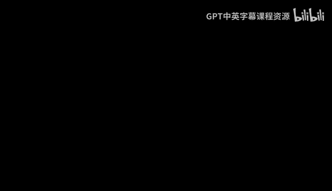

# 斯坦福大学《机器学习理论｜CS229M Machine Learning Theory - Fall 2021》中英字幕 - P7：-07-7_ Challenges in DL theory, generalization bounds for neural nets.zh_en - GPT中英字幕课程资源 - BV1jT421r71m

Okay， I so let's get started。So in this lecture， what we're going to do is that at the beginning。

 we are gonna to talk about deep learning。Especially some of the challenges in differ in theory。

And then in the next probably like5 to 10 lectures， we are gonna discuss。

Different aspects about deep learning， I guess you you see like over on top of optimization generalization so and so forth。

 So， so basically in deep learning theory， they are kind of like different aspects， for example。

 optimization， which we spend probably two lectures on later and generalization is another question which。

We probably will talk about for probably more than three lectures and at the end of the course。

 were going to talk about some other slightly different topics。So， so in some sense。

 you can view this as a kind of like all time for the next five weeks。So。

So to talk about different theory， I think it's probably useful to somewhat kind of like summarize the classical machine learning theory。

 which I actually didn't really talk about that much as you know from a bird as view that much in the beginning of the course。

 because I felt that。You know， it if you get too give too much information at the beginning it's probably a little bit too。

 too much。 So but now I'm going to kind of have a kind of like higher level view about， you know。

 what classical machine learning theory do in terms of different kind of like ices or different kind of like topics so。

I guess in the， in the， in the more classical machine learning theory， there are several。Things。

 so one thing is called approximation theory。So， so in some sense。

 this another keyword is called expressivity。Our representational power。

 if you see these kind of things， you are， you know that。Ppresentational power。

So you know that they are all about the same thing。 So what they are doing is really caring about。

Basically， you want to bond。Ill see the star。Which is the best。Mo都 in your family。So， so far。

 you know， until this week， you know， we always talk about， you know， access risk。

 We compare with the best model in the class。 And we said that if you can get the best model in the class。

 then you are done， right， But actually， it's not done because it maybe you are using the wrong。

Hpo class。 So your best hypothesis class in the family hypothesis class。

 the best hypothesis in the hypothesis class is probably not great。Right。

 so approximation theory is basically trying to deal with this。 right。

 Youre trying to understand whether your hypothesis class is powerful enough to express the functions you care about。

So， for example， you know， in a， in a kind of trivial case， for example， suppose you have some data。

Like this。😊，And。Right， something like this。Some positive data， some negative data here。

 You know that if you use linear model， then the best model， Line model is not going to do great。

 right， Because if you probably find the best linear model。

 you probably would do something like this。You know， I don't know。 So， so so in this case。

 you have you， you can say that， you know， I say a star wouldn't be great if you choose your capital state to be lean your family。

And， and then you can study， you know， what。Hpo cloud can contain a good classifier。

 even you have access to population data， so and so forth。Right， so in some sense。

 this is trying to understand how good。Can my hypothesis class H approximate the ground truth label function。

 right， So， so so that's the， that's one type of question。 So。

 and another type of question is what we discussed already。 So which is about the statistical aspect。

Ipect。Oh， sometimes feel call generalization。Theory。So this is about the accessories。

 as we discussed know in the last。Several week。 So， so you are trying to bond。From above。

 the difference between your learned hypothesis。From the best hypothesis hit the story。Right， so。

 and what we have done was something like。You you， you bound this by。L said hat。

 minus L had said hat。pl。I will see the star。minusus L height to your star。Right， so。

 and people have called this。The generalization error。Right。

 a general error is the difference between the population laws and empirical laws on the learned parameter。

 right so。So this is the g also。 Basically， the difference between trainingning loss and。太老。

Right on the learn parameter say the， if say the head is ERRM， then this is talking about ERRM。

 but maybe in other cases， you are using some other algorithm to find say hat that you want the transition error for that to the hat。

And this term， as we argued， the second term is always small。

 just no matter what hypothesis class you use， you know。

 basically as on your loss function is bounded。 And this term is always something like one over squared N。

 So， so basically， that's why we don't care about this term that much。O， so。And。You know。

 what we have done was something like you prove this con generalization bound of the。

 So you prove something like L had a hat， minus L had their hat deed by something like some complexity。

啊。Complexity。Over squared。 And I guess typically probably should write this。Right， so， and， and this。

 the principle here is that if your hypothesis class is。

It's of load complexity that you have better generalization error。Right， so。

 so simple hypothesis Oh like can generalize better。

So I think this sometimes also people call this outcomes razor。This is， I think。

 is kind of like philosophical principle， which was which states back to something like。

1100 or like some some around that time。 And the principle is something like。

Simple or postssimonious explanation can generalize better to other situations。

And you can see even from these two things where you can see that there's some kind of like a。

Conflict or trade off between the approximation theory and the jurisdiction theory， because。

 you know， if you。A very， very simple hypothesis class。 Then your LC C star may not be good enough。

 right， For example， for the data I do here， if you use linear model。

 then your LC C star is not great， but your generation error could be very good because your model is linear and simple。

So there's some trade off between。 and I think people also sometimes call this biascent virus。

 right So the virus。Mostly corresponds to generalization theory。

 It corresponds to statistical error introduced from learning because you have finite data。

 That's why you have to pay something that depends on how many examples you have。

 That's the kind of variance and the bias mostly is a quantity that only depends buy all the expresssivity is a quantity that depends on the fundamental power of your hypothesis class。

 It's not something that depends on how many examples you have right。

 so but the various variance trade of is essentially the same thing here。

 but the exact definition of bias and violence can only apply to。Basically。

 square square loss and linear model。 That's why we don't use the explicitly here。

 But the the principle for are somewhat related。So， and you can also kind of like， you know。

 extend this generation theory a little bit by saying that you can have。

You can consider the regular laws。 This is in some sense。

 you can consider this as an application or implication of the gization theory。

 which says that if you use regular laws。Or something like。嗯I有。Ill had rack。

Is something like L has theta plus lambda or theta， where this is a regularizer。

That captures the complexity of the hypothesis。 So then you can hope to have claim like this。 So。

 so you can have a statistical claim of the following form。 Of course， you know。

 this depends on exactly what you know， regulator use with models on and so forth。

 But the form of the claim is something like。If。Beta along the head is the global minimizer。

Of I rack， I hydr， then。就还不讲么最心吧。You can bond the access risk or you can bond either guess either the access risk or the generalization error。

I guess they are pretty much related， as we have discussed。Right， so all the generalization error。

Right so they are boundied by。buy something。So this is the type of results you probably get from this kind of statistical。

 the generalization theory， because you know that if you。

 the reason is that if you optimize this regular loss and you indeed find a very small regular loss。

 that means that your regularizer， the R theta， the complexity。Right， it is small。

 and also it means that your training error is small。 And then if both of these are small。

 then you can show that your access is small， right， because this model will generalize to the。

The population or the the test case。So， and， and then there is a third。Aspect。

 which is called optimization。Any questions so far？Right， so there's a third aspect。

 which is called optimization。 So the question is about， you know， how to。Nummerly， how to。

Fund say their hat right Sa hat could be the argument。Of the training laws。

 or maybe you can talk about。Sa had lumped the regular laws。I'm practice。Right， so。So， and。

 and this is a purely， you know， at least in the classicals。Way of thinking about this。

 You can basically view this as a separate question about。You。

 you can forget about where your data come from。 You can forget about， you know。

Why you care about minimizing these training laws， You just say that I'm giving this training laws。

 You know， that's my job。 right， so and， and typically the approach is something like， you know。

 you can， if the loss function is convex， you use convex optimization。

And and or maybe you can use greening descent for non convex functions， so and so forth。

 or maybe stochastic green descent。There are many different approaches。And。

 and when you measure the success， or you measure the interface is that you care about how well。

You can approximate the the minimizer。 you can never find the exact minimizer right using a numerical approach。

 right， So you always have some。嗯。Some small error compared to the minimizer of the empirical laws。

 And you can measure the error in different ways。 maybe measure the error in terms of the sub optimality in terms of how different。

嗯。Your minimizer is in terms of the loss function compared to the， the， the best minimizer。

 or you can compare other con of。So， so in some sense， I think from this kind of like a。

Kind of like the summary here。 You can think of the statistical part is。

Kind of pretty much independent from the optimization part。Of course。

 they are also you know interesting interface。 For example， you know， you can also ask about。

 you know what regular。 So when you write regular， right， So you can ask the question， you know。

 what regular can equally。Can simultaneously have good statistical performance。

 but also can be easy to optimize。Right， so， and by easy to optimize。

 it means that you can optimize it fast or maybe optimize it in certain time。

 maybe D time or D square times so and so forth。 So there are still interactions between different parts。

 But you just need， if you just need a。Kind of like high level， kind of understanding。

 You can think of think of them as kind of separate parts， right。

 The interaction are more on the lower level。Details about， you know， how do you achieve the。

 the best statistical efficiency or how do you achieve best， the best。

Computational and statisticalistic efficiency。 Then you have to talk about interactions。

 But at at the high level， you don't have to think about them。Seimaneous。

 you can think of them roughly separately。그 그 하지。有3。about about something。Sorry， oh， no， no。

 this is not a ratio。 Sorry， my bad。 This is just the two things。 There are there are。My by。

 my writing is bad。 So， so and these two qualities are are basically similar， right。

 So like you care about the access risk， which is the most important thing。

And but which is almost the same as the gization error so and actually you you bond the gization error。

 then you bond access risk。Sorry， my writing is。哦。Okay， so any questions so far。 So。

 so these are the the standard way of thinking about this question， these questions。 and。

 but what happens in deep learning， What happens in deep learning is that as you see。

 things becomes more complicated and for a fundamental reason。And。I think the。

 the first thing is that for deep learningening， there are probably two things that change， you know。

 at least on the surface。 So one thing that changes is that you have， you know， from linear model。

It becomes non nonlinear model。Right， so， and this directly affects the optimization because when you have non nonlinear model。

 it becomes non convex loss。Right， but this wouldn't， you know， change things， you know。

 wouldn't change the the the structure， right， like the the structure view fundamentally because it just become makes the optimization question harder。

 right， So at least at the beginning， this is what I thought， you know， five years ago， maybe。

Like more than five years ago when I was doing started to do different in theory。

Right after deepening took off。 right， I thought at very， very first， I thought that。

The only difference is that now your optimization question becomes harder。So， so。

 and then the question is just， how do you optimize better？

But then I think in probably like about three or four years ago。

 people realized that there is also another fundamental difference from the statistical perspective。

 which is that empirically you always use this so called over parametermetricized model。

Maybe it's not preciselyive to say that you always use overprimat model， but generally。

Over parameters models are better than like more parameters are always generally by or almost。

Always better。 So more parameters。Generally helps。And it can help even to the extent that when your parameters are more than the number of data points。

 right So it even helps when D is larger than N this still helps。

And it even helps when you have already zero training error。 So even after， even after。

You already have training。0 training error。So， so this is a plot that。系。

I got from some paper that this is from a paper by N about Tos She in 2015。

 So this is what they found。Of course， this is only a very small data set。 But the， but the rough。

 roughly speaking， the same phenomenon also holds for larger data set。

 And you can see here that the black。Curve is the chillning error。

 and the X axis is how many hidden units or how large network is。

 hidden units means the number of neurons in your network， which course which， you know。

 if you have more hidden neurons， you have more parameters。

 And actually it's quadtic in the number of hidden the the number of parameters。

 iss calledtic in the hidden neurons in this over in this fully connected case。

 This is a very simple， fully connected network on Mist。

And you can see that after you have more than 64 many neurons。You can fit Amnes perfectly。0，0% error。

 I think literally 0， maybe not exactly literally， maybe  point101% error， something like that。And。

And if you look at the a typical textbook， right， you。

 what you would do is that you would predict that the。

The test error will like go up after a certain point because you are overfitting。

 You are using too complex of a model and you are overfitting to the data。

That's the purpose thing which you would probably read from some of the classical textbooks。

And actually， it does happen in in some classical settings。

 but just not happen often in neural works， you know， or probably never happens in right。And。

And and if， and what really happens is the， is the right one。

The g error will actually continue to improve as you have more and more neurons。

 even though you are the。Even memorize everything， Right， So like Sir。

 So if you compare 64 versus 4K。Basically， these are just two neurons。 Oh sorry。

 These are just two neural works。 You know， both of them， both of them like a face the training data。

With 100% accuracy， but one of them has better test accuracy than the other。So。

So to this is the kind of a big mystery from， from a theoretical point of view。

 especially if you believe in the classical trade off between bags and variance or the trade off between the expressivity and theory。

 power， so。So this is the big open question， Right， So and let me， let me briefly discuss。

 let me discuss， you know， like again， like what， what's the impact on each of these。

 you know concepts， right？ And actually， you even have to rethink about some of these concepts。

 like how do。Like this， this， some of these concepts becomes。Entangled or intertwined。

 now in deeping。 So  first of all， for approximation theory， I think we don't really change。You know。

Things don't change that much， at least compared to other parts。So for approximation theory， I think。

Generally， I guess know， you know that， you know， large models are expressive。

And there's actually something called universal approximation theorem。

I'm not sure you heard of if you heard of it not。 in some sense。

 this is saying that if you have any work that is wide enough。

 then you can approximate any functions。 Of course， that's， in some sense。

 a misleading way to say it because， you know。What what does it mean by large enough right So if you need exponential number of neurons that's indeed very large that that's large enough。

 but that's not really implementable right so so empirically。

 you don't even need that many neurons to to be expressive。

 I think you just need polynom number of neurons。 But anyway。

 so the gist is that we do believe you know regardless whether this universal approximation theory is。

Exactly answering the question。 At least we believe that。The new works are very powerful。

 So we generally believe that your。The best model in this family。

 especially if you use a wide enough network， This is generally small。 This is what we。😊。

Generally believe， you know， And at least what you can show is that and at least。

What you can show is that you can say this is really small。The the， the minimum of the training laws。

 because if you have a neural network with more than n neurons。So this is just because。

With more than annuals。Then is the number of examples you can。

 you can show proof you can proofly memorize all the training examples。

At least you can find one network that memorize all the chain examples。

 that network may not generalize， but。You把 this。Already means that your minimum training loss is very small。

 It's probably 0。Okay， so basically for approximation theory， I think。We generally believe that。

 you know。The models are very expensiveive。And then that。Becomes the generalization part。

Which becomes， you know， quite complicated。So， so there are。

 there's one another kind of like information about what practical network does is that in in in practice。

Also， people don't use。Very strong regulation。 Only weak are weak regulations are used。

And this is kind of like a somewhat important thing to say， just because， you know。Recall that。

 you know， even the classical setting， right， It's not always that you can show。哦。

Like like sometimes， you know， you can have a ver so even the classical setting。

 you can have the setting there where you have a lot of parameters。

 but you have a strong regularization to compensate。So that's allowed in a classical setting。 where。

 for example， if you have a。Use a sparseity regression where you have a lot of features。

 The dimensionality is very high， but you recognize the sparsity of your linear model。 Then you。哦。

Wait， I think。Speaking of sparsely model， I think I forgot to do something that we are left last time。

About the comparison between medium modes， but okay let's。Anyways， my bye。 I think I should happen。

 But anyway， but let's， let's continue with this。 But anyway， so。

 so what I was saying is that even in the classical case， you do allow to have very big。😊。

You do allow to have D bigger than N， right， The the dimension can be bigger than N as thought as is a regular。

Right because if you use the regular， you implic it。Restrict the complexity。 For example。

 if you say that the sparsity of your model is S and S is less than n， then that's okay。So however。

 in， in， in deep learning， in practice， we only use very weak regular， right。

 So typically just some L2。At least you know， even with L2， you can work。 sometimes even without L2。

 you can， you can work pretty well。And， and also the， the regular strength is also relatively small。

 The， the strength is small enough so that you can still fit your channel data。

 basically100% with basically 100% accuracy。So and and another way to say the weakness of the regularization is that you can consider the following fact。

So the this regularized laws， right， if you just recognize with the， for example。

 you just regular with something like L2。佢什 lamb。The regular laws doesn't have。Unique。

Global minimize。So or at least it has very different approximate global minimizer， right。

 Maybe if you really care about the。The numerical precision， right。

 if you say like you care about the。like。10 like you care about very， very small， you know， accuracy。

 know， precision that maybe there's a unique global minimizer， but。But for practical purposes。

 you know， there are many different global minimizes that are very similar in terms of the training accuracy and or in terms of the records laws。

So， and they all have very small regular laws。 They have very small laws from the regular regular part。

 They also have very small laws from the Chi part。 and they are different global minimizers。

And it's also， another thing is that it's also not true that all of these global minimizers perform the same。

 so。This global minimizes prefer the say。On the test。

I guess probably's easier to just have a figure here。 I think I did prepare a figure。So。So。

 let's see， think。This is experiment that I've done。A few years back， you know。

 there are many different kind of like plots you can find online on different paper sector this。

 This is just one of them。 I actually took a little bit to exacerbate the the differences a little bit。

 but the the g is is the same。 So this is what this is the C far 10。 and you have two algorithm。The。

 the red one or the blue one。 And I'm plotting the traininging and test。

And this two algorithm only differ by the learning rate。 They have the same training objective。

They have the same regularization strength。It's just that the optimizer are different。

So at the end of the day， you see that both of these two algorithms found some global minimizer or approximate global minimizer。

 you can see the trainingning error is close to zero in both of the two cases。

Right under so both of these are global means in some sense。Or at least know。

 approximately mean up to very good approximation。But you can see that their test error are very different。

 So that means that these are two different global me for sure， right in the parameter space。

 and also they perform very differently on a test。😊，So。So that's the kind of the， the mystery， right。

 Because this kind of refute the possibility to have a theorem， like in the classical case， right。

 So in recall that in a classical case， typically have theorem like this where I'm saying， yeah。

So you have serums like this。Right saying something like if you find a the global minimizer or a global minimizer or any global minimizer of the regular loss。

 then you can generalize。 You can bond the generation。

And this is no longer the case because not all the global minimizers are the same， right。

 some of them are better， Some of them are worse， and you probably shouldn't have the same bond for all of them。

 And some of them probably just don't generalize at all。

 right So this is saying that you cannot just say any global minimizer generalize。

 you have to somehow distinguish different global minimizers found by different algorithm。So。

 so this basically means that， you know。And but what happens here， right， So what happens is that。

The optimization starts coming to play。 And this is the reason。 So basically， as I allud to。

 in some sense。Like different optimizers found different global minimumma。

 and some of them are better， and some of them are worse。

So thats is saying that optimization is not only。 So optimization is not only about。哦， finding。

Any minimizes， Any global means。If you just say you find a global mean， that's not enough。

 You have to use optimization to find the right global mean。So in some sense， the optimization。嗯。

The optimization have two jobs。 One thing is that you have to find something that has smaller error or smaller small error。

 small regular laws。 And the other job is that it also has to find。Something that generalize。

 It has to find a global minimum that can generalize。So。So in some sense。

 the kind of the picture is like this in my mind。 So you have this I'm。

 I'm using one dimensional thing right the the this is the parameter。

 This dimension is the parameter。😊，And basically， I'm imagine this kind of toy case where you have a the landscape of the training loss and test also at this。

 right， So the training loss has two global minimum。And one of them is a good global minimum。

 and the other one is a bad one。 and the bad one in the sense that the test corresponding test error is bad。

😊，And the optimization algorithm is not only responsible for finding an arbitrary global meaning。

 It's also， it actually has to find the right global mean instead of the the bad global mean。

But somehow， the optimization algorithm is doing something beyond what its supposed to do。Right。

 so I guess in some sense， you know， this is a one dimensional case。

 If you think about a high dimensional case， this is a something I often often use in my slides。

 It's kind of like you are。😊，'m going to a ski resort。 And the first time I came to America。

 I didn't realize that， you know， you can have multiple valleys or multiple parking laws on the same in the same ski resort。

 So I。😊，Like when I go back home， where， I just go to， I do follow breathing descent， right。

 I just go to an arbitrary kind of like a valley。 And I found that my car was not there。

 And then it's actually a trouble because the the resort is close and you cannot lift you up and。

So it's actually pretty annoying， but then I realized that actually they there are multiple global minimum and and one of them is better than the others so。

 so and you have to find it so so it's not like arbitrary breathing thesecent。😊。

the maybe the gradient thing doing something more than just the arbitrary donhi skining。😊，就到。三对。我说就是。

属于表述堆相的。状さ个。Right， so so why the the generation So the question is。

Exactly mathematically where the transition theory breaks down， I think。嗯。The bounce becomes vector。

 You know， basically， the bond you can prove becomes vectoruous。It in the bond。

 you can prove under this language， under the existing language becomes vectors。So， so basically。

 if you say that you want to prove a bond that works for all new network of size 10 million or of size like 100 million。

 right for only 1 million examples。 right， So if that's the language you are using。

 then it wouldn't work anymore。 So you have to have a more precise way。To think about it。

Does that answer the question to some extent，对我是。分同的。What would to incorporate in the time。也就个是据。呃这。

没有。Right， that's， that's roughly speaking。 that's the approach were gonna take。 But theres small。

 There's a one problem with this。 If you just do exactly what you said。

 there's a problem which is you're gonna get the same bond。For any algorithm。Right， but empirically。

 different algorithms have different。performanceformance。You， you know。

 and the way to fix it is becomes that you first say that different algorithm。

Find models with different complexity。 And then you can have different bonds for for the。

So so the algorithm has to come into play in some way。So， yeah， so basically， that's the。

 that's the kind of the conclusion here。 So the algorithm has to come into play in your。

Statistical analysis， right， because if you don't have the algorithm there。

 you are not going to distinguish these different algorithms， right。

So in some sense you entangle the statistics with optimization to some extent。😊，And， and。

 and and and now like so so basically like the way to fix it is is at least the kind of the current plan that the general kind of agenda。

 I think most of the researchers agree on。 seems to agree on is that you analyze the optimization and analyze why the optimizer。

 find a good local minimum。 So basically， you want to optimize。

 you want you need to have a theory that says something like the optimizer。Find。It hit a hat。

Such that the one they hit had is a global mean。That's probably approximate global mean of the empirical risk。

And also， two。Said the hat has some special property。That you didn't express say。

That is they should do。 right， For example， the property could be low complexity。So maybe。

 for example， why just to give you extreme case， for example， you。

 you run algorithm without any recognition。 But then magically。

 you say that even though I didn't let it recognize， but actually。

The fat height I found has low al norm。Or has the even the minimum L to now。 Actually。

 you can prove these kind of theorems in certain cases。So。

 and then because of the special property thing and this implies that it can generalize。Right， so。

And， and people have kind of like。Proof theorems of this kind of form in many different case。

 for example， you know， like。喂。So， so， so for example， you know， you can talk about SGD， right So。

 so SD probably has some， you know， special preferences in terms of what models they want to find。

 and maybe SGD with different kind of like specifications， right So you can have large and rich。

 you know， small batch and so forth。 I'll talk about that in a moment。 But generally。

 we want to say that the optimizer， the practical optimize people are using can have some preferences on certain type of global minimize。

😊，So， and then after you have this， right， like as I said， after you have the the special preference。

 then you can use the， So this part， right from the special property。

 the low complexity to generalization， this could be kind of more classical。 This could be classical。

😊，Theory。Right， or maybe improvement of classicalt theory depending on what complex measure you are talking about。

 right as you suggested。So， so that's kind of the， the kind of like the。

The current kind of like a status quo of expanding people on theory。 Of course。

 there are other kind of like approaches。 But I think this is。Pretty much， I think。

 kind of like the high level。People have almost reached a consensus on the high of approach here。

 I think。And， and what are the the the， the， the best results。 Let me have a brief summary of what。

 you know， are the best results people know roughly speaking in each of this aspect。 So。

 so basically， first of all， for。Oh， I guess， sorry。 So let me just make this a little more formal。

 So I guess， you know， a little more formally。So basically， you have problem three tasks， you know。

 in my language。 So first， you prove that。I guess， you know。I'm。

 I'm repeating myself a little bit in some sense。 you know。

 so improve that the optimizer converts to。Approximate。啊，loc。啊个萝卜面。Of Al high theta。

And then in a second task， you also have to prove that in addition to one。To one。The data hat。Also。

Has no complexity。For example， something like R said had。It's less than C for some complex measure。2。

And this R depends on the algorithm， depends on even the details in the algorithm。

 like learning rate a batch size so and so forth。And then， task 3。You say that for every the。

Such that。Our theta is less than C。And。Maybe L has datata is close to 0。

 So for every theta with low complexity and small channel error。We have。The test error。

I say it's also small。So。That's kind of like a a general idea。And， and what we have done， you know。

 what people have done in this kind of area。 So I guess。So regarding the task one。

which is the optimization question， right task one is optimization。

So I think maybe if you want to associate some keyword。そです。

People would call this the first question optimization。 and the first， the second question。

 people often call this implicit。Regization， effect。Yeah， probably should if。Explained。This because。

 you know。This is implicit because you never told the algorithm to minimize this complexity。

RightIt's implicitly in the optimization procedure。

 and it's a regularization effect because you get some low complexity solution。And the third one。

 this is probably like the the more less the classical generalization bomb， right？And for task1。

 I think。What happens is that if you don't have regular。So I guess sorry。 So for task one。

 I think for the optimization question。 So one of searching， you know。

 consider the case where you don't have。Over parameter。This is a。Over primary。You know。

 without over parametermatization in some special case。

 you can still prove this in some special case。😊，For example， matrixtri relaxation problem。

Maybe linearizing in might work。Or maybe something like ten。 you can show that green descent or H D。

Can convert。To六 global。So here， linear writing much work means that you don't have any activations。

 Basically， your activation is linear。 So you just stack a bunch of linear models。

 which doesn't really have any。Doesn't really do anything from a statistical point of view。

 It's just purely false。For at the you you only analyze that as the exercise for， for。

 for your technique in substance， But you can still publish papers in it just because everything about optimization is very complicated。

Even analyzing linearizing network work is difficult。So。

 so this is the one thing that people have done， but you can see that this doesn't really address the all the issues。

 right， because you don't allow over parameterization。😊，And it only works for linearized network。

 all matrix visualization problem like matrix completion so and so forth。So。And recently， you know。

 in the last three or four years， I think。 So you can also do this optimization question for。

 for new。😊，For other new artwork。For almost any artwork works in know， deep， you know。

 shallow so and so forth。 But with the caveat that you have to。For special。Highdperpar。

So special hyper problems means something like， you know， maybe like a。So first of all。

 you need over parameterization。😊，That's actually probably good， because， anyway。Emirically。

 people use overization， but the limitation is that you also need special learning rate。

Or an inization， special inization。And learning rate， so on so forth。So。And， and。

 and that becomes a problem。And by the way， this is called typically called N TK approach。

Neurotent kernel， which I'm going to talk。More in the future lectures。

And explain why this is called neurotent kernel。 So this is the so called NK approach。

And the problem with this approach is that this special initialization is a problem and also special learning rate or special algorithm。

 So you also have something， maybe。 So this is also。You also needed something about batch size。

 for example， in most of the paper you have to by the batch size to be very big。

 you can only analyze greening design， you cannot have like stochastic bi design。So this， you know。

This is kind of like the， the， the restriction on the hyperpar。 at the beginning， we thought， okay。

 that's not a big problem。 We we， we， we have this hyperpar。 And then next day。

 we probably extend them to other hyperparmeter。But it turns out that。

There is some serious limitation。In the hyperpar， because， you know， as I motivated before。

 even you change the lot schedule， right in the， in the figure we， we found。喂 so。This one。

 this is a real experiment。 Even you change the learning rate schedule。

 you change the the performance of your model。 So， so it's not so if you analyze a special learning rate schedule and you analyze a special transition。

 then maybe you are not actually analyzing anything impressive， right， So， so， for example。

 like in this N T K case， I think what we can analyze。😊。

The algorithm you can analyze wouldn't give you the best performance that deep learning offers。

 You probably get something like 80% on CF， but the best algorithm probably gets like 95%。啊。

Of course系 know第二。Improvements to along this line。 But generally the the， the issue is that you。

You make this hyperpar so special so that you lose。

The correct implicit regulation effect of the optimize。

And you you're analyzing an optimizer that doesn't have the correct imp placelic representation effect so that they don't generalize as well as as the real deepening algorithms。

But still， I'm going to talk about this because this is a very nice idea。 And。

 and in certain cases is， is pretty useful。 So， and then for the。😊，Ilicit regulation question， right。

 So the question about， you know， why the algorithm， why the optimizer prefers certain kind of like。

A low complexity model。 People have had a lot of results on special cases。So。😊，Special models。

Oh and actually maybe I should call simplifyimplified models。Simply。I I don't know why。

Someday somebody took my yoga mat， a yoga yoga break for some reason。 and I have to use the book。

Anyway， so special simplified。Models， and also special。optimizeims。But here。

 the special business in the inner special in the right way。

 So you're analyzing the effect of the optimizer。 So you。

You you focus on each aspect in each paper in some sense。

 so what are the models that people have analyzed， for example， linear regression。

This is something you can say and here you can say that you know certain initialization prefers certain kind of like models。

And you can also talk about logistic question。Tgistically yourer questions。And here you。

Well see that， You know， you can prove something like。Even the model just want to find the minimum。

 like even the model just tried to minimize the logistic loss。

 actually tries to find the max solution。So， and also for matrix sensing。

Or matrix strization problems。And and linear。New network。

So you can you can talk about this and also there are special aspects of the optimizes。Of course。

 this is a in sometimes sometimes there has to be a combination of the problem and optimizer because you know。

Certain optimizers wouldn't have input place recognition for certain problems。

 So you can talk about the GD， you can talk about SGD。嗯。And SD。

 I think there is actually also about the the the noise covariance。

Like what what core will give you the right implic recognition。 Also， the noise scale。

Which also matters。And you can also talk about for example droppot。

This is something you do in your optimizer， which will change the implicit bias。

 and you can also talk about learning rate。Which is also actually important。And batch size， you know。

 so and so forth。And， and also there are unolved open questions for technical momentum， you know。

 like rationalization， all of this has some in place regulation effect。 So so that's why this。

 this becomes you know complicated。 right。 So everything you do in your optimizer。

 everything you change， right would possibly have a in place regulation effect。

 Sometimes it's positive。 Sometimes it's negative。😊，Of course。

 most of the tricks that we have seen have positive effect because that's why they survive and they are published。

Right， so so， so。That's the city scope， I guess。And。And there are。

 I'm also going to try to mention a more general result that we have。嗯。

Like me and some collaborators have done。 So you can also。Try to have a more general results。

 which say something like， you know。SGD。I theta is roughly equivalent to do ingredient descent。

嗯 l has theta plus l lambda r theta。放心。2。For some regular this is。This is a result that we can show。

 like this is a much simplified， you know， the high level idea of a result that we can show。

 But of course， there are limitations， right， So this this kind more general result have weak。😊。

Weakness in other aspects。For example， you may have additional assumptions。

 or you can only deal with certain of schasticity so and so forth。But but I think from this result。

 you can see that， you know， this is kind of the things that we are trying to do right So if you do。

 if you add stochasticity， then you automatically implicitly， you got a regular for free。

 even though you you you are using stochastic waiting decide on the original training laws。

 but somehow you get optimizeizer for free somewhere。😊，Okay， so， so I think yeah。 So， so basically。

 we are going to talk about， you know， many of this， you know， in the， in the next few lectures。

 in the， in the future lectures。😊，Oh and the the for the for the task3 for the generation B。

 this is also like an interesting open question for deep learning， because。嗯。😊。

You also want to have precise generalization bonds that can be compatible with the。

 the regularizer you got from the previous part， right。

 So we have said that the optimizer has a preference。

 But does that preference leads to a better gization。 That's another open question， right， So， So。

 so， for example， you can have。Like， so one of the early， like one of the paper。In 2017。

 proof that for this。If you use a。This is the the complexity measure where AI is the the weights。

The weight。Of eye layer。So if you use this， then you can guarantee a generalization bar。

 that's one of the early results along this line。But the problem with this is that this is not precise enough。

 right， This is still too big， too demanding in some sense， right， so。

You you sometimes need more precise， you know， optimize， For example， if you。

 if you can guarantee that， I guess， you know， I will talk about the limitations probably when I really talk about this。

 but this is still not precise enough。嗯。And， and you sometimes need more funrant。More more fun。

 complexity measure that is more compatible， more fun。And， and also， ideally。

 you want something that can be。 that is a。That is the result of the optimizer。 right。

 So you want this， this regular here to be the same regular as what you had in the imp requisition effect。

So that's the third part。Yeah， I think that's a basically a high level overview of some of the lectures we' are going to talk about some of the lectures in the next few weeks。

And of course， there are other open questions in deep learning as well。 For example。

 what's the role of the pvamattization， right， So in this。In the last， in these task， you know。

 I didn't mention any of those so and so forth。 But for those kind of things。

 I don't think there's a systematic study yet。 So that's why we don't talk about them much for now。嗯。

And I think the for the intermediate plan， I'm gonna talk about task3 here first。

Because we are in this mode of proving generalization bond。 We。

 we have talk about radar mark complexity。 So， so， and all of this depends on the radar mark complexity。

 And， you know， I'm going talk about that first。 And then I'm going to move on to the other parts。

Any questions so far。还递告成告知。Sorry， I didn't hear the。な。当我这条。也比交通建一。你说刚。Yeah， yeah。

 I got the question。 Yeah。 So， so the question is whether any of these results or tasks， you know。

 depends on the data distribution。 Yes， they all depend on data distribution。 I think。

 so all of them assume some data distribution underlining。

 So some of them will require something stronger。 some， some of them。

Just require some regular condition， but I don't think you can go away。

Without any data distribution assumption。Yeah， and some of them had very strong data description assumptions to be fair。

And and that's actually， in some sense， one of the， in my opinion， that's one of the。

Tecical challenge here。 like， it's kind of like a a subtle balance。

 If you assume too much about the data， then you lose the。The realisticness。

But if you assume something too strong， then。Sorry。

 but if you receive if you assume two less about data， than you。You have some hardest results。

Like like， so， so certainly without any data assumption， you probably shouldn't approve。

 shouldn't be able to prove almost any results here just because things become MP hard。

 especially if you talk about all。Computational procedure。

 it's very easy to get into NP hard hard instance。So， so we need some data description assumption。

 And another kind of even more complex question is that， you know。

 how do you leverage your know data distribution assumption like we don't have a lot of tools So。

 for example， if you assume is sc， then what you know。

 you know something about what's the moment and so forth， right。

 you can do some certain kind of derivations。But I don't feel like we use the。

Even the property of forussian。Enough， in some sense and and let alone other kind of like data distribution assumption。

 we don't have a lot of good tools to use them。Cool， so。If there's no any other questions。

 I'm going to move on to the generalization bound for new works。十。

And you can see that this is still roughly in the kind of mindset of the classical setting。

 Even the only difference is that we are looking for proper， complex measures。

 not only the dimension dependency， but something more， sometimes more complicated。Okay。

And and you will see that this part is really a direct extension of what we have done in the last three weeks because the tools are shared and and it's really just that you need more。

You need better to。Okay， so， alright， so now let's。

So talk about the the particular setup that we can do。 So we are gonna start with two layers。

Toolular networks。And then in the next few lectures， we're gonna move on to multiple layers。

And for two layers， let's use the following orientation。So let's say your parameter theta。

Containents of two parts， one part is W， and the other part is U。So， W is the。The linear。

 the the second layer mu is the first layer。 So so。So basically。

 your new network F theta X will be something like W transse fee of。US。

Where you is a matrix and maps。Dimenssion D to dimension M， where M is the number of neurons。

So basically， U X will be M dimensional。 So this will be m dimensional， and you apply on。嗯。

Ele wise rail function。 So fee is element wise。R路。function。So so p of a vector Z1 up to Z N。

It's equals to basically， you apply the actual wise。 you get max。They one zero。2 max。Y 0。Right。

 so after you apply fee， you get m dimension vector。 and then you end a product with W。

 you get a single scalealr。So， we have a。Model that outputs a single scalr using these two layers。

 U andW。And again， we still call X I，Y， I， the training data set。嗯。As usual。Okay， so。So。

 our goal is that。We first show。A rather macro complexity bond。And， and then we also talk about。

 you know。好。😔，Its RC bound。Is a relevant to。To practice。Okay， so， and I think for the day。

 we probably wouldn't even be able to finish number one because I'm going to have actually two bumps one divided in the other。

 so。So here is the theorem for a random macro complexity bound。So， the theorem is that。So， suppose。

You have a hypothesis class that consists of models look like this， para much by theta。

Where you require that。Normal W is less than B， W。And norm of U I is defined by P U。

 I guess I didn't define U I。 So this is。Let me say this。 So you。Is this matrix of M by D matrix。

 And let's say each of the。Rose is U1 transports up to U。I'm transposed。Right， so。

 so each U I is of dimension D。 And so that's why。U times x is really inner product of this U eyes with x。

That's the not to use。Okay， so， so basically U is are rows of the， the， the weight matrix。

So we restricted the W and a norm of W and norm of UI to something like BW and BU。

And then we also assume something about。个。The the， the data has expected to norm square less than C。

I guess I should this is probably c square。I aty here。So， and then under all of these assumptions。

You can prove the radar marker complex bound。R N of H。It's less than two times B W。B u探 c。

10 square with m。Overscoed。So， I guess。Just a remark is that this is not ideal bond， not a good bond。

Because。I'm shows up。In the about。And actually， it shows up in the wrong way because it says that if you have more neurons。

You have a word response， right， So this is， this， the M shows up in the more classical kind of sense。

 right you have more neurons。 You know， you have more complex models than it's not great。 right， So。

 but this， you know， so basically， you cannot use this theem to explain the size of deep learning the over per model。

 because this is an overper model will have bigger。R mark complexity。

 but you actually want something that。Have you want to bond this better when I'm goes to infinity in substance。

 right to explain the plot that I。I kind of like show here， right？

So you want that as I'm ghost to infinity， you want a better and better bound in some sense。

 But this one， if youre worse and worse bound。But nevertheless。

 let's still prove this because this is kind of like a warm up for what we will show next。房是据本。嗯这。Re。

你然不会。I see。 So maybe let me refresh the question first。 Make sure so。所 you are。You know， it was。Your。

 the question， I， my if my understanding is correct。

 your question is that why you expect this right one is going to 0 is decreasing forever。Right。

 instead of like a really going up after a certain point， right， it's just we don't have enough。

Data points， right， like we didn't run that very super large skill experiment。

I think the answer is that。We do think this is already large enough for us to。

 to kind of believe that it will never go up。 like this because 4K neurons for this task is really。

 really a lot。 Like 64 already allowed you to memorize。 you typically you wouldn't even run so many。

 You probably just， you know。Maybe it would be easier to convince you if I show you。4 up to 108。And。

 and you see something like this。 And then you ask me the question。 I will。

 I will show you 1 to8 up to 4K。 you probably would be more convinced。 So， but， yeah。

 but 4K is already pretty large。 I think that's， yeah，😊，But， of course。

 you can never rule out the possibility that after meal， maybe you million neurons。 it goes up。

 It just sounds unlikely。I think you。The the you。确人。嗯哼。对。嗯这就。嗯哼完具。嗯。这个。that。我我。对。Right， so。

 so I guess the。II think the intention of the question was that whether this bond really is growing as Im goes to infinity。

 right， So because B W could be。Both B W and B U could depend on M。

 and maybe they depend on M in different ways。 Maybe B W increase as M goes to infinity and B U probably decrease as M goes to infinity。

 So that's definitely a possibility， right， So I think the thing here is I'm choosing this scaling so that。

Its。At least arguably fun to choose to think of VW and B to be constant。So why the reason is that。

This is only， this is probably the week。 So the U I is is the contribution of each component。Right。

 so所 the。So in some sense the。So I'm choosing。 So but W is the contribution of all the components。

So in some sense， you are saying the top layer， you control the contribution from all the components。

 And you want to say that that's the constant。 You don't want that to grow as M goes through infinity。

 because。Because so basically， maybe maybe one way to think about this is the falling， so。

If you think about the scale， the scale here does make some sense because UI is on all the flex constant。

And UI transse。At least at least a constant that doesn't depend on M， right。

 So U I doesn't depend on M。And U I transport X doesn't depend on M。

Here I'm writing this a little bit。I'm not you。 So here。

 say could probably have some dependency on the。 We only care about dependency on analyst。

 So U I is on a lot of constant。 and then you have some of W。诶 w i。F of U I transpose X。

Right so each of these terms on out of constant and your WI the total contribution is constant。

So that's why the total thing you can somewhat believe that this is on the order of constants。

Because your it's not like each of the WI is on all of constant。

 It's like the the sum of the squares of them is on all of constant。 So in some sense。

 you can believe that。This whole thing is on out of。Constant。Especially if you have。

I guess it depends on how you think about this， right， So if you sub sub replace W Y by1 square M。

 then this is actually。This is lety。 So this is。I guess depending on how you approximate this。

 like a rapid speaking， if you， if you use caution shores。

 you're gonna approximate by something like sum of W I squared a half times some of。

F UI transpo x squared。好。And。And this is something。呃没 see。Why this is a lot of con。

 Maybe maybe we actually even more generous than that， so。没错。TheL normal of W is a constant。But。嗯。

But I think you can still make this bigger。If all of them are correlated， right，Abouts。Okay。

 so I think this is。II'm pretty sure the answer I should have an answer， but I'm not。

I don't see I have a convenience answer right now。 So maybe we can discuss offline for a few minutes。

 Yeah， but I think the scaling is chosen to be at least， you know， reasonably correct。 You know。

 of course， you can still argue certain like there are， there's always a。For example。

 depending on how W correlateds with this race， there's always some kind of like a flexibility。

 but I think the scalingating is relatively okay。嗯。嗯。I know， but。

 but it's a very good question because you can have misleading results。 You know， if you don't。

 you are not very careful about the scale。嗯。Okay， so。Let's see。Okay， so maybe I have 15 minutes。

 I think I can prove the theorem。In the 15 minutes。知。So what we do is that we use the。

Definition of the right mark complexity and gradually peel off the soup。 So like we did before。

 we have a soup and we have to somehow get rid of it。我我。你说。Some of W times。系所。Oh by。So the。

Rightect's the one。你觉得。没有。which is。发生。but but difference so that's why I got， I， I don't know。

No I I was thinking to use the argument， but I think it's it's not going to be right because some of W I P of。

You are transpose x， I think。The most pessimistic bond， right， would be something like。

This is less than if you replace each of the W by 10 a square time。And each of these by constant。

 you're gonna have some of this。And this will be scrolled on。So then in some sense。

 this is not helping me to justify to use this game。So， right。

 But if you believe that there's some consollation。

So suppose you believe that there's a consollation here。Then this wouldn't be。

 this would be something on the order。Of。So， so basically if you want to。

 so if you believe in there cancellation， then it's a original scalingkating。Or in other words。

 suppose you want to make the skating even smaller。

S you want to say that I'm going to believe BW is even smallerer than。

The skating I give right or BU is even smaller than you have to。

Assumed the strong correlation your model。Otherwise。

 your model wouldn't even opt for something out all of one。So， so whether you are willing to do that。

 So， for example， suppose I I， I I， I tell you that this actually experience things， right。

 So then I have to。Convince you that I can choose B， W to be on the order of maybe。Maybe one。

 And then you are to be on all of form or sc。And， and then this wouldn't go。 The bond would， indeed。

 would would not。G as M goes to infinity， but。You find that some of B I feel of U I transpose X is very difficult to be big。

 You have to kind of match up everything to make it big enough to fit your label。

 So would you be willing to do that， I think you can arguably say that that's not。Really realistic。

Okay， cool。 So I guess let's。Let's as prove this， so the proof， as I said。

 we're going to try to remove the soup in the definition of the radarar complex kind of like step by step。

So first of all， let's define。Let's define we to be the。Post activation， the intermediate layer。

 right？It's meant P to be U times X， which is I dimensional vector。

And you can also correspondingly define。If find B I to be。The corresponding， you know。

 activation for the I example， this is in M dimension。And then using this notation。

 the rather marker complexity。Only empirical， something empirical and a more complexity issue。

Expectation， the randomness is from Sigma。And you take soup。We have some of。sigma i。

Transport times here right upstate of Xi。But I've said of X I。

 I'm going to rewrite it as W transse VI because。嗯。Just because that's the notation， right。

 so let me just replace this here。W transpose VI， this is F of X。

And then here you take soup over two things over both W and U and U is the depend on U is hidden in VI。

And let's clean up this to put the one hour your front and you have soup。Over。You and soup over W。

W transferse times one over n times sum of sigma。I VI。I guess this problem looks familiar。For you。

 because we did something like this in the linear case as well。And then you can get rid of the W。

 but you still have the U。So you s over U and you get rid of the W W has L2 norm bond so。

It's less than B， W， right， So you get。The suit of this is equals to BW times the L2 norm。Opt my eye。

 V I。Okay， so。So now we've get a rid of the BW， we can put BW in front。And now， let's。

Deal with the you。And you is something like。喂。I think I shouldn't have one over in here anymore。

 my bad。Snow。Let's this is Ive。 this is a sum from one to1。And it's re。

 It's plugging back the definition of。VI， which is feel of U X I。And。

What I'm going to do is that I'm going to do a kind of like a if you kind of get familiar with this right。

 you can see that this is a very loose way to do this。

 I'm going to replace the two norm by infinite norm。So， I'm going to say that。

This is less than squared an。Times the infinite norm of this。This is just because， you know。

An vector V2 norm is less than。Scro m times the infinite norm。And。Right， so if we is in。I'm the man。

Okay， so and now the reason why I want to replace it by infinite norm is can be seen later because can be seen now because。

Somehow with infinite norm， I can simplify the soup。So now have a soup。And。

Notow that what this vector is。 This vector， maybe let's。Do something here。 So this is a。

This vector is the sum of。A bunch of factors。Right the infinite norm is about the dimension。

 the coordinates of this vector。So， basically。Each of this dimension is easily。

Something like sum of Sigma I。P， U J X， I。And the sum is over eye。

This is the J dimension of this vector。So。So basically， I can take soup over J。And soup over。You and。

Some of sigma eye。P U J transpose X I。Iphone want。Alright， and I can actually also write U J here。

 because if I take the soup over J， you know， the Js entry only depends on UJ。So。Right， and。

And that's， actually。Kind of the main reason why we want to use this inol。

 Because once you write this， you found that all the Js。Are equivalent， right， So like like anyway。

 youre taking soup， right， So it doesn't matter whether it's U J or U1 or U2， right。

 So the soup is the same。So this is equals to。我是际说。能工中国。Is this the equality？Oh sorryrry。

 this is an inequality。So。Sup over U， a single vector U。 So you replace U JB by U。

And you say that this is needs to be needs to less than be you because U J。

You used to have a bond right I just skip it for simplicity。 So， and then you can write this as。

I see of。U transpo X I。In some sense， you remove the M dependency because for an infinity norm。

 the how many Ms don't matter。Does doesn't matter。I know。

There is one step where I'm gonna remove the。The absolute value because if you don't have the absolute value is it's kind of like you know。

 let's first remove it so by removing it requires Google pay a factor two and this requires something。

That is not exactly she will。But I will not prove it in the inches of time I guess。

So you can remove this。Absol value。 And the reason， you know， it' in the lecture notes。

 The reason is actually， you know， fundamental it pretty simple。 It's just basically。Because。The。

 the soup is actually mostly positive， like almost always positive。Like， like。

 because you have can choose the you is always possible。

 So absolute value without or without absolute value， doesn't really matter。At least for this case。

 right because。You are taking a silk right， So anyway。

 it's going to be positive because you can choose you to be to make this client positive。 anyway。

 so this is what I like this is。I will ask you to refer to the lecture notes for the formal proof。

And then now， after removing the apps value， you can see that this is。

Something like a biomarker mark complexity。Of something simple， because。This。

 you can view this as your functional。And this is the rather more complex of this kind of function。😊。

But still you have P and U right so so that's why we are going to use the eipes composition。So。So。

 this will be less than。To。You copy all the constant。So this is by the lipssus。

The the the I think the the lips composition or the telegram level。Telegram来。

So I think in some sense， you think of like maybe you can define something like， I guess， maybe。

It's prim to be the family of U transpose X。Right， and then you can also look at p of H composed with H prime。

So the rather macro P composed with H prime is gonna be equals to。It's this quantity， right， so。

 and this is less than the luus fee， which is one right。And you get its prime， which is this client。

可。😊，So that's， that's the how we do it。And now it becomes linear。

 So U transpose Xi is is a linear function class。 And I think we have done this。😊，Before。

 so for L2 norm constant linear class， I think you can get。

Something like this is less than two scrolls。B U over square over N。Times。Sorry， this is VW。

Time B U Time square root。some么。Ex slide。To not square。This is just by。啊。

By what we had for the利行 model盾。哦，就是。sorry， yeah， sorry。By拜。为咗啲钱。Where the two come from。So。

 the two come from。Here， this， this line。And this is the something I didn't explain， right。

 So like when you remove the apps value。So嗯。Can you get they are exactly the same。

Without listeninger to， is that a question？哦。嗯 I'm。I suspect it's possible， but I'm not 100% sure。

 So like the proof in the lecture notes。Do does lose， too。But。It sounds like it's possible， right。

 You can save that factor for two。Because the intuition I had doesn't really tell you why you should lose anything right so my intuition is that this quantity is always positive so the absolute value doesn't matter right so that intuition didn't tell you why you should lose the two。

呃。Well I really prove the things， I think at least the proof I figure out。

 or I read from the book maybe I figure out myself， I lose the two。 So maybe maybe it's because I。

I didn't do the right thing， exactly the right thing。Okay， so any。And then the very last step。

 you can take the expectation of the empirical rather macro complexity。

And this is the expecting over S。 then you just get。Like what we did before， right。

 So the expectation of this is less than c times squared n。 So you get this bounded by。

To squared M BWE U can C over square。It's because you use the cache words for this part。

 this is exactly same as what you have done for the linear models。Okay。

 so I guess this is a natural stopping point。 And next time were gonna to have a bond that。

Someone improved on this so that you don't have the explicit dependency on it。Any questions？Okay。

 I guess I'll see you on Wednesday。 soundss good。

