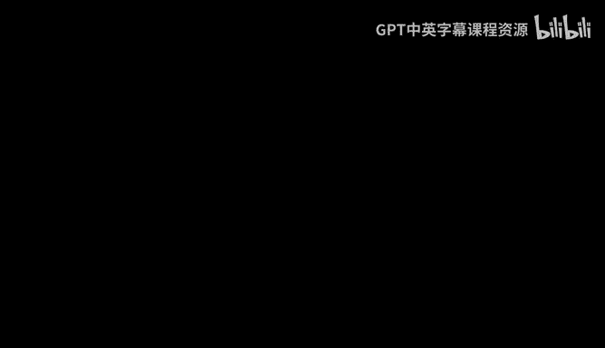

# 斯坦福大学《机器学习理论｜CS229M Machine Learning Theory - Fall 2021》中英字幕 - P8：-08-8_ Refined generalization bounds for neural nets, Kernel methods.zh_en - GPT中英字幕课程资源 - BV1jT421r71m

I guess so let's get started。

So嗯。I think last time what we left was。嗯。嗯。I think we covered。The weaker generation involved。

And then today， we are going to provide。A stronger general bond。啊，好的，你 work。

Let me just double check whether I。Sorry， think some'm how。I got confused where Im。Okay， cool cool。

 yeah， okay， yeah。 So last time what we did was that we had it。

Ceneralization bound of the form that you have something like something in the squared M in the denominator。

And。And today， we are gonna remove that script and you know， not exactly by just improving the bond。

 We also have to kind of like somewhat change the hypothesis class。 So that's the。

 that's the first part of the lecture。 And then we are gonna talk about。Today。

 we're going to talk about stronger。 So first， we talk about stronger version。

 and then we talk about some connections。To kernel method。

And then we will talk about even stronger bound for a multiple layering networks。

 and that requires some preparation with some techniques and we'll talk about those techniques if we have time today。

 otherwise we talk about those next week。Okay， so just to briefly review the setup。

 So the setup was that we have some data， which is consist of。Two layers。 And the first layer is。

I think this is called second layer， which is the the vector W。

 And the first layer is a matrix that maps dimension D to dimension M。

 and our model is something like。W transport fee of UX。And a fee is element wise， Ra。And。

So last time what we had was that we have this generalization bond。

Of the form that this rather macro complexity。Of H is bounded by something like two times B， W。

B U times C square n over n， where H is defined to be something like。Where your。You restrict it。

2 normal of W to be BW。 And you restricted the max。To normal you I to be。Be you。

And that's the hypothesis cost。And in some sense， if you。

 I guess we discuss this a little bit in the， in the class， you know， so， and also。

 I think somebody asked this question， in some sense。

 there's a scaling environment because you can so alpha times W。

1 over alpha U would be the same model I W times U， right。

 So just because you can scale the first layer by alpha then you downski the second layer by one over alpha If alpha is bigger than0。

 So that means that you can also kind of change this bound a little bit。

 and we rerite as something like basically， you can say roughly speaking the g I。

Its something like bound by all squared n over n。 Oh sorry， This is squared n over squared n times。

The norm of W。Times the max I。The max of the two normal fee。

 This is kind of the intuitive way we think about this。So。

So so today we're going to have a stronger bond that doesn't have the squared m here。

 but well have some slightly different terms here in terms of how do you measure the complexity of w and the complexity of E。

😊，Okay， so。So here is a refine bond。 Let me define the， let me state the theorem first。

So the theorem is that we define this complex measure that's called C of theta。

This complex measure is defined to be the sum of。The apps value W J times。The two norm of U J。

 and you take sum over J。And correspondingly， given this complex。

 actually can define the corresponding hypothesis class。Which is the family functions with bonnenet。

Complexy， something like B。And also， we assume that。The norm of X I is less than C。For every eye。

Notow that here actually， we have a stronger assumption of data because before we assume the average of the norm is less than C。

Or the， or the average of the square norm is less than C square。 Now。

 we assume each data point is less than C。 This is just the technicality in some sense。

 And with all of this， then we can prove that the rather macro complexity。

Of H is bounded by two times B times C。Overcor with。Okay。

 so maybe let me first start with some interpretation of the theorem and see why this is an interesting one to prove and then the proof。

So a few remarks。 The first one is that why this is， you know， better than before， right。

 So I'm claiming that this is strictly better。😊，呃。And before。At least in the following side。So。

 so if you really， you know， I guess。So the way that I compare them is the following。

 So before what we had was that， so before， what we had was that this generalization is something like square M over square n times this complexity is something like。

To norm of W times the this， as I we said。That's kind of the intuitive of thinking about it。

 If you assume the C is the constant C is just something about the data。

 which doesn't change actually change the the the hypothesis class is is really something like a constant and and now you can basically think of this new bound as big O of one squareroton times B。

 What is the capital B， the capital B is basically sum of WJ times。U J2 not right， So basically I'm。

The way I'm comparing love means is that I'm comparing these two quantities。

And they claim that the second quantity is strictly smaller than the first quantity。

And the reason is just that if you do some simple。In the quality， you can see that this is。Listen。嗯。

So you first do a cl your shorts。You say this is less than some of W J square half。And some of。

U J2 norm square to the power half。And then the first term becomes to normal W。

 And the second term is you can bond each of them by the max。 So you get。Im times max J。

U J2 nor squared a have。So what you got is square N times。W tur times max。谁。腰椎团咯。So， so this is a。

 in this sense， this is a strictly better bond and you know， they could be the same， you know。

 if your WG and UJ makes all of these inequalities exactly equal， but in other cases， it won't。

And in some sense， you can see one of the intuition here is that this new complex measure。

So another thing is that this new complex measure。See， theta captures the invari。

 captures the scaling environmentvari better。😊，what do I mean by that。 So。

 so what I mean is that so what what I mentioned， I mentioned the following scaling environments。

 right， So if you have W and U， this is equivalent to。Alpha W1 over alpha U， right。

 This is because like the the right is scaling environment。 And you can do this。 But actually。

 you have a little more scaling environment。 You can scale actually each pairs of neurons， you know。

 in this way。 So what you really have is that this is actually equivalent to you can。😊。

Scale each WI to something like WJ。You skill each of these。啊啊啊。

The J is coordinate by alpha G and you scale correspondingly one over alpha G times UG。

And you do this for a different scaler for every WG and UG。 And this is still the same。Right。

 just because， you know， the sum of W J。Ru。U J transpose x is the same as。阿 j w j feel。

1 over alpha J U J X for any U J for any skating that is positive。Right。

 so and you can see that if you consider this kind of environmentvari， still。

 this complex measure is the same。😊，Right， so the complexity measure is。It's really envient。

To the scaling here， Because if you change W J and U J， accordingly， you don't change the complexity。

 which。To some extent， it seems to be a good thing to have， right？So， so， so it's， so。

 but before the， the complex measure doesn't have this property， right。

 So if you look at this complex measure。If you escape each of the WJ。By a different scr。

 and you get each of the user by a different scr， you wouldn't。 this number would change。お。And。Sure。

这有如何。没有。没。呃。Right， so so you are saying that this， Okay， yes， So， yes， So this one， you。

 you do make a stronger assumption。いか？Sorry， okay I。是。It二 you。By by sea yes。Sorry。

 what was the question maybe I didn't answer？比如说。这是比较用。嗯嗯。No嗯。So， so， but I think I I。

 I I'm guessing what you are saying is before the。The， the condition was something like。

I think it's one over any times， some of X I。To square the route is license。

That was in the previous theorem， I think。Or， or， or something like。

 or maybe that was okay in the previous， we read this。对。It's less than C squared。So， so。So。

 so indeed， this is。 so the new condition is stronger than old one because the this one implies the old one。

 So， yeah， so I'm assuming that you。😊，Say this is not a problem。 Like you just。

 you just live with the stronger assumption， then our bound is tricky better。 In some。

 this assumption X is a little bit less important to some extent， because。For example。

 if any your data s the stronger assumption， then it's less important， right？😊，So嗯。Yeah。

 but you're right that the data assumption is a little different， but I don't think it's。

 it matters that much。嗯。所以。Right， right。 that， that's true。 that that's definitely true。

 Or you can choose the right C。 So， but I guess I think the question was more about comparing the two theorems。

 You know， you know， if you normal here， maybe you should normalize there。 So。

 so what's the fair comparison。😊，嗯。Cool， so， so this is one thing。

 one other thing about this complex measure， in some sense。

Like this complex measure is a little more envi to the。

 to at least the trivial environmentviron in the network。 So and also the， the bond is better。

 And also another thing that we have about nice thing about this is that。

About this theorem is that if you have M goes to infinity。😊，At least you get， you know。

 a stronger or equally or a stronger or equivalent。呃，0。So the theorem。Its stronger。So what， what。

 what do I mean by that。 So let me， let me expand this。 So suppose you look at a dependency on M。

 right， So this whole theorem depends on M implicitly somewhere。 I didn't specify that。

 But now let's make it more explicitly， let's say say HM is this complexity in the same thing， right。

 So where you you have M neurons。And also， C set is less than B。Alright， so forever M。

 our theorem applies。 So， but Im now I'm just making dependency on Mm a little more explicit。😊。

And you know that H M is a subset of H M plus1。In， in what sense， in the sense that， you know。

 if you have a function that is in H M， you can always， you know。

 add fake neuro or0 dummy neuro to make it in H M plus one， right， just so any。😊，I theta in H M。

 You can add。A dumy。牛肉。So meaning that you make w plus10 and U am plus 10。

And then you can extend this function so that it becomes in H M plus one。😊，So。

 so H M plus1 is always a strong。 It's a bigger family of functions than H M。 So， so， that's why。

 that's why you have a strong but the bond then depend on L， right， Like you have the same。😊。

Rather market complexity for every end。 So in some sense。

 your your your bound would be stronger for bigger an。So。

 so the strongest theorem would be you just apply it for H infinity。So， so， and， and that's actually。

 in some， the fundamental reason why later youll see that， you know。

 you're gonna have a generalization bond， at least a generalization bond that is decreasing as I goes to infinity。

 so。And that's another nice property of this。Complex measure。

 And also another small remark is that there's something called par par。

If you don't haven't heard of it， you know， probably it doesn't matter is this is a complex measure that people in that people proposed and people evaluate that。

People found that this is correlated with the the real generation bond empirically。

 and this is very closely related to the definition of C theta here。 So in some sense。

What you kind of see。the personal is trying to say that you look at all the parts from the input to the output。

 and you look at the total。Kind of norms of all the passes。

 And mean sometimes this is kind of like that。 you know， it's not exactly the same。

 depending on which version of the personal， but。But kind of like the way you think about this is that。

You look at the input X and so this is WJ and this thing is UJ。So in some sense， you。

 you look at the the So every par matters， right。 So So that's why you look at WJ times U J first and then you take the sum。

 In you can look at each layer first and then you multiply。嗯。Yeah， if you haven't heard of the past。

 what I said probably wouldn't be。Would't make that much sense like， but if you have heard of it。

 probably you can see the connection。 This is not super important。

 This is just something people have， you know， empirically studied。All right。

 so we'll talk about more implications of the theorem later， but before that。

 let me prove the improvement。Any questions so far？So how do we prove this。

 So you can see that the the kind of one of the main point in the proof is that you want to kind of like change the scaling in the right way because you want to capture the scaling environment。

 You don't want to peel off。 So before what we did was that we tried to remove the W first and then we remove the E right you have a soup over W and U and somehow remove each of them。

😊，Sequentialally， and now the the check， the the thing is that you still do the same thing。

 but you want to remove them。嗯。Sequentialally as well。

 But you want to first re scale things first and they remove them so that you can eventually get the right kind of scaling environment。

 I'm not sure whether this makes sense。 Like we can we you see like more clearly in the proof， so。😊。

So first of all， let's define this vector U， let's define u bar to be the normalized version of U。So。

 and then， let's start。With the derivation。So what we have is that the wider market complexity is something like this。

I put oneover in front just to make it easier。So you have， this is the definition。And I guess。

We do the usual thing。The first steps， the first the two steps are just the。Flugging in a definition。

I。And now we want to first re W and U before we take the soup。So what we do is that we。Write this as。

W j。U J2 norm。 So， and then we in insert the the fee。 we use U J bar transpose X I。Right。

 so in some sense， you， you put the norm of UJ outside of the fee。normalmal UJ is a positive number。

 so you can put it out outside of the fee。And。Sorry， I have a have a trouble reading this。

But I think I can remember what。Oh， okay， like there's a page segment so that I couldn't read what my notes were。

 Anyway， so， so you rearrange this a little bit。 So in some sense。

 we trade this W J times U J2 norm as our O W J。 And we want to kind of remove that first。😊。

That's gonna。 And also， you can see that this one is something that shows up in the complexity measure。

 The complex measure is basically the sum of those is less than B， right。

 The complex measure is really just the sum of W J U J2， to normal。 So ys ship over theta。😊，And you。

 I guess re writeite this， you change this。The order of the submission， So that。It's clearer that。

Of those times。I want to。U J5 U J bar trans X I。And here。

 I guess let's specify what the constrain of theta is。

 The constrain of theta is that C E Theta is less than B。

 which means that this W J U J2 norm is less than B。 right。

 So the constraint is really just saying at the sum of W J。You did two。

It's less than it's less than1。And now you can see that the sum of these quantities is S than B。

 but we care about the weighted sum， right， So we weight the each of the quantities by something。

 and then you take the sum。😊，Where'。S last。Oh， sorry， by bye。 There is a sigma。对。

This is the the best。The bed this is a problem where you derive things on the fly。

 just that this particular lie I couldn't read it from my nose。 So， so I I'm， I'm improvising， okay。

Thanks， so， and then let's okay， so we know that the sum of W J U J 2 is less than B。

 So that means that you can use the inequality here。So you say that you。So， you。I guess maybe。

 maybe let me just have。So this is like basically， you are applying this。AI， B I is less than。

 you know， the sub in AI times the max of B I。This is what I applied actually。

 I probably you should use J just to be more consistent with。So this is J from 1 to M。

 and this is J from 1 to M Aj。Bj。And AJ corresponds to。WJ， UG。

 tuon and BJ corresponds to this quantity。That's abstract what I'm doing so。You。

Live in this than you get。Basically， the sum of A J。Some of。W g。U J2 norm J from1 to M times the max。

over j。So in some sense， this is a hollow inequality。

 Right like the inner product of A and B is less than the one norm of A and the infinite norm of B。嗯。

And then this quantity now we got this is separate form。 This is less than B， right。So， then。

 this is less than。One over n times。这ig么？Times B times silk over theta。Max J。

Some of sigma I P U J bar both X。And now this， if you carefully compare this with the what we had before。

 this should look somewhat similar， familiar because in some sense， we。

We achieve almost the same thing as we have done before we。We remove the influencefl of W。

 and we want to have something about U。 And here， what you have about you doesn't have the scale anymore。

 You only have U J bar。So。So basically， now， what you can do is that you can say that。So。

 so from here is basically the same thing as the previous proof。 Let me try to repeat a few steps。

 So I guess one thing you can do is that you realize that this max over J is not doing really much。

 So what you can do is that you can replace this by max over a U bar。Where the norm of U bar is one。

And some。食乜爱。V U bar transfer Excel。So that's one thing we can do。Sure sure that's a good point。

 so I should have perhaps value so。I think I should have it here。And I should have it here。

 and I still should have it here。Thanks。Yeah， thanks for catching all of this。So， and then this。

 I guess。You probably also remember there's a step I skipped before where I remove the apps value by paying a factor too。

So you can do， you can this less than this。Silup。Right。

 and there was all of these are almost the same as， you know， it's exactly the same as before。

 And now you can pe off the， you can remove the fee by the the。

 the the the the lips conversation level or the telegram level。😊，睡觉。Get rid of the fee。

So this is T grand。And then， you can。Then this becomes the complexity of the linear model。

 and you do some thing。 And then you can get the same thing like 2 B C over scroed。

Where the sea comes from the。Come from the norm of the exit。So。Yeah， so basically。From。Basically。

 from after here， these are this part。The same as before。I guess there is a small difference。

 which is that。The U bar now is normalized to norm1。Right， so。So you just have a。

 so that's why you don't catch up。 So before， like if you look at the the proof before。

 what happens is that you don't have the， you have a some other control of U bar。

 You control of the U。 you， you know the normal U is less and B U。

 And now you know the normal view bar is less than one。

 So that's why you don't have the B U show up in the final bond because the normal U bar is less than one。

So in some sense， this is just almost the same proof。

 which the only difference is that you somehow remove the scaling of U first。😊。

You put the scaling of you actively in the in the W so that you can。

Organize this a little bit better。Any questions？Great， so I think next。

 let me talk about some of the， the kind of like the implications。Of the， of the theory here。

 some of them are kind of like interesting， so。I think one thing is that if you believe in a theory。

 then what directly we should do is that。This is not what people do in practice。

 but I would argue this is also close to what people do in a practice。

mBut if you just believe in a theory， what your probably would do is you want to define the following。

Max margin solution， right you want to do the max margin on the minimum normal solution。

 So I guess you can do。Maybe I don't do program one。Will you minimize the complexity of C Theta。

And with the concern that the margin。It started what。Right。why we care about the margin， we that。

 you know， all of this depends on the margin eventually， because， you know。

 eventually your generalization error will be the complexity over the margin。Or， alternatively。

I think these are exactly equivalent。So you can say that you maximize the margin。

And with is the concern that。Your complexity is less than one。So let's call this program too。

 and we can probably define this here。Gam I'm a star that I guess I probably don't have to define now。

So you can do this two program， right， So on this two program。

 the reason why you you want you want this program is because your generalization are a bound。

Will be something like。The generalization error will be。Something like I O theta。Will be less than。

I will say the hat will be less than。So you said I had over。加嘛面。Sa the heart。Over scton。

slow order terms。Right， this is the using the general machinery that we had， right， So。

 so you have one of our scton。😊，So like you basically have the radar marker complexity。

 This is the rather marker complexity。And sorry， I mean。This part is the radar mark complexity。

 This corresponds to the rather macro complexity。Of H， and this is the margin。嗯。

Right so that's what we got from the margin theory。对直播。差不到。啊， the个 is很低。如果。AndThe it just seems like。

変と。嗯。嗯。I think。Depending on。I think you are basically right。

But I think I would say this is already something。Like we already achieve something because。This。

 I think maybe the right way to think about this is that。You compare this two in the。To。2 things。

 right， So in the very idealistic way where So for all the WJs are the same。

 all the UJs are the same。 then these two bonds are just the same。 So then you are right。

 You are just folding。 You are just changing a form of your bond and nothing really changes。

 right you somehow fold the group and somewhere。😊，But the。The thing is that this is not tight always。

 And， and you probably shouldn't expect it to be tight。 It's not。

 It shouldn't be the case that all the WJs and UJs are the same。 You probably should have a decaying。

WJ， as you have more and more neurons， you're gonna have smaller， smaller W J。 just speak， no。

 like there's no way that this is tied for all I， right， So like it it can be tied for all for one I。

 but if you add more neurons， it wouldn't be tight。 So so the typical thing would be that the。

You have more as you have more and more neurons， these neurons probably should you know have smaller and smaller norm because they are capturing like more and more complex subtleates in your function in your ground truth function。

 right so so basically I'm saying that this inequality wouldn't be tight in the idealistic in the ground choose function。

 for example。Right， so， yeah， but， but from a very technical point of view。

 I think that's only we only did a very small trick to， to change the form。后对。就你后。

WithThe other round the that you are。然后。嗯。Yeah， I think you can say that in some sense， yes。嗯。

Or at least the other bond would be。Yeah， I guess depending on how you think about it。

But I think the the way I think about this that is， is really just， okay。

 the way I think about it is that these two bonds are exactly the same when all the WJs and UJs are the same。

 like they are all， for example， constant or something like that or maybe all one over scroll time。😊。

So then you don't gain anything from this， right， So。

 but but it would be much different if you want to find a function where your WJ and UJ goes to 0 gradually。

As you have more and more new rooms。Okay， so。Right， okay， so going back to the g bond。 So。

 so I think the g bond in some sense motivates the the use of this kind of like maximum solution or the minimum norm solution。

 just because。Eventually， your your radar mark complexity depends on the complexity of the the model。

 And， and you also have the margin term from the， from the margin part， from the loss part。So。

 and one of the interesting thing is that this quantity， if you think about this quantity。😊。

And this quality can， you can show this is not increasing as M goes to infinity。So。

 and the reason is actually pretty simple。 So， but maybe let me write down， just to be。To。

 to be clear about what I really mean。 So let's say， let's you say the had M to be the minimizer。Of。

 of say program one。Right， so and M is to in to index which how many neurons you are using。So。😊。

For every M， you have a minimizer， and you can define gama Im star to be。To be the。

 the solution of the to be the corresponding margin， right， you can define got I star to be the。

The margin is the constraints that stay theta。So let's say define this to be on on I star。Right， so。

I think I'm。I think I want to define this to be 2。 So let's， let's， let。

 let's mostly use two as my or main thing。Like a。A little bit title here。Okay， so。

So suppose you this program too， and you get this max solution right， so and then。So you're bond。

 So this means that。The bone。诶。See Se had an over Gama Min。So I had M over squared N。

 And because we normalize the C， the complexity be1。

 So this is really one over gamma M star times squareed。Right， this is the gization box。

 So basically， whether this bond is better or not depends on whether gamma M star is increasing or decreasing。

And interestingly， the Gm Im star。Is increasing。This is a。And this is in some sense。

 almost by definition， why this is because if you think about what that the gamma star M star means。

 it means that the maximum margin you can achieve when you restrict your complexity to be less than one。

Right， and also use M neurons。And the thing is that when you have more neurons。

At least you would achieve the same margin， you shouldn't be worse。

 just because only like right so with more neurons。You never get worse。

can at least achieve the same margin by adding just the dummy neural and kind of exactly the same argument as I had。

 right？Atd list。Ichve the same margin。Because you just either du me new wrong and it doesn't change the functionality。

 It doesn't change the complexity。 It doesn't change the margin。 It just everything is the same。

But having more neurons give you additional flexibility。

 You could possibly kind of like change your neurons a little bit more cleverly。

 instead of just adding a dummy neuro。 That's why your margin。

 adding one more neuro will potentially make your margin bigger。So， so at least you know。

 you never getting the margin smaller by adding neurons。So。

 so that means that this bond can decrease as M goes to infinity。

At least it is not increasing as M goes to。So in some sense。

 this is a kind of like the the nice thing about this compared to other bounds where you have explicit depend on M。

 If you have explicit on M， at least， you know。😊，If you just look at it you wouldn't be able to argue that this bond is better。

😡，So， so now you can say this bond is better as I goes to infinitefin。 Of course。

 this doesn't really say。😊，This doesn't address everything because this is just the upper bound。

Right， it's not like you are saying the actual generalization error is decreasing S M goes infinity。

 That would be the ideal theorem you want to prove， right， that's that would match exactly the。The。

 the， the price I showed last time where you have more neurons and your your your accuracy is improving all your your errors decreasing。

 right， So， so here you're only talking about bonds， right， So if the bond is loose。

 then it's unclear whether this。Decreasing M thing is， is really a big deal。 And that's that's。

 that's indeed true。 So， but I think this is a， you know， in some sense， this is a starting point。

 right， So if your bond is increasing M， that is completely useless， right。

 your bond is decreasing M， that doesn't really mean that it is is' super powerful。

 But at least that's a good sign to have， right， That's， that's a good thing to have。😊。

And and and in some sense， it's really very， it's really hard to capture。The exact。啊。Test error。

 So if you don to say that the exact test error or the generalization error is decreasing in an。

 that's basically the only thing you can do is with with Liium model。 At least so far。

 the only techniques I know is that you just literally compute exactly what the test error is on Liian model。

 you can do the。😊，Analyical derivation using linear algebra to simplify them and in certain cases you can show indeed。

 the error is decreasing。😊，As I'm ghosting invade， this is a， this is actually a pretty。😊，Pop。

Diction in the last few years， like people have done this for。Various kind of linear models。

 but basically only with two K2 linear models。嗯。Right， so， so here， you know。

 we want to work with might work。 So， so we have to。Kind of somehow live with a weaker result。

 You only say that the bond is decreasing， but not the actual error is decreasing。Okay， so。

I guess the next thing I want to say is that。Is actually， okay。

 another thing that is this is different from this program 1 or2。

 They are still different from what you do in practice， right。

 You probably don't do exactly this complex measure。 Nobody regulates it like that。

 You probably somebody tried。 It probably wouldn't make a difference。 And。

 and and here what I'm gonna say is that actually， it's interesting that this complex measure。😊。

This complex measure is definitely different from L2。 complex measure， right。

 But once you minimize the complex measure its the same you get the same effect as minimizing L2。

 like minimizing L2 is the same as minimizing this。 maybe let me， let me just clarify what。

 what does that mean。 So basically my， my main point here is that if you maximize margin。呃。So sorry。

 you can。 So， so you can。 So can be done。By。Minimizing the cross entropys。

The one that with L2 regulation。So here I have two things。

 One is I'm using cross entrepreneurs and the other is I'm using L2 regularization。

 I will do do one of them as step。 So at the first。

 I'm going to first use L2 regularization instead of the complex mesh I defined。

 and I'm going to say that it's actually doing the same thing。😊，So here's the first timema。So。

 so suppose you consider。The one we have considered。 right， So let's call this J1， which is。

You minimize the complexity with the constrained margins。Larer than one， by the way。

 I I keep changing the Sometimes Im I'm minimizing the complexity with the margins。 rather than one。

 Sometimes I'm minimizing the margin with the complexityities that than one。The somehow， yeah。

 I probably should make them all consistent。 But just in my mind， they are always the same。

 So sometimes I forgot to， sorry， I I should probably just keep， keep， keep a single version of it。

 But， but they are the same。 they are just like a equivalent because。哦。Yeah。YeahSo， anyway， so。

 so here Im and minimize the complexity with the margins larger than one。

 And I'm claiming that if you look at another one， which is you minimize the L2。Think the L2 norm。

And with the contrain that。The module is rather than what。So these two。嗯， other say。So obviously。

 these two functions are not the same， right， The， these two complex measures are not the same。

 But if you minimize the complexity， the extreme point actually turns out to be the same。😊。

Which is kind of interesting and the proof is like follows so。😊。

I think at least one thing you know is that。诶。The， the regular， the L2 regulation。

 What is that This is L2 regulation is the sum of the squares of all the parameters。

 which is some of W J square plus sum of U J to norm square。😊。

And you can show that this is larger than the complex measure we have defined because you can use the AM M GM。

 So you can say this is W J square plus。U J2 norm square and you use。I think this has got AM MG。

 I inequality of。YouFor me， everything is cautious。 So J inequality。 So but anyway。

 so you get W J terms。You did too long。Times 2。And you cancel this too。 So this is the set。Right， so。

 so you， so you are minimizing。 So in J2， the program J2。

 you are minimizing a larger complex measure。But I guess， you know。

 the intuition is that even though you're mini a larger complex measure， but when you。

The extremetreal points。Actually， we'll make these two things the same。 So the intuition is that。😊。

The extreme point。Should satisfy。Should satisfy W J is equals to U J。

Even you are when you are minimizing I2 regularization。Right。

 so and if that's the suppose that's the case， then you can kind of believe that these two things are the same because when I'm minimizing L2 regularization。

 if the extremet point satisfies this， then for this case， if this is true。

 then C theta is the same as。😊，The al two。So then you' are not really doing anything different。

 So that's kind of the intuition。If you really on to prove this kind formally。

 I guess the simplest way to prove this is the。Following。So， so， so you you， you say that。

 I guess this implies that J2 is larger than J1。And you want to use in intuition to show that J1 is bigger than J 2 instead is' larger than J2 as well。

 So what we do is that we say that。非常。I a minimizer。Of one。Of J1。Maybe， let's call this。

I think let's call this， maybe。3， and this is 4。So。That is that a good number。

 That's probably not a good number。 Let's called this。P one and p two。So minimizer of P1。

And then what you do is you construct。So you get a theta that is the minimizer of the first one。

 And you want to construct a theta prime， which。I。Its very good on the。On the second。

 in terms of the second program。 So you construct a set prime。And what you do is that you say。

 I'm going to take WJ prime to be the renormalized version。Of the of W J and U J prime。Again。

 to be the really version of UT。And then you can verify that because I'm just a change in the scaling。

 U J。Times p of W J transpose x is the same as。Sorry。

 Wj times phi of UD trans x is the same as before。And also， W J。In terms of the complexity measure。

 they are also the same。After doing this transformation。Okay， and， and this means that。C城。

Its the same as C the prime。An F theta is the same as F theta prime。

 So the functionality and the complex measure didn't change。And。

And what's interesting is that for sale prime。C the prime is also equals to。The L2 norm， because。

Because my construction， okay， why I'm doing this construction。

 I'm doing this construction because I wanted W J it to be equals to the norm of U J。

This is why I choose dessert。すげ。Anyway， I think this should be like this。嗯，哦， sorryorry。Wai。

A I right， I not dislike like this。Right， so you can verify WJ is the same as。The u。This， So because。

And， you know， this is actually my design in some sense。 like you can verify this， you know， like。

 but， but this is， like， you know， if if， if this is true， I should change my design to make it true。

 But that's the， that's the point， so。😊，So， that means that。So what does this mean， This means that。

See the prime satisfies。Constraint。So all of this means that city prime constraints of P2。So。

 that means that。See the prime is less than。is is bigger than J 2。Right， and。

Since the prime is equals to。And see the front。It's equals to a half theta prime。

Square is equals to a half。啊。Sorry， see to the prime。It's equals to。O。What is this equal to。

 This is equals to。你 see what's going on。嗯唔。I want to show that P at the prime is equal to J 1。

 This is because。Al， this is， this is just because t theta prime is equal to C theta。

Whi is equals to J1。ok。I didn't change the complex measure because I'm just really scalingkating。

 So that's why J1 is bigger than J 2。And before you get there2 is bigger than J1。 So that's why。

J j two and j one the。Yeah， actually， I was a little he。

 I was a little hesitating whether I should show this proof or the a more intuitive another version。

 which is actually electionals Ins， There's a such a different way to prove the same thing at the end of the。

😊，Everything is relatively simple。 It's not nothing really hard。

 So this proof is very easy to verify。 And the other proof is kind of like， in some sense。

 carries intuition。 intuition is really just what like what I said。 at the extreme more point。

 this under， W J and U J2 norm has to be the same。 So these two complex measure are not different。😊。

So that's the investmentment intuition。嗯。Cta prime con satisfies the constraint P2。

 So the constraint is only about the margin， right。So， the margin。

It's only about the functionality of this model， right， So if you predict the same thing。

 your margin would be the same。Right， so say parameter theta have the same functionality because you only rebalance。

The， the scale， right， You just multiply W J by something on。Divide U J by something else。 So。

 so the functionality is maintained。 So that's why the margin is the same。嗯不是所有的。玩玩的就是我。In the why。

 there is no here。So here。This is the equality。嗯 the。Oh， sorry， sorry， sorry， sorry this。拜0。Why。

 this is a record and this is in a拜拜。嗯。Okay， great， so。Okay， so the first thing， okay。

 so the first Lama we have to show。 Okay， what we have done。

 Were basically saying that if you minimize the L2 norm， it's the same as minimizing this。😊。

A complex measure。Okay， and we also wanted to do the cross entropy。

 And this is something I'm not going to prove， but I'm just on state statelema。

 And if you're interested， you can read a。Read a paper about it。 Like， you know。

 the proof is actually relatively simple， but I think well probably have time today to。And do that。

 So， so the lemma2 is that if you consider。A regular。Cross entrepreneurs。

And something like L hat lambda theta， which is equals to one over n。他们是。I guess in this lecture。

 this is the first time I have ever talk about what cross entropy laws。

 but I I assume that you somewhat。No what they are， right， This is the。

 the laws for logistic regression。 right you have Y， I times F theta X I。

So this is your input and the loss is the log of one。 So the loss， in some sense is really。

Log1 plus exponential minus T。This is the logistic loss。And you， you add some la。

Times L to recognition。Suppose you do this， and。Unless say that。Tter love the heart。

 be the minimizer。I'm going to claim that for small enough， Lada。

 say the head Lada is basically doing the same thing as the max margin solution。

But there is a small thing that I， I have to deal with， which is that what is the norm， right。

 Because the max margin thing is is you need a， you need a norm。 you need a。

Basically need to care about the ratio between the margin and and norm。

 So so that's why my statement is that。嗯。Okay。嗯。I I don't know why。Okay， yeah。So then。Okay。

 my statement is something about this。 It'， it's like this。So basically。

 you can say that if lambda goes to 0 for small not enough lambda。灯。The norm versus the margin。

Will goes to。谢华。J1， which was defined to be。The max the the minimum norm solution， right。

This is just， I'm recalling the。Defin， so basically。

 you are converging to the max modern solution or the minimum norm solution。Up to a sc。

 because here I'm looking at the ratio。 So this， when you have a small， a very small theta， you。

Sorry， when you have this very small Lada， your normal of theta would be something actually pretty big。

 That's because your organization is too weak。 So you， you are gonna get very big norm solution。

 But if you normalize the norm with the margin， then you you found that this is actually the max margin solution。

😊，I'm not going to prove this， I guess if you're interested， this is a theorem 4。2。😊，Of a paper。

 I wrote。With。Collaborators， and actually， thisem is is actually very simple， like。😊。

And actually it works for not only the L2 regular。 it works for almost all homogeneous or like almost all regulationss you can think of。

 So， so the gist is basically saying that if you care about the max margin solution which respect to certain complex measure。

 right， So the complex measure could be L2 in this case， it could be something else。😊。

Like here it could be anything right so one way to achieve it is that you just add a very weak regulation in your cost entrytropy laws and that will give you a max margin solution。

O。Any questions。そ。Yep。Yeah， so the the general kind of like logisticist is that suppose you care about the max margin solution。

 right， but max margin solution requires a complex measure。 right。

 You need to say I'm minimizing the norm。 such a norm with the margins larger than one or I'm maximizing the margin with some constraint。

 right， There's a norm， right， So there's a complex measure。

 So if you want to get that max margin solution， You just put a complex measure in the。I hear。Right。

 so， and with a small enough longer。Then， and you have cross entropy laws。 and then。The solution。

 this will give you the maximum solution。Of course， you can look for the maximum solution， you know。

 just directly by solving the program， but you can also do it like this way。

 And this is something that seems to be more。😊，Typ。

 like at least this is what people do empirically all the time in some sense， right in some sense。

 this is just linking。What people do empirical Paraco with the max margin solution。

 which is not what people do that typically in deep earth。嗯。Right， but， but there is a。

 but the caveat here， if you care about the broader interpretation。

 The caveat here is you need the Lana to be very small。 So basically。

 this is saying that if you use a very small Lana， you get a maximum resolution。 But empirically。

 actually， you don't use that small lana。 You actually use something。Bigger than it。

Bigger than this infinite testimal small lambda。 So， so， so empirically。

 probably wouldn't get exactly maximum solution。 You're gonna to get something similar to it。

 but not exactly the same。And actually， it's kind of interesting that like。

 I guess probably for CS S 29， like you have learned like a max margin solution， right。

 So it sounds like the。😊，Before deeping， that's the， that's the right thing to do， right。

 Like but even like a。Even you look at the linear models， it's never， at least I haven't seen。

 I'm not， I'm not like a practitioner。 I I do a a theory。 But when I do experiments， I've。

 I've never seen that。Maxim margin solution is the best for linearer model。三号。Its。

 it's like when you use a very small Lada， you do get max margin solution。

 But if you use bigger Lambda， sometimes it's a bit better。😊，So。

 so I think max solution in some sense is just a theoreticalorore approximation of what people really do in practice。

嗯。All right。So， let me see。So the next part， I'm trying to。

 I'm trying to connect this this deep learning thing， this， this deep learning not very deep。

 like two layer network thing with the the so called L1 HM。This is also kind of like a。

 I think people like the exact， kind of like a。Sing it is in my paper as well。 like a。

 but it's only a like a free paragraphs like in appendix。 And we are， we are not really inventing it。

 We， we just。In some sense， said's something that people already knew like implicitly without thought that it's useful to write it down。

 So， so so so the so the general thing is that you want to say what we to claim is the following。

 so when to claim that this is really doing。What neural network is doing with this two layer network and the max margin solution is really just doing something like L1 SVR。

In some future in some kind of feature space。So， but let me explain， you know。

I guess I haven't defined what L1 SVM is， right， So you probably familiar with SVM。

 That's the so called L2 version of the SVM。 So here you are gonna have a select different version of SVM。

 So the the the kind of the， the idea is that first of all， let's look at infinite number of neurons。

😊，Because we have claimed that you know more neurons is always better。

 so why not think about infinite number of neurons？

And let's see what infinite number of neurons will do for us right so you look at the max margin when you have infinite of neurons。

 this is the largest possible margin you can achieve。😊，With even infinite number of neurons。

 And suppose this is achieved。买。摇啊。算 of first。You need inferom of neurons， probably so many neurons。

actually this you can achieve this without number infinite number of zero， so you can achieve it。会。

I think n plus 1 euros。 N is data points。So but less say you have infinite neurons just like basically infinite is not very different from n plus one neurons。

 as long as you have more than n plus one neurons， you don't really gain anything more from this。😊。

So。And let's again， you bar is the normalization of you。

So I think we have kind of play with this like a lot of times， right， this is equivalent。wo w one。要弯。

To norm， U1 bar， so on and so forth， right。This is what we have。 Let's call it setup setup。

I think I call it a Tilde in this case， and I call this one W1 Tilde。Okay。

 so we have kind of like a then is risk scaling a lot of times。 And we know that if you rescale this。

 you don't change the complex measure。 And， and here， the complex measure is。Right， the W J。

 U J2 norm。 And this is the。JustWJQ的。Absol value。 So this is the one norm of W J，W Tota。

So that that's where the one I'm coming into play。So basic good idea is that。

After you change this viewpoint， basically， you just view W1 W1 tilde as the variable。

And then you are doing some kind of like sparse linear regression of sparse SV。So so formally。

 what you can do is that you can say you can pretend。嗯。So， every。You and。

Sere on a sphere S T-1 is the。The dimensional sphere。So it pretend every you in the sphere shows up。

In the collection of you bars。Right once you pretend that you and why this is possible。

 this is just because adding more neurons is never a bad thing， right you adding a lot of neurons。

To the to the U and you just set those corresponding， this is just because you can add neurons。啊要要地。

And zero， right， you just add these things， it never change anything。

RightIf you don't see any neurons in this collection， you just add。This new into the collection。

 and you added 0 as the coefficient。 It doesn't change the functionality。

 It doesn't change the complex measure。So that's why you can pretend that the collection of E went up to U U M and。

I guess there is also more， you have infinite of this。

It's really just a collection of all the possible。Unior vector on the sphere。

That doesn't really change anything。And and once you have that。

 then so once you pretend that this UJ bar is just。Eals to S D mass1。

 Then you can take a continuous perspective。 You can say that this F theta t the x。

It's really something like some of， right if you read the。Disqui version， you got this。

 but you can say this is。You can think of this as a continuous version。

We for every you bar you have a W。And you are integrating over all the you。

I'm not sure about this make。 any sense。This is the。The simplest way that I came up with to。

Defund this without。Talking about whats a。this is one way that I came up to expand this without too much jargon。

 but of course I don't know whether this works for everyone again in electronics there's a slightly different way to introduce this。

😊，Which requires a little more drug I don't know， any questions。Oh sorry my。

 why write the sigma here？是。Yeah。Sorry， sorry。O。呃。Yeah这是我。对。Right， okay， yeah， Can we have An。

 So the question is whether we can have Anng Kong full number of neurons。诶。嗯。Here， this is not soup。

Super like。This is just a concept of like a， like， for example。The same question could。

 you could ask the same question about why you can。 when you define an integral， actually。

 you are using the count number of。Deisreization， and if you take the limit。

 you can still get something uncomfortable。 So， so this is kind of the same thing。 is is it's yeah。

 And also in some sense， I eventually， this thing。😊，It's kind of like just a language in some sense。

 It's not really like you implement the integral in in， in the。In practice so。Then make sentence。

 Okay， so and。And。And basically， I think if you， if you see this， this is kind of like what you can。

 The way you can view this is that you can see this is a W Tda inner product with a fee。😊。

And the fee。X is universal。Feature map。So so basically you think of this， each of this is a feature。

 this is a feature。And this is like the coefficient。In in front of the feature。

 And this feature is a is a now the feature is a。The difference between now the difference here is that this feature is a predefined feature。

It's no longer something learned because you have all the possible E bar in this world in your feature set。

 So， so basically， you can view this， this V X is really just the。This gigantic feature。Okay。

 fee feature vector， where you have all the possible。You bars in your feature set。So an。

 and W to is coefficient in front of feature。So， so basically if you。

If you kind of like a taxi S doing night， then this is the feature in the kernel part。

 And this is the。The state。Or the weight vector or the parameters in front of features。

 so now it's a linear function in the feature in the features。😊，So， so。

 but the the the the thing is that the complexity measure corresponds to， as we argue。

 corresponds to W Q the one norm。But not， too not。So， so this is。So this is why the max margin。With。

 you know。The C theta is less than one corresponds to。Max Martin。我。This L1 norm max margin。

So basically， you can think of this as the So the corresponding questions。

 you are maximizing the margin。 The margin is the same。 So W T O the P X I。Take the mean over eye。

And next over W Tdo， And with the constrain that。The one norm is less than one。

And this is called L1 SVM。With。Feature。So， so and and the difference from the SVM， you learn in the。

 for example CS2 and I would be that this is one norm， but not two norm。So。

 so it's not doing just a simple kernel SBM。 It's doing something different from that。

And the interesting thing is that。The L1 SBM is actually not implementable。With infinite features。

It's not implementable。So。😊，Like when you take a CS29。

 one of the message we had is that when you use the kernel check。

You can actually work with infinite dimensional feature。Because you can。

 you can change everything depends on the kernel。 the inner product of the features。

 So you don't really care about dimensionality of the features。

 So you can work with infinitefin dimensional feature。😊。

But here you don't have that kernel chi anymore。 So if you have the L1 constraint。

 the kernel chi doesn't apply。The the final solution is not just a function of the inner product of the features。

So， so you cannot apply that kernel chi。 So that's why you cannot。Implemented with the。哦。

Like with the kernel check。 So， so， so this， this is， so this part is purely for understanding。

 This is saying that， okay， new right work is doing something more than what you can do with kernel because now you are。

 you are effectively doing a L one version of the kernel problem， which was not able to do。

 which is something you are not able to do with the the standard kernel check。

 You have to use the new right work to achieve the same thing。😊，So do we prove that I understand is。

We didn't Yeah， we didn't prove that L1 SVM is not implementable， but I think the how do I say this？

呃。I guess， you know， how do you prove that it's not implementable， Like， you have to have a。

You have to say what does mean， that they mean by implementation。 So， so this is just really just。

 we don't know。 maybe the easiest way to say is just we don't know how to implement it。But it。

 it sounds like very unlikely to be to， to be able to， to be done。嗯。On also on the other side。

 on the flip side for new works right， we are， we are saying that you can implement it， right。

 You can you can in fact。 So basically here is saying that。

You can effectively use your network to implement this all1 SV。

 But the caveat is that you still don't know whether you can optimize the network。

 So it's not an end to result。 It's saying that if you assume you can optimize your network。

Efficiently and and and up to global minimum， that you can solve the L S。

But there's a caveat about whether you can really computationally solve your new network。

 That's something we don't， we don't know how to do。Like we。

 we don't know how to prove theoretically。 empirically， it sounds like true。

 You can do it just by going to decide。Okay， so。I think this is all I wanted to say about the tool learning network。

Next， we are going to talk about， you know， our goal would be。

 next goal would be to prove something about much much network。 And we need more tools。

 So our plan is to spend the next 10 minutes to talk about some of the。The tools。

 and we need to continue about the tools next in the next lecture。

 And then we can talk about how to have better bounds for multier network。哦。

But if there's any questions， I can。Talk about that。I can answer any questions first。

It's a little bit awkward。 I think I， I， I thought I have 20 minutes， but there was only 10 minutes。

But still， I think it's okay。 We can。You can start with the simple thing。

But this will be a kind of like a。At least for the moment， it will be quite different mindset。

 We are thinking about the tools again。Okay， so。Okay， so。Now we are talking。

 we are getting back to how do we bond radar market complexity。And， and we are。

Talking about the different type of tools。And。And let's recall。Maybe， okay。

 I guess before doing that， maybe let's think about。A function。Space view。

Of the rather mark complexity。So。Maybe let me write down the rather mark complexity first。

 So this is something like， if you have a function class F。A random mark complexity is。

This is the empirical red complexity。RightSo if I， S is equals to Z 1 up the。

And let's think about let's define the following that Q。This is a set of vectors。

 and vectors are the outputs。哦，爱了。On these end points。So for every function。

 you're gonna have a vector， n dimensional vector。And so this is basically a set of outputs。Of us。

On the little points， Z1 after Z。Right， these are all the possible outputs you can。 You can。 you can。

 you can go。 You can get from applying F on this set of points。And there are vector。

 And then you can rerite this as。As the radar mark complexity。As the following。

So you can think of this as you are looking at all the possible vectors， V and Q。

And you look at inner product of sigma with V。Right just because this。

1 of and sigma V is really just the sum of。Sigma I V， I， which is the sum of。Sig I， FZ I。

This is justorywriting。So。So the point here is that。です。This RF。帮你。Depends on Q。

Depends on the outputs， but， for example， but not， as opposed to。For example。

 the parameterization of F。I mean， it's mixing what what I mean here。So for example。

 let's say suppose you have function for class F， which is F x is equals to something like sum of theta I X I。

Where theta is in dimension D。And suppose you have another function class F prime。

Which is of the following form。 say something like some of the I。嗯。Writing something。

Where theta is in D and W also is primarily in D， this is just a weird example just to demonstrate a point。

So suppose you have these two function class。And they have different parameterization。

 they have different parameter space even right， so one has d dimensional parameter space and the other has twoD dimensional parameter space。

😊，But these two functions have the same Q。Corresponding Q， because theyre。

The the family of outputs on。I would say， because。In some sense。

 you can have a one to one knife between one。A function in capital F and a function in capital F prime。

Because they are just the。Like， like for every possible outs。That can be output by the function F。

 You can also find the one that can be output by sub function in F prime。So。So。

 so they have this different parameterization， but they have the same functionality in some sense or the same is the same famial functions。

And they have the same Q， and then that means they have the same random macro complexity。😊，So。

 so I guess， you know， I'm just trying to reinforce this idea that the only thing that matters is the outputs of the functions。

 but not how the functions are are represented or parameterized。And。

 and this would be useful kind of like as a， as a general thing。

 it's kind of like a change of mindset， right， So before you are talking about the parameters， right。

 So what are the parameters of F， How do you discrete your parameters from now on。

 we are gonna get rid of， We are not gonna think about the parameters that much。

 We are more thinking about the the outputs of the functions。😊，and。And theres a so called maa Lemo。

 which is actually。One of the things you're asked to proved in the homework。

So the semi is saying that if this Q。Right， satisfies that。Q is。First of all。So I guess。

 maybe let's say。Forever vector V in Q。The two number of V。Over squared n is less than m。

So this is a， this set of Q contains only bounded vectors in this sense。By the way， this。From now。

 we're going to see these things very often just because。You want to normalize your vector。

 you measure a vector by theizing the normalized norm so the norm itself doesn't matter that much you want to normalize the norm by the dimension of the vector。

虚荣。哦比如算。Right， right。Right， that's right。 But but I think this is。

 this is actually a very good question， which I， I probably should have talked about。Early， so。The。

 I think probably I mentioned this a little bit at some point， so。

One of the nice thing about empirical rathermar complexity is that now you are in this mindset that your Zs are fixed。

So you don't have any randomness in Cs， they are just the imports。Fix there like forever。 And。

 and of course， the functions can be changed where you have a family of functions。

 but you don't have a a changing。Z ice。So that simplifies things a lot in some sense。

 And so in some sense， you can think of this。Even in some sense， like you can think of the functions。

 the famial functions are functions that map ZI to real numbers， but not functions。😊。

That maps like R D to real numbers。 Like you can get forget about any other points。

 This will just have end points， and all your functions can be dis representedpresented as。

And numbers， right， which are the outputs on this inputs。

There's no any other points you have to care about。

 That's kind of the beauty of the random complexity in some sense。

 I that's kind of the the why powerful because you before the Z is the the source of the randomness。

 but now that the randomness come from the sigma。😊，So that's why you can fix the eyes。

Okay is going to be taken about。I don't if you more。As long as。把多。好好好。下一个题。II think， I think youre。

 you are the， the， the， the exact same problem is not what like what side。

 but you are on the right in the right direction。 So， so basically。

 the rather more complexity depends on。How how complex is that Q is。

That's what you're gonna say and and。And actually， the next time you can see that this。

 I think we have actually。😊，mentioned this before。 So if Q is not very complex。 For example。

 if Q is a finance site。Then you have good value marker complexity。And， of course， you know。

 how do you measure the complex Q， That's a little kind of like a。It's a。

 it's a question that we have to study。 But， but there are， for example， if the Q is finite。

 then you have a y and more complex。 That's what I'm going to write。 So suppose。

So then you need two things， one is that Q is finite and the other thing is that Q is kind of like roughly bounded。

And there's two things then you have that。This expectation over sigma。Of this thing。

 which is equivalent to random macro complexityplex。A bounded by square root，2 m square。Log Q。Over。

So the side of two come into play。 And I guess， as a corollary。

I think this corollary is something I presented before without a proof。If I've satisfied that。The。

This function is bounded on this。The ice in the following sense。

The average outputs is founded by m square。The average output to square is defined by M square。Then。

The random mark complexity of F。It's followed by。2 m squared。Loock。All right。Okay， so。So that's the。

 that's the relatively easiest thing where you have final hypotheical。嗯。好吧。Okay， so， and。

 and this is a homeworkr question of Ma Salam and a Home question。 I think there's a hint。

 which is actually pretty important， which is you should consider using。

Something about the moment generating function， which will make the math easier。 They actually。

 there are two ways to prove it。 The other ways that you do。Disqutization plus union bond。

And that would give you a， you'll have a relatively hard time to do that just because the constant is still so hard to。

To make like you can， you can work out a similar bond， but just the little mess。

 The moment generating function is very， really cool。 The proof is actually pretty short。

 If you use the right way， you use it in the right way。 Okay。

 so I guess let me just briefly give a quick overview of what you're gonna do next so that you can of appreciate why I'm setting up the things here。

 So so the things， the next thing is that what if Q。😊，Q is not finite。What do we do。

Right so and our answer would be that you do some disquetization。😊，And plus un involved。

So you have a， so basically， you have some Epson cover stuff。

And then you have a union bond or maybe I should say I have thisization to reduce to the final case。

That's， that's basic idea。 And you probably have seen this idea before， right， Like you。

 you have seen it， right in the。In the third lecture。

 maybe when we talk about infinite about this class。

But here the difference is that heret you are discretizing。The output space， the set Q， which is a。

N dimensional vector set of n dimensional vectors。 So before you are discretizing。

The the parameter space， you， you have a D dimensional parameter space。 you discretize that。

 But here you are doing a more in some， fundamental deretization， because anyway， the parameters。

 as I argued， iss probably not the most important thing。 right。

 What's in really important is that what's the functionality of this family functions。 So。

 so now you are discretizing in the right space。😊，in more fundamental space。

 this is the space of the outputs。So， so what we're going to do is we going to discuss a few techniques to discreittize。

OnAnd this Q and， and and what kind of like disquization you really need。 so and so forth。 So， and。

 and there's actually some kind of like a pretty。😊，A deep theorem。

 which is called the the the changing， like the the Dudly changing theorem。

 which actually require like you to。Disretize in a nested way。

 you have a hierarchical discretization so that you can have the best discretization。

 So this is something beyond what we have done before。

 even you don't care about the difference between the out space and parallel space here you can discretize in a much more efficient fashion。

😊，So so that's what I're going to do next and then we are going to use this for the the multiier network。

Okay， sounds good。 I think that's all for today。

