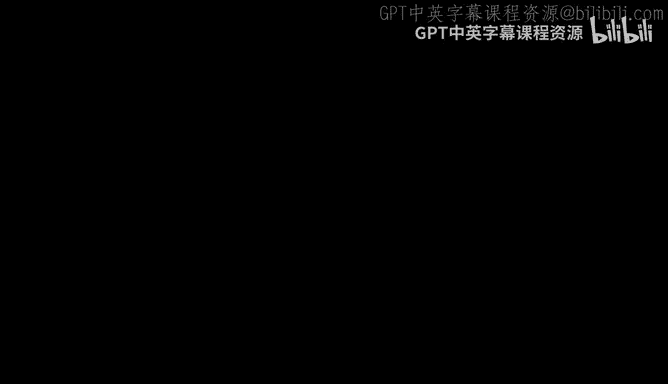

# 斯坦福大学《机器学习理论｜CS229M Machine Learning Theory - Fall 2021》中英字幕 - P9：-09-9_ Covering number approach, Dudley Theorem.zh_en - GPT中英字幕课程资源 - BV1jT421r71m

Okay， I guess let's get started。This is working。 right， Yeah， so I guess last time where we end up。

 end up with was。So we talk about， you know， this view that。That you view the function class F。

 in some sense， as equivalent to asset Q， right， So if you have a function class F and you can define this Q to be the set of vectors。

Of this form or basically， the output vector。Which is a vector in R N。 And here， F is changing。

Over the class app。Right， so in some sense， for the random mark complexity perspective。

 these two objects are not very different。 right So the。

 the empirical marker complex of F only depends on Q。And also。

 we have talk about the case where you have a find and Q。Or find an F。In some sense， in sometimes。

 actually， even you have an infinite F， you can have finite Q in some cases， but not very typical。

 but in this case， what you can show is that you can have a rather macro complexity bond。

This is the so called maal Lema。So， we' saying that。If your queue satisfies that。

This is the at the end of the last lecture。 So suppose for every vector in Q， we have that。This。

Norm of the Q normalized by。W squared n is less than m。Then。We know that this quantity。

Which is essentially the rather market complexity of。F is bound by this。

Two times m square times log of the size of Q over n。So。

 and if you translate this back to the function class， then you know that。If。Ive satisfies。That。

Forever， having us。This。F is bounded in average by M， right This， this。

 you can view this as the average side of F。 but it's a cadratic mean。

 But now the the later the mean。 and then you have that。

The rather macroer complexity of this function class F is bounded by 2 m square log of the size of five。

Oer。So， and。So in this time， I to deal with the case where you don't have a finite hypothesis class。

Right， so if you have infinite hypocs。Infinite Q or F。 then what do you do。

And what we're gonna to do is that we're gonna do a discretization。

 But now we are discretizing in the。In the Q space or the out space of F。So before I think。

 you know in one of the previous lectures， we discretize in the parameter space and now we are going to discretize in this more fundamental space。

 the output space because as we kind of argue that output space of the is what's really fundamentally important。

 the parameterization is just the something that influence the output space。

 but if you have the same output space， but different parameterization actually the functions class are not different So the parameterization are now the most fundamental thing here So so what we're to do is we're going to discretize the output space。

😊，And。嗯。So。So then， so， and we still have this idea of Epson， this concept。Of Eson cover。

 So now we are gonna to cover the output space output space Q or the output space of F by this so called Epson cover。

Let's recall a definition of Epon cover。 So recall that the definition was that C is Epon cover。Of Q。

 now I'm using， I'm talking about Epson cover of Q， but I just changed the variable。

 I think before we call it Epson cover of some other set。So with respect to some matrix。肉。

If for any vector in Q。The existed。Vor in C that covers it。 And that covers it， it means that。

Such that。The distance between this vector is less than absoluteps。

And let me also define the so called covering number。Which is the quantity we're going。use。

Very frequently。 So the cover number of。So of like there are several arguments。 One thing is the。

 the target radius， the target radius epson， and also the， the site Q。And the magic role。

This is defined to be。The minimum。Size。Of Epson cover。Of Q with respect to row。Right。

 so this is the minimal possible size of the covering。嗯。And。And。So。So here is。So how， so。

 and in some sense， you can use this covering number in extra two ways。

 One way you talk about covering of Q and the other way you can talk about covering of F。Right， so。

Even though I think the fundamental thing is about the queue， I think in the literature， you know。

 if you read a paper， then。In most cases， people talk about covering of the。You know， the function F。

 at least in in many papers。 So we're gonna use that language。 But。

 but they are essentially the same。 So， so basically， let's first color。

 So if you do this for the covering of F， then it's the same thing。 So if you have apps on cover。

Of the function class F， you just view F as a， as a function class。 So then it's it' saying that。

 you know。Satifies that。For every F in capital F， the exist F prime。

 such that row F F prime is less than absolute。 So it's just literally the same thing。And also。

 we're gonna choose the row to be the same， you know， for like it's。Like a， like a for Q and F。

 So basically， what we're gonna do is that we're gonna choose row between two vectors。

 right in the Qs， in the Q perspective， you choose this to be oneverse group in times。

The L2 distance recall that both V and V prime at dimension are in vector in space R N。

 So this is basically L， sorry honey。In there's no square。 So basically。

 this is a normalized version of the L2 distance。 The reason we normalized by square is just because this is more consistent。

 You know， the normalization fundamental， doesn't matter。 First of all。

 So whatever normalization you choose。 it doesn't change the essence。

 And the reason why we choose a normalization here is just simply for consistency with the the function space view where you have a two functions。

 then you define a role to be。Suppose you have two functions， F and F prime。

 and what's the distance between them？Recall that， you know。

 we only restrict our function on the final set of points， Z1 to the N。

 So the typical definition of the distance would just be the L two distance on the set of points。

 So it's just something like you look at the average。Difference between these two functions。

On the ice。And then you， you take the cadratic average。And then you check the。

Basically called directly average of the difference between F and F prime on of the ice。

And you can see that these are exactly the same row， just view。

 you can view them in either the function space or you can view it in the vector space。😊。

And typically， people write this row as row 2。PN。 so， so the reason， I guess， you know。

 for those you who are not familiar with it just a single face。

Arbitrary complex symbol to indicate this。 But for those of you who are a little bit no familiar with some of this functional。

 So I think the idea is that P N， this is the empirical distribution。Basically， uniform。

Over Z1 up to the end。And L2。Of PM means that you have an L2 metric defined on this empirical distribution。

This uniform distribution on the on the sphere。 But if you don't know。Where these come from。

 like no no this is just a let's just treat it as an abstract。Like symbol， just because， you know。

 I'm gonna to use this symbol several times just for formality。 But it really just means this。嗯。Okay。

 so。So， and， you know， with this view， basically， you know， as we， as we have said， right。

 So you have a F， you know， corresponds to Q and a function F corresponds to this vector。

 F Z1 up to F Z N。In Q。 and， and it's a one to one correspondence。

 Also the row corresponds to each other。 So you can， in some sense。

Wr this tribute kind of correspondence。If you look at the function space view with the metric row。

 then the covering number is the same as you view it in the output。In the， in the output space。

 the vector space。 and you use the metric。Normalized L to no。

And one of the reason why we normal well one N by something that depends on N is just because you have n dimension and n is something that's changing。

 So in some sense， it makes sense to normalize by that。

Because if you have a vector with chin dimension。Sometimes it's hard to compare different cases。

 so that's why you want to have a norm that doesn't depend on dimensionality。And from now on。

 we're gonna to write the， the function space view， like notation。 We are gonna to write in the， the。

 the， the F notation， but。In my mind， I'm always thinking about multiple space because that's just a vector space。

 which is much easier。To think about。Okay， so and also I I， you know， the。

 the formal kind of like a serum will be stated in the function space， but。But the when I approve it。

 I'm going to change to the queue just to make it more kind of explicit。

And here is the theorem that kind of deal with the。In some sense。

 this is a kind of like trivial disqutization。What we're going to do is that we're gonna first discuss this and then have a more advanced disqualization。

 which is called Chen Ning。 So the trivial version is the following， which is in some sense。

 basically。嗯。Basically the same as like in， the same as what we have done in in lecture 3。

 But here we are doing the function space。 So let F B。A family。Of functions。From some space Z to。-11。

 So I should that these functions to be bounded between -11。And for every Eson log than 0。

You can show the following。So the radar mark complexity is less than epsilon。Plus。

Let me write it down， and they interpret it。Log of the cover number。With the readius apsilon。Over it。

And we're gonna show， you know， how to prove this。 And when you show how to prove， when we prove it。

 you know， you'll see that this is sometimes the discretization error。And this is， in some sense。

 from the re mark complexity。Of the of the。The final Epson cover。

So we will see this more clearly in the proof。So in some sense， the。

 the general idea is that you approximate so the。The proof， the general idea is that。You approximate。

F8。By an Epson cover。And。Maybe let's and， let's call C。 And then。Maybe let's not give a name。

 So by Epson cover。 And then when you have the Eson cover for the Epson cover。

 you have a random marker complexity amount。 and then you pay something because of the discdtization or the approximation。

Okay， so。And when we prove it， as I said， you know。

 I tend to kind of change it to the vector space view just because then you don't need any if all。

 all of those kind of like function。Ondgon about function space。 So let。嗯。Let's。Lets see。

 be an Epson cover。Of Q。Q is the out space， where Q is。The same thing， right。

 so then let's say this is the size。😊，Which is equals to the minimum covering number， right。

Which is just the same as。As we claimed。Of the function class。 So I know。Okay， so。Now。

 if you look at the radar mark complexity of function， as we claim that this is， in some sense。

 the same as the complexity of the。Out put that。And now what you do is you say。

 I'm going to approximate V by the nearby point in the cover， right， So suppose you have this set Q。

And I have a vector V， and I know that V is covered by something， right？

You have the apps cover like this。You know that this point v is covered by for example this point v prime。

In the set C。Right every every point C recall that every point C of course can cover a certain family of points。

 right， it can cover its neighbors in some radius and and you know that every point can be covered by some vector in C。

 So and the vector V can be covered by v prime let' say So then you know that v and V prime。

The distance is less than ail。 And then you can approximate。 So for every we。Find V prime in C。

 And you know that distance is less than epsilson。 And also， you can write V sigma。In some， just us。

V prime sigma plus v minus v prime sigma。Right， maybe let's call this Z。So it's V prime sigma。

Plus Z time sigma。Right， and what you know is that Z is small。 So because the distance， where。

 So you know Z。In this distance， we that we are using a scaled L2 norm。So this is less than Epsil。

 This is what we know。So then what we know that Z time sigma。You can use the。

I think this is one which this is culture shore， So so。The inner product of two vectors is less than。

The norm of the two vectors， the two norm of the two vectors。 So this is less than squared。

And times epsilon， times。The norm of the sigma， which is n times epsil。Right， so。

 so basically we know that this error term is less than E by doing this。

And then so now we can go back to the radar mark complexity。You first use this。呃。

So this is just the less than expectation。Using this a few things， right so。Less than eson， right。

 because Z in a product with Sigma is less than epson。

 And this epson can be go outside of all of those things because epon is a constant。 So then you get。

Plus， Eil。 And here was the range of V prime。 So V prime always has to be in C， right， There's no。

this is the our definition of V prime。 V prime is the， the cover in C。 So then。Maybe see this。

 I guess this is equality， sorry。And then呃。And then this one。You can use the masalma。

 This is the complexity of the set C， the cover set C。 that's using maallema。

 It gets square roots to log C over n plus Epson。嗯。And， and we are that， right。 C has this size。

So this is just a square root2 log。An epsilon F L2P N。Offer M plus app。Okay， so pretty simple。And。

Any questions so far。Okay。So now let's talk about stronger theorem。And this is， in my opinion。

 a pretty deep zeroem because。At least in April， I don't have much information about it。

 but you know。Hopefully， after you show the proof， you know， is， it's intuitive， but it。

 is something non trivial。 And this generally， this type of technique is called chaining。

And they could be much for ways to do this kind of training in such different situations。

 So here I'm。Here， the particular theorem is called Dudley Theorem， Dudley。😊，Thatley sir。

So the theorem is saying that。啊 so。So let F the。A family of functions。From Z to R。So here， actually。

 I relax this even because this theorem is more generally can work for even in functions that are not bounded。

😊，And。So。The radarmar complex is bound by the following。Let me write it down。

 It it it doesn't look very intuitive in the beginning， but I will explain。So， its integral。So the。

 the variable is epsilon。 So you are integrating。A function of epsilon from 0 to infinity。

And you look at the cover number。For different eson。 And you divide by。啊，嗯。

So it the integral is the root of the log of the carbon number over square。So at the first time。

 you know， it's not even clear whether this is a stronger theorem than before， because， you know。

It's not cheaper to compare with the the previous one。 But actually。

 you can compare if you do some work。 So， so probably， you know。

 what I'm going to do is I'm gonna to show the proof。 And then I'm going to interpret this because。

 you know， I think from the proof is。It's pretty obvious that you are gonna get a stronger statement。

But if you just compare the form， you know， it's not that you know， trivial to compare。

 But from the proof， you can see that this is。Like the proof technique。

 the extension of the previous proof technique and。YouYou should kind of like a。

It's pretty obvious that you should expect a stronger theem。 And then， you know， later。

 I'm going to compare them and also interpret this because， you know。

 this form by itself is still somewhat kind of like hard to， hard to use， right。

 How do we know whether I can integrate something good out of this， right， So， so。

 so I'm going to you know， give you certain several cases where you can integrate a good number out of this integration。

So that's the part。嗯。Alright， so， so now let's dive into the proof letter。

 So how do we prove this and what's the intuition， So let's start with the intuition。

The intuition is that。呃。This is actually probably one of the pretty technical proof。In this。

 in this course， so。So intuition is that you have this。嗯。Some。

Thinking about whether I should draw a single figure。 I， I've， I've。

 I've drawn a lot of figures on the， on my lecture notess。

 but I think it's gonna be challenging for the scrap note takers to。

Proreduce all of them in the snow。 So I'm thinking if I should draw one。Yeah。

 maybe I do multiple and LED sc takers to figure out how to merge them if they want。

 So the the intuition is， let me draw this again， so。So you have this set Q。

And what we have done was that you create a cover。Apom cover。Right， it covers this。

 And every century is one point in C。And you want all of these， you know， wallss to cover your set。

Right， so， and what we have done was that you have a vector V here。And。

 and you say that I'm going to approximate v by v prime。And plus， the distance。So basically。

 approximate v by v prime plus the difference in z。So， so this all fine。 The problem is that。

 you know， how do you， So you have this。F， let me just write again。

So the tricky thing is that how do you deal with the this error V times sigma， right。

 So what we did before was that we have a very bru force inequality。

 saying that this is less than two norm Z times two normal sigma。Over。And when this can happen。

 this can happen only if Z is perfectly correlated with sigma， which just cannot happen always。Right。

 because Z is a vector， which is a difference between BM V prime。

 This it could be correlateded with sigma， you know。You know， if your ball is， you know。

It so by the way， this ball is like。You know， I draw it as like a ball， But this is。

 this could be of different shape， right because if every all the everything is really a ball， right。

 So suppose this is really just a cleaning ball， then everything becomes too trivial for us， right。

 So Q is a set and there is some metric defined on it。

 And this metric is potentially somewhat complicated， which we don't really know The metric is sorry。

 like sorry， the the metric is trivial， But the the set itself is could be complicated because you don't really know what the set looks like。

 right， it's the image of a function on some set of vector on set of points right， So this。

 this set is this are all balls， But the the set itself is could be。😊。

Some more kind of like weirdly shaped。 So that's why this Z may not always be correlated with sigma。

So in the worst case， it can， but， you know， not， not always possible。So， so， so the。

 so basically the question is that， you know， can we strengthen this inequality here。

Like why this has to be worst case。So。So if you think about this， right， so。What is the。

 if you think about， so。What is the soup expectation of the。So basically， what you really care about。

 What you care about is the following。 So you can take this。So let me just write down。

 Let me do a little bit slowly。 so that。嗯。So you care so。You do this inequality。

 You first say that this is less than the expectation of the soup。Of the first term。Plus。

 the expectation of the soup of the second term。This is because， you know。

I guess we have claimed that， you know。Ex of soup。A plus B。It's always less than。Expectation of soup。

哎。Plus， expectation of soup of B。Alright， so， so， so the first thing you can do is this volume。

 And then you care about this。And before， as I said， you know， we。

 we have a very worst case in the quality for the inner product， but actually。

This is this quantity itself， you know， may not be that worst case， right， because here Z is in this。

 in some sense in this。Ball around V prime， right， So you have this。But V prime here， which is the。

 which is the ball。 And Z is， is in this ball。 So， so if this， this ball is not like a， you know。

 sometimes this Z is in the。And you can create this you can make this a。Thisiscover， you know。

 of a certain shape so that this in this ball， in some， this is the ball intersect with Q。

 If it's really a ball， I think。要嗯。The， the， the worst case in the call is tight。 But actually。

 you are intersecting this ball with the Q And Q could be weirdly shaped。 So， so if you look at this。

 then this one could still be possibly small because， you know， if this。This， small inter。

 interect this Q is of a small complexity。Right， so， so， so what you。

 so basically the idea is that what you do is that the for the first in thing， you just do the。

 the log of the covering number。 But for the second thing。

 you do another round of like disquettization。So because you don't want to say that Z can be worst case。

 I， I want to say that Z probably cannot be worst case。 Z has to be have some structure。

 So I'm going to discdise it again。Sorry， I， I mean， how do I turn this off。嗯。Wait， why am。

 why am having this。拜拜。I'm not using it I guess， right？So everyone is select。

 everyone on Zoom meeting can hear me， right， could， could hear me， right， So sorry， I forgot to。

Take off the。Hphone。拜拜。Can you su me。Okay， I hope you can hear me。 Okay， thank you。 thanks。Okay。

 cool， sorry， Hi back。 I forgot。Take off it。 Okay， so， so basically。

 the kind of idea is that you this is still a rather macro complexity of B prime in a sec with Q。

 And， and you can do another round of dissation for this set so that you get， you know。

 even a tighter inequality。So that's kind of the， the， the rough idea。 So basically。

 you have a nest layers of like discquization to big， to make it stronger and stronger。So。

So that's the basic idea。 And now let's do a little， let's make a little more formal so that I can。嗯。

Deefine something and and。And， and explain the increasing more。 So let's say we have。 So， so I guess。

 you know， maybe just the two。Worth they draw this， you know， a little bit。 So。

 So what you do is you do another disposition of this yellow ball。And then， you say that。

This Z cannot be worst case。 It has to be something like。Z can be approximately by this， plus this。

I'm not sure whether this is too。I will draw a bigger figure figure。

 but basically this point Z is not you approximate z by its nearest neighbor again。

 and then you look at a difference and then you approximate a difference by something else。

 I will draw this more formally in a moment。So to do that， let's define E 0 to be。I see the soup。呃。

over。嗯。So over I X。The max over eye。FZ I。 So this is just the。

 the maximum possible value that you can output。 and。

 and you can see that this is just some preparation， which is。😊，Almost trivial。 So you can see that。

This is always。Bigger than this， because each entry Epon is bigger than each of the F Cs。

 and this is equal to square to one over n the two number v square。Forever being here。So。

 so basically， Epson 0 is an upper bound。Of the entire site。You have do not have to talk about any。

Apson bigger than this because， you know， everything is in this ball of Epson 0。

And now I'm going to create this nest or this。The technical is not nest。

 but I think I've always thought about it as a nest。Family of like disizations。 But technically。

 you don't really need a nest part。 So let me draw this， you know。Okay， let me define things first。

 So for so I'm going to。Consider epsilon want to be。Ha half times Eson 0。 Epson 2 is。

A quarter of epson 0。 So in general， Eon J is 2 to the minus J Epsilon 0。So。

 so these are the kind of flag， the radius for my epson cover and let。c j b。An Epson J cover。Of。

The set Q of Q。 So I have this family of Epson covers。And intuitively， you can think of。

Can you think of。Epson J plus one cover like CJ is nest in C。C，G plus1 is nest。In CJ， in some。

 but I don't， But this is not necessary for the proof。And also， it's not the entire。

 but not necessary。I just like to think like that just so to give me some kind of like home。

Kind of intuition。 So， so what's really happening， Let me draw if I draw this。

 what's really happening is that I have this。Set Q， maybe I shouldn't draw a ball。

 So that it's kind of like more interesting。 So this is the set Q and。There is a。

Theres the biggest thing， which is the Epson0， which covers everything， let me now draw that。

 So if you use Epson0 cover， then it's trivial because Epson  zero。

 you can just use a tri cover to cover you just need one point to cover everything。

So you you just need the origin。 Let's not draw that。 Let's draw something。Maybe E 1。

 So what happens is that you use， you have a very coarse screen cover at the beginning。

Something like this。Alright， so， so this is your Eson one。And。And have a point。

This is something really hard to draw， so I need to follow my notes exactly。

So that I don't have any issues with it。 So I guess suppose I have a point。历四。Here。

This is my point V that I want to approximate by the cover。So suppose this is the origin。So。

Before what I do is that maybe let's draw this be somewhere else， sorry。Maybe this all be here。

So this is， let's call this U1。 This is the closest point in the first level of the epson cover。So。

So before I just use U1 to approximately。And now what I'm going to do is that I'm going to first use you1。

 and then I have consider the second level of the eson cover。

 So which is of a smaller size in which is of the actual size half。😊，So whether this is， by the way。

 this， this number two is not nothing magical。 You can make it something like 3 or 4。

 It's just for convenience。 You just need a constant， constant factor， smaller net， you know。

 at every level。So you have this， for example， right， so this is the second level。

And what you do is you say， I'm going to take the point you to here。

 U2 is the nearest neighbor of V in the second level。

And then what I'm going to do is I'm going to approximate。We by you1 plus。This vector。

Between U 2 and U1。So， so then I have a smaller distance between V and U2， right， So。

 and then I'm going to have the third level。 I I will only draw three levels。

 So that supposeupp in the third level， what happens is that。You have another。Ting here。

 and this is E U3。And then you also consider this vector between U 2 and U 3。 So basically。

 approximate V by this red vector plus the green vector plus the yellow vector。

 And then you continue to do this until you get to V。So。Any questions so far。So basically。

 I'm going to approximate V by U1 plus u2 minus u1。Plus， u3 minus U2。Until infinity。

 because I'm gonna have like an infinite number of these。

it doesn't have to be exactly infinite number of them if you have fun good enough like an approximation can stop。

 but for simplicity， let's say we have an infinite sequence of epson covers and you can do this。So。

 so more formally， what I'm going to do is that for every V in Q。Like， let's。

I guess this is just a formal definition。So。ItIt's nearest neighbor。Nest。Neighboing CJ， right， So。

 so that's why， by definition。Because UJ has to be covered by CJ。 So that's why。

 So V has to be covered by CJ。 So that's why V1。The distance between。Me and U J is less than epson J。

Right， so in other words， one of our scope and terms we。C J2 norm is less than absolutely。And。

And also， because Epilon J goes to 0， we know that U J goes to。V， eventually， as J goes to infinity。

they goes to infinly。So that's why you can write this nested sum。 you can write this as you want。

Plus。You 2 minus u 1。Plus， U 3 minus U2。So and so of course。Right， and if you let you you 0 to be 0。

 then you can write this as。You are minusU 0。Plus， U 2 minus U1。

This is just to make it look nicer so that we can write it as some。

So this is sum of U I minus Ui minus1。Ih 1 to infinity。

And you can check the convergence right if you really want， right， so。Just because I have this。So。

So if you look at the partial sum， then。Is。U M minus U0。 and because U N this partial sum。

This goes to。V， as am goes to infinity。 So this could convert。 And technically， you actually。

 if you really want to have a proof and you don't have actually have to。Use use infinite some。

 I'm just trying to make simpler。 So you can just say， I'm going to choose the M that is big enough。

 And then I I pay some small I I and。 That's also fine。😊，So， okay， so， and once we do this and what。

 as we kind of planned。So I have this kind of flagos。Better and better approximation， right。

 So now let's deal with each of this vector。So。What we have is that expectation of the soup。

This becomes expectation。Ts。上 off。Ui minus Ui minus1 Sigma。And from one to infinity。Right。

 so and then you switch the sum with the soup。 So you get。Expectation， lesson， expectation。Soup。嗯。

Maybe' take。Some。T super。Right， and and then this is equals to sum。The expectation of the soup。Okay。

 so and and here the constraint is that UI needs to be in C and UI minus1 needs to be in C minus1。

Right， so， in some sense， this quantity， each of this quantity is kind of like some kind of like random mark complexity。

But this is a finite class because Ua and UM1 now are not arbitrary vectors。

 they have to come from a finite set。And then we just have to deal with you know。

 we just have to see what's the radar mark complexity of this set and and then continue with the derivation。

So， okay， so let's try to deal with each of this term， so。So we are trying to use maallema。

 All right， So Masallema is dealing with is trying to deal with this kind of terms for finite set。

 So first of all， C I， so。😊，So the combination of UI and UM1 are the variables， right。

 so they are in C times CM1。And C I times C I -1， the size is equals to。

This the size of C I times C M as1。 So this is something you， you， you can compute。

Let's simplify that in a moment。And。You can also have and for， by the way， for my Lama。

 let's just go back real quick。So I think we had this in the beginning。 So for my Sallema。

 you have to check how large。You have to check how large the vectors are， right。

So this M does't matter， right， If all the vectors are super big， then your complex will be big。

 And if all the vectors are extremely small， then your complex will be small。

So so let's check what's the value M here。 So the value M is the bound on the two norm of the vectors。

 the normalized two norm of the vectors。 right， So， so basically。

 we need to check one over square n times。UI minus Ui minus22 norm。

HowHow large this can be eventually。So， so this can be if you。Upper bound this， this is at most。

You just to trivial triangle inequality。And。Wait， sorry， I my by， my by。

 You cannot do a triangle and quality that that would defeat the purpose。

 So what I'm going to do is that。Yeah， sorry。 So you， you are gonna do a slightly。

 more careful tri in quality because。You want to say U and U M1 are close， right， So。

 so but you and U M1 themselves， each of them could be big if you look at this， right， so。U1 and U 2。

 you know， as as vectors， there are， they are probably big。

 but their differences is small and smaller and smaller as you have bigger and bigger eyes。

 And how do you control that， I think there's actually easy way you just write this as U minus V。

 because you can always compare with V。That's something you know， right。 So。

 and then you try and go in the quality because both U I minus V is somewhere small and U M1。

We is somewhat small。And how small they are。 So you know that。The first term。

Score one of scoring times U SV。 This is less than epson。i。And。

 and the first term and the second term is less than Epon I1。This is just by the definition of the。

Of the appson cover。Right， so， and Epson I。🎼Is two to I times Epson 0。

 So Epson I is smaller than Epson I1。 So by by a factor of 2。 So。

 so this is actually three times Epson I。😊，Justs because Epil I1 is two times bigger than Epil I。

Okay， so with all of this preparation， we can apply the masalma then。😊，What you have is that。

It's soup。It's less than。So we get square root two times the m square。 This， this is the M， right。

So you have m square， which is3 Epsili square。And it has the log of the carbon number。

And the the covering number， sorry， the log of the size of the of the set。

 the size of the set is C I times C M S1。And over。Over and。Right。

 so and let's try to simplify this a little bit。So you get three apps on I outside。Over scroll in。

 and you have。Scrre root log C， I plus log C， I， -1。And times two。

And then you say that this is less than so see so。之爱。

Its probably bigger than it's always bigger than CMMS1 because you know。

CI is a more fungri Epson cover， disqutization。Thenhan C M S1。 So if you have more fun growing。

 you should have more sites， more points。 This is just by definition。 So so you get。

 you just bound C M S1 by C I。 So you get。6 Epson I over N times Sc log。CI。

 because we just replace this term by log CI。Okay， so the constant doesn't really matter that much。

 anyway， so。All right。😊，So， so now let's see what we have achieved。 right。

 So we have bound each of this term。 and let's go back to this。Forulas， we just plug in。

 So what we got is that。So， we got expectation。Sup1 N V sigma。 This is our target。

 which is less than the sum of this over eye。I from one to infinity。6 Epson I overkir and skirt。乐视啊。

So this is still not really an integration， right， So， so how do you turn this into integration。

 right， But this is kind of like half a little con flavor of integration you have like。😊，You know。

 a lot of terms， right， in some sense。 So， so how do you see this， right， So there， there。

 I think the， the way I see this is the following。😊，So， so what's the， maybe let me just write down。

 what's the final formula you want to achieve， The final formula you want to achieve is。

To recall that this is something like 12 times one over square root times square root log and epsilon。

F， L to P，N the episode。this is the final formula we want to achieve。And by the way， in some sense。

 actually， you don't really have to get this integration if you。If you don't。

 if you just care about in applying this to some cases， because this is enough for you to apply it。

It's just like this integration looks so nice and it's kind of like a it's a， it's a good interface。

 you know。😊，In a mathematical sense。 But then so， so how do you see these two are almost the same on the way I see it is the following。

 So if you think about。What this integration is， right， So they have appspson on this。

On this dimension。 And let let's plot the。The cover number， the cover number will be。The log。

 this is the log cover number log， maybe let's say square root。qua log。An epsilon F L2 P。

So you plot this。 And at some point， this， this cover number will be one。

So the log of the carbon number will be 0。 This is just because when you， when you ra is speaking up。

 you can just use one thing to cover everything。 So the log carbon number can be one。

 right and particularly in our notation。When when you read this is epon  zero。

 then your cover number becomes one and then log cover number becomes  zero。

 so square root of that is also zero。So， and， and this this current number will be go to will go to infinite eventually as Epson goes to 0。

😊，Because， you know， you need more and more points in covers as you have like。

More and more fun going covers。So， and， and you have this you know sequence of like points。

 But So like a， you have， for example， Epson 1 is here right， So which is half of Epson 0。

But let's look at Eon I， so。Let me try to draw this exactly has my notes。So suppose this is Eson I。

按安。If this is Epson I， then a half of it will be Epson I plus one by definition。

So this is Epson I plus1。And， and what， what is this value， This is value。

 the corresponding cover number， right， So this is。Square root， log C， I。Right， that's the。

That's our， in our location。Right。And。And now let's， let's compare these two quantities， right。

This quality and this quality。 This is what we are trying to link， right。

 So the quality below is just the。The error under curve under this curve。Right。

 that's the definition of， okay， I guess I'm ignoring the one over squareton， which is you know。

 easy， right， So， so if you don't have the one over square not the2， right the。So。

 so this integral is just the the error under curve。 And now what's this finite sum。

 And if you look at the finite sum， then this epon。Like。If you look at the。This thing。

Thearrow of this triangle。Sorry， this is not a triangle。 This is a rectangle。 My by。

So the area of this rectangle， then it' the， the， the error the math of the is this is Epson I minus Epon I plus one or times。

The height， which is square root， log C I。And Eon I and E I plus one are just the。This is just a。

Let me see what's the best。 I think this is Epson I over two times。Lo of c i。And this is。

Just a multiple of this term。Right， so， so basically the final sum is in some。

 just dealing with the all of these rectangles and the integral is doing all everything。So。

 so that's why the， the sum of the rectangles will be smaller than the integrals up to constant factor。

So basically， what you know is that you know Epon I over two。

Square log C because this is the list area。It's less than integral。Of this part， right。

 This is less than the integral of this part。 It's less than integral from。Apson I plus1 to Epson I。

And square root， log an epsilon。老臭片。The episodeil。Okay， so， and with this， we can。

 we can just take some over all eyes。 So it is。So you have some of Epson I over 2 squared log C， I。

less than。Some over eye。1 to infinity， infinity。换。Sorry， this is not。So， and。

And now you can see that this， you know， each of these integral has the matchingching upper bound lower bound。

 So you get this is from 0 to Epson 0。😊，Scrt log an episode。这片。The ail。

And the upper bond is still not infinity， but that doesn't really matter because this really literally equals to him。

You can extend it to infinite because everything beyond Eson 0 bigger than Epson 0。😊，我有逼。0， so。

So that's what we have。Okay， so now you just， if you just multiply。

This this is the essential single vessel using with this inequality。

 you just link these two quantities， you know。So I think you just have to work out the constant。

 I think there's a constant two there。 So that's why you get from 6 to 12。 So with this。

 you get expectation。And this is actually the rather marked complexity of F is equals to this。

It's less than。Let leave up 6 xon I over the end。It's square to log C。

 and this is less than 12 times this integral。第二组。O。So。Any questions？Okay， great， so。Okay， so and。

 and， and I think from this figure， you can also kind of see that， you know， in some sense。

 the essence here is that how fast。Epson goes infinity。 That's what's important here， right。

 Because if Epson goes infinity very fast， then your integration probably could be even infinity。

 So then you don't have any bond。And if feel， if this thing goes to infinity。Like here。

 slower than you head available。这走了。不结束。告我说。知の。そと。Yeah， so the question is， like。

 I chose this level like the factor of  two。 right So like is two to the minus J times eon 0。

 So what if I change that two to be3 or something like that。I， I never tried that myself。

 but I think。Very， very likely， you would just get a similar constant。 Maybe you get better than 12。

 Maybe you get a worse than 12。 But anyway， this constant is not that important for us。 So， but I I。

I think it's very unlikely you can gain anything， by。Like you can gain anything more than a constant。

Okay， so now let's， let's try to interpret this theorem a little bit more because in some sense。

 this the， you know， at this form is kind of hard to use， right， So because， you know。

 if I got a lot covering number bound。And okay， what's the intended use of this theorem。 So the。

 the way to use this theem is that you， you， you get some log covering number bonds。

 and then you do this integral。 You get the random marker complexity。Right。But。

But it's kind of like hard to use it because， you know， before you get the， So you。

 you don't know how， how does this translation work， you know， explicitly。But actually。

 the translations from the carbon number to the randommar complex actually。

 is actually relatively simple as， as I show。 So this integration doesn't have。😊。

Like like you you see like actually you don't even need to。Like， like， like。

 I never compute this integral myself。 like after I done once in some sense Like。

 so here's how it works。So， so for the。So。Yeah， so basically the question is when this is finance。

 right， So when this is this thing is finance。And， and when it's finance， you know。

 what's the dependency， right， so and so forth。So， when。It's finite。

So I think there are several cases。 like， let's do a kind of， this is a case study。 So it， of course。

 it depends on what the law covering number will be。So we have， I have a few cases here。 So a， if。

The covering number is exponential in Epsilon。Is of the form。

I the form something like one over e to the power。Some power R， R is just a variable like place。

So suppose its exponential E in the sense that one of E is in the base。

Then you can do this computation。 You get。And this is equals to something like。我。Small risk then。

Scar root R log1 Web。Alright， so this because you take a log cover number。 And。

 and you see that and you take the the eson。And you see that the log one apps don integrate to some constant。

From zero to infinity。Oh， by the way， I think。Maybe I should say。I， I forgot to take a yes。呃。

There's a small thing。 Like， I don't want to always integrate from 0 to infinity because the sometimes it's actually annoying。

 so。YeahI forgot to mention this。 So let's assume。The the I is bonnet。Between， I say。-1，1。So that。

This integral only have to do。 You only have to do it in between your infinitefinity。 So like。

Apsson 0， let's say is one， something like this， or maybe a constant。So， we only have to。

To integrate between 0 to to one， let's say。Alright， so。

 so this is just because you have a bo function after that。

 like the log carbon number because it became 0。And now let's integrate， okay， going back to this。

 we integrate between0 and 1 this log one Web song， and youll see that， you know。

 this log one Web song actually integrates to something of strictly constant。😊，So， this will be。嗯。

 just o。Maybe let's write in one notation， I should write this like。

And this is just on the order of like scroll with R over it。Because the E integrates to a constant。

 the dependency on E is gone。Okay， so， so that's good。 So you got this thing and。

Let's look at another case。 So this is the actual case where the dependence on E is very。

 very mild because it's lot on Web So。 So that's why it's pretty mild。

And but sometimes you never get， you don't get this。 So， so if。Is N E F L2 PM， N。Is of the form。

A to the Epom， R over Epson。So now the epson is in exponent。But yeah， and and's。

 and and it's one of Ab the exponent。 And in this case， if you look at this。More of was scrub and。

Integral。Sg cover number。This will be well square end。Our over Eson， Sc our website log a。はい。So。😔。

And this is still。So the Eson and， and still square with one of Eson this integrates to one。The E。

 this is a constant。A universal constant。 you can。 I guess we don't care about constant。 So。

 so it's some constant。And this is equals to So basically， if you ignore the log factor。

 this is equal to over。So still of this form。That's still good。And now it。

 it comes to the the trickyies thing， which is kind of like it's on the。

Kind of on the boundary between what we can do and what we cannot do。So if this is of the form。

 something like。A to the R over Epson square。 So now I have a。

Even worse dependency on Eson where So it's in exponent and also is one of E Square。

 So it goes to infinity as Eson goes to0 faster。So， and in this case。

 this becomes sort of a tricky because and but actually this is the most common case， right， if you。

 if you really do the work， you know， I don't really really expect you to prove any generation about yourself。

 you know， that that often youre like but if you really do the work in many of the cases。

 you get this kind of like cover number。So， and this is actually tricky because if you integrate。

The thing。What you get is that。啊。You take the log of this and you take square root。

 So what you get is maybe。So get。Scr root R times one over episode。Time squared log a。Al right。

 so this is the eson。So this is Sc R Sc log A Sc N。One of the E。And this。

 this thing is actually infinity。I guess this is because the。

How do you see this like one of apps integrates to。Log Epson And log Epson at0 is infinitefin。

So this goes to infinity too fast at zero so that it integrates to infinity。😊，So。So this is actually。

 you know， this is not a good news for us， right， So， so how do we， but actually this can be fixed。😊。

How do we fix this， So this can be fixed。By a improved version。Of badly。

 And this improved version in some sense， you know， I'm not gonna prove it。

 but there actually is kind of like almost。Expect it。 So what you can show is that。 So basically。

 the idea is that you don't。Do do the disqutization all the way to0。

You do it until certain level so that you can pay the the worst case bond。So basically。

 you do it only to the level of alpha。So you buy about this。I think there's a actually。

 I'm not sure whether there's a two here， but let me have the two here， anyway。So that for safety。

And with a constant， it's not very important。So basically， when you do the integration。

 you are not integrating from0 to infinity。 You are integrating from alpha to infinity。

And below alpha， you just pay this alpha bond。So in some sense。

 you can see that this is the interpolation of the two bonds we had， right。

 So recall that one bond we had was this rootforcing。Where。We pay this epsilom。Like， right。

 So this is just because we have a worst case bound for the， for the Epson ever。And。

 in the other case， we had this integration。 We don't pay anything in the worst case。

 And this is basically saying that。You do this nested or iterative discretization until alpha。

 and then you pay a small error alpha at the end。And。And why this is useful， This is useful because。

 you know， it kind of like avoid this tricky regime where you are very， very close to 0。

 So what you can do is that。Like I think this film you you you can。Probably prove it yourself。

 So Im'm， I'm not going to show the proof。 So， and if you use it。

 so you can take alpha to be something like one over poly poly and。So something super， super small。

Right， so， and so that it for alpha。 so that for alpha。Is negligible。And。

 and so that you hear on the right hand side， you don't integrate to infinity。So， so basically。

 for of is negligible and question what integration。Or the integration look like。

 So this is something like。Invepo。Which is negligible。 And then you haveed or skirt log A。

Scrocorre N， and you you integrate between alpha and one。 and you have one overon。

 one over appsson D Eson。And unfortunately， this one。Even though it goes to infinity。

 as alpha epsson goes to 0。Like a as alpha go to 0。

 But this is actually something that depends on alpha very。Very weekly， so。So this is this， right？

I'm not provided this system。You know what my reputation mean， right。

sometimes I think in different clus book， I see different notations for this。

 So so sometimes I got confused。😊，So， and now this thing is really just。Times on。

This is like a log 1， which is 0 and minus log alpha。 So you get log  one over alpha。

And this is logarithmic in alpha。 So it alpha is poly n。 So this is log rhythmithmic in N。So。

 this is。老鬼。So the basic， eventually， this is still old till the。

Scro or overs scting if you hide all the logarithic factor。Okay， so in summary。搜。So。

 the covering number。Of the form。One of options all。A to the R over epsilon。

 A to the R over epsilon square all lead to some all leads to something like a random mark complexity bond。

あ this one。And these are probably， basically the。Pretty much the only cases I I I know of that can lead to this。

 Like， for example， if you suppose hypothetically， your cover number is something A to the alpha R。

 R over Epson cube。I think this will will break。Because。So。So here， if this is Epson cube。

 and I think here it's going to be epsom to the 1。5， one of epson to 1。5。🎼And when it's app。

 so maybe let's do a quick and heur。 So suppose these apps onto the 1。5。And， of course。

 you still have to integrate from alpha so that you don't you you try to avoid a blow up， right， So。

 but it wouldn't be as effective because while eson to the 1。5。This， the integration of this is。

I think one over a square root Epsilom is the log epsilom。And I think this will be。1-1 squared alpha。

W， I think did that。Yeah， okay there's a minus here， I think right so。So。

 so it's gonna be something like one over a square。-1， something like this。

 Maybe there's a half here。YeahYeah。Anyway， let， let's， let's， let's ignore the constant。

 I I don't know what the constant is。 But， but the problem is that this is not log alpha。

 This one over square alpha。 So， and now you cannot take alpha to be poly inverse poly N because if it's inverse poly N。

 you， you pay too much here。So， and so so then it's going to be a very tricky balance between。

This fall alpha term and this term。Right， and I think。

At least I'm not aware of any cases where you can balance them in a nice way so that you get still a good bond。

 I think it's going to be probably not even possible。And， but but。On the other hand， you know。

 for the case， when you have this thing， right， This is log one over alpha here。

 So the balance is triviale。 It's kind of like your free lunch。 if you pay a lot better。

So it's almost always possible，So that's the that's the difference。嗯。Right， and， and， and actually。

 most typically， you're gonna get some cover number of these four。 That's。

 that's the most typical cases。Okay， any questions。Okay， so now I have 15 minutes today。

 So so the the rough plan for the， for the next， the rest of the 15 minutes and。

 and next actually is that we are gonna talk about covering number bound for linear models and deep nets。

 And those will imply rather market complexity bonds。😊，And。I think today。

 I'm gonna talk about linear models， but for linear models， I'm not gonna give you the proof。

 because I think the proof is a little bit too technical。 In most of the cases。

 you wouldn't you need to use prove it yourself。 You just have to invokecate。 So basically。

 I'm just gonna。I'm going to just state some theorems and tell you that actually， for leading models。

 this is almost。Almost kind of， well， I think it's kind of almost all done。 Like。

 you know everything about it。 And I think they are。Pretty much like a。

Matching upper on lower bounds。嗯。So this is actually from a paper by Tongzhahou in20。2012， sorryry。

2002，2002。So， so you saying that this is for。Forlining models。So。Ving models。So。Yeah， so。

 so suppose they are。X1 up to x n in R D。A N data points。And P and Q is this so called con pairs。

I guess I hope that probably you have seen these kind of things in how inequalities。 if one。

1 over p plus one over  Q is equals to one。 And also， we also assume that。He is。

B then two and less infinity， but in most cases， you just can think of P and Q are both two。

 that's the most important thing。And assume that。TheP norm of x is less than C for every eye。

And then let's consider this hypothesis class I。Index like Q。So this is the family of linear models。

Where。The norm of the linear model is bound by B。Right。

 we call that we have actually talked about these kind of models where where p is2 and  Q is2。

 Al maybe P is1， Q is infinitefinly these kind of things。So。😊。

And then before we we prove the rather mark complexity bond， and now we prove the carbon number bond。

 which will also give for a rather mark complexity bond。And this role。Is equal to L2 P N。 L2 PN。

 this is the same thing as we have defined before， and then。The low cover number。Abspson。FQ。Sorry。可以。

Can roll。Is less than。B squares C square over Epsom square。Sailing， the sail doesn't matter。

 It's just trying to deal with the corner cases where this is like0 or something like that。

So I to log to2 D plus one。So。And when P， so， and when P is 2。He is， too。You can strengthen this。

 Con strengthen this。Slicly。2。Something like log。An Epon F to row。It's less than。

B squared C squared over Eppsson square。Times the lock too。

I guess the base is also that important because it's only changed the constant it's just that I copy it。

From the， the base of the log doesn't really matter that much。

I'm probablyb here just for the sake of Preness。So you can。

 you can improve the D deficiency to something that depends on N or D。

 which doesn't matter that much。 at least for our purpose， you know， for， for the。For other cases。

 if you care about the bond that absolutely doesn't depend on D， then this is this matters。

 Otherwise， it doesn't matter that。Okay， so。收。And， and the way to remember this is just that this gives the same rather market complex。

 Right， So basically， if you use the discussion above。Use the the conversion above， right。

 we have done。So this is of the form， which form， this is of the form。This thing。

RightA to the R over epson square， right。Because。Here you have a lock。after taking a log。

 it's our Epson Square。And R is B saw square C square。So， so using this conversion。

 you get that the rather mark complexity。It's less than。Square root R over N。

 and where r is B square C squared。So this is BC over scton。Up to。Lo read me factor。

And this was very similar to this is the same thing as we have them。Before， right。

 so B was the norm of the classifier and C was the norm of the。On the data。

 So you get multiplication of them and overs scpted。

So there's some small differences in terms of the log grid manufacturer。

 so which let's ignore just the for simplicityity。Okay， and。You can also do。

 you can also show this for models。sorry， marty barber mar。Ved。Linear functions。

And I'm showing this just because this will be useful as a building block。

A speeding block for future。Because when you have like a Lee。When you have new networks， you know。

 a linear， a multi linear model is a building block for new network， a layer of network。

And this in some there's nothing really intelligent here is but I just have to state it so that I can use it later so so suppose you have okay first I have a small definition。

😊，So definition， suppose I is a matrix of。This form。Is I by N matrix。Let's define the two norm 2 to。

2 comma 1 norm。 This is not the operative norm。 This is the。Just a some。Some arbitrary norms。

 So this is the two common1 norm， which is the sum。Of the two norm of the columns。嗯嗯。

So MI is of dimension N。And， and you take the。 So basically。

 you first take the two norm of the column and then you take the one norm。To to国 the。So， and。

 and then。You know， in this definition， I'm transport to a norm。This is basically， the sun。

Of the two norms。Of rose。Of friend。This just definition。

 And then we're going to use this in the statement。So here is a a serum。

The theem is that if you consider。Here， I'm not going to do a P and Q just for simplicity。

So you just do the two norm version。 So P and Q are both two。

 So you consider a multivariate function with output， multiple outputs。And this w。

 that is of dimension M by D。And that's constrained W， the2 to one norm of W to be less than B。So。

 and again， let's see to be the。Average of the normal data。And then， you get。logg。😔，嗯。Aalon。F。然后出PN。

It's less than。C squared。 B square。Over Epson Square。来来 to啲 times啊。So so it's kind of the same thing。

 the norm of the parameter times the norm of the data over epson square。

 but the norm of the parameter is measured by this2 to one norm or sorry，2 to norm of w transpose。

I think I think I have type here。So what's the two to one norm of w transpose， as I said。

 is the sum of the two norms of the rows of W。So。So in some sense， there is nothing surprising here。

 is some sense you just glue all the dimension like。

 you just treat all dimension independently in some sense。 Like， like， for example。

 if you think about suppose you try W。I seeDifferent color。

Suppose you write W is W1 transpose up to WM transpose where you have M。vectors， row vectors。

 and then Wx is really just you multiply W1 transpose with x up to WM transpose x。

So can you view with this， you know。Linear layer as， you know， I'm different linear functions。

 one dimensional linear functions。 and then the two。To one normal。

It's just the sum of the WI to norm。So in some sense， you just sum。

 they take the sum of the complex measurement。Some of complexity measure。Of each of the model。

 WI transport sex。Right， so W I to norm is the complex measure of the linear function。

 And you take the sum。So the proof is actually just the。Yeah， there's nothing on。嗯。

I think I have five minutes。 Let me also mention another thing which is useful for our preparation for the deep nights。

😊，So this is also related to how do we deal with bonding the log the covering number。

So you can also have the lips conversation。This is a useful tool for us to do deal with the carbon numbers。

 And this is actually。ReRe that， you know， we had this telegram level， right， so。

We had the telegram lemma， which was like for the radar mark complexity， right。

 So you say something like the radar mark complexity of P composed with age is less than。

Some lipsciousness of V times the radar mark complexity。Of age， something like this。 So this。

 this was the elyious composition for weather market complexity。

And it turns out that for log covering number， the lips composition is even trivial。 This。

 the telegram lema。 I didn't improve it for you。 I just say this is a fact。 This is a theorem。

 And actually proving it doesn't。Then sound easy。 Like， as I mentioned， like it。

 it's actually sometimes pretty complicated。 It's pretty。

I think it's challenging theorem to prove and here the Lius composition becomes trivial for covering number。

😊，I think the the， the fundamental intuition of the spirit is the same It's just for cover number。

 somehow， this becomes super。Intuitive and explicit。 like a so the。Let me stay the lama。 but yeah。

 I think I。So this is almost a trivial thing， so suppose。F is coupleipses。And then， let's say。

 role is this。I to norm。Th like then。The low cover number of phi epson phi compose with F。

Like I mess up my order of these arguments， like in my notes。

 like for every occurrence is after certain points， So so I have to fix it later。So。So Epsilon。

 So if you look at the log carbon number of the composed function class fee composed with。

This is less than。The low cover number of。Of the original one。

 But you have a different radius or different。granularity。

So you basically have to cover the original one with epson over copper granularity so that you can turn that into a cover。

Epson cover of the new composed function。 And this is pretty much just trivial。

 because if you just take。I guess I will just take Eom over a couple cover。Forever。And then。

Like then。So suppose this is tick。That's called C。And then。Fe compose the sea。E claim is up cover。

Of p composed with F。So， because。Just for every。See composed with F in。This class。

You can just the first take fund F prime。And see。Such that。嗯。

This row F program is less than absoluteil。 So you first find its cover。In C。

 and then you just compose it。 So P composed with F prime。

 I claim that this is actually a neighbor of P composed with F。

 This is because if you look at a distance between this。To think this is。Scrt， w and some of。

F of F prime the I minus P of。H C I。And you use the deliciousness。 So this is。

I than one over n times ka square。And then because I I have E over copper close。

 So this is K times Epson over Ka。It is absolutely。So， so we're at that。啊。Yeah， so。Okay。

 I guess that's a， that's a good stopping point for。

 And we'll continue next to next lecture about defense。😊，Cool， any questions。和平质是。都行。Yeah， yeah。

 yeah。 so I should。 Yes， that's right。 Theipious。the world want。不しす。Yeah， so， so so far。

 I have actually a one dimensional function fee is a one dimensional thing。 I've。

 I've output one dimensional thing。 and then you have a one to1 R to R function fee。So。

 so there's no magic。 but yes， but if。F output is a vector。

 and then your fee is a vector to vector function， then you have to make the norm。

Everything compatible， the lips this has to。Be the same thing compatible with the norm。不是。sort。うつ。Or。

Yes， yes， I know we're going to use just out two。嗯。Okay， okay， sounds good。 Okay， I guess see you。

On Wednesday。

