# 斯坦福大学《机器学习：智能体｜CS229 I Machine Learning 2025》中英字幕 - P1 - GPT中英字幕课程资源 - BV1Hrx4z8EsM

Thanks for reminding us。 Glad to be here。 So for for today， I guess we're gonna try to what we do。

 we've been doing over the last couple of years trying to build agents that do the work of humans。

 in particular， human software engineers。😊。

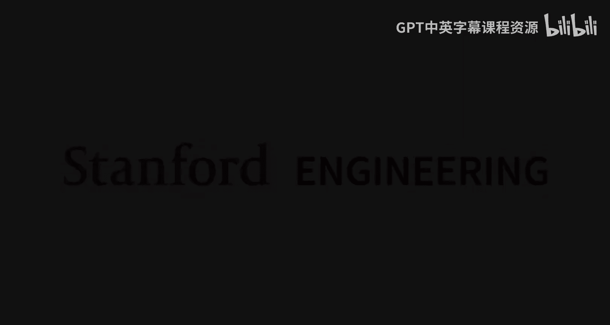

And today， we're going to try to focus on showing。First of all。

 how does a system that kind of an energetic system， what does the work of humans look like。

What are the complications and what are the steps in building such a system， right？

 and where we're even today， What are the limitations of the tools we have at our disposal today in building such a system。

 Because in our view， we're still at the beginning of how far maybe agents are going to go in doing the work of humans。

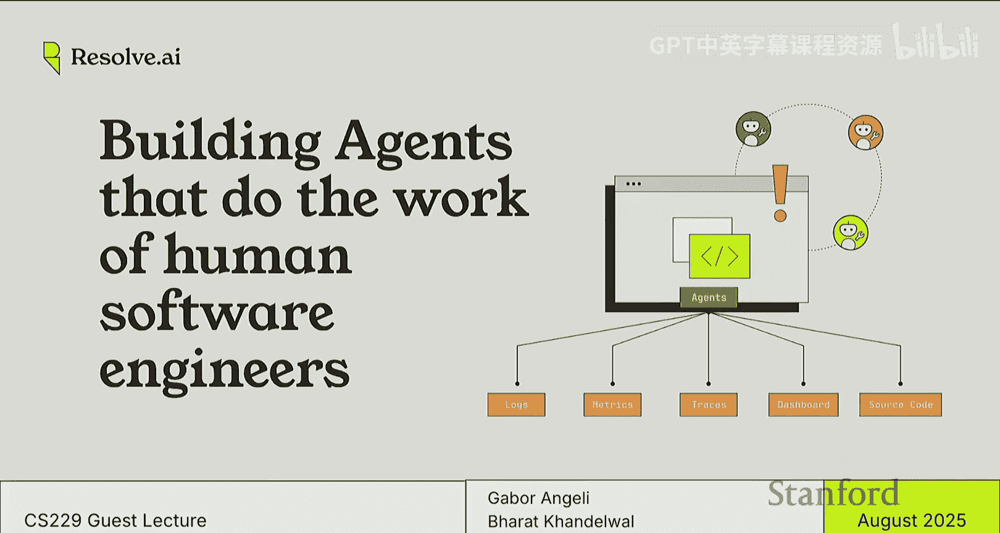

嗯。We already talked about our background， some up enough。

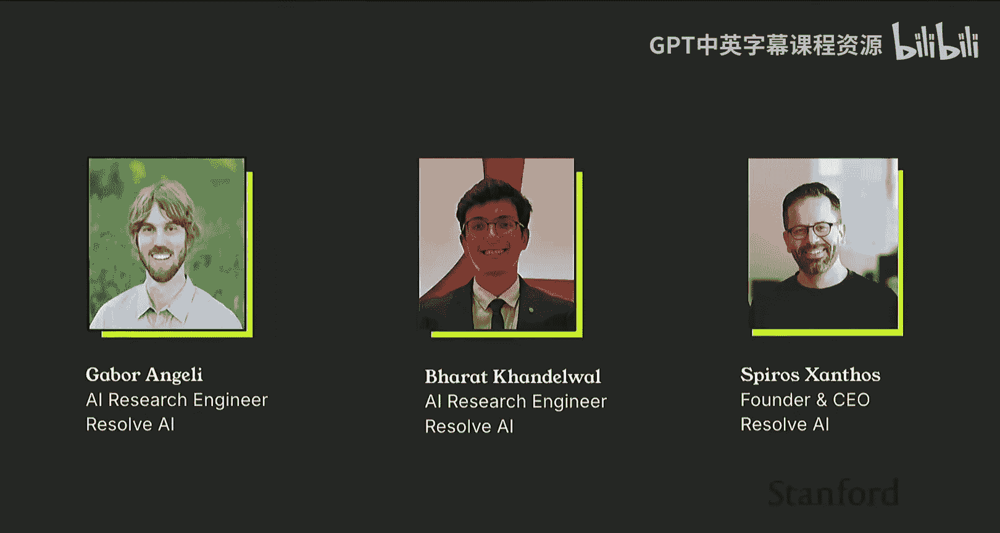

Go back to that。 But you know， I think in many ways， I'm pretty sure， I mean。

 how many of you are using， let's say， LM based tool for coding。Yeah。

 actually Gabo tells me he doesn't， He's like an artisanal。But you know obviously， you know coding。

 or I could say software engineering as we know it has changed and we've seen it big time in coding right and you know you've seen all the advances。

 actually G5 drop today， let's see what how that changes the world even further。

 but also in our of you and for those of you maybe who have worked in the industry。You know。

So engineering is not just coding。 It's a lot more than that right and especially when you're trying to build something at scale or when you're trying to run a large production system。

 code and you know feature development and you know solving hard problems in code is a big part of it。

 but it's also how do you actually how does it all materialize in a production software system。

 but let's say users access and you know use in performing whatever the task might be of that system。

And in practice， the larger actually the system becomes。

 the more the complexity of the production or the complexity of the production increases more and the more time it takes。

And actually the motivation for us in actually building agents for software engineering was exactly our own experience in my last role。

 I was running a very large production system with a large engineering team。And over time。

 what we found is the vast majority of our time was spent in actually maintaining what we had and maybe like keeping it reliableable rather than building new features。

And also。No user ever complained because we delayed the feature。

 many users complained when the system wasn'tavailable。Now。

 let's go back to agents and let's go back to， let's start with how， I guess。

Software engineers do their job today， right， Typ， you know， as software engineers。

 you're dealing with， you know， a plethora of different tools in different categories， right。

 there is tools around coding。 There is tools in， you know， infrastructure。

 whether it' that's AWS services or Google， cloud， etc cetera。

 There are usually observability and telemetry tools like Datadog， Splang， etc cea。I guess by now。

 everybody's probably using coding tools。And， you know。

 there is then all the adjacencies around these things， right that， you know。

 usually create like a software engineering kind of tools stack environment。

The majority of these tools require actually a human to interact like one to one， and oftentimes。

 humans have to then。Take or give the input， Take the output and combine it with the outputs of other tools to perform a task Often times。

 And that's humans are at the glue。Maybe an improved version of these with agents is where we have agents。

 let's say。Kind of performing its its task or its category of tasks。

 and humans now are at the glue across agents。 And in many parts who have moved to this you know place that right like take coding as an example right when we started using AI encoding。

 it was primarily the completion or it was essentially trying to drive a little bit further the call generation。

 But by now we' moved to actually asking an agent to perform a task。

 giving us the output and ask maybe incorporating that right， But still。It mightight have an agent。

 let's say that goes into a production system。 It maybe helps us with infrastructure。

 but humans are still the glue。 where we were headed， in my opinion。

 or maybe started touching is now we have these multi agentent systems that take maybe an input from a human。

 they interact with other agents， they iterate the plan， the region。

 and they come back usually with an answer that often involves many。

 many tools and many categories of these tools might go from code to production to tele element to production infrastructure。

Interction maybe with even other agents in other parts of the of the of the software stack。

 And I think today， we're going to show you how you start essentially from the left of this。

 how you start with simple tools， maybe just simple L Ms。

 and you moved towards building agents all the way to multi agent systems。

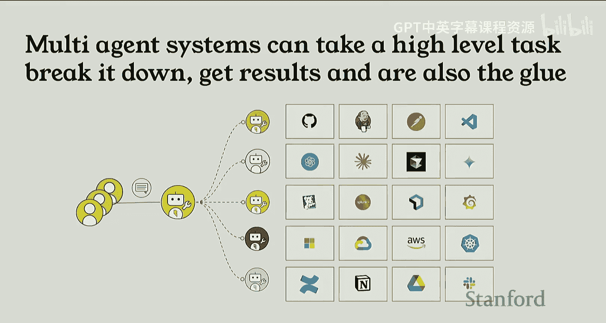

Now， why this is a hard problem。It is because when you' are dealing with all these different types of tools and different types of data。

 first of all， in each category， you have almost an infinite amount of possibilities in data。

You have a lot of complexity that comes from， you know， dynamic environments， dynamic dependencies。

You have on top of that a lot of what we call tribal institutional knowledge that oftentimes exist in like large software systems。

 things that may be documented might be documented across multiple tools or oftentimes are even undocumented right and people just know because they work there for a while。

So when you're trying to build agents， you have to take into consideration all of these things。

 right， the changing nature of the environment。The kind of code is self documenting。

 but other types of data in an environment like this are not。

 the knowledge that is spread out across these tools in a constantly changing world。

But let me show you how maybe an agenda system for software engineering looks like。

 So I'm going to show you a very quick demo of how system like like resolve looks like。

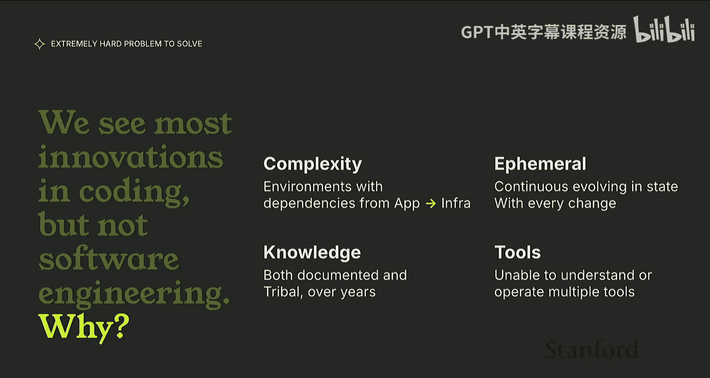

First of all， think of it as a multi agent system， like I described。嗯。

Where you you have agents that understand all the different types of tools that you find in software engineering environment。

 you have infrastructure。And with infrastructure you have a bunch of human tools basically。

 that humans normally use to essentially perform tasks like tools like Datadog or grernetes or Slack。

 you have tools that give you metrics， tools that give you events。Code did have in this case。

et cetera， et cetera。 right And in each of these categories。

 you might have multiple tools right So the point here is that when you're trying to perform a task。

 you might have to go across all these tools。 Let's start with actually kind of a simple task or。

 you know， a simple problem， let's say， which is。Let's say maybe I'm a developer and some of my users are complaining about some problem。

 right？Let's say a bunch of users came and said， like the UI has been slow this morning。 Let's say。

 right， How do I go about solving this， I would probably have to go figure out are the dashboards。

 other the changes， Are the feature flags that are on Did somebody change their code in a way that may cause the problem。

But let me ask actually now the agent this very high level question to see what it does。Let's see。

So normally， like I said in a scenario like this， when I have such a very high level question。

 I would probably have to go across multiple tools or maybe multiple agents depending on how you want to see it。

 and I would start looking at different things to see how can I figure out what's happening right so now do what the agent does here it actually takes this highle directive maps it to a set of tools start doing some planning even to decide how to solve this problem I understand my intention also right。

And then it even maps it to part of the environment。

 I mentioned UI and maps this to the front end which is a real service in this environment。

 and as you can see， it starts switch across all the tools that it has available to see if it can answer the question。

Now， this is agent in the sense that I ask a question at a very high level that agent essentially decides plans for itself。

 let's say， goes executes a bunch of tools and comes back。

 but still it's not like a loan rang agent all it tries to do now is tries to answer my question the very specific way I asked it。

While this is running。I'm going to kick this off， which is like a more kind of elaborate investigation。

 where I ask an agent to go do all the work it needs to do in the background and answering the question。

 right， and I'm going to kick this off。Basically I said like there is an API that is slow and now as a bucket essentially this think of it as like an agent that runs for a very long kind of time。

 tries to do this long horizon task where I say basically go and figure out what is happening and exhaust all the possibilities and then come back to me right so I'm gonna let this run for a minute while I'm looking at this so this came back and basically it ran across all the tools but it has available and came back with some interesting charts to highlight and some answers and says basically that multiple spikes in the UI front latency were observed。

It gives me like essentially a few different citations of what it found in different graphs。

And says like the front end experience spikes in latency and a temporary flood of product lookup or the process errorss during the time。

 this will more sensor cause the degraded U effectiveness。Can you。And I can ask now。

 can you go find the root cause。Which again， I'm giving it a very high level elective。

 It will have to decide how to break this down to some sort of a plan。

 a bunch of tools to go execute and come up with an answer， right。

 what a human engineer would do in a scenario scenario like this。Okay， basically。

 it came back and says， okay， I found the you cause at 8 AMM。

 this feature flag was intentionally enabled。 I mean。

 sometimes it get too smart and by schedule Ch job and says that this。This was a chaos engineering。

 Basically， this was an induced failure， right， Like it understood that that what it was and tells me that this is what happened。

 right And I cannot now say， how do I fix that。For example。

 right I now complete the loop where with me driving。 Now。

 the other scenario I was showing you here is now where the agent essentially starts with a very high level directive and tries to solve the problem by itself。

 So instead of a human now asking the question， the agent asks the question itself right So basically it starts asking six questions。

And you know， the directive I gave it was like there is an API that is slow right And now the agent asks the following six questions。

 What does the front end service dash around the alert。

 What causes high latency in this particular from traces。

 were there any front end service deployments or port that status with this time right And is one of these questions。

 if I expand， basically， you see that。It's not the agent asking itself or asking the other agents。

 basically。For for an answer and even explaining why it tasks right says analyze it traces for request to this particular endpoint around this time。

 I need to identify what specific downstream service or call or internal function is the primary contributor to high latency。

 So imagine now this is like a human who is an expert in this who will receive this high levell directive and is trying to solve it right and to do this essentially it's going to go across all the tools Ask the right questions。

 get an answer back right So this gave some evidence which now the agent takes into consideration and continues doing work。

 The other thing that you see here is that it used three memories So it actually used some knowledge it already possessed about this environment which was back to the problem I was describing earlier。

Okay， this gave me the fix， I can say， give me。Like months。

Okay this is how I turn off the pictures flag right like it's very straightforward。

 So I went from a high level directive to working with the agent to give me the answers right and in this scenario which is running in the background。

 you can see now that the agent is actually working with itself complete with multiple agents let's say to get me to an answer which now you can think how to generalize even further and any task that might require many。

 many steps and let me show you how this looks in practice let's say now the agent that has all these capabilities can be on call like a human right So if I'm in this slack channel。

 you can see that whenever an alert fires this kind of software engineering or S agent basically you can respond acknowledge the alert go use all the tools that has available the alert talks about like highlight this examined point and come back with an answer of what might be causing it and it gives like an initial answer which is like here is what I observe in this environment here is my quick set of evidence that I found it seems like the evidence points to downstream service。

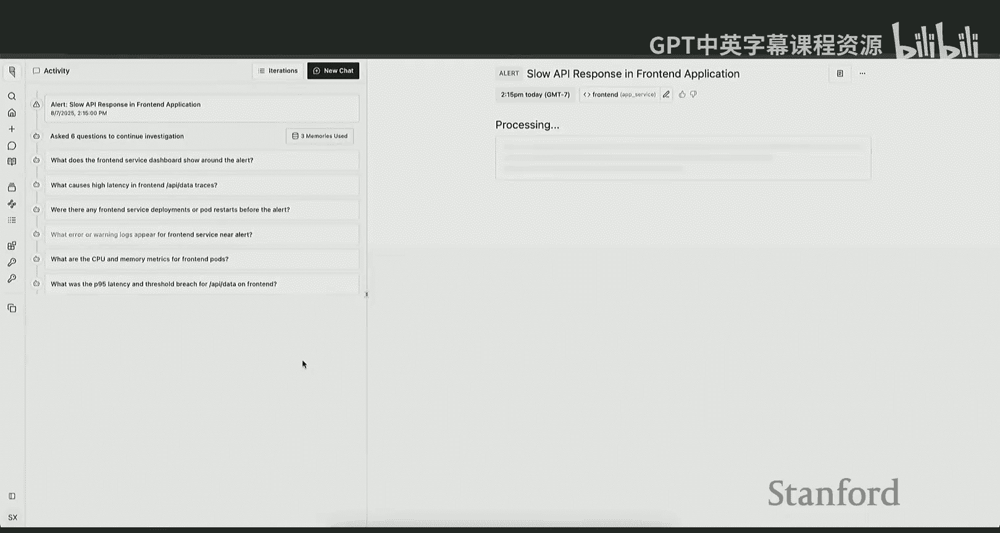

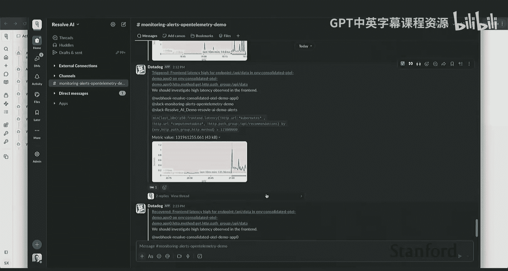

is the recommendations on the a service that might be causing high latency。

 it provides the evidence and then completes the investigation comes back with a final answer where it says that the service high latency is the result of severe concurrent degradation due thestream dependencies。

 the recommendation service。Spike to X amount of seconds due to an efficient n plus one query problem in code。

 So it given points to the code as as the problem， right， And I can say， okay。S me。I called。

 And give me。A fix。Then now it kind of looks into the code， explains how the slow。

 essentially what n plus one means by the way， that you have a loop working every time the loop executes you run a database query。

 So the latency accumulates right， And it gave me an example of how to fix this in code。

And I guess this is still running。 but I'll stop the demo here right But the idea here is that now the agent that is executing on its own is going to run basically multiple iterations in its iteration is going ask a bunch of questions。

 It's going to perform some tasks and come back with some answers until it completes the task all the way to the end And with that。

know I hope this gave you a good idea of what is the goal here。

 what the agents were trying to build doing， and maybe go to how we're actually building them， you。

Oh， sorry。Vus how much of the decision for？It's all automatic， right。

 And I guess that's a good question， right。The question is basically， okay。

 given a high level directive， right， how much of the decisions the agents have to make are hard coded versus you know。

 completely reformed。 I mean， the goal is for it to be completely reformed。Now。

 the reality of the situation today with models is that if you just give tools， the models。

 the tools of the models， they're probably going to go off the rails very quickly。

So it's not hard coded for sure， but let's say the planning phase we do a lot of healthhold the models decide the plan。

 but essentially we constrain quite a bit what the plan can look like in the end the result or you know in the final state。

 ideally you want the model to completely plan on its own iterate on its own decide what to do right for now I guess a lot of the planning and reasoning part of that level is controlled。

 but it's not hard coded right it's mostly you know。You ask。For a plan that is very。

 very constrained， right that kind of you have gut rails around。One more follow up。

 So you have a working system。I do。Sugest that the new feature will also need outholding for the first two six cycles。

And systemを。You feature in the。I builtilt the launch the system three weeks later I add a feature。

Now doing。你给不东。TheNo， no， you don't， right， and the the。

I guess if you truly are trying to build it in my opinion an agent that can maybe do the work of humans。

 it has to learn like a human almost right and to learn like a human in that scenario you probably has to look into code that you created and you know understand what the code does basically right or if you have new telemetry or something else it needs to look into that and kind of maybe learn from it right if you have to every time teach the system that doesn't scale I mean you wantna be able to teach the system but not for every particular thing you do right but maybe hard level patterns。

I was hoping this is going to finish and you will see the end result。

 but I guess maybe let me show it from here what it looks like。

So the end state of this is when the agent。Completeed， it's。Question and answering sequence。

 you know， it did a lot of work。 It itd until it got a satisfactory answer for itself and gave me an answer of what the problem might be。

 right and how to solve it。And with that。I'll give it the bar to continue。

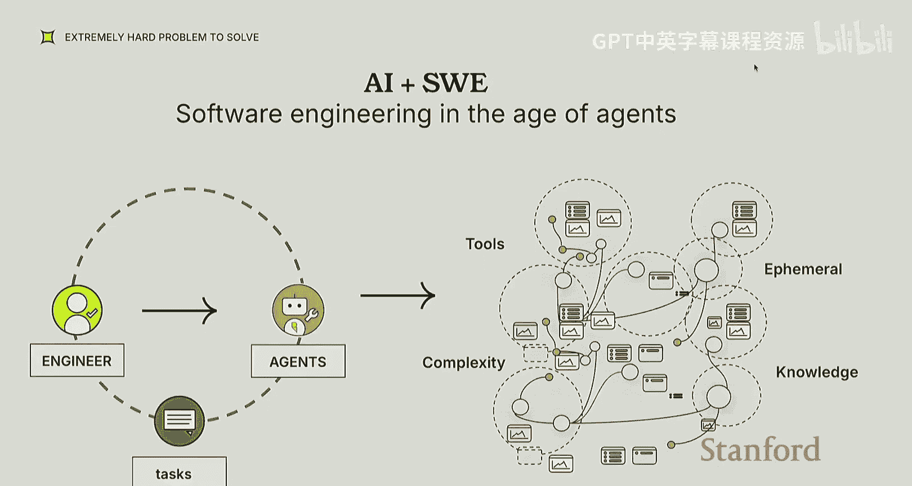

I mean， I guess that's the flaw I was trying， basically。

So now I know that was like a pretty good demo right。

 and we are all thinking how do we build such a multi agent system by ourselves？

But before we do that， I want to introduce you to the foundational principle of building a multi agent system。

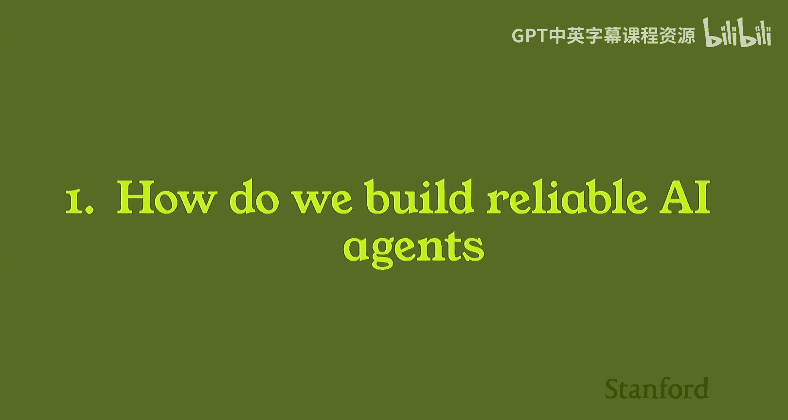

Keep it simple。Because not every problem really requires a multiagent system。

 Some problems can do with very simple solutions。 And if it is possible like that。

 then we should definitely do that。 So what we are going to do is discover what is the right level of agent complexity for a particular task and how how complex should our system be。

And to do this， we will start from building from a simple LLM call all the way to a multiag system on the way。

 we add feedback loops， tool use， make it into an agent system and then add multiagent。

 And at each level well try to answer two questions。

 What kinds of problems can this system solve And more importantly， what kinds can it not。😊。

What we have a running example of a payment system failure。It's a great use case。

 Sometimes the failure reason is obvious。 Sometimes it's a tangled mess that spans multiple systems。

 This progress progression will show you exactly when each level becomes necessary。😊。

And by the end of this talk， you won know you won't just know how to build agents。

 you know how to build the right agent for your problem because in production the simplest solution that works is usually the best solution。

So with that， let's start simple。So here the most basic setup is a single pass LLM call one prompt goes in one response comes out thats it and for a surprising number surprisingly high number of use cases this actually works if you give the LLM the right inputs the right prompt transform the inputs properly then and interpret the output correctly then this is enough a lot of the times let's look at one specific example for this。

😊，So in this task， what you see is。Okay the situation is the payment system is on fire。

 users are flooding support， your phone is blowing up at 2 AM and in a panic you open Pager duty。

 look at the incident send tickets assigned to you。

 you check the dashboards and try to figure out what metrics are going off the rails and you check for the underlying dependencies look at what was pushed to production recently and start targeted log queries with some hunches on what you think the problem is。

😊，And iterly refine the queries to get to the stage where you have like， let's say。

1 thousand log lines。 And then you plug this into any LLM that you like and ask it。

 why are these payments failing And the LLM scans the logs And it figures out that there one specific log that says。

😊，Card expired and says， looks like the card expired。 and that's the issue。 But if that's right。

 fantastic problem solved。 But what if the error that it pointed to is just noise。

 What if 80% of the payments are actually timing out because of a network issue。

 That's in some other log that you never posted。 The L M didn't know enough to ask the right questions。

 It didn't verify its hypothesis， It didn't try to reconcile the answer against all the failures。

 It just spotted a pattern， answered the exact question asked and quit。😊。

So these are the exact limitations of a single pass LLM system。 It has no internal feedback group。

 No way to evaluate or refine its own response。 There's no iterative reasoning。

 no mechanism to course correct once you go off the rails and no concept of uncertainty。

 So there's no way to know if it's actually confident in what it said or not。

 It's like some asking someone a hard question and blindly trusting the first instinct。😊。

This might work for simple tasks， but as complexity rises。

 the cracks start to show and the system breaks down。😊，So we move on to the next step。

 the a Cri system， what will we missing a feedback loop right So we add a critic LLM here that is supposed to give us feedback every time we propose a candidate solution。

😊，So the flow goes like this。 The actor proposes a candidate solution based on prior inputs and feedback。

 The critic LLM examines the candidate and it has its own prompt on and it also has access to the input and it says whether it looks like this is the right solution to this and if it makes sense if the critic approves we return this candidate as a solution If not we go back to the actor with this feedback and ask okay based on this feedback do you have any other things that you want to try out and this keeps on repeating。

😊，So。Let's go to our example here。 The actor now says card payments are failing because the card has expired just like before the critical response。

 that's the only log message that I see is troublesome， but card expirations are usually one off。

 They wouldn't explain widespread failures。 So the actor adjusts respond to respond to the user that okay。

 what I see is a card expation failure， but I don't think that's the issue。

 So maybe there's something else that you should look at。😊。

And that is already much better than the initial response we got。😊，So。

But then what are the limitations of this system， It can't do a few things。

 It's still limited to what the user pasted in the first few log lines。

 It can't query new data or explore beyond what's given in its context。 Second。

 there's no persistent memory。 If the act critic keep going at it。

 let's say 12000 times they might still forget what happened in in1 and then be stuck in a continuous loop。

😊，Third， it's still bound by fundamental limitations of L L Ms， like。Context window limitations。

 lack of math skills， not being able to count the number of hours in strawberry and hallucinations。

Finally， there is no access to external knowledge。 it can't Google。

 it can't look at the latest stack exchange article for this specific answer。😊，So that。

 that brings us to a good point where。We define tools， What is a tool。

 A tool is any external function that the LLM can use to interact with the environment。

 This might mean querying a database， calling a calculator or asking a follow up question to the user themselves。

 tools solve many problems， they enable environment interaction， memory。

 math capabilities and access to it external knowledge。 so。😊，Now。

 that was what LLM means to us what does a LLM look like sorry， What does a tool look like to an LLM。

😊，So to an LLM tools are defined in the prompt as structured interfaces。

 each tool has a name which is an identifier a description and which means which is what does it do。

 what does that tool do， what does it doesnt do， what does it need。😊。

An input schema which are the parameters defined by the type and what values they take and a usage and all of this can be called like a usage protocol for D LLM tooling。

Now， when the LM wants to use a tool it emits a structured output call the the format of the call can depend on what LM it is。

 but it essentially looks maybe like a Json。The execution engine then runs this tool and returns the result to the LLM。

 which then decides what to do with the results。So this is what a LLM tool used looks like there is some sew code here but what' is essentially happening is at each step the LLM sees the current state the tools available to it the input the previous tool called results and its own prompt it generates a new candidate possibly with tool calls the execution engine executes these tool calls and appends the results then the LLM evaluates does solve the problem yet if not it looks again if yes it returns that answer。

😊，By the way， I forgot to tell if you want to ask questions you can obviously ask any time。

 Well also have a question answer session at the end。 So let's go back to our example。

 Now the user just says this time look carefully the user doesn't paste the logs It just says it checked the dashboard and it said the payments keep failing check the logs。

 Now the LLM itself decided which logs to check how to formulate a log query。

 that's also not regular things that we write right that's a specific syntax。 the LLM figured it out。

 it send that query as a tool call to loki agent sorry to a to the Loki system。

 which then return the logs then the LLM analyze those logs figured out what the issue was and posted it So this time it was able to get to a different state because it had access to tool calling So it figured out okay that's maybe not the log to look at I need to look at some other logs and it kept iterating over that。

 So it found out that there's some network issues around。😊，Aelability。And。Now。

 what are the so this looks good， but what are the limitations for tool use。Even with tool Li。

 LM have some limitations。 there' is no state tracking。 They struggle to manage evolving task states。

Tool failures are one other thing， While some of that can be handled in the prompt。Still。

 L M may not be able to handle every possible error in the tools。

 There's no real planning happening here。 The L M are more reactive。 Okay， to solve this problem。

 What are the tools， I do that， I got the result。 What do I do。

 There's no real planning on the overall change task objective。

And there' is a lot of inefficiency around poorly used tool calls calling tools that you don't really need。

 maybe because you just want to be comprehensive so things like that。😊，So based on that。

 let's go to agents。 So what is an agent I't it LM with a tool call an agent。

It is if there is couple of things that are figured out if we add a planning loop where the LLM can reason about a task。

 break it into steps and act as its own feedback agent。😊，Second。

 if there is an autonomous execution engine as well。

 if the LLM can autonomously execute on long running tasks to support that agents usually have memories。

 reflection and internal sub goalss instead of just reacting。

 they have now have a plan which they enact out strategically。😊。

And this is what an LLM agent looks like it comes comes in with a directive。

 it reasons about the directive then it does some tool calls which can be called the action then it observes what the result is it replans around it reasons around what the outcomes were and keeps doing this until it has a result。

😊，Which is， which is then helping it achieve its goal。So this is what an AI agent looks like。

 as you see on the right there is reasoning capabilities added tools as usual and execution loop。

 memory and guardrails guardrails as Pios was mentioning earlier。

 they are things to constrain the output space of the LLM otherwise LMs today are not good enough where they can do everything by themselves or they don't know things not to venture in。

😊，For example， let's say it starts writing some code to fix the issue when we are just asked for logs。

 So you want to have those guardils around。 So that's usually a part of agents today。Sorry， yeah。べ的。

It's a different part of the environment。You the。て。It's to the Egypt， so like how。

How is it like routine multiple fall together or is that we bend to loop software something？

So usually there's multiple ways to do it。 There's no right or wrong answer here。

 some some some of the ways that is done is one is that the agent prompt itself has a reasoning criteria or a reasoning stage。

 So every time it gets some new information， it reasons what to do with it and then has some next steps。

 maybe it's a list of steps already in the prompt， maybe it is something it decides dynamically and does that。

 Sometimes it is externally enforced where an external agent is basically prompting it with a different prompt each time saying。

 okay now it's time to reason now it's time to act。 Now it's time to do this。😊。

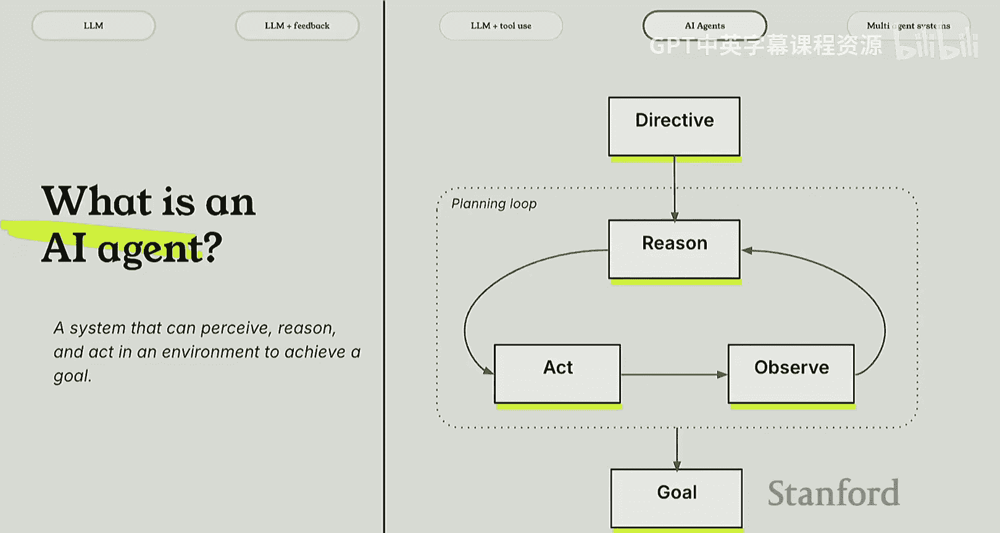

both are agents， essentially， one is more autonomous。

 one is more structured or handholded in some sense， but yeah。But it going to be like moving prede。

 usinging steps more like maybe just。Yes， a lot of the times how that is done。

 like when you have it autonomously happening， it's done usually in the post training or r phase where they are taught to be doing these things。

 when they are taught to follow user inputs they are taught to go about this loop。

 So it's usually handle at that stage where it is able to do certain things autonomously。

 even then not everything is possible， which is why we usually have some outputs out。😊。

Structure outside the LL M to support， support it。Yes， so。Yeah。

 so I think we covered this how this is happening at every stage the it starts with a system prompt and memory generates a sub goal or a plan。

 calls tools， reflects on the results， updates the memory with the outcomes of the tools。

 checks if the directive got complete， loops until satisfied return the solution。Okay。

 so let's go back to what problem。 Now what's happening Now the LLM has access to even more tools。

 it has access to a dashboard tool。 it has access to a log tool and what it is going to do the user just told us what it got on page duty Payments keep filling。

😊，Now the agent checks the dashboard to find out with services failing and note that this is an iterative process in itself。

 It might not find the right dashboard in its first try。

 It might go look at some dashboard find nothing there or some hint of something there and go to another dashboard。

😊，Once it finds the right dashboard， it knows what locks you look， what service locks to look at。

 and then it queries the service queries a service tool call。😊，The agent then queries the log。

 gets nothing， reflects， adjust its query parameters and gets something out。

 And we are again back to theres a network error connecting to striptripe which may be causing your premiums to fail。

😊，But for all the benefits that agents offer us， they do have some practical limitations。 First。

 there's a breadth versus death dilemma。 One agent can be an expert in everything。

 Our hope is that Ls can be jacks of all traits。 But today， the reality is that they master of none。

 So it's more so a lot of the times one LLM can't be expected to do everything possible that you need to do for example。

 to solve a complex enough task。😊，Then this a planning fragility。

 LLM can very easily lose track of their main goals as they get sidetracked in subtask。 For example。

 let's say the previous LLM got stuck in creating that log query。

 for some reason it was never getting the logs。 it would keep looping there looping looping there and trying to fix that or maybe it saw some error and it saw some error loop and it got stuck there it forgot what the user really cared about。

 So that is something that has a problem with single agent systems。

 Then this is centralized bottle leg problem。 Every decision flows through this main LLM making the entire process bottlene by how fast your API provider is。

😊，And then there's the error propagation。 Murphy's law still applies。

 Anything that can go wrong will go wrong and。One bit。

 bad guess can derail the entire conversation flow。

Then there is the problem of tool overload to solve a good enough complex task you need hundreds of tools they can be as simple as checking the time to as complex as fetching those logs and if and one agent is supposed to do everything then it needs access to all these tools and managing access to hundreds of tools can be overwhelming。

😊，So what's next， just like real world teams has specialist。

 That's why any agent systems that are solving complex real world problems need multiple agents。

 And to talk more about this， I'm passing it on to my colleague Goard。😊，What question before you。

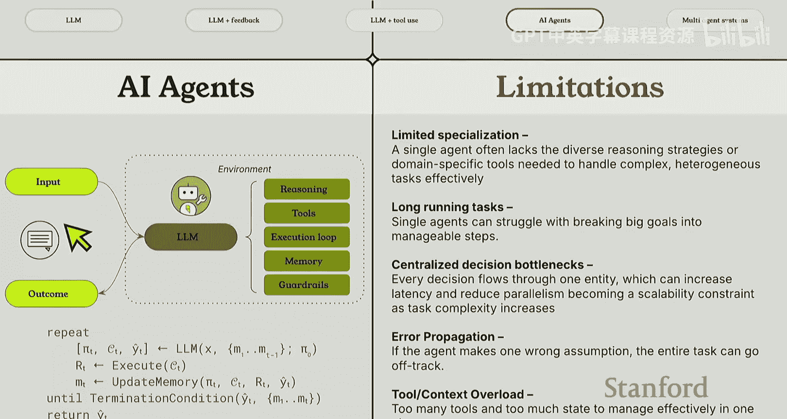

We had it act Berkeley。Yes， the number。gives you the first of cash some of。Yes， so we do。

 but it's not it depends you since we are talking about a single agent system。

 it's built into the LLM。 So when we are talking about the execution loop， the reasoning loop。

 it acts as a critic for its current hypothesis as well before deciding whether to go for more tool calls。

 output the answer or that。😊，Yeah， there's multiple reasons like LMs are not perfect so。😊，Yeah。

 it does happen。嗯。One thing I have a question about。How you contrain the phone call not to do like。

 for example， if you like。

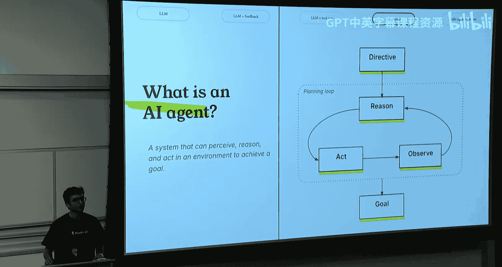

ITo call terminal， how do you noticed stomach green click。在的安意。Okay， so very good question。

 So here the thing is。so the question is and correct me if I'm wrong。

 how do you constrain the tool called to do things to only do things which are which don't destroy systems or like let's say R minus r slash。

And if you do that， then how do you do things that you really want to do， maybe delete a file。😊。

So the answer to that is it's very it's up to you so you can define an RM command that doesn't so you can define a tool call that will never call RM and you are doing that through code so your terminal that you are giving the LM access to it doesn't have the possibility of calling an RM because you have an if statement at the end in that program of the terminal that never do RM do the rest of the things and so the LM never has access to it and you can also prompted saying that you can never delete but it won't respect that you shouldn't trust that it will respect that but that's handle at the end of the tool。

😊，As for your second question like， okay， but now that we have restricted RM how do we do RM if we need。

 so we have to provide that as an API and we have to make sure that it doesn't do restrictive things at the tool call we can't trust the LLM today。

😊，So if you're going to build that system， then constrain it to things that you are confident about。

It's a pretty fascinating system them to train architectures。

 so I guess two questions going to go set by side first one。I mean。

 hope do you not doing like the evaluate and verify your results。

 right because this is a fairly complicated Sydney。Most benchmarks all they ugly about。

The operation is mostly about solving my puzzles， right？So this。

 I guess come to my question number one and my question number two here is。Thatに how go。그送。

Very nice question。 and that is exactly why I so two questions here。

 The first question was given that it is a decently complex system。

 how do you build evaluations for it because no existing evaluation frameworks or test sets out there really match the system and the second question was。

😊，Now that you' built the evaluation， how do you go about debugging it if it's failing？呃。

And the answer to the first question is you build two types of evaluations。

 you build evaluations for every step of the pipeline and for gathering data for that evaluation。

 you do all kinds of hacks。 So for example， let's have to build an evaluation for how good my lock queries are How will I do that I can just give a different LLm a prompt that generate lock queries。

 I don't care what they， just generate lock queries。

 I'll validated them against a running database and make sure that the lock queries return result。

 So whatever succeeded there， I'll use that as a training data for my LLM。

 And sometimes it can be done in a fashion where not even training data even as prompt injection like Q short examples for my LLM。

 and sometimes even for training。 The other way to do it is。😊。

If use a bigger LLM to generate those queries or specialized LLM that's traineded on that data to do that for your regular LM that youre using in your application。

 why not use the bigger LLM because it's costliier to use it's an overkill it has a higher latency。

 things like that but yeah it's an evolving field there's no clear answers and one of the most important parts with these building a big system is gathering the right data so there's two kinds of data together one for every small part you're doing and one for the overall end end task。

😊，Even if you build a good system for every small task you might be failing on the big task and how do you go debugging that you basically look at what the LLM was doing。

 you either manually verify it if it's a really hard task or it's really long to look at you send it to a different LLM which has maybe a different bias who tries to debug it or categorize it into certain issues that then you can think about how to incorporate into your prompts or your training procedure。

😊，呃。自人退过去。Y。Okay， so with that， I'll pass on to Go who will talk about multi agent systems。Thank you。

So I guess I get the last section， the grand finale so to speak。

 when we put everything together and get sort of a multi-agent。

 more distributed sort of aive system throughout this part I'm going to lean hard into the analogy of these sorts of systems is similar to the complexity that we see in large coding systems So if you imagine and an agent as a function then like a multi-agent system as a program if you imagine an agent as a service。

 a multi-ageent system is a distributed system and you know going maybe back to the very beginning。

 the advice I always got for building a distributed system is step one don't and step two。

 okay let's think through it carefully and what the complexities are so we'll get to that in a bit but first what do we get like why should we do this the main reasons we address a lot of the limitations that a single agent system can see So a lot of these fall into a similar category of encapsulation where for specialization in a single agent system。

😊，andling， let's say logs and dashboards。 the same agent has to know a lot about logs and know a lot about dashboards in sort of the same prompt。

 If you break it up into two agents， you can have one that's just specialized on logs。

 one that's just specialized on dashboards， one that's maybe just specialized on code and whatever else you need to do。

Similarly， sort of longrunning tasks and long context tasks。

 instead of having a single thread where you sort of iterate on the right log query。

 maybe and search across dashboards， or like you've all presumably seen Claude go search a whole bunch of stuff and code。

 eventually when you start composing this， then you blow out your context window and most of that context isn't even particularly relevant for like the next step that you want to take centralized decisions。

 similar theme rather than having one agent that has to make the next decision across know100 different tools that you call you can split this up so that each of the subagent sees maybe 10 tools。

 and then there's an orchestrator that sees the 10 subagents that it can orchestrate between。

Errors in a similar vein， someone had a question about like do you still see these sorts of errors when the agent is self criquing itself has its own critique loop and multiagent systems can add you know another level of protection on this where in part just the distribution of these tasks means that there's more critiquing steps before it gets to the user in part like you can even pull out the critiquing model similar to actually it wast at the very beginning as a separate agent that goes back and forth。

😊，And then tool context overload。 So similarly， if you have too many tools。

 then breaking up into agents can help The short of this is。

You can think of it as you break up these systems into multiagent systems for the same reason you break up code。

 into multiservice or multifunction code， if a single function gets too long， if it's doing too much。

 if it's too hard to debug， it's very useful to break it up and get sort of higher performance that way。

And we can look at what this looks like so going back to our classic example payments keep failing and you can even see this kind of looks almost like a code trace you can have the message come into the orchestrator agent and maybe it'll call out two logs and dashboard simultaneously and here it doesn't have to construct the log query。

 it doesn't have to construct like the dashboard metric query or search for the right dashboard it just says like hey logs find logs related to payments failing and then the logs tasks goes off and does its own thing and comes back and says like hey。

 it looks like you know maybe Stripe is failing due to timeouts here。😊。

Dashboards maybe comes back and says， hey it's probably the checkout service that's broken。

 And then the main orchestrator agent in this paradigm can take those two together can say aha okay。

 I think I understand what's going on here， clearly checkout service is failing on striptrie timeouts that seems like a reasonable thing that would cause me to be paged at two in the morning maybe let's go off to the code agent and be a code agent。

 please go fix it increase the striptripe timeout and the checkout service and it goes off and at some point it gets long to show all things the system is doing but you know dot dot dot eventually you come back with a full remediation of the problem。

😊，And the delegates here， you know， there's a lot more on the right hand side。

 There's a lot more that you as the developer have to build。 You as AI engineer， have to build。

 but the interface is much nicer。 Hey， I have a problem。 Go fix it。

 and then a multiagent system can do all the things it needs to do to be like， here's your solution。

 Congratulations。😊，All right， so how do we build them again， leading into the analogy。

 you can do whatever you want to a first approximation。

 but there are patterns that at least people have traditionally used an industry。

 This is not an exhaustive list but maybe a sampling。 scatter gather is a common simple version。

 sort of the mapre equivalent， you have an agent that kicks off a bunch of subtasks collects the results and then summarizes it to the user。

 So if we go to the observability example maybe even a deterministic agent， quote unquote。

 that goes off and says call all of the systems that I have access to all the dashboards。

 all the logs， just get all the evidence that I have all of these subagents figure out whatever they need to figure out。

 they come back and then maybe there's an agent that summarizes it and says， well。

 based off the evidence。 this is what I think might be wrong。😊，In the scatter gather framework。

Orchestrator loops is effectively what I showed here。

 this is my personal favorite or I guess a native way to build agents where you have an orchestrator that figures out some subset of agents goes off。

 calls them， gets the result back， decides okay based off this I think I'm not done yet I need to call these agents goes off calls them gets the result back you can think of it as like chain scatter gather in the degenerate case always calling one agent and sort of the fancier case you can call multiple in parallel。

😊，And on the other extreme， you can have just free for all agents are calling each other Willie Nilly here and there。

 for folks here that like the actor model of programming。

 this is a similar mindset in many senses like there's a shared context and the agents just like handoff to each other is that the common way this happens。

All right， so what what are the interesting implications of these different designs。

 one that at least I think a lot about。 And so you guys are going to have to hear about is multiagent context。

 So for each of these agents you have to you have to decide what goes into the system prompt what fraction of the conversation and the internal agent trace you show them。

 So in this case， like you have an orchestrator it calls two agents。

 agent P calls two agents what a subag B to the bottom right here C of this whole trace that happened where like one extreme。

 you see everything。 It's just the whole conversation trace and like internal trace across these agents the advantage here。

 you see everything So like you're not going to like lose information or have something lost in translation anywhere。

 the disadvantage。😊，You see everything。 So like you're gonna to blow out your context。

 you have many of the same concerns of like why is the code agent， let's say。

 subagent P2 here caring about the particular output from like the dashboard agent in its full glory。

So this in my view， this sort of global scope works actually really well for like the free for all types of agents。

 it's probably less necessary and less useful for scatter gather orchestrator loop type architectures。

😊，On the other extreme， you can have know all you see is your own input。

 so going back to the programming analogy， each agent is like an RPC。

 it sees the request that it gets in， but has no idea where the request came from or what else is happening in the system it's just here's the request I need to fulfill it。

Wonderful for debugability。 You can， hill climb on how the subagent works in isolation from the whole system。

 Wo for sort of the simplicity of understanding what's going on in the system。😊。

But you have to make sure the request has everything the agent needs to do a good job。

 So if subagent B1 did something that it either forgot to pass up or agent B forgot to pass in。

 or if there's like some large artifact that you're modifying that you know。

 you don you don't necessarily want to pass all the way through the whole， the whole chain。

 then this starts to encounter limitations。And you know， there's any number of in betweentwes here。

 my favorite being sort of a call stack approach， an agent sees where it came from。

 it sees all the calls that went into calling that agent。

 but not necessarily all the other stuff that happened elsewhere in the system。

 So like there's a bound in the tree depth of what it sees。😊。

But it still gets some more context than it might otherwise。Related question。

 what is the statefulness of these agents And here。

 like you can think of it as two different analogies in one extreme， they're fully stateful。

 they behave kind of like humans where if like I go and talk to Spiros and ask a question and then I ask a follow up。

 Spiros knows my first question。 So the follow up the sensical。

 he can you know take that context and continue answering in the other case。

 these agents behave much more like RpCs or functions where if you make a request and then you make another request。

 the other request doesn't know the last request that came in why would it same sort of tradeoffs here where like actually in my personal view for more like free for allish agents。

 actor models of agents's even in the name actors it makes more sense to have this more stateful agent for orchestrator and worker type workflows。

😊，I at least tend to like the more stateless agent or more limited state， at least between calls。

And all this becomes a lot more complicated when you start thinking about async activities。

 which is super important from like a UX point of view， generally speaking。

 you don't want all these agents to happen one after another because then it'll take forever generally speaking。

 you want to propagate to what's happening， what agents are being called you saw in the demo fairly quickly after you said the question。

 it'll show like looking for dashboards， looking for logs in parallel and kind of showed progress updates I' looking at this in particular and then in particular。

😊，But now， what do you pass in for context， Like， if you do want to pass， for example。

 more global context， but some tasks are still standing。What do you do there。

 If you have a stateful agent， but you're invoking it two times in parallel， what do you do there。啊。

I don't have answers on this slide。 the best I can do is you know the same sorts of considerations you have for any large distributed parallel law system。

 they map in my mind pretty well to the multiageent architecture world。😊，All right。

 that's the end for architecture。 Oh do do you have questions， questions， excellent。 Yes Again。

 I think thiss really interesting you measure after the programming model。

 it's also like business kind of might be。😊，回。so I was wondering if you guys have。

Let's go out the like of this fishing。你。故。So。So the question was whether there are distributed programming languages for agent and execution or whether we have to write everything by hand。

Yes。I mean there certainly are there's probably hundreds of startups writing agent orchestration frameworks。

 Lnk chainin La graph being the most famous of them， so you don't have to write all of this by hand。

 you can do something more straightforward you mentioned actors in particular as a model So for there keeping track of the goal the easiest solution is you just track the whole conversation So user message comes in and then the agent agent one decides。

 hey， here's my initial response to the user conversation into almost a scratchpa agentnt two sees the conversation including agent one's reply and sort of keep going keeps going that way until they decide that they're ready to respond to the user。

😊，Did that answer the question。Excellent。反正不是吧。In context。Over over here。

 you mentioned like content like。What this is each agent the input is be a second prompt。

 but then what' got down。Good question so we'll get into that some coming soon。

 but the short answer is context is indeed the prompt， so it's usually the system instructions。

 the conversation context so far is the most expensive part。

 Me is additional information that you're pulling in to help this agent do well based off of past experiences。

😊，The core problem here being agents are fundamental， like LLMs， I should say。

 are fundamentally stateless， you get the same request and you set the temperature to zero and you'll get approximately the same result。

Yep。こ告てま。経て上。おなして。Beyond。法院处理。Yeah， it can be any number of。Oh sorry。 the question。 Yes。

 the question was what goes into making an agent specialized beyond say fine tuning the LLM and fine tuning is one of the things you can do so you can have particular agents that have their own data sets。

 their own tasks。 you give them data and then sort of they do their own thing。

 prompting is the other So either wholesale replacing the system prompt or occasionally there's like a shared part of the system prompt and then you replace particular instructions like your researcher。

 here's how you reply， here's how you call tools。 But like your particular researcher for logs or for dashboards。

😊，I'll go back there because you think you had your hand up first so was we have perpetually run agents unless we solve this context problem？

😊，黄是不是。So the question was can we have perpetually running agents without solving the context window problem？

 The short answer is yes， you'll eventually exhaust your context window。

 there are a couple things you can do to mitigate this One is you can periodically summarize your context window and then you actually can have just one agent that keeps going albeit now you have a lossy context。

The other。Well， okay， multi agents help some in that you don't have to care about the。

The context window growth from the subagents that you call or hear sibling agents， but even there。

 like the orchestrator can't go forever or else eventually it's going to run out of context。's。是。

From the beginning， see structure。The Library systems interval and correction。 So let's say。

Assbo hospital。house死。Strection so far or something。

Can they get to choose I lot the1 I use from their。But so how are you funding through that？

Like' save through， you get a choose broader。Re here an element to the King house for something again。

To be。I would you answer this because I think this is not so much like what we do ourselves But I think an interesting observation to your point is I think the question was like in a system like this。

 you choose your own model or you know does the system with models I think actually in some sense maybe this is an next evolution of how this is things work because you can think of let's say agents that are simple the orchestration of top of any model that's more like a single agent paradigm let's say coding agents is a good example of that because for the most part。

 they use one model to do all the work because they're also dealing with one modality of data in a system like this when in theory Yes you could but in practice。

You know what we found ourselves at least is that different models behave better for different tasks right and I think you're going to have this ability of routing and choosing the right model either for latency reasoning。

Cost even right， if， if the same task can perform， they call it well a very cheap model and a much more expensive inference wise。

Model， you want to use probably the best model。 So， yeah， in theory。

 that nothing prevents you from plug in your own models in practice。

 I think when you move to this multi system。Most likely， your， this is。Essentially。

 you have a big gap between the model and the end task。 So I don't think it makes much sense。

So really odd by the way No I tend to agree I think these make the most sense when the cost is passed through so like you。

 the user can choose to like do cursor cheaper， more expensive or what have you and in this case it's more like we just need a test to work well and we've tune these models pretty carefully and I also think the world is moving more towards this model as well than the user picking their model even encoding itself I think。

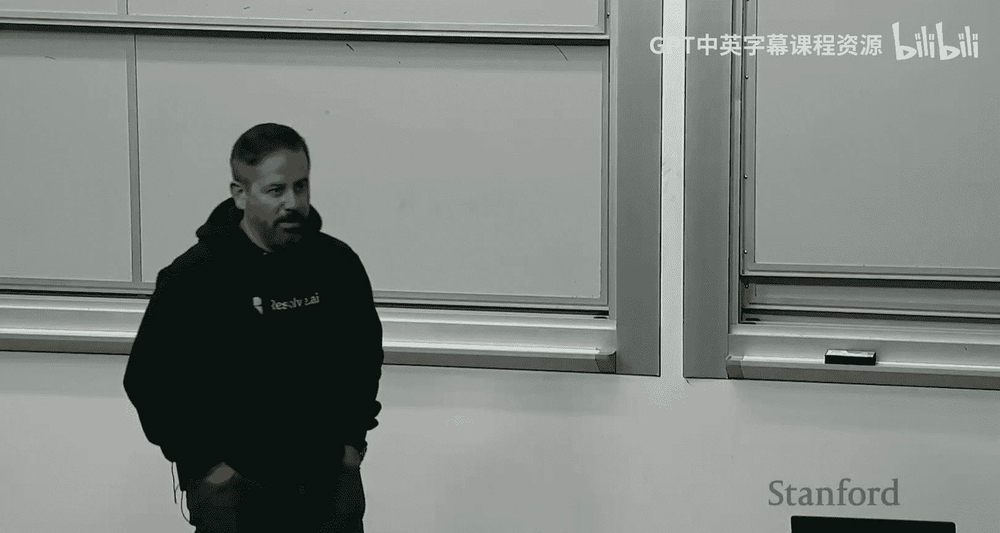

I actually worked currently working on a project my Asian project is in AEI。

I just had a question that you guys saw a few issues when I was working。

The that UA was loging or to me that was a GP3 and then that thing。

I realized that she had a very smaller corn sples， and his remedies and head。

Now like today chargingfi movies and we have like four carbons that it can take。

 so we lesser and lesser amount of NLL is required in vital system。

 but feel like with better regions in the future GDP because we have larger membrane at 1L。

We might be。If I this get of my systems， do you think that's a possibility？

There is definitely some of this， so like the adage remains that if you can get away without a multiagent system you probably should for context windows in particular。

 the very long context windows aren't free so they're all doing some amount of summarization basically of the context like attention itself is quadratic you're not going get truly a 400。

000 or 1 million by 1 million run time out of these systems and so empirically what happens is when you grow past the like true context window。

 the performance starts to starts to steadily degrade。😊。

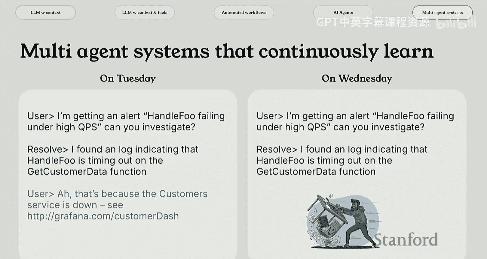

Which is sometimes okay and sometimes not。A you seen maybe doing that？That什么。Oh， and I forgot。

 I forgot to repeat the question。 The question was about long context windows and whether those will make multi agentent systems obsolete。

 The question was， do you think this will degrade over time。What's the end game。

Oh what's the end game here of context。I mean， I should probably not be in the business of predicting things with with AI nowadays。

 my own philosophy is。These LOMs will continue to get smarter nowadays， fairly predictably。

 over the last couple of years， it's been like there haven't been as many nonlinearities as there were in the early days。

And there will always be more that we want to do with them。

 And so things that used to need multiagent systems will migrate to being doable with a single LM。

 And then there will be new things that now we want to do on top of them that will need their own multiagent systems of these larger primitives。

wondering for problem them， especially as hired as software engineering。

 really very expensive in other the tokens。So what on like what of these strategies disease that needs to be more do and efficient。

What are strategies you can use to be more token efficient。I。I'll give you an answer， which is that。

So engineine also very expensive。It's a good answer， No， like George aside。

 the good thing about like when you're solving heart problems is that humans take a lot of time to solve them too。

😊，And so tokens are less of an issue。 If you're solving similar problems， then actually。

 tokens smart a lot more。In a way， I can almost see that when we use more tokens in performing a task。

 I almost see it as a good thing。Not like in a wasteful sense。 but in the sense that， O。

 if a human had to perform the equivalent amount of work， it would take them a long time。 And。

 you know， it costs a lot more。 let's say it。Effort， and， of course。

 more so when you're dealing with like stressful tasks， right， like， okay， something is wrong。

 And I need to fix it right now。But， you know， I don't know if you want to talk about strategies in conserving documentss。

I think that's the best answer that make sure the tokens that you're using are for a cause that it's worth the tokens。

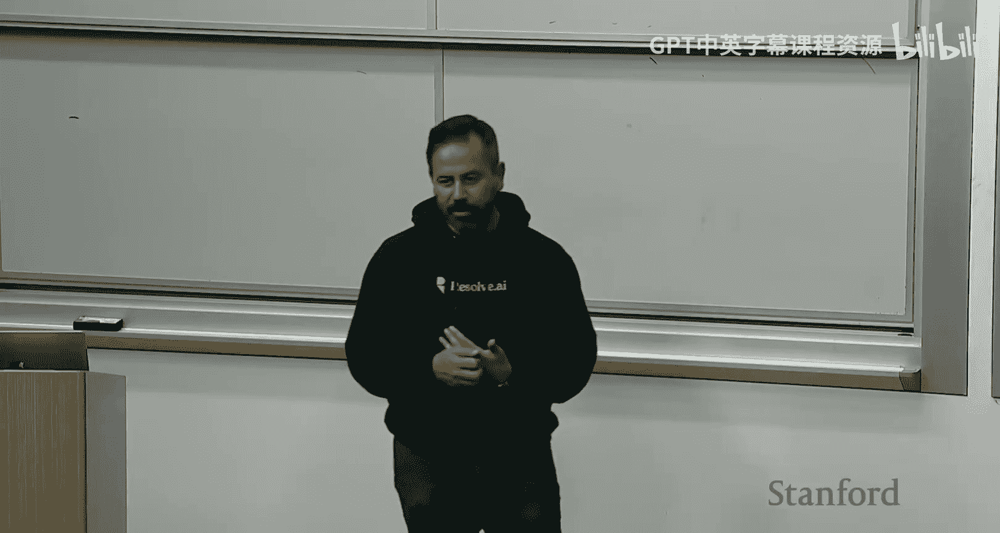

The the other thing that I can point out is you can， you can memorize， in a sense， past results。

 So like a common strategy here is you output to some sort of scratch padd or file system where what have you。

 And then you don't have to recompute things over and over again。

 You can make use of this partial computation to。Hopefully make things more efficient。

Can you other question。Yes。I have a mic。 So I'll say you the trouble of reading。

 I found it fascinating that a lot of what you said。

 all of you said is mapping a lot of what's going on and explaining it with say distributed computing or good software engineering principles。

 which makes me very happy because then what we teach in class or what we learned。

 hopefully those principles remain， You mentioned map reduce， You mentioned global context。

 local context， big program splitting things into smaller functions。 So I'm curious personally。

 I there any place where you've seen this paradigm starting to break down as perhaps those things don't map as nicely。

😊，Evals。And this gets back to the question a while ago of like how do you evaluate these systems and to some degree it maps like to some degree you have individual prompts and I think you covered this that you can test and make sure that on some fixed test set you get some amount of accuracy。

😊，But taking the analogy， all your tests are flaky by nature like you're looking at a number rather than looking at you know it past all the unit tests fine I can deploy and then end especially when you get into these multiageent systems it becomes much harder to figure out oftentimes the test is complex and if it's hard to figure out like did you do a good job or not did you do a better job than this other system that's also behaving stochically And if even if you do have that。

 how do you attribute what went better or what went worse to the right origin It's like this is where you get into like ourLlish。

😊，RLlish exercises of like， how do you do credit attribution。

 How do you sort of propagate a reward back into the system。In meaningful ways。I don't know。

 Did that answer the question。It did。 And I'm glad you mentioned our R L。

 We've just covered that in the class。 So if you have any context on that。

 if it's coming later or not， that would be great to mention as well， everybody knows R here。

 it's that's the way to do it。 I I don't think the talk actually has much about R L。

 but we can answer some questions about it。😊，All right， maybe well okay。

 one more question and then I'll go through the rest of the slides。😊，Let's see front us。

And tomorrows way I'm。Has your system。Does your system have the ability to learn so last time I did the same thing I did at piece with and save some compute costs？

That is an excellent question。 The question was if you get an alert yesterday at 2 a and you fixed it and now you get it again today。

 can you remember what you did yesterday to do a better job today。

 which is exactly what we're talking about next so exactly these multiagent systems do want to learn one of the main weaknesses of LLMs is that they're inherently purely functional。

 you pass in the same input and you get the same output。

 which is terrible if you just top the system that like no， no。

 this particular alert in this example is because the customer services down。

 see this dashboard to like check what the error rate there is and then the next day you get the same alert and in this case resolve gives you the same issue of like hey I got a log indicating that this not actually through root causes the issue。

😊，So how do we learn， How do we not make the same mistake over and over again。

They I'll at least highlight two standard strategies。 One is posttrain So well post training。

 adding new training data and then retraining the model and now it gets smarter。

 this is sort of the classic ML approach like if the model messsses up on something at a data point it gets better or learning through memory。

 there's a question a bit of go about context versus memory So memory here is for exactly this sort of learning where you keep basically an external scratch padd。

 an external database of the things that you remember the things that you already know to be true about the system and then you pull bits of it into whatever prompt you're running at the time。

 whatever agent you're running at the time as relevant。😊，So， sort of。I'll lean into software analogy。

 either updating the code to make it natively know about this thing that you want。

 or like writing your configs， writing your memory to a database。

 and then pulling that information on the fly。Going like one level more in detail。

 like here we have our same example。 I'm getting an alert。

 I found a log indicating that we're timing out。 And then the user says， like， no， no。

 the actual issue isn't isn't the timeout。 It said like the customer service down。

 You should be paging them instead。😊，Here you might add a data point that says， like， hey。

 when you get the input， I'm getting an alert about blah， blah， blah。

 what you should be doing is you should be calling this tool or should be calling this agent。

 And then now the next time when it sees this input or something similar， it'll say， aha。

 it's like just natively baked into my weights that this string maps to this tool that I should call in the future。

Other approach， you add a memory here that says， hey。

 let's say when query then do this and then the next time we run it。

 we pull this into the context of the model so we have like the system instructions。

 the conversation so far and like a set of relevant things that we have to remember and keep in mind and then the hope is that the model's native instruction following will pick up on this and say。

 hey， I recognize that I have instructions in my context that say like when this happens do this instead。

😊，Both of these have pros and cons， the pro of training is you generally get higher consistency because you baked it into the weights。

 you don't have to rely on the model being good at like this abstract instruction following and related to that you can teach it whatever you want like you can get the model to do some weird stuff if you bake it into the weights the downside you have to retrain a model which is expensive both in terms of human time to get it right to get all the valves in order and expensive in terms of like GPU time like literal money cost it's harder to translate for model to model and it's especially hard to get posttraining of any sort like SFT especially but Rl as well to some degree to maintain the model's native smartness while also learning the new thing。

😊，So memory， by contrast， it's a much faster turnaround， it's more flexible。

 it's easier to sort of get right， it's more model agnostic。

 but there's a limit to what you can teach with memory。

 like there's a limit town which you can put in and there's a limit to how much you can move the model away from what it wants to naturally do via this sort of context contextually embedded memory。

😊，Which leads to maybe the last slide I have here of what are the open questions。

One of them we already covered to some degree。 How do you tail patch a model without forgetting what it already knows。

 Like， let's say I just want to teach it five new facts。

 but I still want it to be good at poetry and good at instruction following。

 good at all these other things。 And like this is especially hard when you don't have access to the data that taught it to be good at poetry and instruction following and all these other things。

 As soon as you start hill climbing in a particular direction。

 you move the weights in such a way that everything else starts to jiggle。

 And random jiggling in the other parts of the weights means on average。

 it's probably going to going to degrade。😊，On the other side， you know we have prompting。

 I think AI as a field is well I should say like LLM is a field is kind of in its infancy of figuring out how to do prompting without just black magic。

 there are some people that are like really good at it。 And they don't know why。

 and I don't know why and that's a little bit disconcerting and this shouldn't be the case。

 like I'm old enough that I was around when feature engineering was still a thing in statistical models and it had some of this aspect。

 but know eventually we started to learn like okay。

 these are the features that are consistently good and consistently bad know step1 always put in bygrams and you'll get a decent classifier and we started to learn like the discipline。

 the loop of like try new features， train the model。

 see what one' see went went poorly which I think is just starting to evolve in the LLM world So as project ideas for write young researchers。

😊，This is an area that's currently fairly underdeveloped。Related to that。

 like why does a prompt work on some models and not others。

 What parts of it are specific to the model and the electricityricities of a particular model。

 What parts of it are just generally good instruction following。Similarly。

 I'm not aware of particularly much research tackling this sort of thing and how do you convince this model to introspect non its own uncertainty。

 We kept talking about critiques and error propagation。

 and all of this stems from the fact that these models are natively terrible at knowing when they're not sure about something。

 they're very happy to vSU about whatever you ask them to。

 They're very happy to reinforce whatever they think you want to hear。

 which is not actually conducive to to building real systems。😊，啊。And with that。

 I'll hand it back to sparrows to conclude。 Yeah， just text。Fin， maybe a couple of things that。

What what's limiting agents now beyond like the things that Ga mentioned。 Actually。

 one metric I I use when I talk to people who work with our lamps is。Or you。

 one question ask is do you hate that limbs？So if you work with them long enough。

 the answer it probably gets。Despite all the amazing things， I think obviously。

 like some of these were mentioned already， right， I don't have to repeat。 but obviously。

 like the originaling abilities， original abilities， especially after。

Let's say a long chain of calls and， you know， instructions， the context size window。

 the long correction tasks。Another actually interesting limitation that we see is that a lot of the tools that are available were given toMs were designed for humans and as a result。

 those are terrible tools for LLs almost right so oftentimes they have no APIs now maybe you through computer use you can get to like the human interface of these tools。

 but still this is like a human pace tool in some sense right the throughput oftentimes is very limited。

And we now talk about these systems of record that guess in software especially。

 which are actually pretty bad for when you want to do think work， let's say a lot more quickly。

 or when a test hypothesis parallel at a pace that humans cannot do。

 but LLMs can obviously do very well。And even humans themselves ourselves。

 let's say are kind of a bottleneck sometimes for these tools you know an agent that you know is on call can be on call 247。

 never complains。 we'll look at every letter you to ask the agent to look。

 but then if a human has to also confirm something， let's say that loop。

 oftentimes the humans ourselves become the bottleneck， let's say。

 And now there was this question that was asked earlier。Which is， okay。

 what are the limitations of the con windows， Right。

 How can we have an agent that runs constantly working on a problem， And I think in some sense。

My view is that we're going to be moving in that direction， no。For a while。

And a lot of the problems today， let's say that maybe involve humans confirming might flip。

 or let's say maybe some of the problems will become easier。

 And like the agents are going to be solving on their own。

 And then we're going to move to the new frontier of problems that we're not even touching today with agents。

 right and know， require human intuition and。Human reasoning， let's say。

 but I think it's a constant push towards that direction， right。

 And for those of us who built agents， it's a constant push towards new problems because like the problems we're solving today become too easy and everybody is going to be solving them with with LLMs tomorrow。

And I guess that's， that's what。What's coming I mean agreement with what Gaor said。

 it's very hard to make predictions， but I do think that models will keep improving and enable longer horizon tasks。

 tasks that are very hard to break today and the originallying fails。

I think us as humans we move to high level of abstraction in general and keep managing or managing agents。

 I do think especially in software engineering， it has changed。 We're not fully there yet。

 but I think that's the direction we're headed。 So in some sense。Systems thinking。

 understanding architecture， understanding， let's say， fundamentals even is。

 is probably more important than like tools and code， etc cea。嗯。Human tools will be replaced。

 I think by agent tools。 like and honestly think this is a very interesting problem。 Or you know。

 even for somebody who wants to build something， it's very interesting to like rethink if we were to rebuild these tools that we build for humans。

 how would they look if we build them for agents。And you know it will move from goal setting to alignment and good taste almost right and I think humans will play that role right the role of setting the goal。

 setting the bar， deciding if the output is what we need or not and asking the agents to do more work。

And with that。👏Thanks for inviting us。 Joirhan。 thanks everybody for attending to give you have more questions。

Let's okay， let's。332。So like we spent lots of time on say la。

The using what's taken is like Asians and L ends， where there's also being lots of addition in discussion。

も。But they think that this is kind of life。好吃。would be的这是第。My mother was who。いうか保护前。

The question is you know， like using Norman Telemetertry as an example， you know。

 like which is a protocol for teletry based right like is this protocol。

 let's say designed well in the world of agents right because obviously we designed it for humans and systems of this nature。

啊。I mean， I think I don't have like a very good answer to give necessarily。

 but I do think that the way these protocols were designed or describe states of the system， outputs。

 et cetera， right so there is nothing that should prevent us to use them in the world of agents right and in fact the most useful type of teletry for agents is tracing because you want to see exactly what the agent did and the states it moved through and the tool calls it made and I don't see any limitations on how the tracing structure of open teletry in particular works to be able to culture the data you need for how an agent executed but。

I I don't know if you guys have another。I think that went squarely in your wheel house。S。Yeah my。

Goerrails。 So you have so many engines running over there。Your customer do those a good job。あしてしな。

在三个里。Production deliver。Yeah， the question is how do if you have an agents that have access to your product system right and have HI keys to sensitive tools。

 how do you prevent them， how do you have guardrails from preventing them from doing things that are？

Yeah， you punch them on you。 they steal your password do something。

 But I think it practice what happens。 I'll tell you where the world is right now， right。

 This is a bit like self drivingriving cars， in my opinion， right， where essentially。

To the trust the human gives to the a system of this nature you know is below its capabilities almost right like essentially we have to prove beyond doubt that this is not gonna to do something stupid and then you allow it to like you do work Now from a design perspective。

 how do you add guardrails I mean， oftentimes the guardrails come outside of the system in the sense that the tools like Vato describing the tools you give to the agent maybe have read only access maybe at least know you cannot cause a catastrophic failure Now as these guardrails move into the agent itself。

 you know obviously trying to try to train the agents to not take actions that are irreible or know high risk etc。

 But you know that's not also easy right because you' are dealing with systems that follow is not very reliable sometimes So for now what we do at least a lot of the guardrail sit outside of the agent itself and more into the tools that it can call。

Here's my question， so we just witnessed how English became like a new c， right。

 but I was thinking what's next like once。English becomes its own limitation in both。Then。Yeah sorry。

 so the question is what happens when today English is becoming like the new programming languages。

 what happens when English itself has some limitations and you already see that with programming right English doesn't always transfer unambiguously to programs。

😊。

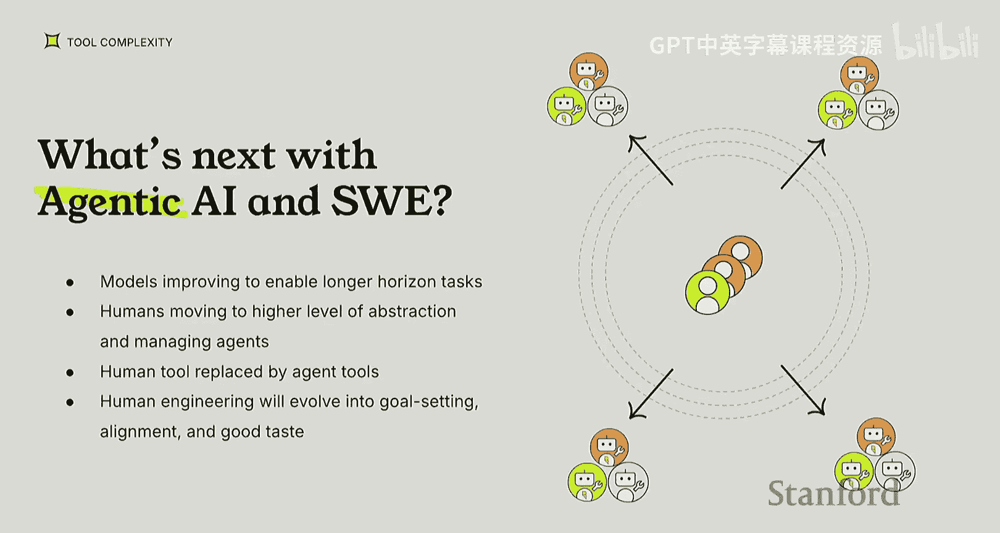

And I would say even take a step further English is already a bottleneck， for example。

 I don't code in English either I code using voice because English is just too slow to type so voice is maybe an extra background language but that is also like English in some sense but to more better answer a question。

😊，There will come a point in software engineering， obviously。How we do it today。

 at least like for example， the guards and things like that。

 we specify them in English and maybe that's not the best way to do those because。😊。

English is inherently ambiguous。 Maybe we should do it in terms of programs or some other language。

 I mean， it's not its not a definite answer that。 but yeah， that is definitely something that。

With time well see evolving。 And I don't know if you've seen those videos of like two agents。

 I think that was mock， but at some point that can be the true thing with like two agents talk to each other and they're talking to each other in English and they suddenly switch to a different language。

 which is like be boy， boy bo and then。If you don't even know what's happening。

 so that is a real possibility。Though English is really good。We've built a， you know。

 we've built a lot using English， talking as humans with each other。 And in some ways。

 I think actually the ambiguity is an advantage rather than a disadvantage。Voice I agree。

 like certainly that's the future。Do you have any tools or microservices that you've found？

Work better in this state。Some tools translate better into the patients than others because they're more morecent and then say Russia should plate super。

我对。That's great。あ对こ。うん、先択し。P。It sure you can have differentiation。

So the question was what sorts of APIs provide are good for tool calling agents。

 and I miss the second part， monoliths how to detect the multiagent system basically when it comes to software itself？

I see how to architect the software so that it finds go。ち。

I think my general principle is do as few weird things as possible。So these others are。

 I know it's just good life advice in general be I guess this goes against but we're all taught as kids of like express your inner self。

 be weird。 like don't be weird。 the core here is like these others still are fundamentally completion models on some giant corpus of stuff that they've seen the tools that are easiest to use are the ones that are least surprising that look most like the bulk of stuff in Github that it's already seen have the fewest like weird API parameters and weird design patterns which I guess is a bit of a cough out answer but it's maybe the best that I have I don' know。

 one software design principle you've aren't as good in this domain as well is like good documentation。

 even if you don't need needs。😊。

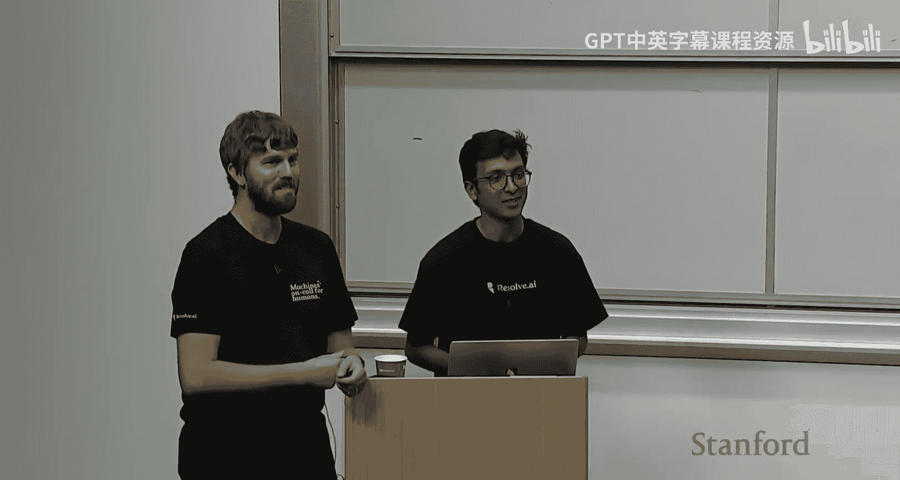

Yes。And do you do your own documentation or do you have the agent？あ高。Thank。😊，I mean， yeah。

It's a mix of both neverized a on trust doesnt believe。Thank you。

You mentioned that maintaining production systems is excellent。头调的是。more difficult。

What I guess the question is like I I use the phrase maintaining production systems is exponentially more difficult than I guess when you're dealing with just one tool right one problem in software right when you're dealing just with code or just with logs。

 let's say right because the combination of all these tools is you know。

Or the possibilities across them gets to infinity， but it's not so much about the tools themselves but it's the data right so let's say if you're dealing with let's say logs or time series data。

 they just keep increasing right so you don't even know where to start when you're looking at the problem right？

Humans have a lot of intuition， of course， to limit， let's say。The the area of exploration。

 but in theory， like a tool that is an L M based tool where it has even started and where it does even stop。

 right， when it starts switch at， you know， infinite amount of logs that are being printed out for these systems。

 That's what I meant。Yes， in the direction and there is no。

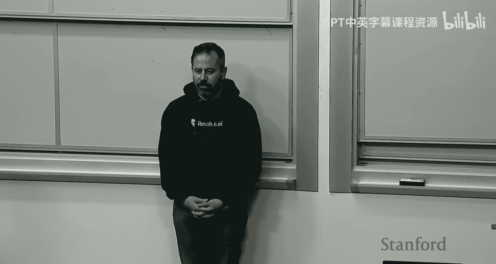

Like， it's almost impossible to verify。A result， right。

 if you don't even know if you have the right result ever almost， right， So when't you even stop。

You know，Because it's not like a math equation that maybe has a right or wrong answer， right。

 Like it's a problem that okay， something is slow。 Can you tell me what's happening。

There's not clear most of the time， it's very hard to know if you have been the right answer。

And when to stop log in。

