# 斯坦福大学《机器学习：智能体｜CS229 I Machine Learning 2025》：P1：构建软件工程智能体系统

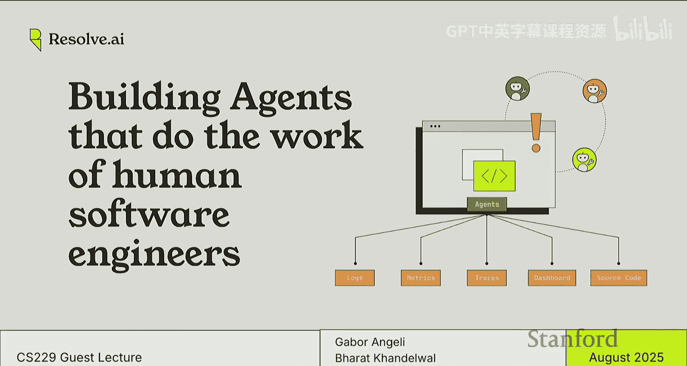

在本节课中，我们将学习如何构建能够执行人类工作的智能体系统，特别是软件工程师的工作。我们将探讨这类系统的样貌、构建步骤、当前工具的局限性，以及智能体技术未来的发展方向。

## 概述：软件工程的演变与智能体的角色

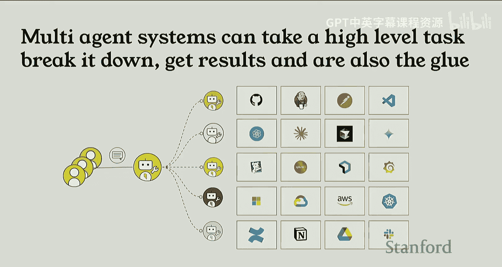

软件工程不仅仅是编写代码。当您尝试构建大规模系统或运行大型生产系统时，除了功能开发和解决代码中的难题，还需要考虑系统如何在生产环境中实现，以及用户如何访问和使用该系统。在实践中，系统规模越大，生产环境的复杂性就越高，所需的时间也越多。

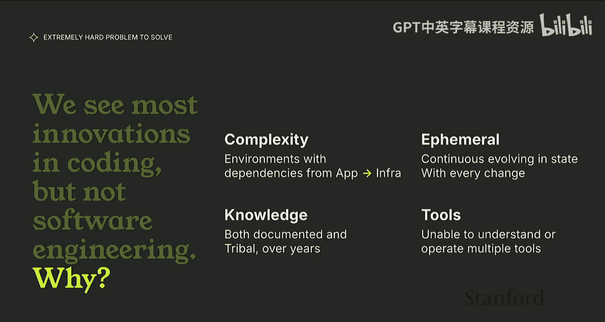

我们构建软件工程智能体的动机源于自身经验。在之前的角色中，我们运行一个拥有大型工程团队的庞大生产系统。随着时间的推移，我们发现绝大部分时间都花在了维护现有系统、确保其可靠性上，而不是构建新功能。用户很少因为功能延迟而抱怨，但当系统不可用时，抱怨就会很多。

现在，让我们回到智能体，从软件工程师今天如何工作开始。作为软件工程师，您需要处理众多不同类别的工具，包括编码工具、基础设施工具（如AWS或Google Cloud服务）、可观测性和遥测工具（如Datadog、Splunk等）。如今，大多数人可能都在使用编码工具。这些工具通常构成软件工程的工具栈环境。

大多数这些工具都需要人类一对一地交互。通常，人类需要获取或提供输入，获取输出，并将其与其他工具的输出结合以完成任务。人类是连接这些工具的“胶水”。智能体的改进版本可能是让智能体执行其特定类别的任务，而人类则成为智能体之间的“胶水”。

在许多方面，我们已经开始向这个方向迈进。以编码为例，当我们开始使用AI辅助编码时，它主要是代码补全或试图进一步驱动代码生成。但现在，我们已经发展到要求智能体执行任务，给我们输出，并可能将其整合进来。然而，我们可能有一个智能体进入生产系统，它可能帮助我们处理基础设施，但人类仍然是连接者。

我们认为的发展方向，或者说已经开始触及的领域，是现在有了这些多智能体系统。它们可能接收人类的输入，与其他智能体交互，迭代计划，并最终返回一个通常涉及许多工具和许多类别工具的答案，这些工具可能从代码到生产，再到遥测和生产基础设施，甚至可能与软件栈其他部分的其他智能体交互。

今天，我们将展示如何从简单的工具和LLM开始，逐步构建智能体，最终形成多智能体系统。

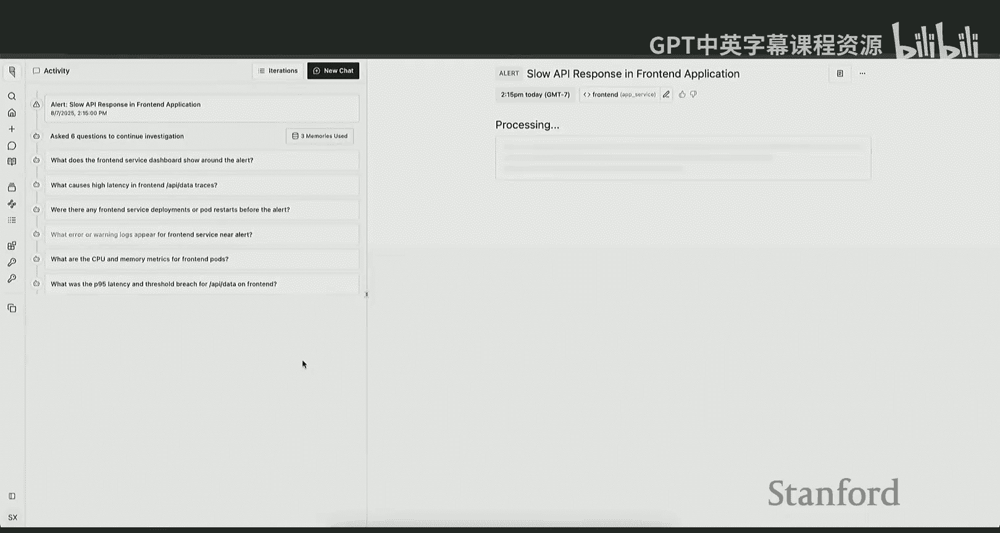

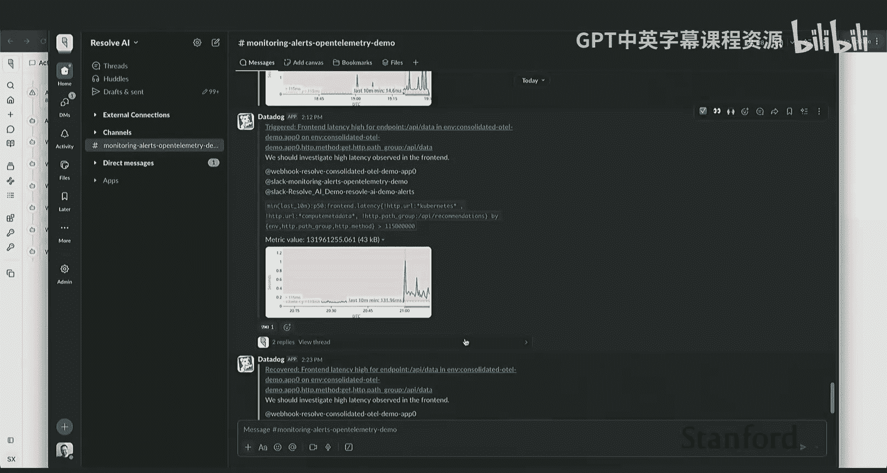

## 为什么这是一个难题

构建这类智能体之所以困难，是因为当您处理所有这些不同类型的工具和数据时，首先，在每个类别中，数据和可能性几乎是无限的。其次，环境动态、依赖关系动态带来了很多复杂性。此外，还存在大量我们称之为“部落制度知识”的信息，这些知识通常存在于大型软件系统中，可能被记录在多个工具中，甚至根本没有文档记录，只是人们因为工作了一段时间而知道。

因此，在尝试构建智能体时，必须考虑所有这些因素：环境的不断变化、代码本身具有文档性但环境中其他类型数据没有、知识分散在这些工具中，并且世界在不断变化。

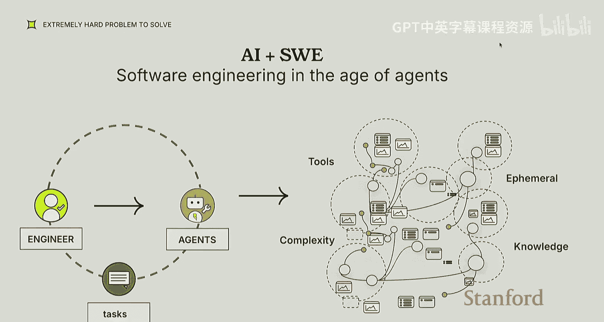

## 软件工程智能体系统演示

让我展示一个软件工程智能体系统的样子。我将快速演示一个类似Resolve的系统。

首先，可以将其视为一个多智能体系统。您拥有能够理解软件工程环境中所有不同类型工具的智能体。您有基础设施。在基础设施中，有一系列人类通常用来执行任务的基本工具，比如Datadog、Kubernetes或Slack等工具。您有提供指标的工具、提供事件、代码等的工具。在每个类别中，您可能有多个工具。这里的重点是，当您尝试执行任务时，可能需要跨越所有这些工具。

让我们从一个简单的任务或问题开始。假设我是一名开发人员，我的一些用户抱怨某个问题。假设一群用户来说，今天早上UI很慢。我可能需要去查看仪表板、变更、功能标志是否开启，是否有人更改了代码导致问题。

现在，让我向智能体提出这个非常高层次的问题，看看它会怎么做。在像这样的场景中，当我有一个如此高层次的问题时，我可能需要跨越多个工具或多个智能体，并开始查看不同的事物，以弄清楚发生了什么。现在，智能体会做的是：接受这个高级指令，将其映射到一组工具，开始进行一些规划以决定如何解决这个问题，理解我的意图，然后甚至将其映射到环境的一部分。我提到了UI，并将其映射到前端，这是该环境中的一个真实服务。您可以看到，它开始在所有可用的工具之间切换，看看是否能回答这个问题。

现在，这是一个智能体，因为我提出了一个非常高层次的问题，智能体本质上为自己决定计划，执行一系列工具，然后返回结果。但它仍然不是一个完全自主的智能体；它现在只是试图以我提问的特定方式回答我的问题。

当这个运行时，我将启动一个更复杂的调查，要求智能体在后台完成所有需要的工作来回答问题。基本上，我说有一个API很慢，现在智能体将其作为一个长期任务来执行。可以将其视为一个运行很长时间的智能体，尝试执行这个长期任务，我说基本上去弄清楚发生了什么，并穷尽所有可能性，然后回来向我报告。我会让它运行一分钟，同时我们看看这个。

它返回了结果，基本上遍历了所有可用的工具，返回了一些有趣的图表来突出显示和一些答案。它说观察到UI前端延迟出现多次峰值。它给了我几个不同图表中发现的引用，并说前端体验出现延迟峰值，产品查找或进程错误在此期间暂时激增，这更可能导致用户体验下降。现在我可以问，你能找到根本原因吗？这又是一个非常高级的指令。它必须决定如何将其分解为某种计划，执行一系列工具，并得出答案。这就是人类工程师在此类场景中会做的事情。

好的，它返回了，说在上午8点，这个功能标志被有意启用。有时它变得太聪明了，通过计划的混沌工程作业，说这是一个诱导性故障。它理解了那是什么，并告诉我发生了什么。现在我可以问，如何修复它？例如，现在我完成了循环，由我驱动。

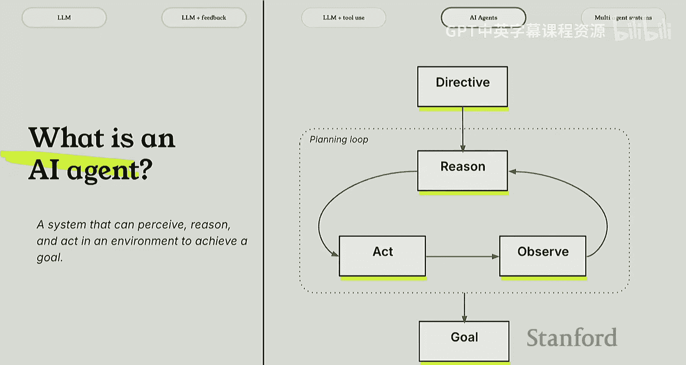

我刚才展示的另一个场景是，智能体从一个非常高级的指令开始，并尝试自己解决问题。因此，现在不是人类提问，而是智能体自己提问。基本上，它开始提出六个问题。我给它的指令是：有一个API很慢。现在智能体提出以下六个问题：围绕警报的前端服务仪表板显示什么？是什么导致此特定跟踪中的高延迟？在此时间附近是否有任何前端服务部署或端口状态变化？如果展开其中一个问题，您会看到，这不是智能体在问自己或问其他智能体要答案，甚至解释了为什么它要问这个问题。它说：分析围绕此时间此特定端点的请求跟踪。我需要确定哪个特定的下游服务、调用或内部函数是高延迟的主要贡献者。

想象一下，这就像一个精通此领域的专家，收到这个高级指令并试图解决它。为此，它需要跨越所有工具，提出正确的问题，得到答案。这给出了一些证据，智能体现在将其纳入考虑并继续工作。您在这里看到的另一件事是，它使用了三个记忆。它实际上使用了一些它已经掌握的关于这个环境的知识，这回到了我之前描述的问题。

这给了我修复方法，我可以说，给我方法。好的，这就是我关闭功能标志的方法，非常简单。我从一个高级指令开始，与智能体合作得到答案。在这个在后台运行的场景中，您现在可以看到智能体实际上在与自身协作，或者与多个智能体协作，以得到一个答案。您可以想象如何进一步推广到任何可能需要许多步骤的任务。

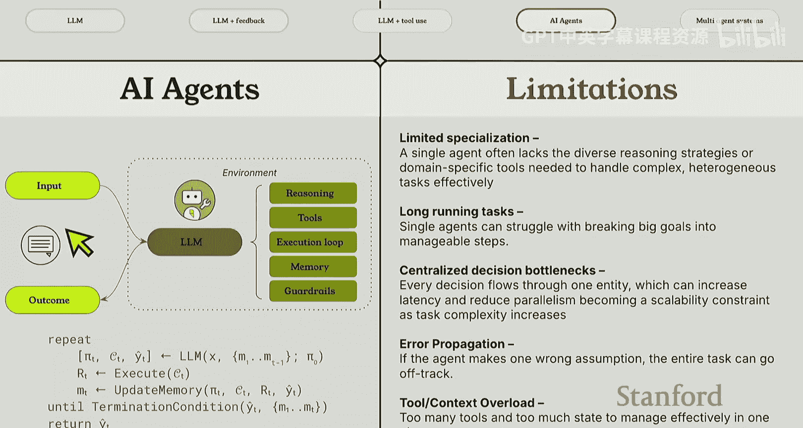

让我展示这在实践中是什么样子。假设现在拥有所有这些功能的智能体可以像人类一样值班。如果我在这个Slack频道中，您可以看到，每当警报触发时，这种软件工程或SRE智能体基本上可以响应、确认警报，使用所有可用的工具，警报会谈论突出显示此检查点，并返回可能导致它的答案的初步分析。它给出了一个初步答案：这是我在环境中观察到的，这是我发现的快速证据集，证据指向下游服务。

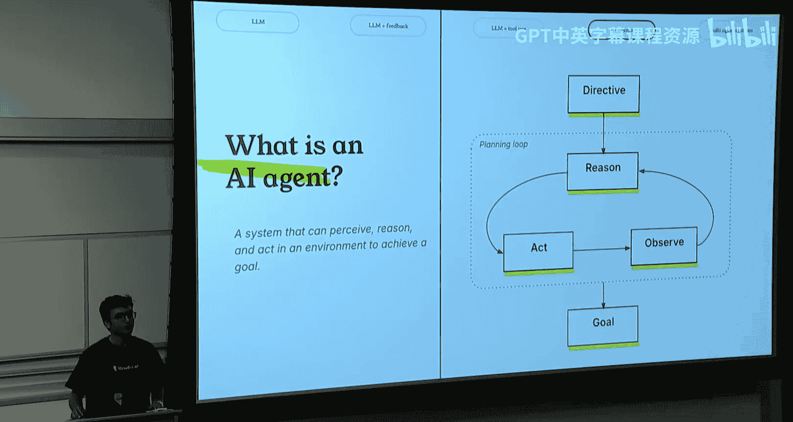

它提供了关于可能导致高延迟的服务的建议，提供了证据，然后完成调查，返回最终答案。它说服务高延迟是由于下游依赖项严重并发降级的结果。推荐服务由于代码中低效的N+1查询问题而激增到X秒。因此，它指出代码是问题所在。然后我可以说，好的，给我一个修复方法。然后它查看代码，解释了N+1的含义（即，您有一个循环，每次循环执行时都运行一个数据库查询，因此延迟累积），并给了我一个如何在代码中修复的示例。

这个仍在运行，但我会在这里停止演示。这里的想法是，现在自主执行的智能体将运行多次迭代，在其迭代中将提出一系列问题，执行一些任务，并返回一些答案，直到任务完成。希望这能让您很好地了解我们的目标是什么，我们试图构建的智能体在做什么，以及我们如何实际构建它们。

## 构建智能体系统的基本原则：从简单开始

在深入构建之前，我想介绍构建多智能体系统的基本原则：保持简单。因为并非每个问题都需要多智能体系统。有些问题可以用非常简单的解决方案解决。如果可能，我们绝对应该这样做。因此，我们将要做的是，发现对于特定任务，什么级别的智能体复杂度是合适的，以及我们的系统应该有多复杂。

为此，我们将从构建一个简单的LLM调用开始，逐步发展到多智能体系统。在此过程中，我们将添加反馈循环、工具使用，使其成为智能体系统，然后添加多智能体。在每个级别，我们将尝试回答两个问题：这种系统能解决什么样的问题？更重要的是，它不能解决什么样的问题？

我们有一个支付系统故障的运行示例。这是一个很好的用例。有时故障原因很明显，有时则是跨越多个系统的混乱局面。这个进展过程将向您展示每个级别在何时变得必要。

到本次讲座结束时，您不仅会知道如何构建智能体，还会知道如何为问题构建合适的智能体，因为在生产中，能工作的最简单解决方案通常是最好的解决方案。

## 第一级：单次LLM调用

那么，让我们从简单开始。这里最基本的设置是单次LLM调用：一个提示输入，一个响应输出，仅此而已。对于数量惊人的用例，这实际上有效。如果您给LLM正确的输入、正确的提示，适当地转换输入，并正确解释输出，那么很多时候这就足够了。

让我们看一个具体的例子。在这个任务中，情况是支付系统着火了，用户涌入支持渠道，您的电话在凌晨2点响个不停。惊慌中，您打开PagerDuty，查看事件发送的分配给您的工单，检查仪表板，试图找出哪些指标出了问题，检查底层依赖关系，查看最近推送到生产环境的内容，并根据一些预感开始有针对性的日志查询。

迭代地优化查询，直到您有大约1000行日志。然后，您将其插入任何您喜欢的LLM，并询问：为什么这些支付失败？LLM扫描日志，发现有一条特定的日志说“卡已过期”，并说：看起来卡过期了，这就是问题。如果这是对的，太好了，问题解决了。但是，如果它指出的错误只是噪音呢？如果80%的支付实际上因为网络问题而超时，而这个网络问题在您从未粘贴的其他日志中呢？LLM不知道要问正确的问题，它没有验证其假设，没有尝试根据所有故障来协调答案。它只是发现了一个模式，回答了被问的确切问题，然后就停止了。

这些正是单次LLM系统的局限性。它没有内部反馈循环，无法评估或优化自己的响应。没有迭代推理，一旦偏离轨道，没有机制进行纠正。也没有不确定性的概念，因此无法知道它对自己所说的内容是否真正有信心。这就像问某人一个难题，然后盲目相信第一直觉。

这可能适用于简单任务，但随着复杂性增加，裂痕开始显现，系统就会崩溃。

## 第二级：添加批评者（Critic）的反馈循环

因此，我们进入下一步：批评者系统。我们缺少的是一个反馈循环。所以我们在这里添加一个批评者LLM，它应该在每次我们提出候选解决方案时给我们反馈。

流程是这样的：执行者（Actor）根据先前的输入和反馈提出一个候选解决方案。批评者LLM检查候选方案，它有自己的提示，并且可以访问输入，然后判断这看起来是否是此问题的正确解决方案，是否合理。如果批评者批准，我们返回此候选方案作为解决方案。如果不批准，我们带着此反馈返回给执行者，询问：基于此反馈，您还有其他想尝试的吗？这个过程不断重复。

那么，让我们看看我们的例子。执行者现在说：卡支付失败是因为卡已过期，就像之前一样。批评者回应：我看到的唯一有问题的日志消息就是这个，但卡过期通常是个别情况，无法解释广泛的故障。因此，执行者调整响应以回应用户：我看到的是卡过期失败，但我不认为这是问题所在，所以也许您应该查看其他东西。

这已经比我们最初得到的响应好多了。

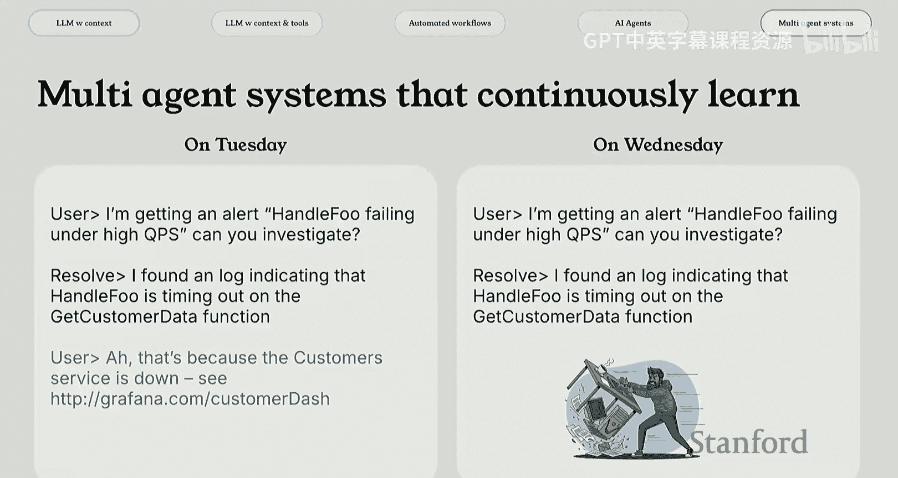

但是，这个系统有哪些局限性呢？它不能做几件事。首先，它仍然局限于用户最初粘贴的几行日志，无法查询新数据或探索超出其给定上下文的范围。其次，没有持久记忆。如果执行者和批评者不断进行，比如12000次，他们可能仍然会忘记第1次发生了什么，然后陷入连续循环。第三，它仍然受到LLM基本局限性的限制，比如上下文窗口限制、缺乏数学技能、无法计算草莓中的小时数以及幻觉问题。最后，无法访问外部知识，它不能使用谷歌搜索，也不能查看最新的Stack Exchange文章来获取特定答案。

## 第三级：引入工具（Tools）

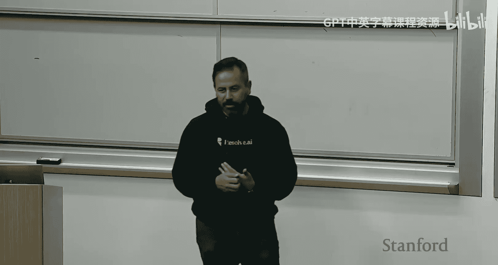

这让我们想到了一个很好的点：我们定义工具。什么是工具？工具是LLM可以用来与环境交互的任何外部函数。这可能意味着查询数据库、调用计算器或向用户本人提出后续问题。工具解决了许多问题，它们实现了环境交互、记忆、数学能力和访问外部知识。

那么，对于LLM来说，工具是什么样子的呢？对于LLM，工具在提示中被定义为结构化接口。每个工具都有一个名称（标识符）、一个描述（说明它做什么、不做什么、需要什么）、一个输入模式（由类型定义参数及其取值）以及一个使用协议。所有这些都可以称为LLM工具的使用协议。

当LLM想要使用工具时，它会发出结构化输出调用。调用的格式可能取决于是什么LLM，但本质上可能看起来像JSON。执行引擎然后运行此工具并将结果返回给LLM，LLM再决定如何处理结果。这就是LLM工具使用的样子。这里有一些伪代码，但本质上发生的是：在每个步骤，LLM看到当前状态、可用的工具、输入、先前工具调用的结果及其自身的提示，生成一个新的候选方案（可能带有工具调用），执行引擎执行这些工具调用并附加结果，然后LLM评估问题是否已解决。如果没有，它再次查看；如果已解决，则返回答案。

顺便说一下，我忘了说，如果您想提问，显然可以随时提问。我们最后也会有一个问答环节。

那么，让我们回到我们的例子。现在用户只是说（这次请注意看）：用户没有粘贴日志，只是说检查了仪表板，显示支付持续失败，检查日志。现在LLM自己决定检查哪些日志，如何制定日志查询（这也不是我们通常写的东西，而是一种特定的语法）。LLM弄清楚了，将该查询作为工具调用发送给Loki系统，Loki系统返回日志，然后LLM分析这些日志，找出问题所在并发布。这次它能够达到不同的状态，因为它可以访问工具调用。它发现，好吧，也许不应该查看那个日志，我需要查看其他一些日志，并不断迭代。因此，它发现网络可用性方面存在一些问题。

现在，工具使用有哪些局限性呢？即使有工具，LLM也有一些局限性。首先，没有状态跟踪，它们难以管理不断变化的任务状态。其次，工具故障是另一个问题，虽然其中一些可以通过提示处理，但LLM可能无法处理工具中所有可能的错误。第三，这里没有真正的规划发生，LLM更多的是被动反应。为了解决这个问题，有哪些工具？我做了那个，得到了结果。我该做什么？对于整个任务目标没有真正的规划。此外，在工具调用使用不当方面存在很多低效性，比如调用您并不真正需要的工具，可能只是因为您想做到全面。

## 第四级：构建智能体（Agents）

基于此，让我们进入智能体。那么，什么是智能体？带有工具调用的LLM就是智能体吗？如果我们在其中加入一些东西，它就是智能体：如果我们添加一个规划循环，让LLM能够对任务进行推理，将其分解为步骤，并充当自己的反馈代理。其次，如果有一个自主执行引擎，如果LLM能够自主执行长期运行的任务。为了支持这一点，智能体通常具有记忆、反思和内部子目标。它们不再只是被动反应，而是现在有了一个计划，并战略性地执行。

这就是LLM智能体的样子：它接收一个指令，对指令进行推理，然后进行一些工具调用（可以称为行动），观察结果是什么，围绕结果重新规划，对结果进行推理，并持续这样做，直到得到结果，从而帮助其实现目标。

这就是AI智能体的样子，如您所见，右侧添加了推理能力、通常的工具、执行循环、记忆和护栏。护栏正如Spiros之前提到的，是为了约束LLM的输出空间，否则今天的LLM还不够好，无法完全自主地完成所有事情，或者它们不知道不应该涉足某些领域。

例如，假设当我们只要求查看日志时，它开始编写一些代码来修复问题。因此，您希望有这些护栏。所以这通常是当今智能体的一部分。

那么，通常有几种方式来实现。这里没有正确或错误的答案。其中一些实现方式是：智能体提示本身具有推理标准或推理阶段。因此，每次它获得一些新信息时，都会推理如何处理它，然后有一些后续步骤。也许提示中已经有一个步骤列表，也许是它动态决定并执行的事情。有时是外部强制的，一个外部代理基本上每次都用不同的提示来提示它，说：好的，现在是推理的时候了，现在是行动的时候了，现在是做这个的时候了。

两者本质上都是智能体，一个更自主，一个在某种意义上更有结构或更受指导。但是，当您让它自主发生时，通常是在后训练或RL阶段完成的，在那里它们被教导做这些事情。当它们被教导遵循用户输入时，它们被教导进行这个循环。因此，通常在那个阶段处理，使其能够自主地做某些事情。即便如此，并非所有事情都可能，这就是为什么我们通常有一些输出约束。

我认为我们涵盖了这一点：在每个阶段，它从一个系统提示和记忆开始，生成一个子目标或计划，调用工具，反思结果，用工具的结果更新记忆，检查指令是否完成，循环直到满意，然后返回解决方案。

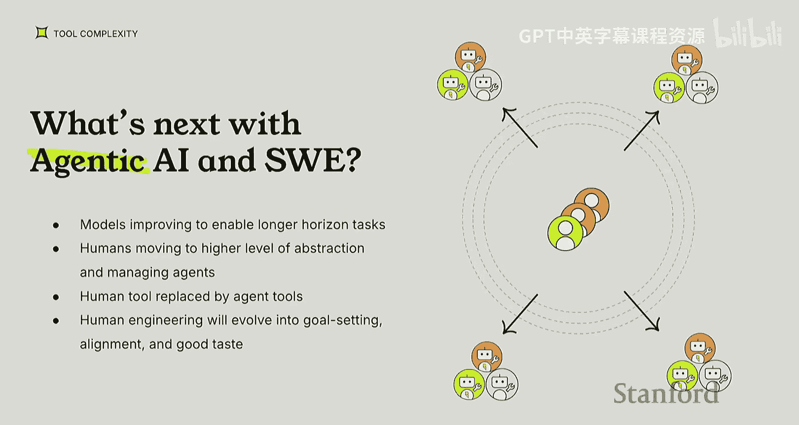

好的，那么回到问题。现在发生了什么？LLM现在可以访问更多工具，它可以访问仪表板工具、日志工具，它将做什么？用户只是告诉我们，他在PagerDuty上收到警报：支付持续失败。

现在，智能体检查仪表板以找出哪些服务失败。请注意，这本身就是一个迭代过程。它可能第一次尝试找不到正确的仪表板，可能查看某个仪表板，发现那里什么都没有或只有一些线索，然后转到另一个仪表板。

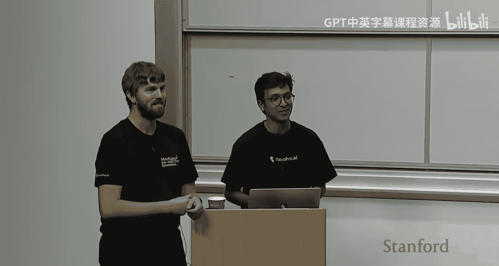

一旦找到正确的仪表板，它就知道要查看哪些服务日志，然后查询服务工具调用。智能体然后查询日志，什么也没得到，进行反思，调整其查询参数，得到一些东西。我们又回到了：连接到Stripe时出现网络错误，这可能导致您的支付失败。

但是，尽管智能体给我们带来了所有好处，它们确实有一些实际