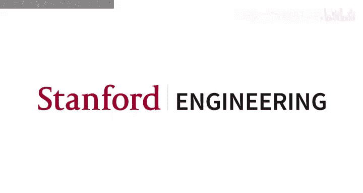
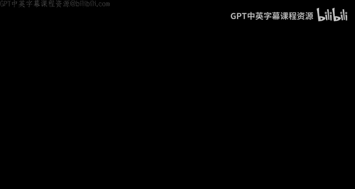
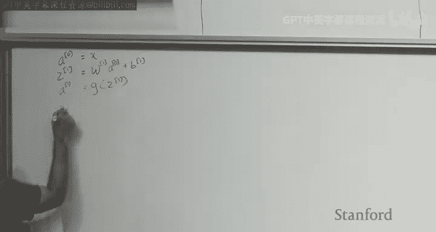
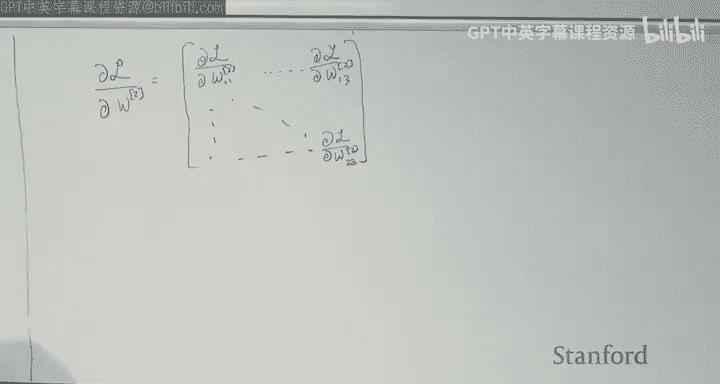

# 斯坦福大学《机器学习｜Stanford CS229 Machine Learning Course  Summer 2019 (Anand Avati)》 - P10：-10-.Lecture 10 - Deep learning - I.zh_en - GPT中英字幕课程资源 - BV1NDopY4ECg

Okay， welcome back， everyone。 Let's get started。 So welcome to lecture 10。

The topic for today will be neural networks and back propagation under the umbrella of deep learning so before we jump into today's topics quick recap of what we covered in lecture 9 last Friday so lecture 9 was all about Bayesian methods and we saw two different kinds of Bayesian methods parametric and nonparmetric with an example each in parametric we saw Bayesian linear regression。

And the general approach with Bayesian methods for supervised machine learning in a parameter setting is to have a parameter theta。

😊，And we assume it is distributed according to a prior distribution， some P of theta。

And this is the assumption that distinguishes Bayesian methods from frequentous methods that we assign a prior probability to the unknown parameters。

And then again in the supervis setting we assume y comes from some distribution p of y given theta comma x。

 which is also called the likelihood and from this from the observed data where x and y are your training set。

 we construct the posterior distribution where theta hat which is now a random variable is。

Is is derived as P of theta given x comma y using the base rule and thats you know that is how the name Bayesian methods comes into picture because the way we construct the posterior is using the base rule there is no gradient descent there is no maximum likelihood we just condition on the observed data and we get our posterior distribution。

And then using the posterior distribution， we can then construct the posterior predictive distribution。

Wwhich is used for making predictions on new unseen data examples so y star condition on x star comma x comma y。

 what this means is x comma y。is your training set that you have observed in the past and x star is the new input that you encounter and we need to make a prediction about y star and what we do is construct a distribution over y star given the new input and all the past training inputs。

And that is called the posterior predictive distribution and this is what the posterior predictive distribution is defined to be and we saw that there was also a piazza post where the steps for this was described in detail we saw that this distribution can be expressed as an expectation of P of y star given x star and theta hat where theta hat is comes from the posterior distribution the interpretation of this is that。

For every possible setting of the theta vector we get a different model a predictive model and the posterior predictive distribution takes the average across all possible models that can possibly exist you know that is infinitely many but the average is a weighted average where the weights are decided according to the posterior distribution。

Okay， and。So this kind of averaging across models。Where we don't。

Commit ourselves to only any one given single model。

 but we are still kind of hedging our bets against all possible models。

 but we just weigh them differently according to the posterior distribution and this is as you know there there is you might read this in several other places as well this makes Bayesian methods kind of prone to overfitting。

This this makes it fundamentally prone to overfitting there is no there is no other extra steps you need to take in order to make your models not overfit and well go into into more details about this probably in Wednesday or Friday's lecture but this kind of model averaging where we don't commit ourselves to one single model which may which could which could be due to noise in your data right we don't commit ourselves to one single model but instead we consider all the possible models the infinitely many possible models that you get for different values of the and we take a weighted average across the predictions where the weights are decided by the posterior distribution。

😊，So this is in the parametric setting where a the exists， right。So this this， this whole setting。

 this whole exercise is in revolves around theta。 and that's why we call it parametric Bayesian methods in the non parametric approach。

 we assume y equals some function F， F of x plus some noise where noise are epsilon comes from a normal。

😊，distributionistribution。And we assume that there is a prior distribution on f just the way there was a prior distribution on theta here。

 we assume there is a prior distribution on on f and that prior distribution is a Gaussian process。

 So this is called a Gaussian process prior。 and in order to define a Gaussian process prior。

 its parameter so to speak is a mean and a covariance function。

 So this is actually a mean function which Ive just written as0。

 it means it evaluates to0 everywhere。😊，And the way to think of a Gaussian process is with the same analogy as we went from vector to functions as an infinite dimension。

 infinite extension of a vector， similarly a Gaussian process is an infinite extension of a multivariate Gaussian distribution。

😊，And for vectors to functions the relation was indices of vectors become the domain of the function。

 similarly indices of your multivariate Gaussian become the domain of the functions over which are we are defining the GP。

😊，And we saw a few properties about multivariate Gaussians。

 so we saw the normalization property that if we integrate out all the data the density of the multivariate Gaussian must evaluate to one。

😊，We saw the marginalization property where。Suppose in this example。

 if we want to marginalize out B from this multivariate distribution then all we get is a and mu a and sigma a square。

 so all the rows and columns that correspond to the the variable that we are marginalizing out just wipe them out of your multivariate Gaussian It is that simple that thats a special property about Gaussians which dont don't exist for other distributions in general and that that makes Gausian Gaussian distributions are really nice and then we saw the conditioning rule。

Where the multivariate version。Appears complex at first。

 But if we see the analogy in case of two dimensional Gausians。

 the conditioning looks like this A even B。Is， again， a normal distribution。

 If A and B are jointly disputed， then A given B is again。

 a normal distribution whose mean is given by this。

The interpretation here is when the value of b is given first we standardize it that is divided by its mean and divided by its standard deviation so it is like a z value transform the z value by the correlation coefficient and then do the reverse transform like the inverse z transform back into mu a by scaling it by a's standard deviation and adding a as mean that is how we we we update the a。

Is a me。And then the covariance of a or the variance of a given B is the variance of e scaled by 1 minus rh square where rh is the correlation coefficient。

 So what this means is if if rh is 1， if A and B are perfectly correlated。Then by observing B。

 the variance of a reduces to 0。 1-1 is 0， which means， you know， exactly what a is。 And similarly。

 if the covariance between a and B is 0， if there's no co covariance whatsoever。

 then the variance of a given B will still be mu of a square。

 So there was no reduction in uncertainty by observing B。 if there was no correlation between them。嗯。

So these， these properties using these properties， we constructed Gaussian process regression。

 so the。Alogs to this， we define f and F star where these are the function f evaluated at our training set and function f evaluated at our test sets。

😊，And this。Follows a multivariate Gaussian distribution because that is the property of Gaussian processes where you take any finite subsample of your Gaussian process that will be a Gaussian distribution。

 multivariate Gaussian distribution。 And this is the kernel function evaluated at every possible pairs。

And so this is the this is we get this by marginalizing out the GP from the GP all the variable all the test testant train examples that we have not observed so marginalize out everything that you have not seen and this condenses your Gaussian process into a multivariate Gaussian evaluated only at the testant train points。

And the assumption was y equals f plus epsilon and using the addition property of Gausians which。😊。

I forgot to recap using the addition property of Gausians y equals f plus epsilon So f plus。

Epsilon gives us this epsilon you still have the same mu。

 but because f and epsilon are independent the covariances add up and epsilon is is a diagonal matrix so you only add along the diagonals and you get a distribution for y is given x and using this。

Using the conditioning property， we construct the posterior predictive distribution。

Which evaluates some form， it might look complex， but this whole expression for the so the variance is exactly this but a multivariate version of this it just looks more complex。

 but it is essentially the same。And similarly， the meanness is is is very similar to that。 And。

 and this is all Gaussian process is about。 It's very simple。 You perform one conditioning， and。

 and that's it。So any questions about GPS before we move on to deep learning today， yes。😊，自由車だ。

They will not be prone to overfitting。身份证。So in general Bayesian methods are are you know。

 you consider them as not prone to overfitting because。

the intuition there is that overfitting happens due to the fact that you are committing yourself to just one model given your training data which which may be swayed by swayed due to noise and here we are kind of hedging our bets by not committing to any single model we are considering all the possible models that could possibly exist and we are taking the average across them where the average is weighted by the posterior distribution。

いし。Can it not。Well we will go into details to that on Wednesday and Friday and I would postpone that you know answer to that for a couple more days but in general the intuition is that with Bayesian methods at least at the theoretical level the concept of overfitting does not exist。

😊，Allright。So today。The topic for today is neural networks and deep learning。😊，Right and again。

 in order to motivate deep learning and neural networks， right the the。

So the models that we've seen so far， for example。We saw we saw linear regression we saw logistic regression GlM etc ceter。

 they have all been linear and one way we kind of introduced nonlinearity was using kernels and also using feature maps and we saw that kernels and feature maps are kind of very tightly related to each other right for every feature map is a feature map is associated with some kernel and that was one way to introduce non nonlinearity。

And neural networks is another way。In neural networks， the。

The high level picture to have in your mind is that when we defined a feature map， for example。

 in problems set1， the last question we explore different kinds of feature maps on a simple regression task that gave us you know very flexible hypotheses and the feature map we used there was you know for example we used a polynomial feature map p of x。

good。1 x x square x cube and maybe things like sine x。 know you can add， you can add more features。

And the responsibility of coming up with such a feature map was in the hands of the designer。

 the one who was training the model， the one you know the data scientist who is trying to fit this model on the data had to you know use their intuition use their creativity to come up with a suitable feature map and that is hard work you need to have some kind of an intuition you need to think hard to see to to make some decisions about what features to include what features not to include。

And at a high level， what neural networks does for you is。😊。

Is give you a way in which features themselves are learned automatically。

So the models that we have seen so far， given features。😊，We constructed linear models。

For you know a regression， classification， etc cea。With neural networks。

Not only are we learning that model given the features。

 but we are also learning what the right set of features are。Right， and。The， the。It's probably best。

Best explain by looking at an example of， of what I mean by that。So， supposing。We have some input x。

No。An R D。And， let's say。We represent x as a set of nodes。Where we have。B number of nodes。

 So this corresponds to x1。Cresponds to it。And the way we constructed logistic regression。

 for example， you know， just to consider an example， was we had。

A parameter vector and that parameter vector。So here just like SV。

 we are going to switch on notation and use W and B for weights and biases we had。W 1。W2。Numb you3。

Till W D。And we had。Bs， and over here。This was。Smation I equals1，2， D。X， I W， I。Plus， B。So this is。

 you can think of this as theta transpose x。Where theta was the collection of W and B and x is the x vector along with the interceptor 1。

And let's call this。Z， that Z equals。X transpose w。Plus， B。And on the other side。

Let's call this a equals。G of。Z。Where G is some kind of a non nonlinearity for example。

 in in the case of logistic regression g was 1 over1 plus e to the minus z。G of z。

Was1 over1 plus8 to minus。Right， so this was。This was logistic regression just visualized in a different way as nodes and connections and this is the view or this is the interpretation that we are going use for extending this further and construct neural networks out of them right so we used to have a parameter vector theta Instead of that we visualize。

😊，Prameterters as connections between some node to another node。

And in neural neural network terminology， these nodes are called neurons。😊，Right， so。

To clarify the reason why they are called neurons is because early in the development of neural networks。

 the design of of of this this kind of a design was inspired by how neurons possibly work based on the theory of how neurons work back then。

😊，But。Its its you know you see a lot of literature where people say neural networks mimic neurons and that's just not the case neural networks when they were designed were inspired by how people thought neurons work back then and in no way whatsoever do neural networks mimic neurons or mimic the brain right so you know。

Just have that in the back of your mind and neurons is probably therefore a poor choice of word。

 you can call it nodes and that's just fine。 but you know we。Call it neurons。

 assuming you guys know that you know this is not how actual neurons work。

So there is some non linearity， which takes。X from z to an output A。

 we are going to call a as the output of the nonlinearity。

And together this this entire assembly will call it a neuron。And。In this particular configuration。😊。

X1 to X D。Is fixed。There there is no feature map here X1 through X D is fixed and everything that that weve seen over here is basically exactly logistic regression with no difference whatsoever。

😊，And we could， for example， if this was logistic regression， then we would call this our y hat as a。

😊，And we would have the right label y I going construct a loss。😊，Y comma y hat is equal to y log。

Y hat plus1 minus y。Log 1 minus y hat。 and in place of Y hat。

 we would express Y hat as a function of Ws and B's。And perform gradient descent。

Right that that was logistic regression。Any questions on this of of why this is similar to logistic regression。

Fors that question。Yeah， so this， this is logistic regression viewed in terms of connections。😊，And。

 and neurons， so to speak。Now， the what we're gonna to do next is basically。Take this network。 Now。

 come back to this network view。And start growing this network。So。X1 blue。X， D。

This is our input layer again。And。In place of one。Neuron。Let's have a collection of neurons。

Over here， we had a set of。Weights connecting。We had a set of weights that connected the input to as from x the input data to the input of this neuron。

And just like that， lets add a second neuron here and give it its own set of weights。Right。

 and this is as if。We are， we are trying to train。2 different logistic regression models in parallel。

 You know， that's the image， you know， that's the picture to her。 You have one set of， one set of。

Ws that connect x' to this neuron and another set of ws。That connect the axis to the second neuro。

They have their own。B term。As well。And。😔，Similar， similarly。

 there is going to be a Z here goes through the non linearity to get an a similarly。

The Z's are basically the linear combinations of x's with Ws plus B。The same thing over here。

 And let's call this。B1 and B2。B2， and this is Z1， Z2 and a1。And a2 So from z to a。

 we apply the G function， the non linearity to take the linear combination。 We get a scalar。

 run it through the non linearity。 We get another scalar。And。We， we can continue this。 So similarly。

 we can have。Z3 and N A3， again that has its own sets of weights。And it's on bias B3。So。

 you get z3 as the sum over w1 x1， w2 x2 w dx d plus B3 and then apply the non linearity and you get a3。

Right。And not only can we add multiple models like this。😊，We can then start nesting them。

 in the sense， these three。The outputs of these three that is a 1。

 A2 a 3 can now become the input for another logistic regression。It's going to be a Z。And。Similar能。

A second logistic regression， using the inputs。As the outputs from the first layer。And a。嗯。And so on。

 we can nest this even further。Yes question。问你对一句。I was atro the CM。One they learn the same page。

Well come to that we come to that so the question was won't they all learn the same same same model aren't they going to be just copies of the same model potentially it can and we well address that shortly。

Wass that another question。Yeah， my question is how the second layer could learn something different。

 I guess。Yeah， well come to that。 well come to that For now we are just constructing a network using base components that weve seen before。

 basically a logistic regression right so take logistic regression， create multiple copies of it。

 take the outputwards of those logistic regressions feed them as input to you know unnecessary nested logistic regression and so on and this kind of a network can be arbitrarily deep and arbitrarily wide。

😊，And it can be arbitrarily wide to different levels at different layers。😊，And were going to call。

 start giving them names， so。This collection of neurons， we are going to call it the input layer。And。

And this over here。Is the output layer。And these are called hidden layers。 So this would be。

Hidden layer 1， hidden layer 2。And this overall network， you can call it maybe a three layer network。

😊，So you have an output layer， hidden layer hidden layer one hidden layer two。

 So you have three layers and generally we don't count the input layer know input is just input。

Right， and。Soon we are going to give more precise terminologies to each of these weights and weights and biases and activations。

 but before that it is important to get this general intuition of how neural networks are kind of constructed。

😊，This is an example of a very simple neural network。😊。

There are lots of different choices for the G function。

 you don't always have to use the logistic logistic function。

 but the general idea is more or less the same that is we take a linear model。With some activation。嗯。

In GLMs we saw that for different kinds of outputs we use different kinds of Gs similarly here we can use there is a wide variety of choices of the activation function that we can use so G is also called the activation function。

😊，And using this this linear model building block。😊，We start。

Assembling a big network as though these are you know think of them as Lego blocks right you place one block here。

 one block here， one block here and then started building yet another layer on top and so on。Right。

 and。And and now once we construct a layer， a network with you know some number of layers each layer being you know some having some particular width and finally at the output layer。

😊，The output， the a of the last layer will be considered our y hat。Right。

And then we are going to get the true label y， and we are going to apply construct some kind of a loss。

Previously we would take the output of the very first layer y hat and apply our loss。

But now we are going to nest these building blocks。😊，Into a more complex network。

And we are going to construct the network that eventually we are going to have a single output。😊。

And that output。Will be the。The prediction made by this network on which we are going to apply a loss。

this is the big picture to have in mind deep learning is basically adding depth by cascading simple building blocks。

😊，Using non nonlinearities in the middle。Any question about the big picture before we start defining terminology and giving specific numbers here？

Yes question。In the second ingredient there the choice of function。Yeses。

Hos is supposed using that G of。 And second， you can use。Yes。

 so the question is do the activation function the choice that we used in the first layer should it be the same say for the second layer right and in theory they can be different you can use different activation functions for different neurons even then it need not even be the same within the same layer but in practice we generally tend to use the same activation function throughout the network but you know thats a convention that' is not a requirement。

One question。So no。Let's start yes question。You said that you have the course function。佢就开我呢游戏。Yeah。

 we're going come to that。 So so the question was， if we have a loss function here。

 what are we going to update。 The answer is， once we apply a loss function。

 we need to calculate gradients with respect to every single connection and bias。Right， the， the。

The goal of training is to first come up with a network architecture and once you come up with a network architecture。

 you take your data， start feeding your input， you get some predicted output。

Calculate the loss and then calculate the the gradient of that loss with respect to every connection。

In parallel。And take a gradient descent step。To， to minimize that loss in the along the direction of that gradient。

 I guess it's easiest。Yeah， yeah， yeah we come to that of you know generally stochastic gradient descent is the one that is most commonly used。

😊，And in fact， a variant of that called minibatro gradientarian will come to that。

So let lets start giving some precise terminology so that we are clear of what we are we are referring to。

We will use。All the all the connections。We will use the letter w， so w will mean connection。

And B will be bias。And Z will be。W。Dot something plus B。

 So z will always be linear in w and linear in B and linear with whatever we want apply B w by。

A will always be。G of sum z。And。As， as。To distinguish the different z's and the different A's and the different bs and ws。

 we are going to use the notation where a superscript。😊，Identifies the layer。

A superscript is going to identify the layer。And a subscript is going to identify which node in that layer we are referring to right so。

😊，We' gonna have I。e。Zhi。😔，I， I， I， so the A is， there are only So A's and z's and B's。

Is a vector per layer？Whereas the weight， the connections are。A matrix， so these are vectors。

So this is the vector A， this is the vector Z and this is the vector B。

And you have one such vector per layer， one vector of a。

 one vector of z and one vector of B per layer， but we have one matrix W per layer。

So w is going to be it is also called the weight matrix， and that is why it has two indices I and J。

And。The very first。Input。X will also be called。Is 0。

So it's like the output of the0 layer So you are kind of bootstrapping this this hierarchy by considering the inputs to be the output of the zero layer。

 you know but we are just going to consider the xs as risk given So think of x's as the output of the activation from the zero layer。

😊，And。这Z。1。Z1， we are referring to this vector z superscript square bracket 1 refers to this z vector and in that let us consider z11。

So， Z11 is。A。In the z vector of the first layer， the first element of that vector。Will be。Some over。

W。J。Some over J，W 1。Zhe。😔，X。Or。对。😔，Bwen。So W is now a matrix that has。So matrix has two axes。

Two dimensions。The number of rows in the matrix is the number of neurons in that layer。

And the number of columns in that matrix is the number of neurons in the input layer in the previous layer。

So， w is a matrix。Wl。Is the weight matrix。Where。The number of rows。Is the number is the。

Is the number of neurons in the layer？ so this is。Number of。Neurons in the e layer。

And the number of columns。Is the number of neurons。In the L -1 layer。So that that is a w matrix。

And z11 is therefore the first row。off。The weight matrix。Dot product it with。

The a0 vector that is do product grid with the input。And that that is basically doing this for you。

 know， w1 x1， w2 x2 w3 x3 and so on。Plus B1。And similarly。Z 2。Of one。Ass equal to。W 2。1n。😔，This time。

 I'm going to write it as a transpose， so that。Just， doesn simplify。Zro。B2。

This is just the dot product and in this version I would written recognized as a dot product。

And so on。 And so that gives that gives us the collection of these。And similarly， then a of 1。

1 equals G of。Zi。😔，Wen。1。The activation functions are applied element wise。没。

For a given value of z that was calculated with the dot product and adding of the sum。

The a function is applied element wise separate the G function is applied element wise separately to each of the z values to get the corresponding a values。

And so on and similarly once we have constructed the a1 vector。So。

 a superscript 1 is the output of the first layer。So， in this case。

 the vector that comes out of the first layer will be a superscript1。

And the dimension of this vector is equal to the number of neurons in the first layer。Is that clear？

And we can， we can continue this， this style of nesting even further。 So we will， we will then have。

Z。2。Next question。TheZco is in。MatxSo w So W is a matrix。P vector rotation。

 I meant that my question is that A is essentially agnostic of which。Layer your， I mean， non layer。

 but which input you coming from。It。Good question。 Let's， let's。啊。

Is is this a the one you're referring to yeah。So， a。A 1，1。

Means the output of the first layer and the first element of that vector。

Is equal to the activation function applied on。The first element of the of the z vector of the first layer。

So the z vectors common to the whole layer， not just one of the dots or one node。 Yeah， So so z。

So let me， let me。Write this in vector notice。 So here we were calculating it element wise。

 So this is z11， This is Z superscript 1 subscript 2， this is z superscript 1， subscript 3。

And if you want to write it in vector form， then you would write this as。

Z of superscript 1 is equal to w of。Superscript 1。Times a of super of superscript 0 plus。B。

now we are writing this in vector notation where z superscript 1 is this entire z vector。

And that is equal to the W matrix。😊，Times the input vector。Plus。

 element wise addition due to the summing up of the B the bias。

So Z is just a linear combination of W's and A's。Plus， the bees。

I would say don't think of a as the probability if you take it through a sigmoid you get a value between 0 and 1 for now don't treat it as a probability just think of it as you know some output of some nonlinearity right so the a is if if if g is the sigmoid then a will be between 0 and 1 yes。

Good question。 Any， any， any other questions。So this is a compact way of writing these element wise operations。

😊，So the full the full z vector that is the vector zs before applying the non linearity。😊。

This vector of size 3 is equal to a matrix w in this case the matrix w will be 3 cross d。

Where D is the dimension of the input。TheThe input dimension goes to the number of columns and three is the number of outputs。

 that is the number of number of neurons in this layer。 So that would be3 here， D here。

 So W1 will be 3 cross D。A0， that is the a0 is the x vector。A 0 is。D dimensional。 So this would be。

According to this network。This is3 cross D。And this is。D dimension。And this is。3 dimension。

And Z will also be there。Tty much。This is clear。And then we apply the the non linearity on this Z that is on the left half of these circles。

😊，You apply the nonlinearity to jump over to the right half of the circle to get A's and the G function is applied separately element wise。

😊，This question。I bother you again， but。It looks like the three is a number of input node。

So in this case，3 is the number of neurons。 The number of input nodes is d dimensional。

Then then the number of neurons will also be d。 So the number of neurons here。

 we have chosen this to be 3。And the w matrix takes you from D to 3。

So the w matrix takes you from D to 3 when you multiply it with x。Whi is3 which is d dimensional。

 you multiply the w matrix with x。And because the number of rows in w is 3。

 you get a vector of dimension 3。And to that， you add a B vector， which is also of dimension 3。

So you get a z vector of dimension 3。Any other questions？

So the thing to kind of keep in mind is whenever we we see some kind of a subscript at least in case of logistic regression when when we thought when we saw an x J。

 we thought of this as a scalar where x was in。RD however。

 when we see a superscript we are still referring to you know the vector or scalar or whatever it is。

 but it is only identifying which layer we are at。😊。

RightSo z of1 is not the first element of z just means it is the z vector of the first layer。

So the superscript square bracket refers to the layer number。喂。

If something is not clear please stop me it's super important that you know you understand this really well because you know once we go to back propagation we are just going to use all these all these notations very liberally there。

 so you know if there is any question feel free to stop me as many number of times you want。

So now a1。Losely speaking， we can call it。G of。Z1 where you can think of G as the linearity。

 for example， the sigmoid being applied element wise separately to each element in the input vector。

😊，And then similarly， Z2 is now。W。Two times。A1。Plus， B。2。喂。And this gives us a 3。哦。I'm sorry， a2。

Equals。G off。Z 2。And so on， right， And then。Z 3。Okay colour。W 3。Of a2。Plus。B 3。A3。Equals。G of。Z 3。

And you can。And you can take this as arbitrarily deep as you want。Right， and。This。

 this depth is what。Is what is the basically the reason why we call this deep learning。 You know。

 the deeper your network is， you know， the more deeper your deep learning is， you know。

 sort to spring， right， So the， the number of level the number of degrees of nesting you have。

Is called the depth of your network right and and this is what distinguishes from simple linear models where then there was pretty much no depth at all right there was just one single layer and the output of the layer was the output of your hypotheses and we can go on。

And。And now the question is。Why do we have this G to be。Non nonlinear function。

 right What if G was identity that is。What if。Giev。Z was just Z。 That is if a equals Z。

 what would happen in that case。 Yes question。我就说。Exactly， so the reason why。

You know the reason why it' is important to have non linearities。Is because if。

Z was just if if G was just the identity function。Then， a 3。Would have been。

Just to simplify the argument we are going to ignore the b terms but you can include the b terms here and the same argument will still hold let let us assume that the b's are just zeros for now so a3 will be G of z3 right and G of z3 is just z3。

Right but z3 is w3 a2。So， this is。W 3。82。Right but a2 is g of Z3 and G is identity。 So this is。

W 3 of。Z 2， right， but Z2 is w 2 of a1。SoW 3。W2 of。A one。And similarly， a1 is G of z1。

 if z is identity， then you know this becomes z1。😊，Z1 and this， again。W three times。W two times。

W 1 times。X。喂。And。This is basically a matrix times a matrix and a matrix。

 and we can call this some w tilde times x。So if G were not a nonlinear function but assume it to be just some you know a linear function。

Then， this entire network。Can now be represented as a single matrix。

hich means we haven't really gone beyond the scope of linear models。

 So any such networks can be represented by a linear model if G is。Not an nonlinear function。And so。

 G being nonlinear。Is essential。To have depth be meaningful。Otherwise。

 all the no matter how many levels deep your network is。

 it can always be collapsed into a single matrix and it will effectively be as expressive as a single layer network。

😊，This question。Numb。别没。Yeah。So then you though can， this is a single matrix。I guess等咩。

reduction can be。But is that lot of depth because you are assuming that the number of nodes in each field layer cant change across layers or is it Yeah。

 so the question is what is what if what if even though we have you know so many matrices。

 why is it you know still effectively the same as one one way to think about that is you can think of these the the w matrices in your networks which have arbitrary widths as being a decomposition of your w tilde matrix。

So you take a w t matrix and decompose it into product of other matrices and those will be your weight matrices。

Next question。So we are going to come to that。 So you mean y G is the sigmoid。Yeah， so。有。Yeah， so。

So z so G of z clearly should not be just Z because then you know there is no depth in the network。😊。

Then the question is， what can Z be， What can G be rather。So， G of Z can be。

Any function which is nonlinear， but in deep learning。

 we choose you know some kind of a nonlinear function that is also monoonic。

So G of z equals1 over 1 plus e to the minus z。 So that is the familiar sigmoid function。

 know that works。G can sometimes be tan H。So tan H is basically E to the z plus。Or is it minus。Yeah。

 E to the G to the E to the Z minus。He不的。Minus z over E to the z plus E to the Z。

 This is the hyperbolic tangent， right， and this also looks。

Very similar to the thick mo except instead from you know0 to 1， it is minus1 to plus  one you know。

 just a different choice。And a very common one of G is re。It's also called the rectified linear unit。

 And this is basically。Max of z comma 0。What does this look like， It basically looks like this。Right。

 so。This is。Z。This is。Rlieu of the。And similarly here， you know。This was z and this is stand h of z。

 And here this was z and this is sigmoid of Z。 This is z， and this is the value of z。

what value does is if z is negative。😊，It just setss it to 0。 if it' is positive。

 it leaves it as it is。And this is a non linearity。And if， if Gs are the value function。

 then you cannot represent W as know product of。Other ws。And these are you know。

 probably the you know three most common choices of。

Of the activation function that are used in practice。So。This is pretty much how we construct。

A neural network of this kind of an architecture。 So this kind of an architecture is also called a fully connected network。

 The reason why it is called fully connected。Is because。In each layer。To the next layer。

 we have a full bipartite connection。 Every node in one layer is connected to every other node in the next layer or in the previous layer。

And there is the reason this this kind of a network architecture is called a fully connected neural network。

😊，And the number of layers。You want to have and the number of neurons in each layer that you want to have。

 they are all configuration choices。And they are also called hyper parameters。Yes question。大电も这。

on the。Degr is really less。 I it going to。But if you have a。やってた。Yeah， so the question is。I guess。

 you know。Do the number of layers do the and the number of neurons that we have， you know。

 does that relate to overfitting and underfitting right。緊中して。

Yeah so how will we choose the right number of layers and how do we choose the right number of neurons per layer or in general how do we choose what activation function to choose what activation function to use and the answer is almost always cross validation。

And the answer will be cross validation for a lot of future questions as well。

 and that's just the nature of machine learning right。You have a lot of。Freedom。

 lots of degrees of freedom to tune a lot of different hyperparmeter。And。

The right answer of what a hyper parameter value needs to be is generally not obvious。By， you know。

 just reading the problem description or just by looking at the data。If it were obvious。

 there would be a lot of theory and。There isn't a lot of theory for deciding what is the right number of layers by just looking at the data。

😊，Or the word know whats the right activation to use looking at the data。

You can use some intuitions which you might you know develop over practice for a long time。

 but more often than not， even like the world's best experts they just generally tune it through cross validation。

 have a holdout cross validation set and fit your network on your training data and see how well it performs on you know a validation data。

これ都排革な。Alpha you have， either you can go down or。In this case。

 you can either like go this way or this way。 How would， How do those two movements relate。

So what do you mean by alpha learning Oh， the learning rate。 Yeah。

 but here we have two lets have some observation now you have the choice of going。But adding more。

How you make aYeah and in fact you you still need to choose alpha as well you know like the choice of alpha hasn't gone away So we need to choose alpha。

 we need to choose the number of layers， we need to choose the number of neurons per layer we need to choose what activation functions to use there are lots of hyperpara that you need to tune in neural network right and there are many strategies for doing cross validation。

 for example， if it was just learning rate then you can you could have done some kind of a binary research you know sweep some region and find a good learning rate but here you basically have。

This hyper cube of different hyper parametersa right and each each point in this hyper cube represents some kind of a configuration。

 And the way you go about searching it is。People sometimes do something that's called a random search。

 we are actually going to cover strategies for cuning your hyper parametersa later this week。

 but in general。The answer of how you， how you choose these values is。Through cross validation。

 you know， try some， you know， come up with some possible configurations。

 see how well it works try some other configuration， see how well it works and you know。

 keep trying that until you feel satisfied， you know， which is not a very satisfactory answer。

 but that's exactly how it's done in practice。Next question。Sovic to have the job。

We are going to come why we need a learning rate we still haven't seen how we you know optimize this yet。

 We are still talking about the network architecture。That for。G。Let's say there。The width。Yeah。Yeah。

 in general， if if the width of the network becomes extremely wide or if the depth of the network becomes extremely deep。

 you youre absolutely you know it's absolutely possible that you may overfit your network。

 overfit on your data and and which is why you need to do cross validation where you know you measure the performance on a validation set and see that your training performance is very good test validation set does not server so you overfi。

😊，Yes， question。えと。A you think that。The depths and width are also parameters that the model also on its own。

So is is something I mean is is something that we said Yeah so the question is is the depth and the width something that the model learns on its own。

 the answer is no which is why it's called a hyperparameter right So the parameters in terms of terminology parameters are those variables which the model learns on its own using gradient descent or whatever hyperpara are the ones are the variables that you as as as you know a human being who is building the model will choose。

Yeah， so， you know， the number of layers is something you decide before you start running a gradient decent and that's called a hyperparameter。

So for close violation， we just try different configuration。Exactly for cross validation。

 you you try different hyperparameter and see how well each configuration of hyperparameter works on the validation set。

😊，Next question。a of otherI'm not going to go into that。😊。

So there is a lot of research where research of on on how to。😊。

Most efficiently or even learn what the right hyperparameter are going to be。

 and thats way beyond our scope right now。 but yes。

 there is there is actual research going on to to you know automatically learn the hyperparameter yes。

Yes question。Yeah， so the question is should the activation functions be bounded because standage and sigmoid are bounded。

 but re is not。There are there are good reasons to keep it bounded and there are good reasons to not keep it bounded as well。

Maybe we will cover it later later today or if not in the future the the。The problem with。Right。

 so so maybe we are we are kind of skipping ahead， but in general。The， problem with a sigmoid。

Network sigmoid function。Like this is as you， as you kind of reach。

As your z value goes farther and farther away from 0。D。The gradient of the sigmoid is pretty much 0。

Right， so which means。Which means if if as we will see later today， if your gradient becomes zero。

 then your learning effectively stops because know when you do a gradient update。

 if your gradient is0， your learning effectively stops。😊，Yeah。

 so I'm going to postpone that for you know another 20 minutes or so and when we talk back propagation probably that's going to be a better time to discuss that。

😊， so。Moving on， so this is how we， we construct a fully connected network。😊，And now。

 once we have constructed it。We're gonna see how we are gonna train this network。

And that brings us to back propagation。So， to recall。嗯。Eaught is x。Right， and。Z1 is。W。One times。

A not plus。Bwen。He1 is。Gi of。Ziwen。Z 2。

Yes。W2 of。A1 plus。2， and。A度。G of。Z 2。And。We see this pattern of alternating between z and A。

 z and A all the way until let us call it。😊，A of say capital L。

 where L is the number of layers in your network is equal to G of。Z of L。And then y hat is equal to。

A。And then our loss。We to use script L of y。Y hat is equal to。For now。

 you are going to assume we are doing a classification problem rather than regression。

 If it is regression， you are gonna have you are going to see the squared error here y minus y hat square for regression。

 this is going be y log y hat plus。😊，1 minus y。Log 1 minus。Wiha。Next question。啊。What should be L -1？

C should。So， if there are L。Layer should this be L -1。And we don't count that。

 We don't count the input layer。So this is our loss。And the。In order to， to， to train our network。

 the。Our goal is to do something like this。4 L。In 1，2。Capital L。W N。Equals。😔，Well。Minus。

So because we are treating this as a loss。This should be the negative of the likelihood。

Of the log likelihood， because we are thinking of this as a loss and because it is a loss。

 we are doing gradient descent。😊，Minus。Aa。Limes。😔，Fial derivative。Of L。Paoss。Similarly。B of L。W this。

😔，How far。Osh。😔，So very similar to to gradient。Aend that we solve for logistic regression。

In logistic regression， we had just one set of theta vectors。

 and we would perform gradient ascent on that theta vector Here we have a collection of W and B matrices and vectors。

 and we have L。😊，Number of these matrices and vectors。

And what we want to do is for each weight matrix and bias vector。😊。

Take the gradient of the final loss final loss all the way at the end with respect to the corresponding weight layer weight matrix of that layer and perform a gradient update like this and similarly to the bias term as well。

😊，So this is our goal， and。The way we go about calculating these gradients is using an algorithm called back propagation。

😊，So back propagation helps us calculate these gradients。 But once we calculate the gradients。

 we perform。😊，Graaddian de on the last function。 Yes question。still。So。

 the question is is this stochastic in this case it is stochastic because we are we have considered just one example。

😊，Right so yeah， good question。 So think of this as why I， So why hat I。And white eye。Yeah。

 so this is just the I example。So for a given example。

 this would be like the stochastic gradient descent update rule。😊，Now， the question is now。

 how are we going to calculate these？These derivatives of L with respect to W and L with respect to B。

And the short answer there is。😊，Change rule。And if you are if you are familiar with multivariable calculus。

 if you are already experts are taking。😊，At applying the chain rule in a multivariate setting the rest of the lecture is probably boring for you because all what we are going to do is apply chain rule of calculus multivariable calculus to calculate these gradients right and that's pretty much all what back propagation is so back propagation is a fancy name。

But the reason its call back propagation is。Mathematically， it is。Just the chain road。

But the way we go about calculating the gradients is we start from the end and work our way backwards So algorithmically。

😊，we follow a particular sequence of steps。😊，Which makes it appear that the gradients are being calculated in a backward fashion but mathematically it is just the chain rule there's a difference between a mathematical answer and an algorithmic answer right for the same mathematical answer。

 they can be multiple algorithmic concepts we saw that with kernels as well right for the same for the same inner product we could either calculate the explicit feature representation and take the inner the dot product between them or we can directly calculate the kernel function right theyre mathematically equivalent but algorithmally different Similarlyly the back propagation。

😊，Mathematically is just the chain rule。But algorithmically we calculate it in a way such that it is memory efficient and we reuse a lot of the computation when。

😊，When when we we reuse a lot of the intermediate computations when calculating it。 right。

 So that's that's back propagation。 And let's， let's see how we go about doing it。😊。

Any questions so far。Before we go into back propagation。

There was a question asked earlier why why can we not what would happen or rather the question was wouldn't all the neurons in say the first layer learn the same thing？

aren't we just learning multiple copies of the same logistic regression？

And the answer there is if we perform an initialization where the entire network is initialized to zeros。

 all the weights and biases are initialized to zeros。

 then that is exactly what will happen if we start with a zero initialization。

What we will observe is all the neurons in every layer。Are learning the same thing。

 So we we will just end up having multiple copies of the same neuron within a given layer。And。

In order to。Avoid that problem。We perform what is called as a random initialization。

 which means we are going to initialize all the weights and biases in the network。😊。

In a random way by calling a random number generator and and initializing them。

 and this is a necessary step。Which is also called symmetry breaking。

Because the network is is is symmetric within a layer and in order to break that symmetry。

 we initialize them at different at different random initializations。😊。

And because of that random initialization， they will end up learning。Different functions。

So each logistic regression will end up learning with within a layer is going to end up learning different。

😊，Weights and biases just because we have we have started from a random initialization。

In case of logistic regression。No matter where we initialize from， we always reach the same answer。

But over here。😊，In logistic regression， we always use the same answer because the problem was convex。

But once we are in a neural network setting， we lose convexity。This。

This giant composition of functions in general will not become convex。Which means， depending on。

The initialization， we are going to reach a different solution。Right。

 and which is why random initialization is is， is very necessary。 And the way we go about。

Initializing is。So。W L。So in， in， in。In logistic regression or in general。

 in our learning algorithms， the way we set about doing it is。Initialize。Ws and Bs。 And then for。

n called I in。1 through some time or another T in some time step， you know， theta equals theta。

Minus alpha times something right in order to do the initialization step。Which。

In logistic regression and linear models， we would just initialize them to 0 in that in in in place of zero initialization。

 we will instead do an initialization like this。 So W L。😊。

Iitialize it with a random number generator， Gaussian random number generator of the mean 0。And。

Square root of。To over。And L。And -1。Or this is one choice， or we could also do W of L this。Uniform。

Mus 0。1。Leus。There are many different initialization schemes。So。

 this is just you know a random uniform initialization and this is commonly done。

 this has a particular name it is called a year initialization。

And this is another charge of initialization。And what you will observe is the choice of initialization is also a hyperparameter when you are。

Learning to fit your model。Next question。So the superscript identifies what layer each thing belongs to。

WW1。B one。Yes。So。So the B1 is shared。Every。So the question is， you know。

 is the shell by every neuron in the layer。 So the dimension of B1 is the number of neurons in。

That layer and each element of this vector。Corresponds to one neuron。Thanks sir。Yes question。moreね。

Yeah， so this over here is the number of neurons in the L layer and the number of neurons in the L 1 layer。

Yeah， we can we can discuss the the reason for that。Probably， if you remind me again， we， we。

 we can discuss the reason for that。 Yes question。But want to you just get the same answer。

 like multiple copies irrespective of what you choose because。It's this like。ちと secondんで。

And the first P we also with strength food and second layer of the。No in that going。So。

Is it the supposed the personal not of。And the second one is the place。

So its the combination of whichs right。So the， the， the question is。I is won all the nodes。

Be the same。 The， the， the answer is no， because W is。A matrix。

And each row of the W matrix is associated with each neuron。Right，And if w is initialized randomly。

 then each row of w is going to be you know a different， different vector。Right so when。

Every rose they。Yeah， so over here， you know， I should probably put this S WI J。

So each element of your W matrix。Initialize it by performing a random sample from。This question。

It takes offと。Yes， when we are updating， we need to update so you。

We can also see this as you know WIJ of E Claire。Equals W， I J。

Of L minus alpha times partial of the loss with respect to。I J and this and this are equivalent。 Now。

 this just。Vectctorized。Rotation。so the training algorithm， you know， first we initialize W and B。😊。

With some kind of initialization and for each。For each iteration。We have a nested loop for L in。1，2。

Heen。😔，W L。Equals。Alpha times。Baashun。Of loss with respect。Baasheng。지。

So this is going to be our our high level algorithm first initialize all the ws and B with some kind of a chosen random initialization。

😊，Inci the full network and then for each iteration。😊。

We are going to we are going to take some examples， maybe one examples or maybe you know。

 a few examples， and we are going to。Calculate the gradient of the loss with respect to the weights and biases of each layer and perform a gradient update of each of the weights and bias parameter。

Yes， question。We you。That。So what do you mean by weight1 and weight2。

 do you mean the weight by weight  one， do you mean the first layer or the first iteration。

Please start。We get update。actually update that way。

Be 2 will have a dependence on some other previous rates of this way。

 You update these based on the new values of。So we will see what the relation between the weights are next。

So。Now， what I'm going to draw is you can call it a computation graph。This。

 this will allow us to understand how all the different terms are dependent on the loss right so。

First， I'm going have。Ina call this。Is 0。and this is basically just x。And to this a 0。

 we're going to use。Mattrix W1。A bias。Me。😔，Wen。喂。And here， you know， we have some。Outcomes。Z1。

And the computation that happens here。 So basically， each。Square or a rectangle is some vector。Right。

 and。The clouds are basically computations， right， So some， some some operation happening here。

 And here， the operation is Z。Z equals。W。A plus B。Right。And now， this goes。

Into a cloud of operation and comes out。As。Ywen。And here， the operation is。A equals G of z。

And similarly， next。Mhao。you2。Me2。Some operation for which these coin as inputs。And outcomes。Z2。Z 2。

And again。T else。This will collect。It2。And again， this is just G。Right， and here it is。Z equals W。

 A plus B。And let's just draw one more。Right。Over here。 let's say we have。3。3。Z equals W。Plus， B。

And you get。😔，Z 3。Third g。So for the sake of simplicity。

 we will assume that the final layer has just one row。Because we want a scalar。

And B3 will also be just a scalar。And Z3 is also a scalar。And we get K 3。

And a3 is also equal to y hat。Right， and。I's going to continue it here。And we have。Why hurt。Why。

 so one arrow comes into this cloud。This y comes in here。And outcomes comes our loss。

And the loss is also a scalar。Right。We start with the input vector。Like this。

 the dimension of this is the dimension of our data right and。

The dimension of Z was a hyperparmeter that we chose。RightAnd and the the dimension of Z。

 the dimension of a and the dimension of B is equal to the number of layers in the first。First layer。

 the number of neurons in the first layer。And the way we compute Z is W A plus B where the ws and bs are coming here。

And so on， we nest this by you know we are adding depth and finally we have a loss。

And what we want to do is take the partial derivative or the gradient of。L with respect to each Ws。

And take the partial derivative of L with respect to each B。And then perform gradient update。

Next question。てはせ。In the summer。Yeah， so so the question is what if why hat was a vector right why hat would would in general why hat could be anything as long as your loss is a scalar。

eventually we want the loss to be a scalar。とかそあ。Ofend one。

Yeah so the question is could we not append yeah so you know have another have another one extend the a vector by1 and extend another robe for W Yeah could you could do that in you could do that but in practice ws and b's are kept separate and there is a good reason for that we saw the reason in sVMs if you remember that we were only penalizing the norm of w and not penalizing B。

And there is going to be a similar reason why where we we are going to perform something called regularization that that is going to come in the future only on ws and not on v it for notation it its in this case it is good to keep the B's and ws separate。

やってか。Yeah， yeah， yeah。 That's right，You， you， you could do that。 I mean， there is mathematically。

 they are the same right if you， if you think of if you at every layer， if you extend a。啊。

If you extend a by。Adding a one， then you can get rid of B sure you can do that， but in practice。

 you know。It's， it's exactly the same。 But in practice， you know， nobody does that。Anyways。

 so now the question is， how are we going to compute each of these partial derivatives of the final loss。

😊，Which is a scalar。This is a scalar with respect to this matrix， this bias and you know and so on。

 And and thats where。Shame rule comes to hell。 And that's what back propagation is all about。

So I'm going to switch to that board。So first， we're going to make a few observations。For this。

In example， we are assuming binary classification that is y are in zeros and ones。And。

SoY is there zero in once？But in general。Your wise could be anything。

 and your last function could be something Here， we're just assuming the logistic class。

So first we will observe that。We will work it out for W2。嗯。And even in the notes。

 we have done it for W2， But the steps are exactly the same for W 1， W 3 and B 1， B3。

 right once you know how to do it for one， you can just apply the same recipe for all of them。So。

Partial of loss with respect to。80了。W。2。Is equal to if you remember from our matrix c review。

 is going be。Partialial。And。As for respect。Orship。😔，W。2，1，1。我是。😔，P。W。2。In this case， in in the node。

 we the second node has three。So w so this had three， but but in general， you know， its just。

Depending on the dimensions of W， you know， you have。In this case， it's just 1，3 and。

So this is a matrix and you take the partial of this loss with respect to every single element and arrange it as a matrix。

 So this is it you know， this this is the definition of the gradient of a scalar loss with respect to a matrix。

This question。What the。Wz。W 2 is a second layer。You you could So first。

 let's work out the math and then we look at the algorithm of how we go about doing it。

 So this is just math。 you know， what's what's the gradient of of。

Yeah， this is for the middle layer。 this is the middle layer right。And now。

Make a few more observations。So， the partial。Of L。With respect speak to。Z 3。So what is Z here， Z3 is。

So the partial of L。With respect to Z3。Is。Sequl2。Partial of。Z。3。Times minus y。Log。Why hat？

inus1 minus y。Log1 minus。My hat it and this。Looks out to be。So I'm going to skip a few steps here。

It's basically the same kind of calculation you did with logistic regressionggress。And here。

 this is minus y log。Why hat is basically sigmed of。Z 3。inus1 minus y。Lock。One minus sigoid。Z 3。

And you can do the steps this basically the same kind of steps we did for homework one question one part a when you when you are showing the positive definness of the hessian of logistic regression you would have calculated you know basically the same steps and this simplifies too。

A，3 minus y。 So the partial of。L with respect to z3 is equal to a3 minus y。And now。

We are now going to calculate。The partialial。Of each of these。

 I're going to pick one I J element and see what。It turns out to be。So the partial of。L。😔。

Respect to partial of。W I J， of the second layer。s equalqu to。Partion of n。Introspect。I feel off。A 3。

Gmes。😔，Pel off。A3， with respect to。Pion of。W。Do。😔，换一句。 this is Cha rule。 Any questions with this。

All good。AndThen this river further break it down。Times。Or you love。😔。

Any questions from here to here？Again， just the chain rule。And so on。 And now he observe that。

This did I me something Z。Oh， so。Okay， so on most have， so partial of L with respect to partial of。

A3。Times。Or she love。83。Partial。Z 3。Partial of。嗯。32 Z，3。And Z 3 to82。Part。The3。と？Orial love。我是个。

Parttion of Z。Let's see。W。Do。😔，Ig。So basically apply the same thing and we get this。

 this long expression right And how did we reach this expression to reach this expression。

What we basically did is。You，App the chain rule， right so。B， Z。So， D a2 by d z2。Is a Jacobian。

Because it is a vector valued function or a vector valued function。Right， so this is gonna be。So。

 here we are going to get。Let me use the red to denote the gradients。

So the partial of L with respect to Y hat。RightOver here。 So anywhere where there is a computation。

 we get a gradient or a Jacobian so。L， with respect to Y hat is going to be a scalealar。

 So I'm just going。Denoted by a dot。There is another computation here output to input and this is going to be a scalar because the scalar it a scalar the the derivative is going to be a scalar。

From scalar to。Vectctor， so the derivative of a scalar valued output times a vector valued input is going to be a。

A gradient， a vector。 So Im going to write it as。A vector。

And the derivative of vector valued output by a vector valued input is going to be a。😊。

A Jacob matrix， So you going have a matrix here。Similarly。

 vector valued output to vector valued input is one。😊，Ja Coion。喂。Now。Li。😔。

The the way we go about doing this the common pattern that you observe is that you if the deeper your network is you are going to have this alternating sequence of z's and A's and z and As and z and A's and from every A to every z and from every Z to every a you are going to keep getting Jacobians。

😊，Right， and whenever there is a G。The Jacobian， because this is element wise operation。

 the Jacobian is going to be a diagonal matrix。😊，And over here， also this。

I is going to be a diagonal matrix whenever the non nonlinear linearity comes into picture because it is an element wise operation。

And whenever we。We。From Z to a。Because z is w times a。

 you will observe that the Jacobian from z to a will always be。C will always be just W。Yes question。

The weights are all independent of each other， but in order to calculate the chain rule。

What we do is we break them down into local derivatives。我那个位。Yeah， the the well。

 what do you mean by independent？そいよ。Can there be depends。So here they it is。

 it is diagonal only for the non linearity， because that's just acting。Element wise。

 There is no interaction between you know the other terms。 you're just performing an element wise。

Oper， so this is going to be a diagonal matrix。Right， and。From Z to a。

 it is always going to be the corresponding weight matrix and from a to z。

 it is always going to be a diagonal matrix。😊，And no matter how deep you go。

 you you are just going to keep getting this diagonal matrix corresponding weight matrix。

 diagonal matrix， corresponding weight matrix and so on。

 And now when we want to calculate the gradient of。

And the gradients that we want to update are for values over here。Right。

 these are the ones we want to。These are the the， the parameters that we want to update。

 So we want to calculate the the， the gradient of。The final loss。With respect to this blue dot。

 final loss with respect to this blue dot and so on。 and construct our。Update matrix。Right。

Because this matrix we saw is。Now， each of this corresponds to a blue dot。So。

 we want to calculate the gradient of the final loss with respect to each blue dot and construct the corresponding update matrix。

And in order to calculate the final loss with respect to the blue dot， you just apply the chain root。

And the chain rule says。Back to the chain rule。The chamber rule says。Each of these。Are going to be。

This is going to be。So， Z to a。Is always going to be the matrix W。off。3。

A to z is going to be a diagonal matrix。Of G prime。And。This thing over here。

Is what we calculated already， that's a3 minus y。Right， so we are going to get a3 minus y。

Times W3 timesagonagonal of G prime of Z2。Times this one。 Now， how do we handle this， so。

Once we bootst this no matter how deep our network is we are just going to keep adding on you know the w matrix itself and the diagonal of G prime。

 the next w matrix， the next diagonal of G prime next W matrix。

 next diagonal of G prime and that is going to be a recurring pattern。

And we just need to figure out the starting end which which is common for all。

 which is just you know the a3 minus y and all the way at the beginning。

And for all the way at the beginning we are trying to calculate the gradient of a vector times a scalar so this is a vector。

😊，And this is a scalar Z Z2 is a vector W Ij is a scalar。😊，So in， in our picture。Now。

 we are trying to calculate the gradient of the z vector。With respect to the scalealar。

And this is again， pretty straightforward。😊，And this turns out to be。So if。

 if we are doing it for R W I J， this will just be。Matrix with zeros everywhere。Except。Yi。J of one。

In the。I position。And the reason is， again， pretty pretty simple because Z。Is just W W A。Plus， B。

 So the。The derivative with respect to w So W I J can only influence the I element of z。W。

 I J cannot。So， if if w Ij is is say from from the second row。

 so all these parameters of w can only influence the second second element of z。

So the derivative of this vector with respect to this is going to have zeros everywhere else。😊。

And the influence of i J element on the I element is just Aj。So this is going to be just Aj。

In the I position。Any questions on this？And and so if， if we kind of do a dimensional check。

 this is one cross one。W 3 is。In this case， in the example in the north， it's one cross two。

And this diagonal is going to be two cross 2 with only diagonal entries。And this is going to be。

2 cross  one。好。In that example， there's。There's only that there's only two。

 So the other one will be 0， and A J will be。Enment， and now we can combine all of these into。

In a single entry。 So this is basically a3 minus y。The scalar times。W 3。And when you multiply。

A diagonal matrix。With another matrix， you get a matrix which is the same as performing element wise multiplication。

When you multiply by a diagonal matrix with with a vector。

 it is essentially the same as performing element by multiplication。And this whole thing。Is now。

1 by two。Times。Hej， with is two by one。This the I position。And。AndFurther。

 this can be further simplified as。Yi。3 minus y。Times。W 3。Element wise G prime。Of the。3。

And because this is zeros in everywhere except the Ih position。This vector， we only need。

The Ih index。Times。😔，诶。Zhi。😔，And this is for Ijath element。So。

 partial L with respect to Wj is the ih element of this vector times j element of this vector。

Which means。发生。L with respect to partial W， the full matrix。

It's just the outer product between these two vectors。So， that is。3 minus y。W 3。Gi prime。3。

 so this is the vector from which we took the I element instead for the full matrix it is going to be this vector out of product width。

Yizhi。😔，One principles。Yes question。It's A G1 because we are calculating with respect to W2。

And for W2。Sorry， I should have kept the picture here for W 2。A1 is the thing it gets multiplied by。

So what what you see here is there is。A fair amount of notation。

 but the main idea to take away from this is the loss is the final loss is always a scalar and we want to take the derivatives with respect to elements of a given matrix。

😊，And for that， we use the chain rule to。To start taking the gradient all the way from。

The final loss。To the layer below before to the layer before to the layer before to the layer before and each of those gives you a Jacobian。

And those Jacobians have a repetitive pattern。😊，The very first time it is something different know a3 minus y and this comes from logistic regression。

😊，And then onwards all the Jacobians you going to have this daisy chain of Jacobians and they are very easy to compute They are going to be the corresponding weight matrix or a diagonal of the derivative of the activation function right and you are going to have a daisy chain of this。

😊，Of these Jacobians depending on how deep your network is right and the dimensions are always going to be such that the output of this layer is going to be the input of this layer and the output of this is going to be the input of this and you know they will always match in dimensions。

So we are going to start with a one by one and going to end up with a one and all the intermediate。

Intermediate dimensions where the， where the meat will always match。 and once you。

Once you multiply this whole thing， youre going to end up with a scalar one by one。

 one by one solution。 and that's going to be。The value you are going to fill in here and then you repeat that when you repeat that you see that that one by one entry was basically the product of the Ih element of one vector times the j element of another vector which means the full matrix is just the outer product between those two vectors。

😊，Yes question the final。Yeah， this should be you're right， so this should be two， Thank you。Yeah。

 it's a two hour here。 I made it three over there。Right，So that's basically。

 that's basically the applying the chain rule to get the the partial derivatives。

 and basically back prop is now。Now， this what what we see you know。

 this daisy chain structure if we want to compute the partial with to w1 now it is basically you are going to add two more links into this daisy chain。

😊，Into this daisy chain of Jacobians。 you're gonna have two more Jacobians and the final。

And and this is going to be specific to the previous layer right and basically back tells you that if we start computing the derivatives with respect to matrix all the way from the end。

 then we can reuse the terms。😊，We we don't have to recompute。

The the product of this which is going to be a vector for the next for the previous layer we are just going to have another w matrix and a diagonal matrix and the corresponding a matrix a vector for the previous layer so we can reuse all this computation when we are calculating the derivatives for the previous layer and that' is basically back propag it suggests to you that you should start working backwards so that you can reuse computation。

Any question？Yes question。Yeah， so， so here we are you know， in this daisy chain。

 you observe that we are moving from vector to vector to vector right so the local derivative will be a Jacobcoian。

😊，With respect with respect to vector， exactly。All right， so then we will break。😊。

