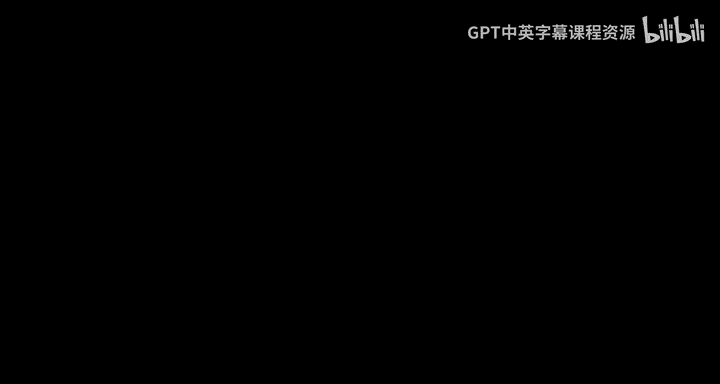
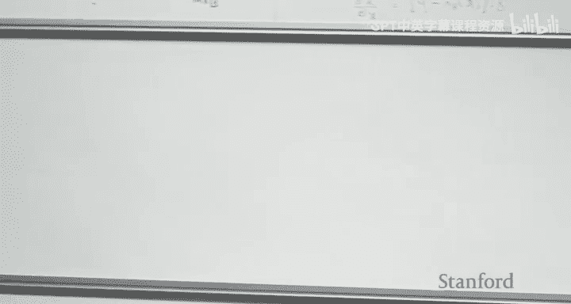

# 斯坦福大学《机器学习｜Stanford CS229 Machine Learning Course  Summer 2019 (Anand Avati)》 - P11：-11-.Lecture 11 - Deep Learning - II.zh_en - GPT中英字幕课程资源 - BV1NDopY4ECg

Welcome to lecture 11 of CS2 to 9 the plan today is to wrap up deep learning and we we left off at the end of black propagation last lecture and we probably the last part was probably a little bit hurried so we're going cover it again just to make sure you all understood it properly and then once we wrap up deep learning we are going to the goal is to cover regularization today and before we start regularization we will give fairly informal。

Introduction to bias variance and so just enough so that we can kind of cover regularization in a meaningful way and we will go deeper into bias and variance again on the Friday lecture。

So， to recap。Where we left off last lecture was we。

We discussed neural networks a neural network is basically a composition of multiple layers of computation where each layer you can think of them as a vector of neurons。

And each neuron， which which is represented as a circle in each of these layers。

 is takes us input the entire previous。The output of the neurons from the previous layer perform some kind of a computation and the output of this neuron becomes the input for the neurons of the next layer。

Right。Networks are structured in this compositional way where the output of one function becomes the input to the next function and the output of that function becomes the input to the next function and so on。

And。In the case of binary classification where the the goal of this network。

 which is also called a neural network， is to perform classification。😊，The last layer。

 which is also called the output layer。The output layer。Well have just one neuron。

And the output of this neuron is considered the output of the network。😊。

And we take the output of this network。😊，And the output the value of the output of the network depends on the on the parameter value within the network and also what input we fed into the network。

😊，So， the input of the network gets translated to the output of the network and corresponding to the input there is a correct answer yi。

😊，We take Yi and the prediction y hat I and construct the loss。

And the goal is to minimize the loss for every X Y I pair and the way we go about doing that is through gradient descent and gradient descent we have seen gradient descent for linear models before where the idea is to take the gradient or the derivative of the loss with respect to parameters not with respect to the input we take the the gradient of the loss with respect to the parameters。

😊，And update the parameters to take a small step in the direction of the negative of the gradient。

And we are going to do the same thing with the neural network。😊。

And the big challenge with the neural or rather the only challenge it is not really a big challenge is how are we going to compute the gradients of all the parameters at the same time simultaneously。

😊，The gradient of the loss with respect to all the parameters simultaneously right So the the and that's where the back propagation algorithm comes into picture and back propagation is essentially just the chain rule。

 So if you are familiar with chain rule， then back propagation will will seem very natural。

 There' is no magic in back propagation。 It's just the chain rule。So， the same network。So。

 this is the network view and this is the computation graph view of the same network。😊。

And before we go into the computation graph mus remind ourselves if we have a function f that takes an input in Rn and outputs a vector in RM。

 so vector input vector output kind of a function。😊，Now。

 the the the derivative of the output of that function with respect to its input will be a matrix。

A matrix which has as many number of rows as the number of outputs and as many number of rows as many number of columns as the number of inputs。

 and this is called the Jacobian of the function Yes question。😊。

So this might be a very basic question。Every time we。We did like。It like。And we computed the。Graio。

In the center。So why did we never except for the normal equations in the linear？

It why we never set the green。Yeah， so so so the question is when we covered all the gradient ascent and descent techniques。

 maximum likelihood techniques， we are seeing methods where we take the gradient of the loss with respect to parameters and take a small step and perform gradient ascent or descent why not do why not take the gradient and set it equal to0 and solve for the parameters directly like how we did with the maximum with respect to linear regression and the answer for that is you can do that whenever is possible so whenever possible。

 whenever you can take a gradient set it equal to0 and solve for the right parameter values。

 absolutely do that。 However for a lot of models such as even including logistic regression there is no analytical solution。

 you can you can take the gradient set it equal to0 and try to solve the parameter values。

 you just won't get a close form solution And that's the only reason And if it is possible you can absolutely do it And the other reason is that in cases when your loss function is not convex。

😊，There may be a lots of local minis and when you set a gradient equal to 0 in theory you could land you know in any of the local minis or you could even land land at a local maxa if your loss function has you know local max so just setting the gradient equal to 0 just takes you to a stationary point。

Whereas with gradient descent， we can end up in local minimas。

 but it you know at least you stay away from local maximus。😊，We but it。HowHow often is it that。そラと。好。

So the question is how， how。How frequently do we why not numerically calculate what value of the gradient what value of the parameters will set the gradient equal to 0 and gradient ascent is the algorithm you would use to perform that numerically。

😊，啊。Alright， so this the， this is the。Jacobian where if you have a vector valued output and a vector valued input。

 the derivative of the output with respect to input is going to be a matrix。

 a matrix whose number of rows equals the number of elements in the output vector and the number of columns equals the number of elements in the input vector。

😊，And now we are going to use we are going to see how the Jacobian can be used here because we are now going to start thinking of this network as these blobs of computation right every blob over here。

😊，Wwhich is is you know not a rectangle you can think of it as some function but takes some inputs so incoming arrows into this blob are the are the inputs to the function and outgoing arrows are the outputs of the function。

😊，So， for example， consider this this function f which has output which we call as a1 and input as as z1。

 so the derivative of this function。😊，Which takes。Whose output is some vector， input is some vector。

Is going be a matrix The the derivative of this function is going to be a matrix。

And the derivative of a with respect the vector A with respect to z is therefore the Jacobian of this function。

😊，And。With this computation view basically we have represented the same network what happens in this network in this network as a computation graph so we take the input the input goes into the first function whose functions are the input itself and two parameters so all the blue blocks are the parameters with respect to which we want to perform gradient a center descent。

😊，And the first layer takes the input example2 parameters computes z equals w x plus b。

And we call that Z。And after that， it applies a nonlinearity。😊。

It takes the linearity is applied in an element wise fashion。😊，And we get。A nonlinear output。

 which we call it as a。And this entire。Seect of。Operations， we call it as one layer。

 So this makes up a layer。And then we take the output of this layer。😊。

And run it through this this function which is again you know w2 a plus b and we get a vector z and from Z we apply another function which gives us a vector a so we are kind of hopping from vector to vector to vector to vector。

And some there is some function that transforms one vector to another and another function that transform this vector to another and so on。

 and this can go on for。😊，You know， many number of layers， you know， any number of layers and。

In general we we you know with such networks we we generally use that term capital L to denote the number of layers so this this story repeats all the way till we get we come to a L 1 so。

The L -1 layer。We take the output of the L minus1 layer and now because we are trying to do binary classification our output needs to be scalar valued and so the the the functions this function will have a scalar output so take this this vector as the input dotted with this w so w W A will now be a scalar we add another the scalar so we get a scalar。

😊，And then， apply a nonlinearity again。And we get Y hat。 So this is the output of the network。

And once we have the output of the network， we take the Yi corresponding to the X。😊，To computer loss。

So， in case of binary classification， the loss is y log y hat。😊，Plus 1 minus y log，1 minus y hat。

 we take the negative of that for the loss。And that's our loss。Now， the goal is。

To perform gradient descent。We need to take the derivative of the loss。With respect to B， L。

 the last， with respect to W， L， the derivative of the loss with respect to B2 and W 2 and B1 and W1 and so on。

 And once we calculate those。Those gradients are derivatives， we can perform gradient descent。

So that that the that is a setting in which you know backdrop comes into picture and if you remember the chain rule of calculus。

When we need to compute the gradient of say the loss a scalar。With respect to some element。

Let's call it w2 Ij， So this is a matrix and lets you know think of this as the IJ element of that matrix。

If we want to calculate， let me use a different color。Agent of。Last。WithRespect to。6 w。Do。😔，아이지。

And the chain rule of calculus tells us that。😊，We。Because all these composition。

 all these functions are compositions where the output of one becomes the input of the other and so on。

😊，We can take the local derivatives of each of these and multiply them out right that' is basically the chain rule of multivariate chain rule of calculus and the the reason why the multivariate chain of calculus is different from the regular you know chain rule of calculus is because the intermediate values can be vectors。

😊，So here L is a scalar， WIj is a scalar。Right。But the intermediate values are all vectors。

 which is why we use the multivari channel of calculus。And what does this come out to。

 So first let us calculate all the all the intermediate pieces and then we will just join them together。

So， first。So the picture in mind you want to have is you are jumping from you know boxes to boxes in our computation graph。

 so we take the derivatives also you know boxes to boxes。😊，Right， so。First。

 we start from the very end the loss with respect to a2。 so this。We're going to call this。

Last with respect， to。A2 scalar， scalar。 What's going to be the dimension of this。Scaar， right？

So this is going to give us。The gradient of the last， with respect to a2。

And then a2 with respect to Z。Lastpect， too。Z。😔，So， this is a scalar， this is a scalar。

 what is the derivative going to be？Scalar again。 Are you good。With respect AYeah。

 this is you're right， that's not A2， you're right， thank you。Thank you。He嗯。喂。And now， from Z。

We need to take what is the derivative of ZL with respect to BL？

What what dimension is going to be this is kalar， this is scalar and the。Z。

E with respect to partial of。B L， what's the dimension of this。Scacalar， very good。

And now what is the derivative of ZL with respect to WL， this is a scalar and this is a vector。

So this is going to be according to the Jacoban view。M， which is the output， is a scalar。

And n which is w the is a vector， so it is going to be a row vector because we have one output and you know some number of inputs。

So this。This is going to be。A row vector。Partial of。Z L over partial of。W L。

And now so that was one branch and we are going to continue down the you know main trunk of the network so at each layer we are going to branch off into you know the parameters but we are going to continue down the trunk of the network to reach to get to the previous layers parameters right so from z to a。

So Z is a scalar。A is a vector。So the derivative is going to be。It is going to be a vector again。

 but it is still going to be a row vector so in this case we I have just you know written them to say but you know scalar output vector input。

 the Jacobian is going to be a row vector。😊，喂。Follow this convention scalealar output vector the output。

 is going to be a row。I think of it as a row vector。So， this will be。Yeah the。with respect。Yeah。L -1。

This will be。A row vector。Allright， and now。And so on， you know， we go from layer to layer。

 and let's say we reach here。From。Whatever the next layer was from here to here。

Vectctor valued output， vector valued input。So the Jacob bin is going to be。Matrix， exactly。

 So here we know， this will be。A matrix。えと。This is two。Or were。Z。读。And similarly， from。

 from here to here， the derivative of Z with respect to B B2。So， this is。A vector， this is a vector。

 So the Jacobian will be R。Matrix。However。Before at at the last layer， before we calculate the， the。

The derivatives as a matrix here， we are going to make use of the fact that。😊。

We we want to calculate it with respect to each of the elements of the matrix are。

or this vector and the reason why I want to calculate the the derivative of the z vector with respect to each of the elements separately is purely for computation reasons。

😊，You could have followed the same approach and calculated the Jacobian over here。😊。

And taken the derivative of the vector with respect to a matrix。

 and you would have gotten something in three dimensions。And mathematically， that is perfectly fine。

 but computationally， that is going to be very inefficient。 So for computation purposes。

 we are going to take the derivative of each。😊，Sell in this grid or eat cell in this vector separately with respect to the the z vector and so the goal is to calculate it with respect to WIj we want to start from a scalar。

😊，End with a scalar and take the derivative， which is going to give us a scalar。

That that that's the idea here。 So let's see how that works out。😊，So here we want to take the。

Consider， say the I J element。And from Z。And what's the dimension going to be here。 So Z is。

Z is a vector， and。This is a scalar， so the derivative will be a。Row vector or column vector。So。

 the number of outputs。Is the number of rows。So here the number of outputs is multiple。

 so the number of rows in that matrix is going to be multiple。

But the number of columns in the matrix is the number of inputs we have just a scalar。

 so this will be a column vector。Right。So， this is the。Zi。😔，2。No。W。2。😔，I。 now。

 this recipe can be apply plus。 So we have pretty much。So we are missing this one more， so that。

Z to a is， again， going to be a。So this is vector output， vector input。

 so this is also going to be a。Matrix， Jacobian matrix。 now。A few。

 few observations that you want to make。The first is that。

What we do in each layer repeats in every layer。So once we figure out what each of these values are。

 we can just repeat them at every layer because each layer is just a repetition just the number of dimensions will be different but the math that we use to calculate the IJ element is going to be the same at each layer。

and we are essentially kind of toggling between z to a a to z z to a a to z z to a A to c and so on until we come to the L minus1 layers a and then we have you know something different。

😊，Right， so we have。You know。Something that is not repetitive at the last layer followed by something that repeats alternatively。

😊，L number of times or L minus1 number of times all the way until we reach the input。Right。So。

 it is sufficient to see how this pattern works for one example and once we do that it is very easy to just repeat the same recipe to any given any given parameter in the network。

Yes， question。So， far every。They are derivative。InWith respect to each element， yes， that's right。

So yeah， so the question is are we going to take the derivative with respect to each element in w for the per yes that that is what we will do the the reason is because it is computationally efficient you can take the derivative of with respect to the entire matrix directly。

And that will the intermediate step to go from a matrix to a vector。😊。

Will give you something in three dimensions。And it turns out that， you know。

 in that entire three dimension volume， most of it， you know。

 pretty much everything will be just zeros， except a small fraction of them will be non zeros。

 which is， is。hi is the same value we will get if we start from， you know。

 take the cell point of view。 So think of it as one parameter scalar parameter。

 to scalar loss with a whole bunch of Jacobians in the middle。えけ？I think that's everything good。オけ。

Im this。けマイナ5。If we if。That how can。Computation making。So lets lets。

 let's work out one example and maybe that will answer your question。

 So so what we are going to do now is try to calculate the gradient of the loss。

L scalealar with respect to W I J。 and well see what happens for all the you know。

 with the layers in between。 So this we're gonna compose it as。Loss。With respect to。A。Times。Las。

Just speak to。Z， L。times。Last。Respect to。A -1。Times。Right so。I'm just gonna take it down。嗯。

L -1 times。Las。With respect to。Z。😔，L -1。Can I use a black pen。 The only black pen here is。All right。

 it's writing now。 All right， let me use the black one。So。Okay， I'm just gonna。Start all over again。

嗯。So just to keep this in view， I'm not going to push it all the way up。 So the。Do it of the loss。

With respect to。W 2。I J。Is equal to using the chain rule。 We break it up into components。Last。

With respect to。Eel。Times。Through of the last。Respect to Z。L times。The last。😔，Back to a。L， -1。Zi。😔。

How -1。And so on， until we reach。Let's continue from here， until。Derative。Of the。Two times。

Driative of Z。Two times。Terative of。Zi。😔，Two times two of W 2。ア知。喂。So this is just the chain room。

What we。A L L derivative of L with respect to a was a scalar。😊，没。So this is one cross one。Right。

L with respect to Z。Sorry， this should have been ill。Oops， sorry。Sorry about that。 So this will be a。

L， this will be。The L， this will be。诶。Ha the -1 does the other -1 and so on。

So L to loss to A is11 by1 cross 1 loss to z L A to z L was again one cross 1。Right。

L to Z was1 cross 1。And then。Z L to A -1 was a。One cross。 So for the sake of simplicity。

 let's assume that all the， all the vectors are have dimension M right。

 So I'm just going to call this。1 cross M。Right， and。A -1 to z -1。

A 1 to z 1 was just like this was again M by M。And so on until a2 to z2。A2 to Z2 was， again。M by M。

And z。Z22 w。2 y z was？M cross  one， exactly。This is Mcros 1。And it so happens that if we have。

Each at each layer， if we have a different dimension。

 then this would have been say M L -1 and this would be M L minus1 till M L 2。YouBut you know。

 there are still going to be Jacobians of of matrices。And now we can see that L。

The the derivative of loss with respect to W Ij， this must be111 cross one with a scalar output scalar input。

But in the in the middle we have all these matrices and vectors and whatnot and what we will see is that when you start multiplying them out so this together。

😊，Is one cross 1 and this and this together。Is one cross。M L -1。 And this together。

Is1 cross L -1 and L -1， you know they go。 So this will be1 cross M L minus2 and so on until you reach here。

Right，And this will be one cross M。 And this is times。M cross 1 will give us one， cross 1。

RightSo this and this long daisy chain of Jacobians will always will always always when you multiply the amount。

 condense it to a scalar。😊，And if it doesn't， there's a bug in your math somewhere because it always will condense to a scalar because it' is the scalar loss with respect to scalar parameter and all of these need to just you know collapse into a scalar。

And what we see here now is。We did this experiment for you know in terms of know writing them out as just these partials。

We can simplify this a little further so we can， we can know make two observations here Now。

 in place of W 2。What if we wanted to calculate？Los。Respect to W I J。From one。

we did it for layer up layer 2 until w 2， what if we wanted to do it。对了。Layer 1。喂。反带就。

They do respect an A one。Z关。Exactly， so what we do is。

To calculate the the the derivative of loss with respect to w1 Ij。

 everything we did till z2 was the same。😊，At Z2， we branched off。Instead， for w1。

 we continue down the trunk right？We take this Jacobian and this Jacobian， and we end up with Z1。

 And from Z1， we again branch off just the way we did it here。

In order to compute the derivative of w1 Ij with respect to L。We reused everything until Z2。

And you know this， this is you know quite a long list。

 It could be possibly a pretty long list of computation。😊。

And then we just ignore what we did the in you know that specific to that branch of that layer and then get two more Jacobians and branch off into this layer。

😊，that is how we reuse computation if we were to perform if we were to calculate the loss with respect to WIj and then you know ignore it forget it and then start over all the way again with respect to W2 IJ we would be recomputing all these intermediate Jacobians a whole number of times and back propagation is an algorithm that tells you what is the most you know optimal or efficient way to compute these。

😊，Comp these gradients by reusing the intermediate computation as much as possible。So where were we？

So if if we wanted to calculate with respect to w1 j， then this would be now I am going to call this。

L， with respect to。YZ。2。Times。Z 2。It2。Oh，8 one。He went to Z。Eiwen。Z1。Yeah。Z 1 times。No。W。Ig。Of one。

Right， so。This whole thing。Is。all these got reused。Over here， you know， we would have computed this。

 you know， just save that value and plug it in here and just compute these extra Jacobcos and derivatives。

😊， so this will still be。1 cross M。This would be M cross M。M cross M， M cross 1。

And you combine these， you get one cross one， and this is also one cross one。Next question。这个。Yeah。

 so the。So the derivative of the final loss with respect to w1 Ij w1 Ij。Will be。

The same until you know we are going to reuse everything we use for w2 Ij until Z2 layer right and and then we branch off for W2 Ij instead we will continue by calculating two more Jacobcos and branch off towards w1 Ij。

😊，RightSo everything until Z2。😊，Is written here and the the the the thing highlighted in the blue blue square is。

This blue square， they are the same。So， we are going to just reuse everything we did until here。

 just discard the last component which was in the branch。And now this part。

 you know the the reus part and these two extra Jacobians is is now the like the new trunk， the new。

We extend down the trunk。 and， and the last part is the branch that's specific to the layer one。

Yes question。You use D L over D。So you have。D over Dw， right。

What is dL over so dL over dw is what is what we calculated for the second layer and in order to calculate it you know this was an intermediate result in the computation。

And we are going to reuse this intermediate computation。😊。

For performing for calculating loss of L with respect to W W1。So yeah， that's， that's important。

 We are not using the gradient of。The gradient of loss with respect to W2 to calculate the gradient of loss with respect to W1。

Because this branch， what happens here， has no bearing on the loss with respect to W1。

 right Youre only going to use you know。We are only going to use the parts until z2 and then calculate the rest and we are going to just discard discard everything in this branch that is specific to w2。

 we are going to discard it for calculating the derivative with respect to w1。

Any any questions on this before we see how each of the individual components look。Right， so。Let's。

 let's look at this again。 Now， there are lots of， lots of you know， intermediate Jacobians here。

 One observation that we can do is。Right until here。Everything to the right of。The last L -1 output。

This should be familiar to you。 It may not look familiar， but you have seen this before。

 This is just logistic regression。😊，If this was your x。Assume you are just feeding your x's。

 you know， the the inputs at this layer。What you have here is logistic regression。😊，So。

 the the way to think of this as a logistic regression is now combine these into a theta vector。😊。

And extend this by adding a one。As the interceptum， when you do theta transpose x， you get a scalar。

Take it through the sigmoid function。 you get your Y hat and you take your y and Y hat and compute the log likelihood right So everything to the right of this you know blue line over here is logistic regression。

😊，Theres no difference whatsoever。The difference is only notal。 computationally。

 this is just logistic regression。After the last layer right so you know this is you think of this as your theta vector like this is like theta n and theta 1 till theta d and this is like your x X and you know assume there is an extra interceptor take the dot part of it in theta and x you get theta transpose x。

😊，Take it through sigmoid， you get your Y hat， his question。イキリして場。Your grade better or多 better。

So Ive just drawn this as a row vector here。Think of this as， you know， think of this as you know。

 just some vector。 You know， don't worry too much of whether's a row vector or column vector。

 It's just some vector。We need to make sure that they are good。Let me do it a scale。So we take the。

 the inner product between or the dot product between this vector and this vector。 Yeah。

 so the output is a scalar yeah。Otherwise， you will be a。道。それなだけ。So if this was a vector。

 if this was a matrix， Yeah Okay， so if this was a matrix and this was a vector。

 then the output would also be a vector is it vector。

Is it because you want to scale it if so how do you choose。Yeah， we want， we want a scalealr here。

 exactly。Because we are doing binary classification， we want Y hat。 in fact。

 if you want to do multiclass classification with a neural network， then this would be a matrix。

 and you would have one11 element per class and you you would have a soft max instead of the sigoid right So so think of everything to the right of this line to be a GLM。

😊，If you are doing classification， it is logistic regression。

 if you are doing regression then this is this linear regression。 If you are doing you know accounts。

 then this is Pois regression。 So a GLM you know you can attach a GLM at the at al -1。😊，Right。

 so now。In order to compute these。In order to compute these individual parts。

You are going to make the observation that。D L to。D A L -1。So。All the way till here。This whole thing。

Is。Basically， what we saw in case of logistic regression。 So this is going to be y minus。

So in case of logistic regression there was y minus h theta of x。Times。X， I。So the， the。

 the equivalent thing that we're gonna have here will be。hy。I minus。A。L。Times。inus Al times Al -1。

Does that make sense， So everything until here is going to is going to be just。And now。So if you。

 if you think of。A -1 as， as like the input of logistic regression。OhWai a second。 I think I。

Fpped it here。 So this would not be Al minus-1。 This would be WL。So。In logistic regression。

 you had a theta vector and an x vector。😊，And the derivative of the loss with respect to theta had x in it。

 but x and theta are symmetric， so the derivative of loss with respect to x would have been y minus h theta of x times theta。

So here we are trying to take the derivative with respect to。Yeah， so。In。

 in case of logistic regression。off。E， with to L of。The theta was y minus。H theta of x。Times x。

L with respect to x will be y minus h theta of x。Ts theta because x and theta are symmetric here。

So this whole thing over here evaluates just。so you see you see the parts that are getting used here right so pretend this was x pretend this was theta of logistic regression and calculate the loss with respect to you know this theta and。

You get this， so。Get this。RightAnd in the notes， we have you know worked out the details of this。

 You can see the step by step of how you get this for the for the initial part。😊。

And then we you know， so once we， once we compute this。

The rest over here are the repeating patterns in our chain of Jacobopians right so this was the part thats specific to the end of the network which is like a logistic regression or you know any other GLM what what what happens further are basically a to z z to a A to z z to a the repeating pattern per layer yes question so why the weight。

第s that那个。Over here。So。In case of logistic regression see see the kind of similarity with logistic regression if you are taking the derivative of the loss with respect to theta you get an x if you are taking of the loss with respect to x you get a theta。

😊，So similarly， if you are taking the derivative of the loss with respect to a。

 you will have the w show up here。😊，And if you are taking the derivative of the loss with respect to W。

 an A will show here。Right， so。In this in this long chain we have you know condensed the first three and by observing that this is essentially just logistic regression and we know the the gradient for logistic regression and this is the one cross ML minus-1 so this is our row vector。

Does it make sense all the way until here。Is this And this is a row vector。 So this is a scalar。

 This is a vector。 So this is a row vector。Now， until here now weve got the row vector so on and now we are going to calculate these these matrices and the matrices are are again pretty straightforward so。

Z by D A。 So let let's let's， let So let's try this。Deel a of L -1。咩。Z of L -1。So。

How do we go from Z to a。We perform an element wise non linearity。Right， so in this matrix。

Where the output corresponds to the A's and the input corresponds to the z's。

This will be a square matrix because， you know， we are just performing an element wise multiplication。

 And because we are doing an element wise multiplication， the effect of the I element of Z is。😊。

Has no effect on the J element of a If I and J are different， because this is the element twice。

 So this will be a diagonal matrix。 The Jacobian is going to be a diagonal matrix。

Because it is an element wise operation。 There is no interaction between AI and ZJ if I and J are not the same。

And so here， this will just end up being G prime。G prime。Here A and Z are both。Yeah， so a。

I equals G of Z， I。It is an elementwise operation， so the Jacobian of the a vector with respect to the z vector will be diagonal because。

😊，A J with respect to de。The I is equal to 0。 if I is not equal to J。And ordinarily。

If it was not a element by。And the first column of that meeting。Just speak。B。One。

 one with respect to D one。Right， exactly。 So， so， so if this was not an element wise operation。

 then here we would have you know， D A。1 by D， Z，1 D。1 D a2 by Dz1 and so on。Untilenttal D， A。

 whatever M by R。N by D Z n and so on。 So you you take every possible partial derivative of the output with respect to the input and and that is your Jacobian here and here just because we are doing an elementwise operation all these are zeros。

Right， so。Yeah， so this would be， you know， if it's m by n， then this would be a Yeah， D A1 by D Z N。

 Yeah， you're right。 So yeah， basically the the the M cross n of all the partials。

So what we observe is that in this chain of Jacobians。😊。

Every other Jacobian is going to be a diagonal matrix。

Because it's an element wise operation happening every other step。And。So， this。Is。Diaagonal matrix。

Of G prime。And now what what what about。Dell Z。Say， up， up L。Over dell a。And -1。So by， by Z。

 L to A L-1， we are asking。You know。Z L to a -1。 How do we go， How do we get Z L from A L -1 we do。W。

 W， A plus。W A plus B。 So here。So， Z L was。W L。Times。😔，Yi。😔，Is minus1。Leus。Meer。So Z L by al -1。

If you do it element wise， you will see that this this turns out to be exactly just。哪看。

Why is that take the Ih element of Z。And the8 element of Z， so。Z I equals sum over J。W， I J。也对。

So the partial element this the partial derivative of Z with respect to AJ is WIj。

Which means the partial of of， of this entire Jacobco is the W matrix。Iだ。Yeah， so this。

 so this is a matrix multiplication。 So here I'm seeing this matrix multiplication for just one element。

So the plus B is is is going to cancel because we are taking respect to A。So yeah。

 there is a plus B and when you are taking the derivative of this with respect to a。

 know B is B is just not one。😊，Yeah， sure， sure， sure， sure， Sure。 Yeah， right， thanks。Right。

What we saw also the the initial part is a linear model followed by。Her diagonal Jacobin。Followed by。

A Jacobian， which is the L -1 layer times。A diagonal G prime times W L minus2。And so on。Right。

 so this long。You know， a multivari chain rule chain。Has this。

Has this pattern of starting off with a linear model followed by alternating between a diagonal matrix and the w matrixtagonal matrix and the W matrix until we reach。

Until we reach。The Z layer of until the Z vector of the corresponding layer。

And what what happens here。Orial of， let's call it Z2。With respectpect to。W Ij。Of two。

 So this is the， the last part。So here we make the observation right we start from here again。Me。

Dell so the partial of Z2 with respect to Wj。We see that W I J。Only interacts with Aj。

So this actually is， is so after making this observation， make this other observation that。😊。

The numerator here is a vector and the denominator is a scalar。So this Jacobian is a column matrix。喂。

Output is vector input as scalar， so the row is a vector input as a scalar。And。

We also observed that the role played by WIj。Only impacts Z I。

 So W I J has no effect on any other any other Z。So what does this mean so。

It's easy to So say Z equals。W times。诶。So W Ij， so you can think of the Ih element of z as the dot product between the I throw of w and the a column vector。

Right， and this。Is equal to the dot product of this times a。 So any W I J， any cell。

Can only impact the Z I element of the Ih element of Z。It has no。

 no impact on any other element of Z。Right， so this。This Jacobian will have zeros everywhere。

Except the。It。Highth element。And this eighth element is going to be。一据。A제。

So W I J is the is the parameter with with respect to which we are taking the the the derivative。

 So Z I is W I J times A J。 So A J comes here。And for every other Zk。😊，You know。

 WIJ has no role in it。So it' is going to be zeros everywhere， except Aj at the Ih position。😊。

Does it make sense？so。This this vector over here is a column vector。Withhid。

A J in the Ih position and zeros everywhere。Now， what does this mean。

 So we have a row vector over here。And the column vector over here。Right， now。

If we take the dot product between this row vector and this column vector。

 we we get the answer that we are looking for。We also observed that the column vector has only one non zero element and everything else was zeros。

😊，And when you take the dot product between such a column vector and this row vector。😊。

Because most of them are zeros。And only the Ih element over here is non0。

This dot product will be the i element of this row vector。Times aging。Does that make sense。So。

We have。Some vector。Times0， everywhere。AJ at the Ih position。0ero， so this dot product is， you know。

 let me call this B1 through say， B Bk。So this the the dot product of these two will be just。B。I age。

Is it clear？So partial of L with respect to W I J is。Ith element of this row vector times。A。

So let me write that here。So this whole thing， let me call it， say。Dell of two。Dot product width。やぱ。

Yeah。0。Yi。Zhi。0。And deel2 was basically。Partial of loss， with respect to。Two times。0。Yizhi。

And this is。Partial of L。With respectspect to。Z2， So this was a row vector。 this is a column vector。

 this row vectors。Ith element times Aj。内上。That to。W。So。

 this is the derivative that we are interested in calculating， right。😊。

What we saw was because of the chain rule， it was this。Row vector。Ks this column vector。

 but this column vector was mostly zeros， except know the I term。

The calculation of going from here to here or this entire thing oh just this one Okay so the the derivative of z with respect to W Ij right so Z what we saw。

😊，The Z vector is W matrix times。A column right so the the derivative of z with respect to w I J some I throw and J I J element of w will be。

Because it's just a matrix multiplication。W I J can only impact the eyeth。Yeah。

 so only the I element of this。Of this gradient vector will， will be non zero。 Everything else is 0。

 I is it because its w I Yeah， exactly。 but just following the formula you I equal that thing So if you expand that。

's gonna be like W1， W I A1， W I1。 I don't know how you write it out but。Basically。

 the you the derivative is usually have。Only items without the same。

Yeah yes so w I so if you take the derivative of this with respect to W Ij。Right。

 so only AJ will remain。Yeah， so that's A J。 That's why A J comes here， and everything else is zeros。

So。So the the partial of l with respect to W Ij is this long row vector times this special column vector that has only aj in the I element and this is you know。

When you take the dark product， because this is the IF element。

We get the I element of this row vector times aj。So AJ was a scalar in this vector。

 Now was just a scalar。Now， what does what is what does this pattern tell us if Dell。Pen。

Dspect to W2 is now there。Just the out of product between this and this。 So this is going to be。没。32。

Times。I guess I should have been putting。Superscript of two everywhere。A2。Transport。

So this from here to here is just you know， linear algebra notation。Is this clear。

Let me explain this part again。The partial of L with respect to Wj was this row vector times this column vector that we got from here。

 this row vector times this column vector where this column vector happens to be a special column vector that has only the Ih element to be non0。

Which is why we can can we can write this dot product as the ih element of this vector times aj。😊。

And。Because now。This I Jth element of this matrix is the Ih element of this vector times the j element of this vector。

 then the the full matrix is basically the outer product。😊，Yes question。Yeah， so this。

So this is with respect to W 2。 Yeah， so this is probably， yeah， this is with respect to one。

 Thank you， yeah。And dissolve social one。Anyways， the main idea here is how we went from this special column vector having just one non0 element。

Into this notation。 and from this notation。We。When we extend this into the full matrix， you know。

 this just becomes the outer product。Alright， so once we are able to calculate the derivatives of the loss with respect to all the。

Wake matrices。We can do something exactly similar to the biostrs， to the B vectors。

We repeat this for every layer。We， we get the collection of all the derivatives of the loss with respect to the corresponding matrices。

 and we take a gradient decent step in the。Direction of negative of these。 So what we get is w。

L equals。Con equals。W L minus alpha times。Bil off。L over。保持 off。W。

Where the partial of L with respect to partial WL was calculated as this outer product at the end。

There are a lot of moving parts。But it's， it's basically just， you know。Multtiated calculus。

 a chain rule。Applied in a mechanical fashion。 There are a lot of moving parts， but， you know。

 it's just chain rule and calculus there's。Yes question。はいちり。这个那个。BW。あだ。Convering for W。ぐる前。こちだ。Yeah。

 so I guess the question is you know is there a preferred order in which we perform this with respect to the different L layers the way we generally do it is first we calculate the the partial L with respect to WL for every layer and in order to do that in order to reuse computation you want to start with the last layer first and then work your way backwards because you are reusing lots of computation and then once you have the full collection of your partials these can be done in parallel because once you have this matrix you know you are only updating the L layer parameters using this matrix。

And so， this update can be done in parallel for all the layers。

 but to calculate the updates itself you want to do it serially starting from the final layer and working your way backwards because you can reuse a lot of the intermediate computations。

Exactly， so we， we are going to reuse。We are going to reuse in order to calculate Dl L by Wj 1。

 we are going to reuse everything until z2。And get a few more two more Jacobians and calculate specific calculate the branch specific to the first layer。

 So because we are reusing。A lot of these intermediate values。

 you want to start at the end and work your way backwards。

 And that's why it's called back propagation。もちょと。So what I meant by calculate two mod Jacobcos is in order to calculate w2 Ij。

 you would have calculated everything until z2。And now in order to calculate with respect to w19j。

We reuse everything we did until here and get two more Jacobians and。The first。

The first one will be up what do you mean by first one was sub z1。

Of the the two Jacobians are a1 to z1 the Jacobians are z2 to a1 and a1 to z1。ワ？Exactly。

 and the branch will be C1 to WIj， exactly。And same thing。Be also， you go up。Previously。

Yeah the same with respect to B the in fact b is a little simpler than what we did for w W is the harder case which is why we work through it B is going to be very simple you know what is the the partial of z with respect to B1 partial of z with respect to B2 you know and work it out it in fact is is going to be much simpler than W。

RightSo again for B in order to calculate for B2 I。😊，Everything until Z 2 from the last， is the same。

And you just have a different branch。So any， any， any， any。

Immediate questions with respect to back propagation。Yes， question。Yeah。Andこ。The observations of。So。

 the question is we start with the input layer， which is of dimension D。And this is like， you know。

 your D dimensional input。 if it's like prices， you know， if you're you're you。

Like if you are trying to do some kind of say a linear regression。

 then these are the features of your axis。One example。 This is one example。

 This is why I write x superscript I。 So this one example。 So examples we have。Yeah。

 so Im coming to the multiple examples next。 So all of this was weve seen it with respect to one example。

Right，Now what do we do when there are multiple examples I。

Before before I jump onto that I want to make sure there are no outstanding questions on back propagation it is fine if you haven't understood all the details right now I would recommend you to you know go back and work through the notes and work out these parts yourselfselves and why you are working out through the math step by step the key steps the key points to have in mind is to break down the big problem into this。

Into this smaller steps where you know there are these two steps a to z and z to a that repeat over and over and the Jacobians of those are very simple so z to a is a diagonal Jacobian。

And A to z is just the W matrix。So this will always be just the w matrix， and this will always be。

Dagonal of G prime。Now， A to z is the W matrix Z to A S G prime3ops。Because you went through G。

 so the derivative of a with respect to z will just be the diagonal of G。Yeah， so yeah。

 A to C will be always a diagonal matrix。 Z to A will always be just the w matrix。And this。

 you can you know， repeat it depending on how many layers you have。

And once you reach the final layer， this part is just like logistic regression or any GLM in general。

 So GLM。😊，Diaagonal W，agonal W， diagonal W。 And then you have something that's specific to the branch。

And the part that's specific to the branch。Is。です。This special column vector that has only Aj at the Ih position for WIj。

And you take the row vector and you take the column vector。 you get， you evaluate it。

 you get the value for。Dell L the derivative of L with respect to WIj and then you observe that this is just the ih element of one vector times the j element of the other vector and so the derivative with respect to the matrix is just the outer product we these to。

😊，There are a lot of moving parts， but know pretty much straightforward。

So should there be a transposeware over here？So， this is， you know the。I'm not sure understood。Yeah。

 this is a matrix， yes。Oh so this should be yeah。 So， so yeah。

 So think of so D L by Z2 in our case was。Row vector。 So， yes， so you can， you can have。

But but the idea here is the out of product between two vectors。

 Think of it as out of product between these two vectors， whether they are raw column you know。

 calculate the out of product I element of here J element of the that becomes the I J element of the matrix。

Right。Okay， so this was with respect to one example。When we have。

The way we generally train these neural networks in practice is。With gradient descent。

But we don't always do stochastic gradient design。What we do is something that's called as mini batch Canadian descent。

And in mini batch gradient descent， it is similar to stochastic gradient descent where except instead of sampling one example at random。

 we sample a batch of examples at random。Right， so in。In practice， to train， we define J of。

Ws and Bs where this is the set of all ws across all layers and set of all bs across all layers。

 right。And we define this as the sum from I equals one to capital B。Loss off。喂。Hi。Why。あい。Right。

 where。B。Is。Size。offff。Mini batch。Right， so。When we， when we。

When we are now working with so so far we considered x to be a vector。

But if you are working with a mini batch， let us see what happens。😊。

Let's see what happens in the first layer。 So in the first layer we have Z I， Z1。Was equal to。W 1。

Dmes。😔，X I plus。B1。So， this was。Let's call it M by M。So， M might be。If assuming。

The first the output of the first layer has dimension M X because it the input has D dimension。

And B also， therefore， has。M。And Z is also a vector of size M。So。And this。dimension D。Right， so。

W times x will give us a vector of size。M。And this is a vector of size m and output is a vector of size m and this was all fine。

When we were， let's put across one to just。This is all fine with respect to one example。Now。

 what happens when in place of Xi， we take a mini batch of X's。 So what happens if we do。W of one。

 which is still。M by D。And in case of x， we have a mini batch。X 1。Next2。X。B。

So this is now B by capital B。Right。Plus。We1。 And this is still。M by one。So this。

 this matrix multiplication will give us something that is。😊，M by B。But。Now， we are trying to add。

Something of dimension M by  one2。An entity of dimension， M by B。But this doesn't work。

You can add two to a vector and a matrix or two matrices or two vectors whose dimensions don't match exactly。

And。Over here。What is most of the。Most of the softwares that you use for training machine learning。

 especially neural networks， you know like TensorFlow， PyTch， NI。

 all these software applications deal with such a scenario of adding an M by1 to M by V by something called broadcasting。

So， when you are implementing your neural network in your homework。

 which is there in your homework too。😊，You might wonder how。

You are going to take this M by B dimension and add B and add a M dimension vector to it。

And as long as yourre。As long as your dimensions match up in this way where you have M on the left and B and1 on the right。

😊，Most of the computer software， including Ny， will perform something called broadcasting。

 which means it is going to make which is it is going to broadcast this m by one vector into an M by B vector by making multiple virtual copies of itself as multiple columns。

Next question。Is it equal？So the question is， is this， would it be equivalent to multiplying。Be by。

By what a row vector of a row vector of ones。 So B by one times one by。

1 by B filled with filled with ones Yes， exactly。 So you can you can do it explicitly and make multiple copies of your be。

And that will consume more memory in your computer whereas you know broadcasting is this you know you are probably going to come across you know broadcasting errors when you are doing homework you know things are not you know so broadcasting is this feature in most computer software which work on matrices where it makes multiple virtual copies of this vector to match up the dimensions。

That's something you just need to be aware of。It is mathematically it is equivalent to multiplying a row vector of ones and making multiple copies。

 yes。Mathematically it is equivalent but actually performing this is very algorithmically expensive you are going to use a lot of memory use a lot of computation Broadcasting is a feature that you know the software implement to do it virtually for you。

😊，This question。ょか。出かして。We said that we could do that because closed the context。Yeah。

Com much to the same。た例ば。Yeah， so a good question。 So in the other other algorithms we use stochastic gradient descent and and because the problems for convex we kind of you know knew that it would go to the the global minimum or nearby the global minimum but neural networks are not convex and whats and the stochastic gradient descent makes sense in neural networks I guess is a very good valid question right and the answer there is。

It is valid the the if you look at the theory of using stochastic gradient methods。嗯。So there are。

 there are certain conditions。 So again， you know， this is。For your reference。

 so the the the if you want to go deeper into this， look up stochastic approximation。

Approxiation and one of the very first papers that introduced this idea was from a pair of others。

 I think it was Robin and Monroe。Robin and。Monroe， so when they introduced this whole idea of stochastic。

Stochastic optimization of stochastic gradient descent。

 it was introduced in the context of stochastic approximations and what the theory says is。

If you perform this gradient descent with your learning grade。You know， we used in all our methods。

 we use a constant learning rate alpha。But if。In this paper。

 they give a proof that as long as your learning rate is also decreasing over time。😊。

And if it is decreasing at a rate such that so supposing if alpha1 is the learning rate used at time step 1 or the step size 1。

As long as you as long as you decay your learning rate over time such that。Some more time。Alpha T。Is。

Infinity， but。s over t alpha t square is less than infin0。

 which means the sum of the learning rate values explodes to in50。

 but the sum of the squares of the learning rate you know converges as long as your learning rate follows this condition then。

Stochastic gradient descent will converge to some local optima， right。

And that local optima in case of neural networks could be any local optima right gradient descent will also take it to some local optima in a neural network。

 but we dont know what it is anyways。And， you know， then， you know。

 why the extra concern when you start using stochastic gradient descent is， you know。

 is is is is a response and。In terms of when exactly stochastic gradient descent will converge to a local minima。

 as long as your learning rate follows these set of conditions。

 stochastic gradient descent will converge to a local minima even if the problem is nonconx take you to a local minima in practice we don't follow learning rates in this that meet this condition but it is actually common to anne your learning rate in some way may not be in this way。

 but it' is common to decrease a learning rate in neural networks it is a commonly done practice though not in in that fashion So SD will take you to a local optima。

But you know， you have no guarantees just the way you have no guarantees with gradient descent itself。

こ to。That very。But mean。しで。So the question is。You know these models are very expensive to compute you know calculating all this batch prop。

 So why do we do mini batch instead of just stochastic so the reason why you want to do mini batches because most of these softwares are implemented on GPus where you get parallelism for free kind of So if you' are not doing you know at least some amount of parallelism youre kind of leaving money on the table So you want to use you know make use of the parallelism somehow and also when you when you move from stochastic gradient descent to mini batch gradient descent the noise in your gradient direction comes down significantly So if you're averaging across multiple examples you know the noisiness and in each step that you take is reduces significantly。

As question。第一。That's。You change your learning rate through time，So why why should。ど？

Whether or not we can。めちだ。So I'm not going to go into the details of this I'm happy to go into you know more details of this after the lecture if you are interested in I would highly recommend you know reading up this paper it gives you all the details of know what are the necessary conditions probably there is also a sufficient condition for your training process to converge。

どうじ？Doesn't matter I'm working。Yeah。你该是。Those elephants will。Exactly， yes， yes。 So the papers the。

 the idea here is。Any set of learning ratess you take， no matter what your loss function is。

 if they follow these， these conditions， then you will converge to a local opt， exactly。Well。

 not all the alphas， some of the initial alphas could be very big but， you know。

 but the sum of the square of the alpha should converge to some finite value。All right。

A few more comments about neural networks before we move on。嗯。

So one view of neural network is to start with this picture and。You know， remember， we， we first。

Consider the last layer as a linear model and everything else has something else。

This view basically tells you that what a neural network is doing is transforming your x's。😊。

Into some phi of x。Right， so you can think of this whole。Network。This whole thing。To be。

Some phi of x where the p are parameterized by W and B。

I think of it as a feature map we came up with some hard codeded features and problem set one in the last question like you know polynomials and you know sinus oil features。

 etcter。😊，But。Essentially， what this neural network is doing is taking your input and transforming it to some other space。

 And then you apply your GLM or any linear model that we were that we' have seen before。

 So neural networks in a way are。😊，Way to learn representations。

 So everything that happened from x until a of L 1 was learning a way to represent x so that the GLM could consume that representation。

So that is one view of neural networks where your neural network。😊，Is is some learnable feature map？

Plus， linear model。in case of linear models， we would only learn the parameters over here。

But in the case of neural networks， we are jointly learning the parameters of the linear model and the parameters of the feature map。

😊，Yes question。Everything simultaneously exactly when we do gradient gradient descent or gradient descent。

 we are updating the parameters of the last layer and the initial layers all at the same time。😊，So。

 in a way you you are trying to learn what the right parameters of the linear model needs to be and also at the same time learning what are good representations that are going to help by linear model。

So linear， in fact， one of the leading conferences of deep learning is called ICLR。

It it is a academic conference that is kind of dedicated to deep learning and the name of ICLR stands for International Conference of Learning representationpresents So that is what deep learning is doing。

 It is learning representations。😊，So that you can apply linear models that you are already familiar with。

Which， which gives some interesting additional perspectives。That is， once you have a feature map。😊。

I guess what Im， what I'm about to say， you know。Beyond this point about neural networks are。

A not some things we are going to ask you in your exam but are you know good to know。

 especially if you want to get into machine learning research。😊。

Associated with every neural network is a kernel。😊，A kernel which give two examples， I X I。

X J is the。Fi of。X I transpose。Fee of exchange。the fee are is the thing that takes you from x to here so every neural network kind of comes with an implicit kernel where a kernel is represented by this explicit feature map。

Which means now this gives you a way in which you can use neural networks with Gaussian processes right in Gaussian processes you need in a kernel。

😊，To， to tell you how similar or dissimilar to examples were， right， And over there。

 you can use neural networks。 You can。 you can。 There are ways in which you can learn kernels。

 which means you can learn。These neural networks for the for that GP process and you know that that is a very elegant way of combining Gaussian processes and neural networks where a neural network becomes the kernel of your GP。

There are also a few other interesting。Few other interesting results with neural networks。

So there is another interesting。I guess linked to Gaussian processes where there's another paper which。

Which shows that。A single layer neural network。Which means one hidden layer and one output layer。

the input are your excess and you have one hidden layer and one output layer。As the number of。

Neurons in the hidden layer tend to infinity then the neural network。

Becomes a Gaussian process itself， which is another interesting link between Gaussian processes and neural networks。

If you're interested in those papers， you know， make a post on Pi。

 I'm happy to share links to those papers。However， the the other interesting。

Interesting。Idea of neural networks is this thing called the universal approximation theorem。Again。

 these you know we are not going to ask you about these in your exams or homework or anything。

 but these are good to know you know especially if you want to get into machine learning research so the universal approximation theorem says。

If you have a function。Sa。Y equals F of x。Where x， you know。

 assume it's from R D and y is in know some R。Let's call it K。And you are interested in some bounded。

Region of x。Which means， say， if your X's are， for example， some， some image， right。

 then you're only interested in。The region of x where the pixel values is between some range right thats that that kind of limits our region of interest of the inputs。

 So given a bounded region of interest， then。There exists。Exists a neural network。

Of one hidden layer。Which means。Your input layer。Is x in。RD。Your final。Is white？Yin。RK。

And you have a hidden layer， a fully connected hidden layer。

And the universal approximation theorem says if you have a function。

With a given region of interest of your inputs。Then for any smooth， any continuous F。

 any function F that is continuous。😊，There exists a neural network with a finite number of hidden layers。

That can approximate F to an arbitrary degree of precision。Right， and， and。

That could be surprising initially。 So any F that is continuous。😊。

If you define a region of interest in the input space of x。No matter what no matter what F you have。

There exists。A neural network with a single hidden layer。With a finite number of。Hidden dimensions。

 but that number of dimensions can be exponentially large， but it is still finite。

And that neural network can approximate y。To an arbitrary degree of precision。

 So if you come up with a degree of tolerance， epsilon， say call it， you know，10 to the -6。

Then you can construct a neural network， F hat。Of x， such that effect of x minus。F of x。

It's less than epsilon。For all values of x in the boundary region。This question。Is doing best。

So I guess I wouldn't call it a violation of no free lunch because Gaussian Pro could also do this。

 You know， it can approximate anything if you have a non parametric thing。

 But here the result says you know， in， in a parametric setting， this can， this can。

This can basically mimic F to an arbitrary degree of precision。

You throw in more input layers than your degree of precision improves。But yes question。对按那。The？今自な。

No， no， it's just this。 you know， consider the the output over here no nonlinear。Yeah。

 if you think of that， you know， you you can， you can， you can construct a network like this。

Where so if， if you think of your y as a scaleal or valued， then I guess， you know。

 you would just have one cell over here。Why bother。

So so yeah coming to that so right so it tells you the universal approximation tells you that any function continuous function f can be approximated to any arbitrary degree of precision with a one layer neural network as long as you are willing to you know have lots of hidden hidden units。

😊，However。So that that that's basically you know， a theoretically a mathematically you know。

 true valid result。😊，And you know， thats probably you know a big reason why there is a lot of interest in neural networks because it has you know。

 such good expressivity power。😊，However， the catch that comes with this is it does not tell you that。

😊，It does not tell you or give you a recipe of how to recover that function or how to recover that configuration。

Now it doesn't tell you that with gradient descent， you can。

 you can reach that configuration of the network。😊。

And it also doesnt tell you how many samples of x and y pairs you need to mimic it you know there are lots of lots of catches that come with it。

 but it it is still a valid mathematical result that by adjusting your parameters in some way doesn't tell you how but a configuration exists where it mimics any continuous function f to an arbitrary degree of precision yes question。

Continue to。呃。I don't remember the details。 but， you know， it's it's。

 it's it's not a very I I don't think it needs to be。lip shits。

 it probably needs to be I don't remember， but you know it it it's for most practical purposes。

 all the kind of functions that you may want to learn are covered under that。First question。My way。

You I guess you know this is just a mathematical result which tells you that there is a way in which you can adjust the weights and biases of your network to mimic f of x to an arbitrary degree of precision you know that is just a mathematical result and you probably want to view it outside the context of。

😊，You know your data and test set and whatnot but you know thats still thats still a valid result and that's basically you know kind of spurred a lot of interest in neural networks because hey they are you know universal function appators and as long as I have a good enough data set that you know that that' is kind of representative of you know your your function and maybe gradient descent will get us there you know but theres no proof that gradient descent will get you there but you know maybe it does。

That shall they give this。あ表の。Itsscribe Fred。There's no algorithm of how to extract such effect。

 All it tells you is that there exists an effect。 So we can just make predictions。

Again I would not think of it in the context of prediction versus learning versus inference all it is telling you is there exists some configuration doesn't tell you how to reach that configuration。

😊，So now you know neural networks are therefore in theory you know the hypothesis class of neural networks if you are able to you know afford a pretty large intermediate hidden layers。

 the hypothesis class is pretty big， you can approximate any function you can you can you know or continuous function you can think of you know in some boundary region of input。

And， and which， which kind of。Forms a nice segue to our next set of topics of， you know。

 bias variance trade off。I don't think we have time to finish it today。

 we are going to pick it up again on Friday， but maybe just you know lay out the setting so that we can we can pick it up from Friday as a question。

😊，把 decision。来。Good question。 So， so the question is。

 we use neural networks to come up with nonlinear hypotheses And a decade ago or so， S Vms， you know。

 with kernels could also do nonlinear decision boundaries And why is the recent you know。

 trend or shift in interest towards neural networks and away from S VMs， I guess。Few。

 few possible reasons or likely reasons， one is SVMs require you to hand craft a kernel。

It is you know， you need to use your intuition to come up with you know a good mathematical kernel for it for it to work well。

The second is whereas in neural networks， the feature map is kind of learned from data right you don't have to construct。

A mathematicalthely valid kernel， you know， the data gradient descent will kind of figure out a reasonable implicit kernel in this case。

 The other reason is because。Neural networks。Are very computational intensive， right。

 They are extremely computational intensive， especially as you add more deeper layers and。😊。

They are also very sample inefficient by sample inefficcis。

 lets see what I mean is you need a lot of data for the neural network to work well。

Whereas other algorithms are a lot more sample efficient。

 They kind of work at their maximum capacity with a lot fewer data sets。

 and recently the trend in computing is that a lot of data is now digitized like pictures or you know images are you you get a lot of images which are digitized now and also there's a huge jump in computation GPs and stuff right so the two obstacles that were kind of holding back neural networks you know lots of computation and lots of data are kind of now met Another in terms of algorithmically there hasn't been a lot of。

😊，OrThere hasn't been a whole lot of fundamental changes to neural network algorithmmic。

 except probably the。The introduction of the activation function called theLlu。

Which we saw the other day， it is equal to max of0 comma x。 so value。Addressed one， I would say。

 a problem with neural networks of making it very deep。

 which was something that is called the vanishing gradient。

We probably won't be covering vanished ingredients。

 but the idea there is if you have an activation function that looks like this and if your activation function the input to your activation function is some you know z value here then the a value will be whatever one but the the derivative or there is pretty much0 so the Jacobian will just be。

😊，You know， it has zeros everywhere else， but you know these elements will also be end up being zeros。

 So you take the the the gradient of of of the next layer multiply by as Jacobian are0 then you know everything behind。

Are are pretty much going to get zero gradient。 So this， this。

 this problem was kind of solved with values。And it's， it's kind of， you know。

 if you look at its kind of hack， right， It's just。 But， you know， in practice， it works。

Works pretty well。 And and so the the you know， trend in increasing in you know。

 computation power and increasing in data。 and with very few algorithmic improvements like this。

 you know， is is probably by there is a renewed interest in deep learning。😊。

And experience are basically。So if you just design them。

See yeah so the question is you know there is a kernel that we you know that we showed that every neural network kind of implicitly defines a kernel you know that is associated with its feature map and SMs use kernels so what is why you know is there a reason to use SVMs again and the answer is actually very few people use SVMs except。

There are still probably a few cases where you don't have a lot of data you know that' is kind of one regime where neural networks don't work well if you don't have a lot of data and other you know others you know more more simpler methods are still commonly used。

Another interesting thing that might be interesting is you can train a neural network。With， with。

 with know， in in this way and。Just use it as a feature extractor。😊。

To map your your examples to some higher level feature space and then you can feed that into other algorithms。

 you know thats that is something that people do as well。

 So train a network on your full training set。Right and learn this feature map and then on other exam you know on the same examples you know kind of chop off your network at this stage extract the features that the network learn and then say train you know like a random forest or some some other algorithm on this representation of your inputs know that thats people do that sometimes as well。

Wass another question。Yes。Isnt so。Doesn't it have。A bigger vanish ingredient problem， because。

Like everything。Yep。Sigmoid。かせせてて。判断でしょ。Yeah， so the question is in in RE。

 won you have vanishing gradient problems here， the answer is。

The answer is yes over here the gradients do vanish however。

 the input that goes into activation is actually the output of some linear transformation。

Whi means it is going to be different for different values of x。So。Yes， over here， the one。

 the gradient is is。Is0， and that is a problem of value。

 and people have come up with kind of again hack fixes for it。

 They call it leaky value where the leaky value is you know。😊，Its like this until 0。

 And then it has a much smaller gradient over here。 So you know。

 it's like instead of it being exactly 0， everything it has a small， negative slope。

 So there are fixes。Or ways around it。 But in practice， re seems to work。Why would you do something。

There are infinitely many。にあれて。That seems so crazy。I mean， it's， it's easy to compute， so。

It's inexpensive to compute。This question was。わしる？I'm not familiar with the universal approximation theorem for SEMs。

作戦？Literally， any， theoretically， any， any possible。エ twoア。どんなとって。As。

As long as it's continuous and you' are interested in some bounded region of input space said。

It doesn't。Doesn't guarantee that you can actually learn that mapping， that feature map。十か？Yeah。

 you want to learn those Ws and B's， which has。Can you elaborate。Why， why can't。

So all I said was the approximation theorem doesn't offer you a recipe of how to recover that network。

It just tells it， it's an existence theorem。 It says， you know， that that such a network exists。

that's all the theorem says。Also you' are saying the only problem。学中に achieving that。Some ideal。

 optimal。刚。一是在。We might get。Minibu gradient design。

So there are many challenges in order to even get it。

 right So how many samples of x and y pairs do you need you know that right there you have like an obstacle if you want to train it with gradient descent。

Anyways， so that's， that's。That that's fine。 So the the， the main。

 the main idea that you want to take away from this is that neural networks are extremely expressive。

 the set of all。Hypotheses that a neural network can represent can be extremely large。

linear regression was limited to just straight lines。Right，But neural networks are。

 in a way you know， much， much， much bigger and which which kind of， you know。

Will lead us to the next topic of bias variant straight off of you know is this always a good idea you know is more expressivity always a desired thing and we'll jump into bias variant straight offs on on Friday and to just wrap up today's lecture I would kind of stress upon the idea of that propagation you know think about it in terms of this daisy chain of Jacobians where each of the Jacobians are pretty easy to compute ci the diagonal matrix or just the W itself the end of the neural network we've seen it before they are just linear models we've seen GLMs。

😊，And the gradient over here follows just like a linear model and then you have a daisy chain of Jacobbians and the branches to each of the Ws and Bs are again very simple math the notation may be a little confusing because you have these zero vectors full of zeros with only some elements non-zes and we kind of view them as autoer products etc but thats again straightforward linear algebra work through it you know once from the notes and hopefully that should be clear if not you post on piazza right well stop today thanks。

