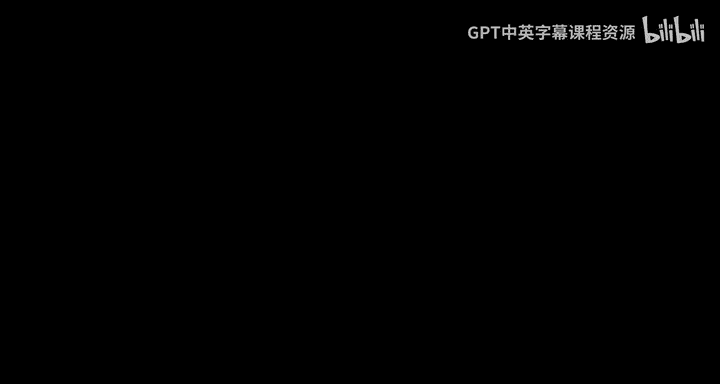
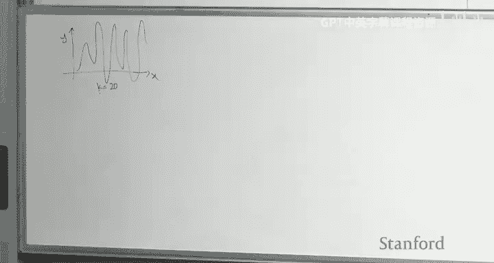

# 斯坦福大学《机器学习｜Stanford CS229 Machine Learning Course  Summer 2019 (Anand Avati)》 - P12：-12-.Lecture 12 - Bias and Variance & Regularization.zh_en - GPT中英字幕课程资源 - BV1NDopY4ECg

O， welcome back， everyone to lecture 12 of CS S22。The topics for today are。

Bs variance in straight off。Model selection and cross validation and regularization。

 The three are are kind of。Somewhat related to each other。

 and I would say bias variant straight off is probably one of the most important topics that you need to take away from the course。

 it's at the heart of machine learning and。The concept that kind of is unique to machine learning and distinguishes it from other fields al right so a quick recap of what we covered the last two classes so the last two classes we covered neural networks and deep learning。

And the main takeaways from the last two classes was the neural networks are basically composition of simple building blocks where the simple building blocks are you know linear models that we have seen in the past。

 so we take the output of one one simple model and feed that as input to you know another simple model and so on。

And the crucial。A crucial thing whileos them composing them is having nonlinearities。😊。

And nonlinearities are crucial because if there were no nonlinearities。

 then the entire network could be represented as just a linear single linear layer with one matrix。😊。

And also， neural networks and deep learning， they are。They are non convex。

And it is important that we initialize the parameters randomly whereas in the previous models that we saw the simpler models they were mostly convex and initialization did not matter。

 but for neural networks， for example initializing all your parameters to zero will not work because because of the symmetry properties that we discuss。

😊，And then the approach for training neural networks was basically back propagation。

Vact propagation is just a fancy name for the chain rule of multivariate calculus。

And what we saw was we calculate the gradients of the final loss with respect to every parameter at all layers and in order to calculate those those gradients。

 we use the multivariate chain rule。So the last layer was know a linear model that we you know very similar to GLMs。

And then from beyond the last layer as we compute the gradients of parameters from earlier layers。

 we saw that you we encounter a chain of very simple Jacobians there either diagonal Jacobians where each diagonal entry is the derivative of the non nonlinearity or it is going to be the weight matrix so the weight matrix itself will be the Jacobian。

Right， and。We we construct the simple chain of Jacobians until we arrive at the layer at which we are calculating the gradient from and then from from the branch that is specific to that layer it was pretty straightforward calculus that the notation was a little heavy but it is pretty much you know there is nothing nothing fancy going on there it is just simple simple gradients that we need to that we need to take。

And to the end of the last lecture we saw this or we just discussed this theorem which is you know it is not going to be in your syllus and we are not going to test you on that theorem。

 but it' is a good kind of segue into bias variance because。

The universal approximation theorem suggests that neural networks can be very expressive。

 so it can represent any possible， any， any。A smooth and differentiable function on a given input range。

And that that kind of brings us into bias variants and asking the question is that a good thing or a bad thing having having expressive models is that is that good or is that bad？

😊，So that brings us to bias variant。Any questions on neural networks or deep learning before we jump into bias variants？

Any remaining questions。Okay， so bias variance。 So in in your in your homework  one in in the last question。

Where we we saw feature maps right so in feature maps we supposing we had a data data set that looked like this。

App ploting the same data set。Again， here and here is the same data set。now。

 if we fit a linear model。Where the feature map is just a polynomial of degree1。So， K equals 1。

We get a straight line fit。To the data。And if we try with k equals 2。

 whether the polynomial degree is 2， we get。Say a quadratic fit。Similarly。

 if we try with say k equals 20。We would get a fit that might look something like this。Now。

 we could have done something very similar with， say， a classification problem。I， supposing。

The X here。Mark one class。Omark。Another。X here and1 over here。Sosing we had a data set like this。

And say third， I'm just copying the same data set in three different places。

Here the x's mark one class and the O's mark another class。Now， if we try to fit。

 say a logistic regression with polynomial features， say with k equals 1。

 we would again get a straight line fit。The price will separate the two classes。

If we tried the logistic regressiongregation of k equals 2， we would get a quadratic fit。

And let's say we tried it with k equals， you know， maybe 20。And we。

 we would probably get something that。Potentially， look like this。Right， so。Losely speaking。

We can call these models as being underfi。These models as overfiight。So， in machine learning。

We are given a training set。But the error that we actually care about is not how well the model performs on the given data set but how well does the model perform in general on data that it has not seen before you can call it loosely speaking the test set but in general you know you call it generalization error so generalization error。

Generalization error is the error or the loss of the cost that our model incurs when it is tested against possibly all the infinite data out there in the world from whose distribution we got the training set。

Right， and。In machine learning， what we care about is that our model needs to have a low generalization error。

But the， the fundamental problem is that what we have access to is just a finite sample from the。

From the you know the infinitely many possible examples from the data distribution。

 we have a finite sample from the data generating distribution and we need using this finite sample we need to build a model that has good error rate or low error when it is tested against all the possible you know infinitely many examples in our data distribution。

So， this。This concept of underfitting and overfitting。Is you can， you can。

Think of underfitting and overfitting， as corresponding to。

Different components of the generalization error。 So loosely speaking， generalization error。

 which means taking the model that we obtain and testinging it against an example that we have not seen before。

And when we tested against an example that we have not seen it before there is going to be some error it is never going to be perfectly right and that error can be broken down into subcomp so the generalization error can be broken down into two parts。

😊，A component called the bias。And the component。Call the variance。嗯。And loosely speaking。

 bias is the component due to。What you can call as this is the component。Of generalization error。

 I'm going to write it as G E。Component of digital error。Due to。Expressivity handicapap。

And variances。Is the component of generalization error。Due to。Finite sample。Of training sector。

And the generalization error。That is incurred by this model。

You expect it to be pretty high and the generalization error incurred by this model。😊。

Is also expected to be pretty high。But they are high for fundamentally very different reasons。😊。

The reason why this model or these kinds of models。

Are expected to high have high generalization error is because。😊。

They are linear models and they are kind of have handicappped and cannot capture this quadraticulation between the x's and ys。

😊，Similarly。This model is extremely expressive。 It can twist and turn in wild ways。😊，But。

It cannot generalize well because it just it does not have enough enough data to kind of fit it。

Fit it well rather so it does extremely well on the given training set and in order to do well on the given training set you know we are kind of you know losing the big picture of wanting to generalize well on unseen data and we do overly well on the training set。

😊，And this is due to the fact that we just don't have enough training data if we had a lot more number of training data than even though we had a higher expressive model。

 it wouldn' not have overfi on the data like this。😊，Right。

 and we saw some amount of that in your homework question as well， where if if we start with a small。

😊，Data set where the number of examples is very small。

 then the higher order polynomials can overfi it by you know by forming highly wgly hypothesis functions。

 whereas if you had a larger data set even polynomials of higher degree can you know do a pretty good job of。

Of fittingtting the data。So， loosely speaking， bias is。

The generalization error of a model due to it being kind of handicapped in its expressivity and it just cannot even do a good job of fitting the training set itself very well。

😊，And variance is。Is is due to the fact that your model was highly expressive。

 but it just did not have enough data for for it to。For it to general as well。And these concepts。

These definitions are very loose。 These are not standard definitions。

 but this is a good good kind of intuition to have of of。Of what bias and variants are。In fact。

 when we are using the square error。As the loss function。In the setting of the squared error。

And where the model is。And we assume that our data comes like this， y equals。F of x plus。Epsilon。

 where F is some function， you know， some hypothesis。嗯。If。

 if this is the true data generating distribution where the expectation of epsilon is0 and the variance of epsilon is。

Sigma squared。For in in this particular setting。The generalization error or the test error。

is also the generalization error。Its equal to， you know。The expect。Y minus。F hat。X。Square。Now， let's。

 let's analyze this for a moment。So， F hat。Let me suffix it with n。

F hat n is the is the model that we get by fitting。On end painting examples。

And the end training examples。😊，Were obtained with this data generating process。

Which means the end training examples。Now obtained with Yi equals f of x Is。Apsilon I， right。

So the end training examples from which the F hat was obtained had noise embedded in them。

And therefore， F hat n。Is a random variable， It is a random function。

 it is a random variable because it is a function。Over。Inputs that were random。Right， so F hat n。

Is it accepts an input as x x is not random， but the way F hat n was constructed。

Was using end training examples and the end training examples had noise in them。😊，And therefore。

 because the n training examples had noise in them， F hat n is random。😊，It is random。

 but it accepts an input which is deterministic， but the way F hat n itself was constructed was it is a random variable。

😊，And what is this expression what is this expression calculating？😊，It is calculating。

Over here x and y are a pair from the test test set or on an example that the model has not seen before。

So， on an example that the model has not seen before。

 what is the prediction of our learned model on the new input？😊。

And this is the error of of that model with the new output。

so this is generalization error and this expectation。😊，Is。

Over the noise that is in the test example and noise in the training set。

So this is the expectation over all the noise noise variables both in the training set and the test set。

😊，Right so where。Expectation。Is。Over。All epsilon。In。Craining set。And test examples。

And in the case of the square error， we can see that this can be with some。Pretty simple。

Pretty simple algebra。We can show that this will be equal to sigma squared。Plus。Expectation of。

F of x minus。F had。😔，X。Square。Plus。Vararianance of。So over here， F is。

The true function that we don't have access to。And F hat。F had。In。

Is the model that we obtained by training on the finite training training data？

And we can decompose this this error on a new test example。As into three components， this component。

It is called irreducible error。And this component。It's called the bias squared。Bus squared。

And this component。It's called the variance。Right， so。What' is happening here。

 So what what this is telling us is the test error。Of any model。

Can be broken down into into these three components now all of these three components are non negative。

Because this is this is a sigma squared that is the variance of the noise that is non negative。

This is the bias squared， so that is non negative and this is the variance of something and that is non negative so the test error or the expected test error can be broken down into three components。

Now。Each of these， each of these three errors is。I is a fundamentally very different kind of error compared to the other two。

 so irreducible error。😊，Tells us that no matter what kind of model we choose。

 no matter how big training how big a training set we start with。

 we can never do better than irreducible error。😊，And why is that？

 that's because fundamentally data is noisy， which means for the same given value of x。

For different examples， why can be different because of the oyster？

Whi means that test time when we are given a value of x on which we need to make a prediction。

 the y value could be multiple possible y values and there is just no way we can we can get get the right prediction all the time because our function f is a deterministic function。

😊，And that noise is essentially what captured in this irreducible error so irreducible error is because the data is noisy and for given value of x there is no single right answer that is irreducible no matter what kind of model you choose you choose a neural network you choose a linear regression。

 choose any fancy model you want， you can never do better than irreducible error。😊。

Any questions on this， yes。这は一。えつかて。一ど日。Youせ by。Let's say like in your。Equs 20， We certainly。

Pdiction。最中？De。So the question was， why is this irreducible error because by increasing k。

 we actually made it go through all the points。😊，So and and and the question is， you know。

 is an epsilon zero in this case， the the answer to that is。😊，Here we are talking about test error。

 which means now we are measuring how well this model performs on a test point that was not included in the training set。

So this is generalization error， which means we are measuring how well the model performs on unseen data because doing well on the given training set is an easy thing right there is you know you don't need so much of theory to do well on just the given training set that you have。

 in fact， if you are just given a training set and you want to do well on the training set。

 just memorize the training set。😊，The whole point of machine learning is to start with a limited set of training data and still do well on generalization error。

😊，So generalization error is when you are given a new example that we have never seen before。😊。

The expected error。Can be decomposed into an irreducible error component。

 which is due to the fact that the data is noisy。😊，And then there are two more components here。

 Now What are these two components。So， the first one is the expectation of fx minus f hat nx。

 So what does this mean there is a true underlying signal that we don't have access to。

And the true underlying signal。Will be different from the prediction made by our model。

And in general， what is the expectation of this of this of the difference between。

Of the difference between the true underlying signal and our and the prediction that our model makes in general。

 And if we take the expectation across。All the all the possible different training sets that we get and the expectation across the noise in the test example。

That gives us。How， how systematically wrong are we。

what is the expected expected difference between the true signal and。

And the predicted predicted value。 And this is the square of that bias。

And finally we have a third part called the variance of F hat Nx now what what is the meaning of the variance of F hat Nx。

 it means if we were to repeat this experiment with a new set of n examples。😊。

I dont mean repeat the experiment of reffitting on the same data set repeat this experiment by collecting a new set of n examples from the same data generating distribution。

F hat N x will be a different the prediction on the test set will be a different value right and now if we were to keep repeating this process over and over by collecting a new set of n examples and making a prediction on this test set you know and repeat again a new set of any n examples fit the model make a prediction on the new test set X。

😊，All these different predictions on the new test set is going to have some variance in it。

And this is the variance of the prediction made on。

A new test example when we are changing the training set to be resample every time。Right。

 and this variance。You can kind of see was completely unrelated to what the right answer for F of for the new test example was。

it's just how。How sensitive to noise we are。In the for the noise in the training set。And。

 and that's captured by variance。Yes question。Like。But you say that it's due to finite。Mmm。

And you K equals 20。嚟于上。Of， which was actually。Exact。And if you participate。5 degree%。Right。

 so the question is because we we said variance is。

 is due to the limitation of having a finite sample test set。 Now。

 you can imagine if your population has， you know。Theoretically。

 it has an infinite number of number of points， infinite number of examples。

 if you were to take the entire infin set of training population and fit your model and you were to repeat it by taking the entire infin set again and fit your model。

Youll always get the same model。And the the variance that we get from experiment to experiment where the experiment includes collecting your end training examples the the variance that you get from experiment experiment is due to the fact that you are collecting a small number of finite examples if you were to collect more number of examples in each experiment then the variance will come down。

😊，And well go a little bit deeper into this shortly。

 So coming back to your question about the polynomial case in in our homework question 5。

 what we saw was with k equals 20。😊，It was a pretty weeklyly function Now。

 if we were to repeat the k equals 20 case with a data set of say10000 examples。

Then what you will see is that it it will do you know fairly well， it will fit it fairly well。😊。

You resample a new set of whatever the number I said， 20。

000 or whatever you know 1000 examples you repeat， it will be slightly different。😊。

And you repeat it again， you will get a new hypothesis which is again very slightly different。😊。

And if you were to repeat this experiment with a new number， say you know 10 million examples。

 then the variance from experiment to experiment is going to come down even further the more number of examples you have。

 they may be noisy right you know you take 10000 examples each of those examples has noise in them but the variance in the fitted model from experiment to experiment is going to come down the more number of examples you have linear linear come down。

😊，We we will come to that。 So the question is， it is the relation linear or quara。

 well come to that shortly。 so this is in the context of machine learning， right， however。😊，However。

 I think understanding bias and variance from a more classical statistics statistics setting is a little more intuitive than understanding this so。

😊，So let's have a look at bias variant from a more classical statistics setting。😊。

Because here we were focused on prediction how well does the model or what does the model do when it is presented with an x that has it has not seen before。

😊，So bias variance in a more。So let us assume there is a data generating distribution is a data x comma。

Why our pairs。Come from some， some distribution。That's parameterized by theta。

And what we do is from this data generating distribution， we collect。And。Examples。

So each of this is a pair x 1。Y 1， until。X， n。Y N。we sample x and y pairs from the data generating distribution。

And we sample such NS such pairs and we run it through。A statistical model。

And by a statistical model， what I mean is say the ML estimator。You know it。😔，And。

What we get out is a the hat。This is what we did for example in linear regression you know if we assume a linear relation between x and y where the theta captures the linear coefficients then this is just the normal equation but in general it is some statistical model if this is you know x is some features and y is 01 then you know think of this as logistic regression。

😊，And once you fit the model， you get the estimated parameters。😊， so now this。Is random。

Random because they were random samples from our data generating distribution。And this。Is。Not random。

 This is you deterministic。And what happens when you feed a random variable into a deterministic function。

 the output will be。😊，Random。So this is also random。And the way it is random。

 we can we can visualize。😊，Yeah。So let' us assume we have four different statistical models。喂。So。

 this is theta 1。This is。Theta D。DAnd this is our parameter space So over here we were looking at the data space。

喂。So here this was x， and this was y。And here this was x1， and this was X D。Over here。

 we are in the parameter space。That's thats so it's a switch from that view。踢九温。K这的。

Pick that one end。Take。Now， the data that we sampled from came from some true distribution。

 let us call it theta star。So theta star is some unknown。Unknown constant that， you know。

 we don't have access to。 So let's， you know， assume theta star was here。This is。Theta star。

Ting it in the same position in all the four。Take a star。This is。Yeah， so， so this。

 this is basically in the same position in all the four four。And let's。

 let's assume we have four different。😊，Statistical models。

 four different estimators of our parameter。and we start an experiment。

 we sample n examples from this distribution here we are assuming we have access to you know a potentially sampling an infinite number of points and assume sampling is cheap right sample n examples where n is some fixed number run it through this statistical model。

Run it through each of the four models。 So we have。So let's call this model A， model B， model C。

 and Model D。And these four plots correspond to a。B， C and D。

RightAnd for a given sample of an examples， we get some estimate data hat right so maybe。You know。

 this was the estimate。By a and by B， maybe。This was the estimate。And maybe from C。

This was the estimate。And maybe from D。Maybe this was the estimate。

so unfortunately I do not have colored pens here， but maybe Ill highlight this with。With。

The true parameter make it a little bigger as a block。

Because I don't have a different color pen today。Right。And。And supposing we repeat the experiment。

 get a new set of n examples。😊，Fit it on the four different models。

And because the new set of examples had you know noise in them。

 the estimated theta is going to be different again and in this case let us say the new。😊。

Theimate was here。And in this case， the new estimate， let's say was was here。And over in this case。

 let's say it was here。AndIn this case， let's say it was here。And then， we repeat it。

Set of n run it fitted through four different models and plot the estimated values so lets say it was here and lets say we keep repeating it。

So， each。Each dot in these plots corresponds to one experiment。It is the output of one experiment。

 The number of dots is not the same as the number of examples。

 So the number of each dot corresponds to one experiment。And。What we see is。

We might get plots like these。 And what we would call。What we see here is in these two examples。😊。

The the variance of the expected the variance of the estimator is pretty small because they are they are you know。

 because they are pretty tightly。Concentrated in one region。Right。Whereas in these two cases。

The variance is pretty large。 so you would call these two as。Low variance。

And these two has high variance。A low variance estimator。And high variance estimator。Right。

And similarly， what we see is。Over here。The distribution of the hat。So you can。

 you can think of the dots that we obtained by， you know， repeating this process as samples from。

Pata H。The distribution of data hat， and that' is also called the sampling distribution。

So these each of these dots are samples from the corresponding sampling distributions and what we see is the sampling distribution is kind of centered on the true value。

So so the center of the sampling distribution coincides with a true value in both the cases。

 So this is so。This is， therefore， called a low。B is estimator。And this。

The center of the sampling distribution is has moved away from the true parameter。

 So these you would call them as high variance estimator， high bias estimators。So。

 what we see is that bias and variances are fundamentally different things right having one each having having low variance or high variance says nothing about whether the model has high high bias or low bias。

😊，The way to think about high bias is that the estimator has。

Has a fundamental systematic error in estimating parameters。

In that no matter how many times you you sample different data sets and fit them in this case。

 they are you know fundamentally kind of there is a systematic bias。

 say in this case to be closer to  zero。And that has got nothing to do with whether they have low variance or high variance。

😊，Similarly。This model has low variance。These， these， these models have low variance， which means。

 no matter。No matter how much noise no matter the noise that you get from you know different training sets。

 the estimated value is somewhat you know tightly tightly grouped in some region。😊，Right， so the。

 the。It is less swayed by the noise in the training set。

 That is one way to think of it in this case it may have a systematic error in this case it may not have a systematic error。

 but these estimators are less swayed by the noise in the training set。Whereas these。

 these two models。Are pretty they are sensitive to noise in in the training set。

 So depending on the specific set of n examples， you know。

 the the variance in the estimated values are pretty large。Any questions on this， yes。

Ihy do we then say bias rating。Yes， so I'll come to the trade off why we call it a trade off。嗯。

What we， what we then notice is。Instead of n examples， lets say we collect a much larger set of say。

Capital N。No， we just。A much larger training cycle。 say thousand times the size。 right， So x1。W one。

Or the vector。Ex capital in。Wei。Capitalland。If you increase your data set。

By a large fraction by a large amount。What we observe is that in all the four cases。

 the variance will come down。Right， so。So with a large， larger data set。 So this is a。B。C。D。

 let's say these were the true values。Yes， so instead of small n number of samples。

 we are repeating this this cycle of experiments with capital n examples in each experiment。😊。

What we see is that。The variance is going to come down。 and in this case。Right。

 so this is with n examples。 and this was with。Small in examples。

So what we see is that this is still has some bias left。😊。

But the variance has reduced much more and in this case， in all the cases。

 the variance has come down。😊，Right，But the， the。These two still remain unbiased。

 These two still remain biased。And。As n is increasing， we see that the bias is also kind of。😊。

Reducing as an increased from。Here to here。 And that's a pretty， excuse me。

 That's a pretty common phenomenon as well， as you increase。As you increase N your your。

Varance will almost always come down， and。The the bias also generally also comes down， so。So in。

 in a classical statistical setting。The expected difference between theta hat so the expectation of theta hat is going to be the the center of your sampling distribution。

😊，Right， so。In in classical statistical setting， the expectation of theta hat minus theta star is called the bias。

 if the the mean of the sampling distribution is centered exactly at theta star。

 then the bias will be 0。😊，Right， and the variance of。Data hat is called the variance。And。If the。

As intends to。Infinity。So if the bias。Tends to 0 as n tends to infinity。

 Then this is called a consistent estimator。So what does it mean as as。

As the number of examples goes to。Goes to infinity。 the variance， you know， will generally come down。

 but also if the bias also goes to 0 as n to infinity， then its called a consistent estimator。

 for example。In case of Gaussians， the maximum likelihood estimator for the variance。😊。

So theta sigma square hat is equal to 1 over n。I equals 1，2 n。X， I minus。Muha。系。Square。

 so this is the if you recall， in case of the Gausians。

 the maximum likelihood estimator for the variance parameter is this where mu hat is the estimated。啊。

Me。This is a biased estimator。😊，This will always systematically underestimate the bias。

RightBut it is also consistent， which means as ns to infinity， the bias vanishes。😊，Yes。Yeah。

 the X I minus mu hat side。There's no either。So can you tell why it。

I won't go into details as to why it's underestimating， but the the the general idea is that。So。

Sigma hat squared。If it were to be 1 over n。Equals1 to n。X， I minus。Mu， so if this。

 if you use the true mu value， then it's an unbiased estimator。 But if you use the estimated mu hat。

 then this is a biased estimator。And there are ways to， you know， use n minus-1。

 there's a correction you can apply to make it unbiased。So this would be an unbiased estimator。

 So this is unbiased。This is biased。This is again， unbiased。And ML。We'll use this one。

If you if you perform ML on a Gaussian you will get this， but that is biased。

 but it so happens that even though it is biased as intents to infinity the bias vanishes So it is still a consistent estimator right if your bias vanishes as the number of examples goes to infinity then it is a consistent yes question。

This one。The second and called it。So this one is is it's generally called the unbiased estimator。

Where you apply this n you know n by n -1 correction to get n -1 in place of n。

And that becomes a bias。 But yeah， so。A consistent estimator is one that eliminates the bias as。

 as the number of example goes to infinity。 And you can also see。嗯。So the limit has ns to infinity。

Vance of。Take a hat。U。The rate at which this goes to 0。

Is the is also called the statistical efficiency。So how many examples does your estimator need to be really confident of the estimated estimated parameter yes question。

うそか。もわけ。昔？にはめた。The second。This one。 So the MLE is not always an unbiased estimator。

MLE performs maximum likelihood， so write out the the likelihood。

Take the gradient set it equal to 0 or do gradient to n and you end up with some parameter estimate。

Soす bias means。Yes， that's correct。Yes。有确认。So the one over n minus1。びせ。都。Y。Shouldn't want that。ま自分。

So the question is， why isn send this the maximum likelihood estimate。So。

 maximum likelihood is a recipe or a procedure for you to follow to construct an estimator。😊。

Right for in case of Gaussian， the maximum likelihood estimator for mu is unbiased。😊。

But if you follow the same maximum likelihood recipe and construct an estimator for sigma。

 it is going to be biased。And there is no， there is no fundamental reason to tell when ML is biased or unbiased。

 sometimes it's biased， sometimes it's unbiased。And how do you。With this one。This one， so there is。

I can give you more details about this if you posted on Piazza。

 but that' is not relevant to the discussion right now。

 but I am happy to give you more links to why this is unbiased。Anyways。

 that's that's the the the whole point of this was to give you an example of a consistent estimator right as entrance to infinity。

 the bias vanishes。And the rate at which the variance reduces as you increase。😊。

As you increase the number of examples is called the statistical efficiency and that could be something like at the rate of 1 over n or1 over square root n different scenarios it you get different rates。

So in the context in the context of classical statistics， this is bias invari because in statistics。

 we are interested in estimating parameters。😊，And and our goal is to estimate parameter and call it today。

 whereas in machine learning， our goal was to make predictions on unseen examples。😊。

In machine learning our goal is generalization error。

 which means we are interested in how well the error or how low the error of our model is on unseen examples and so in machine learning we are now interested in the square errors on unseen examples。

😊，Right， and。This was a good visualization for the statistical setting。😊。

where you where you have a true unknown parameter and you know the estimator gives you you know a sampling distribution either centered on it or away from it either with the low variance or high variance。

😊，Similarly， we can also kind of try to visualize this one to get a good sense of what bias and variance means in case of the square error for a prediction problem。

 So Im just going to use the space right on top here。Maybe I push it up in case you want to。

Refer to it in the meantime。So， to kind of understand。Understand this。 So assume we have a function。

So， this is x。This is Y， let's see。This is。F of x。And the training data that we get。

Are basically samples of。Some x。Calculate the f of x and add some noise。 So this could be。Similarly。

 you sample some other x， calculate f of x and add some noise。

So our training set might look like this。Because that is our data generating distribution now pick some x。

 some Xi， choose some Xi。Evaluate f of x， add some noise。 the noise is mean zero。

 so the noise could be positive or negative， and that is the observed Yi。All right。And now。

Say this was the， the true。Distribution， so let me instead make this a dotted line。

Because in general， we don't have access to。Why hat its invisible to us。 We don't know what what。

F of x truly is。Right。And we take these。This training set。

And construct an estimator say using maximum likelihood say in a linear regression with a polynomial set of features。

 and lets say the the resulting model that is specific to this training set was。Something like this。

 So the dotted line is the true F of x。 and this line is。The fact end of。Right， so。For a given x。

 let's call this x star。Test， for example。So for a given test example。Consider this。Verticle slice。

The true distribution。😊，Of。Why。Is centered around the dotted line。So， this is。

This is the distribution of why。一個です。F of x plus。Eppsilon。Right， and。

If this were to have been in our training set， then the corresponding why would have been。

A sample from this distribution。Right， is that， is that here if， if。If the distribution of wise。

For this X star。Is the corresponding y value that you might observe right and if this this extra was in our training set then the corresponding y would have been a sample from this distribution and that distribution has a variance of sigma squared。

This has variance。Sigma squared。Right， and that's the variance of。Appsilon。Okay， now。

Let me draw this part a little bigger over here。Just going to focus on。This is F of X。And。😔。

It has a distribution for。Why， and we are interested in。X star。Right， now， if we take n examples。

From our training set and construct an estimator that estimator say estimator one for from experiment one might。

Go， like。This。So。This is from experiment1。We collect another set of an examples。

Fit our model from those in examples。And plotted。That might look like， I don't know。This。

This is experiment 2。What are in this？😊，In this example， each experiment resulted in a dot。😊，In this。

 in this setting， each experiment results in the corresponding。

Hypothis that looks like that and so on。 So as you keep repeating n。We will get。Different hypotheses。

And what this is measuring is that the expected difference between。The point where the dotted line。

 so this this point over here。Is。F of x。And the points where the different hypothesises are crossing this line。

Each one of them are。Samples。From。F had。N O fix。This looks a little messy because unfortunately I don't have different colors but let me repeat what what is happening here so this this vertical line is like the slice that is of interest to us because we are measuring the what is happening at when we predict that X star。

😊，The dotted line that passes through it。Is the。The true function that we do not have access to。

 which is why its a dotted line。And this。Distribution represents。The y values that。From which we。

 you know， from which observations are made。For the。For the specific X star， for example。

 why in the in the test error would be a sample from。

From the corresponding y distribution or y U next distribution。And。

Because we are using different number of training examples or different sets of training examples to fit our module。

 we get different hypotheses。😊，But are kind of near to the true dotted line。

 so this to the true F of x。And these points。Where the different hypotheses cross the vertical line。

Are the different values of F hat N of x。Does that make sense。

Yes question So you are saying that dont have access to the dotted line you usually use the average prediction to estimate it because how we dont know so so the question is how do we know how do we calculate the dotted line we don't know so in this expression that that is a very good question So the test error the expected test error。

😊，Can be decomposed like this。 And this is a mathematical expression， right。

 We cannot compute these components right you you know you you， you mentally。

 you kind of break it down into these sub components， but it's very hard to actually compute。

The two different components because we don't know what f of x is exactly And if we knew what f of x is。

 then we could compute it， but then why even do machine learning because we already have access to F of x。

Right， but let's assume that every time we are an experiment。

 we want to measure our equipment or we want to measure some the effect of different circumstances。

 then we could always know the truth and as a result use that to measure the effect right。

I'm just saying that there is some use to it， but generally speaking we don't have access。

We don't have， Yes， the， you know， we don't know what F of x is。 That's。

 that's the fundamental assumption。 Yes question if you want to。Systematically， no。

After repeat many experiments。Whether you are undercoling or overproducting。Can you like do。

 let's say。example， like1 thousand different production fitting and then see on average。

 if you take the average parameter and on from that average parameter。

 this certain parameter is less than it。Use that average of different housing experiments as the true。

So the the question is， can we repeat the repeat the experiment multiple times to guess whether we are systematically underestimating or overestimating？

From experimentally it is very hard to calculate because we don't have access to the true y distribution if we had access to the true y distribution if we could take an infinite number of samples from the true y given x then we could do such a comparison but in general it is hard to do。

Anyway， so moving on。 So the， the way to think of。The think of this test error is that。

Let's say we end up with this hypothesis and our prediction is over here。

And lets say the test example was also sampled from this y distribution。

 say maybe we sampled this value。😊，So this square so the expectation of the square of this distance。

😊，Can be broken down into the variance of。Of the y y given x distribution itself plus the systematic bias now whether。

Our distribution of fn is it going to systematically be below F star below the dotted line or is it going to be above the dotted line the square of that plus the variance of F hat and x which means in general。

😊，Do the the different how spread apart are the different hypotheses the value of the hypothesis at that time。

😊，It is a little hard to visualize because you know Im using black color everywhere but but maybe you can you can sit down and kind of write it out yourself on your own book and understand this。

😊，RightSo the the square error so the square error is the only error that allows for such a clean decomposition for other errors。

 for example the logistic regression loss there is no well accepted you know decomposition in this way。

 but there are a few papers which kind of。😊，Unify this to other kind of losses as well and I can share those links if anybody is interested but the the idea here is that squared error can be decomposed into these parts and you can think of this decomposition visually like this。

Unfortunately， this figure is a mess。And also kind of see the similarities with the more classical statistical setting where the visualization is much easier。

😊，What's happening over here in case of prediction？Is actually。

Very similar to what's happening over here if you were to kind of put them all in one one single axis maybe maybe you can do that on your own as an exercise。

Right。So that's， that's bias various decomposition。

 The general takeaway from bias various variance decomposition is that。Underfitting。

Roughly means you have high bias。Overfitting。Approximately means you have high variance。

And these are approximate terms， so you know you can have models that are that have high bias and high variance。

 which means your model can simultaneously be underfitting and overfitting at the same time。😊。

It could mean that your model has fit to the noise of your data but just hasn't fit to the signal at all。

 so your model could theoretically have the underfitting and overfitting at the same time。😊，Right。

 and。And this is， this is just。A heuristic or a rule of thumb to talk about how you know how our model is is is performing is question。

You say。A model can be set to be overfitting。Don beach just。

So overfitting if it is overfitting and underfitting at the same time。

 dont we call it just overfitting。😊，No， no， if it's underfitting and or fittingtting at the same time。

 one example could be， let's say your。So in the K of3 case， it is overfitting and not underfitting。😊。

So if you have data， that is。Pretty noisy。RightYou could have， know theoretically。

 you could have a model that。😊，That might give you a hypothesis。And if you take a different sample。

 the hypothesis might look very different and it still doesn' not fit your data at all it is just capturing the noise but maybe hasn't captured the signal so it sways a lot depending on the sample that you get。

But still， it doesn't go through it。 So that is， you know。

It is kind of overfitting and underfitting at the same time。But these are just heuristics， right。

 So what， what you。What you want to do in general？Now。

What we have discussed so far is mostly for you to build a mental model of what is going on under the covers。

 but what you actually do in practice the actions that you take。😊。

Is what we are going to discuss next。 and that's called cross validation。So remember， our goal。😊。

Is to do。Well。On。Generalization。Mization editor。Right。Of course。

 in cases when the generalization error is measured as say the squared loss or the squared error。

 we can decompose it into biasson variance。😊，But in general。

 what we care about is that we just want to have low generalization error。😊。

And the irreducible error is like a lower bound on how low the generalization error can be。😊。

But your， your。But we， we， we still want to do， you know， as as well as we can。 and the， the idea of。

Measuring how well we are doing on generalization error。

 So the the idea behind how we do it is something very simple。 we call it cross validation。😊。

What that means is when you are given a data set。😊。

We don't use our complete data set to fit our model。 Instead， what we do is split it。Into。

Training set。A dev set and a test set。 right So split it generally into three parts。Into。Train。

Call it validation or depth set they are synonymous。And a test set。

And historically there have been you know a rule of thumbs that you know this needs to be you know 70% and 20%。

 10% or you know some people do it 60%， 20%， 20% or 80%， 10%， 10%， there is no single right answer。

 right。And you split it into three different， three different。Splits。

And you fit your model on only the training set。😊，And you you the so when you do maximum likelihood。

 you are doing it only on on the training set， which means you are you know doing it on some fraction of the data。

And then， you need to。You need to make a decision of whether you want to increase your feature map size。

 reduce your feature map size should you use logistic regression versus you know sVms do you want to use neural networks there are all these decisions that you need to make right and broadly speaking we are going to call them hyperparameter do you want to increase the number of layers do you want to add regularization we are going to talk about regularization next right all these decisions we call them hyperparameter。

And the way you go about。Deciding on what hyper parameters you want。

Is by not measuring how well your model is doing on the training set。

But use the fitted model and make predictions on the validation or a depth set。😊。

And see how well your model is performing in those predictions。

You would expect your training your training error to be。Over optimistic。

Because the objective is to minimize the training error so you know is there is a systematic bias to that your training error will be lower than the generalization error。

So， to get a better estimate of how well we are doing on our goal。

 our goal which again is to do well on generalization error is to measure measure it know have have a holdout set。

 you know pretend it is you know unseen examples that you are encountering in production and see how well the model does on those examples。

😊，And。It is common practice to repeat。This cycle multiple number of times。

 so you will you take the training training data that you have。Start with some model。

 say logistic regression。See how well it did on your validation set。You know， maybe you are happy。

 maybe you are not very likely you will not be happy the first time and say you you go about increasing your feature map size you start with k equal to 1 you set it with k equal to 10。

😊，And you fit your model again。😊，And measure the performance on the validation set with a new model。

 which has you know a higher feature map。 And if it has overfi。

 your validation error is going to go up。😊，Even though your training error came down。

 your validation error is going to go up if it has overfi。😊，Right， and。You realize that youve over。

And you you know take back your decision of going with k equals 10 and maybe p k equals 2 or maybe k equals 5 and so on and the decision could be things like the size of your feature map it could be things like use neural networks versus logistic regression it could be you know the number of layers in a neural network so no matter what your hyperparameter decision is。

The process of cycling between the train set and the validation set is essential。😊。

And this is one of those things that is so pervasive and so universal for all of machine learning that it is something should you should spend some time thinking about and it is always good practice to follow。

😊，And。That。That process of having a holdout cross validation set against which you are measuring the quality of your hyperparameter tuning。

I so universal that it works for any kind of hyperparameter in general right so it could be it could be something as simple as you know what is the regularization parameter versus you know choice of different algorithms those all those kind of choices come under the same umbrella of being evaluated using this cross validation approach。

😊，RightNow， why do we have this test set。You know， we we had this holdout validation set。

 but why do we still have this test set。The reason is because just in the same way how the training set gave us an over optimistic estimate of our model performance。

😊，After， repeatedly。Performing hyperparameter tuning to do well to do better on the validation set we have also kind of overfi on our validation set as well。

😊，By repeating the cycle。😊，We are overfitting on the validation set more and more。

 even though we do not explicitly minimize our training loss on this。😊，One way to think about it is。

When you obtain a data set for the first time before you evaluate your model or fit your model on it。

 think of it as fresh and every time you fit a model and look at its outcome or every time you。😊。

Use it as a validation set and look at the outcome。😊。

Mthally you need to think of that data set as rotting every time you look at it it rocks a little bit right and the more number of times you you run your model on that data or you train your data on that model and look at the outcome that data set is rotting。

😊，Right。And。To to as a way to kind of counter that rot effect。

 you have this test set that you always keep away all the way until the very end。

You may be going through the cycle， you know。A lot of number of times。

 but all this while you need to keep your test set away and just not even look at your test set。

In the end， once you are satisfied with your performance。You know。

In order to get a realistic expectation of。Your generalization error。

Only for that purpose all the way all at the very end。

You measured your the the performance of the model and the test set， and that gives you you know。

 a rough approximate of how well it is going to do in generalization error。

 right So the purpose of the training set and the validation set。

 So the purpose of the training set is to。😊，Do well on training set。Flash minimize loss。

The purpose of the cross validation set is to do well for generalization error。

Do well in generalization error。The purpose of the test set。😊，Which。Strictly speaking。

 you need to evaluate your test set only once all the way at the end。And never again， is to give you。

Get an estimate。On。Generalization。And in practice， because going through the cycle。You know。

 rocks your validation set。And。Over time， if you， if you repeat this this cycle too many times。

 your validation set is no longer you know a good sample of your of generalization performance。

It is sometimes quite common to have multiple levels of validation sets。Right。

 you can have multiple validation sets where。You know， once you kind of。

Repeat the cycle with one validation set and you feel that you kind of you know overfi on this validation set through your hyperparameter it is quite common to discard that validation set and move on to the next validation set right and that is common too。

And you want to keep your test set all the way to the very end and the purpose of the test set is to give you an estimate of how well your generalization error will be off at the end of the cycle Yes question。

😊，How do we know if we are overfitting on our validation set。Is there a number of n find。

Past that it is highly likely that we have overfied on our presentation set。 Yeah。

 so the question is， how do we know that we've overfi on our validation set。One。

There is there is no there is no clear answer to know how whether we overfi on our validation set or not the the one way you can you know check whether you overfi on your validation set is to。

嗯。Is to have yet another validation set and you know you are making your decisions against one validation set。

 but you could just measure the gap between the model performance on the validation set with which you are making decisions versus some other validation set。

😊，Which you are using only for the purpose of detecting whether you fit on the first validation set。

yYeah， so in general， in general， there is when， does the cycle end。

 there is no well defined answer for that。 And， and it it it is something that you。

 you use your judgment to say you， you know。You've done your best。This question。

 So what think you prefer very on the test。过去一个。Yeah， that's a very good question。 You know。

 we go through all of this。 Finally， we you know， measure our test set。😊，What do we do， You know。

 the performance is really bad and。Strictly speaking， you know。

 you need to use your test set only for the purpose of just getting an estimate of how well you are going to do。

😊，But you know its a good question what do you do you know if you don't do well on your test set and the you know in real life you know if you are trying to take something into production you still want to do something about it and。

😊，For those purposes， it is always good to have you know yet another test that you haven't looked at。

😊，嗯。Otherwise， you can always go through this and kind of you know check your test performance again。

😊，But in a way， you're now starting to rock your test set now。 Yeah。

 and that's like a fundamental paradox for which there's no right answer。Yes question。Data set。

 can you do this where you do。来。Finder optimize。上年使。Then you get。That it 5% your seconds。一个。

1d person fit through the model， using the same architecture。Use those final parameters。

Take advantage of that Yeah， so the question is， can we fit the model on on the 80% or some percent go through the cycle。

 measure it on the test set。 Now we are happy with everything now。

Stick to the same set of hyperparameter that you that you used and reffi the model on the full full training set。

You can do that if your data set is reasonably large， then you know that that might work well。😊。

Sometimes if your model is pretty sensitive to small variations in your training data。

 then you may want to just hold on to the model that you have which happens to be know working reasonably well rather than you know risking it and fitting it on the full data know especially if you if your model is kind of sensitive to noise in the data。

 but you know you can certainly do that in most cases。In practice， people generally do not do that。😊。

Well， let me take that back。 It depends on how big your data set is right If your data set is reasonably large。

 say you have a million examples and you have some， you know test that you've kept apart。

And you repeat this let's say you kept away you1000 examples in your test set and you repeat it then there is not much value when you already you know you have like 999000 then you know there's little value in adding another thousand00 to reited but if you are in a smaller regime where let's say you have 100 examples and youve kept away 20 then it might be worth。

We're doing it。 Good question。So this is， this is this kind of。😊。

Cross validation is also called is called holdout cross validation where you take a fixed validation and test set and keep it away。

And fit fit your model only on the training set。 So this called hold out cross validation。

 There is another kind of cross validation technique called。K fold cross validation。

And this is more common when you have。Small data sets。So。

 the idea behind K4 cross validation is to take your drain set。Right， so x 1。Y1 pill。X， n。😔，Y N。

Right， and。Split it into cap。False。In this case， case 1，2，3，4。And what you do is。

Once you split it into K folds。You fit K different models。Where for each model。

You take one of the fold as the validation set and use the remaining force。

 aggregate the remaining fold as your training set。So for model 1。For it。One is the validation set。

And。😔，Forold2 to n is the test set is the training set。There is no。

You can you can also have a separate test set that you dont touch at all。

 but it is quite common to use the full training set to perform Kfold course validation right and for model2。

4。Two is the validation set。And。Fold one， comma3 to n is training set。So one model at a time。

 pick a fold， make that your validation set， use the remaining fold as your training set。

And using the corresponding model。😊，Make predictions on the corresponding validation set。

 So from model 1。Order 1。We use for model 1， this is the training set right using the training set。

 make predictions on it and get your predictions here。Why hat。From model 1。And similarly for fold2。😊。

Take model 2。 Model 2 was strain on。So these go into model 2。

And using model 2 make predictions buy hat from。And similarly for each model。

 make the prediction into the corresponding fold。😊。

And youre going to get your full set of predictions。Of y hats and your full true label Y。

And using these two you can measure you know you may have some some kind of evaluation metrics such as you know maybe accuracy。

 maybe square error， maybe area under the ROC curve and you can use these you know the true labels and the predictions for the full data set and see how value model is doing。

😊，Yes question。といくも。Or to is the validation。あそ。Old one。So， everything except to。Training set， yes。

So for model model 2 makes prediction on fold2， but model 2 training set is fold1。

 fold3 and all the way clear。Everything except the corresponding form is part of the training set。

And this is called K4 cross validation and this is more commonly done when your your model is not very computationally expensive and your data is not very big。

😊，And in fact， you can even take this to the limit。😊，Where K equals number of examples。

So you have one model per example for which that example becomes the validation example and all the rest of the examples are part of the training set for that model and that is also called leave one out cross validation。

Ccroross validation where k equals n。Next question。 In this case。

 there's no distinction between validation set and。Yeah。

 so the question is is there a difference between validation set and test set and you can still have a separate test set that is not part of this keyfold process you can still have。

A test set and but most， most of the times。When you do K4 cross validation or leave one out cross validation。

You are doing it because your data set is really small。 let's say you have just 20 examples。

 let's say you have a data set of some very rare disease you know for which the number of patients is just a very small fraction and you want to build a model on that in those cases doing this would be a bad idea because you know you have only 20 examples you don't want to lose let's say four of those 20 just for the purpose of cross validation and in those cases you would do leave one out or。

K for cross validation because， you know you want to kind of use your all the data that you have to build a model in some way and not leave some expensive data In those cases。

 you generally would not have a separate test set and you would just and you would you do cross validation like this and then you could either just use the ensemble of all the K models and average their predictions at test time。

Or you can use this。Use this procedure only for the purpose of deciding hyper parametersameter and take those hyper parametersameter and just refit using the entire dataset。

And and both， both of those are， are commonly done。

So the lowest validation error would be your test error。Yeah。

 in that case you can think of your validation error and test error to be the same though this process you know yeah。

😊，This， this cycle。Does not fit well with this。Procedure。RightAny， any questions on this。

Before we move on to regularization。Allright。Yes question。Theres a good reason that you don't。

系佢にちゃんと。So is there， you know？Is there a good reason not to sample from your training set itself so there is there is a process where you take your data set and you know sample from it and fit a model and you know do it again and that is called bootsottrap however bootsottrap is generally used for。

Booushtrap is generally used to obtain what we saw previously as the sampling distribution for getting a distribution over of parameters right it。

Not commonly used in machine learning， where the goal is to do prediction on unseen examples。

Its it is more of a technique to get uncertainty estimates or confidence intervals on your model parameters and that's more commonly used in more classical statistics settings where you want to get confidence intervals on your parameters it doesnt。

It doesn't help us a lot in terms of getting generalization error estimates。AlRight， regularization。

So first， let's gonna have a quick。A quick motivation for regularization and。😊，And in this lecture。

 we will cover regularization from a Beijing perspective。嗯。So。

 if you remember in the case of k equals 20 in linear regression， right？😊，X and y。

 where case was the degree of polynomous。 we got a hypothesis function that was very wiggly。Right。

 and。If you look at the coefficients of。

TheThe resulting theta vector corresponds to this very wgly hypothesis。

You will notice that in order to get these very sharp wgleles。😊。

The theta the magnitude of theta theta i should be large。If all your theta i values are small。

 then the resulting hypothesis even for k equals 20 will be something that is much smoother。😊。

So it is these large values of theta that makes for these highly wgly turns in in in the hypothesis function。

 And the general intuition is that。Having something so wgggly is bad。You know。

 that is the general intuition because it is very unlikely that you know x's that are that are so nearby would have very you know would have y values that are differing so much。

 it is more likely that you are going to have models where the hypothesis is much smoother where nearby values of x have nearby values of y。

😊，And using this intuition， we want to come up with ways in which。

The our estimator will output small values of theta。😊。

We still want to have the flexibility of you know k equals 20 and have have the ability to fit our data if necessary。

 but at the same time we also want to keep the magnitude of each of the theta i to also be kind of as small as possible because that encourages smoother hypotheses。

😊，Right， so the。The， the technique of。That's not called keeping of。Encouraging。Small。Mius of theta。

Is you， think of it as regularization。Now， how can we kind of。

Not let the noise in the data sway our fit hypothesis。To this extent， and。And yet。You know。

 still be flexible to some degree。But encourage smoothness in the resulting hypothesis。

 That's the goal of regularization and the goal of regularization。

Is almost actually you know stated in the statement itself that we want small values of theta。😊。

Yes question。Why would you want to reduce the。Are you saying the normal？

Not just the number of dimensions。よ没修。So the in regularization。

 we reduce the the values of taken on by each component。

 So regularization yeah so we want to make the the values of theta small。单。

Why should that sound that problem？The problem that been investigated。

That we solve by making the dimensions of theta itself smaller， right that's ab。Yeah。

 so that problem will be solved Yeah， so， so we could。 So the question is。

We can solve this by reducing the number of thetas that we have。

RightAnd you know so why are we trying to reduce the value the magnitude of theta rather than just reducing the dimensionality of theta right and thats that's a valid approach too。

 And we will see that one of the regularization techniques you know achieves that goal So so so the intuition there is if if your theta I equals0 for some I。

 then you implicitly kind of reduce the number of thes and and we're going to cover all these shortly So in general。

 the the intuition is that smaller values of theta I。😊，So， this is by。We want theta ice to be。

To be small。 So one way to do it is to is to penalize。Large values of theta。

And what that means is in case of linear regression， if our cost function g of theta it was。

I equals1，2， n。Y， I minus。H data。Of X， I。Square， so this was。Standard linear regression。

 where H data of x was。It was just theta transpose x。Right， so。

We take this standard loss of linear regression， and kind of。

Add on this extra constraint by penalizing。By penalizing the norm of the theta vector。

The idea here is that this extra term in the loss function。

Will penalize the model for selecting theta is that are very large and therefore give us very wgly hypotheses。

喂。And。This seems and so what is the value of lambda in this case so lambda is some coefficient or weighting factor of how much we care about the original objective versus how much we care about having small thetas so if lambda is very big。

😊，Then the the model will focus more on making the values of theta small and might not even fit the data at all if lambda is 0。

Then。The model will just fit our data as the original objective without any regularization right so Lada acts as this this relative weighing factor between the original data fitting objective and the regularization objective。

And the way we go about you know tuning the value of lambda is true。😊，Cross validation， exactly。

 So use cross validation to figure out what。Lambda value works well for on your validation set。Right。

 and。And refit the model。 So this， this is loosely speaking， this is regularization。A few things to。

A few things to observe is that the norm that we used here was the2 norm。You can also use。

The one arm。And the one norm is basically so this is basically lambda times。Equals 1，2， B。た。

It's just the sum of the absolute values。 Yes question。So the question is。

 why not learn Lada using ML and the so so by definition ML E will。Will。Will give you a 0 lambda。

 I think。Garranted because our goal is to minimize this loss。 This is always non negative。

 So the way to minimize this is to just set lambda 0。 So ML E will give you lambda equals 0。

Next question。見つけら。Why we。在这个。Like why that is the correct code。Theな？How， how is that。

 So am I correct to say that we want to。え流し。Yeah， so so the question is why why does reducing the norm of theta help help fight overfitting So the norm of the theta if you remember this is equal to sum over i equals 12 d。

テータアス square。So the the idea that if you want to have small values of theta and you want you know all your values of theta to be small。

 you know some what the squared values and that that the。That's the general idea， right， So you know。

 if all your thetas are reasonably small， then you get a smoother function。 So you know。

 penalize penalize those values。Okay， so。However， this seems a little arbitrary。 I mean， you know。

 it it seems a little hacky we just。We knew we use our intuition to that large values of theta kind of cause overfitting。

 So let's directly penalize it， which seems kind of a little hacky。 But however。

 regularization has a very。Very nice Bayesian interpretation， right。😊，If you remember。

If you remember in the Bayesian setting， we had theta come from some prior distribution。

And your data， Im just going to call it s for both x and y。

 So S given theta is something which is called the likelihood。And we construct the posterior。

It's called the posterior。In the Bayesian setting， all we did was construct the posterior distribution。

 so p of theta given s was equal to p of S。デタ times。P of theta over。P of S。Right， and。

This gives us a full distribution over theta。😊，And we use this distribution into test time to construct the posterior predictor distribution of for constructing P of。

W star， given。X star， come on， X， Y。Was equal to expectation of。Theta。

 let's call it theta hat sample from B of theta given S。offff。P of Y given Y star。Extor times。Pi。

Theta So we， we constructed the posterior predictive distribution from。

 from the posterior distribution。However。Only in simple models。Is this integral tractable。

In most cases， this this integral is not tractable。

It is very hard to perform this integration to construct a posterior predictive distribution。

 let alone the posterior predictive distribution it is very hard to construct even the posterior distribution of the parameters itself in simple models it is possible we saw that in Bayian linear regression it possible。

 but in a lot of other models。😊，Constructing this posterior is extremely hard。

So what's done in practice？Is。And this is something that you have on PS2 as well。

 is something that's called。M A or。Maximum。A posterior。Therameter。Estimate。Right， so。

What we instead do is take our posterior distribution。

This is now a distribution over your parameters。It is not a single point testament。

 It is a full distribution over all the infinitely many possible parameters。

 and out of this we extract just one。😊，Prirameter setting called。Map， which is the R of max。

So theta hat MA。Is the R max of theta of from the posterior What is。The arc max of。

 So if you have a distribution over。This is theta， this is P of theta given S。

What we want is to find a point。Which。Maximizes P of theta givenness。

So we want this to be our theta hat。It maybe， so。The MA estimate is the mode of the posterior distribution。

The value of the parameter that has the highest density or the probability in the posterior distribution。

And。And now once we， once we obtain this。We are going to switch back to the frequent setting。

And make our prediction using。H theta at。Map on unseen examples X star。Right。

 so this is called MA P estimation。And what we are going to see now is that。

Regularization is essentially doing MA estimation with particular choices for the prior distribution。

😊，Well， let's see what exactly we mean by that。😊，So。

 what we were doing before was not taking the mean of this distribution we were holding on to the full distribution to construct the posterior predictive distribution right we were holding on to the full distribution to construct the posterior predictive distribution right now we are not holding on to the full distribution we are going to just pick one value of theta。

And switch back to the frequent setting。Of using that as the estimated value， yes question。

It's very similar to M E。 And that's what you're going to see。

 And that's what you're going to show in your homework as well。 It's it's。

 it's so what we want to do is。Data hat equals。Or Max。

 Im actually probably doing some of your homework here for you。 So you know pay attention。😊。

P of theta given S。Right， and。This。Is equal to。Rrc max of P of S given theta times。P of theta over。

P of S。RightBut P of S has no theta termminant。 So this is just。Arc max。P of S given theta times。

P of theta， and。You can apply the log here because log is monotonically increasing， and you get。

Arc max theta。Log P of S cube theta。Log。P of theta。Right so this is the MA P estimate。😊。

And now what we are seeing here is that you are trying to find a value of theta that satisfies this times this。

😊，you trying to balance out two different competing weights。If p of theta is Gaussian。

Normal with some covariance。Or Sigma squared。Then。It is going to be。Your original likelihood term。

 So this is your likelihood。😊，And this。In case of P of theta to be Gaussian。As we've seen before。

Will turn out to be。Some。Constant times Lada square。 Remember， the log likelihood of a Gaussian。

E X B。half。If it mean  zero then resist the square over here and you take the log of this。

 it is going to cancel out everything except the square and that's exactly what you see here。Right。

 so。Having a Gaussian prior。On your parameters and performing MA estimation。

Is effectively the same as adding a square an L2 regularization on your。On your， on your ML estimate。

 So this could be in case of regression， this is the square loss。And there is also。

 you can do a quick visualization of this。😊，If this is your theta。And this is 0。Then you're prior。

Is some distribution thats。So this is prior。And over here， let's say this is your。

Let's call this likelihood。And this is your MLE estimate。So MLE maximizes the likelihood。

 so assume this just peak over here。And instead， what we are trying to maximize is the product of these two the the prior times the likelihood and how。

 how does the product of two functions look So if either one of them is very close to 0。

 then the product is 0。So over here the prior is close to zero。

 so the product will be zero over here the likelihood is 0， so the product is zero。

 So instead what you get。Yes。So， this is。Prior times。Llihood。

is is a prior times likelihood because in any place where either the prior or the likelihood to 0。

 the product will be very close to 0。 So only in in the region where both of them are kind of non0。

 that is where the maximum will be observed and MA P estimation。😊，Will you get us this one here。

So theta hard。Map。So what we see is that。Map P。 So there is this kind of。There is this conflicting。

Forces between the prior trying to pull the parameter estimate close to 0 and ML E trying to estimate you know pull it towards what the data tells us the the estimate is and。

Map is kind of trying to you know find the right balance between the prior and the likelihood and it is going to therefore shrink your MLE close to 0。

😊，Yes question。本 me都是。刘经理。When we are making a decision。Plus prayers and。

Do we just choose the kind of distribution of。When you invasion in statistics。

 when you choose a prior for your parameters， you choose the family and the parameter。聞た。Yep。

You do anything Why do。Wate to what we believed initially without any knowledge about the world。

So the the the initial belief so is basically captured in the parameters of your theta the theta prior。

 So if you have a strong belief that your parameters are close to 0 then you will assign a very small variance。

 which means。Your prior。Peak。And if your prior is peak at  zero。

 then the pool is even stronger and your M will be even closer to  zero。

And sometimes it is common to use something what is called as a flat prior which means your prior is just flat which means your likelihood multiplied by the prior is going to hold the same shape so that is when you use something that is called a flat prior where you don't want to do anything at all but in that case you know you don't have the regularization interpretation or the regularization interpretation。

😊，Your prior needs to be a Gaussian。And this lambda is going to you know involve terms of the you know sigma square and a few other things which you do in your homework。

 but the general idea is this， you know this acts as a regularization term because of the square error that comes out here。

Going to be encoded in the covariance。Yeah， so how confident we are depends on what kind of variance we assign to the prior。

All right。If there are any other questions， feel free to walk up here and I can answer that and that's all right thanks。

😊。

