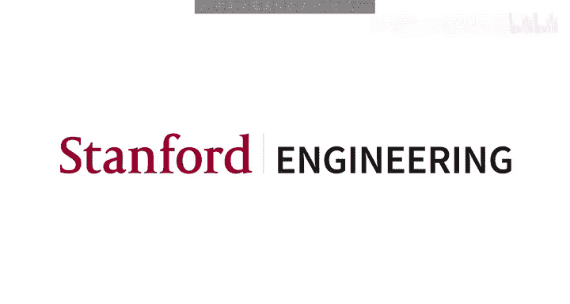
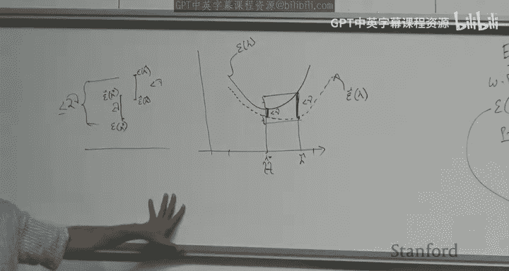

# 斯坦福大学《机器学习｜Stanford CS229 Machine Learning Course  Summer 2019 (Anand Avati)》 - P13：-13-.Lecture 13-Statistical Learning Uniform Convergence.zh_en - GPT中英字幕课程资源 - BV1NDopY4ECg

So today the the plan is to cover bias variant straight off and the role played by regularization and the role played by。

The hypothesis class in biovari straight off， so。In last class。

 we spoke about the concepts of bias and variance。And we probably briefly mentioned that there is a trade off between the do some kind of a trade off。

 And today， we will see。2。Two kind of more concrete ways of how this trade off comes into picture in practice。

And the second part， the role played by the hypothesis class is actually you know。

 if you are interested in machine learning research。

 it forms a good entry point into statistical learning theory。😊。

However the kind of the big picture that we want to take away at the end of the class is probably extremely important if you want to be a machine learning practitioner so in order to build a good predictive models it's very important that you understand the role of bias and variance and how you have you handle the two the two evils so to speak both bias and variants are bad and how do you balance between the two that's at the heart of successfully building good machine learning models in practice so even though some of it is theoretical there are very good takeaway messages even if you want to just apply machine learning in practice。

😊，Before we go into today's topics a quick recap of what we covered in the last lecture or at least the parts that we covered in last lecture that are relevant for today so we saw the concept of bias and variance in classical statistics classical statistics we are interested in constructing an estimator for our parameter theta。

😊，And that the estimator that we construct we call it theta hat n where n is the number of examples that were used in your know training set。

 so to speak。😊，And。What we saw was theta hat n is a random variable because it depends on the noise in the data that was sampled from from which the model was fit。

And it has because it is a random variable， it has an associated probability distribution and that distribution is called the sampling distribution。

😊，And the bias and variance are directly related to the sampling distribution of this estimator of the hat n。

 So the centered mean of。Of of the sampling distribution or the center first moment is called the bias。

And the the variance or the covariance of the estimator is called the variance。

And supposing in the parameter space theta star， which is indicated this by this black square was the true parameter from which data is been being generated in the world and we collect a sample of size n。

 a random sample of size n。And we run it through our estimator and we get an estimate a point estimate for theta and supposing we plot it and we repeat that over and over where we are reampling data from the true data generating distributions though in practice that is hard but as a mental model imagine you are gathering a new set of data you collect new data and。

You run it through your estimator， you get another point estimate， you plot it。

 and you will see that。They end up being samples from the sampling distribution。

And this the sampling distribution will be centered around some point here calling it indicating it by a triangle。

And。This is the mean of the sampling distribution and this gap。

Is called the bias of the estimator right And the variance of the estimator is how wide the sampling distribution how whats the variance in the sampling distribution。

 That's the the variance of the sampling of the。Estimator。

There are very is a concept closely related concept of bias and variance in prediction problems in machine learning。

😊，Over here we are interested in prediction whereas over here we are interested in statistical inference over the parameters here we are interested in making predictions on unseen data。

😊，I know here。Similarly， lets this is the the x and this is y， and we get samples X Y from from。

From the data generating distribution now supposing the true relation between x y。

 which we define as y expectation of y given x is this dotted line。So this doted line over here is。Y。

It。Expectation of y given x。And。Because of this definition， we get y equals f of x plus epsilon。

Where epsilon is some zero mean noise。😊，And here what we see is。😊，Though this is the true function。

 we take some training data of size n and construct an estimator we call it f hat n。

And using F hat n， we make a prediction on a new test example x star。😊，And the prediction。😊。

Maybe anywhere on this line in gem in principle it could be anywhere so the value of f hat n of x star could be anywhere and what we see is if we just like before repeat this sampling process where we collect a new set of n examples。

 construct a new model using the new set and make a prediction on the same x star using the new estimator it is going to be a different prediction。

And the set of all those predictions is going to follow some distribution。So。

 the distribution that is having a thick line is something similar to this distribution。

 except it indeedin。😊，In the prediction setting。And again， this distribution has a mean。😊，Which。

 you know， just like before， I'm using a triangle to indicate the。Indicate the mean of the F hat n。

And this this this triangle can in general not be equal to the the point at which the true function makes its prediction right and this difference。

It's called。The bias of。F fact n。Just the way this difference was the bias of the theta hat estimator。

 this difference between the square and the triangle is the bias of。The bias of f hat n。

 it is the gap between f hat n at x star and f at x star， F hat n at x star and f at x star。

And similarly， the variance is just the variance of this distribution。

 The variance of F hat n is just the variance of F hat n。However。

The the bias variance decomposition of the squared error loss has a third component。

 which is which we call as irreducible error。So。The dotted distribution that is indicated here is the distribution of y given x。

 so this is y given x and it is from this distribution that we make the observations y。So。

 if we were to sample an example from the data generating process at x equals x star。

 then the corresponding y will come from this distribution。😊。

And the expected error that we would make。😊，Using F Ha1 on a new example， Y star x star can be。

Was written as。So。Means squared error of F hat n。Is equal to the expectation of y star。

Minus F hat and。X star？So we use some training set。Constructed our model。

 made a prediction on X star， and it was a sample from the thick client distribution。

and it is a random sample because there is noise in the training set that we used if we use the same training set then we always make the same prediction obviously so suppose the the predicted F hat n was lets say over here。

😊，Similarly， the true label also has some noise in it。😊。

Because it is sample from the data generating distribution and lets say the observed y star was here。

 so this is y star。And now this gap。Is what we are trying to decompose？

From y star to F hat n of x star。And this can now be broken down again into three parts。

First we well we have spoken so this can be broken down into three parts。

 One part is the gap from the black square that is like the true function till y star。

That we call as irreducible error there is just no way we can fight that no matter how well we construct our f hat n in the observation that we are going to make there is going to be noise there is nothing we can do about it so the expected square error between y star and and our prediction f hat n x star。

😊，Can be broken down into three parts， one is the irreducible error。

 the second is the bias and the third is the variance。So。

 the irreducible error is noise in the test data it is not noise in the training data irreducible error component it is noise in the test data because when we deploy the model there is going to be noise in the data that we are going to encounter。

😊，The bias and variances are properties of the training data and the model class。Right。

If the data is noisy and we don't have a lot of data， then this variance。

 the variance of the thick line distribution is going to be。Large it is going to be more spread out。

 however， if we collect a lot of data then it this the thick line distribution the the the distribution of a pattern would be more concentrated。

But still even even if it is concentrated， there could still be a bias that is the mean of our our f hatn and the true value of f。

Can still， there could still be a bias。 And there's a variance because of， you know。

 the the remaining is is the variance。 think of it as the variance where the variance is due to the noise in the training data。

So， there are three parts irreducible error due to noise in the test data。

Vararis due to noise in the training data and bias。 there are three parts。

And we also covered regularization。😊，Before we go into regularization so weve just discussed the three components we still havent spoken of any trade offs between them。

 but this is the mental model to have you know in your mind to decompose the test error into three parts。

😊，Part due to noise in the test data that is irreducible error part due to noise in the training data that is variance and bias。

Now we also spoke about regularization and we will see why regularization plays a role in shortly soon。

 so regularization is a way in which we want to penalize our estimated parameters from having very large values we want the estimated theta values to have small values and the reason is that the intuition there is that if you have large values in your theta vector then your predicted hypothesis can be very squiggly it can make very sharp turns and it can sway a lot。

😊，And the intusition there is we want to you know therefore penalize large values of of theta and therefore we add an extra term to our cost function So if J of theta which previously used to be。

X theta minus。Why not？You know， this is standard linear regression cost function。

 and we will add an extra lambda times。Take到哪。You' are going to add this extra regularization term。

Into our cost function with the hope that when we minimize the cost not only are we trying to fit the data well but we are also trying to you know to some extent make sure that our theta values are not too large and the balance between the two is decided by what is the you know regularization coefficient we are going to use to weight this the regularization term。

And we also saw that。The motivation that we we went through just now it sounds a little arbitrary sounds a little hacky but in fact there is a more principled interpretation to this from a Bayesian point of view so remember in Bayesian statistics we construct a posterior distribution over our parameters given the data。

😊，And what instead of holding on to the full posterior distribution to make to construct posterior predictive distribution。

Instead， what we could do is just calculate the mode of the posterior distribution and use that mode of the posterior distribution as the output of our estimator and hold on to just that single point estimate which we call as theta MA that is maximum aor a posterior estimate as our output of the estimator。

So， the we saw how theta height MA can be written as the arg max of the product of these two terms so one is the likelihood term in case of linear regression the likelihood term will turn out to be exactly equal to this or rather it is going to be some scalar times this but effectively this corresponds to the likelihood term and then there is going to be a regularizer term。

😊，Due to the prior we assign on the parameters and if the prior happens to be a Gaussian prior。

Then this prior will will take on the form of a square error on theta。

so that's another thing you want to keep in your mind in general and whenever you assign something to have a Gaussian distribution or a Gaussian prior。

 it is going to show up as a square error somehow because you know in the exponent of the Gaussian there is you know a square on the a square term and when you take the log likelihood the exponent and the square cancel out and you are just going to end up with the log in the exponent cancel out and you are just going to end up with the square term in the exponent so when we have a Gaussian prior this corresponds to。

corresponds to the regularizer term and the variance that we assign to the prior distribution of the Gaussian。

I directly related to lambda right the stronger our prior is than the larger lambda is and in your homework you know you work out what is the exact relation between lambda and the variance but that that is the idea in general so it means if this is the x axis is are the parameters and this is0 that is the origin and we have a prior distribution over that is centered around the origin and we have a likelihood function。

That is maximized at the maximum likelihood estimate。 So this is theta hat ML， this is 0。

And we are now trying to maximize the product of these two so the product of these two is this dotted function and the way you want to think of it is since we are multiplying two functions。

Any region where either of the two functions is close to 0 the product will be close to0 right so it is going to take it is going to be non0 in regions where both the prior and the likelihood are non0。

And so assuming this is the product of these two functions the。

The theta hat MA is the value that maximizes this the product of these two。So。

 this is like the posterior distribution it might not be normalized。

 you need to divide it by P of S in this case to normalize it。

 but you know this is think of this as the unnormalized posterior distribution。

And the value where the unnormalized posterior gets maximized is the same value at where the normalized posterior gets maximized and this is theta hat MA and therefore what we see is the posterior is going to because it is the product of these two the posterior is going to kind of lie between the likelihood and the prior。

😊，Because of the product of the two functions and therefore the value that maximizes MA is going to be closer to 0 than the MLE。

😊，And therefore， the estimated theta values will be smaller in value because they are closer to 0。😊。

So this this was this was one way to kind of think of regularization using the Bayesian framework。😊。

And in fact， in your homework you also have another question where instead of assuming P theta to be to be a Gaussian。

 what happens if its a Laplace distribution right and over there you know the intuition to have there is again。

Assume this is theta 1。Theta D， the prior of a multivariate or the product of independent laplace is going to look like this。

It's a star you know， it's kind of like a star shape function， whereas in a Gaussian。

 it's going to be circles。And if if this is theta hat。ML E。

 So if this is the maximum likelihood estimate and let's say these are like the。

Contour plots of the likelihood。Now， the product of and this is the contour plot of the prior。

You can see that the product of this function and the product of this function will achieve a value or high values generally along the axis。

And therefore the value where MA is maximized will lie along the axes exactly along the axes and in high dimensional spaces it turns out that this results in sparse parameters。

 which means most of the axis most of the theta i values will be exactly zero because it is going to be along the axis because get in order to to the way the way the prior is is structured is that if you want to reach out as far as possible and still have a high prior value then you need to go along the a to kind of have to have high high prior probability but still stretch out as far as possible to the theta hat you need to do that along along the axes therefore therefore applying a plus prior will result in sparse。

😊，Spase parameters， and that's called the Laso estimator and you explored this in your homework as well。

Any other questions before we move on to today's topic， yes question？Defin of advisory。Prodction。

 you bind into a problem card when you might be able to impose straight off。

By like because they are parts of probability， how do these two definitions relate to each other？

してくれ。Yeah， so the question is how， how do the， the definitions of。

 of the the statistical in the bias invariance and the statistical inference relate to bias invariance in in the prediction setting。

The short answer is that the F theta F theta hat of n is generally composed of。You know。

 theta Ha end。So theta hat n is kind of embedded in this F hat n and therefore you know the bias in various in simple cases they directly transfer you know which will will go over today but in general the bias in F hat n is assuming you are using some kind of a parametric model and not non parametric。

 assuming you are using some kind of parametric model then the bias in F hat n is。😊。

Related to the bias of theta hat n， which is the parameter of f。

isA non GLM model than these they are related in general no matter what the parametric family is。

 but it is very hard to come up with an analytical relation between the two but in general there the noise in F hat n in the prediction is due to the noise in the corresponding theta。

😊，Yes question。かで大臣。あれく願いす。呃听到吗？せた。えと。Plus， lambda。So the question is。

 how does this translate into this？There done。学こした。

Yeah so I mean so this is exactly what you are showing in your homework you need to show in your homework the question is how does the prior result in this and when when you are taking the arc max of this you know if you instead of the product of P of theta you take the Rmax of the log of these two that separates and you know two additional terms and this will have a Gaussian distribution you know assuming if it's Gaussian then the log and the exponent of a Gaussian cancel and the squared and the prior will end up being this it is pretty straightforward max。

😊，見せなりある。I are not。这个。That is not how there is。Yeah， so if if the prior is not theusian。

 this will not be squared error， it could be a different so if it is if you apply a la plus prior then you will have。

Just the theta norm or the one norm。In of the two n。

So the squared error happens only when you apply Gaussian prior。Allright。

 so moving on to today's topics。So， today， we're gonna。Today， we're going to see how。Bs and variance。

 There is a trade off between the two using two kind of。Case study。 So in one case study。

 we are going to see the role played by regularization to affect or how it affects bias and and variance。

 and we are going to use the the the case of。L2 regularized。Okay。Linear regression。

So I posted some notes over the weekend that give a detailed derivation of all the steps that we are going to do today。

 we will just go to the results and discuss the intuitions about the results but you the step by step derivations are there in the notes。

😊，So in case of， in case of。L2 regular linear regression。First。

 we will talk about the bias and variance in theta in the theta hack itself。

 So remember L2 realized linear regression has the cost function。I equals1 to n。Y， I minus。

Theta transpose。X I squared。喂。Plus。Lambda times。Tル square。And。If you， if you。

If you work out the maximum if you work out what the optimal value of theta is for this case there is a closed form solution and the close form solution will turn out to be this theta hat n。

😊，Equal to。X transpose x。Plus。Lambda eye。Inverse。X transpose y。And this is very you know。

 similar to the normal normal equations that we derived except there was no external lambda item term in that case。

 So if you remember the。😊，TheThe normal equation had given us theta hat equals x transpose x inverse。

X transpose y。And back then， we had。When it spoken or at least briefly mentioned that it is。

 you know， sometimes it is possible that x transposs may not be invertible。😊，Right， and。

In the case of L to regularized linear regression。What we see is you know we are adding this diagonal matrix with lambda as the diagonal values to x transpose x。

😊，And what does this give us， So supposing。X transpose x has an i and decomposition。Where it is you。

Sigma 1 square until。Sigma D squared。You transpose。

 So suppose this is the eigen decomposition of x transpose x。By adding a lambda parameter。

To a lambda i to this matrix you are essentially just adding lambda to all the eigenvalues right if you remember adding a diagonal matrix to adding a diagonal matrix to some some matrix just increases the eigenvalues by that diagonal value。

And this is x transpose x plus lambda I。And now if we invert this matrix。

Then we are just inverting the corresponding eigenvalues。Yes question。两个书的。Yeah， that's you know。

So I will not go into the details of that that is a standard linear algebra result where if you add a diagonal matrix to another symmetric matrix then you are just increasing the eigenvalues by you know the amount by which the diagonals are scale that is a standard linear algebra result and it is very easy to show it if you know you can post on piazza I can reply with the steps but you know that you know just take it as given for now。

Yes， question。 you a new transfer not word。So。X transpose so u here are assumed to be you know invertible where u has the property u u transpose equals u transpose u equals I so u transposees the inverse of u so thats again that is eig decomposition。

Right。So now we see that because we are adding a non0ro value to all the eigenvalues。

 all the the inverse will exist because you know we are not doing a 1 over 0 anymore in the original ex transpo some of the sigma i squared could have been0 but now that weve added a small lambda value this matrix is always invertible and you always get a unique inverse。

And now。Theta hat n is now therefore this。Theta has n is so x transverse x plus lambda I inverse is now this matrix。

And we can now see that the expectation of theta hat n。

I is equal to again Im not going to go over all the steps。

 but I will directly write out the last equation that we get。Is equal to。Sigma，1 squared over。

Sigma 1 square。Plus， lambda。Sigma D squared or sigma D。Square plus lambda， rest all zeros。Times。

You transpose off。Pa a star。喂。So the question is is lambda take on only positive values necessarily yes。

 so lambda in case of regularization is always greater than 0。Good question。So。

 so the expectation of the theta hat n where theta hat n is the solution of the L2 regularized regression linear regression is this matrix。

😊，So this whole thing is a matrix。Times of vector。Right。So we can make a few observations here now。

 supposing lambda was 0。 this whole matrix。Ruces to the identity matrix。

Because each of the diagonals become one along the diagonals U and U transpose have this property that U U transposes the identity。

 So this whole matrix reduces to。A large identity matrix， if lambda is 0。Yes question。

How we get this expression。 So it is pretty， pretty straightforward。 It's in page four of the notes。

 The way you go about doing this is。So theta hat n。Is equal to。未来てた。Over here。

 we write this as x transpose x plus lambda I。Inverse。X transpose。 And then in place of y。

We write x theta star plus epsilon。Because y is x thickta star plus epsilon as the assumption and then you expand this and you will get two terms。

And because of the epsilon， the second term just becomes0。

 the expectation of epsilon times a scalar is 0 and the first first expression you apply e decomposition。

 you get this。Like the detailed steps are there on the north。

But the idea here is that the mean of theta theta hat n。😊，Is this matrix times theta star？So。

 if lambda is0， the standard linear regression then。

Expected value of theta hats n is equal to theta star。 So the linear regression。

 the standard linear regression estimator is unbiased。However。If we add a regularization term。

Then we are multiplying the the true theta star by a matrix whose eigenvalues。

 all the eigenvalues are less than 1。And if you remember the eigenvalues decide how much the input space of that matrix shrinks or expands in the output space。

😊，So， if you feed some any vector into a matrix。Whose entire spectrum。

 whose set of all eigenvalues are small then in the output space is essentially shrunk。😊，Right。

 and so what we see is that。The when we have lambda greater than 0。

 the norm of theta of the norm of this entire expression is going to be smaller than the norm of theta star itself。

which is how you see the shrinkage effect coming to picture you are multiplying the true value the true parameter by a matrix whose entire set of eigenvalues is less than one and so the result。

Of multiplying the the vector is going to be a strongunk version of that vector。Right。

So thats how we get you know thats how we see that。

Linear the regularization term adds a bias when theta is non0 then when lambda is nonze。

 then the expectation is never exactly equal to theta star。😊，So that's bias。 What about the variance。

For a reference， I'll just continue it down here so that we can just compare it with whats above。So。

So， the covariance matrix of。Data h n。Again， you know。

 using a very similar argument if if we expand it out。

 we are going to get that the covariance matrix of theta hat n will be u。Times。Towall Square。

 Sigma Square over。Square plus。Laandda Square。D squared。Times。Tranpose where。Tao。His so。

So if ta tau square is the variance of the noise in in。In our x and y， such that y equals。

Theta star transpose x plus epsilon。 So if Tu square is the is the variance of the error of the error terms。

 then the covariance of the。Theta hat n。 That's the covariance of our regularized estimate。

Is this matrix。Now， this matrix。You can observe is。Sysymmetric。Because of。

Its symmetric and it will be positive def because all the all the eigenvalues are greater than 0。

 so it is a valid covariance matrix right just sanitity check。😊。

And what we also see is that as we increase the the lambda value to to a larger value。

 then the covariance matrix is going to have a smaller spectrum。😊。

The set of all liigenvalues of the covariance matrix also reduces。😊，As we increase lambda。And。

 because these are the。Each of these terms is just the directly related to the the。

A are exactly the eigenvalues。 So if you have a larger lambda then the eigenvalues of the covariance matrix are also reducing。

 which means the intuition to have there is that your covariance or the variance in your estimator is also reducing。

😊，So if you remember， if you have。A Gaussian distribution that has some mean and some covariance。

The covariance design。The covariance implicitly defines an ellipse around the mean and the smaller the covariance。

 the shorter。The tighter the ellip side will be。And that is the intuition heavier。

 the larger the smaller the eigenvalues you have， the tighter， the ellipoid is around the mean。So。

Here is one so here what we see is as we increase lambda。😊，The bias。In our estimate increases。

 which is bad。 but the variances in our estimate are reduce， which is good。😊，So we want our variance。

 our estimator to have low variance， but we also want it to have low bias。😊。

But what we see here is as we increase lambda the bias。😊，Increases。Which is bad。

 but variance decreases， which is good。 Similarlyly， if you reduce lambda， the bias decreases。

 which is good， but variance increases， which is bad。😊，Yeah。So this， this， this is one example of。

 you know what what is called the bias gradient trade off。Where some action that we take。

Will improve one of them， either bias or variant， but at the same time， it can hurt the other one。

Next question。Or by the bias。So， the bias will increase when we increase lambda。😊。

Because we are now multiplying the true value of theta star through a matrix that shrinks it and it is getting farther and farther away from the true value so you know that that is bad we are going farther away from the true value itself in expectation。

At the same time。There is also， you know， a variance storm involved。

which is our sensitivity to data the larger lambda the value of lambda we have then the less sensitive we become to the noise in the training data。

😊，And and that' is good。 So therefore lambda is is you know youre kind of by choosing the value of lambda you are doing a trade off between bias and variance。

😊，RightAnd these two terms directly translate into prediction as well。 So this was about， you know。

 about the hat itself。 Now， if you want to do prediction。So when I do prediction， let's remember。

Next， we call the。The bias various decomposition。So means squared error of F hat n。I saw was。啊。

To square。Plus。Next hour。マイナス。Next star。whole square。Variance of。

So this is the standard bias variance decomposition， which we saw last last time as well。

 This is called the。Irreducible error。Like， this is。By a square。This is variance。

And this is again in page seven of your notes the detailed steps of deriving this。

 but lets just look at look at the result and try to get sometu so this is our bias。😊。

And what we see is。If if we define f to be now theta f of x to be theta star transpose x。

 which is the true value of theta， then the bias will relate the bias of the predictor will now relate to bias of the estimator。

In this way， so。Bias of。Have had and。OfX star。Equal to。Expectation of。Yeah fact。😔，X star minus。F。

X star。 So that's just。This end is equal to the expectation of。Theta hat and。Transpose x star minus。

Take a star transpose。X star。This is equal to expectation of theta hat n minus。The star。Transpose。

St this equal 2。Bs of theta hat n。And suppose。X star， so the bias in the predictor。

Is related to the bias in the estimator。With this relation it you just take the transpose of the bias in the estimator with the point at predict with the prediction point。

 prediction input， and that gives you the bias in the predictor Yes question。か是。

Use those to form a closed form solution of Lar in terms of sigma and ta。So the question is， can we。

 can we come up with a close form expression for。Lambda， in terms of。Sigma and tau。

And minimize what want。Een not used to be as big as possible。So that interest。

The covariance matrix to beized。So you write some sort of play good issue。The minimizeise。

You you minimize your variance and you maximize your itemenvalue And so I guess if I understand you correctly。

 you are trying to you are trying to say， is there an optimal way to find out kind of the best value of lambda or the optimal value of lambda。

To simultaneously minimize that and maximize that well come to that shortly。

 So we are going to answer the question of how to choose Lada。

The close form expression has some challenges with the method that you suggest。

 but let's come to that shortly。So so this is the。So。

 this is the relation between the bias and the predictor and the bias in the estimator。

 whereas the relation is defined by the point at which you are making a prediction。

And this kind of a closed form relation is possible only for simple models such as linear regression with L regularization for more complex models。

 if F hat n is a neural network， then it is very hard to come up with a simple relation between the bias of the predictors of the neural networks of the parameters of the neural networks and the prediction that it makes right but for simple modelss here we we can see the relation between the two。

😊，Similarly， the variance of。F hat n。Its equal to。Ex transpose。Covariance of theta heart and。Ex。

 it's a quadratic form that uses the covariance matrix of theta hat n along with x as the input to get the variance of。

Right，So， and， and， and similarly， the， the。And therefore。

 because there is you know a straightforward relation between the bias。😊。

From the estimator to the predictor and the variance from the estimator to the predictor。

The effect of lambda is also the same。 So if we increase lambda。To a large value。

 the variance of the estimator comes down and the variance of the predictor comes down。

And if we in reduce lambda， then the。B of the estimator comes down and the bias of the predictor also comes down because it's a very simple relation between the two。

那。Any questions on this？So in general， what we care about is we want to。Minimize the。

Squared and on future predictions， right， in machine learning， that's our goal。

 right What we want to do is。Is have。Have an estimator or a predictor that has very good low generalization error。

 So generalization error is how well we perform on unseen examples。😊，And for that。😊。

What we see is in order to minimize the generalization error。

We have three different components that we can go after right all of them are non0 so reducing any one of them will reduce the overall generalization error。

😊，And these three components as we saw before is the irreducible error bias the square of the bias and variance that add up to form the mean squared error。

😊，Now to reduce any one of these lets lets see what what what happens So irreducible error is something we we can we cannot do anything about right that' is just a fact of life。

 we have to live with the irreducible error no matter what kind of a predictor that you come up with you can never do better than irreducible error。

😊，So that's like the best we can hope for。And then we have these extra two terms bias and variance。

 so if we want to reduce generalization error， then we need to reduce either bias or variance or both。

Unfortunately。😊，What we saw was some steps such as regularization。Will。

If we tune the regularization to reduce the bias， it increases the variance。

 If we tune it to reduce the variance， it increases the bias。😊，RightSo that's that's like。

That's the fundamental trade off that we need to work with to to find some kind of an optimal。

Optimal minimizer of the sum of these two terms And there was a question that was asked。

 Why not try to analytically minimize this and to， to analytically minimize this。

 we need to be able to compute f of x star。Without being able to compute f of x star。

 we cannot find the right balance to minimize the sum of the two。And therefore。

 what we are left with is to use cross validation。😊，So， what we do is take a validation set。

 we discuss cross validation in the last lecture。😊，Have a validation set。

And keep that away when you are fitting your model。

Once you fit your model with some specific value of lambda。See how well the fitted model。

 which is regularized， performs on the cross validation side。😊，Right， and then。

When you measure it on the cross validation set， you are measuring the overall means qua are we are not measuring the individual components when you measure this the error made by the model on the cross validation set。

 we are measuring the overall error。😊，And then we now start tuning the lambda parameter to different values。

 increase it little decrease it a little and with the tuned values measure the performance in the cross validation error again。

😊，And tune such that the overall mean squared error on the cross validation。😊。

You find some kind of a good minimum。By doing that process。

 you are automatically optimizing for the overall mean square error and implicitly finding a trade off between bias and variance。

😊，It is very hard to get an exact breakdown of what was the irreducible error component。

 what was the bias component， what was the variance component。

 but the theory suggests that by tuning lambda。😊，We going to have are going to have some kind of a trade off between bias and variance and there may be and there probably is some kind of an optimal lambda that finds a suitable trade off between the two and the way we do about way we go about doing that in practice is using a cross validation set。

Where we are directly trying to minimize the。The overall means square error without actually finding out what the exact broken down components was。

😊，The other。I guess the， the larger takeaway from this is that。Even beyond regularization。

In machine learning， as I said before， what we care about is reducing the mean squared error。Right。

And。If we want to reduce mean squared error。We want to take some action。

That either addresses bias or addresses variance。And in order to to。

 to make the judgment of whether we want to go after bias or go after variance。

 we need to get some kind of。Huristic estimate of what the current bias value is and what the current variance value is。

 But as I said， already， unfortunately， it's not possible to get， you know。

 a close form expression because。F of x star is unknown thats that that's at the heart of the problem。

 We don't know what f of x x star is。 If we knew it。

 we could exactly calculate bias component and variance component， but。

But but we don't have access to F。So instead， what we do is we fall back to heuristics。Right。

 so the heuristics is that。Right。So， this is。A heuristic that is extremely useful in practice。😊。

It is。If you change this approximately equal to to equal to， then it is very wrong。😊。

Because the training error is not your bias and the cross validation error minus training error is not the variance。

 but they are extremely useful heuristics。So。When we are trying to to build a model that gives us better。

Generalization error， as I said again， our goal is to minimize generalization error。

 Our goal is to not go after bias or variance by itself。

 but we do that in just in order to minimize the。Generalization error。

And in order to minimize the generalization error， we always want to get a rough sense of the breakdown between bias and variance components that are contributing to the generalization error。

😊，And rough heuristic again is to consider the training error as the bias and the gap between the cross validation error and the training error as the variance。

😊，Okay， so。When we want to。Improve our generalization error。

We first need to find out what's the breakdown？😡，And go after the the component that is larger。

We never want to take an arbitrary step such as you know get more data or add more regularization or reduce regularization there are there are a whole number of things you can do to improve generalization error but。

😊，It would be extremely wrong if you just tried them arbitrarily right that that' is probably the biggest takeaway from this lecture and probably the biggest takeaway from this course in machine learning we want to reduce generalization error and the way you go about reducing generalization error is to construct heuristic estimates of the components are and the heuristic estimates are the training error and the cross validation error。

😊，And only once we come up with these heuristic estimates。😊。

We make a conscious decision of whether in the next step we want to reduce bias or we want to reduce variance。

And the way you go about making that decision is to see which of these two is is like the larger view is your training error so large and the gap between your cross validation and training error is so small that you know better go after your bias first。

 which means，😊，To improve bias。To improve bias or maybe to fight bias is probably the better term。

To fight bias， we do things like。Mick。Model， larger。So if it's a neural network。

 then add more layers or add more neurons in each layer。Redduce。Regularization。No， et cetera。

To fight variants。We do things like。Increase regularization。Or collect more data。喂。And。

And the way you go about improving I'm repeating this again because this is you know this is probably at the heart of this entire lecture。

😊，Our goal is to minimize mean squared error and to minimize mean squared error in theory。

 there are so many possible actions that you can take。😊。

But before you go about taking any action you want to come up with some kind of a heuristic estimate of what the breakdown is。

 what is the amount of you know estimate of the bias in our in our generalization and what is the estimate of variance and once you get this breakdown we then make a conscious decision of whether we want to fight bias or we want to fight variants in the next step。

😊，And in order to fight that particular of the two evil， we choose one of the actions。

That help us fight that component。Next question。Consider reducing the flexibility to fight。

the modelYeah yeah， absolutely。 So the question is。

 do we not consider reducing the flexibility of the model to fight variances， absolutely in know。

 a simpler model。😊，So this this is not an exhaustive live。 these are just some examples， you know。

 simple model， absolutely。You know， a more complex model。Yes question。achieve those distribution。

You know that。Star is a function of theta star。Like a true underlying process was a function of。

And he does got。Expectation of our estimated thetas is a function of theta starting from that matrix。

And we can plot the different diagnoses。As a of many。

Here had kind of curve where we can take all the diagonal values in the first matrix and all the diagonal values in the second matrix。

you can find a huge sort of curve left。Keep changing lambda。

 the theoretical value of those diamonds will keep changing， right。

And if we take that bull shape curve and find the minimum of that curve。

 we'll be able to optimize those as well as this simultaneously theoretical perspective。

 we do not need to go after Cta start。So the question is I guessre what youre suggesting is a few ways in which using this analysis we can you try to come up with optimal values of lambda that minimizes like the sum of both the errors so the first problem with that is such an analysis is possible only for simple models if you want to increase for example。

 if you want to reduce the bias of your model， you may want to switch from linear regression to say a neural network or a Gaussian process right。

Once you do that， this analysis breaks down at that point。

And and this exercise of seeing the breakdown is useful to get like an intuition a mathematical intuition of what is happening underneath。

 but in order to take some real world action you want to follow recipes like this right if you want to if you if you see that your model is not fitting your your examples your data well to fight bias you could say add more features right。

😊，And once you do that， your entire covariance matrix is no more ofus because it is now a larger covariance matrix with an extra dimension。

 so it the actions that you take are are they are kind of beyond that simple analysis。😊，の詳して。

Re question we a started。Is our decision going to be。Let's support that know what。

Our decisions won't be influenced by that。So， the question is you know are our decisions influenced by theta star so theta star is unknown because if it was known then we wouldn't even go through this exercise of taking data and fitting models right。

😊，It is because it is unknown that we， we come up with。This kind of an analysis to see you know how。

 how how bias and variances can can impact us。All right。

 any questions on this before we move on to the next part？Uniform convergence。All right。

 so let's one。So what follows next in this lecture is going to be a quick high level。

Introduction or overview of。Statistical learning theory or or like the general kind of flavor of how statistical learning theory is。

What are like the common。What's the common framework of analysis and and you know what are the kind of things we。

We can do with statistical learning theory。This would be especially interesting to to those who have an interest to move into machine learning research。

 but also the results that we see。😊，We will kind of strengthen our intuitions about bias andvari。

So for statistical learning theory so。let's。So， we make a。So。

 a common assumption that that is kind of widely made in statistical learning theory or in most theory is that our training and test data。

😊，They come from the same distribution。If this assumption is not there。

 it's very hard to say anything at all in general。 So the， the。

The underlying assumption that we are going to make is that our training and test data come from the same distribution。

And our examples are sample IID。So there is in each example a sample independently of any other example that we have and at test and train time we are working with data that is coming from the same distribution。

😊，And now with these， we define the following terms so。The risk of an estimator。

So let's call this distribution as D。Risk of an estimator。Its defined as。

It's called risk of a hypothesis。So the risk of the hypothesis is defined as the。Expectation。

X comma y。S倍。From this distribution。Of loss。Of y and H of x。Right， so。H over here。😡。

Is our hypothesis it is a function that takes us input some x and produces y as an output so the risk associated with this function right so this is also called as a risk functional because it takes as input a function and returns as output a real value so。

The risk of a hypothesis。Is the expected loss。Made by。

That hypothesis under some kind of a loss function so this is you know generally accuracy of squared error or something along that SA where the data that we are using to feed as input to x and compare it to the y are sampled from the data distribution。

So this is the definition。Of the risk of the hypothesis。Now， suppose there is a related。turn儿。If S。

A some set of。X i。喂爱。Pairs s 1 to n。 So if S the sum training set。Then， we defined the。

Empirical risk。As。Epsilon hat of H。Does it꼴 do。1 over size of the data set。Times， some over。X。

 Y in S。Off。Lastス。喂干嘛。Hx it is very similar to the risk。

Definition except instead of taking a full expectation over the entire data generating distribution we just limit ourselves to taking an average over the training set that we that we have right and this is called empirical risk。

😊，Now。What we want to do ideally or you know。The best we could hope for。

Is to find some kind of a hypothesis that minimizes the risk。

 That's we what that's what we want to do。 That's our that's our desire to to find an H that minimizes。

The true expected risk。But what we actually do in practice？Is to find。

A hypothesis that minimizes the empirical risk because we have some some training data we construct a loss function over it and we minimize the empirical risk instead and that is what you know we have seen this so many times you have done it in your homework linear regression you know we use a design matrix we take the labels and use the normal equations to minimize the empirical risk。

So the questions the question that that comes into mind is what is the relation between you know。For。

Given。8。What。Is the。Relation。Between。Epsilon heart of H。An epsilon of H。Right， how does the。

Training error relate to the generalization error for any given hypothesis。 Like， you know。

 that's an interesting question。 And the other question is。How does。Our。Generalization error。Compare。

To the。Best possible generalization error。Right， so。

Our training error is something that we can measure。😊。

The generalization mirror is something that we cannot measure but you are going to use some theory to make statements about or give you bounds on how well our general what our generalization error will be given that our training error is some value。

😊，Right。Similarly， what I guess you know what is important at the end of the day is how well is our generalization performance compared to the best possible generalization performance that you can get。

😊，And here we are comparing two know two things both of which we cannot measure right we have no idea how well our generalization error is。

😊，And we have no idea what the best possible generalization error is either but we still want to make some kind of probabilistic statements or give us bounds on the gap between the two right if we know that our the generalization error of our model is within some small range of the best possible generalization error then you know we are happy right we may not be happy with you know happy with the result itself but we know that we are we are pretty close to what's theoretically possible。

😊，So in order to kind of get a better understanding of each of these two。

Let's define some terminology。So on the x axis。We have the set of all possible hypotheses。

What I mean by a set of all possible hypotheses。I literally means set of all possible hypotheses like the set of all possible neural networks。

 the set of all possible SVMs set of all possible Gaussian processes set of all possible models that are not yet invented today you know every possible hypotheses you know comes on the x axis and。

Youre going to linearize it to make the visualization simple。

 but you know imagine you have all possible hypotheses on the x axis。😊，And on the Y axis。

 you're going to have risk。Now。Was that a question？要吗。There was么。Right。Yeah， so yeah。

 so what I mean by hypothey is a set of all possible predictive models you can you can think of。

 you know， random forest， neural networks， everything， you know， comes comes on this axis。Now。

 on the Y axis， we have risk。And supposing we， we indeed had access to the true data generating distribution。

 right hypothetically， we had access to。The true data generating distribution。

 And we could take an infinite number of samples， right。We could take the entire and finite set of。

Samples from the distribution。Take one of these hypothesisses， and measure。

The empirical measure the the expected loss of that hypothesis。

At the against all the entire infinite set of examples。 and that was give us a point。

So this is the hypothesis that we feed in over here。And this is the value of evaluates to the risk。

Right and similarly， we can， we can repeat that for every possible hypothesis you know。

 across all the models。 and that's going to give us some kind of。Some kind of a risk function。

I'm very glad we stayed with talking。So this is not empirical risk we are talking about the true risk。

You know， assume you get the entire infinite sample and you you evaluate the the loss and you know let us assume this is the kind of loss you get you know this is a risk。

However， we don't have access to this。We wish we did have access to that。

 and then we could just minimize it if we had access to it， but we don't have access to it。

What we instead have is。A finite sample， S。And。From this S。

 we can construct the empirical risk and the empirical risk might look something like this。

It's going to be some kind of an approximation。And this。

Gap between the true risk and the empirical risk。Is intuitively you know you can think of this gap to be a function of your data size right as you get more and more data set as this n increases。

😊，Then the empirical risk and the true risk， they become tighter and tighter know the empirical risk gets closer to the true risk。

Now， this particular risk function is specific to one。Set one specific set of。

Training set that we have。 If we take another training set of the same size。

 that might give us a different。Risk function。So these you know think of these two as two examples of risk functions or loss functions that we get from two different training sets both of the training sets are sampled from the same data generating distribution and they have the same size right and if we keep repeating this again and again we are going to get more and more such you know dotted lines more and more such empirical risks that are spread about the the true risk with some variance and if you know you can imagine that if we。

If we increase the data set size， then the spread around the true risk will be much tighter。

We' will formalize that shortly now。The true risk。😮，The true risk， that is the thick line。😊。

Is minimized at some point。The gap between this minimal point and the x axis。This gap。

Is the irreducible error。No matter what model you get， you know。

 model invented you know 10 years from now， no matter what model you get。

 you can never do better than the reducable error because that's just because your data is noisy。

 Yes question。So， the question is how do we know that the irreducible error is can be reached by know some model by definition if you have use non parametric models and you have the model you know。

😊，H of x equals。Expectation of why， given。X equal 6。Now， a non parametric model。

 this function will give you this。Right， but you may not be able to approximate this well with。

know some function， but there exists a function that is going to minimize your true risk to the absolute minimum and that minimum is the irreducible error。

😊，Right。So this is with the assumption that we're using the squared loss。

 So the squared loss is minimized by the mean。 if you use like the absolute value。

 then instead of the expectation， take the median and so on。

 But but there there exists some some some function that is going minimize it。

So this is the irreducible error。Now， however， we are going to limit our analysis to a class of models。

😊，We are going to limit ourselves to just say the set of all neural networks。

 random forests and S Vms and logistic regression， right we are going to limit ourselves to。

A class of models。And this class of models that。This interval on the x axis， I'm going to call it。

Scrip capital H， right， which is。Class of models， class of hypotheses。brought this。咩。

And what we then see is this class of within this class of models， the best possible。

Risk that we can hope for。Is found here。So this is the point within the class of models that minimizes the risk the most。

 And here I am talking about the true risk， not the empirical risk。So let's call this h star。

Which a kid star。Is。Best in class。Hypois。So this is the best class hypothesis。And。

The difference between the two。This gap。It's called the approximation error。

It is called the approximation error because this is the penalty that we incur by limiting ourselves to a particular class of models。

😊，If we did not limit ourselves to this class， but we used a wider class。😊。

Then our Western class would have been the same as the you know irreducible error。

 but because we are approximating the hypothesis by some class of hypotheses then this is the extra you know this is the extra penalty that we are paying due to limiting ourselves that' is called the approximation error。

😊，However， that the the model that we say end up using。😊。

Is the one that we get by minimizing the empirical error。😊。

So it is the empirical risk that we minimize。😊，In order to come up with a model， right now if。

This dotted line。So let me erase the other dotted line to。So in practice。

 what we do is we take a training set and we get this。😊，As our loss function。

And we minimize this loss function， and the point。Where we minimize， we get a hypothesis。

 lets call it H hat。This is the estimated hypothesis。

So in case of linear regression this corresponds to the theta hat vector that we get。And now。

Because we we let me move this a little to the right so that it is easier to visualize。

So let's assume this is where we get H hat。Now， this is where the empirical risk was minimized。

And the corresponding。Generalization error is over here。And this gap。

Is called the excess risk or the estimation error or the excess risk。 You can call it both of them。

 Let's just call it excess risk。Right？There is one part that is the irreducible error we cannot do better than that no matter what。

😊，There is another part called the approximation error。

Which we it is the penalty that we paid by limiting ourselves to a class of hypotheses。

And there is yet another component called the excess risk。

It is also called the estimation error and this is the penalty that we pay。😊。

For having a limited data set， a finite data set rather than the full infinite number of data。

Because if we had the full infinite data， then our empirical risk would be exactly on the thick line and excess risk could reduce to 0 because we would just end know finding this as our empirical risk minimizer yes question。

😊，We are actually doing better than the。Just like。To access looks。Yeah。

 so we want we want to find points such that the risk is minimized， so going higher up is bad。

To thereducible area， we are actually doing better than。

So we are doing worse than the irreducible error because irreducible error is even lower。Yeah。

 but in that class， you can either have edge star or。

 edge is closer to a redducable letter than E star。So， so。

 so I wouldn't read too much into the ver into the horizontal distance between anything。

What we care about is the error incurred expected error incurred we want the error to be minimized so this this is you know the fact that have even drawn it linearly is a big simplification so don't read too much into the the horizontal ordering of things。

Right，So， so what we want now， ideally is to。Minimize this excess risk。

 or at least get a bound on excess risk。And the way we go about doing that is we are going to break it down into into two sub steps。

😊，So the way we are going to do it is first。So step one。没 the发。Convergence。Step 2。Excess risk bound。

Right so we are going to follow these two steps。Where the second step。Is， is。Of。

Is very is a pretty straightforward step and applies to all models。

 but the class of model that we use and the last function that we use is going to give us different techniques for doing step one。

😊，so roughly speaking， uniform convergence means。The intuition behind uniform convergence is that we want our risk function。

 the empirical risk function。😊，To converge to the true risk function。

In a uniform way and we want to make to come up with some kind of a probabilistic bound on how far apart the empirical risk function is from the true risk function。

So， if you are if you if you have taken some you know advanced mathematical classes before。

 you might be familiar with the concept of functions converging to other functions and that is exactly what is going to happen here so this is some function。

😊，the true risk is another function。😊，And now we are going to see how the empirical risk functions as we increase the number of data points we have will probabilistically converge to the true risk function uniformly across all points。

😊，Right， that's， that's the， the， the。That is the intuition to have that we want to minimize the gap uniformly across all hypotheses。

So， the uniform convergence statement。啊。The statement looks something like this。

 so with probabilitybabilities， so w P means with probability。

 so with probability greater than equal to1 minus delta。

So deelta generally you know you want to think of delta as like a small value。

 So if you want to give like a 99% probability statement then delta will be 001 if you want to give you know with probability 80% then delta will be 0。

2 so you think of delta as the gap between 1 and the level of probability that you want to give a statement so with probability1 minus delta。

For all H。In。H， so we are going to limit ourselves to a particular class of hypotheses。😊。

We are doing our analysis now in the context of a particular class of hypothesis。

The generalization error， epsilon of H minus epsilon hat of H。Is less than equal to some term gamma。

Well， this gamma。Is。😔，A term that involves。And。Delta and class of hypothesis。

So this is the standard template of all uniform convergence results。😊。

And the result is is is different for different classes of models， for different loss functions and。

😊，So， depending on the class of model that you have you will obtain you know a different you will obtain a term for gamma that uses these terms in some particular way if you are using say sVMs then this term is going to be different but in general the term over here is going to use this is going to be a term over n delta and the hypotheses and the statement says with probability1 minus delta you know you think of it as with high probability。

For all hypotheses， you know， for all hypothesis on the on the x axis， the gap between the。

The test error or the generalization error and the the gap between the true risk and the empirical risk for that hypothesis is less than gamma。

 So it is basically telling you it is telling you。If you give me。At traininging set size， n。

The degree of of conference you want in the statement and the class of hypothesis。

 then I will return you some margin。Think of gamma as a margin。Such that。With probabilitybil say 99%。

The gap between the true risk and the empirical risk。😊。

Is going to be less than gamma with probability 99%， which means for say99 with 99% probability。

For any given age。The gap between。The true risk and the empirical risk is less than gamma for all age。

Right， it's。Think， think about it， you know， carefully because it， it can be a little confusing。

 What we mean is for any given edge， Let's consider this edge。Right。For this age。

We have fixed the the number of examples， n。And we are going to repeat collecting n examples。

 fitting a model， evaluating the empiricallys。Repeat take a use set of n examples。

 fit the model by minimizing the empirical risk and plotting the error and that will give us points like this。

So， each experiment is going to。Give us a point like this。

And what it says is for any given hypothesis for all H。😊，The probability that。The the。

The point that we get。The empirical risk that we get。😊，And the true risk at that point。

 the gap between the tool， let us call it gamma。Gammma is going to be。The the the gap between。

The gap between the two， sorry， this is not gamma。 this， this will be less than gamma。So。

 there is going to be some upper and lower bound plus gamma and minus gamma。

 so this is a gap of2 gamma。So it says with probability greater than 1 minus delta。😊。

The empirical risk is going to be within you know gamma of the true risk。

And how do we go about actually calculating this this？

Particular value of gamma is going to depend on the kind of hypothesis that you are working with。😊。

Right， and。And we'll see a few examples of this shortly。Yes。

 n is the size of the sample and the intuition you want to have here is。The larger the n you have。

 the smaller gamma will be， which is good。And the smaller the delta you have。

 which means the tighter the bound you have the larger gamma will be so if you want a high probability bound then gamma will be bigger。

And the larger the n you have you know you are reducing the variance so to reduce gamma。

 you want to either increase n。😊，Or even increase delta。

 which means you want a lower probability bound。This question。

Is this like an assumption that we are making or is this a tournament can be？Yes。

 this is this is going to be a template for a theorem that you can derive different values of gamma for different model classes。

😊，才话这是你。All this going。It will be uniform and we are going to go more I'm just giving you a flavor of the way the statements will look and we will see a few more details shortly。

😊，So this， this uniform convergence results will always follow this flavor。😊，Where you are trying to。

Otain a probabilistic bound on the margin of how far apart the true risk and the empirical risk will be。

And that margin is going to depend on n delta and the hypothesis class itself。Next question？哦发错。

It need not be continuous over hypothesis space。So the question was， you know。

 is the risk functional continuous over the hypothesis space and you know the hypothesis space itself need not be continuous？

😊，Right。So in general yeah so all uniform convergence results are going to look like this where you want some kind of a gap between the empirical risk and the true risk for any hypothesis you know this any hypothesis is what you know is why we call it uniform convergence。

😊，And that gap is going to be less than some margin gamma。😊。

For a particular level of probabilistic confidence and this gamma will depend on n。

 the level of confidence and the hypothesis class。😊，Right and。

Assuming we have derived some gamma in this way。We can then plug it into the excess risk model。😊。

Excess risk bound。So I'm intentionally not giving an example of。A concrete example of this yet。

Let' us see how this plugs into the excess bound and then well see a more concrete example of this。😊。

So the excess bound results looks something like this。

With probability greater than equal to 1 minus delta。Epsilon of its star。Is less than or equal to。

Epsileppsilon of H hat is less than equal to epsilon of。It's star。Plus。都 get吗。

This this looks somewhat similar to this， but it it is pretty different。 So first of all here。😊。

In uniform convergence， we are talking about the same h， but。😊，The different risk functions。

 you know， we are talking about the gap between the the true risk and the empirical risk。

Whereas over here we are talking about the true risk itself。😊。

But it is the difference in the true risk between our estimated hypothesis H hat and the best possible hypothesis h star or the best in class hypothesis h star。

😊，And the only difference between the two is you know， from gamma， we went to2 gamma。😊，Why is that。

And this is， this is a pretty。Pretty cool result。 in our very kind of。Intuitive results。Yes。

 question。我 is是。あいうこと。Is that where you drop the line。たて。Yeah。

 so let me let me draw a quick picture about this。 So the question is why does the excess involve H hat。

 I guess that's what the question was anyway so。So if this is our region of interest。And let's say。

 this was。Is the true risk。And。Its the empirical risk。 So this is。Spsilon of H。This is。😔，Ha of H。

Right， so what we want here is， so this is。H star that minimizes。That minimizes the true risk。

 And this is。A chat。That minimizes the empirical risk。Okay， so now the x' risk is。This gap。

This gap is the excess risk。So the accessor risk。We want to get a。

We want to get a bound between two points on the thick line。

But whereas what uniform convergence gives us is a bound between the dotted line and the thick line for any given value of H。

😊，That' is what uniform con gave us it gave us a bound on the margin between the thick line and the dotted line for any given value of H。

😊，But instead， what we want is a bound on the gap between two points on the thick line itself。

How do we go from， go from this bound to this bound is， I guess。

 the question for this for this proof。 So the proof is pretty。Pretty nice and intuitive。

So epsilon of h hat， which is the generalization error of our learned hypothesis or the estimated hypothesis is less than or equal to。

Epsilon heart of。Each hat plus gamma。And this comes directly from the uniform convergence result。

 We apply the uniform convergence result at H hat， and it says that the true risk function。

Cannot be more than gamma away from the empirical risk at H hat。Any questions on this。

 the first step？Okay， right。So， this is。Uniform convergence at。A chat。

And then we are going to say this is less than or equal to。Epsilon hack of。It's star。Plus， gamma。

What changed from here to here？The empirical risk at H hat。

Is less than the empirical risk at eight star。What does that mean， this is the empirical risk。

Empriical risk at H hat is less than empirical risk at H8 star。

 and that is by definition because H hat minimize the empirical risk。😊。

So the risk at h star cannot be less than the empirical risk as h star cannot be less than the empirical risk at H hat because H hat by definition minimize the empirical risk。

Doesnt make sense？And now， so this is basically。By。Definition。off。Emirical risk minimization。

And this， in turn， is now going to be。And now we are going to make a statement that。The gap between。

Let me just write it down's enough。St。唔啱吗？Yeah。Now we are you are going again apply uniform convergence for the gap between。

The true risk and the empirical risk at 8 star。Uiform convertence tells us that the gap between these two these two risk functions is going to be less than gamma at any age with some probability。

RightSo it's going to be less than h over here and it's going to be less than H over here。Right， so。

This is uniform convergence。At。Each。😔，Start。So， the risk between h hat epsilon hat of h star and epsilon of h star is going to be less than gamma。

RightIt's epsilon。Here， know we are applying this at eight star。And this is basically equal to。

I's enough。Its star plus gamma。The sium，'m sorry。Right， we just。

The result that we got H hat is less than epsilon of8 star plus2 camera。So what happened here？

We had a tool called uniform convergence that gives us a gap between the dotted line and the thick line at any hypothesis H。

😊，And using that tool， we wanted to obtain。A gap abound between two points on the thick line itself。

Which in general is not possible。😡，But we are going to use the fact that we are doing empirical risk minimization。

😊，So we have one， one。Gap here and。So， this is less than gamma。

 this is less than gamma uniform convergence tells us this is less than gamma and this is less than gamma。

 uniform conversiongence two different points and empirical mis minimization tells us this point。

Is less than this point。So two you know so this this basically allows us to order this point to be less than two gamma times。

This point。Because this point cannot be a gamma more than here。

 this cannot be you know this cannot be less than here and this cannot be gamma less than。Here。

 so at most， the gamba between these two is two gamma。So to， to， to kind of。Dr it clearly。

So this is epsilon hat of H， this is epsilon of H， and this is attmost gamma。Hang。😔。

We have epsilon heart of。It's star。Which must be more than epsilon hat of H。啊。It hat。And this can be。

 at most。This is less than。Gammma， and this is epsilon of H star。RightSo this is less than gamma。

 This is less than gamma， and this has to be more。 So at most， these two can be。Less than two gamma。

Right， so once we are able to derive a uniform convergence bound for。😊，A particular hypothesis class。

We can just multiply by 2 and get an excess risk bound。

To tell us how well our model is going to perform in the real world relative to the best the best possible model that could have performed in the real world。

😊，喂。Now， with this template。Let's see。Any questions on this before we see a few examples of uniform convergence？

This is the general recipe know of you are going to use uniform convergence to derive the gamma term and that' is going to be different using different techniques for different kinds of models and different kinds of loss functions but once we get that uniform convergence bound of gamma for a given hypothesis class。

 you are going to then plug it you know using this technique to obtain an excess bound which is just two times gamma。

😊，Right， no questions。 Yes， question。But it's just a。What the statement is saying。

 the empirical risk for the so restricting yourself to a certain。

The one that H class is the one that you pick， which minimizes the empirical loss。そ。じゃ。

Temper loss in that one is less than the best。It's bounded by two dimas。So before you go further。

 this is not the empirical loss。RightSo Epsilon is not the empirical loss。

 Epsilon hack is the empirical loss。Epsilon is the generalized loss or the true risk。

So that this is the true risk in the exorsus bound we are talking about the true risk at the empirical disk minimizer and the true risk at the best in class hypothesis。

😊，So we have kind of both of these are in general not measurable because it is measuring the true risk at two different points。

😊，We calculate H hat using empirical disc minimization。

We have no idea what this value evaluates to here we have no idea what HR star is and we have no idea what that evaluates to。

 but we can still derive。An upper bound on this this on the gap between the two using this technique。

And in order to kind of actually you know completely this technique we need to get you know a uniform convergence which is abound on gamma at any point at any hypothesis yes question。

😊，呃代表。our eight star times。Because they break。一下。So the empirical risk at8 star should be less than empirical risk at H hat so it need not be so that is a good question。

 So the empirical risk at8 star and empirical risk at h H hat they may be flip they may be in any order what uniform conversiong tells us is the absolute value between the two is less than gamma。

So the what that means is。At8 star， the empirical risk may have been you know above it that is totally possible。

G question。生明た。で大や。Saying that you've take a neural network with one layer and you take it with。

Thousand years。 this is always going to go。 So make it entire hypothesis。Yeah。

 so so so the question is what if we make hypothesis class like you know infinite say using neural networks we are going to come to that that's exactly what we are going to come to now。

 So any any questions on on on this this technique yes question。也是的。第三。第三。Yeah。

 so H hat is the empirical loss minimizer， which means the empirical loss at H hat will be less than empirical less than or equal to empirical loss at h star。

 it says nothing about。😊，That true risk versus empirical risk at any of those points。

 they may be flipped。Uform convergence tells us that they cannot be gamma apart。

 so the true ri may have may have gone below the empirical risk so it' is totally possible。All right。

 so moving on。😊，Let's see a few results of empirical risk minimization。😊，I'm sorry。

 a few results of uniform convergence。So。So， case one。Finite hypothesis this class。

So if we assume that we have a finite number of hypothesistheses in our class。Which is。

Which might seem actually you know， very limiting at at first。

 But then if you kind of think about it， you know if。We， you know。

If you consider logistic regression or say a neural network。

 you represent that that you know neural network with with its parameters stored in the computer memory。

So the weights of your neural weights and biases are stored in your computer as some float values or 64 bit per parameter or some such representation and your computer has finite representation capacity so each weight each a parameter is stored as a 64 bit value which means it can take at most two to the power of 64 different possible values。

So even though you have a neural network having real valued parameters in practice it is actually you know we are dealing with the finite hypothesis class just because we are working with finite capacity computers so even though this might seem very limiting at first。

😊，It's possible to kind of。Use this in pretty powerful ways。

So if if you are considering high finite hypothesis class where。

The size of the hypothesis class is some value K。Right。

 the uniform convergence result tells us uniform convergence tells us with probability greater than equal to 1 minus Delta。

Have the value of。And for。All。Age and。What's this。Minus。H is less than equal to。

 So the gamma term that we。So the gamma term So thats if you remember in uniform convergence。

 this is the template that we always follow。 and for each different situation we are going to get a gamma term that involves n delta and something about the hypothesis class。

 and in this case it turns out to be square root of one over。😊，To n。Log。2 k over Delta。はい。

Yes question。What do you mean by， So K here is the size of the finite hypothesis class。Yeah。

 as I said， you know， if you are storing things in the computer due to the power of you know number of parameters you have could be used in this case。

😊，Because you know， for each number of parameter， for each parameter。

 it can only take up to you know know in a 64 bit value。So you're depending the size of your。

To be the。It's memory representation。Yeah， because， you know， that is you are limited to the。

 you know， by the memory capacity in your computer of you know。

 the different possible hypothesis you can， you can。Practice are ages even much more limited than。

Yeah， in practice it is which which doesn't hurt the bound， the bound might be loose。

 but the bound is still valid。So you get you get a uniform convergence result like this。

 which translates into an excess risk bound。😊，As with probability greater than equal to 1 minus delta。

Of epsilon of H hat is less than or equal to。Epsilon of。It's star。Plus， two times。Ner two， and。

Lob 2 K or Delta。And there are different results you know for finite hypothesis class we get a margin term in this form for different kinds of classes for even for infinite dimensional infinite size hypothesis class there are different techniques where you can obtain terms like this the key observation to see here is that this term。

Is essentially。Min。H。Pas this。This is， by definition， the performance。

 the true risk of the best in class hypothesis。And what we see here is now。

Just like the bias variance analysis， we can do a very similar analysis here。😊，Which is。

What is the optimal size of our hypothesis class if we increase the size of our hypothesis class？

Then。This term is going to reduce because you are searching over a larger hypothesis space if script H is bigger then the minimized value will be much smaller because you are just minimizing it over a larger space。

 but if script H is bigger then k is larger。So this is going to go up because K is an enumerator。

RightAnd this is。This is another way of kind of interpreting the bias variance tradeoff where in the earlier case we saw the effect of regularization but here we see the effect of using bigger classes versus the smaller hypothesis classes if you increase your hypothesis class to be bigger then think of this as the bias term and the bias comes down but at the same time the variance goes up because the size of the class appears in the numerator here。

😊，And you can think of this as the mean squared error of your of your hypothesis where you are testing it against。

You know， the generalized performance so the generalized performance is bounded by some term。

 which is like the bias plus some term that which is like the variance。And。

Here we see the trade off between the the hypothesis between having a larger hypothesis was a smaller hypothesis because。

 you know， the larger hypothesis reduces one component。

 but increases the other component and vice versa。There is in the notes there is another there is another section on how to work with infinite classes where H is infinite using something called VC dimensions and you' are welcome to read that we won't test you on the exam any of that in fact we probably won't test you on any of these except the main takeaway over here is that。

it' is very important that you understand the straightoff between bias and variances what we care at the end of the day is minimizing generalization performance or improving our generalization performance or minimizing the generalization error and that generalization error always has two components a bias component and a variance component。

It is very hard to break them down analytically， but there are heuristics where we can consider the bias as the training error in the gap between cross validation and training error as the variance。

😊，And。Always always when you want to take some action to improve your models generalization performance。

 characterize these two using those heuristics and purposefully attack one of them at a time。

 either go after bias bias at a time or go after variance at a time depending on which of the two is bigger right and that becomes an iterative process where you improve one and then you see that you know that is no longer you know say bias is no longer the biggest error then you go after variance and also you know using these trade offs you see once you when you fight bias in some way you know that can increase the variance and so on。

that' is probably the larger message from today's lecture and that's probably the biggest takeaway from the course itself of dealing with bias and variances to improve your generalization performance right let's break for today。

😊。

