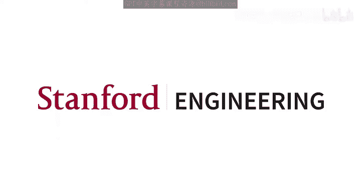
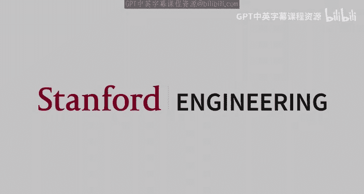

# 斯坦福大学《机器学习｜Stanford CS229 Machine Learning Course  Summer 2019 (Anand Avati)》 - P14：-14-.Lecture 14 - Reinforcement Learning - I.zh_en - GPT中英字幕课程资源 - BV1NDopY4ECg

Back， everyone。 So this is S 2 to9， lecture 14。

The topic for today will be starting a new chapter is reinforcement learning and today we be covering。

Markov decision processes， value ateration and policy iteration。

 which form probably the core of reinforcement learning and in Friday's lecture we will see more complex extensions of this。

And before we jump into today's topics， a few announcements。

 so for those of you who have been sending in feedback through the Google Forms that we submitted。

 thank you so much there are we got a lot of good suggestions。

 a lot of points where we can improve and I would like to briefly summarize you know some of the feedback that we've got and the kind of steps that we'll be taking to to improve。

So one of the concerns raised was office hours that there were a few too many last minute changes for office hours。

And we will try to do our best not to change the office schedule moving forward unfortunately sometimes there may be personal emergencies or things beyond the TS control when it is too late to bring in a replacement T but those exceptions apart we will do our best to keep the office schedule fixed。

There were also a few very specific comments and suggestions about the way the office hours were conducted and。

We've noticed what you've said and we'll be definitely taking steps to improve。

And a few more comments from from you guys， so a few comments on the lectures。

 so some of you have asked for doing the lectures with the slides format where we are projecting slides and。

And doing the lectures around the slides， however， this is a pretty mathy class and。😊。

At least it's my opinion that you know slides might not be the best approach because there'll be a lot of back and forth between going on slide and going on the backboard and that can be pretty distracting for somebody who is watching the videos and also we just tend you know。

Probably math is better explained on a whiteboard than on slides。

Several of you have asked that I write bigger on the whiteboard。

 thank you for that feedback I will make a conscious decision to write bigger if any of you have any trouble understanding what's written on the whiteboard please stop me right then and tell me that you cannot see it I I will I have no problem erasing it and writing all over again。

And also， some of you have mentioned that the lectures are going too slow。

 some of you have mentioned it's going too fast。So the the。

So I guess one one way to kind of accommodate both needs of going fast and going too slow is probably that。

I think a good compromise there would be to probably postpone some of the questions that come from the audience to in a batched way so hold off till I complete some section and then ask your question in case your question gets answered right then and if the questions are not directly related to the lecture itself then I might ask you to just post the question on Piazza and when I ask you to post it on on Piazza it will be it's a sincere request that you actually do post it on Piazza because I want to answer them and just not hold the hundred or more of few waiting while I answer the questions that may of interest to few of you。

And then some of you have also given some feedback about the difficulty of homeworks。

 so some find the math in it too hard， some of you find the programming in it too hard and。

I don't know if there is a clear action that we can take over there because machine learning is indeed you know a field that spans computer science and statistics so it will be hard on math it will be hard on programming and that's just the nature of machine learning。

And the programming assignments or the homework assignments might feel a little too long。However。

 you know， in this course， we are just following the the following the pattern that has been。

Followed for this course in the previous quarters right and and the programming assignments and the homework assignments you know in each homework is not more or less than what's been done before。

 and that's just the way the course is structured。 It is it is a work work through heavy course。

In terms of in terms of help required for programming in general in office hours we tend not to focus on helping students debug their code we expect students to be comfortable with programming and be able to just implement things on your own。

 however going forward if there is no backlog in the queue you know the Ts might probably help you a little bit if there is nobody else waiting but in general the expectation for the course is that you come with you know basic computer programming skills and you have no problems writing simple code given an algorithm。

 but at the same time we don't want to you know kind of。

Leave you stuck if you are having some trouble so you know try attending office if youre especially if you need help in programming。

 try attending office hours early in the homework phase so that office hours are free and maybe TS can help you out there if you if you attend office hours when the deadline to homework is close then the TS will have a hard time helping you with programming。

嗯。And for those of you who you know the feedback form is still open。

 I'm still going to keep checking for it every once in a while if you have any feedbacks you know please feel free to give us standard feedbacks on how we can improve and we'll do our best to make changes and accommodate as many needs as possible。

Okay， with that， let's start with a quick recap of。😊。

Of of the last lecture and also do a quick summary of where we are standing in terms of the overall course so in the last lecture or the last two lectures we've been talking quite a bit about biovari and straight off。

And this understanding this bias variant straight off in a deep way。

Should probably be the highest priority for you of what you take away from the scores right Bit is variance straight off is something that is so fundamental and understanding it in an intuitive and deep way will be will probably serve you the longest it has probably the largest payoff into your future machine learning career right so。

To summarize bias variance trade off。In machine learning we are interested in generalization error。

 which is how well our model performs on unseen data。

 not on the training data that we have and the test error or the generalization error can be decomposed into three parts。

 three additive parts。So one is irreducible error and this is just the noise in the test example right our training data is noisy and our test data is noisy and the noise in the in the in the test data is what contributes to irreducible error and there is nothing we can do about it。

 It is just a fact of life and we accept it。😊，And then there are these two other components called bias in variance bias。

 you can think of it as a systematic error of your model。

 which means if you average it across all the possible training sets that you can get。😊。

The the systematic error that your model makes that is either you are under predictting or over predicting for certain examples or that your parameters are closer to0 than what it should be that systematic error is called bias。

And variance is how sensitive。Our model is to noise in the training data。

 right And this is where the distinction between noise in the test data and the training data comes into picture。

 noise in the test data contributes to irreducible error。

And that is you know one component of the generalization error and noise and the training data contributes to the variance of of your model。

😊，Right and。The steps that we can take to reduce the test error。

 the steps that we can take there are way too many steps that you can take for example you can try a bigger model you can try you can get more training data there are many steps that you can take。

 however， not all the steps work all the time。And in order to determine what steps。

 what what is the step that is most effective for the problem that is immediately in front of you？

In order to make that decision， it' is very crucial that you understand this bias variant trade off。

Reducing training error is is simple。 you can always you know get a bigger model。

 get a more complex model and that will reduce your training error。

 but our goal is to improve on test error。😊，And。And and and the steps that we take。

 as I said already is going is going to depend on whether the current problem that you are facing is mostly a bias problem or is it mostly a variance problem right and the bias variance straight off basically tells you that by taking some step you may be reducing。

You know， one of them either bias or variances， but that may also increase the other right and which is why its it is very important that we that we are able to characterize which of the two problems is the bigger problem at hand and take a step to purposefully go after that particular problem either bias or variance right for example。

 we saw that if we。If we increase increase the model capacity。

 if if you move to a more complex model that will reduce the bias of your model。

 but at the same time it may increase the variance of your model right so if if the problem that you are facing right now is high variance then you should almost certainly not use a bigger model because that is going to worsen the problem that you have。

And similarly with regularization， if we increase regularization that is going to reduce the variance in the model but it is going to increase the it is also going to increase the bias in in the model。

 which means if your problem right now is high bias then increasing regularization is going to make it worse whereas increasing in regularization would have helped if the problem was high variance which is why to super super important for you to characterize and get a heuristic estimate of what the contribution of bias is towards and what the contribution of variance is towards the current test error。

😊，And。Unfortunately， there is no principled approach to decompose and get these estimates in practice。

 which is why we use heuristics， right， the heuristics are。

You can think of the training error itself as the bias。

 and you can think of the gap between cross validation error and training error as variance。

 And this is where cross validation comes into picture。 Cross validation is necessary。

Or the the the most important use of cross validation is that we can get this this decomposition of various variances and bias from the current model。

😊，Right， and。And once we get this， get this breakdown。

We can then make a judgment about whether a model is currently facing a larger bias problem or a larger variance problem and take some remedial step according to which of the two is larger。

😊，So the summary is that whenever you are working on model development and you want to improve your model performance you should always always always look at the training error and cross validation error simultaneously right we care about improving the cross validation error or the test error but just looking at that alone will give you nothing actionable in order to have something actionable you need to see both the training error and the cross validation error simultaneously。

Make a judgment about whether the situation is a high bias situation or a high variance situation。

And then accordingly， take some action to remedy the high bias or high variance。 right And this。

 this is probably the the the most important thing that's going to serve you well for the rest of your machine learning career。

😊，Right， so that's， that's the bias variant straight off。

And to kind of take a larger look of where we are standing in terms of the overall course。😊。

So here's， here's。A rough overview or a quick overview of what we have covered so far。

 So approximately week one through four， we cover supervised learning。😊。

And what a supervised learning， supervised learning is learning some function H。

 which we call a hypothesis。😊，That maps x to y。😡，is there is this clear concept of input and output in supervised learning which will not be the case in unsupervised learning in supervised learning there is a very clear sense of what is input and what is output and we have noisy examples of input output pairs and most of the time the noise is embedded in the label what we call in the output。

And we get a training set of size n of you know these x Y pairs and from this training set our goal is to learn this hypothesis that that is a function that maps x to y such that it generalizes well to unseen data there is some notion of a loss function and we want to minimize this loss function on unseen data。

😊，if the problem was just to minimize it on the given data that we have then we would just call it an optimization problem but this is machine learning because we want to do well on unseen data and that that is where you know the concept of bias variants come into picture。

😊，And we thought we've been seeing you know， approximately you know two kinds of algorithms。

 classification versus regression。😊，And this categorization is based on the data type of the y variable right if the data type of the y variable is binary 0 or 1 then you call it classification and this could not be just binary but it could be over multiple class like you know for example in the homework you building a classifier for 1000 digits for MNT where y can take anything between you0 to 9。

😊，And that is called classification where y is discrete and in cases where y is continuous we call it regression。

😊，And weve seen know simple two very simple models that we started off with that was linear regression and logistic regression for regression problems and classification problems。

😊，And then we after after seeing those two， we kind of generalized。😊。

The data type of y to not just you know be this strict。Regression was classification。

 but generalize them into something called GLms Generalized linear models where y given x is some distribution in the exponential family right It could be discrete。

 It could be continuous。 It could be Poan， which is just in teachersger。 it could be anything。

 It could be positive only And as long as that y given x distribution is belongs to the exponential family then we can solve it with with you know common update rules。

 and you know there there were other I cities that we saw So generalized linear models。😊。

Is not just for classification or for regression or4 percentson。 It generalizes the data type of y。

To any any kind of data type essentially and then we also saw two different kinds of approaches for building models discriminative versus generative and discriminative models we are directly learning y given x so generalized linear model is an example of a discriminative model where we are only interested in learning the probably distribution of y when the corresponding x is given to you。

And the the other approach for building models is called generative models where we want to learn how to generate new examples。

 how to generate a full pair x y pair and this can be generally broken down using the chain rule as p of y times p of x Q and y。

😊，And we saw a few examples of generative models so we saw a knife base where x was discrete and we saw GDA Gaussian discriment analysis where x was real valued。

And we also saw that with GA。😊，There is a one to one correspondence between GD and logistic regression。

 in fact， for any x given y where x belongs to exponential family P of y given x will always take a logistic regression form right and we saw that in the homework as well。

And then we moved on to nonlinear models right the we actually did explore nonlinearity using feature maps in your homework already in the first homework where you try different feature maps we get nonlinear hypotheses right。

😊，The the a more formal approach to feature maps that we saw was kernels kernels are these you know symmetric positive definite functions which have an implicit feature map embedded in them and using kernels we can we can build you know kernel based methods you know we call them kernel methods and we saw two such examples support vector machines for classification problems and Gaussian processes for regression problems both of these methods use kernels and。

SVM in particular was， was， you know， particularly well suited for a kernel method。

 And that was because with， with。With the non kernel based approaches。

 the complexity of the model depends on the number of parameters that we have that depends on the number of features that we have whereas with kernel methods the the complexity depends on the number of examples that we have。

Those are the two kind of sides of your design matrix with normal models we learn one parameter per feature that is per column and with kernel methods we learn one coefficient for example per row。

And so kernel methods in general tend not to work so well when the number of examples is a lot when you have a very big data。

 kernel methods tend to tend to be more expensive and we saw that in SVMs in particular the set of coefficients that we learn for with the kernel approach happens to be sparse which means you get the best of both worlds you get good scalability in the number of features because kernels can potentially give you infinite number of features and you also get good scalability in terms of number of examples because the coefficients are mostly zero and even with large data sets therefore SVMs tend to work well。

😊，And then we move on to another kind of non linearity。 So the you know kernel methods was one。

 and the other approach that we that we saw was learnable features where。😊，In the first approach。

 the feature map of the kernel is hand designed， you decide what the kernel you want to use is。

The other approach is to again use data to learn what are good feature maps。

 that is when neural networks came into picture。😊，With neural networks。

 you can think of neural network as a generalized linear model at the last layer and everything before that as some kind of a learnable feature map。

😊，Right， and after that， we moved on to。Learning theory and in learning theory the the main topics that we touched upon was regularization and it its Bayesian interpretation of how regularization corresponds to performing MA estimation in the Bayesian setting。

😊，And we saw。We studied bias and variances and the bias variance straight off which which we covered already and we also studied uniform convergence so uniform convergence is a more theoretical theoretical part of the course and in general you know understanding the contents of you know the lecture notes on uniform convergence and what we covered in the lecture can be very useful if you are interested in getting into machine learning research because you know that's like the common framework in which most of the machine learning theory problems are posed。

And that is until the last lecture， so we are here right now。

And today and in the next lecture we'll be covering reinforcement learning it's going to be a very quick overview of reinforcement learning we will not be going very deep there are multiple courses offer only on reinforcement learning you know its a super vast field and but we will only be covering just the basics and giving you kind of you know a big picture or a mind map of how the different reinforcement learning algorithms that we are not going to cover how they all kind of fit together in one piece。

So that's the plan for reinforcement learning。 And starting next week。

 we will be starting unsupervised learning。😊，For me personally I like unsupervised learning the most you know it's very exciting and once we kind of finish up with unsupervised learning we're going to cover some general topics you know things like you know evaluation metrics。

 maybe a few theoretical ideas like KL divergence or a few such things some general topics that don't kind of you know fit into this supervised versus unsupervised classification and finally in the last week on week8 we' have only two lectures on the Monday and and the Wednesday and those two lectures will be doing a full review of the entire course again with the hope that it prepares you well for the final exam。

😊，Right。Any questions before we move into todays today's topic of reinforcement learning。

Yes question。The version of why the dragon period。Ultimatelyimate needs the bias and the same。

That's very。So the question is why are these two why is why training error an approximation of bias and cross validation I would say you know post that on Piazza and you know I'll be happy to kind of give give you more details on that。

All right， so let's let's start with。Reinforcement learning。孙德。

In the examples that weve in the topics that we've covered so far。

 which has been mostly supervised learning。We were always told for a given input or for a given situation what the correct answer is right so for every x we had a corresponding y which was the correct answer or the the answer that our model should learn to predict and that was given directly to us right and which is which is why we called it supervised learning。

Whereas in reinforcement learning。This kind of supervision is a little weak。

Instead of telling us what to do in a given situation， we are instead given some kind of a reward。😊。

So in in R we you know one way to think of it is replace。😊，W， which is supervision with reward。

RightAnd reward is always a real value。 It could be positive。 It could be negative。

 And the way you want to think of reward is kind of how good a job you did right There is no right reward。

 so to speak， you know there is there is no。😊，There is no。Optimal reward as such。

 And the goal in in reinforcement learning is to kind of。Maximize our long term reward。

 which means we are dealing with situations which are changing over time right in supervised learning we were dealing with fixed situations and each example was what we call as IID where each example was independent of the other whereas in reinforcement learning。

We are trying to trying to program an agent that kind of lives in an environment or in the real world or in a simulator that performs well over time。

😊，And examples of such agents could be， you know， for example。

 it could be a robot which is learning how to walk。😊。

It could be a game playing agent that plays chess or go it could be。

Even some kind of an automated trading agent that you know that that you use in a financial market。

 right things where you are making multiple decisions over time and at each time you make every after you take every action you get some kind of a reward right。

And the goal with reinforcement learning is to maximize this accumulated reward over time。😊，Right。

 which means we need to take this long term view of trying to optimize how。

 how much reward we are going to accumulate。Starting from now all the way into the future right which is very different from the supervised learning setting where in supervised learning setting we were given an example and our only concern was to do well on that example alone and the next example was completely independent。

😊，RightAnd so it is this， this concept of time that makes。

Reinforcement learning different from general supervised learning right in reinforcement learning we are making multiple decisions once one decision at one decision at a time and with each decision we are earning some reward。

😊，And our goal is to maximize this accumulated reward。😊，Into the future。

And the way we kind of formalize reinforcement learning is through this formalism called MDP or Markov decision process。

😊，Marcal decision process。M B。Right， so an MP is。Viictus is。1，2，3， is is a five tuple。

 It is a tuple containing five things。S。Yi。P。He。Gamma。R。Where。S。Is a set of states。

It is a set of all possible states that our agent can currently be in。A is。Seect。Of actions。PS A。

Our transition probabilities。Gamma。This is。Discount factor。And。A。Just。😔，S cross。Scar。

The reward function。Right now lets lets look at an example of what all of these actually mean。

 supposing this example comes from a very famous textbook on on artificial intelligence and it is also a very standard example used in many courses。

 So you might have seen this before。 So supposing there is this。

Supposing this is there is this agent that lives in some kind of a map， some kind of a region。😊。

Where。Your agent at any given time。Can be in one of these grids。And our goal is to reach here。And。

 and you get a reward of plus one if you reach here and you get a reward of minus-1 if you reach here。

And our goal is to， is to。Is to be able to solve this。 And by what I mean by solving is。

 so first of all， what is S S is the set of all possible states where our agent can be。

 So states in this case。S。In this case is the set， you know，1，1。One，2， and so on。

And the size of the size of our state space in this case is 11 can be in 1，2，3，4，5，6，7，8。

9111 and you know this is blocked。 you cannot be in the state。

The set of actions that we can take in this case are to move our agent one step at a time in any of the direction so the set of actions we take can be move north。

 move south， move west or move east。Right，4 simple actions that we can take。

And the probability PSA is also called the transition probability。 what this means is。

This is a probability distribution over the states。

And what this specifically means is if we are in one particular state that index by S and we take an action index by a。

Then what is the probability that we are going to end up in one of the other states？

So it is a probability distribution over the state space and it has two indices。

 the current state and the action that we are taking。😊，So， for example。

 if you are if you are building a robot that has to move in this kind of a map if the robot is in 13。

😊，Then， P。1，3， and let's say the action that we take is go north。North。

 so this is PSA state is you know the state we are in 13 and the action we take us go north then this。

Will be a probability distribution， such that。Lets say there is there is some kind of uncertainty in the robot and whenever we ask it to go north with let's say with 80% probability it actually goes north and with a 10% probability it goes west and with 10% probability it goes east right so this will be a probability distribution。

That has zeros everywhere。Point one， that corresponds to the state。1，4。Right。

Point1 that corresponds to the state 1，2。Pot8 corresponding to the state 2，3。And zeros everywhere。

This is clear for every state we take an action and when we take an action we can end up in a new state。

😊，And that， the， the transition of moving to the next state is stochastic。

And that that stochasticity is captured by this probability distribution。

 which tells us with what probability we are going to end up in any given state。😊。

Depending on what action we took and what state we were currently in。Next question。し？

you can see that for a certain。 Yeah， I'll come to that。 I'll come to that。

 So so let's for in a simplicity assume we can take any action in any state for now。

So that that is called the transition probability and then there is something called the discount factor gamma will come to that。

And there is a reward function， so a reward function is basically the reward that our agent earns immediately after you know when it is in some particular state。

 for example， if if our agent comes to this state where we know want it to be it earns a reward of plus 1 and if we want it to avoid the state it earns a reward of 1。

😊，RightAnd lets say you know， the reward at all the other places is a small negative reward point or2 minus point or2 minus0 point。

😊，Or two。And so on these are the immediate rewards that the model gets or the agent gets for entering a particular state。

😊，And most of the times， the reward function is。Represented as a function of the state。You know。

 gives you some。A real valued reward and sometimes it is also modeled as or of Ss commma a。Where。

When you are in a particular state and you take the next action A， you get some particular reward。

The reason why sometimes we tend to model model it as a state action pair rather than state alone is because taking taking different actions may have different costs。

😊，So even though you earn the same reward for being in a state。

 the fact that you took one action over another， you may be paying a different cost so you know to account for such actionspec costs you know sometimes you would model the reward function as a function over the state action pair rather than just state alone。

 but in terms of what we are going to cover most of the times we will be just focusing on reward functions as a function of state and assume that all actions have equal cost yes question。

私は。Yeah， so in practice， how do we know we get to that。

 We know it's it's it's part of how we define the problem itself。嗯。Yeah。

 so that's the reward function and。In terms of， in terms of。What happens when we start an agent。

 we assume that the agent is going to start in some initial state s S not。So。

Let's assume that the agent starts at some initial state。Ss not。

And we take an action a or a not that is the first action taken by the agent and by taking an action A at state S。

 we enter a new state。S1。Which is according to the transition probabilities。 So S1 is now。

S 1 a sample from P of。S 0 is 0。And once we are in S1， we take action a1。And interstate S 2。

 where S 2 is sample from P of。S 2 S 1， a 1。And then we take action a2 enter 3 action。3。And so on。

Right。This sequence of。States and actions。Is commonly called there are multiple names that you will see in different books or different resources。

 you can either call it a trial。Or you can call it an episode。Or trajectory。

All these are you know synonymous for a sequence of states and actions taken by an agent where the action is taken by the agent and the environment lines you in the new state according to the transition probabilities yes question。

这个。So the question is， why is the probability of going north when we are around 13 a vector so。

In general， so so the way to think of reinforcement learning is you are in an agent that lives in some kind of an environment right you are in one particular state and you take an action。

😊，And by taking an action。😊，You end up in another state， but the state that you end up in。

Can be random。So let's say you are building a robot and in your robot you ask the robot to move north。

😊，And for whatever reason， maybe there is a stone under its wheel or maybe there is some some things that are beyond our control。

 your robot may end up going to a different location than the one that you are than you are actually interested in。

 maybe you ask your robot to move a me in one direction。

 but in reality it may end up moving say 95 centimeters or 105 centimeters right so there is some stochasticity in the environment due to which we always don't go to the same state that we that。

An action will not always take you to the same state all the time right And that is why here if you are in 13 and you know you and you go north most of the times you will go to 23 with probability in 。

8 but sometimes you may go to12 or you may go to 14 So either here or here with probability 0。

1 but you know most of the times you end up going north that that's the general idea Yes question。就。

Like broadcast。I， I'm sorry。 I didn't understand the question。What action。

Yeah so so I think you are talking about a game playing where there is an opponent so Ill push that question until later for now let' us assume we are you know the environment is stochastic for whatever reason。

Yeah， so it could be if you are if you are in a game playing scenario。

 it could be due to the opponent。So。Yeah， so this， this we call it as as a trial or an episode or a trajectory。

 and all three are all three names are synonymous。And now what we what we when when an agent goes through a particular trajectory at each state S it is earning some reward So over here it earns。

😊，R ofs not and it lands in state S1， the agent earns r ofs1。Right， from here， R of S 2。So。

 the agent is accumulating rewards at each step。😊，Right。And。

and this is where the discount factor comes into picture right so the discount factor is basically a factor which we multiply all future rewards by。

😊，So， the reward for being in state S1 will be discounted by a factor gamma。

The reward at state S2 will be discounted by a factor gamma square， the reward from S 3。

Will you be discounted by a factor gamma Q。And what the agent。

What the agent accumulates over the future is basically the sum of these discounted rewards。Right。

 and this is。And this sum of accumulated rewards is what we want to maximize。And the the idea here。

 the reason why we call a discount factor is one way to think of it is。😊，Um。

Any positive reward that we get。Is better obtained sooner rather than later。

So the discount factor incentivizes。The model to earn larger rewards sooner and it also incentivizes the model to postpone any negative rewards into the future right that's one way to think of it another common interpretation of the discount factor especially if you are in a finance setting is you can think of the discount factor as interest rate right which means you want to you want to earn your money sooner rather than later and you want to postpone your losses into the future rather than you know rather than sooner right。

Yes question。With respect。doesntだ。So I let let's push game the game playing you know we will cover game playing tomorrow for now let us assume only in the setting where we have an agent that is working in some kind of an environment right will cover game playing。

😊，来。くらい。just说。あ会速公式。Yeah， so we're going to touch upon exactly that topic of subopality。Right。

 so this is， this is the setting in which。The the agent operates。

 so we want to design an agent that given this Markov decision process。

Ws to or needs to maximize the sum of accumulated rewards into the future。喂。

And these rewards are discounted by a discount factor gamma and this discount factor gamma there are many many good reasons to have this discount factor gamma but some of the interpretation is you can think of this gamma as know interest rate or you can think of it as a motivation to make the agent get the reward sooner rather than later yes question。

😊，Yeah， its it's the gamma is the same gamma that we use at all time steps。Yes。

 there's a particular reason well， we， we're gonna we'll cover this in shortly why， why。

 why we're gonna use same camera。Right。So now， given this， given this setting。We can define2。

Central concepts。Right，And these two concepts are gonna。Are going to stay with us for the rest of。

Reinforcement learning。So。So we are going to define something called as a policy。はい。

Which is mapping from state。2。Action。So， the policy tells you what action to take when you are in a given state。

😊，And this is the policy over which the agent has flexibility to learn our goal is to learn a policy we want to learn this function that maps us from state to action。

😊，And we want to learn a policy。😊，That is going to maximize something called the value。So the value。

Associated with a policy pi。Its a function。That takes us from a state。都。Real valued where v pi。Of S。

Its defined as。Expectation。哦。Or if it's not。Yes。Gamma times。Mo of this one。Plus。Gma squared。Or of2。

So on until。S now equals Sma。So， we define the value of。A state by following a particular policy。

To be the。Some of all the expected rewards。From starting from the first state all the way， you know。

 until until infinity。Where each reward at a particular time step is discounted by the corresponding gamma factor。

😊，And over over here the。The S， which is the parameter of the value function。Besides。

 what is the starting state going to be， right， So the value of。

The value of a particular state by following a policy pie。

Is the discounted sum of all future rewards？Assuming we start at the given state。

And the actions that we take at each step。Is， according to the policy。That that's given to us。

You start at a given state， start taking actions according to a policy。

 the environment based on the transition probabilitybilities is going to keep throwing you to different states and when you go to a new state。

Refer to your policy and take the next action and you know you keep going to new states and as you are going to as you are going from one state to another you are accumulating rewards and we discount each of those rewards by。

The corresponding gamma factor right and the value of a particular value of a policy at a given state is this expected sum of future awards。

 And the reason why we use expectation here is because。These rewards are random。

 the reason why the rewards are random is because the state that we end up in is random and this reason why the state that we end up in is random is because of the transition probabilities。

So， if the transition probabilities were not stochastic so if we always reach the same state when we took a particular action every time then we would not need this expectation but because the transitions are stochastic we the values defined as the expected sum of future rewards or some of future discount rewards。

Any questions about this。Yes question。But this is a comma。So this is。This is。

 this is called the value function， and this is called the policy。

 And as we will see probably tomorrow， you know， these two concepts are， are kind of。

They are at the heart of reinforcement learning because you can kind of classify the entire field of reinforcement learning into those that try to optimize or learn good value functions versus those that directly try to learn policies right so this these two are central concepts that we are going to encounter over and over。

😊，And it's this value function that is。That is related to rewards。😊，But also。

 it is different from rewards。 So reward is， you know， you can think of reward as like the。

Reward is the immediate reward that you get by just entering into a state， whereas value is。

You can think of value as the long term benefit or the sum of all future rewards that you are going to accumulate by following a particular policy So reward you can think of it as short sighted。

 you know something that youre going to get immediately by going into a particular state whereas you know value is is like the long term value by following a particular policy。

Yes question。So the value keeps changing right depending on where you are in the next state。

So even in the first state， S O is always taken at where you are at the moment。 And therefore。

 your value is shifting all the time right。何美してな。So so the question is the states that you end up in you know。

 can be different because of you know the the dynamics are stochastic。

 which is why we have the expectation。Notation， does it mean that Sl is not fixed。Its on where I。

Yeah， so in this expression， S n is not random because we we have conditioned S not to be something。

😊，That S。S that is parameter to the function。So S not here is not random because it is given all the future S1 S2 are random。

Right， so we can now rewrite this。In a slightly different way。You know。

 by actually recognizing that SN is not random。And so we can rewrite this as R of S because S notaught was just equal to S。

Plus。Gmma times。Some over。Ass prime。In。Yes。P of。S。Pie your face。As prime。Vipi。offff。Epiry。

How did we go from this equation to this equation。So the way we went from this equation to this equation。

Is by recognizing the fact that。This， this expression can be now written as。A of。Yes。Plus。Ga times。

Expectation of。A of S1。B。Plus R of S1 plus gamma time R of。Its too。Gmma times， Gamma square。

All of S 3。And so on。Right， because this was。This was not random we took it out and all of these terms have a gamma so we take the gamma factor out。

😊，And what we end up with is， is， is。The expectation over all of these。And this。

 we again recognize that。😊，嗯。This whole thing over here is。 so this whole thing is just v pi of S1。

And by making this this by recognizing this recursive pattern。😊。

We can define this recursive statement that v pi of s is equal to the immediate reward that we obtain by being at s plus the discounted you know the discount factor times the expectation of。

The future values of each particular state you know times the probability that we end up in that state by taking the action。

And the action that we take is according to the policy， this question。are the success of。Yes。

 so the S primes are the immediate successor states， right so。

We are at just for the fact that we are in state S， we earn R ofs。And once we at R ofs。

 we take some action according to P ofs。The policy tells us what action to take。

And by taking this action， we can end up with one of the all possible future states or the successor states that we denote by s prime。

And for landing in one particular s prime， we earn v pi of s prime as the future value。And so。

 the overall value of a state can be decomposed into these two parts。

 the immediate part and everything else that follows。😊，Next question。てみ。The no。多。Yeah。

 so the notation here this is the transition probability that is PSA a here is pi ofs you are following the policy of what action to take。

And so this is PA think of this as PA and PSA is a probability。😊。

A probability function over all the states So PSA of S prime tells you the probability of ending in a prime。

If you were in state S and took action by office。And depending on which state we end up in we get an appropriate value out of it and so this is just the expected value of taking expected future value of taking action according to p of this question。

Can you， can you repeat the question again。So v pi s is so there was this expectation here。

RightIn this expectation here， we could take R of Snat out。Because this was not random。

And what we end up with。That is the rest over here。 we are just calling this V pi。Yeah。

 it's the expected one。Yeah， the。S1 through， you know， S1， S2 S3 are still random。

 And so we need to still have the expectation。Right，And this equation， you know。

V pi S where v is is defined recursively right so we have v on the left and v on the right this recursive equation is also called the Belman equation。

And let's put a box because this is important。All right。So， to quickly summarize。

 we have these two central concepts called policy and value。😊，Right， policy is just。

What actions we want to take when we are in a given state， It is a simple function。

 nothing fancy there。😊，Value is this long term extension of reward。 right Re is this short term。

 short sighted， immediate。Immediate grat gratification that we are going to get by you know being in a particular state whereas value is this you know long term long sighted you know what is the what is the total sum of discounted rewards that we are going to make in the long term by following a particular policy and that is value。

😊，Right， so， and， and this distinction between。Between。

Immediate reward and long term value is at the heart of reinforcement learning。😊。

Because if our goal was to just maximize the immediate reward。

 we would just be back in supervised learning setting。😊。

It is because that we want to move maximize this long term reward where we need to take this long term view。

We may need to make some sacrifices of short term rewards in order to maximize the long term value and that is what makes reinforcement learning hard and makes it distinct from supervised learning。

Yes question。I so far we。如我刚说的呃。哦。possibility。Even possibly the what you made in the woods。

Yes yeah so so the question is does this expectation cover all possible future scenarios yes it covers all possible future scenarios where you may win you may lose your robot may crash right away your robot may land your goal you know reach the particular goal and you know all these possible scenarios that may happen by following a particular policy pie。

So， our goal which which which we are going to talk about next is to come up with a policy that is going to maximize our values。

😊，For， for all states。Any other question？So before we go into， into maximizing these value functions。

 first， let's solve。You know， given a policy， how do we calculate v pi right So。

 so the picture to have is。So these two concepts， you know， value and policy。

Can kind of think of them as the dues of each other。So。And that is this。Kin of。

Relation between them such that one gets induced given the other。I should just era that anyway。So。So。

 we have policy。And we have。Value， right， So policy takes us from S。2，8。value takes us from S。To R。

And again， value is distinct from reward because reward is immediate gratification and value is long term value。

Which means in order to maximize value， you may have to sacrifice immediate rewards if there is a prospect of doing very well in the long run。

 right that's the key distinction between reward and value。And。Given a policy pi。

We can calculate the corresponding value v pi right so pi takes us from pi to v pi and well see how we are going to do that and this should be intuitive right if if if you start from a given state s and you follow a particular policy。

And you follow the same policy over and over and you repeat such trials you you know。

 and you average out the total value you average out all the values that you end up making。

Then you know that is v pi right so the so pi implicitly defines a value function for each state。

And correspondingly from v pipe。Or from any value function V you can construct。

A correspondingresding policy phi。Where you say that the action that you are going to take at a given state。

Is to。The action that you are going to take at each state will be to choose the action。

That gives you the highest probability of reaching the next state that has the highest value。

Right try to reach the next state which has the highest value right and that will that implicusitly defines a policy if you start with a value function right so you can go from pi to v pi as we are going to see next and from v to pi with this with this。

In in a somewhat natural way，So given a pi if if you just follow it over and over you can find out what v pi is and similarly if you are given a value function if you are told that in this in the in the grid of your map what the long- term value of each one is and you are in a particular state try to take an action that is going to take you know with high probability take you towards。

The next state that has the highest value。So they are kind of duels of each other。This question。

Dction。think。実際。you can you please repeat the question， I think it is about something about time。

具えみです。Yes， so the， so the， the policy。Asks you to take a particular action a。

When you are in a particular state， no matter how far into the trajectory you are right now right so you always follow so you always follow the same action when you are in a given state according to the policy。

 ignoring all the previous you know you may have been you may be entering that state the first time you may be entering it for the thousandth time。

 but if you are following a policy， you always follow the same same action yes。We to pi。Essentially。

 like。In the grid， it's just a bunch of。That you want by you have。Yeah， it， it doesn't really so。

The Pi tells you if you are at a so facility。You are here what you should do。 But here。

 I will just tell you what the value is if you follow like some。Good trajectory， right。

 like the best possible。 So， so， no we V Pi does not tell you the best possible value that you can get。

 V Pi tells you what's the value that you get by following this policy。

 It's not the best possible policy。 It's not the best possible value。Yeah。

 itll tell you like the expect。て。これわりです。对。But how do you go from like a grid of numbers to a policy？

Yeah so we will come to this so the takeaway from here is that you know there is a relation from going from pi to v pi and a relation from going from v to pi and you know we are going to clearly define how to do this next。

😊，Let first let's talk about going from pi to v pi。😡，Right， and so for that， know from。P to v pi。

For this， we start with the Belman equation。V pi of S。It。A。Plus。Yamama times。Some over。Sing S。P of S。

Poface。Pme。パイオフ。So this is just the Belman equation。 I' have just written it again。😊，And over here。

What we see is that v pi of s， assuming we have a finite number of states。 So v pi is a vector。😊。

Right， so V pi。心。Vectctor of numbers that you have real values for each， you know， S1， S 2 and so on。

Right。And this is， you know， weve， we've kind of seen this。

This view before of switching between vectors and functions in the past， right。

 So vectors and functions are essentially one and the same。

 So think of this V pi of S as a vector having one。You know， value， value per state。Right。

We have v pi， so we have v pi of S1 over here， v pi of S2 over here over here and so on。

And what this tells us is now we want to solve for vpi。

Lets assume we know R of s for every possible state S and let us assume we know the transition probabilities from any state and any action to any other state let us assume we know R。

P and gamma。So now， this is basically。For each S， you know for each possible value of S。

 we get one such equation where everything is linear。And。We can construct a set of linear equations。

 So if this is S1， S1。S1， S1， similarly， v pi of S2 equals。R of S 2 plus。Gama times some over。

That prime。Yes。P，Pi of S2。Of S prime times。3ぱい。Office right。And so on。All the way until me pi of S。

S equals。So， here。Each of these terms。Is a scalear variable that we want to solve？And there are。

You know。There are capital S number of such variables。

And there are capital S number of such equations。So we have S variables with S number of equations right and they are related only with you know in a linear way。

 So all of these are known constants and scalrs which we are multiplying。😊，And this can be solved。

You know， with， with any kind of a linear solver。To make this more concrete。Lets define this matrix。

P pi， let me write it a little bigger。So， let's define P pi。To be。Matris。Yes。

So you have one row per state and one column per state。Right， and。So P pi here each row。

Is basically P。S。Pi office。Where S over here indicates the row number。 So lets call this S1， S1。

This corresponds to this one。I know。S I will give you。PS I。系啊。

So basically collect all the transition probabilities。😊，Of every P，1 and A。

RightAnd where a is chosen according to pi and write it out like a matrix。😊。

So this is just you are just selecting a few of the transition probabilities。

Where we are starting from a given state SI。And taking an action according to pi of SI。

 lets call it AI and this is PI AI， right。And arrange them into a matrix and call it a p pi and with that matrix we can rewrite this in a more compact form as v pi。

Equals r plus gamma times。Pipei。Vp。これが挨さしま。Question， what is？I。What does I S I stand for？ now。

 So this is the， the size of the set S as many number of states。

So we can write this in a compact way， yes question。いです。Re reallyally useful。way， way more。

So this is just so the number of policies that we have are you could have any number of policies。

 but we you know we are assuming that we have PSA for every possible S already。

Right we we are assuming we have the model。 we know the transition probabilities already。

So all these， all these rows and all the rows， the transition probably that are not included here。

 we assume we know PSA because that is part of the MDP definition。

 So we have PSA for all combinations of SN yes question。😊，表 make。要。Yes。

Over here should it be V v pi S or S prime over here it is S prime。

Because we are taking the expectation over all future states。But I don't think this is consistent。Oh。

 this should be you're right。 So you're sorry。 Yeah， this should be a spring。Yeah。

 so the S1 only goes into the policy。 So this should be a spread。 Thank you。

So this this set of equations can be compactly written in vector notation in this way。

And once we write it in the way。We immediately get。So move this over to the other side and invert it。

 we get v pi。Equals。I minus。Gamma Pipae。Inverse R。So， this is。A vector of size S。

 this is a vector of size S。This is。S cross S， It's a matrix。

 Theres the matrix that we instructed here。And v pie is， again。It's the same v over here， size S。

So take this to the other side。Invert it， and we get this。So this gives us a way of。

Starting from a policy pie。And calculating the long term values for each of the states。

 if we follow that policy at all times。 so this is。This arrow， So collect one。This is one。

So according to the policy that we have， you are going to end up with a different P Ppi and plug that Ppi in here。

😊，Ours are given， gamma is given and you know calculate this we get v pi。Yes question。是的。一般分。

From the state， I。Yes， so each row over here tells you if we are at state SI。

And we take an action according to p ofphasi， what are the set of all possible states that we can go to with you know corresponding probabilities？

So this tells us how to go from policy to value。Yes。よあげですな。Never go back to the same state。Now。

 we are not making a assumptionsumption that we cannot go back to the state。

 We can always come back to the same state again。 There is no such restriction。You never can afford。

So the question is， will we not converge， we will converge and we will see why we will converge shortly。

So this is， this is。so this yeah this this is that how to go from policy to value right so the policy according to different policy we get a different P matrix because we choose different rows according to the corresponding actions and you plug that matrix in。

Construct this you know this related matrix， invertted， multiply with R。 you get get P。So no。

We can also define what is called as this。You know so recognizing the fact that we can now you know given a policy we can construct the value function。

 let us move on to define something related。 we will come to the other arrow shortly。2。

So we also define what is called as the。Optimal value function。

So the optimal value function is defined as。V star。Of S。Squ2。Max over pi。V。😔，P。

So the optimal value function is defined such that。😊，If we are at a particular state。Right。

By choosing the best possible policy。What is the highest value that we can obtain。

So v pi of S tells us what is the the long term。Pay off long term some of discounted rewards the expected some of discounted rewards that we are going to get if we follow the policy pie。

 and we star off as。Is it tells us， you know， what is the maximum possible value that you can get across all possible policies by。

Right。いいし。Yes， you know， here so the question is here is as the initial state， Yes。

 So the definition of value function is， and assuming you are at the current state。

 it doesn't matter whether this is the initial state or you somehow landed here， if we start at。

A particular state， S。No matter what the history was， even if it is the first state。

 what is the expected sum of future awards？So v star s is defined as the maximum possible value that you can get by searching over the entire policy space。

😊，And。We start of S can。Its therefore， is also written as。R of S。Plus。Max a。And。嗯。Gamma times。

S prime and S。PSA。S prime。Times， v star。Thats prime。So v star of S is。

Defined as the max of v pi of S， where V pi of S。We used。This definition。

We plugged in this definition into v pi of s。And note that R of s。

Is the constant that does not depend on a。And does not depend on pi because the policy only tells us what is going to happen in the future whereas the reward is what we already got。

So， it' is going to be r of s plus max of AO in the action space。

 what is the action that we need to take？Such that， we maximize the sum of the future awards。

This equation looks pretty similar to the original Belllman equation。😊，Except the。

 the difference is that here， instead of。Pi of S， we are maximizing over a。

In in place of P S pi of first， we have P S of a， and you are maximizing over a。

And the other difference is that。V pi of s because this was for v pi of S。

 we had v pi of s here and over here because this is where we start of s you know by the recursive definition we have the star of s here。

Now， this， the Belmon's equation， we saw that we can express this in。

A nice linear form and obtain a close form solution。You know。To to， to。To obtain vpi。However。

 we start off as because of this max operator。😊，It's just not possible to solve it linearly。

So if you are given a policy， it is very easy to calculate the long term value according to that policy。

But to calculate the best possible value or we star the optimal value function。

 not it is not as easy as solving a linear system。Right。And。It is。 It is。

And we saw how we can go from pi pi policy to v pi using this approach now here we will see how we can go from a value function back to a policy right so this is the optimal value function that you know we are interested in or strive to calculate。

And given this v pi of s。We can define the corresponding pi star of s to be the optimal policy。

To be equal to。Arg max。The in。예。Same thing over here。Some over S prime and capital S。PS a。offff。

S prime。Times， V star。off。Epirin。So the optimal policy tells us that。The action that we need to take。

A state S is basically the same action that achieved。The optimal value for us。The as。行さ。

AMter finite set of A， you can enumerate all。So the question is， why is this hard to solve Because。

 you know， we have a limited number of As and and you can So yeah， so in in cases where。

In cases where you have a finite state space and action space， you can iteratively calculate this。

 So this involves iteration。Whereas the the for V P， there was no iteration。

 You had a direct close form solution。 By heart， I meant there was no close form solution。So。

 this is the optimal value function， and this is the optimal policy。😊。

So the optimal policy is defined as the policy that will achieve the optimal value function for us。

So it because it achieves the optimal value function because know we are using the exact same action at each state that' is going to maximize the same right hand side。

So this is we started with the two concepts， policy and value。

We started with policy and value like these two are two very central concepts。And given a policy。😊。

We can calculate the corresponding value function that you get by just following that policy with this cross form expression。

And similarly， for any given value function。😊，We can define a policy。😊，That takes action。

That maximizes the the expected value based on the given value function estimate。

And when we use the optimal value in place， we get the optimal policy。😊， so this is how we move from。

Value function。To policy。Now， with these two observations， we can now come up with。To algorithms， to。

To actually calculate we start off。 So this is just。Now， this is just a mathematical expression。

 This is not an algorithm of how to calculate So this is just giving you a relation between that we start needs to satisfy。

 So this is a necessary condition。😊，That we star needs to satisfy。

If if V start is the optimal value function right so this is a necessary condition it is not telling you how to calculate v star or s and this is the optimal policy corresponding to we start。

So now we are going to look at two algorithms， one of them is is called value iteration。

 the other is called policy iteration that will help us calculate v star ofs and pi star ofs。

So policy iteration， that's the next topic。Sorry， not policy， valueuators。So， the value is。

An algorithm。So this is an algorithm。 It tells us how to compute。

 It is not just a mathematical relation which is a necessary condition so this tells us how to compute。

😊，Step 1。F。😔，Yicchi。State。S。Inialize。V of S。これとすよ。都。Repeat。Co。Convergence。For every。State。S。Update。

V of S。Equal to。Part of S。Yes。Max。Yiyin。Hei。😔，Gamma。😔，Some over a prime。😔，PS， S A of S prime。

V of spring。So， initialize。Iitialize the value function to be 0 everywhere at all states。

And then for every state S。Update V ofs。😡，According to the sea。

And this equation is the same necessary condition that we have， according to。

According to the optimal value condition。 So if， if we have the optimal optimal value。Then。

V of S would have satisfied this。But we are going to know pretend that v of s is the optimal value and。

😊，And by taking that that necessary condition， we are going to construct an update rule。Now。

 the question is， why will this converge， will this even converge。We took a necessary condition。😊。

It is just a condition and convert it into an update row where on the right hand side we have the old value and you plug it in you know and we set it to the you know to be equal to the left hand side and update V ofs Why is this even expected to converge。

And the reason why it know the proof is is beyond the scope。

 but I can offer a quick sketch of how it works。So。

This update rule that we have over here is also called the。

Belman update operator or the Belman backup operator。So the word。Operator is interesting。

That's because， supposing we have。As one。As。Yes。So you might remember how。

 how we visualized functions as points in space。 You know， we have done it several times in the past。

Right，So supposing we have a function。 We have a policy or I'm sorry， Supposing we have。

Some value function v pi that we represent as you know a point in a space where each axis corresponds a difference to a state。

And v pi of s is basically the you know the coordinate along S1 is v pi of S1 coordinate along S2 is v pi of s2 you know the same way weve been viewing functions as points in space so supposing this is the value function。

And we plug that v pi of s。Into this operator on the right hand side。And get something else。

On the left hand side right we take that V， run it through this operator and you know we obtain some output。

I this the update rule right now。Supposing we start here， and。

This is the so I'm going to call this B of V pipe， which means this is the output of applying the Belmanop backup operator。

Right。Now， there is a proof that is beyond the scope of this course that this Belman operator is。

What is called as the technical term for it is called a contraction mapping。

So what a contraction mapping means is。Take any two input points。You know。

 let's call this V prime of p。 or let's just call it。V pi， and let's call it V V。V pi 2。

 call v pi1 and v pi 2。And。The beman operator the Belman back operator when you apply on the two of them。

 you get two different。Be of。2 파と。And the beman update operator is called a contraction mapping because for any two inputs to the operator。

😊，The corresponding outputs will be closer to each other than the corresponding to inputs。So。

And and this can be this can be you know shown mathematically with with you know， some simple rules。

 you apply this and you can prove that the the beman backup operators are contraction mapping。😊。

And when something is a contraction mapping。😊，There exists something called as a fixed point。

 So the intuition there is for any two any two points you you know run them through the beman operator。

 you know you get two you know the two output points will always be closer than the two input points and that holds for any two points in the entire space。

😊，And when you have such a contraction mapping。😊，The points to which they are all converging to is called a fixed point。

And it is called a fixed point because once you reach the fixed point and you apply the Belllman operator on it。

 you get the same point again。And this fixed point is called V star。Is， as we start。

 that's the optimal value function， right so。Start with any initialization。 We started with 0。

 we started at 0。 It does not have to be 0。You start at any other point you want and you keep applying this Belman backup operator over and over。

Recursively you take the you start from the initialization， apply the operator get an output。

 apply it back into Belman operator you get an output and so on and we will keep following know this this kind of a path where eventually you are going to converge to Vstar and the reason we are going to converge to Vstar is because you can prove that the beman backup operator is what is called technically a contraction mapping。

So it kind of contracts this the entire space towards a single fixed point。

Anyway so the proof is beyond beyond the scope， but it is good to have this intuition that what is happening over here this right hand side。

😊，Corresponds to this B mapping， this contraction mapping where the entire space is converging towards V star。

So this is。The value。So start with some random initialalization we know P we know all all the p values。

 we know all the r values and you keep applying this over and over until it converges and when you converge。

You would have reached v star the so called fixed point。After which。

 even if you apply the Belllman operator， the output is going to be the same。😊，This question。だ分。

Of the。That last。안てか 뭐。So the Belman operator takes you one step。Because that's in the one。

One application of that。Yes， so one application of this for all the states is one Belman operator。

And anywhere in the state。Sp。It is almost like a convex problem Yes。

 it is a convex problem exactly So it is a convex problem no matter where you start and you keep precursively applying the Belman operator。

 you will keep you know hopping and hopping and hopping and reach the same fixed point。😊。

Right so that that is a value iteration and this proof is beyond the beyond the scope。

 but you need to know the you know value iteration itself， the algorithm itself。😊，And then， there is。

Another algorithm that's called the policy tu。And in the notes in fact there are two variants of the value that is called the synchronous and asynchronous。

 so in the synchronous we calculate the left hand sites for all states as a temporary variable and you know replace it in one sh whereas in asynchronous you update it for one variable and use the updated variable for updating the other variables。

😊，That's a slight way。And now we come to the second algorithm called the policy iteration。

So in policy iteration， this is a different approach here we start with the policy so initialize。Pi。

 randomly。As I said in R， you have these two central concepts。

 the value function and the policy right So this approach。

Use the value function and kept updating the value function， kept hopping the value function。

 Here you start with the policy。 the other central concept in R。And two， step two。Repeat。

Until convergence。Y。Fect。V。😔，Equal to。理派。B。F。Each state。Yes。Set。P F。Equal to。Hard max。A and A。

Some were as prime。PS S A of S prime。Times v of。Epiry。So start with some initial estimate for pi。

Right， and。Probably era it。 We saw how given a pie， we can。

We have a close form expression for calculating V。You just solve a linear system of equations。

 So start with the random pi， calculate the corresponding value value function。

And then using that value function， update your policy such that you are taking steps。

Where you are maximizing your expected future rewards using the current value function estimate。

And then that gives us a new policy using that new policy update V。😊。

And then using the the updated we update pi and so on。Now。

 what is the difference between these two methods。So you can make a few observations。 So。

 first of all， in。Valu it。All we are doing is for each。😊，For each state in the value function。

 we are performing a max over。Over capital S number of。Items。Right。

 so you can think of the computational complexity as。This will be order。

Capital is square approximately， is that right， So for each state。We take a max over。

So I think this will be or S squared times a。Action space。Where over here。This step。Involves。

Inverting S by S matrix。Right you remember， there was an inverse where V equals。

Identity minus gamma P。By。Inverse of R。Right， so this involves inverting an S by S matrix。😊，And so。

 this is order。Approximately。SQ。And this。This step is。Approximately order。O of， you know。

 action space。Times， state space。So for large state spaces。

Policy iteration can be much more expensive。Then。Valu。However。With policy iteration。

After a finite number of steps。We get the。Exact optimal value。

Whereas with this we keep getting closer and closer and we keep getting closer and closer between we may never reach the exact v star。

 but with policy iteration after a fixed number of steps we will recover the exact v star。😊。

After some number of steps。This question。we are in terms of policy。

So the question is are we converging in terms of V or in terms of policy both both are you know you can use both the conditions it is easier to check in terms of policy because it is discrete。

😊，じはにも。え nameム changing。But you can just see arrows。It might change if you do。With this。

 so once once your policy converges， it is going to stay converged。But watching the hours。

What action you should take。Yeah， so so the way to check convergence here is first you know。

 make a copy as you know， pipe prime。Of the full policy， you know。

 update the new policy and check if you know for every element wise does pi prime equals pi of s for every S and if it is then you know your policy hasn't changed at all after a full update。

And， you know， then you can declare yourself as conged。takes 11。Yeah， it can take 11 iterations。

 it can take you know some number of iterations， but there is a proof that you are not going to go over it that this will converge in a finite number of steps whereas this。

😊，Has this you know this contraction mapping will take you closer and closer to an arbitrary degree of precision of your choice but you may never actually reach V star but with this once your pi converges the converseged pi will be pi star。

😊，And once you have pi star， you can。Recover the exact V star。Next question。高利于特许。

So once we reach if if we use value iteration and we reach and we converge to some you know V。

 let's not call it v style， let's call it v prime， then you can use the V prime and recover the corresponding。

Policy by using V prime here。 so this is taking you from。

Value function to policy And this takes you from policy to value function。In practice。

 we will use whether you use policy iteration or value iteration。

If our end goal is to recover the optimal policy， we will end up using both these equations。

 both these equations。In value it we apply we we use this over and over and in the end extract the policy according to this equation。

And in case of policy iteration， we apply this over and over and the the the。

The value function pi to V is used in step A。 and in step B。

 we extract the the policy according to the updated value function。This question。

 Can you do value threshold when it is convert do one step of this to get the V and will that be exact。

Yeah， so the question is， can we can we run value iteration for some number of iterations and then switch over to a policy iteration。

And from that number， we train extract P and do month。Yeah。

 so if it has mathematically converged to the right answer。

 then performing one value policy iteration and extracting v star will give you the same v star right both both the algorithms take you to the same v star and same pi star。

😊，本证就。In this case， after a finite number of steps you get an exact v star you know as soon as your policy stops changing the corresponding value function is the exact v star。

😊，With value iteration you get arbitrary close to v star you know depending on how many steps you have。

 but you may never get the exact v star by only following this approach。Yes question。いワイル。Like why。外。

But why， why should it。So， the intuition of why this is expected to converge is right here。

So think of the bellman update operator as some kind of a contraction mapping the proof of why contraction mapping is is beyond the scope and it is pretty easy to show actually you can you can try it on your own and if you are interested I can post a proof on Piazza but。

The Belman update operator is a contraction mapping and once you prove it。

 you know you get the intuition that contraction contraction mappings have a fixed point。😊。

And if you keep repeatedly applying that operator over and over to the same input， you know。

 and then applying it to the output and then applying to its output。

 it is going to take you towards the fixed point and that' is exactly why this will converge。

We are going to cover a few more simple extensions to the policy iteration and value iteration。

 what is something called as the fitted value function and we are going to cover a quick overview of the larger reinforcement learning field as a whole we won't be getting into any other methods for your homework。

😊，These what we are going to cover until the middle of next Friday will be sufficient for the reinforcement learning part of whatever is going to come in your homework。

 but the rest of the reinforcement learning will be just you know for your information。All， thanks。

