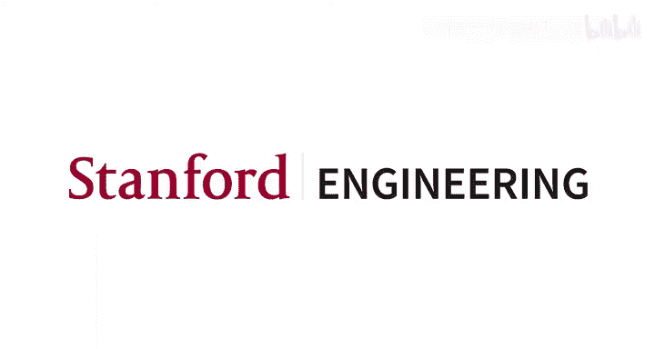
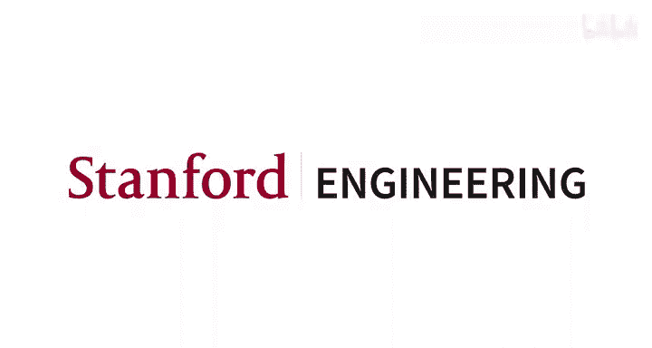

# 斯坦福大学《机器学习｜Stanford CS229 Machine Learning Course  Summer 2019 (Anand Avati)》 - P15：-15-.Lecture 15 - Reinforcement Learning - II.zh_en - GPT中英字幕课程资源 - BV1NDopY4ECg

Back， everyone。 So today。

We are going to start lecture number 15 and the topic for today is。Basically。

 what's left of reinforcement learning for the purposes of this course。

 we' are going to wrap up reinforcement learning today。So first， we're gonna。Discuss learn models。

 We are going to do this first and then then。Talk about extensions of the methods we've seen to continuous state settings。

 And we're going to cover two。Topics are there discretization and fitted value function or iteration。

And once we are done with these two that basically marks the end of whats part of the syllabus for this course。

 the parts that you'll be tested on and for the rest of the lecture once we are done with this we will do a quick survey of the larger reinforce reinforcement learning field in general。

 just talk about the different kinds of approaches that are there in reinforcement learning that we are not covering and kind of give you an approximate mind map of how to kind of relate all the different concepts in RL to each other。

Right。Before we jump into today's topics， lets do a quick review of what was covered on the previous class on Wednesday。

 so we started off with a formalism called Markov decision processes where this formalism。

Describes the setting in which there is an agent that is making sequential decisions over time。And。

An MDP or a Markout decision process is a couple of five entities。

 so first is a set of states set of all possible states that the agent can currently be in。

A is the set of all actions that an agent can take for simplicity， we assume that。

All actions can be taken in all states。PSA is what is called as the transition probabilities。

 So transition probabilities is we have a set of transition probabilities for the set of all states and the set of all actions what that specifically means is。

The pro， the transition probability。I each PSA is a probability distribution over the set of states and it is different for every every combination of S andA so if we are in current state s and we take current action a then the state that we will end up in for the next time step is distributed according to PSA。

So this is only describing how the world works。 right， Think of this as like the laws of physics。

 You take an action and you end up in some states。 This is how the world works。

And gamma is what we call as a discount factor。 It's a value between 0 and 1。

And R is it is a function。 it can either be a function of state or a function of a state and action pair。

 and it is the immediate reward function。 What is the immediate reward that we get for being in a particular state。

And there are these two central concepts in reinforcement learning that is beyond the MDP formalism。

calllled the policy and the value right these these two are kind of you can you can you can you know in a loose sense you can think of them as the dues of each other right so the policy basically is is the rule book that the agent follows right it tells us when we are in a current state S what is the action that we need to take and the action that we take based on the policy will decide which new new state will end up in based on the transition probabilities。

So the policy is is just a rule book of what action we need to take when we are in a particular state。

And the value value function is is like the long term accumulated or the expected long term accumulated reward along with a discount factor gamma so the v pi of s is the expected sum of all rewards。

😊，That is the reward at current state plus a discount times the reward at the second state plus a discount discount squared times the reward at the third state and so on。

 and it is the expected sum of these future rewards discounted future rewards assuming we are starting at a state s not equal to the point where we are evaluating the value function and assuming we are take you know we are following some particular policy pi。

RightAnd this is also called the Belman's equation and this this expected sum of future rewards can be expressed this way according to the Belman's equation there was a question from some student about how how we go from here to here and there is a short derivation that I posted on Piazza number 240 if you want to see how we went from here to here it is pretty straightforward。

😊，Now there was also a question of gamma yesterday you know should it be the same value should it be less than1 and so on the answer is it should be less than one strictly less than one it cannot be greater than one and it is this gamma that is less than one that makes the value function bounded。

So its easy to see if supposing gamma is equal to one。😊，Then in general。

 we could have accumulated we can keep accumulating rewards by an infinite amount。 and in general。

 the expectation need not be bound right the expected some of all future wars can explode to infinity。

 but because we have this discount factor gamma。Which is mostly mostly here for mathematical reasons just to make the value function boundary。

 but it also happens that it has nice interpretations such as you know the interest rate and whatnot if youre working in in an finance setting or you can think of it as you know the rate at which youre you know robots fuel is decreasing or whatever So you can have different kinds of interpretations for gamma。

 but it exists mostly for mathematical convenience to make the value function bounded and the reason why it's bounded is pretty pretty simple。

 you can see that you can this expectation is going to be less than you know。😊。

It's going to be we can show a quick proof here。 So this expected some of the words are of S1 plus gamma times。

 you know， so on。Will be less than expectation of。I'm just going to call it r star plus gamma times r star plus gamma square times r star etc cetera。

 where r star is the maximum possible reward that you can get in any possible state and once you have this you can take r star common and you get a one plus gamma plus gamma square and so on that is bounded So the expected sum of all future rewards will always be bounded。

If we use a gamma of less than one。And then。Based on these these two you know central concepts。

 policy and value， we can define something called as the optimal value function。

 So the optimal value function is the best possible long term value we can have。

If we were to choose a suitable policy， so if we were to optimize over all the possible policies that can exist what is the best possible future you know long term long term value that we can come up with right and this is similarly we can see that V star S is equal to can also be written as R of S plus。

Now maxax of a of this term and you know you can you can see that this is pretty intuitive what this means is v star of s is you know the the best possible long term value is equal to the sum of the current value that we got you know that that is immutable the reward that we got at the at the current step is the reward that we got at the current step no matter what our policy was。

And the。And choose， you know， this is a recursive definition and choose an action such that we maximize the long term reward at the next time step。

😊，Right so depending on which action we choose， we get a different probability distribution for the future a different transition probability distribution and take the expectation of the next time step according to the probability distribution。

 So max is basically。The， the， the max operator is choosing different。Transition probabilities。

 essentially right chooseose an action such that the resulting transition probabilities will give you the highest expected reward expected future value at the next time step。

 right So it is this this recursive definition。😊，Which also happens to be called Belman's equation。

 confusingly。This is also called the Belman's equation。And the。Corresponding to the value。

 the optimal value function， there is this implicit optimal policy。

 So the implicit optimal policy is any such policy that allows us to achieve the optimal value function。

RightIn， in in theory， it is possible that there exists multiple policy。 So strictly speaking。

 this should be。Element of this set of arc max， because this arc max。Well so。

Probably this should not the element。Yeah， so this this should be an element because there could be multiple actions that you can take in any step that gives you the optimal that maximizes the future value。

😊，But for the purpose of this course we assume that it is unique and it is this optimal policy that is is is kind of our you know that that is our end goal that is what we strive to achieve and when we say we want to solve an mP it means we want to find the pi star the optimal policy that you know in some way and that is called solving an mP。

😊，And then， we。We saw the relation between policy and value right the policy and value are kind of they have this intimate relationship where given a given given a policy pi。

😊，There is a corresponding value function that you achieve by just following that policy all the time。

And saw we saw this derivation last time where given a policy pi there is an associated v pi that can be derived in this way where this is the identity function and p pi is the transition transition matrix where for each state we choose the corresponding PSA according where the a is taken from pi and so from pi we can recover a v pi this way and this is called policy evaluation。

😊，That's one direction。 the other direction where you are given a value function right and this value function induces a policy which is also called the greedy policy with respect to V right and that policy is basically at any given state S。

Choose the action the action that is prescribed by this policy is basically the action that maximizes the the expected value of the next time step where the value is defined by the given value function。

Right， so this， we can， we can。We can go between policy to value and value to policy using these two relations。

Right。A subtle point to note。Is that。Given a policy。We get。

 we get a corresponding value function that that that' is kind of associated with this policy。

 However， a subtle point， which may not be obvious at at first sight is。

If we were to take this policy pi that was induced in this greedy way from this value function。

 right if if we were to follow this policy， the resulting value that we get is not this value function。

It may be a different value function。 right That's a subtle point。 A value function induces a policy。

 but if we were to follow this policy， it is not， we will not get the same value function。

 We need not get the same value function right that's a subtle point。

 and that's something that we' are going see in policy。And。

We saw one algorithm of solving MDP where the first algorithm we saw was value at。Now， Im in value。😊。

It is an iterative algorithm you know its called value iteration。

 It' is an iterative algorithm where we start at some arbitrary value function it could be the value function is equal to you can either set it to zeros or you can initialize it to the reward function itself you start at some value function right and we iterate it over and over where we take the the value function of the current iteration and run it through something whether its called the Belman backup operator right and we get the next value function and then we plug it in and get the next value function and so on and the beman value operator is defined in this way So the bellman backup operator is the you know if this is v。

😊，The prime of S is equal to。Where v prime is Belman operator on the previous V。

 So the the the value function for the next time shape is equal to r of s plus max of you know whatever expression here。

 And this thing here is basically the right hand side of the optimal value function。

RightAnd this is called the Belman backup operator。😊。

And we run this algorithm in a loop iteratively until we converge on a V a v function where v function stops stops changing and once we get that v function we can recover the corresponding policy using this expression so given a V that has converged through value iteration recover a policy and thats our you know optimal policy thats our solution to N MDP。

And the reason why this converges， we saw that it is possible to show that thisman beman backup operator is what is called as a contraction mapping。

😊，So if we imagine the space of functions， a functional space where each point here defines a value function。

 not。A point here represents an entire value function where the coordinate of that where where eat a coordinate along a particular axis is the value of the value function along that state right and the beman backup operator is a is a contraction mapping。

 which means if we take any two。Value functions run the two of them through the bellman operator right the distance between the outputs will be closer than the distance between the inputs right thats why it is called a contraction mapping because as you run as you apply points through the Belman back operator through this contraction mapping they get closer and closer right and the point at which they converge is called the fixed point of that operator and that fixed point is vstar right that v star is the optimal value。

Right。嗯。And then we saw this other algorithm called policy iteration right So this this was this is one possible algorithm for solving an MTP。

 This is another algorithm for solving an MTP。 And in this algorithm we basically exploit the subtlety that I mentioned earlier that。

From a given pi we get a corresponding v where this v is is the value that you get by following the policy pi。

However， there is a way from which you know the others other direction where we recover a policy。

By using the guidance of some value function right we use this value function estimate to choose a particular policy to do where we strive to do better where we strive to do our best given the current policy and using this policy if we actually use this policy the resulting value function may be different right and that is the subtlety that we make that we use over here。

 So start with some randomly initialized policy So。Random。And it off。はい。

And from this random initialization of pi we know we do step one from for a given pi we use we calculate the corresponding value function which is which is what we call as policy evaluation right and once we get the policy the corresponding policy v pi we get。

You know， we we we try to recover we try to calculate the optimal policy for this v。

And we do this over and over until pi converges。😊，And this is called policy iteration。 and the。

 the converged by。Will be pi star。Right， and。And once we get pi star， we can again recover V star。

And the pi star and V star that we get from this algorithm and the pi star and V star we get from this algorithms are essentially the same。

RightSo this is， this is how much we covered last in the last class。

 Any questions on this before we jump into today's topics。は cool。So today。

 we are going to start seeing extensions of these methods。

So the first extension we're going to see is what happens when we。When we don't know P SA。

 when what happens when。PSA。Is not given。So this is our first first extension。

And this corresponds to section 3 in the notes， you know， learning a model for an MP。

 So here when we in reinforcement learning。You when you when you see the literature。

 when you read textbooks and papers and so on， you will see this terminology called model based versus model free。

So over here in this terminology， model does not mean the model that we are constructing right So model over here refers to the model of the environmental model of the universe in which the agent is operating right That is the model that this is referring to and this essentially means here a model means。

PSA。Now， if you know PSA if you know how what state you might end up in depending on what action you took it means you know how the environment works right you know you have a model of the environment that is what this model means now PSA is also called the model and the the the first topic that we are going to cover is learning a model。

Again， here by learning a model， I mean learning PSA。So supposing we don't know how the。

How the how the how how the transitions were， We don't know what， what state we might end up with。

 and supposing just， you know， just assume PA is not given。 What do we do。And when PA is not given。

 the one， one thing that we can do is basically assuming we have some kind of， you know。

A simulator where you know we can we can run these experiments， start run run multiple trials。😊。

Run multiple trials where in each step， you start at some。

Some state as not take random action you know you not， you end up in S1。Taken at random action。S2。

And so on。 And then repeat a trial。It's not。And so on， right？

Each horizontal line corresponds to one trial right in the homework that you will see that we willll be releasing on Monday so you can think of each trial so the homework problem is about balancing the cartwhe or the inverted pendulum where the goal is you are given a stick and you which is which has one degree of freedom which can move around and its balanced on a cartwel the cartwhe also has one degree of freedom and you need to keep movingwing the cartwel to keep the stick balanced upright。

RightAnd a trial in such a case would be starting at some initial configuration， an initial position。

 an initial angle of the stick an initial velocity of the cart and the actions in that case would be to move the cart left or move move the cart right right so take some random action starting from some initial state until you know the stick falls down or some such terminating condition right and then start over again with a different starting state and you know take different actions you may be following some particular policy you may be taking random actions it does not matter we are basically exploring the environment we are learning the environment。

😊，And take some such actions like this。And then。Construct。Estimators for PSA from this。So。P。

 is gonna call it P hat。S a of S prime。Is equal to。The number of times。

Number of times we took action A。Act。State。S。And。😔，Got to。State S prime。Or。Number of。Times。😔，Wei。😔。

Talk。Action a。Hat。State S。Right， so。Run such trials， lots and lots of them。

And once once you run all these trials。We just count the number of times we were at state some particular S and took a particular action a。

And that goes into the denominator。And the number of times when we took that action in that state what what fraction of times did we arrive at state as prime so this is the simple maximum likelihood estimator of the transition probabilities。

😊，Right， and。ItIt might so happen that。Sometimes。Both of these could end up being 0 or 0。

we saw this in naive base when you are trying to get maximum likelihood estimates based on counts such as this it may so happen that for some of the cases we may we may have0 or0 in those cases it is common to you know a common practice in such cases when we get 0 or 0 is to assume。

A uniform。A uniform distribution for a P of essay， which means if we have never reached the state S and taken an action a from state S。

 just assume that we are you know that we are gonna we are gonna uniformly end up in any one of them Now the moment we actually end up taking an action at state S we can then update our count to reflect what the the actual。

The actual distribution was。The moment we reach state S and perform an action a。

 the denominator is no longer0。 it will be 1 right and then we we won't have the 0 over 0 until then you know。

 it is common to assume a uniform action it assume a uniform distribution over few future states。And。

Using this this kind of an estimate。Estimation of the of the states of the transition probabilities。

 we can now construct an algorithm。It looks like this。So， this is。An algorithm。With model learning。

Again， here by model， I mean PA， the transition probability。Right， so。Initnitiallyialize。

Pie randomly。Right。No。都啊。Repeat。Execute pie。For some time。Which means， basically。You， step one。

Or2 a rather2 a right So run a few trials where the actions you are choosing are based on the random initialization of pi。

B。Using。These trials。Estimate。P hat of essay。And by estimate T hat of S。

 basically this means estimate。S times a number of probability distribution where each distribution is over all the future states。

For each。S comm a， right， So there are S times a number of such probability distributions。

 So estimate all of them。And see。😊，Apply。Value iteration。 I'm just going to write it as V I。

Value iteration using P hat assay。Using P hat essay。To get。Updated。Vi。😔，Let's call it we， we。And D。

Update。Pi。To be。😔，Brey。What does do。Right， so what's this algorithm telling us。Start at some。

 some random initialization of policy， some random policy right and follow that policy for some time。

And by following this policy for some time， basically what we are trying to do is not only learn an estimate of our value function。

 but we are also learning PSA as well by following some some policy we are learning how the environment works。

 you take some action from a current state you end up in some new state right and you keep observing that again and again you tend to learn how the world works。

 you tend to learn how the dynamics of the system works right and thats like a separate task from estimating the value function learning how the dynamics of the environment works is a separate task from learning the value function corresponding to that policy。

 and using this experience， we can estimate P hatt essay。😊。

It is important to note that learning P hatt SA is independent of the policy that we were following。

😊，And in fact， what we can do is to estimate P hatt SA in each iteration。

 we can actually use the accumulated counts from all the previous iterations as well to get a better estimate of the P hat SAs。

😊，RightAnd using the estimated P hat assay， we perform value iteration。 Now。

 what was value iteration。😊，In value iteration。To remind you， this was value iteration。

In value iteration， we basically loop you know， so this this line over here。😊。

Apply value iteration means perform this loop until convergence。

So step 2 C is actually a full loop of value iteration。And in this value iteration。😊。

We see that we need to take an expectation。As part of computing value and it is for this expectation where we use the P hat essays instead of Ps。

😊，We don't know PA。 we are just。We are using data to construct an estimate P hatt essay and you know it is this P hat essay estimating this P hat essay that we call as learning a model right we use the estimated dynamics of the environment to to to perform value iteration and reach some V star。

😊，So， it is the v star of that particular iteration and the v star will change from iteration to iteration of that algorithm because we are using different dynamics in each iteration。

😊，Next question。So first， just。Estimate all the。Poss。

Yeah good question So the question is why not just perform a and B over and over until we are satisfied and then do c and D the reason why you know that might not work all the time is because unless you have a good policy you may not even read certain states。

Like to be。Understand the game where you have to exhaustively search the Scoma A。Yeah。

 so so the question is， we need you know， why not exhaustively search SA。

 all the states and all the actions？All twos and the reason that might not be possible in practice is because we may not be able to arbitrarily choose an s of our choice。

😊，Right we may be limited to start from certain starting initial states and explore by taking actions。

Maybe it may not be possible to say， you know， I want to start at some particular some particular state at some time and to to exhaustively try all possible S N sequences can be exponentially you know complex may you may not be able to do a brute force and do a full sweep that could take you know that could be exponentially logical。

 It could take years， for example， right to do a full sweep of the entire state and action space。

And that's why we we learn we follow this iterative approach where we where we。

Try some try some initial trials for some policy， get an estimate and then perform value and use that value it to drive the exploration in the next。

😊，Yes question。誘かで。To estimate。You and like to exhaustively search。不是。You can still use， like。

full episode。Like we can use substrs of it。Make a few if few start from。と番ま。And that's in the middle。

先輩？Yep。Like part of those episodes。So the question is， can we use parts of episodes as new episodes。

 And the answer is to， to， to calculate this。We are only calculating， you know。These links at a time。

we take S and S prime and count them to to estimate this so when we are when we are estimating the probabilities we take all the episodes that we have and only look at every consecutive S S prime triples。

Al， so this is an algorithm that we get where we are simultaneously performing value iteration and also learning the dynamics of the system。

 So at this step we will achieve the optimal value function。😊。

Assuming a certain given dynamics right for this particular dynamics of P hat S that weve that we've learned。

The resulting V at the end of one loop of this algorithm will give us the v star corresponding to that P hat S but that P hat SA might not be the correct dynamics of the system because it is just some kind of an estimate and then we use this the resulting pi star。

😊，To go back and perform some， get some more experience， run some more tries。

 improve what P had to say。😊，And then reest the value iteration。Now， one obvious。

Optimization or computational optimization is that when we start the value iteration in some in some loop。

😊，When when we describe value， we would always start the value function at 0。So， instead。

 what we can do is for the next in the next iteration， when we start value it。

 we can initialize the value function。😊，At the same point where we had converged in the previous function instead starting at at0 all the time。

 right and that will， that will allow us to have a much more faster convergence in step C。😊。

Any questions on this。Good。Yes， question。Step D。So step D is saying you know。

 update pi to be greedy with respect to VT and that is。This is awesome。Step  two。

 you have you get some V and you get the pi corresponding to that V。So。

So value iteration and policy iteration they assume that we know the dynamics right and when we don't know the dynamics what the exact transition probabilities are you know you can think of that as one relaxation of the MDP where we don't know what the exact transition probabilities is and and that gives us this algorithm this algorithm where we are simultaneously learning the dynamics learning the model and also performing value iteration according to the learned dynamics。

Next， we will。See another relaxation， which is。Thus far， we have limited our。

 our study to cases of or the types of MP where the states and the actions were discrete and finite。

 right we were limited to finite state and finite actions。 Now。

 what happens when the states is continuous What happens if。The set of all possible states is。

 is continuous， for example。In the inverted pendulum problem that you will be seeing in your next preset the the position of the pendulum which you are trying to maintain it upright。

The state of this， the pendulum can be represented by the angle it makes from。

The angle it makes from the horizontal horizontal floor or the horizontal table。

 wherever it is placed， right， and that angle is continuous。Right， so in， in， in。In kind of reality。

 the state of the pendulum or the state of your system or your agent。Is continuous。

And what do we do in that in in such situations， One obvious answer or one simplistic approach。

Is what is called as discretization。In discretization， the idea is pretty simple。😊。

Supposing our state。Assume that he。This is the S space of say the inverted pendulum problem。

 So as a reminder in the inverted pendulum problem， we have a cart。

That can move in along one direction and on top of that we have a stick。

That you are trying to balance and the stick could you know tilt this way or it could tilt this way according to the dynamics of the system right And if it is tilting this way。

 then we want to have a policy where we where we recognize that when you know the angle is turned is tilted to the left。

 then we want to move the cart to the left。 So the cart has actions move left or move right like two actions and the state can be you know any possible angle and any possible velocity。

 any possible position of this。Of the car。Right， so assume we have。Angle and。Velocity， right。

 so this。This space represents the set of all states that the system can be。However。

 the algorithms that we have studied so far。😊，Are all designed for finite state and finite actions。

RightSo a common， a common technique in， in such cases is to。Disretize the。Your state space。

Into discrete parts。So what used to be a continuous problem by discretization。

 we can turn it into a discrete problem or a discrete set and we generally have some kind of a bound。

😊，On the on the state space for example， angles are kind of limited between you know0 and 180 degrees so you know there is a natural boundary for even though it is continuous there is a natural boundary on both sides and similarly the velocity can be boundary between0 and the maximum velocity the cart can go you know whatever 10 miles per hour some some such thing and then we can discretize this state space into a discrete number of。

Actual states or the discrete number of， you know， virtual states that we will be working with。

This question。そあな。是 you you。Let's think the。え井さんのわざって。AndFor the state space。

 we can also explore some kind of cement。そ用な。Yeah， we could so so the question is we could we can limit this more using you know domain knowledge like symmetry and whatnot。

 but that's not the point here。 So the the the the main the main concern with such approaches。

 which we are coming to next is。Once we， once we come up with。

 you know a discretized state S prime or S hat， which where S was continuous。And this is discrete。

So this is the discretized version of of S。A common problem that we will see is you know。

 there are basically two problems。 So the first problem is。So the first problem is now。

 what happens So lets let's kind of switch back to， you know， supervised learning。

And linear regression， right， lets， let's step away from reinforcement learning for a brief moment。

 So if we had a data set like this。what kind of a model would you try to fit。

 supposeupply this x and this is y。 What kind of a model would we try to fit。

Linear right so this this looks like a perfect you know。

 perfect textbook case of a data set where linear regression would work very well right now in in linear regression。

 we would just fit a straight line through this。😊，However。

 if we were to perform discretization and learn the the appropriate y value within each discrete unit。

 we would get something like this。😊，Right，hich means now we are if， if we discretize it into。

Into bins and take the average in each bin to be the estimator for that bin right that is essentially what we are doing from moving from a continuous state to a discrete state by discretizing we would get a hypothesis like this。

😊，However， this is pretty bad because first you know it is much more complex right the number of parameters we need is the number of bins that we are breaking down breaking this down into and further we are not getting any kind of generalization Now what happens if our data set。

You know had some examples here and some examples here and we did not have any examples here discretization would just not work because we have never we have never seen what what what what happens in this bin So in these regions。

You know。We would have zero examples， and discretization is is a pretty bad thing to do in in in such cases。

 right Instead， we would rather have a simple。Straight line。

W whichch uses a much smaller number of parameters。And also。

 it can interpolate well in regions where we don't have a lot of examples。😊，Right， so this， this。

 this idea of。Of having some kind of a fitted function。Not only reduces。

The number of parameters that we need， but we also get some amount of generalization into regions where we don't have a lot of a lot of examples。

And that's the idea that we are going。Look into next。So as far as your。😊。

Homework problem is concerned。 we will actually be solving it with discretization and that's because it's a simple problem and thats you know its the purpose of the homework is to is to give you a framework to understand value and estimating estimating the transition probabilities。

 etcter。 However， in in larger problems in more complex problems。 discretization usually is is。😊。

It's not the first step that you can that you use in in in in some cases， you do use discretization。

 but there you need to kind of use some。you， you need to heavily use the domain knowledge of the problem space to reduce the dimensionality。

So。With discretization。😊，One problem is this this you know。

 we need to break it into multiple bins and you know it does not generalize well the other problem with discretization is what is called as the curse of dimensionality。

Which means suppose we have。Suppose we have a state space of。You， let's call it。6，6 states。

 So let's say we have things like the。Yeah， supposing it's， you know， we it's。

You are trying to learn learn a helicopter， then the number of states that you have are like the x position y position z position and and you know the the angle at which the helicopter is is。

Is pointing to。 So it's like how upward or downward the helicopter is pointing to or， you know。

So you have three different angles， the the the angle。

 the the angle at which the nose of the helicopter is pointing the angle at which it is。

Turn left or right。 And you know， theres there's one more angle， which。

I'm not familiar with flying helicopters but， but anyway， so you have you know。

 different kinds of angles and different。Vellocities， x x Y dot and z dot。

 So what's the velocity along the x axis， What's the velocity and the y axis。

 Whats the velocity and the z axis and all the angular velocity。 So theta dot。I thought。Side do。

 And I think Mr。Sa here。😔，So 1，2，3，4，5，6 plus。6， so you have 12 you know12 different coordinates in your state space and they all continuous。

And if you were to discretize them。Right let's say you were to discretize them into where each thing into say 10 units。

Right，You would， you would essentially get。10 to the 12 number of discretized states。Right， so each。

 each。Each coordinate of your state space is continuous and lets say you to scize them into 10 into 10 units or 10 bins。

 then the total size of your state space is essentially 10 to the 12。😊，And that's pretty massive。And。

And it and it is this exactly this kind of an explosion in states that is that you get due to discretization that is called the curse of dimensionality。

😊，Right， and it is。And that is probably one of the biggest limitations of discretization because the number of states as you add the number of components in your in your state space。

 it just just explodes。Right， and。That brings us to what is called as the value function approximation。

So in value function approximation。V。We now want to to work in a setting where S continues。S。Yes。😔。

Continuous。And。We don't discretize。And in this case。

 the most common setting is to have something to have some kind of a simulator。

So you have a simulator。And in this simulator accepts some state S T。Stunて。80。And you get。

S T plus one。So， assume you have some kind of a simulator where it takes as input the current state and the action and outputs the next state。

😊，And the， the the biggest difference between this and the previous。

Model that we were working with was that in the previous model， we had a finite number of states。😊。

And we had a multinoial kind of a distribution over the next state for every state and action pair what over here。

😊，The number of states is continuous and we have in place of of a multinoial kind of a model you know I am referring to the collection PSA as a collection of multinomials in place of a multinomial which work well in the discrete setting。

We instead have， you know assume we have some kind of a simulator where we feed a real valued input and some action and you get output as some other real valued state。

😊，Alright， and these simulators can be you know。A generally you know things like you know physics simulators are commonly used if you are working in some kind of a game playing scenario。

 you know， then the game engine can itself is the simulator and so on。

RightAnd now what we want to do is。Basically。Try to do the equivalent of this。In a continuous space。

Right， so you want to kind of transform this into a continuous setting。

This worked well because we were just counting。And it worked well because， you know。

 we could count discrete things。However， now we are in a continuous state and counting doesn't work anymore。

😊，Right， and。Here， we going use。And here， youre gonna。Learn the simulator to the extent possible。

And what do I mean by that what I mean by that is we are going to make an assumption。That。St plus 1。

Is equal to some function of。SD。80。喂。And this。Relation。A common thing， for example。

 what we could do is assume F of assume a linear form for this relations。

 which means f is linear so a。T plus。B。80。Where a is。A matrix and B is。Another matrix。

And you can think of supposing S is in。Let's say， Rd。Now， a is therefore in R D by D。And similarly。

 if a is in。Are en normal。Let's call it R P， then。B is in。Or。네발 비。

And for those of you who have you know some background in electrical engineering。

 you might recognize this as a linear dynamic system。😊，RightThere is。

 you have some particular state and you are taking some action and the action and the state。

Have this linear relationship to decide the next state。はい。

And assuming that your your that your environment has this kind of a linear dynamical relation。

 we can then do the equivalent thing of this， which is。😊，What should I raise？Probably， it is this。

Which is。Follow some policy。And。Run against basically get some experience against the simulator。one。

He not。one。😔，1。That's true。And so one， and another trial as。S's02。In order to。And so on。

So what's happening here is these these are trials that we are running according to some policy。

Against the simulator。And。From this， we collect。Ss and， these S。诶。S prime。Priiples。

 so S A got us to S prime。 This is one example。 S and S A got us to。

 The next X prime is another example and so on。 and we can。

Collect this data set of S A S prime triples。And then。Define a loss function。G of a commanda。

B is equal to。Some over I equals1 to n， assuming we do。And trials。And just to make the math simple。

 assuming we are terminating all of them at S。Right after you take three time steps。

Let's assume we just terminated。And。😔，Pgu。0，2 t -1。What we want to what we want to do is。

Minimize the square error between S plus  one。Of I。Minus。Yi。SD。Of系。PlussB。对的。Hい。

So define a cost function。Where the。St plus 1。Or the S prime is considered the true or the y label。

And this is your hypothesis。So this S plus  one， you think of this as y。

And this you think of it as theta and x where theta is a comma B and x is S comma a。

And now once you have a loss function like this。😊，You can solve it using gradient descent and recover A and B。

 where A and B are the parameters of this of this cost function。This question。Imiing the function。

我山了。This one turn。選て。Un us of the next state。So the the question is is this can we think of this as a policy because it takes S and A and gives us the next state so a policy。

😊，Takes us input the current state。And returns as output the action that we need to take while we are in this current state。

So this think of this as as the dynamics of the system right if you are in a current state and you take an action according to some policy。

 what is the new state that we are going to end up with。😊。

whereasas a policy will tell us if we are given the current state as what should A be that that is the policy。

😊，学生が？Considering policy as any。全ペリ。So， the question is are we not concerned about policy in a continuous state the answer is yes right now we are still in the state where we are doing something that is equivalent to learning the model and once we learn the model。

😊，We will plug it into some algorithm like this where we learn the model and estimate value and policy。

 We are， we are yet to construct the full algorithm。 We are only addressing。嗯。

This part of of of the corresponding algorithm of the continuousity。 Yes question。I the first one in。

That's correct。 So first sum is across trials。 The second sum is within a trial。 That's correct。That。

You call it a linear。So the question is why is this a linear a reasonable assumption it may or may not be a reasonable assumption This is just an example of how if you model it as a and B as as a linear dynamical system。

 then you can have a cost function like this and learn a suitable。😊，you know， a suitable model。

 you can。 you can absolutely use a more complex model over here and minimize you know。

 instead of A S T plus B A， you would have a more complex form here and you can minimize it。

 That's totally reasonable to。Will， we will will at this point。

 let's just assume that our model can be represented as a linear system。 most a lot of lot of。

A lot of examples can actually do pretty well in this and we will see you know what some changes can be done to this to actually you know work in a lot more cases shortly。

Yes question。So in this case， they。When we consider policy。

 it will't be a function because we are giving attendance value of。The state to be attending us。

An actionction， which are also。So so the question is in a continuous setting should the action also be real valued for the policy it need not be so you can have continuous states but still discrete actions for example。

 if you are trying to balance a carpo your state can be continuous where you know the states are angles and velocities but your action can still be discrete can be move left or move right。

So you you can you can yeah having continuous state does not mean your action also have to be continuous in in cases when the action is discrete and state is continuous。

 your policy will take continuous input and output discrete。ルビアファンチナさんで。The point is。Yes。

When we compare it to the previous examples。P policy was just a matrix。Mmhmm。Yes。

 now policy will will will be some kind of。Of our function， yes。So policy it So。

 so one thing to notice， should a policy always be。A function。 So if you see this relation over here。

So what you do in So the policy， if you。Think of it as something in this form。

Right they the induced policy according to some V and it need not actually have any particular functional form。

It can just evaluate the v function， which takes a continuous input at different possible according to different possible actions。

😊，And you can get the the next state according to the dynamical system that we that we constructed。

and evaluate the value function at the new states and you can just take the ag max。So。

 so the policy can be kind of implicit or induced according to some value function in some model。

 It need not always be an explicit functional form。All right。Then if we minimize this cost， So a hat。

Coma， B hat equals。Argument。Of a comma B。Then a hat and B hat will be our learned model by again by model。

 I mean the you know what we have learned about the way the world works。

This A hat and B hat is you can think of it as the equivalent of P hat to say。

So P hat essay gave us a way to relate state in action to the next state and here A hat P hat gives us a way to relate state in action to the next state。

😊，First question。You give me。Exle， that there is certain。好。We'll come to Cas T next。嗯。So。

 the model that we learned with the linear model that we learned。Is。Was deterministic， in some sense。

 that。S， P plus 1。Liqu to。Ahat。S T。Plus。Be hat。80 right。

 So once we minimize A hat and B hat according to this。According to this this cost function。

 we will recover some a hat and B hat and the the prediction that we are going to make for the next state is according to this。

But in general， so if we just limit ourselves to this， we would call this a deterministic model。😊。

But in reality， it is always a good idea to have to to have some kind of stochasticity in in your model。

 which means we want to estimate。😊，You want to predict S3 plus 1。Be equal to a hat。S T plus。Bhat。80。

Plus， some epsilon。Right， where epsilon。Comes from， you know。

 a common choice is a normal distribution that has mean  zero and some covariance sigma。

And it is also possible to learn this sigma from data。😊，Basically。

 the way to think of this covariance is to you， you can estimate this covariance as one over n times one over。

T minus-1。S。Ding。😔，S。I T plus 1 minus。Yi。😔，S，P I。Plus， B。P I。😔，BAI。D。

Transpose right So this is just the if if you know you you've done this with GDA， you you know。

 this is something you should be familiar with， which is the maximum likelihood estimate of a covariance is will be just the residual residual transpose across all the examples。

😊，Yes question。Because this is， were summing across all。Nity。Right， so it is。In general。

 it is considered a good practice to build stochastic models。😊。

Where the prediction that we make about the next state。Is。

Follows this format where for each prediction， we sample。An epsilon。

 according to this distribution and this distribution is learned where the covariance is estimated this way so you can think of sigma hat as this。

This question。嗯。And that's around。Let's say， like you said。of。How many times have you can to。

So the question is for the Pet we you know。You will not be doing any of this for the Pet right in general the the question is you know。

 when when do we know we have collected enough evidence or or experience。When this。

 in case of the discrete setting， you can you know stop when the V stars that you get at the end of each iteration starts converging。

😊，So the question is， you know， you can you can phrase the same question as when do you know you have your estimate of P hat essay is sufficient。

 you know， which is the same as when when is the estimate of A and B you know sufficiently correct And in this case you can consider as sufficient when this overall you know this。

Outer loop converges。For for di part on legacy on the piece。We know like how many times。

 How many episodes。Yeah so again， so for the Pet we have instructions given in the Pet itself you can follow those instructions and and the idea in general is that your your value function stops changing over time right that that's a good sign。

嗯。So instead of constructing a deterministic model you can it is always better to construct a stochastic model where the noise that you want to induce into the stochastic system can also be estimated using using MLE A and B are estimated using MLE and then we can also estimate the noise that you want to induce which is kind of consistent with the the。

😊，With the errors that you are making can also be learned this way。

 And when you are making an next prediction， you know。

 just sample some noise according to that covariance and make your you know。

 a noisy prediction every time。😊，So this is how we would learn a model。そ。Learn。A model in。

Continuous setting。Right。Now let now lets see after having addressed modeling the modeling the environment itself has continuous now what do we do about the value function itself because。

If you remember。If you remember， for example， in this example。😊。

S comes up in in the model in the in the transition and s comes as an input to V right in the discrete setting v was just an array。

Where we had as the length of the array equal to the number of states that we had。

And the transition function or the or the environment was also a matrix where the number of states was continuous so it was just a matrix。

 but now when we move to continuous states。😊，The transitions are the are the environment or the model you know can be made continuous。

 Next， we need to make the value function also continuous。Right， and a common approach for。

For doing that is to first。Think of our。Think of our value function as。You know， V of S。Is equal to。

Aest plus。Gmmar times。Yeah， my thanks。Max a。Expectation of S prime from。P here。Fi。😔，Thats prime。No。

PS，A。You can think of PA from， you know， this model as。

PSA is equal to some normal distribution where the mean is。Yi。S plus B A。And。Covariance is the。

Covariance that we estimated here。So you can think of this as PA， where you sample the next state。

 according to。This， and。And so this can now， you can think of it as。R of S。Plus， gamma times。Max a。

Take个。P of。PS， SA of。Thats prime。Time。V。😔，This prime。 this is the。Gaauian， Pef。So。

 you can think of the value function as this analog of the discrete version where the expectation is now over a continuous random variable instead of a discrete random variable and the input to the value function is also a continuous continuous value。

😊，And。This identity is， is you know， is again。Is also called the Belman equation， because it's。

Wellman equation， it's just the continuous version of the discrete setting， however。

What we end up doing in practice is to use。What is called as。

Fitted value function or the value function approximation。Value function approximation。

 where we say v of S is equal to， you know， for example， in this case， let's assume。

AS theatre transpose。Fee of。Just like linear regression with some kind of a feature map。

 you construct a feature map of your state space using you know whatever domain knowledge you have and assume you have some kind of a linear relationship for for the value of a function based on the state that is that its in。

😊，and with this assumption。What we， what we want to do is。Try to come up with a value function。

 a v function that has this form but satisfies the Belman equation which was basically what we did with with the value iteration in the discrete case and we are going to now do the same thing with the continuous in the continuous case。

😊，So this gives us an algorithm。With these assumptions， it looks like this。

So now this is an algorithm。Where we are using。嗯。Continuous state。With， you know， some model。

Where the model in this， you know， you can assume it to be a linear dynamical system with， you know。

 where you have the A and B made of C and we as you we are doing。Value。Function， approximation。Right。

 so here this was。S。T plus  one equals。诶。SD。B。80。The value function approximation。

 where we have V of S。Is equalqu to theta transpose。Fee of this。So。

 this algorithm is basically an adaptation of this algorithm。😊，But to the setting of。

Of continuous states and value function approximation。Over here。

Both the states and the value functions。 you can。 You can think of them as non parametric。

 which means we did not have a family of。Some kind of a family of functions for V or PA。However。

 these are parametric in the sense that the transition of the model has A and B as the parameters or if you are having epsilon it has sigma is also a parameter and the value function has theta as the parameter。

😊，哎。So it is basically an adaptation of that algorithm into the setting。😊，So， step 1。Randomly。Sampbo。

N states。Call them。S1。As to。S N。In S。2。Initialize。Theta be 0。And step 3。Repeat。Until convergence。Now。

 there is an inner loop here。4 I equals 1。Till N。The inner loop。Is there a question。是。

For equals one through n。Also sorry there's an inner loop， between tin this as well。For。Y。嗯。

The action space。三0。S1 prime。The S K prime。From P。S。Hi。😔，诶。Right， so in this case， it could be。

 for example。The normal distribution with。A。I plus。Be a covariant sigma hat， for example。And then。

 set。Q诶。Is equal to。The averagever 1 over k。系。J equals 1， through k。R of S。Ai。😔，Plus。Gamma of。V of S。

J prime。Again， where hero。V off。S is equal to theta transpose。Fe office。Right。

So we do this for each action。And then。Continue it over here。Set Y， I equals。Equals。Max a。Q of a。

That ends。This， so let's call this as a start a start。B and start C。 So this is finish C。

This is finished。Bi。And then。Set theatre had。Equals。😔，Arg Manta。I equals 1 to n。Theta transpo。Fo。😔，S。

 I。mininus。Yi。Square。This， this is finish。So start A ends with finish A and start B ends with finish B and start C ends with finish C。

All。So what's happening here？First， we start by initializing the the theta of our value function class to be some to some value you know theta equals 0。

And then， we repeat。This iteration over and over where first。For each example， our goal is for each。

For each。Aiyi。😔，In。Yeah， so for。For each of the states that we have sampled randomly。

We want to we want to come up with an estimate y i for each S that is the goal here of the outer loop。

 So for each of the states that we have sampled we want to come up with Y I， which is our。

Think of why I as the。Label for V of。S I。So， we want to construct an estimate of v of S for each I and that is what the the start B to end B achieves。

And the way we go about doing that is at each for each S。😊，Take all the possible actions。

 starting from。S I。And for each action。😊，We sample k next states， so for each。S I and action。

 we get k number of next states sample according to the transition。And this transition。

 we are going to use the learn model。 It could be a linear dynamical system。 It could be you know。

 anything。More complex。And then。We are going to define this quantity Q of a。As the。Expected value。

Of taking that action from that state。So Q of a is the average of R of S plus gamma of v of the next state and average across all the Js。

Does not make sense so you are going to take you are going to start with some sum random state s。

And from this S， we are going to take all the possible actions a， a1。He to。A in this case， you know。

 capital a， you' are going to take all the possible actions from each state。

And for each action that we take。We are going to get k number of S prime， So S prime 1 until。

S prime K。For each action， and similarly。Get S prime1 until S prime k for each action for each state。

Right， and then。From each of those。Final stage， we are going to evaluate the value according to the current estimate of the v function。

RightSo the current estimate of the v function uses the theta value we have so far。

In the first iteration it is going to be 0 after that it is going to be something else。😊。

According to the current estimate of the v function。We are going to estimate the。

 the were going to use the evaluation of these states。

Using the current estimate of the value function。 And we are going construct this。Q value as the。

As the expected。Value of taking this action。This function。 S question。Yes， fear。

So P of S is is just a feature map and you define P of s according to your problem setting right so in in homework 1 we define feature maps with sinusoidal squared polynomials。

 etc ceter。 you define some such feature map for your state space。Yes question。Likequi。

I'll come to that for now， assume we has this linear relationship。so what we do is for each S。

 we take all the possible actions and from each possible action， you know， sample new states。

And for each of those new states calculate the value of the each new state。😊。

According to the value function approximation that we have。

And then take the average and this Q is now an approximation for。So Q is therefore an approximation。

Q of。H。Q of a is， therefore， approximately。A of。S I。Plus。

 gma times expectation of S prime and Q Oh sorry。A sp of P SA of。V of S prime。

So the Q value that we constructed is。And is approximately this and the reason is because so r is just a constant so you can actually take out r from this averaging right and what remains here you know this what we are seeing here is therefore a Monte Carlo version estimate of this expectation right it is a Monte Carlo expectation because we are approximating the transition with k items。

And。It is also an approximation of V because we are only using the current estimate of of the V of the value function with this functional form。

Yes。So Q of a is the estimated is the expected。Expect long term value for taking from this state for taking action A。

Yeah， so you can think of it as Q of Scom I。 That's fine， too。 So yeah， Q of。That's prime。

 that's fine。 So， right， so this Q is an approximation of。Of the right hand side， of the， of the。

right hand side of the Belmon equation。Right， so now。We define Y I。As the max or Q I。 So Y I。

There's no。Max a。Of Q， I。Of， of Q， A and Q， A is basically。A of。S I。Plus。Max a of。Gmma times。

Gmma times the expectation of S prime from PA of。Me yes。

so y i which is max over Q a is max over you know max with respect to a of this thing and therefore it is you know when we apply the max r comes out of the max because there is no a term and it is max over a of this term。

😊，And this now looks like the Belman upgrade operator， right。Or the Belman backup operator。

So according to the Belman backup operator， we should have one set V of。S。To be equal to this。Right。

 but。Our V takes this。Prametric form。 So we just cannot set v of S to be some value right because v is not an array and we are not setting the S element to be some value。

 What we instead want to do because we are in this value function setting is to minimize the distance between Y I and V of S I。

 and that's exactly what we are going to do。 We are going minimize the distance between why Y I and V of S I。

Next question。V is not a vector because s is continuous we are in the continuous setting and we are you know we are we are approximating this continuous function with this linear form。

😊，This is continuous important。F of this is just a feature map for you know， some S。But。So。

The way to think about this is to see the similarity with the Belman backup operator in case of the Belman backup operator we would have v of S to be equal to r of S plus max of a over this expectation of v of s prime。

😊，Instead， because we are in the in this you know fitted value fitted function setting。

 we are going to approximate this expectation with the Monte Carlo expectation that is you know this is the Monte Carlo expectation。

😊，So this this expectation is going to come in here。

R of si is r ofsi and this will evaluate to some y of si which in the discrete setting we would have just set it as the as the width element or the s element of the V array but instead we are in you know a fitted function setting which means we want v of s to evaluate to y or as close to y as possible right which is why we minimize the squared error between p of p so think of this as。

😊，V of S I。And this is the RHs。offff。The Belman backer operator。So what's happening here？哎。Is that。

 first of all，Let's see the a few things。 you know， the weight is similar to this。 So first of all。

Here we are in the discrete setting we were learning both the model and performing value iteration kind of intertwined。

😊，And we are trying to do something similar here。In the sense。We are first。

In this setting we are we are learning the A's and Bs， the dynamics， which is equivalent to this。😊。

First。We are not doing it intertwined， but we are first learning the dynamics and using those dynamics。

😊，We are now performing valueeration。😊，Using the beman backup operator。

 but we are performing it in such a way that the the the beman backup operator is working with these fitted value functions。

😊，Right， instead of the true value functions。And another way to kind of understand this better is。

Right。If you remember value。And so S1 through S。D right in the in the fitted in the discrete setting we had you know supposing this was V star。

you start with some you know， random initialization we not and apply the beman backup operator to get。

We won and we would keep getting closer to closer and closer。喂。Where each hop was。

One application of the Belman backup operator。And the Bman backup operator was a contraction mapping。

 so no matter where it started， you would converge at wester。😊，But now， in this setting。😊，This。

 the space of value functions is somewhat limited。 We are limiting ourselves to only those that can be expressed as a linear combination of the feature map of S。

😊，Which means this whole algorithm is。Kind of limited to some set of。You know， think of this as。

Set of。All v， which can be you know such that v of S equals。Theta transpose phi of S。Right。

This family of functions cannot represent all the possible。Functions in this functional space。 right。

 So we kind of limited in that sense。And。When we， if we start with some value function over here。

And we。Apply one iteration of this fitted value algorithm， fitted value iteration。It will give us。

 So， let me。So if we are over here， let's call this V of。T。

 the fitted value iteration might give us Y I such that。

Yhy I is over here that it might be outside our functional space， the set of Y eyes。

 So we ideally want V of。S I to be equal to Y I。we want V of S I to be equal to I。

 We want this to be 0。Right， but this。Why maybe outside our， our。Our functional space。And therefore。

 when we perform this minimization， we are going get。😊。

The nearest the projection of Yi onto this subspace right that thats exactly you know the what what happened in linear regression。

 we are going to get this function。Over here， which is the projection of y onto this onto this space。

 the nearest point in our。Family of functions。 that is nearest y， right， And then were。

 we're probably going to keep hopping。You know， by， by keeping ourselves within。The family of。

 of the V functions。Of this parametric space that we have defined。

And get as close as possible to westar。That's what this， this algorithm will do us。

 This algorithm does not have the convergence guarantees of the discrete space setting in the discrete space setting。

 the Belman backup operator would take us to the true v star after a certain number of trials whereas in the fitted value functions we have limited ourselves to some space。

 and V star might be out of the space。 there's no guarantee。

 and there is no guarantee that this algorithm will converge。 But in practice， it you know。

 it generally tends to work well。😊，Next question。連明あ。这。検査して。

So think of this as some kind of a functional space。

 Don't think of this as as you know yeah just think of as some functional space where the the set of all functions that can be defined in this form is is limited to some kind of a set。

嗯。Yeah， I'm coming to that next name。Yeah， so your V star can be outside these set of all functions。

 Yes， question。Yes， here we are still assuming actions are discrete because we are performing a max over the different Qs。

 We are still assuming actions are discrete。 Good question。We can decide。I forみ。Y。Right the。

 the fact that we are minimizing this， you know， think of this as the the resulting theta transpo S I after minimizing this。

After minimizing this squared error， the result you know once we do this so。

V hat of S is equal to theta hat of phi of S。So this is essentially the projection of y on to the nearest point in the function。

Also， why why why you not P that belong to that space because Yeah， So the question is， yeah， that's。

 that's， that's something I'm coming going not next。喂。So， there are。

There are there are we weve seen two kind of extensions to the standard policy iteration and value iteration so far。

 one extension was when we don't know the model when we don't know the transition probabilities we estimated from data right PSA and the other extension that we saw was to move on to this continuous setting。

From discrete setting and once we move into continuous setting。😊。

The number of parameters we have can potentially be infinite。And therefore， we limit ourselves。

 limit our expressivity to some kind of parametric family model。

Right and once we are in limited to this。To this。Parametric family of value functions。

 which we call as value function approximation。We then define an algorithm， which is。You know。

 kind of similar in spirit to the value iteration。It is similar in spirit because we are performing the same kind of updates。

 except when we are。😊，in the value iteration we could just set the value that v of s needed to evaluate to。

 however， in the because we are now limited to a parametric family。

 what we do is minimize the loss between what our hypothesis can predict and what the right answer should be。

😊，Right， now there are， you know， based on these two extensions， we can。

So this this basically kind of marks the end of whats kind of in syllabus？😊。

Let's see how we can you know some of the other concepts in reinforcement learning and how we can think of the other concepts that you may come across as extensions for what we have seen so far。

Right。In reinforcement learning。In the in the broader space， right。We can think of。

Two approaches in general。The two approaches are。Approaches based on value functions and approaches based on。

Policies。So， value。Fangsin。Based approaches versus。Policy based。Right，So in the simples setting。

Right， when everything is discrete and finite。Then it' is basically the value。😊。

And the policy based approaching is basically the policy iteration。

And as we move on to more as we move on in terms of the complexity hierarchy。😊，When we move on to。

Infinite space。Infinite state space。We get the fitted value。So。

 fitted valuation is basically this algorithm that we saw。😊，Right， and。In both these algorithms。

We call both these algorithms as model based algorithms。

 We call them model based algorithms because we we constructed explicit versions of the way we believe that the model works right It was either in the form of the P transition matrix or it was in the form of this linear dynamical system where S S T plus1 was。

😊，Distributed， according to。A normal equation。Right either we constructed a dynamical system approximation of the of the model or we used you know directly the PS a transition matrix for the finite finite state case。

 however。We can move on to， you know， model free methods。In the model free methods。

 right we acknowledge that we don't know how the model how the real world works or how the dynamics of the system works。

But we also say we dont care how it works whereas in model based approaches we acknowledge that we didn't know and we tried to learn it right in model three approaches we say we don't know how how the world works。

 we dont know how the transitions happen and we don't care and the way we say we don't care is by coming up with what is called as a Q function。

Right， and the Q function is basically think of it as， you know， Q of S。A to be。The value。

The expected value of being in state S and taking an action a。And the reason why， you know。

 even though it seems like a simple edition of an action。It is fundamentally very different。

 The reason why it is very different is because supposing we learned you know v star of s and we don't know how the dynamics of the system works。

 but we still somehow figured out the optimal value of being in each being in for some state Now how do we decide what the action is。

There's no way because we don't know which state we will end up in by taking some action because we don't know how the dynamics of the system works。

 So knowing we start is insufficient if you don't know the dynamics of the system。

And the way we go about go about the limitation is to instead learn these Q functions。😊。

Whi are which is basically the Q function is basically telling us what is the expected sum of all future rewards Dised some of future rewards if we are at state S and taken action A。

😊，We don't know what state we are going to end up in but if we take this action from the state you know the Q of S tells us whats the expect or some of future awards right we just stay agnostic to which state we are going to end up in and directly assign a value to taking an action at a given state。

And these techniques are called Q learning。And we can apply Q learning function approximation to Q learning as well。

 We saw function approximation applied to value functions。😊，And just just in a very similar way。

 you can， we can perform function of approximation for Q values or for the Q function。😊，Right。And。

We saw an example where the family of， of， of of the function space with which we performed approximation was linear。

But there's nothing stopping us from using more complex functions。 right， So this。

So this approximation of the value function using a linear function。

 this could have been something much more complex。 We could have used a neural network here。

where the input was s and the output was the value at the last layer and when we are minimizing this you know use back propagation and minimize the loss with respect to you know the parameters of a neural network。

There is nothing that stopped us from doing it。And when we use neural networks as the function approximators for either the value function or the Q function。

 that basically gives us the field of D parallel。De reinforcement learning。

 So you can use deep reinforcement learning by using neural networks as appximators for your value function or the Q function。

There is another。There are are other approaches other kinds of classifications you can think of in the finite case the way we evaluated the value function was using something called as exact method。

😊，So the Belllman back operator， when you apply it over and over again， you get the exact V star。

And there are other approaches where we can either you can use Markov chains or Monte Carlo approaches。

 not Markov chain Monte Carlo approaches， or you can use something called as TD learning or temporal difference learning。

TD learning so in in Monte Carro approaches what we do is we take some value。

 we take some policy and just follow that policy。Until the end。Until we reach a terminating state。

And then。Average and then calculate the discounter sum of rewards and use that as as the estimate of the value function。

 Let's actually try it out and measure how much total value you got and average it across multiple runs。

 thats Monte Carlo based。 However， the limitation with that is that you got to follow the policy until things terminate whereas there is there is something called TD learning or temporal difference learning that is something in between exact and Monte Carlo。

 And in fact， in practice， TD learning is what' is used most commonly。😊。

If you are using so TD learning is in fact something very similar to this what we did over here is something very similar to TD learning。

 thats TD learning means temporal defense learning。That's probably all that。

I wanted to so there there is probably one more thing I want to say so there is another another kind of line of line of classification you can use for a reinforcement learning algorithm there is something called。

On policy。Versus off policy。Methods so on policy methods you are trying to learn the value function by staying on the given policy whereas with of policy you know youre looking at data that that was where the trajectories were were obtained from some other policy and you are trying to learn the value function of a new policy that you are trying to come up with and this off policy method has you know for those of you who have a more statistical background of policy methods and reinforcement reinforcement learning has a strong connection to causal inference。

Because in causal inference you are seeing some observational data and you are trying to work your way backwards to decide you know what would have happened if we had taken some other action instead and that has kind of pretty strong ties to causal inference where here we are observing a sequence of actions that were taken according to some policy and we are trying to answer what would have happened if we had tried some other policy instead。

So reinforcement learning is a vast area of machine learning and in fact probably reinforcement learning has its roots in mostly in the field of electrical engineering called optimal control and I think its history is probably older than machine learning in general and so it's a pretty vast field and there are lots of ways in which you can use machine learning and the most common way or the most popular way where machine learning and reinforcement learning are kind of coming together is is using more expressive function approximation methods to approximate either the value function or the Q function using neural networks or deep learning techniques and also there is you can also use neural networks for policy based methods for something called policy tradition though we didn't cover any of that in this course。

😊，All right so that brings us to an end to reinforcement learning and starting Monday we will start the next chapter which is unsupervised learning right have a good weekend。

😊。

