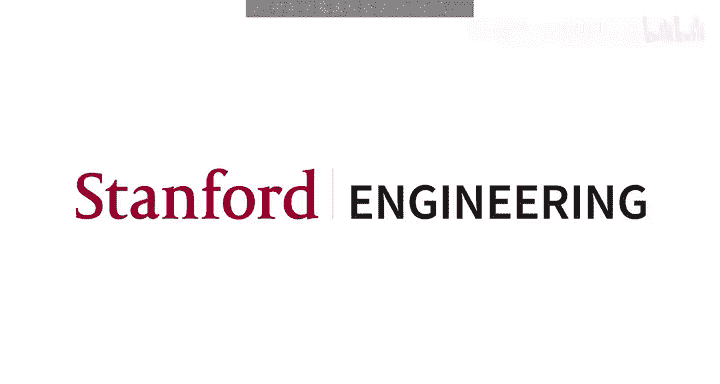
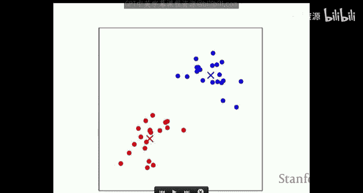
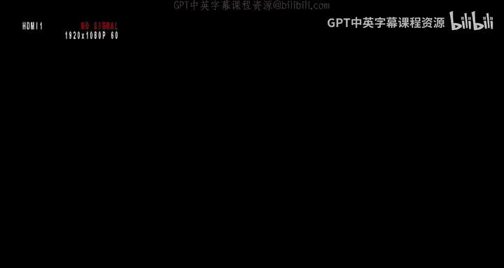
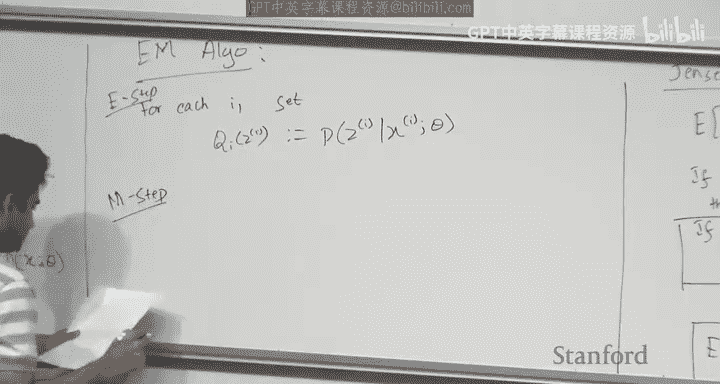
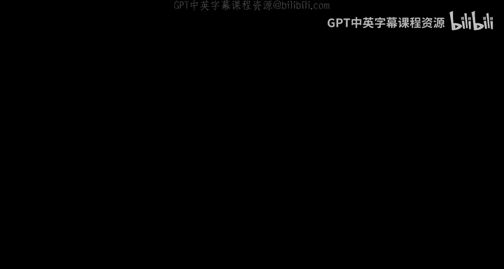
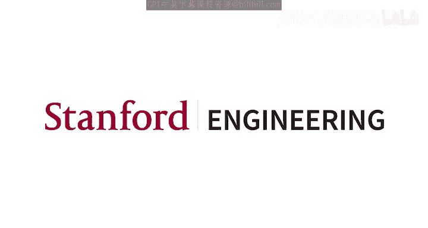

# 斯坦福大学《机器学习｜Stanford CS229 Machine Learning Course  Summer 2019 (Anand Avati)》 - P16：-16-.Lecture 16 - K-means, GMM, and EM.zh_en - GPT中英字幕课程资源 - BV1NDopY4ECg

Allright， welcome back everyone。 Hope you had a good weekend， So this is lecture 16 of CS2 tonight。

And today we are going to start a new chapter on unsupervised learning。

So unsupervised learning will be the broad topic for the rest of this week and parts of next week。

And the specific topics for today are the Kmin means algorithm， the mixture of Gaussians。

 which is also called the GMM or Gaus Gaussian mixture models and the expectation maximization algorithm。

😊，And to jumping into today's topics， so what youve seen so far is the first few weeks， first three。

 four weeks or so， we covered supervised learning where we were trying to learn a function that maps X to Y and we were given pairs of X Y as our training set or examples。

😊，And then。After supervised learning we went into some learning theory。

 we studied bias variance trade off in the bias variance analysis and saw a little bit into generalization。

And then we last week we saw reinforcement learning where the goal in reinforcement learning is rather than minimizing some kind of a loss function we want to maximize the value by choosing a suitable policy right and here value is the long term cumulative sum of discounted rewards and we want to maximize the long term reward by choosing a policy。

😊，Now， the new chapter we are going to start today starting today is unsupervised learning。

And in the unsupervised learning case， we are given a data set generally。A collection of。X1。X2。

 et cetera。And。And we do not have a corresponding y variable associated with each x variable。

 We are just given a set of collect examples a set of xs where each X I。Is in。

R D in a D dimensional wheel space， for example。And our goal is to learn some kind of a structure in these xes。

We don't have a corresponding correct answer， we don't have what is otherwise called supervision of what the correct answer is for e x。

 but in general we are just given some some a collection of x's and and the goal is to find some kind of an interesting structure in these x's that hopefully gives us some new insight。

Right， so we've seen。Logistic regression before。 and in the case of logics， logistic regression。X1。

XD， let me use a few colors here。We had some。You were given a data set like this。

And our goal was to find a separating hyperplane。That was this is is supervised learning because we are given the correct answer。

 that is the color of each point along with the point itself。😊，Whereas in the unsupervised learning。

 the problem would translate to something like this。We are given some points。Just the excess。

And our goal now is to learn some kind of an interesting structure here right previously we had we had the correct answer for each for each input now we are just given a collection of x's and a reasonable structure to find in this are these two clusters。

😊，So， loosely speaking， we want to look for such structures。😊，With when we have given just excess。

 however， this problem is generally not very well defined in the first case for each point we were told what the correct answer is。

 but consider a problem like this。😊，And if you are asked to find an interesting sub structure in this kind of a data。

 it would be totally reasonable to say this。😊，Is one cluster this is one cluster and this is another cluster right and another totally reasonable thing would be to say this is one cluster and this is one cluster right so in a way there is no correct answer so to speak and our goal is to learn some kind of an interesting structure in the presence of such kind of ambiguities。

Right， the。The way to you you want to think of this is classification problems in the supervised setting are somewhat。

Related to clustering problems in the unsupervised setting。

 where the cluster identity is like the class label。And we want to looking at just the x's。

 find out both how many number of classes there are and also to which class each example belongs to。

😊，RightAnd why would this be interesting， So， for example。

This would be interesting for example for in examples where supposing you have you are working at a marketing department and you have information about your customers right and the information about your customers can be represented in some kind of vector space where you know you have the age of the customer here you have you know their。

😊，Annual income。And on another axis， you might have their geographical location。

And each customer would be a point in the space。Right， and now as a， as a， as a。

As a person who is working in in marketing， you might be interested to perform some kind of a market segmentation to identify。

groupsups of customers so that you can do some kind of a targeted you know advertising or marketing campaign or some such thing。

 right So that that's just one example of how why unsupervised learning might be， you know。

 interesting。So the first unsupervised learning algorithm that we'll be seeing is something called as the the K means clustering algorithm。

And the K means clustering algorithm is pretty straightforward。

This is probably one of the simplest algorithms for unsuffvised learning。平面すか。So。

 we are given a data set of n examples。X1。True。X， N。Where each。X， I is in。RD。Right。

 and our goal is to。Group them into K clusters。And for the purposes of the algorithm we will assume that kine is given to us。

😊，And the algorithm goes like this。Initialize。Clluster centides。Nuwen。Muttu。UK。

 so you have one centroid per cluster。Where each of them are in RD randomly。

So each of these mu and muum mu is a vector。😊，Previously in， in our nots， generally having a suffix。

To a variable generally meant it was a scalar right but in this case mu one。😊，Is a full vector。

RightAnd there are k such。Full vectors you want from UK and we initialize them randomly and then we repeat the central convergence。

😊，Repeat。Until。Convergence。4。Every eye。Where I denote the example number。Seect。Ci I。Equal to。Arg。Min。

Gi。X， I minus。Muzhi。Square。And then that's step 1 and step 2。For every。J， where J is now。

Where J indicates the cluster identity。Set。Muzhi。s equal to。S over I equals 1 to n。Indicator of。C。

 I equals。Jy。X， I。And some of I equals  one。To end。Indicator。C， I equals。Zhi。

So what are we doing here？Kmeenes is an iterative algorithm where we are given a set of n examples。

 which we index by I。And we want to identify k clusters where the K clusters are indexed by J。

We initialize the cluster centroids randomly。😊，When mu1 from UK are each。A vector in RD。

And we repeat until convergence where for every。For every eye， we set。

C i here C C you can think of C as an array of length n where for each example there is a corresponding C for everyxi there is a corresponding C and we set C to be the identity that is the R bin of J identity of the nearest mean。

😊，Right， and based on the set C。Vectctor or CRA， we then recalculate muj。Where muj is。

Calculated as the mean of all Xs for which C equals J。Next question。私もいう。

So as I said already for now let us assume k is told to us now we are given what k is and this is the algorithm and the way it is a pretty straightforward algorithm where we where we alternate between one step where we are where we are calculating the cluster identities for each example and in the other step where we are recalculating the cluster centroids。

😊，And this is probably seen through a simple visualization。Which well have a quick look at。

Any questions on this so far yes？And把せ。So the question is what happens can we use an unsupervised learning setting to learn the different cluster centers and use that as a classification algorithm？

当ずレズでし。Yeah， it might or it might not behave the same way as a supervised learning algorithm。Yeah。

 so supposing this is you know， think of this as a collection of points that are given to us where each green point is you know is a data point in X and RD。

😊，And the way the algorithm works like this。😊，W here we assume k equals 2 and the red x and the blue x。

 you can think of them as mu1 and mu 2， which are randomly initialized。😊，And in the first step。

What we do is for each point。For each point， x。We identify the nearest cluster。

we we set C to be the identity of that cluster which has the smallest L2 distance between that point and the cluster centroid so over here the red dots are those for which the red x is closer and the blue dots are those x for which the blue x closer so this is like setting the the Cs in the first iteration。

😊，And once we set the seas in the next step， what we do is recalculate。😊。

The mu the mu js so what happened here I am going to go back one slide so at this stage we set all the cluster identities and in the next stage what we want to do is recalculate the red x that is the mu to be at the middle of the red points。

At the right circles and similarly recalculate the the blue mu to be the center of all the blue circles and that is what happens in the next slide over here。

😊，So this is this is just taking the mean of all the points of the corresponding color。

And then what we do。😊，We repeat and assign new cluster identities。

 reevaluate all the points to see which。New cluster centroid they are closer to。So。

 what happened let me go back one slide just to see the difference so these two points which previously belong to the the old blue centroid。

Now got map to the new to the red one and then we ree evaluateu the centroids again and the centroids will now move to the center。

And once we reach here in the next iteration， I actually moved a slide， you know。

 nothing changes and we declare that the algorithm has converged。😊。

So it is a pretty simple and straightforward algorithm。😊。

And now the the a few natural questions to ask is， you know。

 will this algorithm always converge and will it always give us the same？

Same answers all the time。So it can be shown。That the algorithm does always converge。

And what we mean by convergence in the cell algorithm has a special meaning。So if we。Consider this。

Lost function called J of C comm U。To be equal to。I equals 1。To end。Xile。Minus。😔，Mu。C。Square。嗯。

This is also called the distortion function。And the key means algorithm is basically an algorithm to minimizing this particular loss of the distortion function in the form of coordinate descent。

 So what is coordinate descent coordinate descent you can think of coordinate descent as a variant of gradient descent where what we are doing is at each step。

😊，Instead of minimizing the loss with respect to all the input variables。

We only minimize the loss with respect to a few variables by holding the others fixed。Right， so the。

The step number one corresponds to minimizing the distortion function by holding mu fixed and optimizing c where where we calculate new Cs。

And。Step number two corresponds to then minimizing J again by holding the C's fixed and optimizing it with respect to mu。

😊，so K means。Is。Coordinate。Decent。Of the distortion function。Je。

Where in one step we optimize it with respect to c and the other step we optimize it with respect to mu and the result of the optimization results in these closed form rules for recalculating the season and muse。

😊，And we say that K means algorithm converges。In the sense that eventually。

We are going to reach some kind of a local minima of this J function。😊，Right， it may so happen that。

😊，We may have minimize J， but we may end up toggling between two sets of。Me two sets of mules and Cs。

Alterernating once we reach a local minima， though， that happens extremely rarely in practice。😊。

But we will eventually reach a state where J is no longer minimized further we are going to flatten out in J and most of the times pretty much all the time in practice that is going to result in some kind of a muancy that does not change anymore。

😊，This J is non convex。Which means。The the mus and the C's that we end up in can change from run to run if you start with a different initialization。

 you may end up with a different set of mus and C's。

Which kind of ties back to a question that was asked before， you know。

 why do we you know ever need to use the label identities and not just perform。Of perform plus ring。

 And the answer is is that this is basically a non convex problem， and we can end up with different。

Different cluster identities， depending on the initialization。Any questions on this Yes question。

So the question is by looking at a function， how do we determine whether it is convex or not in general。

 it is。The answer is not always straightforward。 So it is easy to show that something is convexed by showing it as。

 you know， a composition of。Convex sub functionss。However。

 showing something is not convicts is not always that straightforward。

 something could which may not appear to be contx at first and sometimes with some kind of reparaitization may end up being convict。

 etc ceter。嗯。In this case， it happens to be nonconvets。Any questions on this。Goodol。

So given this clustering pro clustering approach that we've seen。Let's move on to something that is。

Slightly different and also somewhat related。Which is the problem of density estimation。So。

 density estimation generally refers to the problem where we are given。😊，Some number of data points。

Were given some number of data points。And this is。In R， think of it as the x axis。

And these points are residing in a continuous space。😊。

And the goal is to now we assume that these points are sampled from some kind of a probability distribution。

😊，And because this this。These points are are coming on a on a continuous distribution。

 The corresponding probability distribution has some kind of a density。

It is not a probability mass function， but it is a probability density function and given these points。

Points that look like this， The question is， you know what is the density function from which these points were sampled？

😊，And in general， it is a very hard problem。😊，Because if you want to fit this data really。

 really well， then the best possible fit would be a density that looks like this where it has you know。

😊，Like a direct delta function over every data point。You know。You know， a peak that。

 you know that that's really， really peaked over each data point。 And you can， you know， this， this。

 this。This is a valid density。😊，But at the same time， it doesnt feel natural right another。

Another equally valid density would be something that looks like this。And。

Now this is also a valid density right from which it could have been sampled because there is nothing to the left。

 nothing to the right and there are some values over here。

 you know there there are something where there is some data So you might you might have some kind of a density。

 And also this is also a valid。So， all these are different possible answers for what the underlying density is from which these points are are calculated and kind of the the fundamental problem of density estimation is that the density function has to be a continuous。

😊，Function。In the case， if， if these were you know。

The outcomes of coin tosses where the support was discrete then maximum likelihood was was pretty straightforward you could treat them as a multinomial and just count them。

 but whereas in density estimation we need to come up with a smooth function。😊。

Over discrete observations。I say discrete observations because we have a fixed number of observations and we want to come up with with a smooth estimate。

😊，So， a common approach in density estimation is to use this model called the Gaussian mixture model。

😊，Or it's also called the mixture of Gausians。The Gaussian mixture model where given some given some data points that look like this。

We want to we make this hypothesis that there are these two underlying。Different。

 two different distinct Gaussian distributions。there is one Gaussian distribution from which these were sampled。

 another Gaussian distribution from which these were sampled and together you can take the sum of these two Gaussians Gaussian probability distributions and say this entire data set is sampled from these two different Gaussian these two mixture of these two Gaussians。

And the choice of k is something again is similar to you know in K means it is something that we choose by by you know visual inspection or。

😊，Or in general seeing how well the data the fit the number of k。And the。

 the problem we have now is to。Is to given this data set。

Estimate the two Gausians from which the data set might have come we are not told what the identity of the two Gaussians are if this were to be a supervised setting。

Then。We would have， you know。They would come with some kind of an identity。And we could have。

Take one Gas here。And the other here。And this is exactly what we did in do any of you remember where we did something like this。

😊，GDA exactly So in GDA we were we were told that x' come from our sample from Gausians and there are these two different classes。

😊，Class 1 and class2 and our goal was to take these x's along with their cluster identities。

 the corresponding ys and estimate the muse and sigmas for the two classes。😊。

Now in Gaussian mixture model we are essentially generalizing GA in a way where we are not given what the y labels are。

 you are just given the X。😊，And we also relax the constraint which we had in G that the covariance have to be the same in this case the covariance can be different。

😊，And our goal is to now come up with some kind of。Ds p of x。

That allows us to assign probability density to the observed values。

So that that's the setting in which the Gaussian mixtureer model comes into picture。

And the reason why。Why we are interested to even calculate the p of x。

There are many reasons why calculating P of X could be interesting。So， here's one example。

So here's a completely made up example。 Supposing Supposing you are an aircraft manufacturer where。

Let's assume the， the。The parts that we manufacture have two kind of attributes。Let's say， you know。

Heat tolerance。And if any of you are you know， are in aeronautics， what what might be another。

Now let's say let's call it。Heat tolerance and and。They were power off。Whatever that means。So。

 let's assume there are are there are these two kind of。

Attributes that are that are therefore some part that we manufacture and in general what we observed that if we were to plot。

😊，The the， the every manufactured part is a point here。We might observe that。

Most of the normal parts。fallall along some kind of a distribution like this maybe there are you know two different kinds of subtype of parts maybe based on the material or something where some of them fall in distribution。

 some of them fall in this kind of a distribution you know whatever be the reason but you know generally let us assume that you know normal looking parts fall in this kind of。

AndBe to this kind of a probability distribution。 now， suppose。We want to。

We want to have some kind of an automated anomaly detection where we want to detect that you know some part is is is faulty for some reason。

 for example， a part that may。That has this attribute。哎。We want to identify that this。

Point over here is is faulty and。At first， it it might appear， you know。

 even though this looks visually away from this kind of a heat map。

If you were to look at any one of the axis alone it looks pretty normal right just from the heat toleranceals point of view it is kind of you know in the close to the mean and if you just look at the power output it is also kind of near the mean but it is this combination that makes it kind of you know an anomalous example。

😊，And the way this kind of an anomaly detection is can be carried out in practice is to construct know a density estimate p of x for these points。

😊，Where where this P of x assigns high probability for anything that falls in this region。😊。

And P ofx assigns low probability for anything outside this region。Right， and。

A common approach to doing this kind of a density estimation is to use mixture of gations。

And the way we go about。Doing mixture of Gausians is。So。

 first what we are going to do is to provide you an algorithm to do mixture of Gaussians。😊。

And we are going to provide construct this first algorithm。😊，Based purely on intuition。

And then what we are going to do is。Describe this general framework called expectation maximization and then rederve Gausian the Gaussian mixture model using this framework and see that we end up with the same algorithm that we got using intuition。

😊，The expectation maximization that we are going to see next is a more general framework that works for a broad class of of of of。

Genrative models， these are examples of generative models。

And the Gaussian mixture model is just one such， one such model。

 which can be solved through expectation maximization。😊，This question。So， even given that。優せ？

Difficly choose K like basement。You know， just trying out to。But shouldn't we also。

Doesn't someone need to tell us what is the highest。The restrict like what is。るとアメリカも。给SPF。Yeah。So。

please。So， the the question is I guess to kind of summarizes how do we find out k and it is true that as we increase the number k we kind of fit the data better and better。

And in order to kind of think of what is the best value of k。😊。

I will leave this as a thought exercise for now and we'll come back to this probably next week。

 Try to see how you can apply you know what we learned in in learning theory。

 bias and variance you know how can you give some thought on how you can apply bias variance analysis on this kind of a problem right we'll come back to this later for now know for today and for the rest of this week。

 we're going to just cover more algorithms and we you know come back to it later know and see how we can approach it in a more principle way you know for now you know as a mental exercise。

 see how we can apply bias variance analysis in this kind of a setting。😊。

So in the mixture of Gaussians。Our Gaussian mixture model。So we are are given a training set。

Of just x'。And then we are going to assume that is this。Z， I。

Which belongs to a multinomial distribution。Of parameter。With parameter fee， where。

Phi J is greater than equal to 0。 And the sum overall j equals1 through k。P j equals 1。And。PJ。

Is basically。Pj is the probability that。Z系。G是姐。And then， we have。X， I given Z I。Equals J。

To be distributed from a normal distribution。Of mean。Mu J covariience。Sigmaing。

 so this is describing the model。So the， the way we assume the model works is that first we sample。

The class identity z from some kind of a multinomial distribution。RightAnd then， you know， once we。

 once we have a sample the identity， we generate。😊，You know， an observation X。

Condition on the z value that we sample from some particular Gaussian distribution which mean muj and covariance sigma J。

 This is very similar to GD。In GD， the differences between this and GDA is that in GD we call z is y。

😊，Here， we just calling it Z。And that is a common pattern that you will see when you know in the algorithms where we are doing full observation which becomes a supervised setting。

 the variables that we call why we end up calling them as Z in unsupervised setting because they are not observed。

😊，In this case there is this underlying Z that we do not observe that is sampled from some multinomial distribution and depending on the identity of the cluster that we that we sample the observation is then sampled from a corresponding Gaussian distribution that has a mean covariance specific to that cluster。

😊，In these cases， Z is because they are not observed。😊，Are called latent variables。So。

 a latent variable is a fancy name for a random variable that we have not observed youve just not seen what what what its value is and that is why we call it latent。

😊，Yes question？So Phi over here is the you can think of it as the class prior。😊。

you know the class prior that we had in GDA， this just tells us of all the examples x's that we have。

 what fraction of them belong to cluster J。😊，Good question。嗯。And now in。GT。

We performed maximum likelihood estimation in GDA and our maximum likelihood objective was。😊，GD。

 it was log p of x comma y where mu。Sigma and few the parameters。Right， so this was。

The log likelihood objective in GD。Whereas in Ga view mixture model。😊，We do not observe why。

And so in the in the Gaussian mixture model， our objective will be to maximize log。😊，P of x。Given。😔。

For， far。Fe meal。Sigma， like， this will be our。Likelihood function。Me。

 that's the only difference over here。Your objective was the full joint distribution。Over here。

 we would have liked to do the same， but we havent observed。😊，The the corresponding wise。

 which you call us these here。 right， they're not observed， so we cannot。

Construct a likelihood function because we won't know what value of Z to plug in in this expression。

If you had observed them， it was pretty straightforward。 We would have been just doing GDA。😊。

And so instead what we do is maximize log p of x。😊，And lock P of x can can also be written as。Log。

Some over Z。P of x comma。Fe meal。So we write out the full joint distribution and marginalize out the latent variable。

😊，Any any questions how we went from this to this。This question。So。

 the question is shouldn't Z also contribute to our likelihood objective and the answer is。

If we had observed Z， then yes it should have， but we don't know what Z is， so it you know it cannot。

给分。反。So the question is we are assuming there are k clusters and given a setting you know some value for k shouldn't we therefore account for the cluster identity？

😊，We are making an assumption about k， but we don't know which of those k clusters each point belongs to。

嗯。So our objective is to now maximize。This expression。Which is the same as this expression。

And for the rest of you know todays lecture and throughout it can be useful to set up you know some kind of terminology so for example p of z you will call it class prior。

😊，Or。In cases where z is not discrete， but it is continuous， we will just call it prior。Right。

P of x comma Z。We will call it the model。Because it describes the full data generating process。

 the join distribution always describes a full data generating process and that is always called the model。

😊，And Z in unsupuppy settings is。Call latent。Because we don't observe it latent is just a fancy word for unobserved。

And p of z given x， you will call it the posterior。And finally， P of x。

So p of z is called the prior and p of x will be called the evidence。Evidence。

 because x is what we observe。 That's the evidence based on which we are performing inference。

 This is terminology。 And this terminology is is pretty standard and you know， used in many papers。

 many， many books。So， our goal is to。Maximize the likelihood using the evidence。😊，And this。

The way we go about doing that is。So to directly maximize this evidence directly maximizing this likelihood。

 if we were to attempt it the way we did it with Gda of taking derivative setting it equal to0 and solving for the parameters you will observe that you won't get a close form expression for this you can try it out you know you won't get a close form expression for the way we got it with GD in GD we got a close form expression because we had observed both x's and z's we called it y and if we had observed both x's and ys here we would have got them a close form expression but because the z's are not observed and we are taking this marginalizing them。

😊，If you， if you work it up， we will not get close form expressions。 So instead， what we will do is。

Just like you know taking inspiration from K meanss。

 we are going to first imagine come up with some kind of an estimate for ZIs first。So。

 the algorithm that we are going to do。Is。Repeat。嗯灯。Convergence， where this is， you know， just taken。

Inspired by Kames。We'll call it the E step。Frry。😔，Each I comma J。Sip。W。系。J。To be equal to。Piu。Zii。

Equals J， given。Xile。Prameter， phi。Mile sigma。And the M step。update the parameters。j。Of one over n。

Equals 1，2， n。W。G。Muji is。Some。equals1 to n。W。I J。Next slide。Or。I equal 1 to n。W。😔，Zhi。😔，And。😔。

Sigmage。Is equal to。Somewhere I equals1 to n。W。I G。X I minus muu J。X， I minus。Mu J transpose。

Divided by。I equals1 to n。W。Aji。So， what we did is。We start with some random initialization， so。

Randomly initialize parameters。And so the repeat will start after we randomly initialize it randomly。

Initialize。Mu field Sigma。Start with some random initialization and think of this as the way we randomly initialize the clustercentroids and kines。

😊，And based on the random initialization。In K means。For each point。

 we associated it to the nearest cluster centroid。And the the the kind of similar operation that we are going to do here is for each point we are going to assign。

😊，A weight to each cluster centroid specific to that point。

Where the weight is the posterior distribution of P of z given x。so given a point。

We calculate a posterior distribution of the probability that this point belongs to a particular centroid。

And this is just the posterior the posterior distribution， we going to call it a weight。

And once we calculate this weight。😊，We are going to reweight all our data points to calculate the corresponding muse and sigmas。

😊，So， for example， X。😊，Will may belong to will have a weight of let us say。

 if there are if there are say three centroids where k equals 3 then。P of。Z， I。

equals j given X this could be some kind of multinomal distribution like 0。1 0。70。

2 right where this belongs to k equals 1 k equals 2 k equals 3 where if the centroid mu was close to mu 2 was close toxi then it would have a higher weight and you know these two are farther away so it has a lower weight。

In， in case of K means。We would do a hard assignment of every point to one cluster only。

 but over here you are doing a soft assignment where every point。

Has has a soft assignment in the form of this probability distribution。😊。

For all the cluster centroids and the probability assigned to the centroid that is closer to the point by closer here we mean in a probabilistic sense where it is it has a high likelihood in that cluster's Gaussian distribution then it will have a high posterior probability。

And we do this kind of a soft assignment of every point to the set of all clusters and using the the calculated weights。

😊，We recalculate the muse and sigmas。😊，Using the weighted data set。

Here every every point I contributes to every centralroid J and the contribution is weighted by the corresponding WIj。

😊，questionsions？是。じにして。不そぐな。Would that have like a close problem。くれか出て。Yeah， so the question is。

 will this have a closed form expression？It's just that right， like what you know。ゆビポイン7。Yeah， yeah。

 so so the question is so for this I would I would remind you in in case of GDA。

 we had calculated a posterior that was very similar。

 And if you remember the posterior had a form of。😊。

Yeah it had the form of a logistic regression in that case however we limited ourselves to two points to two classes and we also had a constraint that sigma was common to all of them。

😊，But in this case， when we relax that constraint， what we will observe is that the posterior takes the form of a soft max。

😊，It takes a form as a soft max that uses quadratic features。😊。

Qudratic features of excess but for a fixed value of you know for a small case。

 you can you know come up with with an exception for this。 And in fact。

 you'll be doing this in your homework。 So that will be clarified in your homework as well。😊， so。So。

 inspired by K means here is a version of you can think of the Gaussian mixture model as soft k means。

 you know people call it soft k means as well we call it soft because in the assignment phase in K means。

😊，In K means， it was a hard assignment。😊，Right，This this corresponds to the E step。

The in K means the cluster identity was a hard assignment。

 you can think of k means as a way in which we calculate a posterior distribution which is always one h。

Right if we calculate these kind of procedurei distributions。

 then we effectively get k means out of GMms。😊，Right， and。

In the equivalent of the M step was the way in which we were recalculating mus， the mu js。

 we used only those those x's for which the cluster identity matched the corresponding cluster。

And over here， of instead of having an indicator function。

We are going to use this soft assignment weight。Any questions？个場念。Yeah， so if ws are one h。Then this。

 this will essentially be， you know， Kmes。Yes question。WI。買見県けれて。自样。So。

 the question is how do we calculate WIj if we have not observed Z is the Z is that a question Yeah。

 so here in order to calculate this we don't need to know Zs。😊。

So we dont need to so we are just we are just constructing the probability that Z could be equal to J。

😊，Right， and the way we go about doing this is to use the base rule。😊。

RightAnd the way you use the base rule。Right， so， and， and this can be calculated as P of， you know。

 so。B of Z。Given x is equal to。P of。X given Z times P of Z。Or some all。up。Z P of x given Z times。p钥匙。

Right over here， P of x given z。Is。Normal distribution。 So this is Gaushi。

And P of Z is just multinomial。And in the denominator。

 you know it is the same terms Gaussian and the multinoial， but you sumit over all the classes。😊。

And you will see that you know just the way you showed it in homework1 for GDA where in GDA this took the form of a logistic regression here you can actually show that it takes the form of a softmax。

😊，It's， it's very similar ca station。Any questions。Yeah。

 so this is basically the Gaussian mixture model where we derive the steps to be by taking inspiration from K means。

😊，And we are intentionally giving it the names the E step and the M step because next we are going to talk about the EM algorithm and we are going to derive it in a more principled way and we are going to end up with the same update rules。

😊， and this is， you know， think of this as soft gaming means。Soft。Okay minutes。Right。

Now we're going to switch gears and talk about the EM algorithm。

So the EM algorithm is also called the expectation maximization algorithm。😊。

That's an algorithm where。It gives us a framework。Of max of performing maximum likelihood estimation when some variables are unobserved。

It is used in cases where we have a functional form for the joint p of x comma z。

And x and z could be anything。😊，But these are not observed， so expectation maximization。

Expect maximization is an algorithm where we perform ML E。😊，In the presence of latent variables。

So where the true model。😊，Is P of x comma Z with some parameters theta。And if we observe x and Z。

Jointly， if everything is observed， then the problem is very simple。

 we perform simple maximum likelihood estimation。😊，But。When Z。Is unobserved。We want to， instead。

 perform。Maximization。Of the objective L theta。It was。Log。Pf。

X where z is marginalized and the EM algorithm or the em framework gives us a framework for achieving this where we maximize log p of x in an indirect way rather than directly taking the derivatives and setting them to 0 and so on。

😊，Now， before we go into the E algorithm some kind of it can be useful to have some kind of a context here。

 So the EM algorithm was was discovered some sometime in the I think early 1970s where you know where people were trying to。

Perform ML in the presence of unobserved unobserved data。 And it so happens that this。

This framework is so general and so powerful that there are it has been adapted in so many different ways。

😊，And it has been know minor extensions to the EM algorithms are there in so many different forms。

 but this framework is somewhat central and understanding EM in a deep way will be extremely useful if you are interested in things like deep generative models so over the last few years there has been tremendous growth in deep generative models where you might have heard of variation lot of encoders。

 generative adversarial networks or GNs or flowbased models。

 glowbased models and all of them understanding all of them would be a lot much easier if you really understand the EM algorithm well because the EM framework gives you a kind of a mind map where you can place all these different algorithms and kind of understand the strengths and weaknesses and and you know what's common between them what's different between them and so on so em algorithm。

😊，I is one of the key algorithms for even modern deep learning or deep deep generative models。

 so before we jump into em algorithm， you are going to first。Look at。

Something called as Jensen's inequality。So， Jenssen's inequality。Is a。

Is a very general probabilistic inequality that is used you know in very many places in probability theory and applied probability theory and it will show up in our derivation of EM algorithm as well so you can think of Jensen's inequality as a probabilistic tool that we will use in driving EM but Jenenssen's inequality by itself is a very generic commonly used inequality in probability theory。

😊，So， let's。Let's assume a function F。To be convex。Right， assume F to be a convex function。

 which means。F double prime of x is greater than equal to 0 for all x。And we say that F。

Is strictly convex。If f double prime of x is greater than 0 for allx。

So the the mental picture to have is。For x， and this is x。F4 x。H next。

 so this is an example of a convex function。 convex functions are bowl shape functions， right。

 and they can have。A0 second derivative in a few places where f prime of x is greater than or equal to 0。

 but in a strictly convex function。The second derivative is never exactly equal to0。 it's always。

Greateater than 0。 So if there are straight lines for for certain input ranges in your functions。

 then it can still be convex。But for a strictly conve function， there cannot be straight lines。

 It should always be curving upwards。Now。The gentleen's inequality tells us。That。Expectation of。

F of x， where x is some random variable。Is always greater than or equal to。F of。Expectation of x。

Where。F。Yes。Convicts。So this is。젠니까。So， the Jenen's inequality tells that the expectation of f of x where f is a convex function and x is a random variable and the expectation is taken with respect to the randomness in x。

😊，Will always be greater than equal to F of the expectation of x。Right， and。Moreover。

 if F is strictly convexed。Strictly conveyx。Then。Expectation of。F of x。Equals。If， if then。Then。If。

Expectation f of x equals。F of。E of x。Then。X equals。Expectation of x。With probability。1。

There's a lot of jargon here。 We， we dissect it in a moment。So， to just to restate it again。

 Jensen's inequality says if f is a convex function and x is any random variable。

 then expectation of f of x is greater than equal to f of expectation of x。😊，And moreover。

 if f is strictly convex。😊，Then， this statement all。

And this held statement holds true only if F is strictly convex。Now， if expect the， the statement is。

If f of x equals expectation of f of x equals f of expectation of x。

 then it must be the case that x equals expectation of x with probability 1。

 which means essentially x is a constant。 now， what does this mean。To。

 to kind of understand this more intuitively this， this picture can help。Let this be some function。

F of x。And。This is basically， x。And use a different color here。Let's also assume that x。

Is has a probability distribution associated with it。

So the green dotted line represents the probability density of the random variable x and f is some function of x。

Right， now。Expectation of x。哦一呃。Would be somewhere here。 So let's call this。Expectation of x。

 So expectation of x is is。So think of it as like the mu if this is a Gaussian。

 That's the expectation of the random variables。And now。F of expectation of x。 So in in。

 in the case where。X。Let's assume x takes only two possible values。So let's assume。

Let's draw another picture here。This is x。This is。F of x。

 let's assume x takes only two possible values。Let us assume it is a discrete division here we here x was continuous but to understand Gens's inequality let us assume a discrete setting where x takes only two possible values。

This value and this value， maybe they are， you know，0，1，2，3，4， and and 10。

 Let's assume x takes any one of these values and the mean of x。

If it takes with probability half the value 1 and with probability half value 10。

 then expectation of x will be。5。5。 so。Expectation of x。Coals 5。5。It's 5。5， Yeah， 5。5。And。

This over here。Is。F of。Expectation of fix。Does that make sense。 This is the expectation of x。

 You evaluate f at expectation of x， and you get f of expectation of x。 That's the right hand side。

 now， similarly。With probability half f of x can takes this value and with probability half another half F of x takes this value。

Right， so this。Is lets call this A and B。So this is F of a。And this。Is F of B。

And expectation of F of A and F of B is basically the midpoint between F of A and F of B because with probability half it takes this value with probability half takes this value should the expectation。

Of F of x。Yess。This one。And this。Is。Expectation。offff。F of x。And it so happens at this point。

Will always be the midpoint。Of。It will always be the midpoint of the card connecting F ofA and F ofB。

And what Jensen's inequality is telling us is that this point。😊。

The point that that's the the midpoint of the car connecting two points on F will always be higher than。

This point。So F of expectation of x is always less than。The expectation of F of x。Is this here？

Can you raise your hand if you understood this。Some of you have not care。

Can anybody tell me what's still confusing here？I can just go over it again。

 So F is a convex function， which is kind of bending upwards。Right， and。

The x axis is denote some random variable。And in this case。

 just for the purpose of understanding Jenen's inequality， let' us assume x is。😊。

I is takes on two values， one of two values， either one or 10 with equal probability。

 So the expectation of x is therefore 5。5 right that。Thats over here now f of1， you know。

 let's call it a know f of a is this point。So， this is f of a。

 so the height from the x axis to this point， this is f of a and similarly if this is B。

 this is f of b。And the expectation of F of x is therefore the midpoint connecting these two points。

And that comes over here。And the F of expectation of x。Where expectation of x was 5。5 is this point。

Com forward what here？And Jensen's inequality is therefore essentially saying that the ch connecting any two points of a convex function always lies above the chor itself。

😊，The expectation expectation of f of x is higher than f of expectation of x。Kind of understood。

 okay， lets let's move on。 and it also tells us that if F is strictly convex。😊。

RightF strictlyically convics， then。F of x equals。If it is f is strictly convex and if expectation of f of x equals f of expectation of x。

 then x equals the expectation of x itself， which means x is essentially a constant。😊。

What does that mean， So here is an example of F of x that is strictly convex。Right， now。If。

Expectation of f of x equals F of expectation of x。 When can that be possible。Right。

Expectation of F of x equals F of expectation of x。When can。Let's assume A and B are here。

This is expectation of F of x。 And let's say this is F of expectation of x。If。F is strictly convex。

And if the two are equal。F of x equals expectation of x。Then the only way that is possible。😡。

That f of x equals expectation of F of x。Is if。X has a probability density。Now over here。

In this dotted line essentially I am drawing the probability density of x。

 which is like a direct delta function where it has all its mass concentrated at just one point。

Right， and in this case。This is expectation of x and f of expectation of x is here。

And also because x always takes on this value with probability 1。

 f of x also always takes on this this value with probability 1 and therefore。

F of x equals F of expectation of x equals expectation of f of x because essentially， you know。

 the equivalent of the card connecting two points has length 0 here。😊。

All the values ofx are always here and x always values to the same value。Next question。Aes continue。

So， what is the expectation of a continuous random variable if x is a continuous random variable？

And it has a PDF， let's call it。Small P of x。 then expectation of。

X is equal to the integral of x times。P of X， Bx。通わせ。So P in this case is some probability。

 So the green line。The greenen doted line is P of x here。My question is， what is E on F of。So oh。

 what's E of F of X。 So E of F of x， if。Yiof。F of x。They call to the integral of。F of x。P of x。Dx。

Good question。So this is this is Jenensen's inequality and the reason why we require f to be strictly convex is because。

😊，If F were not strictly convexed， then you could have a case where。

X F of x is flat in some place and。X has this r density。And。

Expectation of F of x would be here and F of expectation would be here。And also。

F expectation of f of x would also be the average F of x in this region， which is also a constant。

 So expectation of F of x would be equal to F of expectation of x。

even though x is not constant because F has a flat region somewhere。This question。は続け。

So the question is。In， in the， in the convictx case， can we assume that。So for。Me mean， for this。

 for this case。 Yeah， so if， if。For this to hold without x being a constant。

For x to an f of x to be the same， then all of x should be distributed in a region where f is flat。

两个水。So what are some examples of convex functions？You may examples for convex function？

Y equal x squared。Example for concave function。Mus x square y equals minus x squared。Yep。That's good。

So。嗯。Examples。off。Convicts。Concu。And。Strict， yes or no。 All， So convex function， is a。X squared。

This convicts。Mine is x squared is therefore for concave。Right， and。Is this strictly convexed。

And therefore， also strictly conve。Now， another function。Y equals or F of x equals。

Equals a M X plus C straight line。This convicx。By definition it is convex。

 a straight line is conveyx。And it is also concave。But is it strict？那。Right， now。What about。

E to the x。Conveyx。Minus e to the x is therefore concave。 I that strict。What about log X？然后。

So log x is concave。And therefore， minus log x is convex。And it is strict。Goodol。No。How does this？

How is this useful for expectation maximization。Yes， question。Yeah。

 a straight line is always convex and concave because。

I is so f double prime is equal to 0 and the definition of convex is that f double prime should be greater than or equal to 0 and it is equal to 0 so it satisfies greater than or equal to 0。

And similarly for conve， it is less than or equal to 0 and it is equal to 0。

 so it satisfies less than or equal to 0。😊，No。So， using Jenen's inequality and with these observations that expectation of f of x is greater than equal to f of expectation of x and so on。

😊，We can adapt Jensen's inequality to the concave case where basically it says if。F is concare。Right。

 example。F of x equals log x。Right，Then the inequality will switch。 So the expectation of。Log X。

And of greater than equal to will be less than or equal to。Log。Expectation。

This is also Gen inequality。So now let's derive the EM algorithm。So。In the EM algorithm， our goal。

Is to。Maximize。Log。P of。X i。Comumma theta where by theta mean know all the parameters equals 1 to1。

you want to maximize this。 That is the goal what what we are trying to achieve。 This is our end goal。

 We want to maximize log p of x， but however maximizing log p of x can be hard because the Zs are unobserved。

😊，If these were observed， this was very easy， but these are unobserved， so it's hard。

That's the case that's the setting we are in。And now。ForFor the derivation。

I'm going assume one example。 So I'm just going to write it as。Log P of。

X comma theta and Im going to leave the summation out。

 but basically the whole the entire derivation that we are going to do you can include the summation and everything will hold right that is just to simplify notation。

😊，So lot P of X， we want to。Maximize this。 That's our goal。 so the first thing we are going to do is。

Right。Log P of x。Com theta is equal to。Log of。The sum over z。P of x。RightFirst。

 we are going to marginalize out Z。And then once we do that。

We will define you know some arbitrary probability distribution。Called Q over Z。And write this as。

Log。Some over Z。Q of。Z。Times， P off。Xか吗。Z theta divided by。Q of。Where。Q of z is greater than 0。

For all some arbitrary。probabilityb distribution over Z。 It could be anything whatsoever。

 Any kind of probability distribution over Z such that Q of c is greater than 0 everywhere。

This question。course my you。So the question is its you know why is this a hard problem？

Even on the PC。beyond。So it is hard because we are having a summation over here right and in general when in the cases where z is continuous。

 this will be an integral。😊，And that integral can be arbitrarily complex。You mean computation。

It can be computationally expensive。 It can be analytically not possible in cases when we want an analytical solution。

Good question。So。We come up， you know， Q can be any distribution whatsoever as long as Q of C is greater than 0 for al G。

😊，And and now we can see that this。Can be written as。Long。Expect。What should I do here？

Nothing basically。 So this is the definition of expectation。So this is a function of you know， Z。

 some function of Z。And think of this as the probability and this as some function。

 and therefore this is just the expectation。😊，Is this clear。Okay， so this is just the expectation。

And now we make use of Jensen's inequality and note that log of the expectation of something is greater than the expectation of the log of the same thing。

😊，And so this is going to be。Greatter than or equal to。Expectation of the。you。Log。必要。つかまず。Daタ。

This question。F here is log。And log is。Cont cave。Log is con，And this is our random variable x。

any any questions on how we applied， how we went from here to here。

 this is probably the most crucial step。How good， okay？And this。What we see here。

 we will call this you know， give it a name。Well call it elbow。Evidence， lower amount。Right。

 so it's an elbow of。Q and。S of x。Q。Peter。And Jenensen's inequality tells us that the elbow know which is defined to be this term is always less than or equal to。

😊，Our objective that we want to maximize。Right， which， which means now， if we find。

Thetas and Qs such that we are maximizing the elbow then implicitly for the same values of theta。

 lock P ofx is also going up。😊，Does it make sense？Elbow is defined to be is by Jensen's inequality elbow is always a lower bound for lot p of x our likelihood。

😊，Both of them have theta in them。Now， if we find values of theta such that we are maximizing the elbow。

😊，Then it necessarily means that lock P of x at that value of theta is higher。

Andgenen's inequality gives us that inequality。Yes question。Well be able to take， like， let's say。

なてけど。AndWill be able。We， we We better to come to that。Right， so this is the。

So this is the elbow and this term elbow is something you will very commonly encounter if you are reading reading research papers about you know generative models or deep generative models you know this is this is a widely used term and elbow means you know the the。

😊，The lower the lesser side of the Jenen's inequality of lock P ofx。Right， and our goal is to now。

Well， before we go into our goal， let's， let's make a few more observations。Now。

 log p of x is greater than equal to。E보。At all times。That is what Jensen's inequality says。

 but are there cases when lot p of x is exactly equal to the elbow？are there cases？Are there cases。

When。Log P of x。대다？Is equal to。Eb of x。He went later。And the answer is。Yes。It is， yes。

Because of the second part of Jenen's inequality that we saw。 So Jenensen's inequality。

 we also saw that if F is strictly convict， log X is。Strictly convex。Right。

If F is strictly convicxed， then。Expectation of F， of X。E expectation of F of x equals。

F of expectation of x。If and only if x is a constant。Right。

 so this is one side of Jenen's inequality。 this is the other side of Jensen's inequality。Right。

 and the two。Will be equal。If when only。The term inside is a constant。

That's what Jensen's inequality told us， because log is strictly concave。His question。In this case。

 we want we want this entire term over here to be a constant。

Now are there cases so the next question is are there you know under what circumstances is this entire term over here always a constant that that's what you are going answer next。

Like as you very。SoIt has to be independent of Z and to be it has to be independent of Z。

 So it is constant with respect to Z。Right。The question though， is。

In order to make this inequality and equality。😊，Because， because log is。

Because log is strictly concave。The inequality becomes anequality， if I only。P of x comma。Z theta。

Over Q of Z。Equals some constantsancy。Right。And now， this implies that。Take Q of Z over there。

 Q of Z。Is equal to 1 over C times p of x comma Z。嗯。And we also know that。

Because this is just a proportionality constant。We can write this as Q of Z is proportional to P of X comm Z。

 So Q of Z is just。Proportal to p of x comm Z and in order to make this equal to。We just。

Use the calculate the proportional normalizing constant that you're summing over Z。ピーオフス command。

ついていた。And this is basically p of x comm z theta divided by when you marginalize R z。

 you just get p of x。Theta。And this is equal to p of z given x。Data。So the question is， why did we。

Normalize it with P of x。So， becauseq of these is proportional to this and in order to and we know that this is a probability distribution which means it has to sum up to one。

 so this the normalizing constant must necessarily be the sum of this。Was that another question。

 yeah。有。原来这是。Program distribution over time。So， the denominator is this term that is summed over all possible values of c but if you are something if you are sum a distribution to one is it multivari and enhance you to some over。

So this is a distribution over Z。 P of X Z could be anything。 X could be continuous。

Q of z is a distribution over z that must sum up to1。And that's proportional to P of x kmai。And the。

 the， it is proportional， and the corresponding normalizing constant must necessarily be the。The the。

 the sum over the numerators for all possible values of Z， because it must， it must sum up to one。So。

When Q of z equals P of z given x。Then， Jensen's inequality。Will。Change into inequality。

Lots of moving parts， yes。So， we started with。We started with lock p of x right and wrote it out as as you know the sum over z of the joint know there there is nothing fancy going on here right we are just marginalizing out the z and then we multiply and divide it by some arbitrary distribution Q。

And by multiplying it and dividing it。😊，This， the numerator allowed us to write it in the form of an expectation。

RightAnd and this stayed in the denominator。And once we wrote it as an expectation we had log and the expectation right so initially we started with a log likelihood and therefore we use the concave version of Jenensen's inequality so this log and this expectation are then swapped。

😊，And we get a greater than equal to expectation of log。And once we get this， you know。

 this is basically Jenen's inequality， the one side and the other side of Jenensen's inequality。

We call the lower the lower end of the Jenen's inequality。

 we just called it elbow we just gave it a name。And then we use the the corollary of Genens inequality to look for conditions when this inequality will be exactly equal to。

😊，And because log is strictly convex。😊，The corollary of Jensen's inequality gives us a condition when this inequality becomes inequality and the condition is that this term must be a constant。

😊，And then in order for this to be a constant with respect to Z。

It is necessarily the case that Q of z must be equal to the posterior distribution of z given x whenever Q equals z given x。

😊，At that value of theta， then Jensen's inequality becomes a strict becomes inequality。😊，And now。

 given these two。Yes question。So why is yeah， this？

We want to find the condition that p of x comm a z divided by q this is equal to some constant right So now let it be equal to some unknown constant C right so you can take Q of z over here。

RightAnd once you take it over here， this becomes proportional because of some constant times right So now what we we also know that。

Some over Q。嗯。Of z equals 1。Which means the sum over all of the right hand terms。Must be equal to。

See itself。And we divide it by c， and we get。Exactly。

So Q of Z is equal to the posterior of Z given x at that value of the。Thank you。 Thank for asking。嗯。

So based on this， we。We come， we write the。The EM algorithm or the more general form of the EM algorithm。

We call it the more general form because this throughout this setting we have not assumed any specific form for p of x and z right it could be the mixture of Gaustions。

 it could be any algorithm。This derivation holds for any such latent variable model。All。

 so that gives us the。Algorithm， so the EM algorithm。E， algorithm algorithm basically does。F。

So we have the E step。For each。I。Set。Q， I of。The I。Is。Equal to P of。Z， I given。Xアてた。And the M step。

Set。Take噶。Equal to。Rrg max theta。Al。1 to n。Elbow。Xi。Q爱。So what did we do。We basically。

You basically get this EM algorithm where the corresponding E step is to set Q to be the posterior distribution of p of z given x。

And in the M step， we set theta to be equal to the arg max of the elbow。Now， why will this。

 why will this work to see why this works。Let's see this diagram。Now， let's suppose。This is theta。

 is not x。 This is theta。Right， and this。This is is。 So let's assume this is our。So， this is。Log Pf。

X theta right as we vary theta lock p of x gives us different values， this is not the density。

 this is a likelihood because the x axis is theta and not x。And its a dotted line， because。

We don't know it right， it is hard to calculate。 we have to marginalize our x。

 which may be an integral。😊，And what we got from this elbow is that for any given value of Q。😊。

The elbow of elbow of x for Q and theta will always be less than or equal to。Lock P of X。

 That's what Jensen's inequality gave us。 So Jensen's inequality tells us that。You know， this is。

Like this。This is。One possible elbow。咁啊q。안테。And。Let's。Consider another elbow， for。

This is another elbow。X。Qu。对er。So for different choices of Q。

 we get different lower bounds of P of x。Right， and。

What Jensen's inequality tells us is that or the corrollary tells us is that for a given value of theta。

😊，Lets， let us assume this is our randomly randomly initialized theta of0 for this value of theta if we chooseq to be p of z given x。

Theta 0 for this choice of Q， let's call it。Q0。For this choice。If。Supposing this is。The elbow for Q0。

Then it basically tells us that the elbow value equals log p of x at this value of which means。😊。

The elbow touches。Lock P of x。At this value of theta not， right？When we are at theta not。

 if we choose the Q if we choose to construct an elbow using Q as the posterior distribution with that parameter value。

 then the elbow will be tight with respect to the invisible goal that we are trying to maximize at that value of theta。

😊，And now if we maximize in the M step， if we choose a new theta such that we maximize。

If this is theta 1。That is the theta for the next iteration。And now we construct yet another elbow。

 right Now， the new elbow will be constructing， constructed using。You know， this queue。Q1。

 which uses state。Q1， then。This elbow will be。Will be tight at lock p of x at theta 1 depending on the the choice of the Q to be equal to the posterior using the corresponding theta value the elbow that will get will be tight。

will be touching the the lock p of x that that is what Jensen's inequalitiesroll corrollary tells us Now if we start theta knot maximize the the elbow that is the M step。

😊，We get a new theta  one， construct a new elbow and maximize that one。And we reach here。So。

 this will be theta 2 and here we construct yet another elbow such as that it is tight at at this value of theta 2 and so on。

 if we repeat this over and over by constructing different lower bounds at each value of theta and we are maximizing the lower bound and so on then we will eventually reach。

A local optima。Where the algorithm converges， which means， you know， theta stops change。

And that is essentially what the em algorithm does so this is the the rough intuition of the visual intuition of how the em algorithm works and in the next class we will we will go through a proof to show that it actually converges you know more than just you know just simply drawing some pictures。

😊，Yes questions。変か。Yes， exactly。 So how do we compute the elbow， The elbow is。

 is exactly this exactly yeah。😊，But you。So in the next class well see an example of how we apply to Gaussian mixture models where it might be more clear。

 but for now for the purpose of this lecture it is enough to have this abstract view of how the EM algorithm works in general and in the next class we willll apply it to Gaussian mixture models and see exactly how each of the steps work。

I there any other question？Yes， question。先こ。Is theta given as z equals theta transpose x？Now。

 theta here is some unknown parameter of the model。No， no， we don't make any linearity of it。

