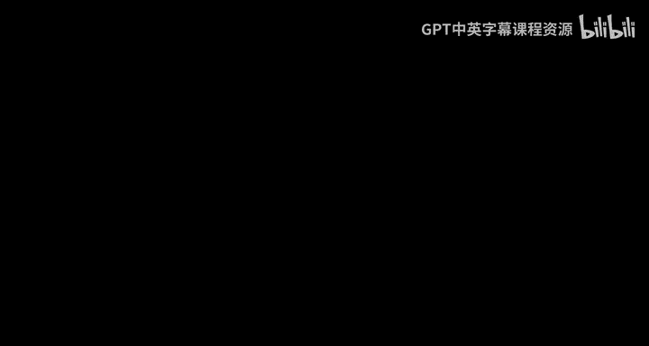
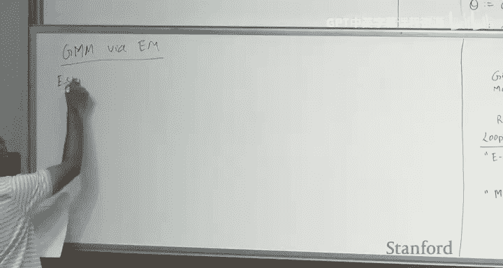
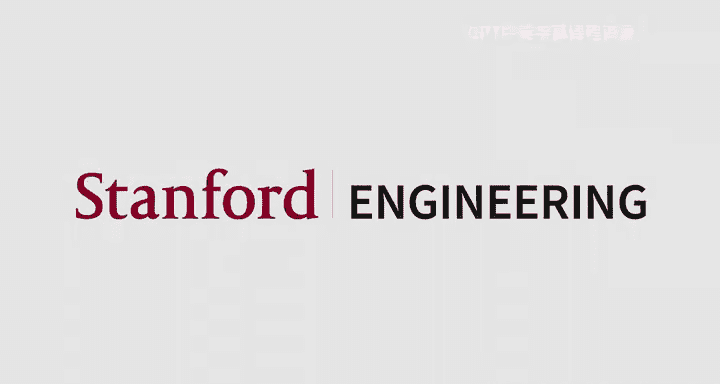

# 斯坦福大学《机器学习｜Stanford CS229 Machine Learning Course  Summer 2019 (Anand Avati)》 - P17：-17-.Lecture 17 - Factor Analysis & ELBO.zh_en - GPT中英字幕课程资源 - BV1NDopY4ECg

Right welcome back everyone so this is lecture 17 of CS2 tonight the topics for today will be to finish the expectation maximization algorithm we will prove the convergence of expectation max algorithm and then well apply it the expectation maximum maximization algorithm to the Gaussian mixture model that we saw last in the last class and then we'll move on to a new model called the factor analysis and solve factor analysis again using expectation maximization so that's the plan for today。

And before we jump into today's topics a quick recap of what we saw in the last class so in the last class we started off with unsupervised learning right and in unsupervised learning we are given just data points a set of x's and there is no supervision that comes along with it what I mean is there is no y values that come along with the corresponding x values we are just given the x values and we started off with clustering problems clustering problems are those where which we want to identify some kind of a hidden structure where the data kind of clusters into different groups。

The first algorithm that we saw was k means in K means。😊，We are given a collection of examples， X。

 and also。Let us assume we are also given the number k of how many clusters we want to identify。

And the way we go about executing k means is to。Come up is to randomly initialize。

K different cluster means where mu J refers to the j cluster。 There are K such mujas。

 Each of those cluster centroids， they are called centroids。 They live in R D。

 the same space where X lives in。And then we loop until convergence where in step one。

 which you can think of as the e step we set。😊，The cluster identity C of the8 element to be the identity of the Jth cluster centroid to which it is closest to which it is nearest。

So there are k different mus and for each eye。We check which of the K mus is nearest to it。

We where it is commonly we use the L2 distance and depending on which one is the nearest we use the argument so the the identity of the cluster to which X is nearest we set that to be C and then what you can think of as the M step。

Is。For each of the cluster centroids， we only look at the examples which got assigned to that centroid in the previous E step and take the average of those x's。

To update our estimate of muj right it is this iterative algorithm where in one step we perform a cluster center assignment。

 so this is assignment where we assign each point to a centroid and then update the centroids using the mean of the assigned points。

And we also briefly discussed of how this overall algorithm can be thought of as coordinate on this loss function。

😊，Which is also called the distortion function。 So the distortion function takes two parameters the。

The C's and the muse， the set of all C's and the set of all mus and this。

Los function can be minimized using coordinate descent by coordinate descent what we mean is we hold some subset of the parameters fixed and optimize over the remaining subset of the parameters and then we hold the remaining parameters fixed and optimize over the first set of parameters and we go on and on。

so you can think of this step as optimizing over the c parameters while holding the muse fixed and this step as optimizing the mu parameters while holding the C is fixed。

😊，Right。So that was K means。And then we saw this other model called Gaussian mixture model。😊。

So Gaussian mixture model， we can think of it as soft k means。

In Gaussian mixer model we are again given k the number of clusters or the number of mixtures。

 the Gausian mixtures that we want to fit。😊，We are given the set of x's。

We don't know the cluster identity if this was supervised learning。

 then the cluster identities would be the y eyes' and again here if supervise if this was supervised learning。

 we would be given the C ice， which would be like the Y I。😊。

And we assume that the data generative model is something like this。😊。

There is so we have a multinomial distribution， which you can think of it as like the class prior。

 You know， what， what's the total number of examples in each given cluster that you you can think of that as a multinomial and。

The Zs， the cluster androids， the cluster identities of every corresponding excise are sampled from this multinomial right and then once we know the Zs。

😊，Each for each identity of Z， there is a corresponding mu and Z。😊。

And the x's are sampled from the corresponding Gaussian。😊，Based on the value that z was sampled from。

 So it is important to note that z in this case is discrete。

because it is sample from a multinomial we get we z will happen to be one of the k different one of the k different Gaussian mixtures and by the choice of z。

There is an implicit mu and sigma associated with that Gaussian。😊。

And the x will be sampled from that Gausian。 We think of this as the data generating distribution。

And so the parameters that in this model are the Phi mu and and and sigmas。 In this case。

 the parameters was。Was both the C。CI and the mui were the parameters。

 so the parameters are in the green boxes。😊，And then we came up with this with this iterative algorithm again。

😊，When we came up with this we were just using heuristics to make it something that is similar to k means we had not yet derived the em algorithm in in its most general form and the algorithm that we came up was this so set so randomly initialize the parameters to some values just as in the case of k means。

And then we set W i for each example so this loop is over the number of examples for each examples we set w i to be the probability that Z I。

😊，TheThe probability that Z I is the， is the。Z， I equals J。

G anxii and the current current values of the parameters。

And then using these these weights where the weights is basically telling us what is the probability that X i corresponds to the J cluster so the sum over j of all these wI will be equal to 1 for every i。

And using these weights we perform what what we call as the M step which was to recalculate or update the values of the parameters using the current estimates of the weights right and this again was very similar to what we did with k means right so the the red box think of it as the E step and the green boxes think of them as the M step right and the green boxes we are updating the the parameter based on what we thought of based on what we。

What we derived in the E step in the the in the case of Gausians， a mixture of Gaussians。

 each cluster centide will be the weighted average of the excise。😊。

In K means it was just the average of the Xise which got assigned to that cluster。

 but over here every every example belongs to every cluster with different weights。😊。

So this is just a weighted means of all the x's。😊，And you know we have corresponding parameter update rules for the fees and sigmas and basically all of these derivations was very similar to the case of GDA Gausian discriment analysis except you know we have a small few small changes the changes are that each cluster centroid can have its own covariance rather than having a shared covariance and also that there are case such clusters rather than just two right otherwise this is pretty much exactly the same as GD。

😊，And then we moved on to deriving the the most general form of the EM algorithm。😊，Right， in the E。

 M L algorithm。What we wish to maximize is this。Marginal likelihood that is log P of x for a given value of theta。

 right This is our likelihood objective。😊，Had we observed the full data。

 had we observed all the these， like in the case of GD， we would， we would instead maximize。😊。

P of x comma z theta if z was observed。But Z is not observed。 So the the the。

 the most rational thing to do is just to maximize the likelihood given the evidence that we have。

 So P of X is also called the evidence。And。We do some base some some。

 some pretty straightforward algebraic manipulations。 So log P of x is the same as log of。😊。

The log of P of X Z with Z getting marginalized。That's by definition， log P of x。

And then we kind of cook up an expectation out of， out of nothing by multiplying and dividing it by some arbitrary。

distribution Q over z。And once we multiply it and divide it。

 we can now think of this as an expectation。😊，So we had a log。😊。

And we cooked up an expectation out of nothing。And to think of the way we come from this step to this step is described here。

 so the expectation of some function G of z where z is distributed according to  Q by definition is the sum over z  Q of z times G of z that is just the definition of expectation and in this case if we said G of z to be p of xz divided by q of z this becomes the G function。

😊，And therefore， this is just the expectation by just the definition of expectations。Right， so。

We started with a log likelihood that the that is the one that we always want to maximize and the log in the log likelihood is a concave function。

😊，RightAnd then we cooked up this expectation out of nothing by multiplying a divided it by z。

 So we got a concave function and an expectation。😊，Using the tool。

 we apply Jensen's inequality and Jenen's inequality allows us to swap the order of the log and the expectation。

😊，By using this inequality。RightSo this is the the the log likelihood the log in the log likelihood is the concave function。

 the expectation is something that we cooked up out of thin air and Jensen's inequality now allows us to swap this login expectation and get this inequality。

😊，Right and this inequality we just gave it a name we call it elbow it is called the evidence lower bound because this is the evidence。

😊，And this is a lower bound of the evidence and the lower bound was obtained through Jenen's inequality。

😊，And as a corollary， we also saw that genencing quality tells us that this lower bound is exactly equal to if and only ifq of z。

😊，That is the probability distribution with which we were taking the expectation happens to be p of z given x well Jenensen's inequality did not tell us this。

 but we derived it and showed that as a consequence q of z must be equal to p of z given x in order for this term to be a constant。

Right。Now， we we have this Jensens inequality and we have this corollary and using these two。😊。

We then did。Came up with the more general form of the EM algorithm。

In the most general form of the em algorithm we assume there is some parameter theta right in case of Gaussian mixture model theta will be the collection of p muse and sigmas right you are just calling it theta it could be any collection of it could be any parameter depending on the model that we have and the most general form of the em algorithm is again iterative。

😊，And in each iteration， what we do is we perform the E step where the E step is basically calculating these optimum Q distributions。

😊，The optimum Q distribution， what we saw here is the posterior distribution of p of z given x。😊。

So in the E step， we calculate the Q distributions。😊，Right，And in the M step， we maximize the elbow。

😊，And the elbow。😊，By writing it out in a more verboose form。

 the elbow is basically what what we have over there is。😊。

The sum from I equals 1 to n across all examples， and this again is just the definition of the expectation。

😊，Q of of Z times log of P of X theta over Q of z。A few things。

 important things to note here is that in the E step。For each example。

 we calculate the posterior distribution。😊，And once we calculate that posterior distribution。

 the cues are held fixed。During the M step， right that's， that's a crucial detail。

 right The cus over here are constant。 We assume these cues to be constant。

Even though the queues had theta in them。We assume that these thes are from the previous iteration and we we hold them fixed during the M step。

😊，And when we are performing this a max over theta。😊。

The only theta that is getting optimized is the theta that shows up over here。😊。

So this is the know p of x comma z divided by q of z is what we had over here that went into the elbow。

😊，And it is only this theta that we are optimizing over in the M step。😊，The Q distribution。

 remember it came from the from the e step and in the e step in order to calculate Q there was a Q over here but we dont write this as p of z given and parameterized by theta because we are not optimizing that theta we are holding it fixed。

😊，And we are only optimizing the thetas that show up in the numerator。

 and this gives us a visual understanding of the E M algorithm where。

The dotted black line is lot P of x。Which we assume is is hard。

 It could be hard to evaluate or it could be hard to to optimize directly and we are going to。

We are going are going to assume that this is not directly accessible for optimization right instead what we do is we start with some random initialization the some theta not。

😊，And for this。😊，Particular value of theta n。 we construct the corresponding Q distribution as the posterior z given x at that value of theta n and that gives us the corresponding elbow where the Q corresponds to。

Q corresponds to the posterior at theta n right and this theta knot by definition or by the corollary。

😊，Will be exactly equal to log p of x。Over here。So we are at theta not。😊。

And by constructing the elbow and by evaluating the elbow we have effectively evaluate we know what value log p of x is at this at this point but now we want to keep improving our theta values or keep adjusting our theta values such that we the corresponding lock p of x is increasing right that that is our goal that our objective is to。

😊，Findine value of theta that maximizes lock P of x。

And and we are doing the CM algorithm to do that indirectly right if we had observed Z。

 we could have directly performed gradient ascent or gradient ascent over this objective。😊，However。

 we are doing this iterative algorithm where in each step we construct a lower bound using a specially chosen value of Q and that value ofq is the posterior distribution of z given x at theta knot。

😊，And then we maximize the elbow instead of maximizing lock P of x。😊。

And when when we maximize the elbow， we get an updated value theta 1 and this theta 1 will correspond to the elbow being maximized。

😊，Right， and。It is using this theta1 we now construct a new elbow。😊。

We is tight at at theta 1 and this elbow has you know Q1。

And Q1 will be the posterior evaluated at theta 1。And thats the that is the elbow of the second iteration and then we locally and then we maximize elbow or locally maximize the elbow of the second iteration to get you know theta 2。

😊，And using this data 2， we can， you know， construct Al 3 and so on， and so on。

So it is this this iterative algorithm， which we call as the EM algorithm。😊。

And what we are going to do today will be to give give a quick and easy proof that proves that the EM algorithm always converges to a local optimum and then we are going to apply it to the Gaussian mixture model and end up with the same update rules using this more principled approach of maximizing maximizing the elbow iteratively and then we will move on to factor analysis which is a different model。

😊，Another different latent variable model where there is a hidden Z and apply E to the factor analysis model and solve that using E as well。

 So that is the plan for today any any questions so far yes。😊，Every day， new customers will。Yeah。

Keep having。like a new initial。Or did you have your。BecauseAnd then you're shipped over to。

Asian methods and thenstock。So the question is what if you have like youre if I summarize it correctly。

 what if you are in a streaming setting where you're getting new data you know and you already have a model that you fixed with the old data and you obtain some more new data if you are using if you are performing market segmentation and you have some customer data you fit a model and you got data from new customers right so so what you want to do over there is first you want to ask the question。

😊，Do we want to hold on to the same number you know of clusters K or do we want to update K？

That is the first question you want to ask when you get the new data if the answer you know if you want to hold on to the same cluster k then you can perform em algorithm where you can use the the previously optimized parameter values as the starting random initialization and then just reit over the whole data and you know that hopefully will just converge faster。

However， if you decide to have you know a larger k where you want to have more number of cluster tu know with the updated data。

 then you basically have to just start randomly effectively。😊，the same。ペ。Let start。我知定。

Yeah oh yeah yeah so so the question is we fit the new models and we get new customer data and how do we place them into place them into one of the existing clusters in case of K means that would be you know pretty straightforward in place of Xi you place the new X star the you know the new customer data that you get and find the minimum the closest centroid。

😊，In case of the Gaussian mixture model， you will calculate this posterior distribution using the base rule to get you know a probability distribution over your mixtures。

And that that is essentially something very similar to what you did with GDA in GDA it was only two classes and therefore it took a logistic regression form in case of a Gaussian mixture model this will end up taking the form of a softmax right and because the covariances are different it will effectively be softmax using quadratic features。

😊，N， good question。 Was there another question， Yes question。G setting for。

Is that for each of the eye。Ex， so Q I will basically put them in the Z bins。 So it's a。

PDF over like what glass can do。So is it like for a discrete classification？Yeah， so the question is。

 you know， in the E step， are we calculating。A discrete distribution over。

 you know the set of Z set of K classes。 exactly， That's exactly what happens here for each x。

So what you want to do is equals J。Equals J。 right That's what you want。

 that's how we want to think of this。 right So Q is， is a multinomial distribution over the clusters。

 So Q in this case will you know， Q of Z you know，3 for the third example。

 once you calculate this will give you a multinomial distribution over the K classes。

 So this is cluster one through。Cluster K and you will get some value 0。1，0。9，0。01 and so on。

So what does that seem？So Z 3 means like the third example。Like， you know， X I， you know。

 will have a Z I corresponding。Was that another question。Sorry， I didn't get what you mean。ささんてく。

Oh yeah， so the question is what did I mean by quadratic features because we used covariance。

 we discussed that briefly in GDA it' is not super critical that you understand that what if you remember in GDA what we what we saw was。

😊，You， if， if。If your data resides in two clusters。

And we assume they have equal covariances then the two covariances might look like this and the separating hyper boundary will therefore be a straight line。

But if we assume different covariances then it could be know a curved line and the posterior of this is effectively represented by a a logistic regression that uses quadratic features of x1 and x2。

😊，So it is essentially the same instead stuff two you will have know k different centroids and because they are all having different covariances we assume different covariances for each class that means it is like you are performing a softmax with quadratic features。

😊，So logistic rig the the generalization of the logistic function to K classes is the softm。Right。

 and if you assume。Equal equal covariance of the Gaussians。

 Then you will get effectively get a softm using linear features。 And if you include。

Different covariances it will effectively be softms using quadratic features。

But it's not super critical that you understand the the connection to the softm or the quadratic features。

 Yes questions。ごしのも？嗯。😊，あいや。that particular like is that。That's how we are constructing。TheM step。

Exactly so so the fact that so the question is the elbow touches lock P of x over here is does it touch because you know we intentionally carefully constructed the elbow to be that way and that is exactly right we construct the elbow over here such that the cu in the elbow is the posterior that makes it tight at lock P of x。

😊，Right， so let's move on so。So the proof of， of Y E M algorithm converges。Proof of E。Convergence。

Right。So the so the proof of E convergence is something that weve almost seen over here。

 right So in order to prove that E convergence， our strategy will be to show that。F。

Every T or time step or every iteration。L theta of t plus 1。Is greater than equal to L theta。Of T。

So L over here is our objective that we want to。😊，Optimize， so L theta is is。Log。P of x theta。

And what we want to show is by performing the EM algorithm by iteration of it iteration。

 the log likelihood of the marginal log likelihood of p of x is always increasing with each iteration of EM algorithm that is what we want to show and by showing this and also by recognizing the fact that the log likelihood is bounded above so log likelihood cannot go off to infinity。

😊，Using those two assumptions， we will make the case that because L is bounded above and because with every iteration we are increasing the value of L。

 eventually we will converge。😊，And so what remains is to show this this condition and to show this condition we will basically use the same reasoning that we saw with the diagrams over here。

😊，Right， so。L theta T plus1。Right。Is。Greatter than or equal to。Elbow。Of x。Q。😔，第一。😔，Ter。Deep plus one。

Why is this the case？So L theta， this is， this is basically just the definition of。

Of what Jensen's inequality gave us that the log likelihood。For the same values of theta。

 the the likelihood p of x will always be greater than or equal to the elbow。😊，For any values of， of。

 of Q。喂。And this。Is greater than or equal to。Elbow。X。调啲。And。Tta低。 so this was。Jensen's inequality。

Why is this the case？Exactly， this， this is because because of the M step， right。

 So the M step guarantees that。That theta t plus 1 was chosen to be the maximizer of this so theta t plus1 over here will give us the highest value for elbow and therefore this is due to M step。

Because we had the theta T plus1 was chosen to be the arg max of this。And then。And this is equal to。

还退噶。Of me。And， why is this the case。Because last。This is the corollary of Jenen's inequality。

So what is this basically telling us so to kind of visualize to visually understand this proof l theta of t plus 1 so this black dot over here this is l theta of 1 right assume t equals 0 right l theta of 1。

😊，It says is greater than equal to the elbow。Right，It's always greater than the elbow。

 So the elbow evaluates。😊，To a point here。Right。This is greater than 0 is step 1。

And step 2 basically told us。😊，Elbow evaluated at theta T plus one is greater than elbow evaluated at theta T。

 So that tells us that。😊，This is greater than 0， that step 2。Of the inequality。

Because theta 1 was chosen to maximize the blue curve。Right， and then step 3 tells us that。

That L theta equals the elbow and that is because we we constructed。

 we intentionally constructed the blue elbow to be equal to log p of x at the current value at theta T。

😊，Right， so that basically tells us the gap between the the the gap between the the。

The blue line and the black line at this is is basically 0 right so that tells us that l of theta 0 is less than l of theta 1 right it so at each step we are guaranteed not to get worse in terms of the log likelihood next question。

😊，So the same thing as the。浮。So once we， so， so。So the question is， should this be Q T -1。So。

 Im saying a of。Will be elbow of。たミこル。Qピ minusナ1。So， L theta of t。

Will be equal to elbow where Q is evaluated as the posterior of theta。

 So that is that is theta T So the right side。So this is the E step。 We get this from the E step。

 Yeah that happens and the next step is getting the theta for that So the next step yeah for so the e step。

 So at the current value of theta， we use the E step to calculate Q of T。And using Q of T。

 we construct the elbow， and that elbow will be equal。And then from this elbow。

 so this is basically like starting a theta knot in the picture and constructing the blue elbow。😊。

So the blue elbow will be equal to this。And the the next step is to go from theta t to theta t plus1 by optimizing the blue album。

takes in the previous queue。So L of T is has no Q， right L E of T is just L to T L to T is just not p of x。

 There is no Q in it。😊，Right is is this scare Any questions。Good。

So it so the proof here turns out to be pretty intuitive you know it can be easily visualized what we are saying is we start at any value of theta some random value of theta right the log likelihood has you know evaluate to some value which we may or may not be able to calculate right but we can always construct an elbow such that log p of x equals to that elbow at that point。

😊，So we construct the elbow it is guaranteed to be lower than than lock p of x and then we optimize the elbow right So once we optimize the elbow we reach a higher point at the elbow。

😊，Now， it is important that this point over here was tight。

 what would happen if this point was not tight？What would happen if the elbow was not tight over here？

Yes question。it was not。MakeSome vaccinations that。Right， so what would happen if。If。

If this was not guaranteed to be tight is that。😊，It may well have been the case。

Then the likelihood function goes like this。And if this was not tight。

 we may have gone down in our likelihood rather than guaranteed to be going up。😊。

Because this was tight at Qn。😊，Because it was tight we you know the other two pieces of the proof allow us to connect l theta of L of theta 1 to be greater than l of theta of0 if this were not to be tight then the likelihood at thetaaught could have been much higher and we may have actually gone worse in terms of our optimizing our objective。

😊，Is that clear。Alright， so now we have derived the the most general form of the E M algorithm algorithm here。

 Z and xs could be anything。😊，And the the joint probability of the model， we made no assumption of。

The joint probability of P of x and z to take any specific form。

And now we will taking this know more generic algorithm。😊。

You will see how we can apply it to the Gaussian mixture model and basically see that we will end up with the same update rules。

😊，So this part will be super quick。just give some some some hints on how to go about it。

 and in your homework you will be basically doing a more detailed version of what willll be doing now。

 So to derive。So G Gaussian mixture model。We are em。So for the Gaussian mixture model by EM。First。

 we do the E step。

， so in the E step。4。Each height。so before we we before we go into how we go about doing it a general kind of template or you a thumbs of rules to follow when you want to apply em is to first always get clarity on what the model is right first step one。

😊，Right。Rightrite out。P of X comma Z。And what I mean by write out is write out your assumptions。

 right。You may observe only x's and zs。That is fine。 We may only observe X and not z。

Independent of what your what data you observe and what you don't observe。

 first write out your model and by writing out your model it may be something like this。

 you know Z comes from。Mulinomial。Right， and then x given Z comes from normal of muy and。Sigmay。

Why do we call this the model because this is effectively p of z times p of x given z and this is equal to p of x comm z。

So first write out your model and writing it in this form is basically called as writing the data generative process and writing the data generative process you are implicitly defining what the model is right so the first thing you want to always do is write out the model and be clear what the data generating process is and what your parameters are right and in this case the parameters basically R P of x comma Z the parameters will be phi。

Muse and sigmas。Be clear on what the parameters are and what what is the form of the full model。

And then， the step2。Is。Clearly， identify what are latent。And what。Are observed。Or you know。

 what's the evidence？And， and in most of the models that we will see。

 x will generally be the evidence。That is the part of the data that is observed。And Z will be latent。

That is how we generally name the things so when you look at the models in the notes or in general you know x will generally refer to something that is observed that will be given to us and z will generally refer to know some latent variable that is not observed。

Right， and。And then。Once once you are clear about what the full model is， what the parameters are。

 what is observed and what is latent only then。Attempt to apply E M on it。Right。

If you are not what what if you are not clear about these first two steps。

 it' is going to be very hard to apply EM and you are going to just get confused really badly。

Alway be clear on what the full model is。The data generating process。

 which is the same as the module， what the parameters are， what's observed and whats latent。喂。

In case of the Gaussian mixture model， the z's， the latent variables are the cluster identities。

 right。😊，The parameters are the multinomial parameters。

 the different sets of mules and sigmas those are the parameters in Gaussian mixture model and what is observed are just the x's without the classide entry。

There is also a difference between another thing to be clear about is there are two kinds of unknowns here。

 right。So we have the unknown latent variables and the unknown parameters。

What is the difference between the two。The unknown latent variables are example specific。😊。

For a different choice of x， you will have a different latent variable。😊。

Whereas the unknown parameters are global。😊，They they are not specific to any example。

 the means and the covariances and the and the parameters of the multinomial they are kind of global in the sense that they don't belong to any specific example。

 whereas the latent variables are paired with a given example。😊，Right， and。And this kind of a model。

 you can think of it as a frequentous model where we we consider the parameters to be unknown constants。

😊，Whereas， but you can also。Perform a Bayesian treatment of this where you consider everything to be a random variable。

 but you know that is beyond the scope。For the EM algorithm。

 is it is clear that it is important that you are clear the what the parameters are and the parameters are global。

 they are not specific to any example。😊，And there is this other kind of unknown。

 which is the latent variable， which is paired with an example。😊，And what we do in the E step。😊。

Is basically estimate。This latent variable thats pair with each example。

 which is why in the E step we loop over each eye。😊。

You are calculating what the corresponding hidden latent variable is for this for the given example by holding the parameters fixed。

And in the M step， we go the other way we assume we you know know the z values are you know the z values。

😊，What they are and then we go about updating the parameters in the M step right so in the e step we are we are kind of attacking one kind of unobed which is specific to each example and in the M step we are attacking the other kind of unknown which is global。

And this is going to be common in all kinds of models where you are applying EM right in the E step we are attacking the latent variable in theM step we are attacking the parameters。

😊，So。So the E step in Gaussian mixture model will is basically。For each I， for each I。Q I。off。Z。

 I equals。J is equal to。P of C， I given。Xi at the current values of。Fe meal。sigma。Now。

 how do we write how do we obtain the posterior distribution of Z U next using。Base road， exactly。

 And this is。P off。X given z times p of z。Over。P of x。RightAnd again， this， because z is discrete。

 this will be p of x given z times。P of z over summation over z。P of x given z times。P of C。

And this turns out to be p of x given z， What is P of x given z here？

P of x cube Z is a normal distribution。And。And P of x given z will therefore be1 over。Square root。

2 pi to the。2 point to the D by2。This is just， I'm just writing out the the multivariate Gausian know sigma。

y。To the1 by  two， that's the law， the determinant。Times。The exponent， we have。X， I minus。Muzhi。

Granpo。Sigma J inverse。X， I minus。Yuji。And then。Times。Times。P of Z。P of Z is just。Fee， because it's。

Fji and and because its it's you know everywhere it's implicit that we are trying to do。equ to G。

So this is just fiji。Now， here， some overall J。No。The same thing。Next question。Should yeah， yeah。

 there's a minus1。Thank you。-1 over 2。Right， so。We've done such calculations before。

Weve calculated such poster in GDA。And we also saw that if the if P of x given C belongs to the exponential family。

 there is going to be an exponent here right and then there are all these constants they can get absorbed into the exponent。

 you can take the log of this take it in and you get you know exponent of something divided by exponent of something plus exponent of something plus exponent of something that。

Works out to be the softm comes out to be in the softmax form。And yeah。

 so this is basically you know， you know all the values here plug it in and you get you get the estimates for the east。

😊，So that's the E step。And。I'm going to erase this。Hopefully， you have taken note of。

And in the M step。Now， in the M step。Andcept， what we want to do is。New。Sigma phi is equal to。

Arc max of mu sigma phi。Right。And in the Mstr， we do the ag max over there。At the elbow， exactly。

 And the elbow can be written as。We saw over here。So the elbow。

 we have written out the the expanded version there。 and for simplicity， let's just call this。W I J。

We call it Wj because once we calculated this will be held constant in the M step even though WIj。😊。

Depened on the values of theta of the parameters to get calculated。In the M step。

 we will not be optimizing over them。 Were gonna hold them fixed And because that's that's for the。

 the， the。The elbow should be held fixed。And we are going to arc max over the elbow expression here and that will be。

S over I equals1 to n。Some over。Z。W。I。J or。Here we can write J equals1 to k。W， I J of。So。

 the elbow is。So the elbow is basically the expectation of the log of this term。😊，Itll be。Log。P of。X。

I。Z， I。Given data。Mu。😔，Sigma。And fee。Duided by。W。系。一致。

This is just writing out the elbow by expanding out the expectations and this。😊，Arc max mu sigma。Fe。

equalals one to n。J equals12 k。W。I J。Now， this， we can。Again。

 break down the joint according to our data generating process。So this will be P of。X。Given Z。

Or the equals k or the equals J。Times P of。ジアイこちで。Over w G。Now again。

The same process that we did over here， P of x given Z will be a multivariate gaus in P Df P of Z given J is is the multinoial。

 which will be just phi of J。 and ws， the two ws are constants。For this， for the M step。

 the2 ws are constant。In the E step we derive them using the previous values of theta or the previous values of the parameters。

 but once we calculate them in the E step we will hold we will hold them frozen in the M step for performing the maximization。

😊，so plug in the values of the Gaussian p here， plug in fiji here and to perform arc max。

 how do we perform arc max？😊，Take the gradient， set it equal to 0， solve for the parameters。Right。

It this looks pretty， you know， big and nasty， but， you know， it's pretty straightforward。

 There there's no， there's no special tricks going on here。 It's just tedious。 right。

 So write out the。😊，Write out the Gaussian PDF here。Phija here。

 take the derivatives set it equal to 0。 and once you do that for separately for p mu and J。

 we will end up getting phi is equal to。1 over n。I equals1 to n。W。I J。And。New heart will be。

Basically， the same thing。So basically， this will be mu hat and。Sigma hat。Will be， you know。Lising。

So write it out like this。😊，Take the gradient， set it equal to 0。And we get this。

And this is the way we start from the general EM algorithm know work out the E step and the M step and in the M step work out the maximization and by following this principled approach we will see that we will end up with the same update rules that we get that we obtain using the heuristic soft k means kind of an argument。

😊，Next question。Exactly so the question is do we have k different muse and K different sigmas Yes so over here when I write new I mean the collection of K different new vectors and K different covariance matrices。

😊，In there。あいさ。Yeah， so in the M step， we simultaneously update all of those exactly， yeah。

You can do it for any mu J or sigma J and you know it is symmetric so once you do it for one it is the same procedure for doing operating all the others good question。

So， that's， that's。Em and EM applied to Gaussian mixture models。

So what we did basically was was to come up with a general EM algorithm and using the general EM algorithm。

😊，First in order to apply to Gausian mixtureer model the first thing we had to do was get clarity on what the model was whats the full joint probability distribution of all all the variables xs and zs have clarity on what the model parameters are in case of Gaussian mixtureer model it was phi collection of muse collection of covariance matricacy sigmas and then get clarity on what is observed and what is not observed。

Once you know what is observed and what is not observed。

 it becomes clear what you need to do in the E step in the e step we need to calculate the posterior the probability of unobserved given the observed。

 whatever it is for your specific model， construct the construct the e step。

Of probability of unobserved given the observed and we hold the parameters fixed。

And the the steps of evaluating this will be different for different models for Gaussian mixture models this happen to be normal and multinomial for a different model in fact analysis that we are going to see next these might be different。

😊，But the general recipe is the same。Construct the construct the posterior distribution or in the E step。

And then in the M step， write out the elbow。😊，Wite out the elbow by plugging in the full model in the numerator and。

😊，And the the post， the cube distributions in the in the denominator and in the expectation。

The denominator and the the probability with which we are taking the expectation are constant in the M step。

We are going hold them constant。And by holding them constant， you are going to optimize over。

These set of parameters， right， when we do the a max。

 it is only these parameters that we are updating there are。You know。

 kind of hidden parameters inside these that were used in the in the E step。

 but we are not going to optimize them for the purpose of the M step。

 the cube distributions are fixed。😊，we are going to only optimize over these and when we take the gradient。

 everything except these will be assumed to be constant。😊。

And basically you know this is just calculus you know take the gradient set equal to0 and we end up with the update rules that is specific to your model and what was absurd and what is not absurd。

Any questions？Yes。そにあい。大善濯。てた some。Because let's say for the I example。

 if it is associated with the j cluster。Why would you want to update。

All the other means because so the question is why are we summing over J because in only in K means we do we assign it to only one point in case of the Gausian mixture model we we every point belong to every cluster with different weights。

But why， why。Like why not have it be belong to either of the Galus So this what we got here was purely a consequence of applying the E algorithm and the EM algorithm we we proved that it will you know converge and it will maximize So the the choice of summing over here was not an arbitrary choice。

 It is just a consequence of the E algorithm。Yes question。

So the question is instead of taking the expectation。

 what if instead we took the more than you know take the the the highest highest probability in that case we will Gausian mixture models will will will be kind of modified into becoming canians in that case。

😊，All right， so factor analysis。So factor analysis probably has the most。

Tedious calculus in all the scores。So。There's going to be quite a lot of symbols that that are going to come up on the board。

But。Even though the， the。The expressions might look complex and hard。 The idea is pretty simple。

Fact analysis。So。In factor analysis， we。Consider。An interesting and challenging scenario。

So in factor analysis， you have Xi。Belonging to some。RD。And you have given a collection。X I equals1。

2， n。And now we are interested in this。In this kind of situation， where。D is much bigger than n。

In most the most of the common scenarios that we encounter。

 the number of examples that we that we have will generally be much bigger than the dimension of the data。

😊，But there can be situations where the dimension of the data is much bigger than the number of examples that we have。

Right， and。It is it is challenging because when we using this， if we。

 if we assume this came from some kind of a Gaussian distribution and if we estimate the covariance matrix sigma。

 sigma will now be1 over n。Some more equals1 to n。X I minus mu。X I minus mu transpose。Right。

 so each of these each each term inside the sum is is one rank1 matrix and you are summing over n rank1 matrices。

 So sigma will be。Frank n。But n is much smaller than D。 Sigma is a D by D matrix。

 but it is only rank n。😊，And now if you want to use this covariance matrix to calculate your Gaussian Pf your Gaussian Pdf is P of x given mu sigma。

1 over。2 pi to the D by 2。So the determinant over here will be 0 because it is it is it is not full rank right and and because you get you get。

0 in the denominator， you know you can't even evaluate the the evaluate the PDFf right。😊，And。

 and the question is now， what do we do in such scenarios， This was our question。I'm sorry。

This will be rank n because we are summing over n rank1 matrices。Matrix is d by D。Sigma is。D by D。

Right， what will have only rank can。And most of the times when n is bigger than D， it will be rank D。

😊，RightBut in in cases where n is much smaller than D， you know， the rank will be So。

 So this will be a singular matrix and you know。We， we can't do much with it。Yes question。

I wouldn't say so。 I'll come to that。 So we we are now just considering a scenario where x's are coming from a high dimensional space。

And。And the number of dimensions is much greater than the number of the number of dimension is much greater than the number of examples we have。

😊，Right。We can think of kind of， you know。A few ways in which we can kind of address this So one way is you know instead of thinking instead of considering sigma to be you know a full blown covariance matrix。

 maybe we can restrict sigma to be just a diagonal matrix so that the number of parameters reduce but even if you limit it to a diagonal matrix。

 the number of diagonal values is still D that is greater than n。

We could also think of sigma thinking of restricting sigma to be some kind of a scalar times the identity matrix。

 but if we do this then we are effectively limiting ourselves to covariances that are spherical right and that may not capture all the interesting structure in your data。

So this wouldn't be very interesting either。So instead， what we want to know。

Now do in in with with factor analysis is to think of a latent variable Z。 So assume that your data。

The true data that， so we are observing x， but we are going to assume that these x's。

Live on some kind of a lower dimensional subspace。 So we are going to assume that there is a Z。I。

 that's normally distributed。And then we are going to make this second assumption。😊，That。Right。

 so over here， I is。I is basically K dimensional。And Z I is therefore。RK。

 so we are going assume that there is this lower K dimensional subspace。In which。These reside。

RightAnd from these， from this K dimensional subspace。We are now。So， X given Z。

Is now a normal distribution with mean。Mu plus。So in the in， in the notes。They use。Capital Lambda。

to denote the up mapping matrix。I personally don't like Greek letters。

 There's nothing against Greeks， but Im just going to call it L because you know。It looks less scary。

 So there is a matrix L。Times z。And。ACovariance sub s， right， Let's leave one Greek。

 one more Greek in there。 No problem。 So here L。Is a matrix that maps us from K to D。D by k。Right。

 and。You' can assume， Psi is。Are there any Greeks here， What is the right way to pronounce this？

Is it p or p Psi anybody knows？S。Site， all right， So well call it site。So site is。D by D。

 and you are going to assume it is diagonal。So what's happening here？

You going assume that there is this low dimensional or k dimensional subspace where k。😊。

We will assume is less than n。 The number of examples that we have。Right， and。

There are these latent variables Zs that reside in the scale dimensional subspace。😊。

Which get mapped on to a higher dimensional space。Wwhich is x's and the way it gets it gets mapped on is through this you know what you can call as you know an uplifting matrix where z'。

 when you multiply it with L it takes it from k dimension to so Lz will be in D dimensions。

And there is， you know， it gets shifted by some some offset mu and some there is some random noise that gets a diagonal noise that gets added。

RightSo previously in Gaussian mixture models you know to compare it to Gaussian mixture models。

 these were multinomial in Gaussian mixture models， but now z continues here。😊，Right。

X given z was in the Ausian mixtureer model was normally distributed。

Here also it is normally distributed， except in the Gaussian mixture model for each z because z was discrete。

 we had a separate mu and a sigma。😊，But over here we are not going to have a separate mu and a sigma but the mean for x given z will be this term which is some parameter mu that is common across all examples plus the mapping of z from the load from the k dimensional lower subspace to d dimension that is the higher dimensional subspace so L is this mapping that takes you from a low dimension to a high dimension。

This question。What的。You're not doing this。 So this。 So， in fact， analysis。

 we have moved on from classification。And here we are essentially trying to find a subspace of our of our of the x's that we have right Xs live in a high dimensional subspace。

 What we are trying to do is to find a low dimensional subspace in which they reside。😊。

In in which z is reside and the corresponding and we assume that the x is that we observe。😊。

Have a corresponding latent variable Z。And the way x is generated from its latent variable is through this relation。

 your The goal here is to fit， as with all you know， probabilistic unsupervised models。

 the goal is to。Be your f。YouTheta， in this case， theta is you know mu sigma and and。Yeah。M。

 so what do we have your mu。Saai。I know。And we want to find this mu sine L such that we have a probabilistic model or a density estimator over x。

😊，And it would you know， there are many interesting scenarios where this this this can happen。

 for example。You， you can， you know。The reasons the kind of scenarios where this can be useful is supposing you have some kind of temperature sensor。

 right， so you can have temperature sensors that are spread across your building。

Right and lets say there are。D sub sensors right and if you measure all your sensors at a particular time that collection of observations can be your Xs right so X belongs to RD So instead of I you can think think of it as t at one time you measure you take the you know measurement of all your sensors a temperature sensors in your entire building and you get a d dimensional high dimensional subspace。

But you know， all these these different temperature values may not be independent。Which means。

 you know， two temperature sensors inside this room are probably going to give you you know。

 very similar values right And similarly， if you have 10 different sensors heres maybe you know。

 you might see see some slight changes where， you know。

 it might be closer to where the the light bulbs are because of， you know。

 it's warmer and maybe colder in a few places， but more or less， know。

 they' are not independent And there are these。These you know similarly if you you know collect the set of all temperature sensors in the entire building there are probably a few factors that affect the different sensor readings across all the you know across all the sensors right and basically what we are trying to find out what we are our goal here is to come up with a model。

You know， for p of x。And and for example， come up with a model for P of x to get a sense of what are normal sensor readings。

😊，RightAnd using this， you can probably build some kind of an anomaly detector to see if there is you know a fire going on somewhere。

Right and the， the idea here is that。Even though x's reside in a much higher dimensional subspace。

 their values， the actual temperatures that they end up measuring are based on a few much fewer factors。

😊，And these are you know that live in a k dimensional subspace。

 the assumption here is that there are probably just k factors that decide the temperatures that you observe in all the D sensors。

😊，And and and you know， given these these D dimensional observations。

 we are trying to build a model from which we can not only fit P of x well。

 but also hopefully make inference about z given x。😊。

so it' is kind of dual purpose in case of G Gaussian mixture models these were discrete you know where we are trying to cluster data。

 but here its a fundamentally different problem where we are trying to find subspaces in our data。😊。

私にのなえら。Yeah no longer。We will do E on this， right E M made no assumption about Z being discrete or or or or。

Discrete or continuous in in when we wrote out the the elbow。😊，Right。

 so we intentionally used expectation here and if z was continuous then this summation will be an integral。

😊，we make no assumptions about Z being continuous or discrete in EM。So。So back to where we a P of x。

 we want to we want to learn a model P of x so that we can do things like anomaly detection。

Next question。to12。Whatever you said， it will kind of like。A we going。Yeah。

 so the question is is is k going to be learn automatically or is it going to be hyperparameter for the purposes of this lecture assume it is a hyperparameter and you tune different values of k。

😊，Yes question。Deine this way just too。You mentioned space over there。Yeah， so， so this is。

 this is the the the assumptions that we are make making over here are what is called as。You know。

 factor analysis。And there are there are a few variants of factor analysis in fact。

 so here we are assuming you know thesi matrix is diagonal and has different values in the diagonal you can tweak you know that assumption to say there is equal is there is equal noise in along all the diagonals and you know that gives you a different model you can make few other small little changes here and that gives you something called this probabilistic PC this specific set of assumptions is called factor analysis。

I mean， why does z has mean 0 and。Yeah， so that's just you know， an assumption that we are making。

Yeah， that's so the assumption that z has mean0 and identity1 is just an arbitrary assumption。

 And it turns out to be that， you know， it it is most of the times that's that's good enough。

So the making an assumption that our x's has mean 0 and identity 1 would be you know observed right but then we have this you know offset mu and you know scaling L。

😊，That we applied to Z。So， you know， it usually that you know this。

 this the L and mu make up for the fact that we don't have any degrees of freedom here。Right。So。

And now， our goal is to。Using using this set of assumptions， we want to maximize。 We want to learn。

L P of x。Even mu， L and p Psi。How do we go about doing it？The answer is？Em， right， and as I， as I。

 as I mentioned already， the。The first thing to do in EM is to be clear on what the model is。Right。

So the model that we have was described like this initially， so Z comes from。Normal 0。Rity and。

X given Z comes from。Normal。Mu plus。L Z。And。使。We are now going to make this small change and rewrite this as。

An equivalent model。Zi。Readity。eppsilon。Comes from。You。谁。AndX is equal to。Mu。😔，Plus L。Z plus。Apsilon。

Yes question。In， can you explain why。Whys will still now with this modification。

 why will still not be first。It seems like like whatever game you play。So I should still this person。

Like our initial problem was that sigma was non invertible because it was first。Why was I。

Well see why sp P will not be fast。 We are going to work it out。Right。

So these two are basically equivalent。Are there any questions on why these two are equivalent or not？

Because we we we will be using this trick again in in a couple of lectures。

 Are you clear on why these two are equivalent。So this is basically called the the scale and location property of Gausians where if you take you know。

 some Gaussian。Right and。So this basically follows from the fact that over here。

You can write x as you can decompose this into into two parts so。

You can X given C has this mu plus L Z and， and。Sigma。

 so this basically tells you that for this given。Ming。

So think of this as the mean and think of this as the covariance right So a normal distribution。

If it has some mean。And some covariance， you can write this as。

M plus normal distribution with some mean and some covariance。Right。

So yeah so this is bad notation think of them as you are adding one1 number to a random variable that is distributed according to that。

😊，So。So， assume you know there is a random random variable which has mean m and which is distributed normally according to mean m and stand know covariance s this random variable can be written as the sum of a constant plus another random variable。

Right， so this， this other random variable has means 0 and and standard right。

 So we are basically you know， doing essentially the same。 So here the this is。Epsilon over here。

It question。サ。So we， you know， for so x had， you know， mean I mean， you， you can see here， right。

 So this is just mu plus L Z。And we just。U plus L C plus Eps。どこ売りまさ。もために。に感んで。先党？哎送一 from。

Because X is。It will。 But this is just x equals。 You we。

 we haven't written the distribution of x here。 We， you can just rewrite x as， as this thing。So啊。

So this gives us， you know， use it making this observation we can now write out。😊。

The model now of z comma x。Will have。三。Joint。Mu。😔，Z X。And some covariant sigma。

So what we are going to do for the next few minutes is to write out this model。😊。

And once we are clear about the model and clear about the different components then we are going to attack it using EM so first as we did it with the Gaussian mixer model first we want to be very clear about the model。

 what are the latent variables， what are the observed variables， what are our parameters。😊。

 and it turns out that。We can。So this mu Zx。We have two parts。

 a mean corresponding to z and a mean corresponding to x。

This is just the standard multi Gaussian properties we we saw such we saw these properties using when we were talking about Gaussian processes right So this will correspond to the mean of z。

 So the mean of z is just0。And the mean of x。So the mean of x will be just。

So what will be the mean of x？of x is equal to the mean of。New plus L Z plus epsilon。

This is equal to mu plus 0 plus 0， just mu。牛。So for the for the joint probabilityba distribution。

 p of x commaz Z is distributed according to a normal distribution whose mean is you know0 mu。哎。

And the covariance。So again， the covariance will have four parts。 right， So here we will have。

Covariance of z。Covariance of。Weing off。X X， z。X z transpose and covariance of。X。Right， and。

It can be shown pretty straightforwardly that covariance of z is just。Identity。Right。

 and this will the covariance of， of。The covariance of。Or this， this is， so the covariance of。

X and E covariance of x and z。Is basically， by definition， expectation of。X minus expectation of x。

Z minus expectation of。The transpose。And if you expand this out， this will just turn out to be。L。

Here you get L transpose。So this will be L transpose。 This will be L。 And here we get。L。

 L transpose plus。So。RightSo the the the model or the or the joint probability of x and z is going to be a normal distribution。

 a multivariate Gaussian distribution whose mean is。

Given by you know0 and mu and whose covariance is given by identity L L transpose L transpose plus upside and the way you arrive at these is by basically going with the definition of covariance of x and z to be expectation of x minus expectation f times z minus expectation of z transpose and and similarly for the expectation of x you do the same x minus expectation of x x minus expectation transpose and you will get these termss and you know the detailed steps are in the node。

But the but the the higher level message that we want to take take from this is。Given some。

 some data generating process。The first step that we did was to come up with the definition of the model。

So， the model in this case。Turnned out to be。X and Z are。Jointly。Multivariate Gaussian。

With a given you know， with some particular mean and some particular covariance。Right。So， the model。

That was our the first step that we want to do is p of x comma z。Is such that。X， z。

It's jointly normal。With mean。0 mu。Or Z X or another。Z X， mu and covariance。I。L transpose L。And L。

 L transpose plus。So。Right， so this is the you know， the full model。And the parameters。

Prameterters are basically mu。L。And side。And in this， what have what do we observe we observe。

What's observed in this？X。And the latent variable。I。Z。So。Prameterters。Evidence。Lant variable。Right。

 and now。To apply EM on this。The E step。You want to calculate P of z given x。So on the E step。

 we attack the latent variables。And in the M step。We want do mu L。Sigma equals。Hard max。Of the elbow。

So this is this is going to be the the high level flow of what we are going to do next。

And this this this recipe is the same for any kind of model on which any kind of latent variable model that you want to solve using em right first get clarity on the full model of the joint distribution。

😊，Identify what are the parameters， what is the evidence， what is the latent variable？

And then figure out the E step and the M step where in the E step。K， you know。

Reestimate the latent variables。 and in the M step。Reestimate the parameters。It so happens that。

In this case。In the factor analysis model。It so happens that because they are jointly Gausian。

You know， this is a side note。喂。We， we can actually write。L of mu。Sigma。Os， not sigma。P new L and Pi。

Lug。P of x。You usings those parameters。And using the marginalization property of of Gausians。

 this actually has。You know， you can you can write it out as。You know。

X is actually distributed according to normal。You know， we can just read of this。

 It has normal mu and variance L L transpose Sigmma， right。Mu。The trans plus。这嘛。Right， but now。

If you try to perform maximum likelihood estimation and。Otain expressions for these。

You cannot get a close form expression。whichch is why E kind of comes in comes to our help here because in this case it so happens that lock P of x。

😊，You can actually write out， you know， it has one over you know2 pi to the D by 2 and here LL transpose plus。

Sa half。Exponent。-1 half。X minus mu transpose。L L transpo plus。Si inverse。X minus mu。

You can write it out like this。But there is no close form solution that you can that you can come up with for Ls and Ls and Psi。

 you can try it out。 but you know this cannot be solved using close form。So instead。

 what we do is we we use factor analysis Im sorry expectation maximization。

And with expectation maximization， we actually do get。

Close form update steps for both the E step and M step， though they are a bit。Pedious in terms of。

How complex the expressions look， but it is you know pretty straightforward。 it is just tedious。

 it is not tricky。So for EM for factor analysis， the first thing we want to you know attack for the E step。

Is calculate。P of Z givenix。P of z given x。In this case， both z and x are are jointly Gaussian。

 you know， which is the best you can hope for right when Im going to just write out the the full model here so z。

Z x。Normal。0 mu。And covariance。Identity。L。Transpose L。L L transport plus。使。Right。

 so what is P of z given x， you know， looking at this， we can just read it off。😊，Right， if you。

 if you。We did the same thing for in Gaussian processes where we calculated the conditionals of Gaussians。

😊，Right， in this case。In this case， P of Z given x will be。Z given x will have a normal distribution。

Where the mean is given by。Etrans。L L transpose plus。si。😔，Inverse。X minus mu。Right。

 so this is basically， you know， if if you， if you remember a B。If they are jointly distributed as。

のニ。New a。Mbi。And some kind of covariance。Sigma a squared。R， sigma， A， sigma B。Rose sigma A。

 Sigma B and row Sigma B square。No。A given B will be normal。

This basically you know I'm just I'm just recapping what we had seen in the past A given B will be mu B or B minus mu B。

Divided by sigma B， you know， get like the the obtained the the z value of of of b times rh times sigma a。

That'll be the mean。 And the covariance is is like the sure complement， right， So it was。

Sigma is square minus。嗯。In this case， so this minus is。This times the inverse times this。 So it was。

R。Square sigma a square。Right， in case of A And B， And this is basically。

Being none in the in the multivariate case。 So it it's basically the same thing。

 but with with metataes instead of scalealrs right And this will give us the sure complement that So that is covariance will be I minus。

L transpose inverse of this， L L transpose plus。si inverse times L。Right， so this is。Short company。

And this is， is， is like。Calculate the z value so x minus mu divided by the covariance。

Times L transpose which is basically。Map it back to the the variance of， of C。So this is z given x。

 Any questions on this？😊，And now。Once we have Z U x， we basically are able to calculate。😊。

Set Q I of Z I。It to be normal。Wet。This mean。And。This various， so that gives us our E step。

The E step are we are going to hold the current estimates of the parameters fixed and calculate the posterior of z given x。

😊，In the M step。So in the M step， we want to do。Hard max of mu L。Sa。Of the elbow。

 So sum over I equals1 to n。And now， we will have。An integral of over the in place of the summation over K different clusters。

 we instead have an integral over。Over the Z space。Of log。P of。Xi。Z I。Prameterized by mu L。s。

Divided by。あ。Qu。I of C I。Wed byq。系 f c。没有。H。😔，Sai。equs thisす。 so this is the M step。Now。

 there are a few observations we can make here。So， the first thing is that。

We are going to first write it out as an expectation。Right， so the expectation makes it。

Makes it easier to understand。This is。Arc max， mu L Psi。I equals 1 to n。Expectation。Or Z。

I comes from。Q， Y。off。So we are going to factor this into x given z times p of z。

And in the denominator we have Q and there is a log。

 so this will be log p of x given z plus log of z minus log of  Qi。哎， so的。Factor this into2。

 And these three apply to log。 So you get log A plus log B minus log C。Right， so this will be。

Pa of log， P of。X， I， given。Z I。Plus。Log P of。Z， I。Minus。Log。Q， I of C I。So this is the M step。

Any questions on this？ Yes question。ぱいぱい。InTheig good of Q I。Yes。

 so this integral and Q I became the expectation。Good question。So one thing that we can observe。

Here is that， in all。In any kind of an E M， whenever you apply E M。

This part over here was is lot P of Z。 So this was the。Nummerator。 and this was the。

Deenominator this is the denominator that is lockq lock Q and this is the numerator right and numerator we factored out into two parts right。

In all， whenever you apply Em， no matter what the model is。😊。

You always have this denominator Q that does not have。Any of the parameters that we wantt optimize。

 right， So the parameters that we wantt optimize are always in the numerator。And there's a log。

 So which means。In any given E M model， when we are performing arc max， we can just。

Strike out this part。Not just in factor analysis or in Gaussian Mier model whenever you apply EM。

Right，In the elbow， the denominator。😊，Because there is a log log log of this this ratio。

 the log of the denominator will never have the parameters that we are optimizing over so you can always just strike out the log cube。

Over here， specifically in the case of factor analysis。😊。

We make yet another observation that lot P of Z also has no parameters， because we assumed。

Z comes from。From a normal distribution of 0 I。That also had no parameters。

So in case of factor analysis。😊，We gain this additional cancellation of the P of Z， as well。

 so now all we are left with is。So， X given Z。Has。So what was x given Z， X given。Z had a normal of。

 yeah， So this does have the the this does have new。

L and ps it has all three of them right It is parameterized by new L and Z and so we are we basically need to perform ourrc max of of this term with respect to new L and Z。

Next question。We have not yet we have not yet， and I am not sure if we will have the time to come till there yet。

 but lets wrap up as much as we can。So， and now once once we have written out in this form。

 it is basically just calculus right its it's going to be so lock p of x given z can be can be written out as。

This can be written out as。Arrc Max。Mu L。New L。I equals y per n。Expectation of Z， I from Q， I。offff。

Log。1 over。2 pi to the D by2。Saai。😔，AndHa。Exponent。-1 half。X， I minus。Mu minus。L Z， I。Is。😔。

So inverse。X， I minus。Mu。And。New minus L。C系。Right。And here， if， if you， if you。

If you basically you know just take the derivatives set it equal to 0 in order to do that。

 however there is this expectation over here so we have this expectation over this whole thing。😊，So。

 in order to take the expectation， we will now have to break this into smaller chunks。

So this will be log of。Log of1 over2 pi to the D by2。 and this will be minus half。

Log determinant of p Psi。Log in the exponential cancel， minus-1 half。X minus。Mio minus L Z I。

s inverse。X minus mu minus L。Ie。Right。So you still have the I equals one to n。Expectation， Z I from。

QI， right？And now we we can see what terms depend on Z and what do not。

We are taking an arc max of an expectation of something。RightAnd so this term。Does not have Z。

 nor does it have any of the parameters， so this can just cancel out。This term does not have z。

 so it can come out of the expectation。This term does have z and in order to perform the expectation you will have to expand out you know distribute this multiplication across all terms。

And once we， once we once we do all that and you take the gradients and set it equal to 0。

 we will get。L is equal to。Some over i equals 1 to n。X， I minus mu。Times。Mux Z given x。Transpose。

 where muzy ofonic transpose was from the posterior。It's that big expression over here。Thankss。

Smation i equals1 to n。music。Given x。My given。X transpose， again， this。

 this music given x is the full posterior that we derived earlier。Plus。是吗？Z given in x。

So this is the M step update for L。And similarly， the M step update for mu will be。1 over n。

I equals 1，2。And。X I。This should be pretty straightforward because we assumed we gave z a0 mean and x。

 you know， x therefore had to be a mu therefore had to have。😊，This， this mean。And then。😊。

We calculate this。Phi matrix，1 over n。I equals1 to n。Bo， this is painful X。X I transpose。Minus。😔，X。

 I。Mu Z given x。Transpose L transpose minus L。Musi given X。X， I transpose。Plus， L。

I'm getting tired writing this music given X。Music given X transpose。Plus， sigma。See given。X。

Times L transpose。And it。Pi I I equal to。P i i。Right。

 so this is an intermediate computation and to take the diagonal values of this and set them equal to be P psi Ii。

so there is this a lot of symbols， a lot of monstrous looking expressions I would not expect you to memorize this however the larger story from this is the way we went about applying em the recipe of applying em we obtained you know we derived the E step as as the simple posterior and in the M step we had to take this expectation with respect to Z。

😊，Of of the of the elbow。 So the elbow which is the expectation with respect to Z。

A crucial point to note here is that。In many places， if you。

 if you you know search for E algorithm on on Google and try to learn about E algorithm in many places。

You might see an algorithm that is described like this where in the E step。You know。

C expectation of z。And in the M step。You know， do arc max。Of P of Z comma expectation of Z。

You might see many， many articles or documents that describe E step this way where e step corresponds to the expectation M step corresponds to maximization。

This recipe。This， this， this sequence of steps is true only sometimes。RightIn simple models。

 you can write it like this。 in Gaussian mixtureer models， you can write it like this。

But the correct way to do expectation maximization is to have in the E step perform only calculation of the posterior and construction of the elbow and in the M step maximize the elbow。

😊，In simple models， those two steps are equivalent to this。😊。

But if you were to do this for more complex models， it will be wrong if you follow this step for。

Factor analysis， you will get it wrong。It works only for simple steps。

 but the process that works for any model is in E step construct the posterior the Q distribution and in the M step maximize the elbow that works all the time no matter what for simple models that is equivalent to this but you know that is something to keep in your mind。

All right， with that we'll break if you have any questions come up to the stage and we can。

