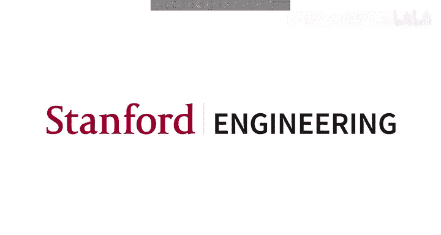
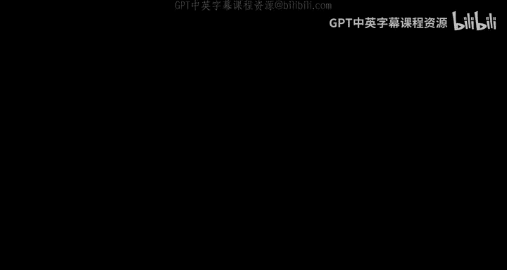
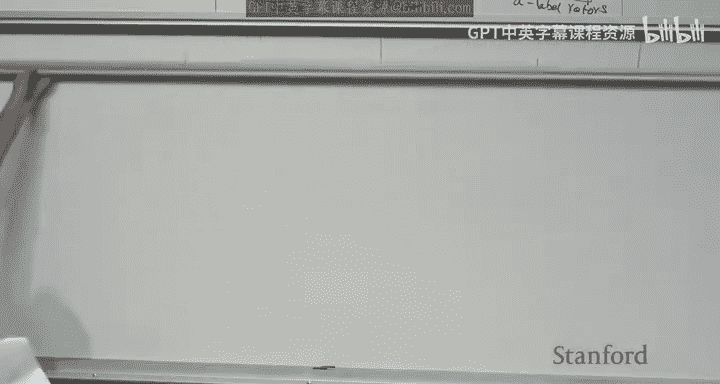
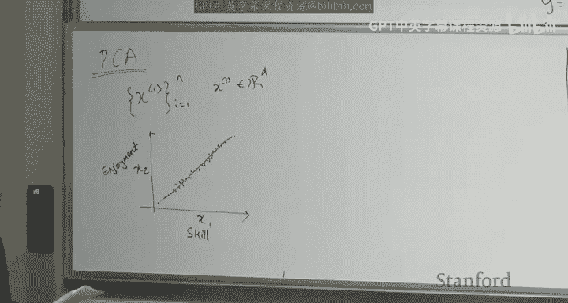
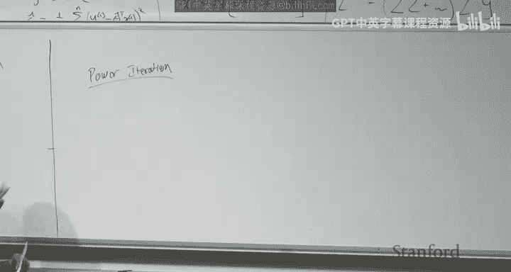
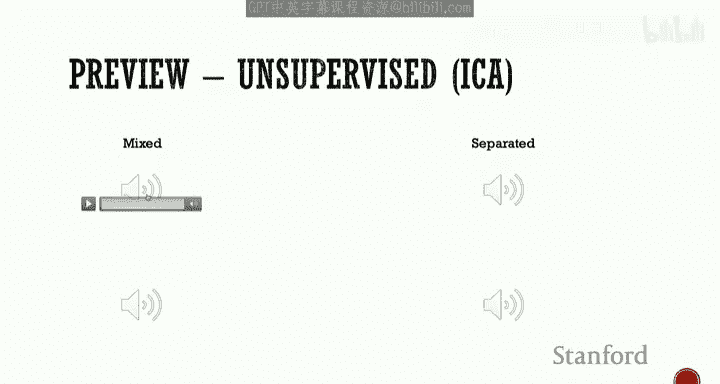
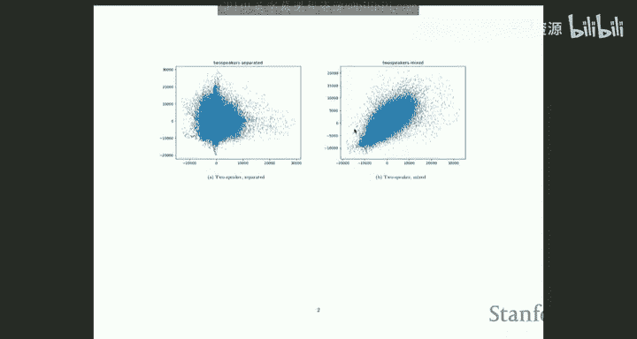
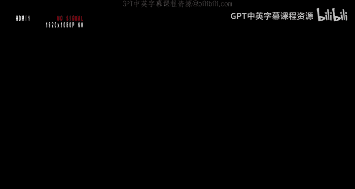
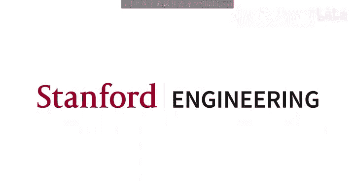

# 斯坦福大学《机器学习｜Stanford CS229 Machine Learning Course  Summer 2019 (Anand Avati)》 - P18：-18-.Lecture 18 - Principal & Independent CA.zh_en - GPT中英字幕课程资源 - BV1NDopY4ECg

C S2 to 9， lecture 18。

The topic for today will be continuing our study of unsupervised learning so the topic today is we are going wrap up factor analysis we mostly finished up factor analysis last time except we just stopped at the end where we finished the derivation and didnt really have time to kind of answer some of the pending questions and really get a good feel for factor analysis it almost felt like you know monstrous looking expressions and that's it but let let's kind of quickly revisit factor analysis to get some better understanding of what's happening under the covers it's a lot easier than it looks。

And then the plan is to finish up principal components analysis and maybe start ICA independent components analysis I am not sure how much time well have for this but hopefully we will at least start this and if possible finish it。

😊，so a quick recap of the last lecture the last lecture one one big proof that we covered was the convergence of the expectation maximization algorithm and the proof was pretty simple it was we wanted to show that the EM algorithm。

😊，is guaranteed to increase the likelihood of our of the observed data in every step in every iteration right and the way we went about doing that is to show that the likelihood at theta of t t plus 1 we want to show that it is greater than the likelihood at the previous theta of t。

😊，And the way we went about doing that is to show that the likelihood is greater than the elbow you know Jenensen's inequality tells us that the elbow for the same at the same parameter value the elbow for any value of t any value of  Q will always be lesser than equal to that's Jensen's inequality and then we we saw what happened when we switch from theta t plus1 to theta t and this basically was the M step at time step T so at the M step of time step T we optimized theta to obtain theta t plus1 such that the elbow was maximized so theta t plus1 is the maximizer of of the elbow at Qt so therefore at theta T the elbow value will always be lower and then we saw from the corollary of Jenensen's inequality that。

😊，That the elbow at at theta T and  Q T is equal to the likelihood at。At theta T， right。

 So it was three simple steps。 And we， we also kind of。Saw the pictorial。

Intuition intuition for this。 So at theta t。Let's call this。The spin is not good。This is。Elbow of。

Q T。Take出啲。喂。If this is theta T。Where it is tight at the likelihood。 So this is just。

L theta and this is the elbow where at theta t is tight and then we maximize it。

And we get theta t plus 1。And。We construct a new elbow at is spike at theta L L T plus1。

 So this elbow is this。And this elbow is this。And so we got that L of。Theta T plus one was。

Was less than the， the。The likelihood of theta t is less than likelihood of theta t plus1 right so that was the em proof and then we moved on to factor analysis where in factor analysis。

😊，We we first we we were interested in the case where we want to model x' that live in a d dimensional space。

 but we have n number of x's where n is much smaller than D and in these cases we saw that。😊。

Performing modeling it as a simple gaustion will give us singular covariance matrices。 And therefore。

 we instead， what we what we want to do is to。Have a latent variable corresponding to z that lives in a lower dimensional space。

😊，And have a matrix L from which the low dimensional space is mapped up to a high dimensional a D dimensional space。

😊，And there is some extra noise added in the D dimensional space。

And so the so the model was defined like this。 Z comes from a lower a low dimensional Gaussian。

 which has this K dimensions。 So in in in this problem， k is less than。

D but k is less is greater than n right so this is the assumption we are operating where n is much smaller than D but k is also smaller than d but k is bigger than n that that is the setting here。

Working in。Well， did I flip it so we want。K should be less than D， but。

D is much quicker than n but we want n to be greater than k yeah that is better right so we want so z lives in a k dimensional subspace and it it is normally distributed with mean 0 and identity covariance and then x given z。

😊，We assume is generated in this way where mu L and psi are parameters right so mu is like an offset for for in the extra dimensional space so once we map map z to high dimensional space it will still mean zero right so this is like an offset that we are and psi is some kind of an extra covariance an extra diagonal matrix where each dimension in the d dimensional space has an independent noise that is added。

😊，so at first these these might seem pretty arbitrary choices。

 however if we kind of visualize what is happening basically what we have is this process can be visualized like this right so from this we see that x minus mu is distributed according to mean lz and some noise psi so we can think of。

😊，The set of theses， the set of latent latent variables that we have。

 imagine we have you know a design matrix of these theses。😊，just like in linear regression。

 so E Z is one example， we have n such examples which are of k dimension。😊，And then， suppose we have。

You know。L1， right？ consider L1 to be like theta。So we have this theta， which is like a parameter。😊。

And when we， when we multiply this， this design matrix by theta， we get。One set of column。

One column over here， so you can think of this as the independent linear regression problems。

 so L is d by k and k and the k K matches the dimension of the design matrix。

 so think of this as the design matrix。Design matrix。 and think of this as。D theta vectors。

And think of this as。D label vectors。So what's happening is for each dimension in which x lives。😊。

We associate a parameter vector。 that is one way to think of it。

 we associate a parameter vector and we get a noisy observation which is x x minus1 column of x minus muo。

😊，And we have so this this in linear regression， we had a design matrix。😊，One parameter vector。

 which。We try to fit to one column vector of y， so this was y this was theta。

And just was x but here you know the terminology is different you have a z design matrix and d different parameter vectors you know d different and for each vector we have you know a different different label so you can think of this as d different linear regressions happening simultaneously。

😊，Any questions。Any questions here？Yes， question。所。P every single。Yeah。

 so every single exactly so every single dimension in the d dimensional space you can you can think of the column corresponding to every single dimension in the larger space is like a label vector for that linear regression。

😊，We are going to come to projection soon。 Yes， so for now you know this is the setting we are operating and we subtract x minus mu you can think of mu as being the bias term。

😊，So bias term， you can add know each component of mu。

 you can think of it as a bias term you are adding to each of the D problems。

And so if you subtract the mean from x， you get this kind of setting where。😊。

This is this is like a linear regression problem and a linear regression problem。

 we also assume that y was equal to theta transpose x plus。😊。

Epsilon when epsilon was independent noise。Whereas over here we are doing x minus mu is equal to。

Is equal to Z L。Plus。si I I so this is one you can think of this as Z and this is the first first row。

 so this is like a Z transpose L1 plus the psi Ii where this is the diagonal matrix that we are adding。

So this is this model is basically trying to represent d different linear regression models in vector vectorized notation where all of them are written in this kind of a matrix matrix matrix notation whereas previously we had this matrix vector vector notation that all that is happening here and from this we constructed the e step and the M step right so the e step was pretty straightforward so Qi was this so  QI we set it to be the posterior distribution at the current values of。

😊，of mu L and up and this notation is pretty straightforward it is just the conditional of the Gaussian weve seen this kind of notation in Gaussian processes as well so for every I for every example we set QI to be a normal distribution that has this mean。

😊，And this covariance and these are just if you remember this just comes from the short complement and this follows the the notation where you know you consider so much to be like the z value of the x variable where you subtract the mean divided by the variance and then you this also has like the correlation coefficient embedded in this and then you multiplly by。

😊，Munipied by L transports right So this this this is just like transforming in the case of in the case of multivariate Gaussians and this is the she complement from which we get the covariance of z given I。

 So the goal here was。😊，We calculated Z I given。X I， and that's， that's， that's that's Q， Y。

Right and from this。😊，We come up with the M step。 So in the E step we always estimate the latent variables and in the M step we reest the parameters right that that' is going to be common for any model including including Gausian Gaussian mixture model and factor analysis。

 So in the E step we estimated the latent variables Z and in the M step we we reest the parameters。😊。

Where L mu and psi are the parameters。So。L。We had this monstrous looking expression。

Mux was just the mean of the Xise that should be intuitive right because we are just what we are doing is transforming z via the L and adding some mu so Lz has mean0 so obviously the maximum likelihood estimate of mu will just be the mean of x's and in fact that will not change from iteration to iteration right so that's just going to be mu so you calculate it once and in the next M step you can just reuse it there is nothing that changes here。

And this Psi II was this you know， even horrible looking you know expression worse than the L expression for the L。

😊，And and and that is where we stopped last lecture。 however。

 even though these look pretty scary we can actually kind of dissect this a little more and and get a better understanding of what is happening right so first of all。

😊，Let's start with the L。So to make this understanding easier， I will introduce some new notation。😊。

Mux of。Mux Z I given X。So mu of Z argument given Xi is the mean of the posterior distribution that we obtain the in the E step。

😊，It it is a Gaussian that is concentrated at mu。 So you can think of this as loosely speaking。

 lets lets call this kind of。😊，Z hack high。So its our best guess of what z is。😊。

Given our knowledge about access So so this is our best estimate of of Z I。😊，Doest make sense。

 this is just our best best best guess or best estimate about Z given what we know about x。😊，So。

 that's one not。And now。嗯。X I minus mu。Or let's let's。And we also have this term。L。Mu。Z I given X。

So now mu L times mu of z I given Xi。😊，Is equal to， basically。L times。Z hat I。Right。

 we just define we saw that mu of Z I given X I。 we can think of this as our best estimate of Z。嗯。

And L times Z I。We see that you know L times Z。😊，Is our best estimate of x minus mu。😡，So L times。

Z I think of this as our。Best estimate of。off。X I minus mu， and therefore。We will call this。X hat。

 I minus mu。So L of mu Z I given X I is just L of z Z hat I。

 and that is the same as x hat I minus mu。😊，Right。Now， once we， we are。

So what what what what do we what can we think of this as， So think of L Z hat I to be。😊。

The reconstruction of x。So z hat I is our best guess of what z is given x is and then L times z hat X is what you know is is now we are going from z back to x so you can think of L z hat I plus mu to be the reconstruction of x。

😊，So over here plug in z hat X here multiplied by L and we get x hat minus mu。😊。

So this is like the reconstruction of Xi。So。That expression can now be written as。L is equal to。

Some over I equals1 to n。X minus mu， so X minus mu let lets you know think of it as as Yi。You know。

 following the linear regression example and mu。Mu of， of， of Z I。So new of Z I， Let's。

 let's call this。So mu of Z I is basically this entire vector Z。

 So mu of Z I is our estimate of of the Z vector。 So let's just。

So I'm just going to call it capital ZI。Transpose。And here again。

 this this basically is is can think of it as Zz。Z transpose z。Plus， some covariance。Inverse。R if we。

Take the transpose。We get。 we don't need that。 So this is basically like you can think of this as。

 you know， L transpose is equal to。This comes here。Z transpose。Z plus， you know， something。Inverse。

Z transpose。喂。RightSo basically， we are， we are doing some kind of a regular linear regression。

 That's what's happening in the L expression over there。

 right So we have we we make our best guesses about Z。😊，We have x's that are given to us。😊。

And using those best， best guesses for Z， we may， we update our L。 And for that， we are just solving。

😊，Be differently in your regressions in parallel。Right， so that's， that's that's L。Now。

 what about psi？So Psi is also this you know scary looking expression。

 and we are going to use you know the same terminologies in there as well so。😊。

What we end up getting there is something like you can。You can think of this as。You know。

 I equals 1 to n。X， I。X I transpose and now in place of me of Z I。So over here。

 let's call L mu to be x hat。 So that that is minus。X i。 X hat I。Transpose and then L muus again。

 x hat I minus。X hat， I。X I transpose。Minus。If we expand the the matrix on the other side。

 we get plus。L mu， you know， think of it as X hat。i。X had I。

And the L comes from the other side x hat i transpose。Plus。L。Sigma。Z I given X I。And transpo。

And now this can be written as。😊，I equals 1 to n。X， I minus。X Ha I。X， I minus。Exact I transpose。Plus。

 L times。Z I given。X i。Health transport。Right， so。This if you if you if if you recognize what we are doing is we are taking the the correct label minus our estimate of the correct label。

😊，Right， and， and。This is is is therefore similar to estimating the noise in linear regression right so in linear regression if y equals theta transpose x plus epsilon。

 the way to estimate epsilon from your data is to first find out theta hat and then do1 over n。

I equals 1 to n。Y， I minus。Data had transpose。X I， I squared。 right， So this is。

This is this is the way we estimate estimate epsilon in linear regression if you need to and similarly you know we are we are estimating this psi which is the noise that is getting added to excise。

😊，And this because of the notation turns out to be a full matrix。

 however we are we are interested in each of the d examples independently and therefore this this matrix that we obtain we are just going to take the i element to be。

😊，Iite element of this This is basically like saying we don't care about the covariance of the noise between one linear regression problem and another regression linear regression problem right so we are just ignoring the oftagonal elements here。

😊，Does make sense， Any questions？So the L matrix is what we what we what we have in the in the update that that。

Or was it a different question？So X hat， you， you can think of X hat as so if you so you can think of。

 you know， you can think of of factor analysis as this。 You are given the y labels。😊。

For different problems， right， and by just given by just having the y labels。

 you want to construct both the。Covariates as well as the parameters。

 right Its a really hard problem right You are given x。

 and you want to estimate both z and L L are the parameters that we that that is part of the model。😊。

And Z is are the latent variables that is specific to each example。😊。

So our goal is to not only estimate what our design matrix was。

 but also estimate what the parameters was by just having the labels。😊，Wch。

 which which sounds you know， kind of impossible but。

Given these these modeling assumptions that these come from from normally come from a normal distribution and that they follow this kind of a linear relation。

 you can apply em algorithm to this and you can estimate it。😊，WasThere was another question。So。

 you can think of factor analysis as this problem where you are given just the labels for D different problems。

😊，and you are assuming。😊，A linear modeling of some hidden covariates。

 we we don't know the design matrix。We don't know the parameters。

And we are estimating both the design matrix and the set of parameters given just the labels。😊。

It sounds like it is kind of magical here you are just given labels and you are estimating both what your x's were as well as the parameters with only the assumption that with the only assumption that the inputs are distributed according to some kind of a normal distribution with me。

😊，And mu here just ends up being the bias term， one one per linear regression problem。Right，Yeah。

 so this looks kind of monstrous。 But if you， if you think of each of these L muune。To be like X hat。

RightThen you can visualize this as you know estimating just the the reconstruction noise between x and x hat and we are only interested in the diagonal element here。

so that wraps up our coverage of factor analysis。😊。

I think there was also one question which a student asked by doing all of this。

 how did we actually go about solving the singularity problem where you know？So， if you remember。

We briefly。Wrote this notation。Back。For factor analysis。You know。Lock P of x。

The margin likelihood actually had this close form expression where it turns out to be。Or x。

Appappens to be a normal。With。Mean mu and covariance L， L transpose plus psi。So。

 the covariance matrix estimated for the marginal of x is therefore this Lll transpose which is a low rank matrix plus a diagonal matrix and because we are adding a diagonal matrix to this low rank matrix we are guaranteed that this is no longer singular。

😊，喂。Allright， so let's move on。 So this this basically wraps up factor analysis。😊，And now。

 we will start。

Princiipple components analysis。PC诶。PC。So in factor analysis。😊，Our goal was to。

To model x's as something that approximately lies in a low dimensional space right so for every x we had a corresponding z。

😊，And z lived in a low dimensional space and the relation between x and z was was what you call as aine aine is another word for linear plus some offset right so L defined L gives us from z to the centered x and then you add some kind of an offset so x and z are related by what is also called an aine relationship right so。

And。We had to go through this E M algorithm， because we were。

We were modeling it with this with the assumption that D was much larger than n。😊。

PC A is another approach to。Where you are given X I's。I equals 1，2， n， and。X， i。Is indeed。And now。

Here， we no longer。We no longer assume that d is much larger than n we we are back into the usual regime where we have you know generally have more number of much more number of data points than the dimensions of the space。

And now， we want to。We want to find out if our data actually lives in a low dimensional space。😊，So。

 for example， if。here's one example。So， if this is a data set where are we are plotting。

 so this is x1 and x2。So， if you have a data set where you are plotting。

The example in the notes is supposing you are。You fly helicopters or you fly you know toy helicopters whatever and for every for every such you know pilot you have a skill level and the level they enjoy flying the helicopter right and if you are trying to to。

If if you look at the scatter plot of skill。Versus enjoyment。You know。

 you wouldn't be surprised if you see some kind of a linear relationship between them。

It's moral or less because， you know， people who enjoy flying helicopters are likely to be you know good at it and vice versa。

 right So even though you have two different variables， they are kind of you know， reading of this。😊。

Underlying， you know， common。A common trait of the pilot you can call it you know piloting karma or whatever and you know and therefore these four are pretty correlated。

😊，And now。Your data may therefore have。

If your x is。In general， so if you have any examples。And D features。So。

 some of your features may be kind of correlated so if you if you have if this is a data set about pilots and one of the features is you know their skill level。

And another feature is you know， the level of enjoyment they report flying helicopters。

even though this looks as a D dimensional space because you know。

Some or many of your features may kind of actually level in a lower dimensional space。

 your entire d dimensional space can probably be represented in a lower dimensional space。😊，Whi is K。

Okay。By by this I don't mean element wise similar we are just thinking of representing this high dimensional data in a low dimensional space question。

😊，Yeah so the question is why isn in this supervised learning where you know you can think of one of them you can take one of them to be why and kind of regress it from the others you can do it as a supervised learning problem but the problem is in general quite hard in the sense you don't know upfront which label which which of these features you want to choose as your y label you can try it with all of them you can try you know a subset of them it' is not clear you know how to go about actually solving this a learning problem what if D is 10000。

A you going to perform 10000 know linear regressions， You could do that。

 but PCs is much more efficient。Any of them， they will。You you you could do something like that。

 though this is PCA as you will see is much more straightforward。

 you don't have to you know pose it as a supervised learning and learn it etctera。

 so it a PC is more straightforward。So in PCA， our goal is to therefore find subspaces of our data find subspace in our input space where the data kind of lives。

😊，So NPC here， the first thing we do。Is to。Center our data and scale it to have variance  one。

 What we mean is the first step in PC is to。Now，Standize your data。Which means you want a set。6。J I。

To be。X J， I minus。Muji， divided by。Sigma J where mu J is the mean of the jith column and sigma J is the standard deviation of the J column。

So first thing is independently kind of center each。

Column and scale each column so that the column has variance one。

So that's the first thing where muj is。Its one over n。I equals。😔，W and。Next chair系。Sick， my dear。

Squared has one over n。I equals1 to n。X， G， I minus。你oja square。Right， so the first thing is。

 we want to。Standardize our data set to have mean0 and standard deviation 1。

And the reason we want to do this is。😊，It may so happen that the units in which your your data is represented can be very different So for example if you are representing for example the height and weight of a person in a data set where each row corresponds to a person you know height may be you know you never know the weight may be represented in kilograms but height may be represented in millimeters right so the values in the height column will generally be be much much bigger than values in the weight column for example right so。

The first thing you want to do is to kind of become agnostic to the units in which your data is represented and for that we just standardize each of the column independently。

😊，And once we do that。😊，The way we want to find the。Be。Underlying subspace is like this。そ。

So let's assume this is X1。X D。And。If you， if， if your data is。So， we could。Try to find。

A subspace here。And project all our points onto the subspace。So this is one possible projection。

So each of the each of the crosses were。The X's that lived in the high dimensional space。Right。

So this is one way to you know， this is one possible low dimensional subspace onto which we are projecting all the individual data elements onto the low dimensional subspace。

😊，And， you know， another possible subspace is。Its like x1。X， D， and。

Trying to draw the same things here。 Now， what if instead we chose this to be our subspace right if。

But there is one technical error in what I did。 the subspace must span through the origin。

 So instead let me just read the axes so that it。Yeah， let's assume。This is X。

And it's going through the origin。So instead we could。

 we could also have this to be the subspace and if。We can project。All the points。Onto our subspace。

Right if you remember。Projection means to find the closest point on the subspace。

To our the point which you are trying to project。So and the natural consequence of that is that the。

The the line connecting the projection to the point will always be perpendicular to the subspace itself。

All right， so we could have。😊，You know there are an infinite number of subspaces that we can come up with right and we could either use you know this is one possible subspace onto which you are projecting this is another possible subspace onto which you are projecting but PC tells us that the subspace onto which you want to project your data。

😊，Should be the one where the。The variance of the projected points is maximized。

What do we mean by that， It means。 So if you look at the。Projected points in this example， you know。

 they are kind of clustered。Clustered within within within the space。

 And if you calculate the sample covariance， it would be， you know， some， some。

It its of some value however with this we see that the projected points are much more spread out。😊。

This is much bigger than this it is the same points but different choice of subspace but the variance of the projected points the projected points in this case are much more spread out compared to the projected points here and PC tells us or what PC does is to find this low dimensional subspace。

😊，The K dimensional subspace of this d dimensional space where the projected points have maximum variance right so it is a variance maximizing procedure where we find a subspace such that the projected point on the subspace have highest variances。

😊，And。The way we represent the subspace is through these。Unit length vectors。

So the idea behind you know doing something like this is that we want to we want to retain as much of variance there is in the data to the extent possible even after projecting it down to a low dimensional space。

 we don't want to lose the variance we just want to lose the number of dimensions where the data lives。

 we want to project onto a low dimension a lower dimensional space but we don't want to lose the variance in our data we want to retain the variance in the data but lose just the dimensions that is the idea with PC。

😊，So。So suppose we are， we are。Suppose we represent the load dimension subspace with。

Unit vectors U if。You， you can think of you in。R D to be。Unit length。

So if if u is represents you know a basis of the subspace of unit length onto which we want to project our data。

You might remember from one of our earlier lectures。If u is is a basis vector。

 the projection of x onto the space spanned by u will be。The projection matrix of U。

Projection matrix of few times x。And x is the point that you want to maximize。And so。

So that would be the。That would be the projected point and this。

 you know the projection matrix of u is basically u u transpose。😊，Over nu transpose U。Of x。

 that's just the projection matrix of of。Projectctionally。And we see that。U transpose U is just one。

And so the projected point will be just。X， I transpose。You。So this should be X， I， X。I transpose u。

 this is a scalar times u。Now， what we want to do is to find you。Such that the。

The variance of across these projected points is maximum。 So if we have n examples。

 what we want to maximize is the。For all in examples， the norm of this this projected point。

 so the norm of the projected point is basically the length from here to the projected point。Okay。

 the。If we we find U such that the sum of the squares of all the projected lens。Is maximum。

Then effectively， we would have performed PC。So what we want to do is。Find you。Such that。1 over in。

S i equals one to n。第一。Norm of the。Election of U times x。Square is maximized。

And this is the same as 1 over n。I equals 1 to n。X。Xi transpose U。 So this is just a scalar。Times U。

N is maximized， so we want to maximize this。Maximize this。Another U is equal to。Arcm maxax of this。

And this we see that it is some scalar times a unit length vector。

 so the norm of this whole thing is just1 over n。Equals 1 to n。T I transpose you。Square。

So the norm of a scalar times a unit in vector， so the norm of that is just the square of the scalar itself。

And this we can now write this as to continue here。And that is equal to。You transpose。Or over N。

I equals1，2 n。X i。X， I transpose。You。因为。And。Because our x's were。Center。

This thing has mean  zero and therefore this entity over here is the sample covariance matrix。😊，So。

You might remember this from some optimization class you took。This。U equals。Ag Max， you。

Of you transpose。Some matrix， U。In this case， this happens to be one over and。I equals1 to n。X。系。X。

I transpose。Right。Does anybody know what the solution of you is for this problem？That U is a vector。

So， u in this case is identifying so so if you solve this the solution u is basically the eigenvector corresponding to the largest eigenvalue of this matrix。

😊，Right， and and that's。That's because。Rrc max of U of U transpose A U。Will give you。Eigenvector。

Of largest。Iigenvalue of him。And this analysis holds。Where instead of you， if you have。

Where here we just considered1 u one vector， but if you consider a whole basis of of basis vectors。

 then nothing in this argument changes by performing this maximization you would have recovered where。

And so of a single u if you had K U vectors， then by performing this maximization where instead of one vector you have K U vectors you will have recovered the top K eigenvectors corresponding to the largest eigenvalues。

😊，As question。So how we went from here to here。Yeah， so。So this step， I'm going to write it here。

1 over n。I equals1 to n。X， I transpose。You。😔，Square。Right， and this is the same as1 over n。 So Im。

Equals1 to n。Pix。I transpose you。X， I transpose U。 It's just the square。In this。

 we can write it as one over n。equalquals1 to n。X i。Transpose U。 And this dot product。

 we just write it the other way。 and then we get U transpose。Xi。

 rather I should have done it the other way。 So instead， if we had swapped this。Get equals1 to n。

 U transpose。X， I。X， I transspo U。RightAnd then you can take the U common out of all the sum and that gives us u transpose。

I want to what end。I equals 1 to n。X i。Xi transpose。You。So， basically。😊。

By following this variance maximizing argument。Where we want to maximize the sample variance or the projected points onto our subspace must be as far as possible from the origin by following this variance maximizing principle if we find the basis u such that the projected variance is maximized we will see that we will end up with an eigenvalue problem where we want to calculate the eigenvectors of the sample covariance matrix of x。

So， if x is our data。Data matrix。PC tells us that first calculate x transpos。

X transpose x is basically this written in matrix notation。😊，Take x transpose x。And calculate the。

Eigenvectors and eigenvalues are calculate the spectrum of the x transpose x。

And depending on the number of subspaces that we want to retain。

So x transpose x will give us a collection of lambda I U I。So say lambda 1 nu1。Lambda 2。You too。

Until lambda D。UD。喂。These are the D eigenvectors， eigenvalues and use are the D and U are the D eigenvectors。

And now。What we want to do is is if depending on the amount of variances that we want to retain。

 a common practice is to then choose as many lambdas or as many pairs of eigenvectors。Such that the。

Or a more more precise way to say it is。Find。K。Such that。Some over i equals 1 through k。

 lambda k over some i equals 1 to d。sorry， lada eight。懒唔得。はい。

This is equal to you know some some kind of a person say 95% or something。

And it is common to choose k in PC by first performing the eigen decomposition of x transpose x。

Right， and then。But you know sort your eigenvalues in some kind of decreasing order in a decreasing order and then find k such that the sum of the first k top k eigenvalues。

Divided by the sum of all the eigenvalues is some you know， percentage of your choice。

And by choosing K to be you know， 95%， you can effectively say that you retained 95% of the variance in your data。

 even though you went down from D dimensions down to K dimensions。This question。Reations that。其当。

인기를 맞。Yeah。Yeah， so I'm going to come to that right after this。So。Any questions in this。

 the way we go about doing it is to take x transpose x。

 take the eigen decomposition of x transpose x， obtain the the eigenvectors of x transpose x。

And then choose k。😊，Such that the sum of the top K eigenvalues divided by the sum of all the eigenvalues is the fraction of variances that you want to retain。

 So if you were to plot。Let's say this is。K， and this is。Fraction of。Varance。

 you will generally see that。If this is D， then you will generally see that this goes down something like this。

Where。or rather this is d minus k， which means if you were to prune out all the d eigenvectors then you will be having zero variance remaining。

 but if you prune 0 you will hold you will be having all the variances remaining and generally you know this remains flat for quite a long time which means even if you prune a big fraction of your feature space you will still be having you know like 95% of your variances。

Next question。Professor， so you is。I think。Okay。Yes， so you in this case。

 we showed it we showed the the showed the intuition using a single single eigenvector， but。😊。

Effectively we just calculated the largest eigen you know showed that the largest eigen eigenvector is the one that minimizes maximize the variance if you projected to one dimension。

 but if you want u to be larger then or rather if you want k to be larger，😊，This was k equals 1。

If you want K to be larger then just do the full eigen decomposition rather than just this optimization because this just gives you the top eigenvector so instead do the full eigen decomposition and hold on to the you know top k eigenvalue eigenvector pairs。

Okay， any questions in this so far？So for those of you who may be familiar with singular value decomposition。

😊，What we performed here is also called singular value decompposition。 So SVD。😊，你哎这天。Okay， okay。

Maybe we covered this in one of the earlier lectures， but if you have a matrix x。Where x is。Square。

And symmetric。Then， x has。Orgonal eigen basiss。Eigenvectors。And。Real eigenvalues。Right， and if x。Is。

Positive semi deffinite。Then。Then it is obviously square and symmetric and if it is also PSD。

 then eigenvalues。Are positive。 All the eigenvalues are positive。Right。Now， in this case。

We are using x transpose x to be to be the matrix on which we are performing e decomposition。

So it is x transpose x is guaranteed to be square， symmetric and positive semi different。😊，Now。

Performing。Eigen decomposition。On。X transpose x。Is the same as performing。

Singular value decomposition on x。The way you go about doing singular value decomposition on any matrix x in this case for to do singular value decomposition。

 your matrix need not be PD。 it need not be symmetric， It need not even be square。😊。

You are given any matrix whatsoever。😊，The way you perform singular value decomposition on any matrix x is to take x transpose x。

😊，Take the eigenvectors of x transpose x。And the eigenvectors of x transpose x。U。

And the eigenvalues of x transpo x will the square root of the eigenvalues will give you the singular values of x。

😊，So this is the same as performing singular value decomposition on the x matrix。

 which is you know another way to think of the same thing is to construct x transpose x and just do eigen decompositionation on x transpose x。

Any questions on on on PC in homework we you will see so here we we saw the variance maximizing argument where if。

Where you know， we want to find。A hyperplane where。If you take the。Projections。

 then the variance of the projections。 So this distance， you know， this distance， this distance。

 you know， this is basically the。You know the spread of the projected points is maximized in homework you will show that this method is equivalent to or you will see another motivation where。

If you were if you， if you rephrase the problem as finding a subspace。Where the。The projected points。

Are as close as possible or as near as possible to the original points。 That is to minimizing this。

This distance。So maximizing the projected variances and minimizing the residuals are equivalent and in your homework you will show that if you phrase it as a problem of minimizing the residuals or minimizing or improving the approximation of the projected points to your original points you will recover the same same solution as maximizing the variances like there are different two different ways to think of PCF fine。

Find a subspace such that the projections are as close as possible to the original points that is you know interpretation 2 that you will do in the homework interpretation one that we saw in the lecture is find a subspace such that the projected points have maximum variance。

Any questions on PCA？Okay， great。 So let's move on to ICA。

 So it looks like we are making good progress。 So we might be able to finish ICA today。😊，So in I에。

It's somewhat different problem from。From the problems we receivedd so far。And to。

 perhaps to understand kind of the， the， the。The difference of ICM， it might be useful to kind of。

Kind of placed together the algorithms we've seen so far。 So so far， we have seen， let's see。

 I can erase this one。So so far in unsupervised learning， we've seen four algorithms。Right。

The first one we saw was ks。 We started off with ks。And then after K means。

 we studied Gausian mixture models。And after Gaussian mixture models， we studied factor analysis。

And today just now we studied PCA。😊，So， we studied four algorithms so far and you can kind of classify them in two different ways。

😊，Right so。These you can call clustering algorithms。And these， you can call them， you know。

Subspace algorithms。These were probabilistic。And these were not probabilistic。喂。

So the probabilistic algorithms。We solved them using EM。Expectation maximization。

Whereas the non probabilistic problems in the non probabilistic approach there was no there is no we didn't have to use E and loosely speaking again。

 this is a very loose。Any， you can think of clustering problems to be the counterpart of classification problems from supervised learning。

You can think of them as classification problems not where you are not given the labels and you can think of these subspace finding problems as the counterpart of regression problems some supervis learning。

😊，And。They are you know， both PCA and factor analysis。In in both of these， we。

 we recovered a low dimensional subspace。Where in factor analysis， z's were the subspace。

 z was the subspace。And in PC。😊，The way we recover the subspace is to construct the the。

The matrix U where u。Is the。There are。K different。Columns。Each of dimension B。

And these are the the the the top K eigenvectors of。X transpose x。RightAnd then using this U matrix。

 which is。We can multiply you。X transpose。So U X transpose will give us。嗯。

U ex transpose will give us。K such。Or it would be easier to just do it as U trans。

X you transpose will give us the projected points of x onto the lower dimensional space。

You take the eigenbases and take each example and multiply it and just multiply it onto you so thats like projecting it onto you because they have unit unit lens and X u will give us the subspace。

Now。You might， you might ask whats you know what what what else is different between fact analysis and PC。

 The other difference in fact analysis， we assume D was much bigger than n。

But here we made no such assumption here， we in fact， we assume that n will be bigger than d。

If we don't assume n is bigger then than D， then again， you know， this would。

It might work if this would be the this would be singular。 but yes， so in fact， actually， in PC。

 you probably don'tt don't need to make。N to be because N D but it is commonly the case that n is indeed because N D。

And the other difference between the two was in factor analysis， we recovered the matrix L。😊，And L。

 the parameter that we recovered took us from z to x。😊，Took us from Z to X。Whereas in PCA。

 we recover U。😊，U takes us from x to z if you call z as the projected projected points。Right， so。

 so the the the recovered parameters kind of go in opposite direction between fact analysis and and PC。

 The other difference between PC and fact analysis was in PC。You can first perform PCA。😊。

Get the set of all eigenvectors and eigenvalues and then decide。😊。

After the fact what is the appropriate k for your problem you can decide k after you perform PC whereas in EM you need to decide k first and then run em if you are not satisfied with it you need to change K or different value and rerun factor analysis all the way again whereas in PC you first perform eigen the eigen decomposition and then you look at what k will give you the best variance retaining factor。

Next question。Is this a feasible a。you so so the question is is it reasonable to first do PC to find K and then go to factor analysis but then what is the point of going to factor analysis because you would have you know recovered a lower dimensional subspace anyways？

😊，So these are some ways in which we can classify what we have covered so far。

And now we are going to start ICA independent component analysis。😊，Right。

And independent component analysis is somewhat。Different in nature from what weve seen so far。

Yes question。So is there a benefit of doing factor analysis？It， it so happens that。So。

 factor analysis。Next thing of。There are benefits to doing factor analysis。 for example， when D is。

 is。Much larger than than。So this， this would also。ABC。最後。

Yeah PC PC it work but the problem with with so so here is the thing in PC we are not explicitly modeling the noise in the data right so there was no probabilistic assumptions being being made whereas with fact analysis even though you choose you know k to be some value it generally works pretty well because it will end up adjusting your the psi matrix accordingly if case different so its。

😊，Quite you can think of them as two different kind of equivalent approaches。 You know。

 the differences are what we discussed you know in some cases it makes sense to use factor analysis some cases make sense to use PC but PC happens to be you know more commonly used because it's easy to implement you just perform e de compositionposition and you get it whereas fact analysis you know it also provided as a good good weight good example to apply E。

 So when we applied E in one case， these were discrete but here we saw these were continuous right so it was know。

😊，As an example to understand EM better factor analysis is helpful like you know from an educational purpose。

 but PCA is probably used much more commonly in practice than factor analysis。😊，嗯。

Another thing about PCA that we kind of skipped over was we just said do eigen decomposition on x transpo x but sometimes x transpo x can be you know really huge in terms of you know the number of dimensions and you know if you were to use nuy or MAlab and you know do know eigen decompose on a large matrix then you know that that may just fail you may run out of memory or something so in fact when you when you run PC in practice a common a common technique to perform eigen decomposition is to use something called power iteration。

so power iteration is is commonly is one of the commonly used techniques to perform icon decomposition on large matrices。

 So again this is this is。There is not going to be something you are are going to be tested on。

 but the idea of power iteration is to start with some u0 and randomly initialized U0。

 anything that is non0 right and from u0。😊。

Calculate x transpose x times u 0 call。Right， so U1 will be。Ex transpose。X times U 0。

Divided by the norm of x。X transpose x。Expo x times。

U 0 so basically take some randomly initialized matrix randomly initialized vector multiply it by the matrix whose eigenvector you are interested to calculate and you get u1 then multiply you know x transpose x transpose x times u1 will give you u2。

And if you keep multiplying the vector over and over again by the same matrix。😊。

And after every multiplication， if you rescale it to have unit length。😊。

And if you repeat this over and over， you will end up you will you will see that you will the the the vector that you will end up in。

 the vector that you converge will be the largest eigenvector。😊，And the the intuition there is。嗯。

Suppose this is x1 and Xd。Now， if you remember， if you take a unit。

spherephere in your input space and multiplied by a positive definite matrix。Then。

The outputs will be on some kind of an ellipse。So if you were to take this as as the input and know if this is。

You not multiply it through x transpose x， then you may get this。To be the point that got map 2。So。

 this would be。X transpose x times u not and then rescale it back to unit length multiplied through x。

And you will get this。and then rescale it back multiply through X and you will get this and eventually you will see that you know this will always converge to the principal axis of the ellipps which is the eigenvector right so multiplying the same matrix the matrix over and over and then rescaling the multiplied vector back to unit length if you repeat that over and over no matter where you start you will either you know converge。

Along this direction， or if you start here， you will end up converging along this direction。

 but that' is going to be your principal eigenvector。

And then one you know you can then take you know x transpose x subtract from it you you transpose you will get a matrix of one lower rank and then perform the same power iteration on this matrix and you will recover the next largest eigenvector and so on。

 so in practice usually you do something like this when the number of dimension is large So this called power iteration。

This is just a good detail to know if you come across the word power iteration。

 basically what is happening is you know take take a vector and repeatedly keep multiplying it by the same matrix and rescaling the length back to one。

😊，Anyways。IC에。In ICA。😊，The in ICA， the motivation is probably best seen through this cocktail party problem。

In the cocktail party problem。Assume， there are B。Speakers。know， people who are speaking。

And there are D microphones。So there are D speakers and D microphones。

And the D microphones are placed in different places of different lens and they are recording the D speakers simultaneously。

Right， and。We will call。え。In R D。To be。You know， think of S and RD to be one instantaneous recording of the of the speeches that are happening at the sources right and。

We also assume that。The recordings in the D microphones， we will call it X。It's also R D。

 and we assume that x is equal to a times S where a is。Commonly called as the mixing matrix。Right。

 so。え？Zhe。😔，I。Is the。Is the thing that the8h speaker is pronouncing at the Jth time？ and similarly。

 x。IJ is the recording。In the。嗯。In the Jth microphone at eighththe time。Did I say the other way。

 so J is the speaker identity。Maybe I told it the other way first time and I is the kind。

And similarly， J here is the microphone identity。And Ie is the time。 so what's happening is we have。

D different speakers。Saying whatever they are saying。And。D different microphones that's。

Recording them。 So we have。Speaker one over here。Speaker 2 over here。 right， Let's。

 let's just start with two， right， and we have。Microphone one over here。Right。

 and microphone2 over here， that's。Recording what they're saying。 So this is。X1。Next to。S1。

2 now these are kind of placed at you know arbitrary distances from the speakers。

 you will assume there is no lag in in recording。And， let's say。You know， speaker 1。Let's assume。

 this is the。Wayform of what the speaker1 is speaking。And speaker 2。

This is the waveform of what speakerea to is speaking。Right， and this is time。

Time is progressing this way。And。If we take a point in time。And record a snapshot。This will give us。

S。I， so at time I。SI will be set S 1。S。I hope。And this is in。R D here， D equals 2。Okay， so the the。

S I1 is this height， S2 is this height and this is the time so you can think of a snapshot in time to be one example。

And the the kind of the amplitude of what the speaker is speaking at that time to be the coordinate value at that example。

😊，And similarly， we have。😊，You know， the two microphones。So this is microphone1。Thanks one。

X2 and this microphone is recording some linear combination of the two right。This is x1， and this is。

X2。Similarly over here。Again， time is。Movingwing to the right。And at time I。はい。X I is equal to。X I1。

 comm on。Xxi 2， but here， these are the values recorded by the microphone at time I。

We will assume that。We have the same number of microphones as the number of speakers。

And we are only observing。😊，These x。And the problem now is。We are only given these xs。

We are told the number of you know we obviously know the number of microphones。

 we assume that there are the same number of speakers。

And by only having these be different microphone recordings， we want to recover the original。😊。

Or speed signal spoken by each speaker。 That thats the that's the setting in which we want to in which we are operating。

And the， and what that translates to essentially is。We have。We make the assumption that。X equals。A。

Which means X I equals a of S。Right。A is a square matrix because we have the same number of speakers as the number of microphones。

And what we want to do is to。Calculate w is equal to a inverse。Which is called the unmixing matrix。

W equals n versus the unmixing matrix where we are。😊，Where W can take x。Right， and return。Yes。So。

 the w matrix can separate the speakers。 So this is also called the source separation problem where we are given x's。

Which are different different mixtures of the sources。And using just these mixed sources。

 we want to construct this W matrix。It is called the unmixing matrix。

 which will recover back the original speech。😊，And。The， the。

 the assumption that we are going to make， we are going to make only one assumption。

The one assumption that we are going to make is that sis。Are distributed。

A core are independent in the sense， each SS SSSJ is independent of the other SJs。So the speaker。

 the assumptions we are going to make are。So， what are the assumptions weve made so far。

 So the first assumption we made was number of speakers equals number of microphones。Right。

And the second assumption we we made was that these two are associated with a linear relation。

 so s is equal to wx we made a linearity assumption and the third assumption that we are going to make which。

😊，You know， with just these two it is impossible to recover right we we need to make one more one more some more assumptions the the assumption that that is going to help us recover is that we are going to assume Sj is independent of Sk where j is not equal to k。

😊，What that means is Sj has some kind of a probability distribution and Sk has you know belongs to another probability distribution。

😊，And these two random variables are independent。what that essentially means is we are assumingsum that what one speaker is saying is independent of what the other speaker is saying。

 which may not be a valid assumption in reality if two people are having a conversation then most likely only one of them is speaking at a time etcter but。

😊，In it generally turns out that this is this still happens to be a reasonable assumption to me。

Independence assumption。And we need to make one more assumption that will allow us to solve this problem。

The last assumption that we are going to make is that S J。Is not。高兴。

So this is a non Gaussian assumption。 why， why。Why do we need to make this non Gaussian assumption。

 Let's， lets。See a few pictures。 and hopefully， that will。Give some intuition。We。

So these are basically the the slides we saw in the intro lecture just。Let's hope the audio works。

So here we have we are considering the case of d equals 2 and these are the versions that are recorded in the microphones。

 the two microphones and these are what the original speaker said。😊，Right， so。えと。えご中。

It is basically two speakers counting one to 10 one in English and the other in Spanish。

 and this is a recording from another microphone。W。They。え校ち。The audio is a little low。

And once it is separated， it sounds like this， can people at the back hear it？O。When。And the。

The other one wants at separated， Guro Cco， C， Ocho and I。

So all that was fed to this algorithm was these two mixed clips。😊。

And nothing else and by making certain independence assumptions and linearity assumptions。

 the algorithm was able to recover these separated versions of the two audio clips。😊，Right， and to。

To understand these。These assumptions。I made a few slides that might。Yeah。So。😔，イコポネットに。

So what we have here。So， we assume that S I and SJ must be independent。

And we also assume that each of the SJs must not be Gaussian。The first row。

 all the three rows correspond to Gaussian distribution， the second row。

 all the three correspond to theplace distribution and a third。

 all the three correspond to logistic distribution。So if， in the case of Gaussians。

Here x1 the x axis and the y axis represent two independent Gaussians and each point in this cluster of points are points that are sampled from a joint Gaussian distribution where the two components are independent so if we sample from two independent Gaussian distributions assume both have mean zero variance1 then you will see that the points are generally the cluster points have this circular formation。

And then we apply some kind of a linear transform， so the first column corresponds to you know one linear transform the second column corresponds to another linear transform the linear transform is applied to the points that were sampled here。

And we see that if so the first column corresponds to a linear transform that was more or less just a rotation。

😊，We see that the rotated version。😊，Looks exactly like the original version if it's Gausian。Right。

If it is some other distribution， some other kind of a linear transform。

 then it gets some kind of an elliptra。😊，Now。Instead of instead of Gaussians。

 let us assume we have we start with two independent lapplace distributions right where the source one and source 2 are sampled according to independent lapplace distributions。

 we see that the shape taken by the product of two independent lapplace。Has this kind of， you know。

It has。This is diamond shape。And then if we know apply linear transformations。

 we get know shapes that look like this。😊，And similarly。

 if you start with the logistic to independent logistic distribution when they are independent they look like this and as you you know apply transformations they take different shapes。

😊，In ICA。We are starting with data that look like this。😊。

The the microphone recordings if you were to plot them。😊，They look something like this。

And given these when we start if if we were to start with data that looks like this and we want to recover the original。

😊，Untransformed data。With。Laplace and logistic， we see that we can make a good guess。 You know。

 the corners corresponding correspond to corners， et cetera。 But in case of Gaussian。😊。

It is hard to tell whether the you know， in fact it is impossible to tell whether this transform data came from this version as the source or this version as the source。

😊，Because in Gausians you have these smooth ellipses and there is this rotational ambiguity of not being able to determine what the original shape was。

😊，Whereas with these other distributions they do not have this you know smooth e shape they have these you know the intuition to have is that you have these corners right and these corners can correspond to one of these corners。

😊，This。Non Gaussian distributions still do have the ambiguity that the the axes can be permuted。

You can construct you can construct unmixing matrices that start from here。😊。

And map you back to the unmixed versions where the axes are permuted because one corner can get mapped to a different corner and you can also have ambiguity that the axes are flipped in their sign。

However， though in problems where those ambiguities are tolerable。😊，ICA works very well。Which means。

 for example， if you are applying ICA to you know audio source separation。

Where once wemix the unmix the mixed audio clips， we recover the original audio clips。But the。

The speaker one and speaker two identities may have shifted。

 but that is okay because we never knew what the original identities were。

In in case of ICA once we once we run ICA and recover the unmixed versions。

 there is no guarantee that the first column of or or the identity of the first source will always be the same right there is there is ambiguity about。

About what the original sources are and there is also ambiguity that the sign is flipped and in audio generally that' is okay too the sign of your your of your wave file can flip and you will still get the same audio。

So this gives us some intuition of the ambiguity that that arises only in Gaussians right this this spherical shape is characteristic of the Gaussian distribution right in no other distribution if you multiply the if you multiply the pdfs of two independent distribution no other will give you a contour map that is spherical the spherical shape comes only from a Gaussian so as long as the the。

😊，Distribution of our sources is assumed to be non Gausian。

 We have some hope of recovering the the original signal。 Yes， there was a question。

Because no one actually speaks according to distribution。 So does it ever matter。

Yeah so so the question is in practice you know nobody actually speaks according to Gaussian neural Laplace right whats whats what's the you know does it actually matter it actually does matter a lot。

 In fact that's the only thing that matters because even though your data may not be may not be。

Distribut according to Gaussian。What I am about to show in the next slide here is that these two clusters that we see are in fact。

 so I just took the waveforms on the two audio clips that I played short a few minutes ago and just plotd a scatter plot of the corresponding audio amplitudes from the two sound clips。

😊，We see that the。theIn the separated version， even though they are not Gaussian。😊。

It is still not spherical， right， So you there is， there is some amount of， you know， you。

 you can kind of see that， you know， there is some elongation along this axis and there is some elongation on on on this axis。

 and it's not perfectly spherical。 So when we start with the mixed version。

 So this is basically the scatter plot of the mixed audio clips。😊，Right。

We see that the algorithm is able to recover， you know， the the the the two independent components。

 even though the the。😊，Even though the data was not actually distributed according exactly according to Alla plus or or。

Or logistic。So that is some intuition to show why non Gausian assumption is important。

So with these two assumptions。So， with these two assumptions， we can now formulate ICA。

And we need one final。Thing to take care of。Which is the。The linearity assumption。

So supposing we have a random variable， lets assume it is uniformly distributed between 0 and 1。

 It's a uniform random distribution that lies between 0 and 1。So。X is。Uniform。

We take a different panel。Uniform between 0 and 1。Thispen better。Right。

And the per so which means x looks like this。0 and1， and the Pd of x looks like this。So this is。X。

This is p of x， so it has density equal to 1 between 0 and 1 and 0 everywhere else。

So this is just a uniform random variable over 0 and1。😊，Now， what about 2 x？What is。

Let's consider y equals 2 x。 What is P of y。So， so what's， what'， what's P of。 So when we。

 when we when we do y equals 2 x now y。Will be distributed between 0 and 2。

It has density 0 outside this region。What is p of y between 0 and 2？Half， right？This is half。

Why is this half？先し。So exactly so we the probability distributions require that the area under the P must integrate to one。

😊，So if we stretch the x axis， we have to shrink the y axis by a corresponding amount。

And that's because the area under the P must integrate one。😊，RightNow。

 what happens in a higher dimension if x is。You know。In general， x， instead of one a。

 let's assume this is some script X。And instead of multiplying it by one scalar。😊，We do Y equals。

 say some。Y equals W。X， where W is some matrix now x is。Xs is in RD。This is。R D by D。And y is again。

 in Rd。Right and we have。Pp of x to be some x to be some value。So P of Hawaii。Will be。

What can we say about P of y， P of y will be。P of y is W X。So let us assume this is the density of y。

 and this is the density of x。Is this correct？I is not correct right and it it is not correct because of the same reason where p of y had to be So P y of y had to be p x of。

2 x times 1 over 2。So similarly here we need to divide it by the determinant of w。

This is this determinant of W you might have seen this from your probability theory course。

 this is also called the Jacobian。😊，So， Jacobian， whenever you perform a change of variable of your random variable。

 the density will be transformed according to you know this extra Jacobian。Yes question。ちてわ。Sorry。

 this should be PY。Because PY is is is oh， so sorry， sorry sorry so。PY y is P。P X of。X is y by2。

 Yeah， y by two times。피er。That makes sense。And， and what did I write here， I think here， also I。This。

 if， similarly， if P or y of y will be。W inverse of y。W andverse of y times one order。Right。

Whenever we transform a variable， some linear transform。

 the density will get this extra determinant factor。With with these。With these pieces。

 in fact we are ready to finish PC ICA。So in ICA。We define。P of x。To be。Product from。J equals1 to D。

PS。Of W。J。Transpose x。Times。😔，W。Over here。W。Is the。Unmixing matrix。Where。W J。Times， some。X。

Will get us back the Jth source。so w is the wj is the unmixing matrix， you give it this mixed x。

 you multiply it each wj times x will give us Sj。Which this is S J， So S J equals W S J times x。

 So W J times x。And。We define the the probability of x as in terms of P of S。

And we make the assumption that P of S。Is distributed according to the logistic distribution。

So the logistic distribution is the distribution whose Cf is the logistic function。So。

If you remember the logistic function。Is is。P使的。CD F are。

CDf of x is equal to 1 over 1 plus a to the minus x。So this is the C F of。Logistic。

We can call this sigma of x。 and so the Pdf。The probability density of。

The logistic know f of x is the derivative of this。

 That is basically sigma of x times1 minus sigma of x where sigma is the is the sigma not the logistic function。

Right， and。Using this。So， so this sigma sigmoid x times 1 minus sigmoid x will be p of x。

 So we assume that the sources are distributed according to the sigmoid distribution， which gives us。

 you know we can write the。L of w where the parameter here that we are training is W。Is。

Some over I equals1 to n。Some of。J equals 1 to d。Log。Of the Pf， which is。

Sigmoid of x times1 minus sigmoid。So X I times 1 minus sigoid of。X， I。还有什么。Plus。Log determinant of W。

So the parameter that we are interested here is just w。

Previously the parameters that we were trying to recover happened to be the parameters of the probability distribution itself。

 for example we would define the likelihood over mu or sigma or some such thing like that here the parameter that we are trying to learn is the transformation W that is going to take us back into something that is distributed according to sigmoid。

And using the， the， the linear transformation， we， we。

We get this extra log determinant term due to the extra determinant that came due to the Jacobian。

And that's all there is to it。😊，You take this objective， take the derivative。

 perform gradient ascent and run gradient ascent until you converge right and the corresponding update step so you take the derivative of this and you get the update step that looks like this w equals w plus alpha some learning rate。

Times。1 minus。都。G here G is just the sigoid，1 minus2 sigoid。Of W 1 transpose。X I。

1-2 sigoid W 2 transpose。Xi。And so on。Times X， I transpose。Plus， W transse。Inverse。

 So this is the update rule。And you can perform stochastic gradient ascent and once this converges。😊。

Take the converseged W。Multiply your x' with W。And you get Ss。 and if you play these ss。

 you write it into a way file and you pay these S， they will be separated。It's almost magical。

 It works。And in your homework， so here you have the update rules for assumingsum that PSs were logistic and in your homework you will do it make youre tight with a different distribution。

 you assume its aplace distributed and in your homework you have five different audio clips instead of two audio clips and run it till it converges。

 take the resulting unmixing matrix， the conged unmixing matrix and multiply your mixed audio clips through it and you will recover a new audio clip and you play it and they should sound well separated。

😊，And one final tip for your homework in the logistic distribution。

 you will encounter you know the absolute value of x。😊，And you have to differentiate it。Right。

 and the you know。What's D by D X of the absolute value of x。Yeah。

 it is split so you know absolute value of x looks like this right so it is it has slope minus-1 when it is negative and slope plus one when it is positive。

 So D by d x of the absolute value of x is just the sine of x。

so you will need that for your homework you know you can probably would have probably figured it out but in case you are struggling the derivative of the absolute value of effects this is the sine of x and with this you can you know replace replace the sigmoid PDF with the Laplace P。

😊，Take the derivatives， derive a different update rule and run it on the audio clips and you' will be able to recover them and yeah so that that that basically covers PCA and ICA。

Any other questions， if you have questions， know walk up to the stage here， happy to take questions。

