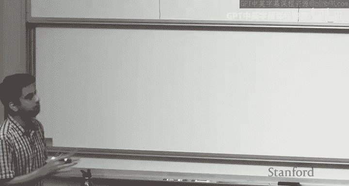
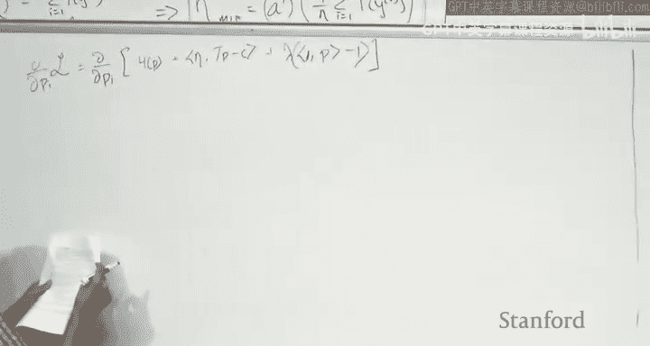
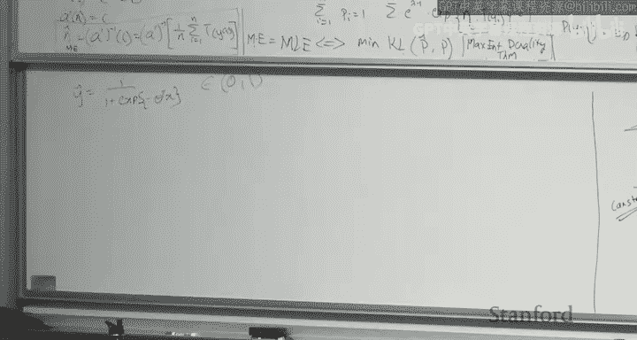

# 斯坦福大学《机器学习｜Stanford CS229 Machine Learning Course  Summer 2019 (Anand Avati)》 - P19：-19-.Lecture 19 - Maximum Entropy and Calibration.zh_en - GPT中英字幕课程资源 - BV1NDopY4ECg

So today we are going to start lecture 19 of CS 2 to 9 and the topics for today。

We are going to talk about the maximum entry pre principle and how the exponential family distributions that we saw earlier in the course can be derived from the maximum entry pre principle。

😊，And we will show how， you know， under what conditions， maximizing entropy is equal to。

Maximizing the likelihood MLE and also this will kind of lead us into some interesting topics such as calibration。

 we'll briefly talk about calibration and you know what calibration means and how it relates to maximizing entropy etc very interesting topics and then depending on how how much we cover and how much time we have left we will talk about a few variants of the expectation maximization algorithm and how these variance kind of leads itself into some of the more recent advances in unsupervised learning such as variational inference and the variational autoender。

😊，I'm not sure whether we will be able to finish variation auto encoders today or even start it。

 but if we don't finish it today we will pick it up in the next class。😊。

Alright so before we dive into today's topics a quick recap of what we covered in the previous class so in the previous class we covered PCA and ICA PCA is a principal components analysis in PC we are given data X I。

😊，Wwhich lives in a D dimensional space and we are to find a low dimensional subspace Z which which has which lives in a space of dimension k right for every Z we want to find its projection onto the low dimensional space that we call Z and the way we go about doing that is to map x to X u where u is a column vector of k。

😊，Of k columns where each of the the column are the top k eigenvectors of x transpose x。And by， by。

By doing this operation， we effectively get the projections onto this subspace。

And then we talked about independent components analysis。😊。

In PCA our goal was to find a low dimensional subspace whereas in ICA our goals are very different in ICA our goal is to find independent sources that explain our data。

😊，And the assumption that we made were there are D different independent sources we call them Sj where J indexes the source number。

 so the each of the Sjs is。Sample from some probability distribution P， which has to be non Gaussian。

 you can either use you know the Laplace distribution or the the logistic distribution。

 any distribution which is kind of has mean zero and its non Gausian we saw some intuitions of what happens if we have Gausian if you make an assumption about Gaussian distributions as being the source。

 you know we get this problem of rotational invariance。

And so as long as the sources are non Gaussian and we have some square matrix a which we call as the mixing matrix which mixes the ss into observations so ss are unobserved x's are observed right and our goal is to start with x and recover s。

😊，Wwhich are the independent sources and the way we want to do it is to the the relation here we assume is that a is a square invertable matrix and we want to invert a to get w。

😊，And w is the matrix that we want to estimate so that given observations we can multiply through w and recover the original independent sources and the way we go about doing that is with maximum likelihood where we directly estimate w and。

😊，And the， and the we saw that。第一。We saw that the probability of x can be represented in this way where we map x back to w x back to s using w and we need a corresponding Jacobian term log or the log determinant and。

By performing this maximization using gradient ascent。😊。

There is no close form solution for this by performing gradient ascent， we can。

We can we can recover upon convergence the unmixing matrix W hat。😊。

and we also saw this in the homework hopefully you guys have finished this question in your homework if not no problem you know we are just stating the results here the homework question has a small introduction you know about some explanations about care and divergence and entropy and so on。

😊，You need don't need to know that for the purpose of this lecture but if you have already seen it it is helpful so the we define the KL divergence between two probability distributions。

😊，So this this is something important right so far we've seen things like you know。

 the distance between two points in a vector space， right。😊。

Here the two things between which we are measuring are probability distributions entire distributions right so you can think of you know p being some distribution like this andq being another distribution like this and we are trying to ask you know what is kind of the difference between these two distributions right they are not single points but entire distributions so the kl dirgence from p toq is defined as the expectation with respect to p of log p byq。

You should note that this is not symmetric， in the sense。

The K divergence from p to q is not the same as from Q to P。

 if they were the same we could have called it a distance like K distance。

 but it it is is it is not symmetric。And this this is the definition of of care divergence。😊。

This is closely related to concepts such as entropy。

 so we define entropy of a probability distribution as as the expectation under p of log 1 over p itself so the entropy kind of measures how spread out a distribution is so。

😊，If we have a distribution over some finite support。

a probability distribution that is uniform over them is considered to have high entropy right whereas if another distribution or the same support。

😊，Puts all its mass on any one point。 Then this distribution is considered to have low entropy right So entropy。

 you can think of entropy as a synonym for uncertainty right high entropy means high uncertainty。

 It can you know you believe that the point can you know some data observation can come from any of these you are not you are not sure whereas a low entropy means low uncertainty。

If this distribution tells us that the point that we are going to observe next。

 if you were to sample from this will be from will be this particular point alone there is almost zero uncertainty there。

 So this is considered to have low entropy。And then there is also this nice interpretation of cross entropy that that is there in the homework description you can see that where we replace P over here by a different distribution queue right and the cross entropy you know gets this form expectation and a P log of 1 over Q。

And the difference between cross entropy and entropy is basically actually just equal to the K divergence itself。

 So the k divergence between two distributions Pq。Its just the cross entropy minus the entropy there are some nice interpretations about about this in terms of coding theory that is there in the homework but you know that' is not really necessary for for our lecture today as long as you kind of remember these。

😊，Did these formulas。And also in the lecture earlier in the course， we came across exponential。

 the exponential family is a way to characterize a family of probability distributions where the probability distribution over y with some parameter called natural parameter Eta takes this form。

😊，So here B of y is called the base measure。And there is the exponent of some of some term over here that term has two parts。

 one is eta the natural parameter。😊，Dot product with T of y。

 So T is called the sufficient statistics over y minus a of8 where a is called the lock partition function。

😊，And。You also saw again in your in your homework one that the mean of this probability distribution can be represented as the derivative of the lock partition function。

😊，at Eta so if we change Eta to two different values we get different means and the way you go from the parameter value eta to the mean of the corresponding distribution is to calculate a prime or the first derivative of a of first spread of the log partisition function at the parameter value Eta。

And it so happens that this this function a prime will always be invertible。😊。

And so we can go from the mean of a distribution back to the natural parameter data this way。

So the first thing we are going to do today。😊，Is to derive maximum likelihood estimates of eta given some observations y and then we will jump over to maximum entropy and start seeing its equience。

😊，Any questions on this so far？ Yes question。新的。えぐらちと。

So the question is in ICA is the log determinant acting like a regularizer or are we going to add regularization on top so that's a very interesting question in ICA it so happens that most of the time we are not really interested in generalization error right so ICA is kind of in a way different from the rest of the algorithms that weve seen where in the rest of the algorithms we are interested in generalization error whereas an ICA we take some examples fit a model and just you know recover the sources of the given data itself so it' is not common to use regularization in ICA and this log determinant is actually not the regularizer say this log determinant is a necessary component to make the distribution a valid probability distribution。

😊，What question。Any other questions before we jump into Emily of exponential familiesami？Right。Okay。

 so。Ami Lee of exponential family。So in in in the when we studied exponential families earlier in the course and when we studied GLMs。

 we made this simplifying assumption that y would was always a scalar in our case so in case of。

Regression y was just real values in case of logistic regression y was you know a binary 0 or1。

 we saw some generalizations with softms where y could take multiple values。But now， were going to。

Take an even more。A generalized form where why can be， you know， some， some。

Why could be anything and T of y which we always most of the times in in when we study GLN T of y was just taken to the identity as y itself。

 but now we will again relax that and make it even more general。😊，Where T of I could be anything。

 So suppose we have an exponential family。Ex family。P of y， given Eta。Its。B of y times。Exponent。

 I'm just rewriting the same thing over there。Eta the product T of y So this is the dot product Eta can be a vector and T of y can also be a vector of the same dimension right and this is just the inner product if there is if these two are scalrs then this is just a simple product。

Minus a of Eta。And we are given some data S。😊，Equal to。Why1。Whyite small。

So we given given this data and we want to find Eta you know， Eta hat ML。😊，Equal to。Argmax。

So here we assume IID。I I。Argm。Across Eta。Log。I equals 1 to n。P of Y， I。对的。

This is a standard you know， maximum likelihood procedure that we followed throughout the course。

 There is nothing different here now lets let's。simplify this further。 So this is。

R max the spectro Eta now log of the product is the sum of the logs。

 so Im going to take the sum equals1 to n。1 to n and the log goes in So the log of this thing over here will give us。

Log。B of。Y I plus。Log in the exponent cancel， get。Eta dot T of。W I。Minus a of theta。

And in order to do maximum likelihood， we take the derivative of this with respect to Eta set it equal to 0 andfur solveulfur eta right the same process。

😊，So for this， we now take the。Ingradient with the spectro Eta of。This whole thing。Is equal to。

 So this is going to be sum I equals1 to n。 the derivative of。B of y with respect to Eta is。

0 right so this will be just0 plus derivative of Eta dot T of yi with respect to Eta will be just t of yi plus T of。

Wai。Minus derivative of a of Eta with respect to Eta is you just call it a prime of Eta。Right？

And this gives us so this。So we have a sum over。I from 1 to n of this term and we need we set this equal to 0。

This gives us n times， a prime of。Eta， so this is n this is Eta this is n the number of examples and this is Eta。

 they look kind of similar。Equal to。I equals1 to n。Tof。Whyai。2。A prime of eta is equal to 1 over n。

I equals1 to n。P of。Yhy I？This tells us。E a hat ML。Squ to。A prime。Inverse of one over n。

I equals 1 to n。Tea off。为爱。So what just happened here？

The maximum likelihood estimate of the natural parameter of any probability distribution in the exponential family。

Can be calculated as the the mean or the sample mean of the observed sufficient statistics。

Take them through the， the。The inverse of a prime， if you remember in the exponential family notes。

 we we called G equals a prime to be the canonical link function。And we call G inverse。

 know which will be a prime。Inverse to be the。Or I think we call this the canonical response function。

And this to be the canonical link function。So this is just the canonical link function。

 So take the the sample sample mean of the observed ys， run it through the canonical link function。

 And that gives you the maximum likelihood estimate of。😊，Of Eta。Where this is。

In the most generic form， right， So when we， when we， when we take。

Specific members of the exponential family， like the Posan or the Bernoulli or you know what have you？

A prime will take some particular form T of y will take some particular form。

 but in the most in the most generic setting this is the estimate for the maximum likelihood estimate of the natural parameter。

😊，Next question。Let's take the。So good question。 So in the last lecture we were doing ICA and PCA。

 which was unsupervised learning。 So what's the what's the goal here， that's a very good question。

 So today what we are doing is trying to understand this you know pretty generic concept called maximum entropy principle and how that that。

😊，resultsult in， in concepts such as calibration and scale divergence。

 and we will use scale divergence as a concept to kind of。

Understand variation inference and variation auto to encodes。これは一す。So this。

 I would not call it either supervised or unsupervised because these are just， you know。

 maximum likelihood estimates about of you know， general probability distributions。 this has。Yeah。

 I wouldn't call this either supervised or unsupervised。

 These are just external family distributions。Good question。

 so this was the maximum likelihood estimate of of the natural parameter。 and lets just。

Save it because we will refer to this shortly in a few minutes。Now。Let's switch gears， and。

Tal about maximum entropy right so in so the maximum entropy principle is a principle that tells us that whenever we want to estimate a probability distribution with some observed data。

😊，Let's suppose we have a probability。Probability distribution over the real values。Right， so the。

 the。This is R。X， and this is P of x。So。And suppose we， we make some observations。

On x in right So we observe this， we observe this and we observe this as samples from this probabilityability distribution。

 and our goal is to now estimate， you know what the density of what p of x is。

And given just three points， it' is very hard to tell you know what the density of of a p of x is right ideally what we would like to have is you know an infinite number of observations you know preferably you know an uncountably infinite number of observations so that we can precisely calculate the fraction at each point and and construct some kind of a density right but we are only given。

😊，A finite number of points。They could be large， they could be small。

 but we are still given a finite number of points and we need to estimate the value of p of x at every point x。

And the maximum entropy principle tells us that。😊，The way we want to go about it is to first translate these data points into constraints right So。

 for example， the mean of this。These set of points could be， you know， say new hat。so new hat。

 its just the sample mean。RightSimilarly， the， the variance could be。You know， right。

I course want to n。Xi。Minus。You。😔，Square right， So this is just the the and if if we take this to the new high。

 this just the sample standard deviation right and the maximum entropy principle tells us that the our estimate for P of x。

Should be a probability distribution that is subject to these constraints and these are hard constraints and within the family of probability distributions that satisfy these constraints choose the one that has the highest entropy。

Right， so the constraints。We can call these constraints。

the constraints define a set of all probability distributions that are what is also called as feasible any probability distribution that satisfies these is a feasible candidate for our estimate and then among this large set of feasible probability distributions。

😊，The feasible probability distribution will almost certainly。

You know be more than one you know because there are an infinite number of probability distribution that satisfy in this example a particular mean and standard deviation among the set of all feasible distributions choose the one that has the highest entropy that is what the maximum entropy principle tells us and the way we go about formulating it is。

😊，The way we go about formulating it is。P， which is the estimated probability distribution over y。

To clarify some nots， let's call this y。And you know， we'll be using Y instead x。So， P is equal2。

Rrg max overall p。Maybe we can just call P star org map or all P， which maximizes。H of B。

Which is the entropy right H of P is just the entropy that we define here。😊，Such that。

We have some constraints。 So the constraints we will write them in the form。

 we will limit ourselves to linear constraints by linear constraints， what I mean is。Such that。

 some over。Some over J。Or the similar I。Pizhi。😔，Of P。I is equal to some C。

What does that mean so we will assume that the constraints for our estimation problem are given in the form of some functions。

P， which are indexed by J。Yeah， Ts are indexed by J。 So T is some function that takes y2。2。So the。

 the constraints that we are given， you know， constraints such as these。

Will be given in the form of these， these T functions， where we have。And。

Such things or M such things。 So J equals one through M。TJ of Y to R。

What does this exactly mean it means that for every corresponding Tj there is a corresponding Cj。

 the constraint value where we need to satisfy sum over i equals1 through n。Tii。T I J。Pin。Tj off。喂唉。

페コト CI。Now， if。Dj。If for example， one particular T of y if you consider this is equal to just y itself。

Then， this gives us。A constraint for the mean。Because this basically boils around two for I equals1 through n。

第一。Of why。Times。I also forgot the P of I。T of y times P of y is equal to C。Zi。Let's see。

 So this is just if， if T of y is equal to just y， then this becomes。

I equals 1 through ny times p of y。The expectation。Of why。

So for different choices of Ts or rather the different choice of sufficient statistics。

 we we can express constraints in this form。And。We are also going to assume that the support。Of why。

Is finite。RightThe support for white being finite is。Is a simplifying assumption。

 And we don't really need this。To show， to show the results。

 but we are going to assume it is finite so that we can represent things as you know。

 inner products and sums rather than integrals。Right， and we assume that n is the。Goodair enough。

Size up the second way， yes was that question。Yeah， it that strange。Likeake。

So how can there be other kinds of constraints so generally the constraints are are constraints given are of the form where the you know some kind of a moment of the observed data is equal to some value right so the moments of the distribution should match know some the moments of the observed samples generally those are the kind of constraints you are interested in。

In this job because we can just take the form of our expial family and then using these constraints。

 try to make constraints on the parameters B and A and。

so when so the question is why don't we start with here So the exercise that we are trying to do right now is to start from P from the maximum entry pre principle。

 make no assumptions about the form of P right here so far you know P could be any kind of a probability distribution we are just assuming some kind of a support and what we are going to show is the maximum entry pre principle will recover the exponential family that's our goal over here right and intentionally we are using the same symbols you know t's and y's that are going to end up being you know the corresponding terms in the exponential family So the T's over here。

😊，Are trying to satisfy some constraint。eventually you know， by the end of this exercise。

 we will see that T's will be the sufficient statistics。 But for now， you know。

 just assume Ts are are are you know， some kind of a function。😊。

Whose linear combination with P must satisfy a constraint value。Right。So， we have。So end this the。

 end is the。The cardinality of the set y。And we have。M constraints。 which means。

We have M such P functions。And now our task is to perform this optimization。

So we want to maximize the entropy of the probability distribution。

Such that some kind of linear constraints over P are。Are are satisfied so。this， like me。

All right this。More clearly。Ai。P of。Wi。Zhi。😔，Times P of。I is equal to C of J。J equals one through M。

 So there are M such T functions。And。All these t functions must satisfy this this kind of a constraint where the expectation of T is equal to some constraint value C。

And most of the times。These constraints will be arising from data from the observed data right where Cj。

Will be equal to。It will be equal to1 over n where n is the number of examples。I equals1 through n。

Dof。Y I J。Yes， was that a question。그 on locationで。Right to。So there's。You know， the wide bracket。

There's an I over the way。 Oh， oh， oh， yeah， you're right。Thank you。 said this is。So， so， yeah。

 so to。To to clarify the notations there are m such t functions and each of those m is indexed by J and Tj tells us you know it is the J T function and is the I is the index we use to scan the support of y。

So why there are capital n elements in y。And i equals 1 through n t of Yi。

 so every possible value of I will get a probability of pi。That's the probability of so。

PI is equal to P of。Y I。So we are going to switch you know it is very common that you know we switch between the the functional notation and the vector notation。

 right。😊，They mean the same thing。So we are given a set of linear constraints。

And satisfying these linear constraints。 we want to maximize the entropy。 Yes question。

It's not C everybody see。Oh it is。 Oh sorry， yes。For why basically each individual data point that we have。

Yeah， so a question so what is the support of why so here we are resuming y is has finite support。

 which means y can take on a finite number of values。Right。

So why itself can live in a high dimensional space。

 But we assume why can take on a finite number of values。

And P of y I tells us the probability that our distribution assigns to that point y I our observed y I y superscript。

 you know parenthesis I are the actual observations。

 so why superscript I tells us what the I observation was。if you sample many of them。

 but each of these yI's will be one of the finite numbers of elements in script Y。😊，district。Exactly。

 so this is just a way of saying that we are only interested in discrete distribution。

 question would we require combat support。We would compact support over y so for example。

 so for continuous this could be entire R line， real value line it should。😊，All right， any， any。

 any questions in this， Let let me repeat it。 There were a few typos。 So just， just to。

Just to repeat it so that everything is clear， we。So we assume that y has finite support。

Which means there are n n is the size of the cardinality of script y and our probability distributions are assigned over this space。

😊，Now， we are given some observations， small n number of observations of Y。😊。

And out of these observations， we can construct constraints。So。

 the constraints can be for example that the mean of the observed data has some particular mean it could be that the the square the sum of the squares of the observations is you know some value that could be another constraint it could be that sum of the cubes of the observed values is some value that could be another constraint right so t of y can be things like you know a t of y equals y t of y equals y square are they are different possible functions of y。

And out of those functions， we construct these constraints that the this constraint basically tells us that the mean of the distribution P。

Will have to be the mean of the。Of the T function of a particular a T function should be you know some particular value and so on。

Now， subject to these constraints， now we want to solve this optimization problem。

The way we go about solving this problem is to construct what is called the laggrangian。

So if t the the the T function is， if that is still a little confusing。

You can assume t to be to generally take on two values the most common values for t are t of y equals y and t of y equals y square。

 those are like the most common kind of constraints that we come up with where we want to say the mean is something you know the first moment is some particular value and the second moment is some particular value。

But here we are trying to derive it in the most general form where t could be anything。

And so using these constraints and the entropy objective， we will construct the lagrangian。So。

 the Lagrangian L of。P。Eta。And lambda so this is the probability the variable for the probability distribution itself and Eta and lambda are laggrs multipliers。

And the Lagrian will be H of P。Plus。In the product of Eta commma。T P minus C。Plus lambda times。

Any product off one。P like-1。What is this？So here。P is our probability distribution。

 You can think of P as， you know， P1。P都。PN。Where n is the cardinality of the set y。And T is a matrix。

 where。We have， you know， T1， a rope respond to T1。 So that would be T 1 of。Waiwen。T1 of Y 2。

T1 of Y capital n。And similarly。We have M such。PM of Y1。Tm of Y 2。Ti。M of。W end。So this is small M。

 the number of constraints times n n is the cardinality of y， and this is n。

And our our constraints say that you know， the inner product of this with this should be equal to c1。

Until C， N。So this matrix times this vector equals this vector is capturing the set of all constraints under which we want to operate。

Right， so this inner product is like the expectation。 So each。Each row times a column。

Is basically the expectation under P of。Pi。P温。why。Expectation。Or P。2 of y。Expectation， P。And。5。So。

 this vector。Is equal to。C，1， through。Okay， so these two are。Equient ways of writing。Yes question。

Yeah， so the seeds and the。So Ps so the question is T's and the C's are the constraints that we choose to impose that is correct and the C values are generally evaluated from data right so given some data we we see what the empirical values of the C's are and make that the constraints what is p so p is the probability distribution itself that we are trying to estimate。

Right， so P must satisfy。P I is greater than equal to 0。

 and sum or P I equals1 to n should be equal to one。

Al so p is the probability vector that we are trying to estimate and the way we want to estimate p is such that it maximizes the entropy and satisfies these constraints。

😊，就类 say。In that column itll be。The number of times you observe why to in all your ways。

So is is p2 the number of times you observe y2 in all of your ys in the long running average， yes。

 the number of times we we will observe y y2 across all ys。So P2 is just the probability of of Y 2。

 now， think of P2 as。Nality2。Of white。黄烧嗰啲。Most of the time want。Like we take a discrete。Like。

 we would ideal like to take。But is it possible to put the in。一んでしいいで、すね。Now， for now。

 we are going to talk about only point values of Cs。And so this is the set of constraints。Right。

 so T P minus c is the is the set of contraint that should be equal to 0。

 And this basically tells us so this is the。Entropy that we want to maximize。This is for the。

Constraints， you know， from data。Generally。And this is to make。To make。P， a valid。A。😔，Valid。

Probability distribution。Right， so we construct this lagangian。And we。We pretty much just， you know。

 solve this optimization problem from the sangian。So to solve this lagrangian we do first we start with taking the derivative of the Larangian with respect to peace。

And we get。Partial of partial， with respect to P。Of thegrian at this is equal to。发0了。

I should expect to P of。H of B。Plus。Eta。T B minus C。Plus， lambda。Times。😔，Wen。P -1。Right。

And now we differentiate this with respect to P， so h of P is some over all some over I p of I times lock p of I。

So all the terms except the eighth term can be eliminated。PI， this will be minus。PI log， P I。

 we are ignoring the non items because they're gonna， you know， cancel with， with P anyways。Plus。

T P minus C。1 p。-1。And when we take the derivative， what we get is。😊。

Apply the product rule taking the derivative of this with respect to P first we differentiate the first term times the second term and then we differentiate the second term times the first term。

 So that will give us minus。Log P。Plus the derivative of log piI is just 1 over pi1 over T pi times pi is just 1。

Plus， this will be just the inner product of Eta。Times。P of。Y i。Plus， lambmbda。Right， so。

What what what we are doing is when we are in this in this。In this expression。

 which is basically T P minus c。PI will appear only in the in the I column here。

So this ends up being AA and C will just cancel will get canceled with P。

 so this will be just the inner product of AA with T of Yi。And from this。

 we basically get that we want to take this derivative and。😊，Set it equal to 0。Which means。We get。

You I take so log。P I is equal to。Lambda -1。Plus， in the product of Eta。ピ of。Why I？And this gives us。

P I。Is equal to。E to the。Lambda -1 times。Exponential of。いた。So right away， we see that。

P of I seems to be taking some kind of an exponential form。

And the the reason why we get this exponential form is because in the entropy we have this log term and when you said log of p equals you know sum value p will be exponent of you know sum value right that is the reason why you know。

😊，With entropy， when you are trying to maximize entropy。

 the presence of this lock term in the entropy will kind of naturally result in an exponent coming when we solve for PI。

😊，And now。We have this and we want to solve for lambda。And solving for Lada is pretty easy。

 so we have pi equal to this and。Some over I was 1 to n。PI equals1。

Which means this sum over this entire thing e to the lambda -1 times。Exponent。Eta。Times。T of Y I。

This should be equal to 1。Thanks all。E to the lambda -1。Will be。When over。Some over y in。Crpt y。

Exponent。A dot times P of y。Right， so。We got p2 be in this form and we can eliminate lambda by by making use of the fact that probability distribution should sum up to one and that gives。

E to the lambda lambda 1 to be that value。And so we get the final form。off。P of y to be。P of Y to be。

 So let's call this denominator。To be， lets call this a z of atta。

So we get p of y is equal to exponent。Of a times T of y。Divided by。Z of theta。

 whereas z of theta is just this normalizing constant。

And so P of y parameter X by Eta is equal to the exponent of。Eta times T of y minus a of Eta。

Where a is just。Itこ to。Log Z。So Z is called the partition function。

And a is called the lock partition function。 right And by taking the log。

 we can bring it in into the term。😊，So here we see that by just following the maximum entropy principle。

😊，And trying to recover P where we did not assume any kind of form for P right you just assume P was you know any any can take can take any values subject to it just being a valid probability distribution。

We see that by having only this constraint。😊，Maximizing the entropy of P。

To satisfy the the constraints that you observe from the data。

 we the exponential family that we recover the exponential family form for P that p of y will always be in the form of the exponential family waste。

😊，Yes。By did。お者の？So this， what we did here is basically enforcing this constraint。That's what we did。

I'm sorry。也给了是。Already。So the question is should we explicitly do this or is it already you know captured in the math。

 So if we don't have this constraint， then you know peace can be any you know arbitrary value。invite。

他这个。Yeah so the question is why are we maximizing entropy and there is a reference in the notes that's been posted which goes into why maximizing entropy is kind of a natural thing to do so basically this maximum entropy principle has also connection with statistical physics you know where the entropy has actually the same mathematical form and in fact there is a paper by know by an author his name is。

😊，In fact， the same author of the link that' is given here， Edwin James。

 he has an old paper called Information theoryory and Staistical Ph and that basically draws this nice connection between information theory or know the Shannon entropy the entropy that we have here in information theory and drawing connections to the thermodynamics entropy and statistical physics and both of them kind of follow the same maximum entropy principle so it's kind of a natural thing to do。

😊，Yes， there was another question， yes。而就是和。So here， yeah， so the parameterization is always there。

 I just didn't write it here。So a of data。 So we， we。So P of I。Is basically equal to P of。

Y i right so p of yi is equal to this times this and this is equal to 1 over z of theta。

So p of y is equal to this divided by 1 over 1 over z of theta。

And z of theta is the partition function and in place of z。

 if we instead take a of a is equal to log of z， then a will just go into the numerator。😊。

Next question。Yeah so maximizing the question is why do we want to max the entropy so maximizing the entropy you know there are arguments to to say that by maximizing the entropy we are kind of being least committal in terms of our assumptions which means the only constraints that we are enforcing is that you know the data that the observed data that we have are the only constraints that we are doing。

😊，Any other objective， if we maximize any other objective。

It can be shown that we are kind of imposing further assumptions that may not be， you know。

 may or may not be may or may not be valid in order to get the most unbiased estimate of P than the。

Then the right thing to do is to maximize the entropy。

 which means make everything else as uncertain as possible。

 subject to the only con the observed constraints that we have。Yeah。

 we're going to come to the link to maximum likelihood shortly。 this question So you said。

Antro we thought of like。Of the yes， can be thought of as the variance want to。

Yeah so so the question is is can you think of uncertainty as the variance the short answer is no and there are good reasons why variance is not always equivalent to uncertainty so there you know there is a link to a chapter in the notes that is given you chapterpt 11 from the book probability theory and that actually has some pretty convincing reasons why enter variance is not the right thing to maximize for。

What are the nasty。So these two are the lagrangee multipliers。No on the item。

These two so these two are the are the terms in the laggrangian that corresponds to the constraints right so one constraint is based on based on the data that we have and the other constraint is that p should sum to1。

Why， what that code。Like in a product of。So in a product of one and P is。

So that's the inner product of the one vector and P。The second one。

So the second one is you know t of p minus C。 So we want T of p equal to C。Right。

 so P of P minus C should be 0。And this is the lagrangerange multiplier corresponding to that constraint。

This question。Margin。Yeah， so so the large so the large n corresponds to the support of the probe of y。

And small n is is you can think of it as the number of observed data points。Is the support of。Yes。

 every possible y， so large n is the cardinality of script y。Yeah，为 you。ピマイナスシで。

So I get that T P minus C， but then like going with the last term， shouldn't it be just some。

Like let's say some new multiplier times to。いなと。so I will not go into the details of this this what we have here is correct if you have any more questions you know post on Piazza I can help clarify that but you know this is the correct formulation of Pe Gria。

😊，Okay， so。So， we get that p of p of y will will always take this form where p of y which were basically the constraints end up being the sufficient statistics of the exponential family and。

Eta which was the lagrrangee multiplier of our constraints end up being the the natural parameter of the exponential family right and a of Eta which is the log partition function is essentially the partition function that we get by applying the valid probability distribution constraint right so maximum maximizing entropy。

😊，Gives us the exponential family as a natural consequence。😊。

We made no assumptions about the functional form of P when we started out maximizing the entropy。

 but。As a consequence of performing this maximizing entropy is subject to some linear constraints。

 we get the exponential family as a consequence。😊，So was there another question？😊，Any data。

So the question is for any given data set， do we get a different family， So good question。

 So the the the family that we end up getting。Is going to depend on the choice of the sufficient statistics that we choose。

For a different data set， we will get different values of Cs。😊。

But the choice of the constraints that we that we chose to enforce will decide the family of the exponential family。

But if you have five points， let's say and you goes the same price。

Are you going to get one distribution？So like how do you find AA given we just so we are going to come to estimating AA now。

 so the functional form of P。Will be in the exponential family if we start off by maximizing the entropy of P subject to some constraints。

So now the question is of， okay， so we we we saw that the function the。

The the probability distribution will belong to the exponential family。

 but what about the estimates of Eta itself。So for that now let us to calculate Eta so first we solve it with respect to P next we will do it with respect to Eta。

So。With respect to Eta of L。Is equal to gradient with respect to Eta。H of P is just minus。

Some old why。P of Y， log， P of Y。Plus。I'm going to write this as the inner product between。E times。

第一。T P。Minus。Eta times C。Plus， you know， lambda of something。

And now we will make a few more observations。So this is the gradient with respect to eta。

So here this is basically the sum over y p of y times lot p of y so we saw that p of y has this form and when we take the log of this we just get the term inside inside the flower brackets。

So it is P of y times。Eta。啊。T of y。Minus a of Eta。Plus。Eer times Tp。 So what is T P， We saw that T P。

TP is just the expectations of the individual sufficient statistics。 So this。

 I'm going just write it as。Expectation of P of。T of Y。Minus。It个。Times C。Plus， lambda of something。

はい。So now take the derivative inside。And here we get。So this。

 you know sum over yp of y times something is like taking the expectation of this。

Eta and Eta will cancel so we can write this as minus。Expect so take the eta out。

 So this will be eta times。Oh， so， so sorry。 So we still have。 let's。

 let's still keep the derivative with respect to Eta。 So Eta times。Expectation。Of the。Of why。

And here we are taking the expectation of a of Eta but there is no y term here。

 so this will just be a of Eta。This is plus8 art times。Pation of P。D of y。

Minus a C plus lambda times something。So this and this cancel。 So well get this。With respect to Eta。

off。A of Eta minus。Eta dot C。Plus some some constant C plus lambda times something。

this is equal to a prime of Eta minus c。And this should be equal to 0。

 And this gives us a prime of ata is equal to C。And these constraints。

Are things that we generally want to estimate from data。And so， we get。E hat is equal to。Apri。

Inverse of C。And that means， a prime。Inverse of C， which we want to be like the empirical averages from data。

 So that would be1 over n sum I equals1 to n。T of。Wai。Right，And this estimate。

You will see is the same as。This estimate。So the last step here。

So from here here we got that a prime of Eta， which is a prime of eta should be equal to c。

Is it clear until this step？So a should be a prime of inverse of c。Now。

 what is C C were the constraints that we started with。And usually these constraints come from data。

 right， So these constraints will be the actual， you know。

Sample means of the corresponding sufficient statistics。

And you plug them in here the sample means of the corresponding sufficient statistics and we get Eta hat maximum enter P。

Maximum entropy to be equal to the same expression that we get using ML E。全部ジえる。い感し。So here。

 so the question is what is T here， Yes T here is you can think of it as the vector of you know。

 J functions， exactly。Right。What we basically got is that the。Is that maximizing the。

Entropy subject to some constraints of sufficient statistics that are whose values are obtained from the data is in fact the same gives you the same solution as starting off with an exponential family where the sufficient statistics are the sufficient statistics of that exponential family and performing maximum likelihood on it。

So， this this equivalence between between maximum likelihood and maximum entropy。😊。

I turns out to be you know one of one of you know one of the few interesting results in this area。

Any questions on this？Yes question。So a function will or the a prime will always have an inverse。

This question。Apriing for any expensive founding。I to new。That's a property， can we not use us？え to。

It seems like an ratio。그래도。し違る方に。So a prime is the mean of the probability distribution。

And basically， what we are telling is that we want the mean of the of the probability distribution to be the sample mean。

 you know， is is essentially what we are trying to say here。

So Cs were the were the means of the means of the data。

 So here we are trying to say model mean equals sample mean。

Yeah we got this from the maximum entropy right so we are still dering the laggrangian of the maximum entropy objective and by solving for EA we end up with the same estimate for EA as we would have if we had started from exponential family directly and chosen Ts to be the sufficient statistics we are interested in。

😊，Yes question。Here。Yeah in the red box。 So when we said C is equals to1 over。嗯。

Aren't we constraining like all seems to be some kind of。

Yeah so for in this setting we are interested in linear constraints that is linear in P which means we are only interested in you know things like moments of the data the moments of the distribution that right。

累。InSo initially， our seats were a weighted average of her team。Cs were what。Like。

 we were weighing them by the。Cs were not weighed by the PC were just the observed C will be P1， Y1。

 P1 times T1， Y2。That is the constraint that we want to enforce that c1 equals t1 y1 times p1 plus t1 y2 times p2 that is the constraint that we want to enforce。

 but c1， the value of c1 itself is estimated from data。I to be some great。Yeah， this is what。

 you know， we would choose to， choose to se according to this， exactly yeah。All right。

 so so weve seen that。Maximizing entropy is the same as maximizing likelihood。And in your homework。

 you have also seen that maximizing likelihood is also the same as。😊，M， L E。

Its also the same as minimizing the K L divergence。Between the sample data and。And。The model。

This is in your homework， question two or three， the last part。So。

 so the and this is equal to you know max entropy。Now。

 the connection between maximizing entropy and minimizing care divergence is is also you know called the。

マax。And。Duality theory， duality theory。for those of you who are probably more interested on the theoretical sites。

 you know， than to kind of learn more about this duality theorem， you know。

 you might want to look up the maximum momentum paid duality theor。😊，All right。No， let's， let's。

Let's talk about。A very related， somewhat related topic， which is calibration。😊，So。

Caallibration is the problem is this concept that so for example。

 when we studied logistic regression。😊，We saw that the output of our logistic regression model。Was。

No， we we took the inner a product between x and theta， where theta was some kind of。

parameterrameter ran it through the logistic function you know 1 over 1 plus e to the minus x and as the output we got a value that was always between 0 and 1。

And we call that value。😊，When we did y hat equals1 over1 plus。of minus theta transpose x。

So this will always be between 0 and 1。Right， which。Superficially， looks like a probability。Right。

Because it it's a value between 0 and 1， but。What will make it a probability right superviscially it is a value between0 and 1 and then we in order to use it as a classifier we decided to use some threshold and you know call everything about the threshold as positives everything below as negatives but what what will you know why do we want to think of this as a probability right so probability has has you know has is is is。

😊，Allright， so let me pose a question to you。 What do you think is probability Yes。Yeah。

 so this if some of all the y hats equals 1， I would still call that a superficial requirement for something to be a probability。

😊，Yes。这按情。都落去沟过。Exactly， so the value of y should be somehow representative of how frequently we you know why hat ends up being this in in you know。

 for example， the data that we have right so。😊，And this。

 this property that the estimated probability values。😊。

Kind of match with absurd frequency of occurrences is called calibration。😊，Okay， so。

It is very common and highly recommended that if you actually build a logistic regression model that you also plot this calibration plot so calibration plot will look something like this。

😊。

Predicted probability。And here this is no observed frequencies。Now。Let's say this between0 and 1。

Take your validation set。In your validation set， assume it it is reasonably large know you have a few thousand or 1 thousand examples in your validation set。

 take your model and run every example in your validation set。😊，Through your model。For each example。

 you get a particular Y hat。😊，So you get a Y hat。And there is a corresponding Yi。

 which is the ground truth。now， y hat will be a value between 0 and 1。😊，And y will be either 0 or 1？

 and then。Your y hats will be you know points that are distributed in this interval between 0 and 1。

Now， next， you know， chop this interval between0 and 1 into say 10 bins。

 maybe 100 bins doesnt matter， so chop it into bins。Commonly， you know it is 10 bins。

 but you it could be any number of bins。And collect the Y eyes。

In each bin separately or the white hat eyes in each bin separately。

So the set of all examples that have a Y hat。In this。In this that has assigned a value in this range。

 take those examples。😊，And calculate the mean of the true labels of all the points that fall in this bin。

And plot that the true mean of the or the mean of the true labels on the y axis corresponding to this bin。

😊，And ideally， what you want is to get a plot that looks like this。Which means。

For for all those examples that got assigned a probability of say 099。

We want 99% of them of those examples to have the true label as Yi。

For all examples that had a predicted probability of close to 0。5。

We want the true frequency of the labels。Or the frequency of the true labels to be close to 0。5。

This kind of a plot where you where you plot the predicted probabilities versus observed frequencies is called a calibration plot。

😊，And if if your model gives you a calibration plot， which is a straight line。

 then you call your model to be well calibrated， which means the predicted the output y hats from your model。

 you can actually think of them as probability estimates。😊，If， if this line is not a sp line。

Then the predicted probabilities， you can't really think of them as probability estimates anymore。

 It may still be a good classifier。😊，you may still be able to find a separating threshold and assign zeros and once and you may get a high accuracy。

😊，But it may not be a good probability estimate。So this， this concept of calibration。😊，So。

 calibration。😊，Tells us， you know。It's a statement about the quality of。Why hat。Bing。An actual。

Probability。So if you have a model that predicts the probability of whether it is going to rain tomorrow。

And。Take B and you run it every day。And you have a few thousand days of predictions right now take the set of all examples or a set of all days where the predicted next day probability rain was say 80 percent。

😊，And then look at the data and see what fraction of those days。😊。

Did it actually rain if your model is well calibrated。

 then the fraction of days that it rained the next day should be approximately 80 percent。

It shouldn't be 90， it shouldn't be 70， it should be 80 for it to be well calibrated。Next question。

Two portions。 if it is a good。As why do we care if it is a group probability。Secondly。If it is。

what can you do to solve so good questions so if all we care about is a good classifier then why do we care whether you know the predicted Y hat is a valid probability or not and the reason is because whenever you are making building a machine learning model that predicts something into the future。

😊，It is。It is most of the times you know， you don't really want。😡，A a binary answer from a model。

 you actually do want some kind of an uncertainty estimate coming out of the model。

 which means you actually care you know how certain is your model about this prediction into the future if it has a prediction。

 you know， say you know 51% probability that it is going to rain versus another you know situation where it gives you a 97% probability that it is going to rain。

 you want to kind of treat those two predictions， you know differently。

If you just think of it as a classifier， both of them will be classified as y equals 1。

But when you are trying to make decisions about the future or in general。

 know many times you actually want this uncertainty estimate as well。😊。

And what do we do if it is not calibrated so there are techniques to recalibrate a model。😊。

So there are some techniques to recalibrate a model you know one of them is called plaque scaling。

Or you can also use something called as isoonic regression。

So these techniques are you can think of them as post processing which means you fit your model to predict the Y hats what they produce and then you take these Y hats as an input to a new model to learn some kind of an adjustment factor to you know adjust Y hat to be you know an updated Y hat and that updated Y hat will be you know better calibrated using these techniques this question。

This is like。I the morning。this way。Trying to fix the。Constantly， life taken off。

Some vintage of that loss function。没这个。It's close to report if anything。 you give it a higher。Yeah。

 so the question is， you know， can you， can you。Can you kind of consider this slope and incorporate the slope of the calibration curve into the last function somehow。

 So， So it so happens that the the。Caallibration is a probability of both your model and the test set against which you are measuring it。

 So which means if you， if you train your model against in say， you know。

 an environment where it mostly is is say。A desert like an environment and you fit your model there and you w to now use your model in a different setting where you know it is some kind of a tropical island where the weather is very different。

 but you still think that your model has good discriminative ability of deciding rain versus not then you can take the same model that was fit on a different data and just recalibrate it to you know using these techniques to data from you know say a tropical island for example so you can。

😊，So you may not be you may not have access to the eventual test set against which you want to calibrate at the time of training。

So a decision boundary would still be the same at。こ down。Yeah， so this， these。

These techniques generally do not reorder the points。

 they just perform some kind of an adjustment such that the ordering of the predictions will still be the same。

 but your model will be calibrated。Yes question。Theyre they necessarily linear。

So plaque scaling is linear。 isoonic regression is not linear。But they are still。

 they still maintain the ordering。His question。天津政はそ。This changing the threshold value。

 what threshold of what？Yeah。サ。Good question so the question is does the threshold that we use to for the classifier does that affect calibration the in fact the answer is the other way right so for calibration here we are only plotting predicted probabilities versus through observed frequency there is no threshold here anywhere right once you recalibrate your model。

😊，You will almost certainly want to choose a new threshold。To， to get a classifier out out of。

Yes question。So that this is the ground。Looking at which you should decide what is that。So。

 this is not the graph to choose thresholds this is to to check whether the predicted probabilities can be thought of as probabilities。

Inform choice for a。make。So， we will get into that probably tomorrow or day after when we talk about evaluation metrics about how to choose thresholds for for now we are just talking about about calibration yes。

😊，How often is this done in practice looking at a calibration plot？本議さ。

Or in practice extremely commonly， this is done in practice anywhere you know。

 any time you want to take you know， prediction from a model and take some action based on it。

 you know in fact， you know。I would call this closer to practice than closer to research you know you always want to check especially if you have if you are constructing some kind of an application pipeline where you take decisions automatically based on the models output。

😊，Then you want to make sure that your model is is well calibrated。Yes。

 so I guess the the reason we are。Again， maximize accuracy， but accuracy in a different way。not just。

Compar of predictions。 So the calibration。Is completely unrelated to accuracy。 And let me。

 let me show you why calibration， you， you may， you may have a perfectly。😊，So， let's see， this。

So the question is。Caallibration is it equal to accuracy。

Or is there any relation between the two if your model is very accurate， should also be calibrated。😊。

If your model is perfectly calibrated， should it also be accurate？Any guesses。

 So if if your model is perfectly accurate， should it be calibrated， Any guesses。😊，No， okay。

 I heard some no and some yeses。 If your model is perfectly calibrated。

 should it be perfectly accurate。SoSo， so， so， so so now the question is the other way。

 if it's perfectly calibrated， should it be accurate。😊，야。Feels like。Right。

 so the answer is no for both。So， here's an example。

Supposing you have you have a data set where you have an equal number of of you know positives and negatives。

 and lets say your model。A science， so probability of correct example。

 let's assume is always you know。0ero point。51， you know， just about the threshold of 0。

5 and probability of wrong。It's equal to 0。 01。Now， this。

Model is perfectly accurate it assigns a probability of 0。

51 for all the correct examples and a probability of 0。

01 for all the wrong examples but if you plot the calibration plot it will be for all the you know smallest bins it will be close to here but for all the examples that were at0 around 0。

5。It will be here， but your calibration plot should be a straight line。so in this example。😊。

The model is perfectly accurate， but it is not calibrated。😊，What about the other way？

Let us consider again， let us consider an example where half the half the examples are positive and half the examples are negative。

😊，And now we want to we want to ask if a model is perfectly calibrated， is it accurate？😊，Right， now。

 again， you can think of this example where the model assigns P of example。To be equal to 0。

5 for all examples。This will be perfectly calibrated right when for all the perfectly for all predictions that had a 05。

 the true frequency will be close to 05。😊，Such a model will be perfectly calibrated。

 but will have zero accuracy because it is assigning the same probability to all examples。

 So calibration and accuracy are are kind of you know distinct concepts。

 They are not they are not necessarily related to each other yes。😊，那。で紹介た。どだけで。

To guide your decision。Yeah， so this alone will not tell you whether your model is accurate or not。

 but this should be something that you look at。So generally a common thing to do is look at the calibration plot。

😊，In relation to the histogram of probabilities。So take the set of all y hats and just look at the histogram of how your model assigns probabilities if your model is well calibrated。

😊，And your histogram of probabilities look like this。And you're in good shape。 so the model is， is。

You you call such such you know， well dis you know。

Models you call such models where you have you know a peak to the left and peak to the right as a model that is discriminating well you know it it's kind of sharp in its predictions。

Its predictions are confident it either produces you know a very low probability or a very high probability and if it is calibrated then you have a good model。

😊，Right。If you're。If your histogram of predicted probabilities look like this。

Then you know your model is not very confident all the time and if it is not very confident and you know then you don't have good discrimination power。

 but it may still be still be calibrated right so in in in practice you want to look。You know。

 look at both of them simultaneously。楽しいお。We'll come to ROCs probably tomorrow or on Friday。😡。

Alright， so calibration。 So now the question is。Is there there is there how is this related to you know maximum entropy that we talked about so as we talked mentioned earlier the maximum enpy principle tells us that the choice of the probability distribution that we estimate should be as uncertain as possible。

😊，Subject to some constraints that we have。And that。

Will naturally lead to probability estimates that are well calibrated。 Why is that。😊，Let's see。So。

So maximum entropy。We saw earlier leads to。Maximum likelihood。So maximum entropy。

Implied maximum likelihood。And in maximum likelihood what we the objective of interest is this right。

ML E， we did。Okay，So if x is the is the。Is the predicted probability then what we do is we use lock p of x or the negative lock p of x as the loss。

😊，So you， loss with respect to theta，We use this as the last。Now。

 to understand the the the connection between calibration and MLE or maximum entropy。

 we want to rethink the the notion of loss function a little bit slightly。😊，generallyener。

 we think of loss function。As a function between y and y hat。

Where why is is the observed or the ground truth or the correct answer and why hat is our prediction？

Right。However， to kind of get a better understanding of of calibration。

 you want to instead think of this scoring rule。😊，So scoring rule that takes two inputs。

A probability。Function P hat and y。So why is still the true observed。

Observed outcome and P hat is our predicted probability distribution。😊，P hat is not a point estimate。

 but it is a predicted probability distribution。It so happens that in logistic regression。😊。

The single point estimate probability defines the full probability distribution。But in general。

 you know， if you are， for example， in a regression setting。😊。

Think of this to be a full Gaussian distribution， like the mean and variance of a full Gaussian distribution。

 for example， right， so this is。A probability。Distribution。Over。All。Possible outcomes。Right。

 and this。Yes。B。The actual observed outcome。喂。So， our model will output P hat a full probability distribution or all possible outcomes so if if we if we are in some kind of in a weather forecasting setting for example this will give a probability and lets say we are trying to to measure say wind speed of tomorrow for example then this will give you a probability distribution that it is going to be have a 5% probability that the wind will be you know 10 miles per hour 7% probability that the wind speed will be know 15 miles per hour and so on it is going to give you a full probability distribution or the entire outcome space。

In case of a binary decision of whether it is going to rain tomorrow or not。😊。

If the outcomes are only two， all what you care is will it train or not train。

 You don't care how much it rains。 if that's the space of outcomes， then。The outcome is， you know。

30% that it will rain。And therefore 70% that it will not rain or 50% that it will rain。

 and therefore 50% it will not rain。 So it it is the full probability distribution over the space of outcomes。

行。We are not assuming a Bayesian setting all we that we have is some predicted probability distribution and one observed outcome。

😊，RightAnd the next day will again output a full probability distribution and there will be some one observed outcome。

The， the。The difference between Bayesian and frequentist is how we treat the parameters here。

 this is just you know predictions。Yeah， this， this is， this is not Bayesian versus frequentist。

 This is this more general。 So now。We we have this notion of what is called as a proper scoring rule。

A proper scoring rule is one that satisfies this requirement。So let's call a proper scoring rule。

 let's call it。F。So， F is a proper scoring rule if it satisfies。So proper scoring rule F， where。

F takes。A probability distribution。An outcome maps it to a real value。

 The scoring rule is one that takes。The observation made by a forecaster and then observes the actual outcome looks at those two and assigns the score of how well the forecaster did right you want to think of the scoring in rule that way So it takes a prediction a full probability distribution。

One observed outcome and assigns the score。And the a proper scoring rule is one that satisfies。嗯。Qu。

啊。So a proper scoring rule F。Is that scoring rule which satisfies this inequality that the expectation of。

F of  Q comma y where y is sampled according to Q。Is less than equal to expectation of f of p comma y y sample to Q for all p and Q and you call it a strictly proper scoring rule。

Strictly proper。Scoring rule。Where equality implies p equals q。Right。What what what does this mean。

 So let's， let's， let's try to， to understand this a little better。 So we have， we have， you know，2。

 to。You know，Two instances of the scoring rule being called。嗯。The scoring rule， as I said。

 takes a prediction in an actual outcome right prediction and an actual outcome。

F is a proper scoring rule if when the actual outcomes follow a distribution queue。

 actual outcomes follow some distribution queue。The average score assigned by F。For a prediction。

Q itself， where Q was how the actual y were distributed。Will be less than。

The average score assigned by f where the prediction was a different distribution P than how y was actually distributed。

RightNow， if F is used as a loss function for your model。And F is a proper scoring rule。

Then your models will tend to be well calibrated。Why is that？ That's because the， the。

the proper scoring rule naturally rewards。Q to have the best possible score when Q was the distribution according to which Ys were getting observed from。

So y y till the Q here and y till the Q， you want to think of this as you know being the way the weather is actually modeled and ys are therefore sampled according to the way the weather is actually happening in real life。

😊，And the the probability distribution that is passed to f is the prediction that we are making。😊。

The best possible prediction。😊，Is when we predict the true weather itself as our prediction。

For any other prediction which is not the actual weather you know the actual weather then it will get a worse score according to the problem according to this scoring rule if this satisfies for all P andq then f is a proper scoring rule。

Next question。DoesAny other institution have a greater expected value？

So here here you can think of this as loss。 A higher loss is worse。

So we want F to assign you know low values for better predictions。はい。야， 안 come다。

So this is a proper coding group。Right， now。From this， you know， you you you know， it's。

 it's it's easy to see that if。We you know if we recover the best possible prediction。

Then our model is naturally calibrated because the best positive prediction is Q itself。😊。

So the best possible prediction that we can do is to predict Q because you know。

 that is the lowest loss that can be attained。And so。You know。

 using proper scoring rules as our last functions。Will encourage our models to be better calibrated。

Does that make sense？Any other， any other other other。Any other P other than  Q。

Will attain a low a worse loss compared to predicting Q itself and when you compare you know when you predict Q itself your calibration curve will be a straight line because。

Depending on you know if if if ys are sampled from Q such that it is 80%， you know，80% then。

We want to predict 80% and that would be the the because that that's the best thing to do according to the scoring growth。

Does that make sense， Yes question。Cause from this。Like， you are getting at。

Distribution at which wide is the industry。Yeah。にくいても。Which implies I。

This does not necessarily imply accuracy。 So， so the question is。

 you know you know does this imply accuracy， it need not because what we are looking for is you know the average scores in long term。

 So supposing it rains 50% on average right。Your predictions may be such that you know half the time you predicted it will rain but half the time you will predict it will not rain and in the longrun average。

 you know you may match the frequencies， but on every given day you may end up predicting the wrong thing right so this is not related to accuracy。

So a proper scoring rule will encourage your your your model to have the long run。

Long run frequency match the predicted frequency。are the predicted probability。

And now the question is。Now the question is how is this related to maximum entropy So first first first do we have do we have a consensus on this that if we employ a proper scoring rule because of this property of of proper scoring rules。

 the predicted probabilities will tend to be calibrated or is there a question on that Yes question at the loss function。

😊，If you had late。The theta， which was from the data generating process。Then also。

 it would have a better estimate。predicted。Use that directly because it also follows the same inequality。

I'm sorry， I did't understand question。Like the loss function。

 why was from a data generating process。 And when we calculate why had we。The estimate of what data。

Even in that case， our inequality was the same the loss。Would be less than our。Given loss。

What do you mean by why hat you wrote about scoring rule loss。On the left side on the left side。

 yeah， yeah。So you have that dysfunction， right？Dly use this loss function where my was from a data generating process and Y hat was theta are estimated theta transpo X you have the same equality like that well may or may not right so so the question is if if we use a loss value like this where Y hat was just theta transpose X。

Will we get the same inequality。 So in case of logistic regression。

 why had completely determined the entire distribution。 But in case of regression。

 that' is not the case。If you just have a point estimate。

 it's not a distribution over all the possible whys。So， in case of logistic regression。

 why hat or the point estimate of the probability is the full distribution。😊，But it's。

 that's not the case in more general settings， like you know， regression。So now the question is。

 so assuming that we have a consensus that employing a proper scoring rule。

Ecoourages our model encourages us to recover the true probability distribution in which case you know the models will tend to be calibrated。

 Now the question is how is this related to maximum entropy so in maximum entropy。

We saw that maximum entropy gives rise to MLe and MLe is essentially the。😊，This， Emily， the。Loss is。

Why coming from。Qu。And。😔，Lus log。1 over P。So this is the。So， this is the。The laws are you know。

 let's think of this as like the true loss。So this is the true loss of maximum likelihood。😊。

Where y is distributed according to some you know data generating distribution and the loss that we have is the negative log likelihood。

😊，Or sorry， this should be live。Be害。So the model predicts P hat。

But the data is distributed according to Y。The loss is the negative log likelihood。

Under the expectation where why hat， you know， is， is。And distributed according to Q now。

What remains to be showed is。This is a proper scoring group。算了。I。Behi of white。

So ys r are the zeros in ones they are sampled according to Q and P hat is a lot P hat of y so P hat is the generated is the predicted probability and we want to evaluate y according to this right。

What remains to be showed is this is a proper scoring group。

And the way we show this is a proper scoring rule is。Pretty simple。

We want to show this inequality right so expectation of y according to Q。Minus log。Q ofY。

Should be less than or equal to expectation of why， according to。Q。O。Minus log。P of y。喂。And。We take。

This。To the right hand side。And this， you know， we get 0 or。We take。

We want to show this is less than this。 Yeah， so we take。Creter than equal to 0。 Yeah。

 so we take this to the right hand side， and we get。Is equal to expectation y， according to Q。Log。

So this is minus log so this when it comes here it will be a plus log。

 you get logq of y over and this is negative so this1 over p over。PY。

 so we need to show this and this can be easily shown because there is just a care divergence between Q and P and that is always not negative。

Right， so。The maximum enpy principle。Is equivalent to maximum likelihood estimate。😊。

Estimation and the maximum likelihood estimation。😊。

Uses negative log as the proper scoring rule as the loss function。

And this loss function due to k divergence being non negative。

Implies that it is a proper scoring rule and because it is a proper scoring rule。

 the estimated probabilities will tend to be well calibrated。So that that's like， you know。

 the multi step connection between。Maximum entropy and calibration。

So maximizing entropy is is therefore。😊，Therefore， leads to your model being well calibrated。

Yes question。Use这是 from down。With logistic integration to。

So this is the last function that you've been using for logistic regression。

This is the same thing that you've been using for logistic regression。 It's no different。是后来对方。

Is there anything that feel like me？entropys， right？Yes。

 this is the cross entropy loss and that is the same as the maximum likelihood estimation it is the same loss you can you can work out the mat there they are exactly the same。

😊，There are other kinds of entropy measures that you can use so here we used you know for maximum entropy we used you know the Shannons entropy that is you know a P lot P there are different kinds of entroies that are that are there not just Shannon entropy and by using a different kind of an entropy you get different kinds of a divergence rather than care divergence and you get a different loss function and all those will still be。

will lead to calibration models as long as the scoring rule that you get is a proper scoring rule thats the general takeaway in this。

😊，Right so we are out of time and we will start with the EM variant and the variation auto encode in the next class thanks。

😊。

