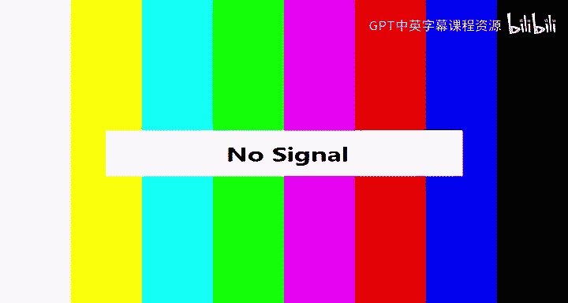
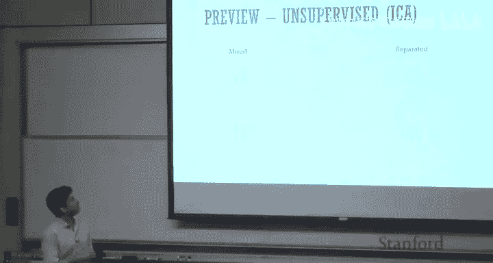
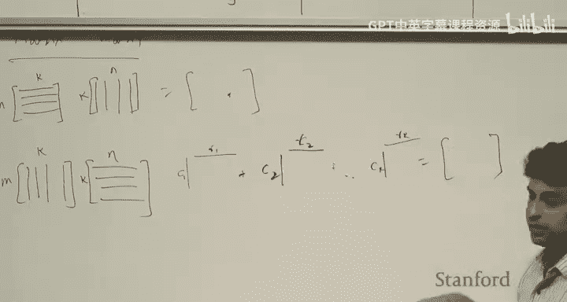
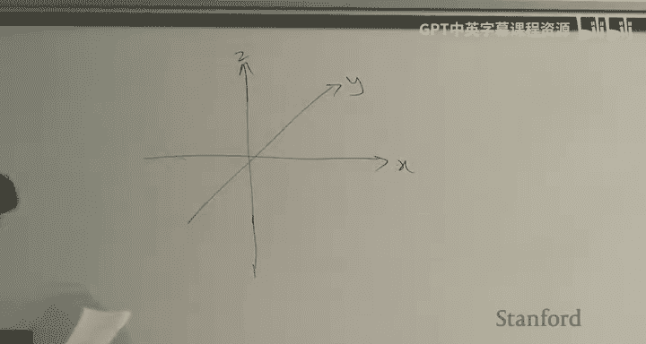
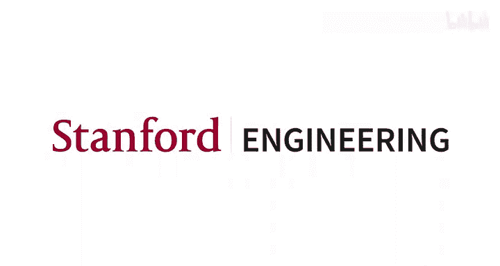

# 斯坦福大学《机器学习｜Stanford CS229 Machine Learning Course  Summer 2019 (Anand Avati)》 - P1：-01-. Lecture 1 - Introduction and Linear Algebra.zh_en - GPT中英字幕课程资源 - BV1NDopY4ECg

So we're going to start off today with some introductions of the teaching team。That's me， Annaan。

 I'm a fourth year PhD student in computer science。

 I work with Professor Andrew Ing on machine learning and applying machine learning to different problems。

 mostly in healthcare。We also have a wonderful team of teaching assistants。

 you will meet the rest of them through the quarter and office hours and so。😊，Okay。

 so the goals of this course， what do we what do we what are the goals on this course。

 So by the end of the course。You we want you to be an expert in machine learning。

 which means you understand the in terms of how machine learning algorithms work。

 not just using them， but understanding what's happening inside the algorithms。

 That's the main I would say goal number one of this course。

Goal number two is to enable you to build machine learning applications。

 which means having a good understanding of what algorithms to use and which scenarios。

 how do you how do you。Decide whether a given problem is a good machine learning problem。

 not all problems are good machine learning problems。

 and once you know that a problem is a good machine learning problem。

 how do you treat it as a supervised learning problem， unsupervised learning problem。

 we'll go through all those things。And the third goal is also enable you to be able to start doing machine learning research。

 which means making you familiar with a lot of the terms and concepts that you will encounter if you pick up and read a machine learning research paper。

So those are the top three goals for the course。Prerequisites。So。

Machine learning is part mathematical and part computer scienceency in the sense。It require。

 it's really the culmination of both computer science and and statistics。

So you will need to have basic computer science principles。

 you will need to know them for example you need to know what is bigger notation right you need to kind of understand whats you know what's computation versus what's memory you know basic computer science principles you will need to be comfortable writing nontrivial programs with Python and Ny。

It would be great if you are comfortable with recursion。

 you know some of those some of the ideas from recursion will be useful when you are translating algorithms to kernel methods you know we'll go into detail about them later so you know。

😊，We， we will assume that you are。 all of you are comfortable writing programs， especially in Python。

 or at least be。Willing to put in the time and effort to pick it up。

The other big prerequisite is probability。You should have taken some kind of a probability course in your you know academic history so far。

 so concepts like random variables， distributions should be you know you should be pretty comfortable with them。

 you should know what's the difference between a random variable and their distribution you know they things that you should know already whats what they are。

 you know things like expectations between using all these concepts very liberally throughout throughout the quarter。

The last prerequisite is linear algebra and multivariate calculus。

So you should already be comfortable with things like gradients and Hassians。

 you know you shouldn't be seeing them for the first time should you should be comfortable with these concepts already。

And things like eigenvalue， eigenvector as well。So what about the honor code so。

You are strongly encouraged to form study groups， in fact I would say forming study groups is a key key step for being successful in this course。

 especially if you' are not so comfortable with the prerequisites。

 please do form study groups and work together in study groups。However。

 you should still write up your homeworks and write up your code independently。

so it is fine to discuss and you know work on solutions together and once you are done with your study group meeting put aside all the material that you used during the study group and independently from scratch you know write up your homeworks by yourselves in your own words please do not refer to you know the material that you used in your study group session while writing up the。

Right up your homeworks。Right。Another important note is that it is in violation of the honor code to refer to。

Homeworks and solutions from previous years， whether they are the official solutions released by this course or solutions written by some other students in a Github or whatever。

 So it it is against the honor code to refer to。Solutions from the past。

 And we are very serious about the honor code。 And though we will you know。

We will not actively look for honor code violations， we trust that you will be following them。So。

 the course structure， there are three homeworks， each homework will be about two weeks long。

And each homework will count towards about 20% of your final grade。

And therell be a final exam it will be a take home final exam the reason it's a take home is because you'll need a computer to do your final exam there' will be some code more details on that towards the end of the quarter but it's going to be a take home final exam very likely a 24 hour take home final exam we haven't yet decided what's the exact start of that when the exam will start but it's going to be a final exam during the final final slots。

Logistics so the course website is on its up， it is c229。sford。edu。

On the course website we have the office hours calendars， the course calendars。

 there are two calendars up there， one is for all the office hours when each TA is holding their office hours and where exactly and the deadlines are part of the course calendar。

We can have a quick look at the course website。Os。Anyways， it， it's not opening over here anyways。

 So the。Yeah you can look up the course website on the course website there are three big buttons as soon as you open them。

 you know one button is called syllabus。嗯。Let me see if I can。야거。So you have three big buttons。

 the syllabus linked to Piazza and the calendars so on the calendars there are two calendars first one is the office hours can you can click on this and add it into your Google calendar if you wish to do so but。

The exact office hours of every TA is out there。And if you scroll further down。

 you will see the course calendar。Basically， we are in this lecture right now。

Youll find details about when each pieceet is out， when each pieceet is due。

 all the deadlines are in the course calendar， so if you are you could just add this to your personal calendar to keep track of the deadlines。

And then we have the syllabus page。So on the syllabus page， we have a collection of topics that。嗯。

We are probably not going to cover all of these， but we are going to cover a pretty big subset of these topics。

嗯。And further down， here is going to be a lecture by lecture of what we are going to cover in each lecture with the corresponding slides or notes corresponding to that lecture。

And the syllabus page， this will be updated through the quarter depending on what the actual progress we make is。

And piazza forum， so all of you should have all of you should have received an invite to Piazza already if not click on the Piazza link and enroll right away Piazza is probably the most important。

Most important platform for the course in terms of logistics because all announcements will be made on Piazza。

 the homeworks will be released on Piazza and anything that you need to know in terms of know the final exam logistics。

 all those details will be announced on Piazza so please sign up on Piazza know and monitor it。

Greatadecope all the submissions will be done on Grcope if you if you haven't used gradecope before you know spend a few minutes to get familiar with it the homeworks will be uploaded by you into Grcope directly and we will grade them on Grcope。

嗯。Again， for Grcope， also you should have received invites by now if you have not received your gradecope invite white。

 you know， create a private Piazza first。So in terms of any questions that you have through the quarter。

Your first destination will be Piazza。If it is any question related to the course content about the course logistics。

 create a question on Piazza， it's very likely some others may have already created a similar question so you can either if you know the answer help them out or if you don't find the question posted there。

 if it is a question that is specific to you in the sense。

 for example if you are not able to submit a homework on time and you know that upfront and you want an extension。

 things that are specific to you or if you have an OAE letter。Create a private PR supposed。

 things that you don't want the rest of the class to hear about。If there are things that you want to。

If there are things even beyond that that you want to say for example。

 just let me know and not even let the TS know just send me an email directly with the word CS29 in the subject。

So that's about the logistics。 Any questions on the logistics。I'll take that as a no。Okay， moving on。

All right， so what is machine learning？So。The term machine learning was coined by Arthur Samuel in 1959。

And one of the very early programs that kind of got people interested in machine learning was a checkers playing program written by Arthur Samuel。

 so it was a program probably most of you know what checkers is it's a two- person game that is a checkers board that looks like a chessboard and you have white and black paws。

It has certain rules， so Arthur Samuel wrote a program in a few years before 1959 and it became popular in 1959 where the program would learn to play against itself。

😊，Without any， any。Any kind of strategy being explicitly programmed into it It learned to play by against itself。

 and it improved its， you know gameplay performance as it experienced more and more games against itself。

 eventually， it it learned to play checkers better than know Arthur Samuel himself。

 I don't know how good a player he was to begin with， but it got pretty good by just selfplay。

 There was no， there was no strategy coded in by Arthur Samuel into the program。😊。

Only through experiences。The program learned to play better。And that was kind of the。

The event that kind of sparked interest， widespread interest in machine learning。

A more common definition by Tom Mitchell， he is a professor at CMU is machine learning is the study of computer algorithms that improve automatically through Exp。

Exedience is。Is a loose term， What do we mean by experience most of the times by experience。

 we mean prior data examples from the past。Where。The the machine learning algorithm itself is a very generic template algorithm。

 you don't。😊，And you just you feed the algorithm data from the past what you call a straining data and the algorithm analyzes the data that is given to it and。

😊，Looking for patterns in the data， the algorithms improves its performance at whatever task it is it is designed to operate on。

So the key here is data or experience from the past that distinguishes machine learning from other fields。

Right。Machine learning is also related to the field of artificial intelligence。

 so AI is a much broader term， and we see the terms AI and machine learning being conflated a lot of times especially in the news and media。

 but strictly if if you look at the definitions of AI。And the definition of machine learning。

 machine learning is a subset of AI， AI is a much broader field。😊。

AI is about building programs where the programs operate at the level of performance of say a human being。

 for example， again that's a very loose definition of AI right so AI is is broader is a broader definition and it deals with algorithms that perform at a cognitive level similar to a human being。

Machine learning is one approach of how to implement such programs。

 for example you could implement an AI program that does not look at any kind of training data。

 you just use your smarts and write up a very smart program that works really well and behaves as you know at the level of a human in terms of performance and backs still AI。

But thats not machine learning and machine learning data is the key you look at past data。

 use it as a training set or you build a simulator from which your program can kind of build experience by interacting with its environment and that program which is looking at data or which is looking you know which is getting experience in some kind of a simulator improves its performance over time。

 that's machine learning that's one way to。Make your programs intelligent。However。

 most of the attention， recent attention in artificial intelligence is due to machine learning artificial intelligence has been around for a while。

 machine learning has been around for a while but some of the recent advances in machine learning has made machine learning very successful and therefore the interest in artificial intelligence is kind of reinvigorated again。

😊，And even within machine learning， there is a specific。

A specific type of machine kernel learning called deep learning。

 which has actually seen the most advances recently。So it's。

 it's it's good to have this clear picture of。😊，AI， which is a much broader field。

 which is dealing with。Programs that operate at at a similar cognitive level as a human being。

It does not AI does not tell you how to implement such programs。Within AI。

 machine learning is a subfield。Which prescribes one way to implement such programs that's basically look at prior examples and learn from examples。

And even within machine learning， there is a subfield of machine learning called deep learning。

 which uses something called neural networks， which we will see later in the course and that that has thats this the field that has。

Made a lot of progress in the last five to 1 years。

So here are some examples of where machine learning has made a lot of progress。

 so computer vision and image recognition， was this is a field that has probably undergone the most progress in the recent years。

😊，There is a famous data set called ImNe， a computer vision data set。😊。

And there is a kind of model called a convolution neural network。

 which together you know more or less revolutionized computer vision and this is all recent you know since you know after 2012 and 2015 within the last decade。

😊，And it has also significantly improved autonomous driving where machine learning techniques are used to sense where you know pedestrians are。

 where the stop signers， where the traffic lights are。

 and it know its a key component for autonomous driving。

Machine learning has also significantly improved speech recognition。啊。And and things like， you know。

 it has made it has made possible things like voice assistant like you know。

 Apple Siri or the Google assistantant， etc ce。Language translation。 So Google Trans now uses。

machine learning or from what we know from what Google tells us it uses deep learning and in fact there was also a paper from Facebook I think last year which does unsupervised translation。

 which means just give it a corpus of a whole bunch English of English sentences and English documents and just give it a whole bunch for example French documents and just by looking at them where it was the algorithm was never told what is a matching English and French statement but just looking at two different corpus it learned to translate sentences from one language to another and similarly with Google translate they had this they had this paper a few years ago where。

They built a single model that could translate from various pairs of languages。

And that model automatically learned how to translate from new pairs for which it had never seen a training example before those are examples in language translation。

 you know a very exciting exciting field。There is also a lot of progress happening in reinforcement learning or deep reinforcement learning。

😊，And most of the progress there has been in gameplay， like for example。

 Deep mind over the last few years。They built reinforcement learning models that could play Atari games at the level of humans。

 So you you feed the model the pixels from the display of an Atari game and just by looking at the pixels of how how the game looks。

The the agent will controls different actions。The agent learned to play atari games at a superhuman level across a whole。

 you know， across 30，40 games。And also Algo until very recently， go is another board game。

 and it was widely considered to be extremely difficult to play because you need a lot of strategy。

 a lot of planning。 And after chess was kind of。Conqud by computer programs in the 80s and around the 1980s Go is then thought of as you know the next big board game that's really hard to kind of beat and you know。

Alphago， again， know， was built by Google again， which plays better than like the world's top goal players。

Those are some of the recent。Progresses。Some preview into the course what we' be doing through this quarter so we're going to look at different supervised learning algorithms。

 unsupervised deep learning algorithms， some learning theory and some reinforcement learning so most of the time will be spent on supervised and unsupervised and a good amount on learning theory and maybe a little bit on reinforcement learning theory so in supervised learning we're going to look at problems and classify them as you know regression problems versus classification problems what are regression problems when the output of your machine is some kind of a real valued output。

For example， if you are trying to predict the wind speed tomorrow at you know at Stanford and you're going to build a machine learning model to predict the wind speed based on today's weather conditions as the input the output is going to be a real valued number some you know kilometers per hour or miles per hour so that's a real valued number so thats for example a regression model classification model for example。

If the output is binary or some kind of a class， will it rain tomorrow， Yes or no。

 That's a classification problem。 given today conditions。

 if youre a predict know whether it's going to rain tomorrow， the answer is yes or no。

And you can you can classify machine learning algorithms in along many different dimensions as generative versus discriminative probabilistic versus non probabilistic so any given machine learning algorithm you can kind of place it on this hypercube of all these dimensions。

😊，嗯。And kind of taking a step back， what is supervised learning， Supervised learning is。

A kind of machine learning technique where the training data that you have come in pairs。

Each pair has an input and an output right an input is what you feed into the machine learning algorithm and the output is what the machine learning algorithm should output right so and that's called supervision because for each example。

You're telling the algorithm what the right output is。 So that's where the supervision comes in。

And unsupervised learning algorithms。You are give the algorithm some data。

 there is no explicit supervision and you just ask it to look for patterns or structure。

 interesting structure in the data and the output of your algorithm is that interesting structure or you know interesting patterns。

And again， we kind of classify unsupervised learning algorithms as those that look for clusters versus those that look for subspaces。

😊，It's fine if you don't fully understand these terms now。

 just giving a flavor of what's to come in the rest of the quarter。

And deep learning is what is also commonly called as representation learning where。

The deep learning can can kind of plug into you can view deep learning in a supervised setting。

 unsupvised setting in a reinforcement setting et cea。

 where you are trying to learn representations of your data。😊，Whereas in nonde learning approaches。

 you are manually feeding in what the right representation is for the supervisor and supervisor reinforcement learning algorithm。

 whereas with deep learning you're letting the algorithm itself learn the representation as well along with the final task。

And then well cover learning theory， super important concepts of you know the bias variance decomposition。

 bias variance trade off， generalization and uniform convergence。

 Why do we expect a model that was trained on this training set。To even perform。

 you know with any level of accuracy when you when you start using it in the world。

 when you put it the production， because you trained it on this specific training set。

 You know why do you expect this model to work well in the real world， You know， questions like that。

 you're going answer them in learning theory。And thats probably the learning theory is probably the part of the course that makes this course interesting in the sense you learn principles that are common across learning algorithms。

 you know common across learning algorithms that have not yet been invented right you know the foundational principles of why machine learning works。

And then we'll spend some time on reinforcement learning as well， though not a lot。

So here is an example of a supervised learning algorithm image classification。

 So these are examples of few images of handwritten digits。

 This comes from a very famous data set called MNist。😊。

Where the input is a set of pixels you know I think this is 24 by 24 pixels or some resolution like that and they are black and white images in fact they are grayscale images where you have a pixel value at each location you feed the set of pixels as input to some learning algorithm and the output of the learning algorithm is going to be。

I going to be one of digits1 through 9 or 0 through 9 it has 10 its a multiclass classification problem so the output is its a classification but not binary it's one among 10 classes and you want to learn machine learning model given this training data which。

Wwhich is is able to predict what the 1written digit is for digits it hasn't seen before。In fact。

You will be doing。You will be working on this data and implementing a neural network to build a hand handwriting digit classification in one of your homeworks。

Okay so unsupervised heres an example of an unsupervised learning so in this example it's what's commonly known as the cocktail party problem so imagine there are end speakers in this case assume there are two speakers who are in a cocktail party just the two of them and there are two microphones that are placed in the room at you know some specific locations。

Now。The two microphones are recording what the two speakers are speaking。

 and each of the recording is some mixture of the the what the two speakers are saying。

And the task here is now to take these two audio clips。

 each of them has a different mixture of the two speakers and。

The machine learning algorithm is expected to output。😊，Two different。

 two different waveforms where the source the voices are separate。

So all that you are feeding into the algorithm is just two clips。😊。

You're not saying you know there's no kind of supervision telling you know speaker one's voice sounds like this or speaker two's voice sounds like this there's no supervision whatsoever。

 you' are just feeding it two clips where the clips have mixed audio of two different speakers and the model outputs the separated voices so let's see if the audio works here。

All3 quarter3，6，1。Thats you know， from one microphone， there were two speakers。Ua。

ro right that's from another microphone。 probably the sound of one of the speakers was a little louder and the second one or vice versa。

 and when you separate them。Uo Do， dress， Quato Cinco saless， Cre， Ocho， No， Is。1，2，3，4，5，6，7，8，9，10。

So all what you gave the algorithm was these two audio clips and nothing else just two wave files and it know it analyzes the audio waveforms looking for structures and it is able to separate the voices with no supervision whatsoever。

And。You're going to be doing one of this in your homeworks as well it will not be two but actually a set of five audio clips that are mixed together and you' are given five different audio files and you will implement the ICA algorithm that you are going to cover in the course and separate the audio into five distinct distinct clips。

And finally reinforcement learning so here is an example of reinforcement learning where the goal of the algorithm is to control whats called what' is commonly called the inverted pendulum or the cart pole so imagine you have a stick and you are trying to balance a stick on your hand a vertical stick on your hand you know and we are trying to control this。

The Spole agent。In order to keep the stick that's placed on it well balanced right So when you start a learning algorithm from scratch so this is episode so each trial is an episode once the stick falls you start the next episode and for example this is episode0。

It is falling， falling， falling。 Now's episode1。Falling again。I so，2。Sll down， E 3。

one and you train this algorithm， you continue train it for more episodes。

 and eventually it will it will get better。😊，I stopped the algorithm for this， stopped at about 1308。

But if you let it continue it' is going to learn to learn how to balance the cart pole for， you know。

 potentially indefinitely long。下一个。Oops I think it falls off the table or something anyways。

 so again this is going to be on your homework as well。

 youre you' are going to write a reinforcement learning algorithm that's going to learn in in a simulator like this。

 how to balance， balance a stick on top of carpo Yes question。十く。是。

So the question is for those who are watching the lecture online。

 is it necessary to have as many number of audio clips as the number of speakers， yes。

 that's exactly right， you need as many number of audio clips as the number of speakers。Okay。

 so that's about it for the introduction， so for the rest of today。We will be。

Yeah so for the rest of today we'll be covering doing the review of linear algebra in case you you know it's been a while since you took linear algebra to brush you up and familiarize you with the concepts that are more important for this course and in the next next class。

😊，We be doing covering matrix calculus and some probability and statistics。 And from， you know。

 onward willll be getting into actual machine learning models。 Yes question。きと？嗯mh哼。😊，どのく。あ同。是。嗯好嗯好。

Y so the question was in unsupervised learning you're just given a data set and asked how to find structures in the data and I also spoke about an example with the language translation where a model was just given unpaired mappings of language and it still learned how to map from each other。

 the answer to that is a little technical， let's take that offline know after the lecture know come up and we can talk about that。

All right， so Im going to be assuming all of you are familiar with some basics of linear algebra in the sense all of you know what a matrix is。

 know what a vector is， you know what you can do with vectors and matrices。So。

We will be reviewing them， but also， I'm going to be assuming some familiarity from all of you。

 So first of all， some notation。So what's the vector？Right， so。For the purposes of this course。

 you will assume that a given vector， let's call it V。Is an element of。R to the B。

What let let lets make sure all of us understand what what this means right this means an element of you know from set theory。

 so v is a vector it is an element of this set and this set is a d dimensionional real space。Right。

So what's a D dimensional real space。 So this is imagine this is。The real line。And this is x。Wai。Z。

So this is an example， this is R3 because there are three dimensions。So。

 a vector is an element of a d dimensional real space。And vectors are， when we say it is an element。

 it means it is a point that lives in this。D dimensional。Real space。

This vector can also be represented as。般。いと？We generally write a vector generally is considered as a column vector。

 we write it as a column in the scores， you can also write a row vector as we transpose。B1。

So what do these numbers mean these numbers are basically the coordinates of this point。

So this is V1。This length and this length is let me right here， V1。We 2， V 3。

And this point over here is。Is sweet。Right。Similarly， we we also have a matrix。

So we write matrices as lets call it a letter a so generally matrices have we use capital letters for vectors。

 we use small letters。And we say is。Of our。M by N。You can you can interpret a matrix a as as an element living in an m by n dimensional data space what does that actually mean so you can think of that as。

😊，So matrix is a grid of numbers real valued numbers for the purpose of this course through the course we hardly ever deal with complex numbers so its going to be only real numbers think of it as a M by n grid of real numbers。

And that's a matrix。You can interpret this as。N M n column vectors of M dimension each right or you can think of it as。

M row vectors of n dimension each。Right。That is。A special matrix called the identity matrix。

 which is ones along the diagonal。And zeros。Everywhere else。

 I just write a big zero to indicate that all the individual cells are 0。

You can also have a diagonal matrix， where。A diagonal matrix is one where。All the cells。

 except the diagonal are zeros。And these could be any value。something called a symmetric matrix。

A setic matrix where。A equals a transpose。What is transpose。Switching rows and columns exactly。

 So a transpose of a matrix in this case。Take the first row。

 I'm sorry the first column and treat it as the row of the transpose and take the second row。

 second column and make it the second row and so on。

The property that the transfer satisfies is that AI J equals。

A transpose JI here I and J are the row and column indices of a given matrix。

 so when you transpose it the row number becomes the column number and the column number becomes the row number。

The price of a matrix。Is。The sum of the。Of the diagonal of that matrix。

 So take a square matrix and sum up the diagonals。 and that's the trace。

Let's look at some basic operations that you can do with vectors。 So if you have two vectors。You can。

 you can kind of combine them in two different ways。 right So the first is called the inner product。

So first this。So vector， vector operations。Given two vectors， what can we do with them。

 So the first is the inner product。And。Technically。

 the inner product and dark product are distinct concepts， but in this course。

 they're going to be the same。The dot product。So one way to think of the inner product is if you have two vectors。

 x comma y。Both in RD。So， in order to perform the inner product。

 the two vectors have to be of the same dimension， for example， D。

And the inner product is the sum over I equals 1，2 D， X I， Y I。

And this is also written as x transpose y。So this is the the mathematical representation of the dot product you could also think of。

This as。this you think of a vector written as a row vector。

 another vector written as a column vector， the two have to have the same dimension and。

When you perform the inner product， you get a scalar。You feed in two vectors。

 the output is a single number。You've lost the angles or the orientation of the vectors once you perform and in the product。

The other operation you can do with two vectors is the。Anybody。You can do the cross product。

 the cross product， however， is not very interesting for us。

You also have something called the outer product right So the cross product and outer product are different things right so in cross product you you are given to two vectors and you find a new vector that is。

Perpendicular to the plane in which the two vectors are。

Here we're going to talk about the outer product。In a product and you have the outer product。

So in the outer product， you can have x in。Let's call it our。D and y in。阿尔。Pi。

So for the autoer product， the two vectors need not have the same dimension But in a product。

 they had to have the same dimension and。Mathematically， we write the outer product as X Y transpose。

Right， it could also， you， you could also。Have a different outer product， which is y x transpose。

In this case x transpose y and y transpose x for the inner product was the same。

 so know you could switch the order， but for outer products if you switch the order。

You get something which is a little different。The way to think of the outer product。

 at least pictorially is something like this。So yeah。So think of。Victor 1。

So we have a column vector and a row vector。Right。So in this case， this is D dimensional and this is。

P dimensional。So， with the inner product， we took a row vector。

 a column vector and convert it into a scalar， but with an outer product。What we do is。You take each。

Each and every possible pairs of elements from the row vector and the column vector， for example。

 take the first element。From the column vector and say the third element from the row vector multiply those two elements right and that becomes。

The first row third column cell of this matrix， So you take two vectors and construct a matrix out of them。

Right， by。Pick the pick the ih element from this vector。

 JP element from this vector multiply them and that becomes the IJ element of the matrix right so this this for the auto product you don't need the vectors to have the same dimension。

And a matrix that you construct from one row vector and one column vector is also called a rank 1 matrix。

Right。Why is it called rank 1 because one way to think of it is it is made of one pair of a row and a column vector。

So that makes it whats also called a rank  one matrix。You could also， for example。

Take two rank1 matrices。Addd them up。So。These together will give you one rank one matrix。

 add it with。Another rank 1 matrix。Right，So the row the the column vectors。

Have to be of the same dimension。 The row vectors have to be of the same dimension。

But the two need not be the same dimension right So if these two have to be D dimension。

 these two have to be， for example， P dimension。Here you get a rank one matrix。

 you get another rank one matrix， you sum them up element wise。And you get that。

Another matrix of rank。So you take two rank1 merices， you add them up。You got to rank two matrix。

So you take two rank on matrices and you add them up you can you get a rank 2 matrix。

 assuming the vectors are linearly independent。If the vectors are linearly independent。

 you take two rank1 matrices， add them up， you get a rank 2 matrix。No。What happens if。

Let's say we add K of them， so1，2。What's the rank of this matrix。렇케。

So the rank of this matrix is actually going to be the。Less than or equal to min of D P and K。

 So the rank of the matrix cannot be bigger than the smaller dimension of the matrix。

So by adding rank1 matrices you know or linear adding linearly independent rank1 matrices you are increasing the rank of your resulting matrix。

 but you can only go up。😊，As high as the smaller of the two dimensions。Yes， question。Yes。

 we will I will define the rank for now，'s let's think of rank as。Think of this as a sheet of paper。

 like you know think of this as a matrix and you add more sheets of papers。

 you are increasing the rank of the matrix。 We will precisely define what the rank of a matrix is in a few minutes。

And just by looking at a matrix， if you are just given a bunch of numbers of rows and columns。

 it's pretty much impossible to tell what the rank of that matrix is its superficially you cannot just tell by looking at looking at a matrix what its rank is it' is like an inherent property there are you know simple cases if you are given a diagonal matrix where everything is zero s the diagonal yes you can tell the rank but in general just by looking at the values of a matrix you cannot tell what the rank of matrix is。

Okay， so those are vector vector operations。Let's look at some matrix vector operations。Right so。

You know， matrix。You went over vector vector operations。

 the inner product and the outer product for the inner product you had to have both the vectors of the same dimension and you would get a scalar for an outer product they could be of different dimensions and you got a rank1 matrix right now let's look at matrix vector operations so for a matrix vector operations first we are going to consider operations where you have a matrix let's call it。

Yi。And。Corrllect x like this correct M by n。And this is N so a。Belongs to R M by N。And X belongs to。

Our enemy。So this is and so Ax is now。Of dimension。Re one。 So how do you think about this operation？

 So first， you can。Think of the matrix。As a set of rows。So each row has n elements。

And the vector you are multiplying with is a column vector。

And all you are doing is the inner product right take the first row。😊。

Get the inner product with the matrix and you get a scalar。Take the second row， do the inner product。

 you get another scalr。And you are going to get as many number of scalrs as the number of rows you have in the matrix。

哦。So， AX。好人。You can write this as m by one but you know we assume vectors are column vector。

 so if I write just you know in RM you know just assume it its M by one if you want to think of it that way。

Another interpretation of matrix vector multiplication。Is。It's the same matrix。

 except you're going to think of them as columns。M by N。This is n。 So this is a， and this is x。

So this has， I'm just going to use different symbols。Let's assume， there are three elements。And。

 all right， this has four。 So let's。Let' us assume this has four elements and the n this4 a is a m by 4 matrix and you are trying to calculate ax。

The other interpretation here is let me use some colors。

So here we did inner products here what we are going to do is pick the first element。Of。

 of x scale the first column of a。Right， and then pick the。

Second element of x scale the second column of a by that number。By scaling， I mean。

 to an element wise multiplication of of this number with all the elements here。 not just rescale it。

And。Takeick the third element of x scale the third column。And。

And then you just sum them up along this way。 So some of the scary versions。So。A X。I again， you know。

 you are summing up m dimensional column vectors that are scaled by the corresponding values in the vector and that is just going to give you you know。

And whether you do the operation this way or this way。

 you willll always end up with the same same right hand side。So that's matrix vector。

And then you have matrix matrix。So again， for matrix matrix， there are kind of， you know。

 two interpretations of how you kind of visualize the product of two matrices。

 So let's assume you have。Two matrix 6， matrix 6 m by k。Times。K by n。So， it is important that the。

The number of columns of the first one and the number of rows of the second one are the same and in interpretation number one we go with the inner product interpretation so you have。

M grows of K dimensions each。And。And columns of。K dimensions each。Right。

The dimensions are matching of the row and the column。

 so naturally we want to do the inner product right now take every pair of row and column vector。

So that gives you M times n。AnyAny row vector， any column vector。Perform the inner product。

And that becomes the cell value of the corresponding Irow and Jde column。

So pick the say the second row and the fourth column do the inner product and that is the second row fourth column of your output matrix。

So matrix multiplication is essentially a whole bunch of inner products that you are doing concurrently in parallel。

You can also。The same operation。M 바 k。K by N。 And in this case， think of them as。 so now we have。

K column vectors and K row vectors。M and n are different。

 so this is m dimensional and this is n dimensional， but we have k of each of them。

Right now pick them pair wise， not all possible pairs， but pick them pair wise。

 So first row and first column Im sorry first column and first row。Do the outer product。

 you get a rank1 matrix。So you get a rank1 matrix of So this is column one from the first matrix and row 1。

Plus。Pick the second column at second row。Cotn 1。And。Road column 2 and row 2。And add K of them。

So column k and row K。 So the columns come from the left matrix and the rows come from the right matrix。

 and you add them up， you get a。Another matrix。And the matrix that you calculate this way or the matrix that you calculate this way are going to be exactly the same。

 So they are just two different interpretations of the same mathematical operation。😊。

Any questions so far？Yeah。Yeah， so the question is。Should this be a rank 1 matrix？

The when you take a column vector and a row vector and take the outer product this will be a rank1 matrix and this is another separate rank1 matrix and this is another rank 1 matrix and when you add them up when you add k of them you get a potentially you know min of you mN then K rank matrix。

It will if the rows and columns are linearly independent， it will not be rank1。

 you are increasing the rank as long as you are taking linearly independent rows and columns。

But you you cannot keep adding matrices rank1 matrices and increase your rank forever。

 you have an upper bound which is the smaller of the two dimensions of the roer column。All right。

There was another question of what the rank was。 And before we get to that。Let's see。

 why do we need to learn linear algebra for machine learning。

 Why is linear algebra even relevant for machine learning。So some of the。

Some of the situations where we will end up using linear algebra know through the rest of the quarter is first is。

Represent data。So suppose in a supervised learning setting your let's say you want to predict the price of the house and the inputs that you are given are things like you know the number of bathrooms。

 the number of bedrooms， you know the area， etc ce， you would then represent your training data as。

X as you know。Where each row x is is it is also called the design matrix where each row is an example is a different example and the columns correspond to what we are also call as features for example this could be house one。

 house two， house  three， house4 etc ceter and this could be say number of bedrooms， area。

 number of bathrooms etc ce。 this is generally called a design matrix。So your design matrix x。

Is most conveniently represented as a matrix。Similarly your supervision values。

 the actual house prices of those houses is most conveniently represented as a vector right so just to represent your data it is convenient to use concepts from linear algebra like matrices and vectors。

Right。And then we are going to do a whole lot of manipulation with these like you know multiply this you know x vector with you know another parameter vector called theta and so on and so on。

 So we are going to be using linear algebra for representing our data and also doing operations on them。

Another。Situations where we will need matrices is going to be in probability to represent what's called covariance matrices。

You will cover probability review tomorrow and we will go over what what a covariance matrix is so for example。

 covariance matrices。嗯。They were originally written as you know。They tend to be symmetric。

 symmetric means the matrix and its transpose are the same。

And we are going to use linear algebra for calculus。Multtivari calculus。Right， so things like。

Gradients， so gradients and。I'm expecting you know what a gradient is。

 so gradients tend to be vectors so you would represent vectors as column vectors。Hassians。

 Hasians are matrices。Hasians are basically like you know think of them as the second derivative in the multivariate setting。

And Jacobians， Jacobians are derivatives of a vector valued output from you know a vector valued input。

All of those can be gradients。Maybe be vectors。Assians。Ma matrix， symmetric。Jaobians。

Again the matrix Jacobbian will will likely not be symmetric and so forth。

 and we are also going to see use linear algebra very liberally in kernel methods。

You are not expected to know what a kernel method is I'm just list it here just so you know you know that know learning linear algebra has used in all these various scenarios。

RightAnd by calculus， I also mean， you know， in general optimization， you know。

 given a loss function， we need to minimize it right and。

We're going to use gradients and Hasians so on there。So yeah。

 so linear algebra is important and it's very important that you are comfortable。😊。

Manipulating these concepts such as matrices and vectors and know multiplying them， taking inverses。

 etc。Any questions before we move on to。A few more interesting concepts。No questions。So。

 we saw matrix vector multiplication over here。You said， like。

 let's do a geometrical interpretation of。So linear algebra is one field of mathematics where it is very easy to visualize things。

 which makes it really fun and also kind of easy once you kind of get the core intus right。😊。

We are the matrix vector multiplication。 So a， let's， let's call a matrix as a Its in。R M by N。

And let's say you have a vector x in。R N right now when you do a matrix vector multiplication。

 you get something called ax。 and this is in。R。M。So one way to think of AX is through these you know raw interpretation or column interpretation right but an even more useful way to think about this is to think of a as some kind of a function think of a as a function you know weve been looking at the matrix as a set of numbers right so stop thinking of it as a set of numbers but think of it as a function a function that takes x as input and outputs you know that vector。

No。Let's assume you have。 we have a in。R3 by 3。 which means we have。It takes as input。

Values from a three dimensional space。And。Its output is also a three dimensional space。Right。Now。

 we are thinking of a as a function。W which takes us input？The inputs are vectors。

And the outputs are also vectors right So x is a vector， A x is also a vector。

 They are in different dimensions。 Yes， right， so it takes as input。

An n dimensional vector and produces an output。Which is an M dimensional vector。Right， so。Next。

Pick some。So assume this is the a， which， which， which does the multiplication and。So these are。

 let's call them。X x is y x is the x。As 3 by 3。 And let's say， we。So this is a vector in， you know。

 this is some x。It lives in a three dimensional space， and it has， you know， a column representation。

Right。Multipliied by a。Right， and。Let's say it maps it here in the output space。

Now let's take another。Vectctor， let's call it。And this is some other vector。Run it through a。

 it is going to give you a different output。Right， so。Perhaps it comes here。And similarly， you know。

 I take。A third third vector right through a， it's probably going to come here。

So the what this picture is representing is you have this function a。

We don't think of it as numbers anymore， we think of it as a function for which we we take some point in the input space as the input。

Fe it into the function。And it outputs you know a new vector in you know possibly a different dimensional space in this case it is3 and 3 to make the visualization simple。

Right， now。If a is full rank， which means its rank is。Is3 in this case。

There is going to be a unique mapping between every point in the input to every point in the output。

 There' is going to be a one， you know， one by one mapping。

 one to one mapping between every point in the input to a corresponding point in the output。Now。

 if a is such a matrix that makes such a one to one mapping possible， a is a full rank matrix。Right。

 now， so this is input space。And this is the output space。Now。

 you could also imagine that there exists some other matrix called it B。

That takes these values as the input。😊， say the red has the input。Run it through B。And it outputs。

The original point over here。Right， now。If a is a full rank matrix。

 then such a B will exist you know which does the reverse mapping and this B is also called a inverse。

Right， so a is the function that takes。It takes vectors as input and maps them to some output。

And as long as it is full rank， will there will be another matrix， which is the inverse of it。

 which takes this as the input and corresponds the and outputs the original point as as the output。😊。

Now， this is in the case of a full rank matrix。Now， what happens？A is not full rank。So this was。

Full rank。Now here， if a matrix is not full rank， it's technique called a rank deficient。So again。

 this is the input space。Ex axis。Why axis？The axis。Similarly， there is output space。X axis， Y X is。

 the X。Right， and。Second we have an A over here， a is again in R3 by 3。

But let's assume this is a rank2 matrix， right。And this was a full rank。 This was a rank 3 matrix。

 so it could uniquely map every point， every other point， and you could go back through the inverse。

No。If it is。Raned deficient。 What this means is。If the rank is two。

It means there exists two dimensional subspace in the input space， know。

So there exists a two dimensional subspace。What does the subspace mean？So。

 assume this is the ambient space is three dimensional。

 assume this room to be the ambient three dimensional space。Any two dimensional pay， for example。

 this paper that extends indefinitely in all。Along all directions is a subspace that lives in this three dimensional space。

 right Now， if， if the rank of the matrix is 2。aAnd it is a3 by3 matrix then in this three dimensional ambient space there exists a two dimensional subspace that is specific to this matrix。

And that subspace must pass through the origin。Right。And also， a corresponding。

Subspace in the output。Space。Which is also two dimensional， which is what makes it， you know。

 a rank 2 matrix。 There is a two dimensional subspace and a two dimensional subspace。Again。

 this also has to go through through the origin and there exists a one to one mapping between points on this subspace to points on this subspace。

So。A point on this subspace may get mapped here。Another point or here me get map here。Similarly。

 you know， a third point here， you get mapped here Now this subspace extends to infinity in all directions。

Right。In both the input and output space and a gives you a unique one to one mapping between elements in these subspaces。

But a is a 3 by3 matrix， right， it's a function。 Think of it as a function。😊。

For which you can feed any input。You know， just because a subspace exists for which one to one。

Ming exists。Doesnt mean you know， for example I may take this point that lives outside the subspace right this is you know think of this as the ambient 3 dimensional space this is a two dimensional subspace what about the point over here where the penicide it is not living in the subspace it is outside the subspace right。

Take take such a point that you know that doesnt live in the subspace。

 you can still feed this point as an input to this function and it is going to market it somewhere。

But where will it map it to？The way to think about that is。Any given point。

In the input in the input space of a matrix can be decomposed。 You can decompose x。Into two parts。

One part。So， let's assume this is x。And x lives。Outside the subspace。

You can decompose this x into two parts where one part lives in the subspace and is in a way nearest to the given x。

And another part， which is this residual from that nearest point。To the actual point。

Which means assume the origin is in that corner and this is a two dimensional subspace that passes through the origin and we have a point over here。

This point can be decomposed into part into two parts This point is represented by a vector that starts at the origin and ends at this point。

You can decompose into two parts where one part lives strictly in the subspace。

And it accents all the way。Till it is nearest to this point。And a second part。

 which is a point that is perpendicular to the subspace that originates from that nearest point to this point。

it's like， you know， pythno theem。 you have two。Two components which are at tritangles and any vector can be decomposed into a component that lies in the subspace and a component that is strictly perpendicular to the subspace。

Right， and。I'm sorry。 What's the question。Yes， you can call it a resolution。

 but a more commonly used term is decomposition。 So you decompose that vector into two parts。

And these two parts when I mean decomposition， I don't mean take the vector and split it into a two dimensional versus a three dimensional。

😊，What I mean is you know， you should not be confusing this。

This decomposition as splitting it into one part that lives in the subspace versus another。

 Thats not what we are talking about， right。What we are talking about is， you know， x。

Can be written as。I'm going to use the word projection over here。

 So the projection of x onto the subspace。Plus。The technical term over here would be。The row space。

Plus。Projection onto。The nu space。Now what does that mean， I mean。

 we saw two terms over there a row space and an null space。Now， row space is actually the subspace。

 which which gets mapped byly to the corresponding。

 you know the output subspace right this subspace in the input space。😊。

For which the bise exists is also called the row space。

And it' is called the row space because it is made up of precisely those points。

 which can be represented as linear combination of the rows of a。Right，Yes， question。

Are all projections ortho togonal。 I'll come to that in a moment， Yes， so。

The row space is made up of all points that can be represented as linear combinations of the rows of a。

 and it is precisely that subspace for which a bijection exists between you know the output space and the input space。

So this is called the row space， and this is called the column space。

It is also called like the range of it is also called the ranger you can think of it as the columns and this is precisely those the set of all points which can be represented as linear combinations of the columns of a。

Now， the point over here， which did not exist in the row space。

We said can be represented as the sum of two components。

 we can decompose it as the sum of two components， one component that lies in the row space and is nearest to x and another component which is you can call it you know what's left or the residue right which is。

Orhogonal to your row space。And the question was， is the projection？Always。

Perpendicular to the space on which you're projecting it to。 Yes， the answer is yes。

 So the the way you want to think of it is let's assume this is the subspace。

 This is a two dimensional subspace in this ambient three dimensional space and you have some point over here you know where this you know a black pen is and you want to project it onto the space。

Onto the subspace now。The the the way you do the projection is search all the points that exist in the subspace。

 calculate the distance from that space from that point to this point and choose the point that that has the smallest distance right that point is the projection of。

The the point having the smallest distance from this point is the projection of this point onto the subspace and the the。

 the line connecting。The true point to the projection point is always going to meet at a angle of 90 degrees it's always going to be perpendicular to the subspace itself。

And it's， it's kind of intuitive， right， so。In the subspace。You know。The point that is nearest。

On this plane to this point is going to be the one that is like directly below it。

 and so that line is always going to be perpenicular。Does that answer your question？Yes， question。

そだすバす。Subspace is always pass through the origin by definition。

 they pass through the origin because this is always going to be some linear combination of the row or the columns and the linear combination can have be just zeros you know just。

😊，Z times column1 plus 0 times column2， so the origin is always part of both the input subspace and the output subspace。

Yes， question。こ就是。ども。Yeah， so the question is what is row space。

 So row space is precisely the set of all points that can be represented as linear columns of the rows。

So column space is the set of all points that can be represented as linear combination of the columns of。

Of a， which means the set of all points that you can obtain by multiplying some vector with that matrix。

And according to this definition， it is some linear combination of the columns。Of a。

 and you know you take the transpose and you get the row space。Yes question。

the question is are the subspaces？So the question is。Are the points of different colors。

 Are they the rows or columns of。The matrix A， is that the question。So。Good question。

 Thank you for asking that question。 So the points that I'm choosing over here。

Have nothing to do with in the sense。They need not。Be either a row or a column of a。

The points that lie on this subspace。Can be represented as some linear combination of the rosa。Right？

What it means is。One of theSo if a has three rows。There will be three points in the subspace。

Which corresponds to the three rows of a。 It has to， It has to lie there because， you know。

What I mean by that is， let's assume a has three rows。 This is a。 It has three rows。 and this is。

The subspace obtained by linear combinations of these three rows。

 which means one of the combinations could be 100 right one times the first row plus 0 times the second row plus 0 times the third row must lie in the subspace right which means first row exists at some point in the subspace。

Does that make sense？Yeah， so。Yeah， so that's that's the row space。 And any given x now。

 what happens you know， back to the question of what happens if you take some x that does not exist in the in the。

R space of x and you multiply through and multiply it by a， what happens。

And this is where the decomposition helps us find an answer。So。A of x。It's going to be。A off。

I'm gonna abuse notation， and write to us。X， R。N where it is。

 this is the projection of x onto the row space， and this is the residue。Right and this。

The direction in which the residue lives is also called the null space of a。Which means。

Any point that lives in the null space of a will always get map20 in the output space。

That's called the nu space of a。Any point in the input space can be broken down into two components。

 a component that lives in the row space and a component that lives in the null space。Right。

And a of x， you know， you can represent it as you know。

 the row space component plus the null space component。 And because a is a linear function。

You can write to this a of X， R plus。X， N。Right， and this。Is 0 because you know。

 you are feeding this this is a vector in the null space you multiplied by a， it always goes to 0。

Right， and so this is just E of。XR，So the， the operation you want to think in your mind is given any point in the。

Input space， which may or may not lie in the row space。When you multiply by。Multipliied with a。

 what happens is effectively， you project that space onto the row space。P。Transfer that， you know。

 and find the corresponding output of that projection。RightSo it essentially means。

This operation is effectively just pruning out anything that's outside the。Row space of， you know。

 from from the input。Find the projection onto the row space and carry forward that point onto the output space。

So this concept of projection is super important going。We're going to come across this concept。

 this this projection again when we， when we do linear regression。Sos technically。

 how do we calculate the projection？Here I just represent it as some abstract function called projection and here I used you know the resulting vector after you do the projection。

 but how do you actually calculate the projection。And that's not too hard either。It's a project。

We'll start with the simplest case。The simplest case where you have。Consider。You have a vector。

Let's call this。V， some vector。And。You have another vector， let's call it。B。

There are two different vectors。And now we want to project。Be onto。

The direction onto the subspace pan by V。V is a vector。😊。

And it induces a subspace and that subspace is a one dimensional subspace which is made up of all linear combinations of the vector B。

 which means take B multiplied by 2 you get take v you know2 v is part of that subspace1 0。

5 v is part of that subspace minus v is part of that subspace so this entire line is the subspace span by v。

By the vector V。 And now we want to project the vector B onto the subspace。And how do we do that？

For that， there is for a given V。That is something called the projection matrix。

Projection matrix of V。Is。V V transpose over V transpose v。We'll decipher this in in in a minute。

 Now， this is a projection matrix， which means。You take this matrix。And take any other vector。

It could be this vector， it could be this vector。And if you multiply B。By this matrix。

The resulting point。Is going to be the projection of。Projection of B onto the subspace span by V。Now。

 why is that the case？That's the case， because。Let's look at what's happening here。

I'm going to rewrite this， as the。We transpose B。Over。We transpose V。 And this is the same as。V over。

N for me。V。ふ？And scores B。So v transpose v is the same as the square of the length of V。

 it's the norm square of v。And that。So this is the square of the length。

 I distribute one of the length to this and one of the length to that。

So when you divide a vector by its length， you are effectively rescaling it into a unit length vector。

So now I'm going to call this say v tilde。We till that。Transpose B。Where weilda is。

A vector along V that has length equal to one。 maybe this point over here is。We。Right， you can。

 you can。Pick any vector along this on the subspace and it is always going to result in the same projection matrix because you are rescaling it by the length so it doesn't matter which specific vector you chose in the subspace we rescale it by the length come back to wetilder and the projection matrix is wetder weter transpose。

那。This。Write it as we tilda times。We tell the trans be。Right。And this， we know， is the。

When you take the inner product between a unit length vector and any other vector。

It's going to give you the， the。The length of the projection of this vector onto a unit length vector。

Right， so the。If we transpose is v tilde is some unit length vector， you take any other vector B。

 the inner the inner product between two vectors where one of them is unit length。

Is going to be the magnitude of the other vector。Along the direction of， of the unit length vector。

 right， So this is going to be。The length。Of the projection of B along the dimension of V。

 And then this is just some scalar。 You're rescaling V tilde by some scalar。Okay， so this。

 this is the。Projection matrix。Of some vector v where the projection matrix projects the input that is fed to the projection matrix onto the subspace span by。

Is it clear？Any questions？Now， what happens if。Instead of。One vector， we， we give you。

 we have a collection of vectors， a bunch of column vectors， for example。We have， let's say。

 you know。We have a subspace spanned by the。A collection of three row vectors。

If these are the vectors。😡，Onto which whose subspace onto which we want to project x。

We follow something very similar to this。In space， in， in， in place of we。Instead of this being。

A vector， we will have a matrix where the matrix here is will be。Some matrix。Thanks。Whose columns。

Our vectors。Which make up the subspace onto which we want to project。In this case， it was a vector。

 it was a subspace with just one vector。But if you want to project B onto a subspace spanned by multiple vectors。

Right， then in place of V， were going to use。Some matrix x。Whose columns。Are precisely those。

You know，A set of vectors which make up the subspace， yes question。

They need to be linearly independent by definition， because those are you know the。

To make up a subspace， you know， you need a set of linearly independent vectors， so。

Take take some set of linearly independent vectors。From that subspace。Right， and。Wherever there is。

 we just plug in x。 So were going to get x。This looks different from this。And that's because。

In v transpose v as a scalar and you could you can divide something by a scalar right but x transpose x is is going to be a matrix and you cannot divide something by a matrix it's not even a meaningful operation。

 How do you even go about doing it right So the right way to think about。

This is to rewrite this as we。RightSo I just reoutte this as we we transpose we inverse we transpose which is which is the same and it is this form that can generalize into a matrix form right so the projection matrix for a set of columns is。

Is this。 And we are going to come again， come come across this concept again when we do linear regression so。

好看。Remember不的。Yes。做提求。I could have put it anywhere。Yeah。So the question is。

 why did we put the x transpose x in was in the middle rather than to the left or to the right？It's。

 I mean， the， the answer is， is。Is， is。I don't know if this is a satisfactory answer。

 but this is the only thing that makes sense if you you know no other position will match the dimensions right So x is M by n。

😊，X transpose x or x transpose x inverses n by n。And x transpose is n by M。So in a way。

 that's the only place where it kind of fits。In order to kind of multiply things。

I know that's not a satisfactory answer， but you know。

 that that's the only operation that kind of makes sense。Right， so this， this， this。

This concept of what happens when youre。This whole idea of projecting things and finding a point for which you know bijections exist and moving over is going to be a recurring theme it's something you want to kind of understand really well right any given for a given matrix a which is not full rank。

There exists subspaces in its input and output space and the dimension of the subspace is going to be equal to the rank of the matrix。

And。And whenever you multiply a vector from the input space。

 what you are effectively doing is projecting that vector onto the row space that the input subspace for which a bijection exists and then carry forward that point onto the output。

I mentioned。Which also means that now， if。We have a point that lives outside the subspace in in the output space。

And we want to find out what。Point in the input space will give me。This is the output。

Which is effectively， we are asking the question， what is a inverse。 that does not exist therefore。

 for no point in the input space， can we reach a point that lives outside。The， the the column space。

 this point is unreachable。And when we cover linear regression we are going to ask exactly this question when we have a point that is not unreachable you know what are we going to do about it。

 how are we going to find an input that that's basically linear regression which we cover on Friday。

 but this whole idea of subspaces， you know row space， null space decomposition， byjection。

 these are things you you want to digest it well and absorb them really well。不's see。

We have about8 more minutes。 All right， so。We might be able to squeeze in this one。

We might run over a little over time today， but I'll try to wrap up as much as possible and we can continue the rest。

All right， so here we saw。Kind of a visual representation of what a the matrix a does to the input and output。

Now， next， we are going limit ourselves to only square matrices。

 which means the input and output spaces have the same dimensions。

And for the purpose of visualization， we're going to only consider， let's say。

 a three dimensional space。Right， now。

In this diagram， we have two different。Two different pictures for the input space and the output space。

 but now because a is symmetric， I am sorry a is is a square matrix。

 we are going to overlay the input and output space onto the same space。Right， so here。

 the input space and output space are are。Being overlaid here。Now， let's ask the question。This。

 you know。Yeah。Now， let's ask the question。 We saw what happened for you know。

Pick you know choose some points， you know run it through a， you get an output output point。 Now。

 what happens if we take the unit sphere。Around the origin。By unit fear， I mean。

Just the points on the surface of the units where think of it as a soccer ball that is centerd on the origin。

And you take every point on the surface。Run it through a。

You get a corresponding output point for every know input point of the soccer ball， right。

How would the resulting shape look。So that's going to look as an ellip side。 It's， it's you know。

 almost like an ellipse。 So that's going to be。喂。So what exactly happened here。

 it' a three dimensional input and output space。We started with the。Input as。

We didn't have one input， but we had a collection of points as inputs and that collection was precisely those points that live on the surface of a unit figure。

And let's say， we。We took this point in the input space。Run it through a。

 we got a corresponding point and that point is say this one。

So every point on the input surface maps to some point on the output surface of that shape。

We could have done this with any input shape， but you know， sphere is easy to kind of analyze。Now。

 similarly， you do it for another point。Let's say， this point。And let's say that maps here。

And let's say we think what color do we have。Let's say， we pick。This point。Us here。Right。No。

We saw what happens when you when we take some shape， for example。

 a sphere and run it through a instead of thinking of。

Running a point through a now imagine running you know a full shape through a which which essentially means you are running every point in that shape through a and calculating the output point you know which will be some other shape So now think of a as taking as a shape as input and outputting a different shape as the output。

If the shape is some unit sphere around is the unit sphere around the origin。

 the output is going to be an ellipsoid。那。This ellip side。Assuming a is also symmetric。Will have。

Essentially， just two things。 So first of all， so this was the input。This was the output。This one。

 which means there were two operations being done here。 One is there is a change in magnitude。

 so the magnitude came down a little bit。And there's a change in direction。

A did essentially like effectively two things， a change in direction and a change in magnitude。Now。

 there are going to be some points。😡，Along， you know， some point on the unit sphere。For which。

The only change is going to be a change in magnitude and no change in direction。

And those are your eigenvectors。For a full rank。3 by three matrix。

 there are going to be three eigenvectors。Right， and。This is going to be one of them。

 and if it is symmetric， those eigenvectors are going to be perpendicular。I used the own color。

That said， so this is going to be one eigenvector and there' is going to be another eigenvector。

Which will map。This point on the input。Do。A point on the output where the the only thing that changes is the magnitude and not the direction。

 Yes question。どなそ。I'm sorry。So does it necessarily have to have three eigenvectors。

 so it will have three eigenvectors， however， some of the eigenvalues may be0 Im going to come to。

Come to it。So this is going to be you know econvector number one for which the the scaling system maximum。

And the eigenvalue is the ratio of the length of the input vector and the length of the output vector。

 so if the output vector is stretched a lot along theig eigenvector then you have a large eigenvalue。

RightAnd if。If the eigenvector is is shrinking the point closer to the origin。

 then the eigenvalue is， you know， less than one。 If it is bigger than the original point。

 it greater than one。 your your point may also get。Reversed interaction， in which case。

 your eigenvector is negative。Now that that is the eigenvector and the eigenvalue is the ratio of the output to the input。

Magnnetitude。It may so happen that when you。Take the the unit sphere or a soccer ball as the input and field as the output。

 the output may not be an ellipsoid。But it may be a flat ellipse。Which means you lost a dimension。

 It got kind of smooushed into a two dimensional ellipse instead of having a rigid three dimensional。

ellipide ship。Now， that means。The eigenvalue along the third eigenvector was 0。So along the third。

 eigenvector， you know， all the lens kind of got mapped to0。And does that make sense。Sure。Now。

 the a question was asked earlier on now what is the what is the meaning of the rank of a matrix。

 so the rank of a matrix。Is precisely equal to the number of nonze eigenvalues。RightIf the。

 if the matrix。嗯。So this is in a square matrix。Setting if a matrix has full rank。

 then it means a unit sphere will always come out as some kind of an ellipoid with the same number of dimensions if your rank deficit。

The ellipoid that comes out may have lost a few dimensions。

