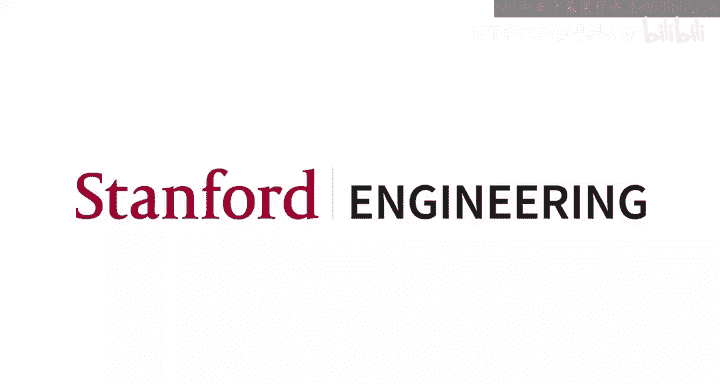
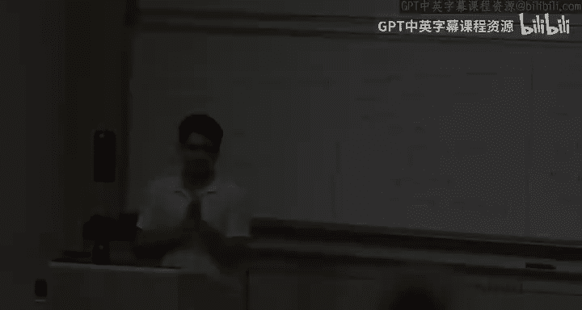
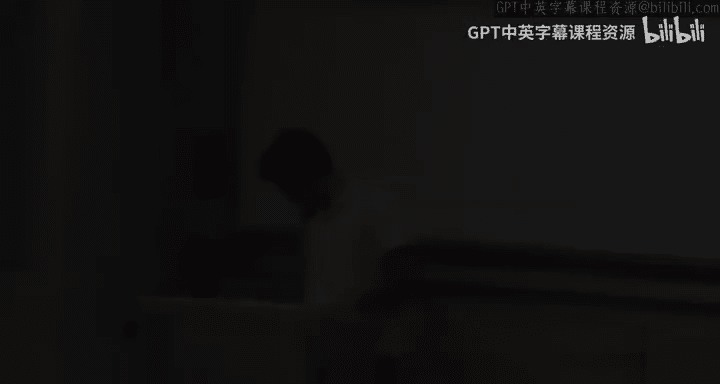
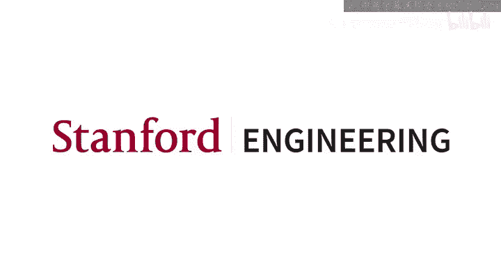

# 斯坦福大学《机器学习｜Stanford CS229 Machine Learning Course  Summer 2019 (Anand Avati)》 - P20：-20-.Lecture 20 - Variational Autoencoder.zh_en - GPT中英字幕课程资源 - BV1NDopY4ECg

Welcome back， everyone。 This is lecture 20 of C S2 to9。

 And the main topic for today will be variational auto encoders。

 So variation auto encoders is probably one of the。

Simpst deep generative models， so deep generative models is a very hot topic in machine learning right now where we try to build generative models of our data using neural networks and variation law to encoders was one of the early early models which made good progress in this field and is also probably the model that you know one should start studying first because it has the key components that are kind of necessary that are used in more fancier models。

So for studying variation auto encoders。First， we will look at you know， simple auto encoders。

Auto encoders have a long history， and。We will look at you know what what simple auto encoders are。

 and then we will kind of switch gears back into expectation maximization and look at a very look at a few variants of expectation maximization because that that kind of。

Gives good motivation into various auto encoders。 We will first study something called as MCMC expectation maximizer。

 MCM E M， where MCM C stands for Markov chain Monte Carlo， and we will also。😊。

We will also have a quick look at variational inference which is kind of like a counterpart to Monte Carlo techniques and then we look at yet another variant of EM called variation EM and then switch gears into the variation autoenr itself so that's the plan for today and so if if if in terms of the oral course if we are able to cover this today then probably today we'll be kind of the last math intensive class well have one more class on Friday we where well be covering more general topics like。

Like evaluation metrics and you know general tips for executing machine learning projects that will not be as math heavy so probably this is going to be the last math heavy class and next week we'll be just doing review of all the topics that we have done in the course and also the review that we do next week will you know kind of will be suggestive of the kind of topics that are important for your final exam so we'll be stressing more on topics that are important for the final exam so that you can focus on it Yes question。

売れて。Like the。So the final is cumulative， it is since we did not have a midterm it is cumulative。

 it covers everything。😊，So， a quick recap of what we covered in the last class。

 so in the last class we mostly dealt with the principle called the maximum entropy principle where entropy of a probability distribution is defined as the expectation of the negative log of probability value itself。

😊，And the maximum mid entropy principle suggests that we should maximize the entropy of a probability distribution that we are trying to estimate subject to some constraints where most of the times the constraints are expectations of some function of of the variable of the space over which the distribution is defined and we want the expectation to be equal to the empirical know empirical expectations and these generally come from data。

😊，Like this where data comes in into the maximum pre principle because they serve as as the values to which we want the constraints to satisfy right so subject to these constraints we get an entire family or an entire class of probability distributions that satisfy this constraintsstraint so supposing these t1 and T2 are like x and x squared so if t1 of x equals x t2 of x equals x squared then basically the constraints that we are trying to express is the first moment of the data should be some the first moment of the data the second moment of the distribution should be the second moment of the data and so on and subject to these constraints we basically have an infinite number of probability distributions in general because satisfying just two or three constraints is pretty easy and then the maximum enter preprinc suggest that among the class of all these candidate。

Probability distributions that satisfy these moments。

 The one that we want to choose is the one that maximizes entropy。Yes question。working。

So moments are so expectation of x is called the first moment。

 expectation of x square is the second moment expectation of x cube is the third moment and so on。

Like， so。The the objective that we want to maximize is the entropy I think there was also a question somebody asked where why are we trying to maximize entropy and why not maximize variance。

😊，Maximizing variance， for example， will supposing our probability distribution is defined on the range a to B。

Right finite support now if we want a distribution that has high uncertainty across， then we need。

The probability PDF to look like this which uniformly assigns 1 over b minus a density to the all the areas now if you want to just maximize variance instead of maximizing entropy then the distribution that we have will be something like this A and B where half the masses here。

 half the masses here。 so this maximizes variance。But it does not necessarily mean that you are maximizing uncertainty。

So maximizing variance is not something that we want to do if we want to just increase our uncertainty and kind of stay unbiased about our estimate of what the probability distribution is so maximum enter principles tells us that satisfy these constrain and among all the distribution that satisfies choose the one that has the highest entropy and we saw that this is equal to this kind of dual problem where the dual problem is maximum likelihood where we want to if we were to start from another direction where we want to perform maximum likelihood and the probability distribution if we assume is part of the exponential family。

😊，Where the sufficient statistics of the exponential family are basically the constraints that we want to satisfy。

 then these two problems are equivalent。😊，In other words， maximum entropy。😊。

Naturally gives rise to the exponential family， exponential family of probability distributions。

 And then we kind of。😊，So this somewhat related topic called calibration which is a super important if you are building you know real world predictive models real world forecasting models。

 so calibration is this property where the predicted probabilitybabilities you know match the observed frequencies where when when you say that some some outcome has a probability of you say 80% let's say it's going to rain tomorrow with probability 80% then if you collect the set of all predictions where the prediction was 80% then approximately 0。

8 fraction of those true outcomes it actually should have rained not more not less it should have the fraction of observed outcomes should match the predicted probability that then that model is then set to be well calibrated against against that distribution。

And we also saw that。Caallibration and accuracy are kind of orthogonal。

 one does not necessarily imply the other you can have you know well calibrated models that are you know that have very poor accuracy and vice versa。

And related to this concept of calibration there is this concept called a proper scoring rule so you can think of loss functions as being a proper scoring rule if they take a forecast distribution and some actual outcome that was observed and kind of basically give a score to the forecaster based on what the actual outcome was right and you can think of it as a loss function where you know the smaller the score the better the forecaster was。

😊，And a proper scoring rule is one that satisfies this property where given any two probability distributions P and  Q know where if you assume  Q is like the real world occurrence or the real world probability distribution or the true probability distributions and if x's are being sampled from this you know real world and these real world samples are used to to score the。

Score the forecast as probability distribution where these are the predictions。Then。

Only only when the prediction is the true probability the loss will be the lowest for any other probability distribution being predicted if the true events are sampled from Q then the expected expected score for the other forecast will always be higher than the expected score for the true function being true distribution being forecasted so this is called a proper scoring rule and if we build models that optimize for proper scoring rules is if our loss function is penalizing our prediction P using some proper scoring rule f and subject to few other constraints it is easy to see that that that proper scoring rules encourages our model to predict probabilities that are forecasted because we are minimized at we are minimized when the predicted probability equal。

😊，To the real world occurrence of data。Right， and。We saw the connection to maximum entropy of this proper scoring rule that if we satisfy if we strive to maximize the entropy or use the maximum entropy principle then as a consequence the loss function that we get is going to be the negative log p of x and that that comes directly from this you we are trying to maximize this instead we can minimize negative log p of x so the negative log likelihood is just the loss function of the maximum likelihood objective and we saw that。

😊，If you know f of px equals negative log p of x is a proper scoring rule because you know if we just plug minus log p of x here and take it to the other side or bring that to the other side。

 we get that k divergence is always greater than equal to 0 which is you。😊。

Which is true that we've also seen that in the homework。

 So essentially the the the big picture is that maximum entry principle。Encourage us to。

Make calibrated predictions。 right， That's， that's the big story from， from last class。

 Any questions on this before we move on to today's topics。Okay， cool。

 so today we will switch gears and talk about variation auto encoders and the first。😊。

The first step in this journey will be to have a look at what auto encoders are in general。So。

 to study autoenrs， we again go back to neural networks so in neural networks。

So the the only kind of neural networks that we have studied so far are those that can be used in a supervised setting where。

We have some we start with some input layer。We started with some input layer and then we had all these hidden layers。

Right， fullyly connected。Like fully connected layers。And we ended up with a single scale or Y hat。

And we compared against you know， the ground truth y or the true level y and out of these two。

 we constructed a loss。Right， and。This was a scalar and then we minimize the loss。

That gave us a scalar valued function as a function of all the parameters and then we basically you know optimize the loss by performing gradient descent on our loss function and in order to calculate gradient descent with respect to all the parameters we use the multiated calculus chain rule which was essentially the same as back propagation that is what we did in supervised learning setting。

😊，Instead， now what we are going to do is。We are only given x's。

 So our training set is now just a set of x's， X 1 through。X， N， there is no Y。And the goal。

With auto encoders。The goal with auto encoders is to。

Learn a way in which we introduce something called as a bottleneck。😊。

And reconstruct the original data what I mean by that is we start with the original with the input layer being x。

😊，And this used to be d dimensional and this will still be d dimensional。😊。

so this is the input layer。 and then we。😊，We have a few fully connected layers。Right。

And we bring it down to some K dimensional。Hidden layer。Let's call it Z。

And from the K dimensional hidden layer we start where typically k is smaller than d。😊，From here。

 we start increasing the。The dimensions of the hidden layers。Until we are back to D dimensional。

D dimensional layer and this layer will call it x hat。And our loss will now be to。

To minimize x hat minus。X。So， we want the output of our network to be the input itself。😊。

This may sound trivial。😡，you know， because you know all what the network has to do is to you know take the input and give the same thing as the output。

 but the challenge for the network is that it has to basically take this data transformation through this bottleneck layer Z。

 which has dimension k which is much smaller than D。😊。

What this what this encourages the model to do is to learn some kind of a low dimensional representation of our high dimensional input data。

😊，And then starting with this low dimensional representation。😊，We。

 we map it back into the high dimensional high dimensional data itself。

And if the model is able to successfully minimize this loss know to a satisfactory level。

 then essentially the model has learned to compress data into some kind of some kind of a latent state or a hidden state。

😊，Here。We typically call the parameters of the first half of the network。

 lets call these parameters as phi。 So these are all the weights and biases of all the layers until you know the hidden layer that we are interested in and lets call。

The weights and biases of all the layers starting from this hidden layer Z all the way until x hat。

 which is the reconstruction to be， let's call it theta。Right， and so the loss is now essentially。

Now， sum over I equals 1 to2 n where small n is the number of examples。

We want to minimize the norm between X。Minus。Let's give them names， so。This part of the network。

 which takes us input x and outputs z。Let's call it the encoder。

So it encodes data into some hidden representation Z。

And we will call the second half of the network that takes z as the input and outputs X hat as the output we will call that the decoder。

😊，And the encoder is parameterized by phi and the decoder is parameterized by theta。Right。

 so now the loss is。X minus x hack minus。So first， we want to encode。X I。

And the parameter here is phi。And we want to take this now this is essentially equal。

We can call the ZI。And then we want to take the Z and feed it as input to the decoder so feed this into the decoder。

😊，And this decoder is parameter by theta。And this this the version that comes out of the decoder that is the original x encoded through the encoder and decocode that encoding back from the decoder this whole thing is x hat I。

😊，So we want to minimize the norm between X and x hat I。😊，Where the loss。

Is a function of theta and phi。Right。So， this objective is basically the gives you what is called as the auto encoder。

 we call it an auto encoder because we want to encode something and decode it back to the same thing which is where the word auto comes in and the way we go about training this is through。

😊，Back propagation this is going to be a scalar loss because it is the norm of a vector or the norm squared of a vector。

 So we are starting with you know some kind of a scalar loss。So you can think of this as you know。

 you come to an encoded state and decode it back into X hat。And。Record it back to X hat。

And we have provided a second copy of X itself。So， this is。D dimensionional， this is D dimensional。

 So start from the input， encode it， decode it， you get X hat， take the。

Take the original another copy of X and using these to construct the last to be。X minus x hat。Square。

 and this is a scal or loss。 This will be in R。And this gives us a loss function against which we can now perform back propagation and train all the model parameters phi and theta these are basically the weights and biases in the first half and the second half of the network。

😊，And the way you go about doing back propagation is exactly how we saw in the neural network lectures。

 yes question。😊，This will be a last。Good question so the question is you know how is this different from PCA right in PCA we are doing something very similar we start with a D dimensional data and project it down into low a K dimensional hidden representation and then in PCA we the objective there was to minimize distance between between every point and its projection the main difference between PCA and an autoenr is that in PCA the transformation from x to z is strictly linear。

😊，Here you can have multiple hidden layers which have multiple nonlinearities。😊，So， yes， so。

 so technically， you。You could perform a PCA with this thing except in PCA you might also require this you need the exact mapping should this be the inverse you can do something very similar to PC with this without nonlinear nonlinearities yeah you can do。

😊，Like the that。So this is not the same as P here because here， you know， things can mean nonlinear。

得你唔主要你。The reason why you would want to do this with data in real life is because you want to learn some kind of a useful hidden representation that has some kind of a latent meaning and well see with variation auto encoders of how this Z representation is kind of you know where the hidden representation with variation auto encoders we end up having some kind of a meaning we see later today。

😊，So this this is variation auto encoders and think of this you can know in a simplistic term think of this as dimensionality reduction or you know a way in which you are just learning some kind of a compact representation for your data。

😊，There are variations of autoenderrs called dennoizing autoenrs where in denoizing autoenderrs you learn how to dennoise your data by training by feeding some kind of a noisy version of the input and in the loss so you feed a noisy version of the input but try to recover the original X right and that gives you something called as the denoing autoender where。

😊，the network learns to dennoise the training data and you know hopefully generalizes to dennoizing unseen data as well so that that there are many variants to the auto encoder。

😊，Any questions on this this is all we are going to talk about auto encoders and we are going to switch to a different topic yes。

😊，Is this whole model independent of the output？So there are no labels here。

So the task here is to not predict a label， but the task here is to go through this bottleneck and reconstruct the original data itself that is the task。

😊，like on Z as of us。Of the first。これ見だよね。The。So z so the question is if if we consider z to be the output of the first first half of the network。

 watch is z output and the answer is whatever the network realizes is the optimum Z that helps it recover back X hat。

😊，are we are not providing any kind of supervision of what z should be。😊。

All we are saying is whatever z comes out of the first half。😊。

Should be the Z that you feed into the second half that that performs good reconstruction of x。Yes。

 another question。Now， P and theta are just two different parameters they are not necessarilyverse Now。

 we don't assume P and theta to be inverses。And in the end。

 is your goal going to be like somehow to detach the second half of it and use that？

CompressYeah so so the eventual goal is to to use only the first half on unseen data to get their you know hidden representations or their compact representations so you can you can you know chop your network at this point and use it as an encoder where you are getting some kind of a compressed compressed representation。

😊，You'll be trying this with like。はい。Yeah， so so the question is you know what' is the dimension of z what the you know how many layers do we have are all those are all hyperparameter that you that you want to tune where you can you can train with you know your training data and see how well the reconstruction is happening on a test data and you know you can kind of do your biasvari analysis there。

Next question。Cond like。自全的。RightSo relation to fact analysis。

 let's take that offline that that's kind of tangential to our our topic right now but you know Im happy to answer that after the lecture right so。

This is this is the auto encoder and we will come back to auto encoder in a few minutes the in the meantime a few more related topics for our buildup。

😊，So next， so this was auto encoders。啊。2。MC，M C。Yian。Right， so。A quick recall of E M。 So in E M， we。

 we。We perform this iterative procedure of going through two steps。

 the e step and the M step over and over again until we converge with the e step。😊，Was。

For all I where I use indexing your data elements。Set。Q I of z equal to p of z given。Xサ。

Under the current parameter theta。And then to make this more clear lets also give time indexes so at the teeth iteration we use theta t。

And in the M step。We perform data。T plus1。To be equal to。I'm just going to write it for one example。

 but know it's basically just the sum over all examples。Arg。Max theta。Of the elbow。

 Im going to write out the elbow in full form。Some over Z。Q。T。Of the。Times。Log。P of x。Zi。

But Im by theta。Over。系。😔，K of。喂。呃。This， in fact， Im just writing it in terms of one example let me just write in terms of all the examples。

So i equals 1 to n you have。X i。Z I。And see how here。

And in this we can make a few comments first of all we assume that we we could perform this posterior calculation p of z given x we could calculate this somehow right this is kind of an implicit assumption in em that we can calculate this posterior distribution p of z given x that may or may not hold true in practice so that was。

😊，That was kind of a big assumption that we kind of quietly swept it under the rug and assume we could you know calculate the posterior distribution somehow。

 Now the challenge comes when you are considering you know complex models， for example。

 suppose suppose our model is something like this right So Z comes from some。

Normal distribution with mean  zero。I K times scale。a continuous latent variable Z， and let's say。

X given Z。I。Some kind of， that's a neural network。はい。Neural。

Network with parameter theta that takes in as inputency。

So is z is a sample from some Gaussian distribution and we feed that Gaussian distribution。

 So imagine the second half of this network。😊，We feed the Z into a neural network and out will come our data。

The data that you observe right in this kind of a setting where our model is。

Is so complex that calculating p of z given x。I is pretty much you know impossible there is no way we can you know take take some arbitrary neural network and calculate the posterior of z given x in a closed form estimate。

😊，It need not be a neural network， it could be any kind of you know some complex model。Some complex。

Z I that is parameterized by theta this could be hierarchical it could be you know any any kind of a complex model。

Now， the question is， how do we perform EM in the setting to estimate our parameters theta？😊。

because we are no longer able to come up with a close form estimate for p of z given x。😊。

And this is where。😊，We can make a few observations。So first of all， at E。In the M step。

We are holding Q fixed。 right， We saw this previously as well， the only。

Place where the variable that we are optimizing this theta， the only place it shows up is over here。

While you are performing this as arg max， this is the only theta that we are adjusting to perform the ag max。

 right Everything else here are constants。😊，And so we can write this as I think we mentioned this earlier as well that we can all in EM the M step can always be written as。

1 to n。Some over z。Q i。He of。The I。Log。😔，P of。X i。Z I。rs by theta。喂。

These two are always the same will always are equivalent because log of a by B can be written as log a minus log B。

And log B is essentially a constant with respect to theta so we can just get rid of the denominator inside the log。

😊，And now， you know， if if you look at this。In this form。We kind of get another insight。

 The insight is that。Even though we wanted to even though in the E step。

 we say we want to calculate Q。😊，The probability distribution of the posterior of z。

We don't really want to calculate the density values itself。The only way Q gets used in the M step。😊。

Is to to is to construct this expectation。 So this is。I equals 1 to n。

Expectation of Z I coming from Q I of T。offff。Ly。X， I。Zhai。对了。喂。Rutom max。

So even though QI appears in this in this expression。

 it is only used to take an expectation of this function。

We dont really need to calculate the density by itself。

 We are only interested in the density of density values of q only to perform this expectation。😊。

And using this insight that the purpose of Q is only to take the expectation。😊，We can， instead。

What we can do is to approximate this。Ag max theta。Some over I equals 1 to n。

And over here what we are going to do is to replace the expectation with the Monte Carlo estimate of the expectation and what that means is instead of integrating over this function using the density of Q instead we will take many。

 many samples of z fromq。😊，Right。And average take the average of this across all those samples of z right so that would look something like this let us assume we take capital t number of samples for each example and this would be1 over capital t。

😊，T is probably a bad choice， so let's call it capital M。No， so we， we're going use。

Capital M number of samples for each Monte Carlo expectation estimate。

 small m equals 1 through capital M。Log。P of。X， I。And in place of Z， I。

 I'm going to write Z M where Z M is。The M。Of I a sample from Q。I of。

So we rewrite this expectation as a Monte Carlo estimate where the Z's are sampled from Qs。😊，The cu。

 however， is still this posterior， but there are many techniques to sample from a posterior of a complex probability distribution。

 even though we don't know how to evaluate it。 There are techniques such as you know gi sampling。

Or metropolis Hatings。So so MCMC is a vast， vast vast field where there are many techniques for sampling from posteriors even though we don't know how to exactly calculate the density of a given point in the posterior but we can still get samples right and basically the law of large numbers tells us that as M goes to infinity this Monte Carlo estimate will tend to will converge towards the true expectation。

😊，And so with this technique。😊，You know this this is a variant of EM where you know even though we we don't know how to calculate the posterior distribution。

 we can approximate the posterior using Monte carlo techniques or sampling techniques right so this is this is one way to to work around。

Complex are hard to compute post。Any questions on this？This question。The last step。Yeah。

 so in the last step what we are doing is we are replacing this expectation。😊。

With the Monte Carlo estimate of the expectation。So we replace this expectation with the Monte Carlo estimate of the expectation。

😊，Where did the Q go， Q is a distribution from which the Z is are sampled。

So over here ZI was sampled from Q and this was an analytical expression for the expectation instead we replace it with a Monte Carlo estimate of this expectation where Z is are sampled from Q and we sample capital M number of such a samples from a QI。

😊，And construct this average of this function for using those samples as the Monte Carlo estimate of the expectation。

写真が。P。In both those places， it equivalent。Yes， if as you take m to infinity。

 then these two will evaluate the same value right and thats the law of large numbers。😊，Right， so。

The original E。We constructed a convergence proof where with every E&M step。

 the likelihood was only increasing。we saw that proof with likelihood construct a lower bound and then construct a lower bound and another lower bound and at every step we were guaranteed that you know the theta Ts were increasing the likelihood。

😊，But over here， that guarantee does not hold anymore。

Because this is an approximation and not an approximation of the lower bound and not the exact core bound。

 this question。😊，So with G sampling， you can sample the posterior samples from the posterior。

So we get samples of these。😊，And using the sample values of these。

 we can take the average of the joint。😊，What question。

So this is this is one approach to addressing interactable posteriors through the technique called sampling。

😊，And is there is this other kind of counterpart approach。😊，For approximating complex posteriors。

 which is called variational inference。So to when you want to calculate posterior distributions you basically have three choices choice number one is the exact posterior you know use map。

 algebra use basees rule and calculate the exact posterior。😊。

If that is not possible you are left with two other choices。

 choice number two is to approximate it using G sampling or through some kind of a sampling approach。

 a Monte Carlo approach。Where you take samples and take the expectation of the thing you you want to take the expectation of with respect to the posterior。

Option number 3 is variational inference。 So variational inference is。

Another technique to work around these intractable posteriors。

And in order to kind of understand variation inferences， we go back to。

We go back to the expression we derived an EM， which was basically lot p of x。😊。

Was greater than or equal to。Eible。off。X。Some cute。We derive this using Jensen's inequality。😊。

And we left it at this form saying you know the elbow is a lower bound of the of the lock probability of the evidence right it is the lower bound of the evidence。

😊，But how much is it lower by。Right。So the question is lot p of x equal 2。And more of x。Plus。What？

And in fact the answer is pretty straightforward， all what you want to do is take this to the other side and you get this is equal to log p of x minus。

😊，Ebow。哎。When the elbow is basically this form。😊，And you plug in this form over here。

I'm not going to do the do the algebra。 Its pretty straightforward， very simple algebra。

 What you get over here is basically the Kl divergence between Q and。😊，P of Zgon next。

And this should not be surprising。😡，Because when Q is equal to p of z given x。

We saw that the elbow is tight and will be exactly equal to log P of x。😊，Right。So。

 it could have been the kl divergence from p toq or q to p you know one of those two are the natural choices。

 but if you work out the algebra it turns out that it is you know the Kl divergence from Q to p p of c given x。

Right。Our， our goal is to。Estimate lock P of Z U next。Right。

And here you are making this observation that you know。

The Kl divergence between  Q and p of z given x is equal to know this value over here。😊。

So this is basically kind of。The motivation for how we derive the variational inference。

 So for variational inference， what we see is。Lot P of x does not have any Q terminate。

So this is effectively a constant。S lock。P of x。Is basically a constant。 It has。It has no。

 no Q term in it。And then， we。And then we have the elbow。OfX。Q plus。D K L of。Q to P of。Zギ next。

So this is a constant with respect to Q。In respectpect to。Q， and this has a Q term。

 and this has a Q term。And we want our Q to be exactly equal to p of z given x。😊，喂。

And or that that is that is our eventual goal or the the ideal goal that z is equal to p of z given x。

 but instead with variational inference what we what we do is we。😊。

In order to make it as close to p of zgon as possible。We maximize this with respect to Q。Now。

 if we maximize this with respect to Q。Make this observation that this is greater than it equal to 0。

 So for no value of  Q will this become negative。No matter what  Q we choose will like become negative。

 if we choose the best possible Q， then just this term just becomes 0。😊。

So instead of calculating p of z given x， somehow we take this variation approach where we say。😊。

Q of Z given Q of。Or rather P of z given x。Next， be approximated。Bye。Di。Arc max of Q in some family。

Q。off。Ebow。X。もき？はい。If we maximize the elbow as much as possible with respect to Q。😡。

We are bounded by lock P of x anyways。So this provides like a ceiling and if we maximize the elbow as much as possible because this is non negative。

😊，The highest possible we can take this when we maximize this completely with respect to Q。

 we would have naturally。Obtained a Q that minimize the K divergence between Q and P P of z next。

Does that make sense？Right， so。Performing arc max of this elbow over Q。

Will give us a queue that is very close to P of Z Q next。And this kind of an approach。😊。

Where we maximize this lower bound with respect to Q and obtain a distribution which we approximate to be p of z U x is called variational inference。

And this is。😊，You know， a kind of complementary approach to the sampling based approaches because in sampling based approaches。

You could take an infinite number exam of samples and eventually you would get the you would recover the exact evidence lower bound。

 you would recover the exact elbow as you took m to infinity。😊，whereasas over here。😊。

Most of the times we will not trick out the exact posterior。😊。

But we will end up having some kind of an approximation of P of z given x。

 depending on how flexible this family of cure is。And over here， the technique we used for sampling。

😊，But as with。Varariational inference that the technique uses optimization。

RightIn sampling we do you know sampling in Monte carlo technique。

 we do sampling with variation inference。 we do optimization here in the limit。😊。

We recovered the exact solution， whereas over here。😊，We always get an approximate solution。😊。

Depending on you how flexible the family queue is。Over here。

 if you are familiar with Monte Carlo techniques， you never know how good your estim is。 you know。

 you need to keep taking more and more samples。 All you know is eventually。

You will reach the exact solution， but at any given time say you youve taken you know 100 samples you have taken 10 million samples that you don't know how good or how close you are to the true expectation right you are just told that eventually you will be。

But this technique。We' converge。You know when to stop when this maximization when you complete this optimization problem you know that you know when to stop。

 you know that the solution is approximate but you know when to stop。

 whereas over here you dont know when to stop。😊，So those are like you know the tradeoffs between between Monte Carlo techniques and variation inference techniques the sampling techniques versus variation inference techniques yes question。

😊，この。Yeah， so the you know the queue that you end up here， you're going to plug it in over here。😡。

ちとしただ。Yeah， you can think of this as the first part where you recover a queue using variation inference and use that queue to construct your M step objective。

😊，And whereas over here you constructed the M step objective or the proxy to the M step objective through sampling。

 whereas here know the proxy was through this approximation from the variation inference step。😊。

And this technique of constructing the M step objective。😊。

Using a proxy queue instead of the exact posterior queue。

We give rise to something that' is called variational E。

In both MCMCE and variational EM the goal is to work around the construction of the exact posterior right in MCMCE we worked around it using sampling Monte Carlo sampling or Gi sampling in variational EM we worked around the exact posterior using variational inference。

It question。类。So I guess the question is you know suggesting a technique of how we can check whether MCMC has converseged go I not go deeper into that can we can discuss that offline but in general it is a hard problem when you are running Monte Carlo techniques to know you know whether you kind of so the technical term there is something called as a Bman phase。

😊，Where first you know you start with some kind of an initialization and you don't know how good it is so you want to know first discard some samples and then hopefully after the burn in phase which is hard to calculate whether the burn phase is over or not。

 hopefully from then youre getting you know samples from the true posterior and then it becomes a question of how many you want but in general calculating whether the burn in phase is over or not is kind of a heart problem。

So。TheSo in the standard EM， you calculate the exact posterior using you know math and you know analytical expressions。

😊，If that is hard you're left with two options， one option is MCME， where you approximate the M step。

With you approximate the M step with the expectation， the M step with the Monte Carlo expectation。😊。

And in variational EM， which is the other approach， you know you construct an approximation of Q。😊。

From some family， capital Q。And you use that， the， the。

The recovered queue from optimization and construct you know the Mt proxy by using the Q that came from the variation yes question。

Monte Carlo Markov chain Monte Carlo， that is the you know the techniques you use are called MCMC techniques to obtain samples。

喂。Right， so now。A few more details about variational inference， and then we can。

We can start talking about the variation auto encoder。So in， in variational inference。

Most of the time， the question is how do we choose the family queue from which we want to perform optimization？

And a common。Family of， of。Of probability distributions is to。So remember z。

 so the Q distribution that we are trying to recover in variation inference is over z and z。😊。

I a vector in R right it is a k dimensional vector。

 so our probability distribution must be a distribution over k vectors or vectors of dimension k。

Right， and。High dimensional。Probability distributions are。Quite few。

 You don't have as many probability distributions as。Distributions over scalar values。And。

A common assumption made in variational inference is to assume that Q of z。

Or the the family of distributions from which you want to perform the optimization Q of z where z is in you know think of it as an RK。

Can be factored into components。Q1 of the1 times。Q2 of Z2 times。QK of。ZK。

We are going to assume if we assume that the components of the of the z vector can be factored into independent scale or probability distributions。

 so if we make this assumption which is a common assumption that is made then。

There is a name given to given to this assumption， it is called。😊，Meanfield assumption。

Mean field assumption and variation inference that uses this kind of factor this kind of a factorization is called mean field variation inference。

😊，And。The route into why we make this assumption is beyond beyond the scope for those who are interested so the obvious first you know the most simple reason is that it makes computation easier。

😊，You you're making strong independence assumptions， but you know。

 you get computational ease in return and there are other。

You know good reasons why this can be done in certain cases。

 for example so the mean field variation inference actually comes from statistical physics where you know variational inference was kind of I guess it was invented in statistical physics where you make this mean field assumption and that kind of holds well in statistical physics for whatever reasons but you know it may or may not hold on your data but you know it is still commonly done because it makes computation easy。

And in fact， the word meanfield comes from statistical physics where you know。😊。

From you know field theory and whatnot in statistical physics where they make these approximations that things are independent。

😊，However， we're going to。😊，You're going to call all the techniques that make this assumption as meanfield techniques。

Where the queue that we are trying to。The family queue where we are trying to perform the maximization。

Can be factored into these individual components。And this meanfield technique is a meanfield assumption is something that we are going to use in variation auto encoders。

So we this is just a name。Various not encodes。So if you remember in EM。In EM。

We constructed this elbow。And the elbow had a Q。😊，And parameter theta。Right， in the E step， we would。

find the best possible Q which is the posterior and in the M step we would update theta in the to recover next the next estimate of theta and while performing each of these steps in the E step while we were calculating the next Q we would hold theta fixed。

And in the M step， when we were calculating the next theta， we would hold Q fixed。

And that is a technique that' is also called coordinate asscent。😊。

In coordinate ascent or coordinate disscent。😊，Our objective has multiple variables。😊。

And the way we go about optimizing it is to start with some initialization。

 hold most of them fixed or all except one fixed or all except you know a subset fixed。😊。

And by holding them fixed， optimize the ones that we have not held fixed。

And once you obtain their updated estimate， then hold the updated estimates fixed and you know optimize the other ones and so on。

😊，So one way to think of it is you know if this is。Q。And。And theta。

And supposing this is the control plot of elbow of the elbow。We start with some。

 let's say we start with some point over here。And we hold Q fixed and optimize it with respect to theta。

And we need some point over here。And then， we。Allold theta fixed and optimize it with respect to Q。

And we need some point here and then we hold Q fix and optimize it respect to theta and then hold theta fix optimize it with respect Q and so on where we are updating only one of the axes at a time and this is called basically coordinate asscent。

we are trying to kind of climb this hill of this controlt plot of the elbow by moving in only one direction at a time so we are either moving north south or moving east west right and keep moving until you have kind of reach the local optima along that direction and stop there and then start moving you north south until you reach a local optima and then again east west until you reach a local optima and so on so that's coordinatorcent。

And this coordinate ascent kind of worked well with。With classical EM。

 where the optimization along the Q step。wa not gradient the same but we were just calculating the posterior so calculating the posterior so starting from this and just calculating the new Q which is the posterior corresponding to this value of theta was the e step right so so the e step。

Mo this way， and the M step moves this way。Now， using this kind of coordinate ascent。You know。

 if we ask the question， can we do gradient a sentence that， You know， what does that even mean。

Instead of doing coordinate descent， can you do gradient descent？And that basically。Gives rise to。

The variation law to encode So in the variation law to encode。

We are going to maximize the elbow using gradient descent and the way we go about doing it。

 we are going to first assume that。😊，The distribution from our the model。Is something like this。

 we can assume Z comes from some normal distribution。きタイすケ。So that's where Z comes from。And then。

Z comes from there， and。X given Z。Comes from some normal distribution。Whose mean is given by。

A function。G of z parameterized by theta。And we're going to assume some kind of a fixed。

Fixed radiance。So Z， Z is the is is like the。Lnt variable。 So z is sampled from some。

So some normal distribution is the prior。And X Q and Z think of this as the likelihood。And know。

In order to， in order to。Perform B the。E step。We need to get the posterior。

So the posterior is you know， if we have access to it， it would be p of z given x。

But but but with this kind of。A model where G。Is a a neural network？With。parameterrameter theta。

It is very hard to calculate p of z given x， you are probably never going to be able to obtain a p of z given x in a close form estimate。

😊，So when we don't have an exact solution basically we have two other options sampling or variation inference right and the techniques that is used in the variation not to encoder is you know not surprisingly variation inference right which is why we call it the variation not encoder so we want to estimate or approximate P of Z U next using variation inference。

😊，And the way we go about doing variation inferences is that the family queue。😊，Q family。For。

Variational inference。We need to choose a family for doing various inference and that family。Is。

 basically。Q I is equal to。Normal distribution with mean。Small queue。X， I。Fee。And。😔，B me。Of V of。

Thanks， Ie。嘛？Saai。what does this mean So first we spoke about。Having families of distributions for。

 for performing variation inference。But in the the the distribution。

Or the family of distributions on which we perform variation influences。

We would get a different Q distribution per example。😊，RightIn in EM。

The E step is performed separately for each example。However。

 here what we are doing is we are recognizing the fact that。😊，QI depends on x。

 because QI is supposed to be P of z given x。And we are going to approximate the Q distribution across all examples using a neural network。

😊，So， the neural network will take x as the input and output the mean and variance of a normal distribution for the corresponding example QI for the corresponding example I and this is sometimes called aortized inference。

😊，Because the the difference between EM and the variation auto encoder here is that in EM we were separately calculating the parameters of the Q distribution for each example separately and independently we would calculate Q。

😊，I going to pull this here to。喂。In EM， we would loop over each example and for each example separately we would calculate P of Z given X。

😊，And once you calculate that， you know keep it aside。

 pick the next example and repeat this and calculate the Q distribution for that example。😊。

And we will do that independently for each example， whereas with。😊，With amortized inference。

 what we instead do is。We are not going to calculate a separate posterior distribution for each example。

 Instead， what we are going to do is。We we are going to assume that all cues come from a normal belong to a normal distribution。

And each of these， the mean and variance of each QI。😡，Is going to be a function of your axis。

They are going to be function of your excess， the mean and variance of each QI is going to be a function of the excess。

 and those functions are essentially neural networks。😊，So feed x as the input。😊。

And the neural network will output two scalrs per input。😊。

One scalar is the or one vector will be the mean。 The other vector will be。The variances。

 So your Q network would look something like this。 You know， take x。As the input。

And you will have a few layers。喂。And。Has the final layer。You will get。M。 so the mean。

And we call this Q。And Im by phi。So。Fed Q phi this entire network right this is Q parameterized by phi。

 So phi represents all the weights and biass of this network。

 So the input to this network is an example Xile。And the output of this network is some。Victor mui。

Xi was N RD。M I is in Rk。And this mui。😊，Will be used as the mean of a normal distribution。

Where this normal distribution represents QI。Next question。So there is no bottleneck here。

 we are just mapping it from x to mu right there is no bottleneck here。

 these could be any dimensions right we just need to go from x to z。

This is not an auto encoder yet it is just some network that takes you from x to zs there is no bottleneck here。

😊，Yesest question。Yeah K is generally less than D Yes that is the general assumption because in general your latent latent the latent representations will always have a compact representation So these will be of dimension k K by k and x's and this will be in RD。

😊，う前だ。ノファート。Whats the mean for the new。F distribution。Yes。So Q is a distribution over z。

 so the question is why is new a smaller dimension， that is because Q is a distribution over z。

And z is k dimensional， so the mean has to be k dimensional。Thanks this。Should be in R。

 the mean should be in R because z is an R。And the covariance should be in r of k times k。

This question。是 the房。above。れビューし。得意ですけ。So the the thing we discussed in the beginning was was just auto encoders all the way at the beginning。

That was not various not encodes。And excruency he justified to be。So this is the model。

 So why is this justified。 This is the this is the model we are starting with。 You know。

 we are not provinging anything。 We are， we are assuming if this is the model and and and seeing what the consequences are。

 that is not the towards。Yeah so you know I would say you know hold off making connections to auto encoders for a moment。

 well put them all together and see the connection So so for now z is some hidden layer you're right eventually this will be like the boneck layer but for now assume you know just like in factor analysis and factor analysis z was some k K dimensional vector and xq and z was was something else。

 So in place of that assume you have a model like this。😊，Right。So， we go from。From x。

 which is an Rd down to Rk， and that will be the mean。Yes question。咁，可以改。个别月。

I'm going to come to the Covaians now。So that gave us the mean。For the covariance。😊，Instead。

 what we are going to do is。Have something very similar instead of Q， we are going to call it v。So。

Again， we are starting with x。In R D。And have some kind of a network。And， and over here。

 you're going to get。嗯。We， again， in our。Okay。Right， and this V。😊。

We are then going to make it positive。Because standard deviations and variances are always positive and there are many techniques you can use to take any e number and make it positive one approach is to just square them。

Another approach is to exponentiate each element。And both are both are commonly done。 So this V。

I is generally taken to be let's call the last layer as you know， I dont know u。好。U， right。

 generally， the last layer of the of the variance network is taken to be。You know。

 E to the U element wise。to get positive standard deviations。

And this this vector of length k is then converted into a diagonal matrix。Where we have v1。We do。

And we care。And this will be K by K。And this matrix is used as the covariance matrix of QI。

It seems like you have two different models there。We have two different models there。😊。

two different networks to take us from x to one parameter and x to another parameter in practice what is commonly done is to have a single network where everything until the last layer is shared and at the last layer you have a separate branch。

So one branch for the mean， one branch for the variance。Because we need two parameters for。

For a normal distribution。We need a mu and we need a covariance。And and you can you can。

 you can get all of them as the output from the last layer。 that's that's that's also totally fine。

That there's not much difference between having， you know。

 distinct networks versus having one network where you kind of split the last layer into different parameters。

 both both work totally fine。I don't want to say。How the Q function describes this family of cu because the model is the same。

From a separate model where the periods of it。So， the variance of this。Yeah， so so essentially QI。😊。

So， the question is you know why do we I guess you know why do we have two networks I guess thats at the heart of the question so the the QI we define it to be a normal distribution and in order to define a normal distribution you need two parameters right so for each example you need two parameters a mean and a variance。

For another example， another mean variance。And because they are in high dimensional space。

 the mean invariance will be a vector and a matrix。Right for another take a new example。

 you need a new mean vector and a new covariance matrix right the mean covariance pair is per example。

And the wave instead of separately estimating them for each example。😊。

We are going to perform a mar inference， which means。Recognizing the fact that they depend on x。

 we try to capture the relation using a shared network。😊。

Where you feed in x and the output is the mean vector feed in x and the output is a covariance matrix。

Instead of calculating them separately。This technique is called amortize inference。

And instead of estimating all all the means and all the means and variances separately。

 we instead learn the parameters phi and psi。😊，Yes question。Atro。case of旧ウ user。Yes。

In case of the being real。Yeah。めト。Yeah， so the question is here we use the notation that phi is parameter Q is parameterized by phi and here is parameterized by psi and I also mentioned that you can share all the layers and have just you know the last layer separate if we do the shared layer that this notation does not work。

😊，So the according to this notation， we just have two different networks。

And these parameters are psi and these parameters are phi。

Right but you you can in practice what is commonly done is you dont have two completely separate networks right they got these two will have shared parameters。

This question。かな。Assuming that like you kind of。Comp。you。Com there。And what how are we。我的。道。

We come to， We come come。And so the， the。We are going to have these two networks which you know when you start there untrained randomly initialized。

 you feed an Nx， whatever you comes out of at the other end。

 you use it as the mean of the Q distribution for the E step。And you have this other network feed in。

 you get a vector， convert it into a diagonal matrix。😊。

And use it as as the covariance matrix for the e step of that example。

 so for each example you feed it once through this and once through this。

 take the two parameters and plug it and construct the e step of that example。😊，And now。

 because we are assuming a Gaussian distribution。And because we are。

Having a diagonal covariance matrix。So Gaussian distributions have this property that。

Uncorrelated that if there is no correlation between two components of a joint Gausian。

 then they necessarily must be independent。I think the Gaussian distribution is probably the only one maybe there are others。

 but I think it is only the Gaussians that have this property that if you take a joint Gaussian Gaussian vector and two components of the joint are uncorrelated have zero covariance。

 then the two are necessarily independent。So this diagonal covariance matrix。😊，Means。We are using。

You are making。The mainfield assumption。So， because we have a we are constructing a daagonal matrix from a vector we are and we are using a normal distribution。

 we are effectively doing meanfield variation inference where we are assuming that each of the Zs，😊。

Are independent。So this is the mean of the Zs， and this is the these are the variances of the Zs this question the diagonal。

Yeah， so you can think I would say don't worry too much about this squaring because the what you get out of here is generally the the standard deviation and the variance is basically the square of the standard deviation that is why I use the notation here you know just the way in you know we write you know mean and sigma square。

😊，But。Because it is aagonal diagonal matrix， you can think of it as element voice， yes。😊。

Next question。Can you please repeat the question。V instance of standard deviation。Yeah， you could。

 you could you， you know， you can treat this as the variances。

 You can treat this as a standard deviation that its it doesn't make a lot of difference。

 You can both both approaches work fine。 His question。S their boots shared across。Yes。

 the good point so fees and size are shared across examples。😊。

You feed different examples through this network， the network is the same。

 the network stays fixed for all examples， the output of the network will be the mean and variance of the Q distribution。

😊，Good point，So， so now we basically have all the， all the missing pieces all or all the pieces to。

Write out our objective。And there is going to be one final trick that is required to finish this up。

So remember？We first observed that EM was coordinate ascent。And now instead。

 we want to do gradient the same。And the queues here。

Are coming through this amortized inference where we have a single network that outputs the parameters for each example。

 rather than having different。嗯。Different parameters for each example。In standard EM。

 we calculate different parameters for each example in the E step。But with aortized inference。

 we just have one network having shared weights that outputs。

Outputs the Q parameters for all examples。 So now。The elbow， we can write the elbow like this。

The elbow here will be over。B。Sai。テータ。이꼴2。Some over i equals1 to n。Expectation。Z I coming from。Q I。

Log， P off。X I。Zai。Prameters by theta over。Qi。Where。QI。Is a normal distribution。With mean。Q。

X I parameterized by phi。And。😔，Covariance being a diagonal matrix。The V network。

She takes input Xi parameter psi。So this is our elbow now， the original elbow。😊，So， for reference。

The E elbow with you know standard EM was。Over there， the elbow had just Q and theta。And that was。

S over I equals 1 to n。Let me just wait， nice。As。Expectation。Z I from。Q i。

Log P of x comma Z parameterized by theta and Q I of。Z I， so this was the。Elbow， in case of EM。

Where each queue。Was separately calculated for each example。As in parallel。However。

 when we move over to aortized inference。😊，We don't have Q and theta anymore。

We had Q because we would calculate Q separately for each distribution instead of having separate cues for each distribution。

 we instead have shared phi and P psi。😊，That are shared across examples。Right， and。The the。

The rest of the expression stays the same。Except QY is now not something that was independently calculated for each example。

 but instead we use this amortized inference technique where we feed each example to these networks and the output of the network will become the parameters of the corresponding Q distribution。

😊， so now we are pretty much。Pretty much ready in case of EM。

 we would optimize this elbow with coordinate ascent。😊。

Now we are going to optimize this objective with gradient tos。😊。

And the parameters that you want to optimize are the phi Psi and theta。😊，So this means。

You want to now maximize。This elbow with respect to these parameters。

 which means we want our update rules to look like this。 So we want the to be。Theta plus。

Some learning rate， let's call it。Theta， you know this is just the learning rate times the gradient perspective theta of elbow。

O。3一。Fi。Theta。And。Phi equal to phi plus。gradient with respect to p of basically the same thing。

 similarly psi。Equal to。Psi plus eta times the gradient。sorry。😔，Of the elbow。

We want to do this until convergence right in EM we would do e step and M step until convergence in case of the variation auto encoder。

 we want to perform these gradient updates。😊，Until convergence， which means in case of E。

 we had Qs and thetas。 now we will have。So thetas， and here we will have phi and。Si。

 I'm just writing them together and you have。Some kind of thing you start with you know some random location and we want to perform gradient update。

Right， and。Most commonly we don't do gradient as， we do stochastic gradient as。嗯。

And now the challenge is how do we calculate these these gradients and once we are able to calculate these gradients。

 are we are effectively done。😊，So the way we go about calculating these gradients is。😊。

So the first thing， the gradient with respect to theta。So gradient with respect to theta of elbow。

offff。Phi Psi theta。Is equal to gradient with respect to theta。off。I equals 1 to n。

Expectation of z respect to Q I。offff。Lg P of x。Z。Pmetized by theta。Over。Q， I of。😔，Z I。Now。

 how do we take the expectation the gradient of。No， some term。Under an expectation。

 we just take the gradient inside the expectation and we can take the gradient inside the expectation because the distribution with which we are taking the expectation does not depend on theta。

😊，Right， so this is equal to。Its more i equals1 to n。Expectation， Z I from Q I。

Off gradient spectro theta of log。L be of。Xi。ExZ。Sorry。😔，Z I。😔，是た。

And the denominator will just cancel just like in the case of EM in case of EM when we were optimizing with respect to theta。

 the denominator could be removed。And this。We will factor it out into p of x p of x comma z is basically p of x given z times p of z。

And this is equal to I equal1 to n。Expectation， Z I from。QI。Graadian with spec theta。Log P of。X I。

 given。Z I。Prameterized by theta。Plus。Gradian with respect spec theta log P of。ZI。

And this just goes to  zero。And this p of x given z， if you remember， p of x given z。Is our encoder。

Right， so P of x Q and Z we assume assumeoom takes this this encoder， and this is basically。😊，The。

This is basically the log likelihood using you know， G， the encoder。

And we use back propagation over here。Now the challenge comes you know this was pretty straightforward。

 we could just take the gradient inside the expectation and everything else inside was pretty simple and straightforward but now comes the challenge for the other parameters and this is where the VAE's innovation comes in。

So now， if you want to do with respect to。Greatant perspective。Fee。Elbow of。Phi Psi theta。

Equal to gradient with phi。Some I equals one to n。Expectation of Z I。From Q I。offff。

Lg p of x comma z。The theta and。Q of。Zi。But now， the Q。

Q is basically what we saw is parameterized by phi and ps。And now。

 if you want to take the gradient of this objective with respect to fee。

 then the distribution with respect to which we are taking the expectation depends on fee。

In these cases， we can't just swap the gradient and expectation。😊。

And this is where really the the the kind of key innovation of the variation lot encoder comes into picture。

 which is called the re parameteraization trick。😊，So。

 the reparametererization trick is something we've seen already in the past。😊，Which is， basically。

If Z。If z comes from some normal distribution of mean mu and standard deviation。Pi。

 we can relate z to be equal to。Some epsilon times standard deviation plus mu， where。

Epsilon comes from a normal distribution， a standard normal distribution。

are going are going to make use of this special property of Gaussian distributions this is also called the location scale property where you can decouple a Gaussian random variable from its parameters。

😊，Where the randomness is completely contained in the separate variable called epsilon which has mean 0 standard deviation 1 and we can take these parameters and scale the standard standard normal and move its location to mu。

😊，And now we are going to rewrite this objective as the gradient with respect to phi。

Some of I equals12 n。Yes question。要睇先咧。Qi is1 by the three。

The distribution Q I is parameterized by phi precisely because Q I。Meme depends on fee。And this。

 we are going to now rewrite it as I equals 1 to n。Expectation of。Epsilon。Coming from some normal 01。

So we。Instead of taking expectation with respect to Z we instead take the expectation with respect to epsilon which has no parameters and Im going to write log of P。

Off。X comma in place of Z， we take epsilon and the。

And the and the epsilon times the ver the standard deviation plus the mean so that will look。

This might look a little complex， but for the let me use some simpler notation here so this we will write it as epsilon I。

Times。I'm going to write it task。Sai。Hi， plus。Muai。Rmetized by theta。Divided by。Que of。Apsilon， I。

Times。Yes。Muai。Where。New I equal to Q of。Xi。Fee and。系。Yes。Tagonal of。V of。X I parameter plus by。

And once we are able to rewrite the expectation with respect to z in terms of expectation with respect to some epsilon。

😊，And in place of z， we are going to take epsilon and scale it by the covariance matrix and add the mean vector that comes from Q and V。

😊，Which is basically Z。 So this whole thing over here。Over here is Z。And similarly。

 this whole thing over here is also Z。Where we make use of this this property。

To do these replacements。And now。The expectation does not depend does not have this parameter anymore。

 and this will now allow us to swap it。And again， once we swap it。

 the gradients can be taken in a straightforward way。This question。So， so， yeah so。

 so the question is， why isn't our， you know， where is the loss for the correct mu， I guess。

Yes yeah so let's piece it all together that that hopefully will answer it right so this gives us a way in which we can take the the gradient of the elbow with respect to phi right taking the gradient of the elbow with respect to theta was pretty straightforward because we could swap the gradient and expectation because the expectation did not depend on theta in any ways。

😊，But for the other parameters where the the expectation depends on fee itself。😊。

We make use of this re parameterameterization trick where in the with the re parameterameterization trick。

 we can rewrite the expectation。😊，From in terms of Z to in terms of epsilon that has no parameters。

 His question。 Yes， I'm going to come to that， right。

So now we weve replaced the expectation with respect to z respect with expectation with respect to epsilon right。

😊，So the question is now， you know piecing this all together。😊，Over here。What we see。

 what we can see is。We still have， even though we were able to swap the gradient and the expectation。

😊，We are still left with the expectations right so the gradients。

Still have an expectation term left in it。Which。In general can be a problem。

 but what is done in practice is that this expectation is approximated with Monte Carlo。😊。

Which means we take a sample Z from QI。And construct and calculate the the。

And use that as the input for this encoder and neural network。

To perform back propagation and back propagation is performed in respect to theta and the output of the neural network。

😊，Is trained to be excise。Right， if you so this is the you can think of this as the as the。Sorry。

 this should be the decoder。Sorry about that。This is the。P of c given x。

 so this should be the decoder。Where in the decoder。

 you are fed the input Z and the output should be Xi。😊，And we the Xi。The X over here， instead of G。

 let' us give it a different name。So what does the node use for G， So all right。

 so the node uses G for decoder。 So okay， so G is fine。 So this is this has。

The loss function over here is the maximum likelihood objective and the maximum likelihood objective is just the multivariate Gaussian。

😊，And。That gives us the loss。And this is basically you know the gradient of the loss of this multivariate Gaussian whose parameters are theta whose parameters are the。

So let me just write this clearly so you can think of this as a neural network。

Where the inputs are z's。Right， and the output is。X hat and this X hat。Will。

Is going to be compared against x's。Right and the so this becomes like the mean of the distribution and x is going to be the observation and we assume that the variance is some sigma square I and this you plug it in into the you know lot probability of。

X， I。Prametized by the mu that comes out of。G of Z I。And the variance is sigma square high。

So this this log likelihood or the negative log likelihood becomes the loss。😊，And you know。

 the input becomes the ZI that is sampled from Q。And you feed the ZI。

 you get a corresponding corresponding mean and you assume a constant variance and you plug it into a Gausian multi multivariate Gaussian likelihood objective and here p will be you know1 over 2 pi to the d by 2 and you know。

The后 thing。So that how the that is how things work on the decoder side where Zs we sample are sampled from from QI。

 but what are QI here QI。Or is the is the is the basically the output of our encodeder network。

 so this was the decoder network。😊，The gradient with respect to theta was for the decoder part of the network。

And。The picture to have of the two working together is something like this， so。Let me do。Z is latent。

Right。X is observed。Now， the encoder takes us from x to Z。And the decoder takes us from z to x。Right。

So。In the variation auto encoder， we are using neural networks here and here。

There are two different neural networks， this neural network has parameter phi and psi。

And this is being used as a replacement for the E step。😊。

And over here the decoder neural network has parameters theta and this is being used kind of like the M step。

😊，But we are going to jointly optimize both these objectives rather than one at a time。😊。

And the the in order to optimize them with respect to and the way we optimize them is by maximizing the elbow。

😊，So the elbow is has。Phi， Psi and theta。And we want to calculate the gradient of this with respect to phi psi and theta separately and perform gradient to。

And order to perform the in order to calculate the gradients。

 we saw this problem where the gradient with respect to theta was pretty easy because we could just swap the expectation and the gradient operator so for the decoder this was easy。

😊，You know， we can just swap it， but for the encoder where the expectation depended on phi and psi。

 we made use of the re parameterameterization trick。😊，Meorization。

And after doing the re parameterization trick for both the gradients。

 we are still left with an expectation though， right we are still left with an expectation we were able to swap it right but we are still left with an expectation we do not eliminate the expectation right and。

😊，What is done in practice is those gradients。Are approximated using Monte Carlo estimates。

Those expectations of the gradients are approximated with Monte Carlo expectations of those gradients。

😊，And the way you think of it is so we have the xs。And you have an encoder。Which takes you down to。Z。

And from Z。😊，You have something that takes you back to。X。And in the encoder we saw that the encoder。

It takes takes x as input and in fact it outputs two components， a mu component。

So it outputs a new component and。The sigma component as a diagonal matrix right so the encoder takes x input and outputs two sets of parameters。

Now， these two sets of parameters。而。So if this is Xi， these two sets of parameters together。

Define Q I， right， That's that's， that's like the posterior。And from this。

We are now going to sample a Z I， because the， the。

The gradient has this expectation and for that we are going to sample the Zs from these from these parameters and we are going to use the Zs as input for the decoder network。

😊，So， the encoder has parameter phi， the decoder has parameter theta。

 and we are going to take the sampled Zs and feed it as input to the decoder to get。😊。

To get the recovered or the reconstructed axis。And together with both these encodeder and decoder。😊。

Nes， we are able to construct the elbow right So the elbow was。😊，So the elbow was over here。

So the elbow is over here。😊，And this is p of x given z times p of z。

so this is the decoder neural network。😊，And everywhere where there is a QI。

 we have the encoder neural network。😊，Right，And the way we go about training。

 training the various auto encoder is to。Is to minimize maximize that loss。

And maximize the elbow and we go about maximizing the elbow by calculating the gradients and taking gradient gradient ascent steps。

😊，Next question。So I would say this is so the question is can we use any kind of neural network to do expectation maximization I would say you don't think of this as doing expectation maximization we are this is an alternative to expectation maximization in expectation maximization is defined as the coordinate ascent approach right so what we are instead doing here is we are just trying to fit a latent variable model where the relation to em is through this coordinate ascent versus gradient ascent interpretation。

😊，So， the question is is coordinate a sense susceptible to saddle points or local optima。

 yes they are VAE is also susceptible to local optima absolutely。They are not conx problems。All。

 so thats thats that's pretty much the variation auto encoder generally the the。

Because we are resuming a constant variance over here。

 it generally works out that the encoder loss works out to be just the squared error or the squared norm between the two networks。

Right， so here you you used。X hat minus x。If you work out the math。

 this part works out to be just the squared error and these two the encoder does not have a direct loss on its own。

So there is no supervision for x's and sigmas。😊，Instead， the mu and sigma will。

Will push these z values to one particular location and concentration right because we are sampling z's from this distribution right and in case of you can think of the variation auto encodeder to be exactly equal to the auto to a simple auto encoder in the case where the covariances are0。

Where we use the mean itself as the Z。Whereas in the variation auto encoder。

 we are outputting two sets of parameters， a mean which will tell you approximately where z will be。

😊，And also a covariance such that we we sample we are effectively adding some noise to the z before we take it through the decoder process。

😊，And its this it it it is motivated through this elbow maximization elbow maximization kind of theory。

 but in practice what you what the way we actually implement this is to implement it as。😊，A simple。

Auto encoder except at the z layer， we add some noise in the form of the epsilons that we sample。😊。

RightSo， so that's， that's variation auto of encoders and。That。

Pretty much wraps up our study of unsupervised learning。

And in the Friday lecture we' will be kind of switching gears and looking at evaluation metrics and other general tips on how to implement machine learning projects and on Monday we' are going to just start the review of the full course focusing on parts that are kind of important for the final exam。

Right， if there are any questions regarding this， you know。

 feel free to walk up and I'll be happy to answer them。

