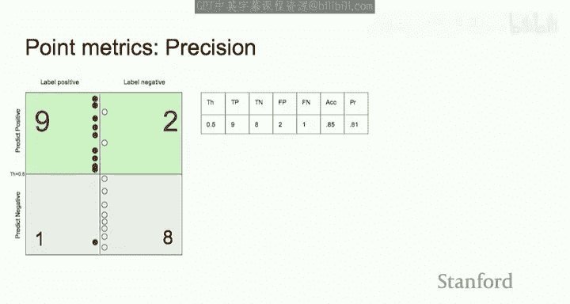

# 斯坦福大学《机器学习｜Stanford CS229 Machine Learning Course  Summer 2019 (Anand Avati)》 - P21：-21-.Lecture 21 - Evaluation Metrics.zh_en - GPT中英字幕课程资源 - BV1NDopY4ECg

Welcome everyone， so today this is lecture 21 of CS 229 and the topic for today was evaluation metrics and also some general advice on applying machine learning in practice in deployment or in production。

So we gonna to。Look at a few evaluation metrics。 And next。

 once we are through with this presentation， well you know， quickly go through some。

 some some ways in which these evaluation metrics can actually be useful in production。So。

 let's get started。So this is the quick overview of what we're going be covering in this presentation。

 You know， first， you know why evaluation metrics then we'll focus on binary classifiers that will be that will be the the。

A problem setting that we spend most time on different kinds of metrics and know some general tips on how to choose evaluation metrics and what to do when you know in certain scenarios when there' is class imbalance and how certain metrics kind of break down in different settings。

So first of all， why are evaluation metrics important？In what we've seen in， in all the。

Algothms in in this class， we define some kind of a loss function and minimize the loss function。

With respect to you know the parameters to minimize the loss on the training data。However。

 these loss functions， it's not always clear whether these loss functions are meaningful in terms of the real world use right for example。

 the loss function may not may or may not capture some kind of a business goal you have right so you know if if your business goal is to improve your revenue or your profit like your loss function may or may not always reflect that。

So it's always important， know that's why evaluation metrics。

 which are like this this secondary measure that you have on your model performance become extremely important。

😊，It also evaluation metrics also helps organize your team effort towards some kind of a business target。

 right So usually it's it's common practice to define some kind of a dev set and the team which is working on improving the model performance strive to improve the evaluation metric on that dev set right you know。

You want to you want to start thinking about the evaluation metric as something distinct from the loss itself。

And it's also useful to kind of quantify the gap between the desired performance and the baseline right so its easy for say a product manager to define what the evaluation metric should evaluate to on your dev set but it is hard for someone to say what the loss value should be on a dev set right so so evaluation metrics are useful to you know measure how well your model is doing in terms of your desired performance level right so it's useful to quantify that gap。

And it also。You know， you can use it to to see the gap between the desired performance and the baseline。

 baseline is generally the first attempt that you come up with some kind of a simple model that gives you a sense of difficulty of the overall project that you're starting with if the gap between the desired performance and the baseline is a lot than you know probably it it's a challenging task and similarly you can also measure the gap between the desired performance and the current performance which kind of gives you a sense of how much more progress is left to be made and it's also useful to kind of。

Keep keep track of how our performance is improving over time you know when we started off we were at you know 60% accuracy。

 three months in we are at 75% accuracy， our ideal you know target is you know 85% accuracy so that you know it gives you a sense of how much progress you've made towards the end goal。

It's also useful for lower level tasks such as debugging。 right。

 you want to do some bias variance analysis on your model to improve your model performance。

 and evaluation metrics are useful there as well。😊，So ideally， your training objective。

 your loss function should reflect your business goal， but that's not always possible。 For example。

 if you care about accuracy， it's very hard to train a model by using accuracy as the loss function So accuracy is is not even differentiable it ends up being a very hard combinatorial problem and it's using accuracy as your loss value as your loss function know generally just does not work。

 You can't get gradient out of them etc。 So ideally we would want your metric to itself be the loss function。

 but that that's not always feasible。 So you know that kind of makes it necessary to to do this measuring this evaluation metric in parallel as we are developing the model beyond just the loss function。

So we are going to limit for most of this presentation we are going stick to binary classification in a supervised setting so think of X as an input X could be an image it could be an email why is a binary output you know if it is an image you know you want to tell whether is whether there is a pedestrian in that picture or not if you you know in the context of say a self- drivingriv car it could be whether a given text to spam or not。

So why is is think of why is binary。 The model output is y hat。

And this y hat can be of different types for certain kinds of algorithms for example。

 we did not cover these in the course itself， but you know algorithms like k nearest a snaer or decision trees the output of the algorithm is directly the class prediction itself The output is the class directly and there are other kinds of algorithms whose output is some kind of a real valued score like you know support vector machines or logistic regression in logistic regression the output was the probability of y being one right it's a real value It is not the class directly。

And with support vector machines， you would output the margin right how far from the margin separating Hyplane is the example that we are looking at。

 either it to the left of the margin or to the right of the margin。So those are。

 those are real value。And in these these score based algorithms where we output some kind of real values。

 it becomes necessary to choose some kind of a threshold and once you pick that threshold you can convert your model into a classifier。

And this is these core based models are the one we'll be looking at in this presentation。

so think of this is kind of the mental picture you want to have so the line here from0 to 1 think of it as probability the range of probabilities that can be output by the model right zero indicates the predicted probability is 0 and one indicates predicted probability is1。

So the green dots represent positive examples。And the position of the dot is the probability assigned by the model for that example。

 right， So the green dots are are the positive examples。 Gr dots are the negative examples and。

We this this by placing them on a line like this， we are kind of defining a natural order on the predictions。

And it's。It's，'s always good to first have a look at， you know。

Have a look at this kind of rank order of your of your examples in your dev set before you start debugging your model right this gives you you know a good sense of you know what what your model is kind of doing in a big picture。

A few more you know some metrics that are some terminology that are useful so prevalence is a term that refers to the fraction of examples that are positives right so that thats a standard terminology so if you are in a situation where you have an equal number of positive and negative examples in your data then the prevalence is 50% if you have say 10 positive examples and 90 negative examples and your prevalence is 10% 10 over 10 plus 90。

All right。这告。Good question。 So prevalence， the question is prevalence a property of the data。

 or is it a property of the of the model， prevalenceence is totally a property of the data that you have。

 You know， your， your。Yeah， it it's just a fraction of positives that you So here a good。

 good good point is that here when we are counting positives and negatives。

 we are counting the truth ground truths， not the predicted probabilities。😊。

And any questions on this。And it's this this prevalence term that that allows us to kind of decide whether we have something like a class imbalance problem。

 So a class imbalance problem is when you know one of the classes is either too many or too little compared relative to the other class if if out of00 examples in your data set if two are positive and 98 are negative。

 then you know you'd generally call it a class imbalance problem。 there's no well。

Well agreed upon threshold to decide whether you have a class imbalance problem or not。

 but as a thumb rule， if if you know one of the classes。

 if the prevalence is you know less than 5% or 10% or more than 90% or 95% then you know it's reasonable to think of think of the problem is having low prevalence and sometimes。

 for example， if you're in you're in the problem of say detecting you know credit card fraud right the volume of non- fraud transactions is is you know is probably so high that you know in those kind of problems。

 prevalence would be really， really small like you know much smaller than 1%。

So we started with you know the score based view I'm going to go back to the slide to compare again so we started with this line where you know we've placed all the examples based on by ranking them based on the predicted probability of the model right so the green and white are property of the data their positions is the property of the model the model assigned probabilities for each example and that's how we started it and this by itself is not a classifier but once we decide a threshold。

Right， once we have a threshold， let's say we said the threshold equals 05。 Now we have a classifier。

Every every example that's above the threshold line is classified as positive。

 whether it was positive or not every every example below the threshold is classified as negative right so the the vertical axis is is is our prediction Anything above the the the 0。

5 threshold is predicted to be positive anything below is predicted to be negative and the true label is on this。

😊，You know we we kind of separate them horizontally。

 So to the left is those examples that truly are positive and to the right are examples that truly are negative。

And here we've chosen a threshold to be know abitarily 0。5。And only once we choose a threshold。

Does a score based model become a classifier until we decide a threshold it' is not a classifier right it is just assigning scores or probabilities after we choose a threshold we get a classifier。

So what did we do here？We just summed up the number of examples in each block right so on the top left is the examples that were actually positive and we also predicted positive and similarly on the right top we have examples that were predicted positive but were actually negative。

And this kind of a matrix is called a confusion matrix。 that' is just a standard terminology。

So a few properties of。Of， of， of the confusion matrix。

 The first is that the total sum of all the all the four squares is fixed。

Because the number of examples we have is fixed also the column sums are also fixed right the sum 9 plus one and  two plus 8 in this case will always be fixed because they they are you know。

 the number of positive examples we have and number of negative examples we have what can change in confusion matrix is the based on what threshold we choose and the way in which the examples have been have been。

😊，Ordered by our model， the the fraction of the left column that goes up and below and fraction of the right column that gets split up and below that can change。

😊，So the total sum is fixed， the column sums are also fixed。

And basically by looking at a Conci matrix， you kind of judge the quality of your model。😊。

Depending on how heavy the diagonals are and how light the off diagonals are right so you want the diagonals to be heavy。

 which means you want the the examples that were positive to be predicted positive and that were negative to be predicted negative and you want the errors you know know。

Examples that were positive were predicted negative to below low and， you know， similarly。

 that were negative and predicted positive to below low。

So another observation to make here is that a confusion matrix does not give you a scalar value like it's a set of four numbers right given two different confusion matrices for the same model in the same data set it is hard to it is hard to compare them and say which confusion matrix is better right they are not scaleal or they are like sets of four numbers can you can't compare them are unabbiguously。

And。And so we start extracting comparable metrics out of this。

 So the top left that the the the number in the in the top left quadrant is called true positives。

 So they are true positives。😊，Is a confusing term， so you might want to you know it true positive sounds like what is the ground truth。

 but unfortunately the term true positive refers to examples that were actually positive and were also predicted to be positive。

Right。So in this case， true positive is9。Right and so on the right hand side。

 we are going to start extracting these metrics or statistics out of this confusion matrix。Next。

 true negatives， you know， again， true negatives is the number of examples that were actually negative。

 but also predicted to be negative here， trueness refers to， you know， you know。

 that our prediction was true。 That's that's what it basically means So true positive means it was predicted positive and we got it right。

 true negative means it was actually negative and we got it right。So。

 so trueness kind of lies on the diagonal。 We want the true positives and true negatives to be high。

 so。False positive is examples。That were predicted to be positive， but our prediction was wrong。

 a false prediction。 So false positives are examples that were actually negative。

 but we predicted them as positive。嗯。And similarly false negative are examples that were actually positive。

 but we predicted them as negative。And these two are false positives and false negatives are kind of you know。

Two very different kinds of errors and depending on the actual application that you are working on。

 false positives and false negatives may have very different kinds of impacts。

Its its very common that the the kind of weight that you want to assign to false positives and false negatives。

Will generally be asymmetric。So so we have you know basically extracted four metrics out of this confusion metrics so far and this false positive and false negative are they also have some other terminology for example they are also called type 1 and type 2 errors right so type 1 error is when is a false positive when you know。

😊，You don't have a certain condition， but you predict that you have that condition。

 You don't have you know the the the the y label is false。

But you predicted why to be true right Similarlyly。

 the type 2 error is is commonly called is another name for false negatives where the the true condition is is is true is。

Is one you know y equals 1， but you predict y equals zero This is you know I found this on Twitter on someone's Twitter page。

 but I could not find the source of source of the image to cite it， but you know it's a funny image。

So。So back back to the slide， the larger takeaway is that depending on the kind of errors you make。

 the kind of impact that false positives and false negatives have can be very， very different。😊。

RightSo if you were to for example， prescribe some kind of medication then you know false positives and false negatives can have different kinds of effects you depending on whether the so for example if you want to prescribe a medication based on whether a person has a disease or not and if that medication has no adverse side effects when given to an ordinary person then you are much more likely to worry about false false negatives because you don't want to lose out on people from getting that medication so you want all the people who have the patients who have the condition to be predicted so that you can give the medication。

嗯。Right so another metric is accuracy right so accuracy is basically what is the fraction of all the examples no matter what class they were that we predicted right that we got them right right so accuracy is generally you know kind of the trace of the matrix divided by you know the sum of all the elements。

😊，And if you want to optimize your model for accuracy。

 then it corresponds to actually using something that is called the 01 loss 01 loss refers to you know you have a loss of one if。

You got the answer correct and you get you get0 if you got a wrong right so optimizing for 01 loss。

 which is very hard to do in practice because it is not a differentiable loss is is thats accuracy。

Now， we that is。Another metric that is very important called precision right so accuracy and precision in our day to day language we might kind of use them interchangeably whether we are accurate or precise。

 but in a statistical setting or in a machine learning setting the two have very very different meanings right so accuracy is what fraction of all the examples that we got right whether they were whether they were they were a positives or negatives doesn't matter whether we predicted them right or not thats what accuracy measures。

😊，However， precision means among the examples that we predicted to be positive。

 what fraction of them were actually positive。😊，So in precision。

 we are kind of limited to the top half of the confusion matrix right。

 So the top half of the confusion matrix。Is characterizing all the examples that were predicted to be positive and now precision measures what fraction of the predicted examples were actually positive。

😊，RightAnd there's another name for precision。 It's also called PPV。 So PPV stands for。

Positive predicted value。

So precision is also called PPV。Positive。Cic go。Value。喂。Yes question。

れて。Ifも。Yeah， so the question is if you， if you worry a lot about false positives， you know。

 how do you kind of quantify that into into your loss function because your loss function is just a last function we'll touch upon that in in some of the future slides。

But that's a good question that that's the kind of question you should be thinking about because our loss function is is you know is you know is our loss function kind of asymmetrically treating false positive or false negatives if not should it how do we do it you know that's definitely a very good question so that's precision so precision is among the examples that we predicted to be positive you know what what fraction of them were actually positive and you know。

You can you can see that you know the precision is all these metrics that we've seen so far you know true positive true negative false positive false negative accuracy precision all these are all metrics that actually depend on the threshold that we choose right so these are all threshold sensitive metrics。

similarly， there is something called sensitivity， sensitivity is also called recall so precision。😊。

Recall is also called sensitivity。So in recall the what recall measures is。

If we were to use this classifier in deployment， what fraction of all the actual positives？

Are we going to recover？Right， so if， if， if。We， we， let's say there are， you know。

100 patients who are out there and。Some fraction of them say half of them have a certain condition We run all the patients through our model and our model is going to predict you know through or you know predict positive or negative for each example or each patient and finally if we if if we。

Look at all the patients who actually had the condition。 What fraction of those patients。

 It our model predict as as positive。 And this is called sensitivity。

 So this the the the term sensitivity kind of comes from。

 I think it comes from epidemiology where you know。

 how sensitive is this test for detecting a certain condition。 right that's。

 that's exactly what this is measuring。 So in this case。

 say there were a total of 10 positive positive examples。 I'm counting the。😊。

The examples on the left half of the confusion matrix and sensitivity is measuring you know the top number 9 divided by 9 plus 1 like you know so the sensitivity here is 90% because we were able to correctly or we were able to recover nine out of the 10 positive positive examples。

So one thing to to note here is that sensitivity is kind of staying agnostic to everything on the right right So we are only focused on。

What fraction of patients were or what fraction of examples that were actually positive so we are conditioning on just the positive examples and checking you know what fraction of them we were able to recover right is this is completely agnostic to what happened to the examples that were that had a ground truth of negative we are just ignoring that half of our data set completely。

So。で。The， the。1，1， one way to another way to think of this is if you want to have。Perfect recall。

If you want to have 100% recall。Then。No matter how good or bad your model is just choose a threshold of zero right if if you choose a threshold of zero no matter how good or bad your model is you will get 100 percent recall and similarly if you want to in in the previous example over here this was about precision if you want to have a model that is 100 percent precise。

Right，Then all that you want to do is choose the threshold such that。

Choose the threshold such that the threshold。Just classify the top one example to be positive。

And you will get100 percent recall。So viewing these metrics in isolation general does not kind of capture the true performance of a model。

So so so to so what will we will see shortly that most of the times we are trying to balance off。

 you know precision and recall in some way because we don't want we don't want our metric to be you know blindly placed all the way at the bottom to maximize our recall Similarlyly。

 we don't want our threshold to be blindly placed all the way at the top to just get good precision numbers Yes question。

Does me。So the so the question is， you know why are we looking at the top half we are interested in the left half Yeah。

 so the left half of this matrix are you know the the examples that have a ground truth to be positive。

But our model when it' is making a prediction， it does not know you know what what what the ground truth is and it' is going to assign some kind of a probability and depending on what threshold we choose so in this case threshold was 0。

5 you know we classify everything that the model classified you know as above above 0。

5 to be we predict them to be positive we don't know what the ground truth is yes we are interested in the left half but the only way we can classify them is as you know top half and bottom half。

Good question。So that's recall。Similarly there is something called negative recall so negative recall is basically doing the same same exercise as a recall but we do it on the right hand side of the confusion matrix which means so negative recall is calculating of all the examples that had a true or the actual label to be negative。

 what fraction of that subpopulation did the model actually class correctly classify as negative。😊。

And in negative recall just like positive recall we kind of stay agnostic to the left half of this picture right we don't care how correctly or incorrectly the model performed on the ground truth equals positive we just look at consider the examples on the right hand right hand side and see what fraction of the actual examples actual negative examples to the model correctly classify as negative。

And negative recall has another term specificity。😊，嗯。So negative recall this our specificity。

And you can start kind of combining these individual scores into you know in in certain ways。

 for example， there is something called the F score or the F1 F1 score。

 So F1 score is you can you can so F1 score is basically the。F1 score is the harmonic mean of。

 of precision and recall。 So one over F1 is。1 over precision plus one over recall。

So you can combine your position and recall into a single number called the F1 score。Similarly。

 there is something called just like the f score that is something called the G score。

 which is the geometric mean of precision and recall。So， the G score。You have art。

So a the geometric means so it is in a log G equals。Lock precision does。Log recall。 So it's。

 it's our G is。Square root of precision。Times， recall。

And F score F score is therefore precision times recall over precision。Plusリ。Oh， sorry。No， X square。

 obviously， sorry。So G so G is So ignore this G is actually， so this is the correct。

It is the geometric mean。 So I guess I missed a half over there。Yes question。他就没钱。搁钱那个。Yeah。

 so you know， what， what do these F scores and G scores kind of represent？ So as we saw before。

Just looking at precision or just looking at recall is is insufficient because you can just fool the model by having 100 percent recall by setting the threshold all the way to zero right But if you were to do that you will take a hit on precision。

😊，RightAnd similarly， if you， if you， if you maximize your precision to 100 percent by setting a threshold all the way at the top so that you just classify that one correct example is positive and and just ignore everything else。

 your precision will be100%， but your recall will be really low because youve recovered only one out of all the positive examples that you have right So it is some way to kind of balance the two in some way。

 So you know these the geometric mean and harmonic mean are are you know kinds of means where if any one of them is low。

 then。😊，The entire mean is low， which is not the case with arithmetic means or arithmetic mean will just is is is pretty robust to stay high。

 but geometric mean will will just bring down your value to be really low if either one of them is is low So these are just two different you know two different ways of kind of combining the two the two metrics in some way。

Yeah， it's， it's another way to， to， to say， you know， what is the min of my precision and recall。

 right， That's what the geometric me is is kind of doing under the covers。 this question。

Aren't we just maximizing。He's once said need to come up with so many。So the question is， why。

 why not just focus on accuracy， Why are we doing all all these other things。 We'll come to that。

In some to3 degree。So， so， so， so， so the question is。

 does accuracy capture precision and recall in some way。Maybe， maybe not。 We'll see， we'll see more。

 more why accuracy is not always the right thing to to look for。

So in examples when in situations where your data is well balanced。

 you have an equal number of positives and negatives。

 then you know accuracy and person and recall will be more or less kind of similar。

 but if if you have class imbalance， let's say you know just 1% of all your examples are positive right and 99% of your examples are negative then if you have a model that just says no to everything it'll get 99% accurate。

RightSo in class imbalance situations， these precision and recall kind of metrics will be much more robust from getting fooled。

 whereas accuracy can be easily fooled in low prevalence scenarios。Yeah。So that's F score。And now。

 so everything that we've seen so far are specific to this。Chosen threshold。

Right so our model did the ranking and then we chose a threshold and out of this once we once we chose this threshold we got this confusion matrix and from the confusion matrix we extracted all these threshold specific metrics now what happens if we change the threshold from 0。

5 let us say we move it up to 0。6。If you were to choose a different threshold then you know some of these numbers changed so the the metrics that change are highlighted in red So Im going to go back one slide for you to compare again So this was with with threshold equals 0。

5。😊，With 06， we see that the true positive change， the true negative did not change。

 similar the false negative change， the accuracy changed。 The specificity did not change， you know。

 So some of them change。 some of them did not change。And now， now， you know。Similarly， we can。

 we can repeat this exercise by trying， you know。Trying as many different thresholds as possible。

 So first of all， how many effective thresholds are in this are there in this situation。 For example。

 you know， choosing the threshold。Here versus slightly below changes nothing right No example was was classification of no examples changed。

 So in in this kind of situation， the number of effective thresholds we have is one plus the number of examples。

So that gives us all the possible different thresholds that are somewhat meaningful。😊。

And so what we can do is， basically。Repeat this exercise of not just checking at you 0。5 or 。6。

 but check it with all possible thresholds。So this is the same ranking。The ranking has not changed。

Ranking is a property of the model， but a threshold is something that we choose to apply after the fact。

Right， and for each。Particular value of the threshold。

Corresponds to each row in the stable on the right side。And as as we change the threshold。

 we get different values of true positive to negative accuracy person recall and so on。😊，now。

 as I said， each row corresponds to each effective threshold。

And the table itself is a property of our model， so if our model was were if if we were to take a different model and you know take the predictions from the other model。

 the ranking would probably be very different。😊，And and so this this entire table is kind of specific to the model that made the predictions。

 but each row within the table depends on what threshold that we chose。😊。

And you can make a few more observations in in in the stable。 So first of all。

 many of these columns are monoonics。 So for example。

 true positives starts at 0 and monotonically increases to 10 through negative you know similarly monotonically decreases。

😊，Similarly， false positive monotonically increases， false negative monotonically decreases。Re call。

Monettonically increases， starts at 0 and ends at one。And specificity oneatically decreases。

 starts at1 and ends at 0。😊，However， there are。😊，These other metrics， for example。

 f1 score right is is there is no strict ordering it kind of reaches a maximum somewhere at around threshold of 0。

4 or something similarly accuracy accuracy also kind of reaches a maximum at 0。

45 and it reduces as we go to the extremes。😊，Right， so some of them have this， this kind of。

Motononic relation where， you know， we we increase in one direction or decrease in the other direction。

And。Precision is kind of interesting because in in precision， we kind of keep going up and down。

 right， So precision， we start at one， come down to 06， go up to 075。8。83 and then come down to 071。

 So it's kind of。It's kind of， you know， going up and down。And。So what we want to do is。

Try to capture the trade off between these columns in some way so as we saw before if you want to just maximize recall just just set your threshold to 0 if you want to maximize your precision maybe just set it at one or just below one but instead what we want to do is not just look at how the model performs at some specified threshold but summarize these entire columns in some way。

And so that's that's the question。 how do we summarize the trade off between say precision and recall are specificity and sensitivity and that's where things like the RC curves come into picture right in the RC curve。

 It's called the receiver operator characteristic curve。

 It is a trade off between specificity and sensitivity So sometimes you may see the RC curve to be flipped in some books know or some some articles you'll see it flipped where on the on the x axis。

 you have one minus sensitivity it's basically the same。😊。

And so the R seek curve is this is the plot that you get by scanning the threshold。😊。

So I'm going to go back one slide。So two slices rather， So as we scan the threshold。From 0 to one。

And for each threshold， we read off the sensitivity and specificity。😊。

And plot that point on a graph of sensitivity versus specificity and as we plot the different points by that we get by scanning different thresholds。

 you know connect those points as well and you get this R seeker。So the R O C curve is。

 is giving you the trade off between sensitivity and specificity as we scan the threshold。 So。

 for example， when the threshold is is is。😊，Set at 1。0。 So， you know。

 you set the threshold all the way at the top。 Your recall will be 0。 right your sensitivity will be。

You're sensitive。 You're specific。When you when you set your threshold all the way at the top at one that corresponds to the top left top left corner。

 your sensitivity will be 0 but specificity will be you know will be maximum and as you keep bring as you keep scanning your threshold down towards0。

 you start exploring these all these other points。So one way to think of the the R O C curve is。

So another way to to to think of it is。なです。So， create a grid。😊，Right， create a grid where you have。

You chop up the horizontal axis。Into equal sized ranges。

Into as many number of examples you have So if you have， say 1，2，3，4，5，6，7，8，9，10，11，12。

 So let's say you have 12 positive examples。And chop up the vertical axis into the number of negative examples that you have。

 so 1，2，3，4，5，6，7，8，9，10，11，12，13， so 13 negative examples。A。And now your model gives you you know。

 some kind of an ordering。😊，Right，So your ordering looks something like this， right。Positive。

Positive， negative。Positive， positive and so on。 So it' is going to give you some some kind of an ordering。

Now， one way to think of this RC curve is。Start from the top left。And inspect one example at a time。

Right， if you encounter。Positive examples。Move， right。If you encounter a negative example， move down。

So first is a positive we move right another is a positive we move right next we got an a negative example we move down then we got a positive move right positive move right etcter and because we have we can only make you know 12 number of you know exactly 12 number of right moves and 13 number of down moves no matter what order you are you always start here and you always end here。

RightAnd if all your positive examples are at the top， then your curve will。😊，Will look like this。

 so it will it will tend towards the top right corner if most of the positive examples are at the top。

And so this intuition gives rise to this derived metric from an ROC curve called the area under the ROC curve so the area under the ROC curve is basically this area。

😊，And this area under the RC curve will be high if most of the positive examples or if all of the positive examples are the ones you encounter first as you start scanning down because you know positive examples will just keep you moving to the right。

😊，And another observation you can can you can make is that ROC curves always have this you know。

 can always be broken down into these horizontal line vertical。😊，Segments or chunks。 and each。

Each chunk corresponds to know one segment of consecutively occurring positive group or a negative group right so you keep moving to the right so you get you get one long horizontal chunk if you have if you encounter lots of positive examples and then once you once you switch over to you know some negative examples you kind of get a kink here and you start moving down and so on So this is this is the ROC curve。

And the area under the ROC curve is generally a useful metric to to check how well our modelist is kind of classifying if it does a good job of placing all the positives up and negatives down。

 then the area under the ROC curve will be high。😊，Any questions on this？So a few。

 a few more observations on R C curves。So。If you have a model that randomly assigns probabilities。

To your examples， then the RC curve will fall along this staagonally。So if you。

 let's say you you have a model， you get an example。

And your your your model instead of you know predicting some kind of a probability it just samples a probability between 0 and 1 and the uniform distribution0 and1 and outputs that probability then the RC curve will will exactly coincide with this diagonal line。

Of course， you know， this diagonal line looks smooth。 you know。

 it assumes you have lots and lots of examples。 otherwise it' is going to be you know a diagonal line that you know looks like this。

So your your random guesser will have an RC of 0。5。Right， so。

So that's like a low bar for what you should be aiming for with R O C。

If your if your model has an ROC less than 0。5， then your model is basically doing worse than random guessing。

 right that' is bad。However， you know， there is， there is。If it is if it is doing like really low。

 like if your model has an RC of 01。😊，That is somewhat good news because you can just flip the labels and you can get a really high RRC。

😊，So。St staying at 0。5 your RRC is 0。5 that is bad you want it to be as high as possible。

 but if it is really low you can always just flip the labels and you know it will perform perform pretty well。

😊，But of course that is still disturbing you should you know definitely investigate why it is predicting low maybe there is a bug somewhere but you know yeah so so 0。

5 is is is it should be the low bar when you are looking at ROC values so if you see if you see you know read some paper and say the ROC was you know 0。

65 you know you should not think of the model could have scored 0 to 1 and achieved 0。

65 you should think of you know between you know c。65 as the ratio starting from 0。

5 to 1 not from starting from 0 to 1。So something with an RC of 0。

6 is quite close to random guessing。There is another interpretation of the R the area under the R C curve。

 So the other interpretation of the area under the R C curve is。Supposing。You choose。

A random example， a random positive example。And then separately。

 you choose a random negative example。😊，Now， what is the probability that this in this random pair of positive and negative examples。

 the positive examples will be ranked higher than the negative example。That probability。

Is exactly equal to the area under the RC curve。So that that is another way to think of the R circle what is the probability that a random positive example is ranked higher than a random negative example。

😊，Rannk means in this， you know pick one random positive example， say it was you know this green dot。

Pick another random negative example say it was this gray art。

Those those random positive and negative examples get some kind of a score from the model were those scores ordered in the correct way。

That that's what RC measures。Any questions？So， another thing to note is that the RC curve。

Is agnostic to the prevalence of your data。Right， so。What that means is if instead of 13 examples。

 you had 130 examples。All that means is the granularity of each of the vertical drop would be smaller。

😊，But roughly speaking， you will still get a similar area under the curve。

RightIt it it would just be a little more fine grain。

 but the area under the curve will be pretty much the same。

 So the A U ROC is agnostic to the prevalence of of the data。

Thats thats thats something to you know keep in mind when you are evaluating models because that's both the strength and the weakness of the R ROC curve that the ROC curve。

If you measured your if the ROC curve that is reported to you was measured on a data set that had equal prevalence。

 but let's say in the real world the true prevalence is very different。Then。

You know that the R O the RO C performance on the real world will still be the same。

So that' is a good part of it， but the back part of it is probably the ROC curve is measuring the wrong thing right if it is if it is if what it reports is agnostic to the prevalence then maybe what ROC is measuring is not the right metric and we will see some of that。

😊，All right， so。That's R of the curve。So， there is this so the ROC curve was was the trade off between sensitivity and specificity the precision recall curve is you know is the trade off between precision and recall。

😊，it is plotted in the same in a similar way as the ROC curve right you start with a threshold at 01。

😊，Read off the precision and the recall values you know you get you get a point and then you know scan down the threshold a little bit read the new precision and recall values that is the next point you know connected by a line next bring down the threshold some more you get a new precision recall value plot it and connect by a line and finally you get a full curve that looks like this right and this called the precision recall curve。

A few things to note here again， the the ROC curve was kind of monotonic in the sense it could never go back up。

would it would either go to the right or come down to the right or come down。

 it could never go back up whereas the precision recall curve can sometimes go back up。

And the reason for that is in what we are measuring is a trade off between precision and recall。

 so let us imagine what happens if we were to start over here， right。😊，Bring the threshold down。

 We got one example， and that one example was positive。 So the precision is100 percent。

But the recall was you know01。 so by by we come to this point basically where the precision is you know100 percent but the recall is 0。

1。 then let's say we bring the threshold down one more level。The precision is still at 100 percent。

 The recall has increased to you know 02 because we recovered two out of the 10 examples。

And then let's say we encountered a third example， a third that was negative right so the recall has not improved at all because we have still recovered only two out of the10 example。

 but a precision drops from two out of two to two out of three。So。

 the drops are always vertical because we come down in precision。😊。

ButWhen we encounter a new example。The precision will come down。

 but the recall will stay the same because the number of positive examples that we have recovered is does not does not change if we encounter a new negative example。

 so the precision recall curve has these vertical drops that correspond to encountering negative examples in our scan。

But once we are here， let lets say we start encountering positive examples again。😊。

Then then what we see is so we go from two out of3 to3 out of4 to4 out of 5 so this is like a gradual increase as we encounter more positive examples so the precision recall curve will will have these you know pretty a pretty standard pattern of having vertical drops and slow climbs vertical drops and slow climbs whereas the ROC curve will have horizontal vertical horizontal vertical movements。

And just like the ROC curve， you can also measure the area under the precision recall curve。

And one one kind of another observation that you can make is that why the ROC curve always started at the top left corner and ended at the bottom right corner。

😊，The precision recall curve when it reaches 100 percent recall you when you take the threshold all the way to 0 your precision。

When you you effectively you know predicted everything to be positive。

 your precision will be exactly equal to your prevalence。😊。

So the precision recall curve will terminate at at the at the right hand side at the level equal to the prevalence so in this case prevalence was you know 0。

5 which or yeah somewhere somewhere there so it ends here at prevalence equals 0。5。

That also means that you know， there is this the precision recall curve。😊，You know。

 might look something like like this。So， this is always the prevalence level where the person recall curve will end。

It also means that there is this。Kind of area。In a precision we call curve。

A certain area in the curve where the precision recall curve just cannot enter。Right。

No matter how horribly your model ranks your examples。In the worst case， let's say your model。

Places all the negatives at the top。And all the positives at the bottom。

 like the worst possible situation。Right。In the worst possible situation。

We are going to keep encountering negatives that is going to know kill our precision。With0 or equal。

And we are going to start off。Climbing the R， the precision recall curve starting from the first positive example。

And we are going to basically start at you know， once the threshold comes here。

 you are going to start at one over the sum of you know all the negative examples。Plus one。From that。

 we're going move on to two over some of all the negative examples。Plus 2 and so on。

 until we reach number of。Positive over number of。Negative plus number of。Positive。

 and it's going to be the slow climb until the prevalence level。 So no matter how bad your model is。

You know， you you kind of get this amount of area for free。In the area under the pre Cal Club。

So there is there is there are variants of the area under the precision curve that account for this that kind of you know discounts this area and only measures you know。

 kind of。The area that yourmar has truly earned and regarding disregarding the part you get for free。

And that's something you might be。 You might be kind of。

That's something worth knowing right If your prevalence is very high。

 then your area under of precision recall curve might look very good just because you get a lot of。

Area， just for free。All right， moving on。Sos let's look at these two these two models。

so we it let let's suppose there is some data set and we have two models model A and model B right and the models models A and B make predictions are assigned probability values to every example and lets say we you know this is the plot so model a assigned you know some negative example this probability value and this probability value and。

You know， these are just the probability values that were assigned by model A and these are the probability values that were assigned by model P。

Now， by just looking at this。Is there a reason to prefer one model over the other。

 iss one of them better than the other or does one of them look better than the other。B looks better。

Anybody thinks A looks better。Why does B look better？So。

 so the the answer was B was confusing for a few points。

 but it did well on this region and it did well on this region。yeah。

 so yeah it might be reasonable to think B does does better and we should we should you know choose B now of all the metrics that we have looked so far which metric would rank B higher than a。

能。Any other guesses。Thats but that's the correct answer。

 None of them will rank B higher than a because the ranking of all the points were the same。Right。

 all the points over here。Though they were clustered together。😡。

if you just look at the ranking position of all the examples。

We encounter positives and negatives in the same order and all the metrics that we have seen so far only cared about the ranking。

For example， for the area under the precision recallcal curve， we were scanning the thresholds。😊。

But we were only you know making moves when we encountered the next positive or negative example right we we didn't care what the threshold value was。

 We just looked at the order in which the the positives and negatives were encountered right so all the all the metrics that we have seen so far are ranking based metrics。

And as we can see here， here are two situations which qualitatively look very different。😊。

But from the point of view of all the metrics we have seen so far， they are exactly the same。😊。

And that thats kind of a motivation for something that is called the log loss。😊，嗯。

The log loss is it it's， in fact， the the loss value that we used in logistic regression right So the log loss is think of the log loss as。

So， if you remember in logistic regression， if the true label was y and our prediction was y hat。😊。

Right， the last that we use。Was。Y log Y hat plus1 minus y。Log one minus y hat。this value itself。

Can be used as。A metric so it is basically just the the the log likelihood of our prediction that is also called the log loss。

so the log loss is is is kind of different from the two that we have seen so far is kind of different from the ones that we have seen seen so far in that。

😊，It it takes into account。The value of。Of the predicted probability itself。

 it is not just looking at the at the relative thresholds right So if we were to kind of sum over I equals one to n。

哦喂唉。ははい。Wifi。Why hadt I。So this this loss value takes into account the predicted value of the probability as well。

And。It basically rewards confident correct answers。

 which means it's not enough that you you know when when youre when youre。

When you predict a correct answer with a relatively high probability。

Then it rewards you to take that even higher。But at the same time。

 it very heavily penalizes you when you get it wrong and are very confident about it。😊。

So it' is kind of asymmetric in the way that it rewards you for having confident correct answers。

 but pretty much kills you if you make a confident wrong answer。😊。

And it is it is this this property that makes the model kind of choose the actual probability value more carefully。

😊，this objective。😊，Does not just。Does not just look at whether。

 you know the positives were higher and negatives were low。

 it also looks into how much you know what level of confidence did the model assign in each of these predictions right So another way to think of the log loss is you can think of a betting game right let's say。

You need to make a prediction of n examples， lets say there are n examples they can be positive or negative and you are going to be presented one example at a time and you need to make a prediction of you know true or false and the way you are asked to make this prediction is not just you know make a prediction but you are asked to make a bet。

RightYou need to make a bet of some dollar amount between0 and 1 in say you know25 cents or 99 cents or whatever you need to make a bet of what the correct answer is for a given example。

Now， if you make the bet。You， you， you win the the bet amount。 But if you lose the bet。

 you win 1 minus the better amount。Right， so which means now if。So let's say， you know。

 you have example I， X I， you need to make a bet of， you know。

 what is the you need to make a bet of what。Of of， of how confident you are about the， you know。

 prediction that you made。 Let's say you predict it to be you know， y equals one。 you know。

 you make some prediction。 and you you also place a bet。 We call it P。And for x x 2。

Let's say you predict y equals whatever0 and some bet amount P。NowLet's call this P1。P2。 Now， if you。

 if you win。You get P。If you lose， you get 1 minus P。Right。And then finally， you know。

 you go through all the examples and in the very end。😊，What you get is not the sum of them。😡。

But the product of them。So for one example maybe you got the correct answer and you earn this value and for another example maybe you got it wrong and you earn this value right and the final take home amount that you are going to that you are going to walk away with at the end of it is going to be the product of all these values。

Right， which means。If for any one of the examples， you predicted。You assigned a confidence of one。

Or 。99999， and you happen to be wrong。The entire product will be 0 or very close to 0。Right， so。

 so in this exercise。In fact， there are kind of studies that show that you know with this kind of an exercise。

You can extract the the true level of confidence that a person has in making a bet if you were to earn the sum of these things then you would be a lot more you would your your betting strategy would be very different but if you are going to walk away with the product of all these values。

Then you know that if you make one confident wrong prediction。

 you assign a probability of one and the answer was wrong。Then you get 0。

 and the product of 0 with anything else is 0。Right， and。So that's， that's basically how the yeah。

 question。そてさん。As prediction。So the question is， can we use this in when on models that make know class direct class predictions rather than scores of probabilities。

 No， so the log log loss is for probabilistic models only。This a model honest。Po。你问点。やかで。

Such a heavy loss。So the question is， you know， perhaps rightly， you' are identifying that， you know。

 wouldn't this encourage the models to be more conservative， you know。

 rather than making extreme values。 Yeah， the log loss can make your models more conservative， but。

The， the， the interesting thing out of this is that。This process， you know。

 this kind of a loss is a proper scoring rule。Which means。Which means the predicted probabilities。

 you know， from this kind of a loss will always result in you know calibrated probabilities。😊。

Like apply a what in the financial market。 Yeah， you would never want to。这个真的搬进去吗。

Whats the place you making。It one。It good results。まあ、全な。Yeah。

 so the question is would this be a good good metric or good loss to use say in a financial setting where you generally take the sum of you know rewards rather than yeah so there are there are you know。

😊，You know， if you're interested， you know， the the thing to look for are robust scoring rules。

And we are going to look at one in a few slides， so there are other kind of scoring rules which still give you you know calibrated probabilities。

 other scoring rules that give you calibrated probabilities but are much more risk tolerant than the log loss and you can use in those contexts。

So the log loss is this is this kind of a loss that not only evaluates the quality not only evaluates whether you you you know got the answer right or wrong。

 but also kind of elicits the true level of confidence。😊，Or the true kind of belief you have。

 probabilistic belief you have in making a certain prediction。😊。

So this is this is an example of a proper scoring rule。

 and we saw kind of proper scoring rules in the maximum lecture as well。😊，So that's our log loss。

Which brings us to this concept of calibration。So， calibration is when the predicted probabilities。😊。

Mach the real world occurrence or frequencies。 So in this case。

We have two models on the right over here。 So the blue line。

Corresponds to the calib is the calibration curve of you know a logistic regression model and the orange line corresponds to the calibration curve of a support vector classifier。

 support vector machine。Right。What the way to read this plot is on the x axis。

The x axis corresponds to predicted probabilities。And the y axis is the fraction of positives in the region around this predicteded probability。

😊，And the bottom plot over here is just a histogram of how were the different predicted probabilities。

 how were they distributed。😊，And you always want to look at a calibration plot and the histogram of predicted probabilities in conjunction all the time。

😊，Right， so。If the calibration curve。Goes close to the 45 degree line。

It means when the predicted probability was 08， for example。

 then the actual fraction of examples was also you know roughly 80%。

 similarly the of all the predictions。That had a prediction of 02。

 roughly 20% of them were the positives。However， the orange curve looks pretty different right so for the orange curve。

Even when it predicted you know， a 06。Probability， most of them were actually。You know。

 most of them were were actually， you know， positives。

This means that the orange curve you can think of it as being underconfident in some way and even though the examples were mostly positive it kind of hesitated to assigning high probabilities to them so even even in the region where you know the predictions are still 06 and 0。

7 all of them are actually you know positive examples。So a calibration curve that looks like this。

 So a perfectly calibrated curve would be like a straight line。😊，喂。

An under confident calibration curve will have this kind of an inverted S shape。哎。Similarly。

 an overcondent。A model will have a calibration curve that looks like this。He said this。

Would correspond to overcon。This is under confident。And if it's directly here。

 this is know well calibrated。嗯。So。The， the。Few take takeaways from this slide is that。It's。

 it's always， you know， important to kind of see these two plots in conjunction。

And the way you want to read them is first make sure that your model is well calibrated。😊。

If your model is not even calibrated， then the probabilities that it is predicting are not even valid probabilities。

😊，And then once you once you know that a model is well calibrated。

 then look at the histogram to see if you have these nice two peaks at the extremes。😊。

So that that' is like the perfect scenario where the calibration curve is exactly along the 45 degree lines and and the histogram has these two perfect know two peaks all the way at the left and another peak all the way at the right。

 so that that is the ideal scenario。😊，However。If your model is not well calibrated。

 right in this case， in the orange case， if the model is not well calibrated。

Then this histogram says nothing at all。It does not tell you whether the model is doing well or bad。

In this example， if you see， you know， both these models have you know for a chosen threshold of 0。

5 the logistic regression and support vector machine have you know 0。87 precision 0。85 recall 0。

86 f1 score， they are all exactly the same。😊，RightBut the calibration of the support victim machine is completely bonkers。

 you know it is not well calibrated at all。 and so the histogram does not reflect the quality of classification。

But if the model is well calibrated， then the histogram gives you a good sense of how well the model is separating them。

So， just like the log glass that we saw over here， there is this other score that you can use called the briar score。

 so the brriar score is。😊，Very similar to the mean squared error。So the brar score。

You can think of this as sum over I equals 1 to n of all your n examples。

P hat you know where this is the precate probability right So P hat I minus。喂fi。Square。

It is just the the mean of the square error between the label and the predicted probability。😊。

Next question。So it if if your model is overconfident then your histogram will generally look like the blue one because it it' is assigning like really high high probabilities so you know the probabilities are more at the extremes it is more confident but they are wrong which means theyve got the ordering strands so over here in the histogram you know the labels are not。

Visible here。 right So this means most of the probabilitybilities。

 most of the examples got this probability， but it does not tell you what fraction of them were correct or wrong。

 right， whereas the the calibration curve tells you what fraction of them were correct or wrong。

It could look similar to so yeah so the histogram could look similar to the well calibrated one it could not there is generally under confident undercondent models will have more probabilities assigned near 0。

5 so you you will see a bulge over here if they are undercon and you know confident ones will have more assignments at the extremes。

What you ideally want are confident models that are also calibrated。This question。Yes because in。这证。

It didn't tell。Yeah， so the question is。Why not just look at the calibration plot and just ignore the histogram completely and the answer for that is back in the calibration discussion we saw how you know calibration does not necessarily mean accuracy at all right so you can have a perfectly calibrated plot。

But most of your assigned probabilities might be you know， just 05。

And you have a few of them that are， you know， well calibrated on the other side。

 But for most of them， you're just predicting 0。5。 And that's that's kind of bad。 So ideally。

 you want a plot that is perfectly calibrated and also well separated and have these two peaks。

 So that's that's like a good sign。😊，So the bra score is basically the the mean squared error between the predicted probability right so this y is either 0 or 1。

😊，AndThis is between 0 and 1。So， we see that even though the usual ranking based metrics are exactly the same。

 the brriar score between them is quite different。😊，Right， and。

The briar score is also a proper scoring rule。So in the in the， in the example。

 one of you asked before about， you know， what if you are in in kind of a finance kind of a scenario where you want to。

Where want to， to。I know be more risky in some way for example。

 you know you can use you know the priorrier scoring rule in those cases you know the priorer scoring rule also is also a proper scoring rule which means it will value calibrated probabilities more but it is more risk tolerant It has other tradeoffs compared to。

The logla。Any questions？So so basically the takeaway is that you know always look at the calibration and the histogram in conjunction。

😊，Make sure first make sure that the model is well calibrated。Otherwise。

 your predictions are not even there are not even valid probabilities。 and once it is calibrated。

 look at， you know， look at look at how well separated they are。

 So the the the you may also see the terminologies like calibration versus。😊，Discrimination。So。

 discrimination generally refers to how well your model can separate positives and negatives in a ranking sense and calibration tells you how meaningful are the assigned probability values。

And you you generally want your model to be well calibrated and have high high discrimination。😊，All。

 moving on。Right so the log probability or the log loss can also be used in unsupervised learning so supposing you have a Gaussian mixture model or factor analysis right you can use log p of x to measure whether your model has underfi or or overfi log p of x by itself the raw value is hard to interpret you know its hard to just look at the log likelihood and tell whether the model is good or bad but you can always measure the log likelihood or log p of x on your training set and on your test set and measure the difference between them。

If if the gap between them is very large， if you have a high log likelihood on your training set but low likelihood on your test set。

 then your unsupposedvised learning model has overfi on your training data。So you want to。

Underfitting overfitting， even though it is commonly used in the supervised learning setting to measure accuracy or whatever is not limited to supervised learning alone right underfitting overfitting concepts apply just as well to unsupervised settings as well。

This question。Between so the question is。For like your trainrs。Oh so， so。So what you wantan to so。

The way you want to So the question is， you have a particular training value and you have a particular test value。

 How do you kind of find a balance between them。 The。

 the answer is very similar to how you would do in in a supervis setting。 Let's say you have。

 you know。85% accuracy on your training set。In the supervisized classification。

 let's say you have 23% on your test set。Right so what do you do you go and you know address bias or address variants to bring the gap closer together Similarlyly。

 you know you fit a Gaussian mixture model that gives you a log likelihood on your training data to be you know generally they are like you know。

You know， like2000。This like a reasonable value for you know a log likelihood of a Gaussian mixture model。

 let's say you get minus2000 on your training set and on your test set you get minus- 18，000。Right。

 then， then you， you know。It probably means。You have assigned too many number of clusters。

 You want to reduce your K value， for example， and kind of bring the two together or something something along those sides。

So yeah， so Lo P ofx can be used as an evaluation metric to measure the gap between your training likelihood and the test likelihood to see if your unsupervised model has overfi or not。

😊，However， you know， k means is a little tricky。 you know Ka means does not have a good probabilistic interpretation。

 and it also uses you know fixed covariances。 So with k means means its its。

A little harder to measure whether it is underfi or overfi。

 so however the Gausian mixture models are probabilistic models in general it works pretty well。Yes。

 question。んすかて。たさん？Yeah so so you know can we take the mean squared between you know the centroids and the examples so which is basically the distortion function and measure the distortion function on the test set you could do that but that does not always work well so even the distortion function can can so for example lets say you know you have。

Some。Some clusters like this。 And let's say you assign。Let let's say you， you， you assign6。

Cluster cents。 So you get one。 Let me use a different color。So you get this centide， the centroid。

 centroid， centroid， centroid， centroid。And I mean， looking at this qualitatively。

 you can tell you kind of overfi there are actually just three clusters， but you assigned6。😊，However。

 if you were to measure the distortion function， if you were to hold a fraction of them as a holdout set and measure the measure the distortion function on the test set。

 they will look kind of pretty similar。😊，So the distortion function， you know。

 because it does not have this flexible covariance per cluster， right it is。

It's's hard to use the distortion function as as as a way to check whether you underfi or overfi。

That is not a good。Make thatで。Yeah， so you， it's， it's。

Of the K means it's usually you end up doing some kind of a visualization and it's more you know like do some spot checks to see if know a few examples that were in the same cluster are meaningful or not or you know if similar examples ended up in different clusters you know is there is it's not as cleanly defined as the log likelihood that you get from Gaussian mixture models。

Next question。Like this。That他的。Yeah， you。 yeah。 So， So So the comment there was， you can。

 you can have this， you know， distortion。Versus K， and。

You know eventually it's gonna the distort is gonna flatten out and you know maybe you know just look at it and choose some value right However。

 this requires as I said， you know， this is like a heuristic you to look at it and decide you can't compare one scalar value with another scalar value one on a test set and one on a training set and declare that you overfi right so yeah so measuring underfitting and overfitting is is is not as clean with K means as it is with Gaussian mixture models。

Yeah， but this is a commonly used approach。Right， going on to class imbalance problems。 So generally。

 if you have。Examples where one class is， is a much smaller fraction than the other。 or， you know。

 if one class kind of dominates the other class， then you know， you kind of call it。

You say that you are in a class imbalance scenario。

And a lot of the metrics that weve kind of seen today can end up breaking down under class and balance scenarios right so。

So for example accuracy right so if you if you are in a class imbalance scenario and let's say you have just 1% of all your examples to be positive and you just you have this blind classifier that predicts no all the time it gets 99% accuracy right so having a high accuracy does not mean much in a class imbalance scenario。

Similarly， the log loss right and the log loss the majority class can easily dominate the assigned probabilities。

 So if you have。If， if， if you。Log loss can be easily。So imagine logistic regression where。

You have some number of positive examples over here。And you have just。One negative example over here。

Logistic regression。We will place the separating hyperplane that is the line at which the the y hat is 05 probably somewhere over here。

Right， and， and。So， so the， the majority class can easily dominate the log loss and make the。

Make the separating hyperplane be placed at some kind of anreasonable unreasonable location right so the log loss is also vulnerable to class imbalance。

A U R O C。 So imagine， let's see how the A U R O C can break down。

So let's say you have examples that are ranked like this。So suppose you are， you are。

Suppose you are in in a fraud detection scenario， credit card fraud detection。

 right you want to build a classifier given a credit card transaction classified classified as fraudulent or not。

In this scenario， lets say you decide to use A U R or C as your metric。Right， A U R O C， And。

 and let's say the， the。So typically in these kind of scenarios where the prevalence is very low。

 most of the times you are in this kind of a retrieval scenario or information retrieval kind of a scenario where you want to you know in this given this pool of all credit card transactions you just want to surface the fraudulent ones to the top。

😊，And， you know， act on them somehow。 right So in， in this kind of a scenario， let's say。

You have a model that let's say you have you know 10，000 transactions。And in this 10。

000 transactions， lets say 10 of them are fraudulent。And， let's say。1，2，3，4。5，6，7，8，9，10。

 So the first 10 were all。Good transactions。 And the next 10 were all fraudulent。

assume there are 10 here and then you have all the good examples。So this is the first spin。Next 10。

And the remaining 998。let's say your， your model ranks them in this way。From you know。

 from the user of this model， this is a useless model because you want to act on the top most likely fraudulent the top 10 most likely transactions to be fraudulent。

 but all of them over here were valid ones。And then comes the fraudulence know after know you have an equal number of you know good transactions and then you have the rest。

RightNow， what's gonna be the A U C of this model。Right， let's， let's do a quick sanity check， so。

So we have 10 positives， so choplist to 10。ten towers。

 the sensitivity side and the specificity side chop it into 9990。Right。You have 999。Pieces here。

 So the first 10 were all negatives， which means。You know， for the first 10， you get a steep drop。

And then we have 10 all the 10 positive examples， So you know1，2，3，4，5，6，7，8。

910 and then you get a negative and this will give you an area under the curve of you know 0。999。

However to 0。99。Maybe I missed。99 or 。9。 Anyway， it doesn't matter。 It gives you really high AU。

 even though， you know， from， from the usefulness of this model。

 you got only good transactions flagged as as fraudulent at the top。Right。

 so in class imbalance scenarios， A U can also be pretty bad。 You know， accuracy is the worst。

 You know， you probably never should use accuracy when you have class imbalance， but A U can also be。

Can also be fooled。And so A U PRRC is somewhat more robust in precision in in these kind of scenarios。

 when you are interested in， you know。The quality at the top where your focus is on the top of what you do because you know you are generally not going to act on the rest at all。

 you are just going to do something with you know the top predicted examples。

In in those kind of scenarios， you probably want to use A U PRRC rather than A U ROC。

So so the summary is that in class imbal scenarios。

 your least preference should be accuracy as the choice of metric。AU RRC might be better。

 might not be better because AU RRC can also be full AU PRRC is generally more robust but with AU PRRC there are you know other challenges that come with it for example。

 you know if your AU PRRC curve you know looks jagged like this this is pretty sensitive to you know。

The ordering over here， if your ordering is different， it might look very different。

So the A U R O C can sometimes be pretty sensitive to small changes。 this question。

Im good enough so like。Use the number of positive and then。

Like somehow generate more of similar kind of negatives。Yeah， so the so the question is， you know。

 can you， can you kind of adjust the class balance by up sampling or downs the classes to fit your model you can you can do such things So that's that's actually a very good point if you。

In order to make your model perform better， you can do all kinds of things like adjusting the class balance。

 up sampling the you know the minority class， downsling the majority class and so on， however。

 when you are measuring the quality of your model on a test set or a validation set。

The prevalence in the test set or the validation set should match the true prevalence。

 right do the adjustment of sampling down sampling only on the training set and not on the on the test set。

It could help its you know the question of whether you know up samplingling and downsling will help or not the answer is always cross validated and check right have have a validation set which you know which which is kind of you know pure in the sense it has the same prevalence ratios and so on。

 do whatever you want with the training set， ups sample it down samplingling whatever。

 but then measure it on this you know pure validation set。

 which has the right or the true prevalence ratio and see if it helped。Yeah。

 generally AUPRC is is that there are a few more metrics， I think in the next slide。😊。

Just in the next slide， so probably the slide after we look at them。

Right so you can extend all of these to the a multi class classification setting as well。

 So the confusion matrix in a multi class will be you know。😊，K by K or n by n。

 depending on the number of classes you have。 So in binary， it was just， you know。

 the confusion matrix are just four。Where you know you had two classes， two classes， but。

If you are in a multi class setting， you can have。One rope per predicted class。

And one column per actual class。And then you just count you know what what what number of you know class C did you predict the C and so on。

 and here you want your diagonals to be heavy。Right。And the reason why you know。

 the name confusion matrix is used is probably more illuminating here， because if you have high。

Now high high values over here then it means the model is generally confusing you know class B to class B right so you know the model is confused between those two classes you know that is an interpretation you can you can use。

So some of the other metrics like accuracy can be except accuracy can be analyzed as one versus many。

 which means you can you can plot AU PRRC curve for one class。

you you know but take all the all the predicted probabilities。

 see what probability was assigned to this class versus others。

 you know just just condense your classes into just two you can do that accuracy you can however you know get get it is basically the some of all the diagonals divided by of all the elements。

There are variants of the ROC and the PRC curve where there is a minor de or micro averaging and macro averaging and you can extend the ROC curve in the person recall curves to multiclass setting。

And you can also， there is something called cost sensitive learning techniques where you can assign some kind of a dollar value to each each。

Sell in the confusion matrix。 And you can construct a loss function by。

So you can you can construct loss functions by absorbing these dollar values or any kind of weight into the loss function and train on them so you can you can look up cost sensitive learning。

For techniques do that。if the cost of a false positive is a lot more than a cost negative。

 then you can incorporate those kind of prior information into your loss function。

And finally some some some tips on choosing evaluation matrix so you will see that commonly you know the problem that you are trying to solve generally fits into a few templates or few patterns right so there are going to be some problems where high precision is a heart constraint and you want to maximize the recall as much as possible subject to this high precision so one way to one one example for that would be if。

The action that you are going to take on positive examples or examples that are predicted to be positive can have a severe negative effect or side effect。

On if the example happen to be negative， then you want to have high precision as a hard constraint。

 which means you want to your model when it says positive。

 it has to be positive and subject to that hard constraint。

 you want to improve your recall as much as possible。RightAnd for example。

 you know search engine results right when you when you search for something on let's say Google right what's going to show up on the top。

 it better be relative it better be you know correct you may miss out a few search results。

 but showing irrelevant irrelevant results on the top is is really。

 really bad as opposed to missing out some relevant results In those cases， high precision is is。

I is a hard constraint and you want to recall as you want to improve your recall subject to this constraint。

Similarly， if you are writing a grammar correction software。

 then know if you miss out a few corrections that is fine。

 but making a bad suggestion is a lot lot worse。And in those cases。

 you want the metric that you want to use。Might not be any one of the metric。

 but you know the metric could be recall at a certain precision。

 which means you have you know a precision recall curve that looks like this。You fix your your。啊。

You fix your precision level to be some acceptable threshold。😊。

And you measure what the recall was that。Fixed precision level。

 And then you want to optimize your recall。 right So this length will now be your metric。

 the recall at some fixed precision。On the other hand you can have other kinds of problems。

 for example， medical diagnostics where you want to to lets say you have some kind of a screening test where let's say it's a blood test and know if it is positive then you want to send them to a more expensive。

 more accurate test know and so let's say you are you need to build some kind of a simple simple screening test and in those cases。

It would be very bad if you missed patients who actually had a condition in which case false negatives are a lot worse。

 but it's okay to have a few false positives because you' are going to conduct this more expensive test anyways on those whom you fly in those kind of scenarios you want to maximize your precision subject to a high recall you don't want to lose out patients who have a condition in this screening test。

But at the same time you know subject to this you know100 percent recall constraint you still want to improve your position because you want I mean you dont want to waste the more expensive test on people who may not have the condition so in those cases you may want to have a fixed recall。

 fix the recall。And maximize the precision。 right， In that case。

 this height will be the metric that you care about。

RightSo you can you can you can construct these derived metrics from the precision recall curve depending on what what is important for your application and sometimes they may be capacity constraint right lets say you want you want to you want。

Among the patients that are admitted today in the hospital。

 let's say you want to take some kind of you know， a different action on。

Say five of them because you have only five doctors available to say test this new procedure。

 for example， in those case， K is a heart constraint。 Your capacity is a heart constraint。

In those cases， all what matters is the quality of the top K results。😊。

You want you want high precision in the top k， you don't really care what happened here because you have this hard capacity constraint。

😊，Even if you are losing out other positives， you don you don't care because anyway you do not have the capacity to do anything about them right in those cases。

 just look at the precision in the top K。😊，So rank your examples。

 just look at the top K ranks and see what the precision was in that fraction。

And there are many you know similar to this， there are many other derive derived metrics that are something that you should think about and decide what meaningful metric what a metric is meaningful for the application that you are。

😊，啊，对。And similarly you know to choose a threshold。

 you are going to use the threshold that you choose for classification would also be based on this supposing you have a fixed fixed you want a fixed recall of a certain level。

 you know go up to the curve and backwards and see what the threshold was that got you this point。

All right， thats that's about it from for the evaluation metrics。

We'll wrap up with that any other questions with what we' have seen so far。If not。

 I'll be around here walk up and ask any questions you have and that's it for today we'll break。

