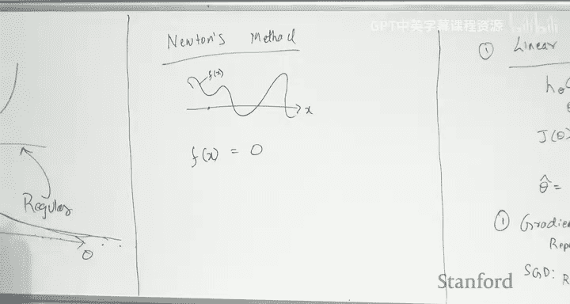

# 斯坦福大学《机器学习｜Stanford CS229 Machine Learning Course  Summer 2019 (Anand Avati)》 - P22：-22-.Lecture 22 - Practical Tips and Course Recap.zh_en - GPT中英字幕课程资源 - BV1NDopY4ECg

Topics for today are first we will on the last class we covered evaluation metrics and kind of like continuation of that today we will talk about some practical tips for applying machine learning in practice。

 especially if you want to you know build a machine learning model focused on real world deployment。

😊。

And with that we are going to finish up all the topics and well spend some time talking about the final exam format。

 what kind of final exam structure you can expect in the take home exam and then we are going to begin our the full course review starting all the way from the beginning giving you an overview of what weve covered in the course so far we be。

😊，As part of the course review we'll be emphasizing more on topics that are more relevant for the exam and well go over both the topics that we covered in the lectures and also discussing related homework problems so we haven't really had a chance to kind of go over the homework problems in the lecture itself so we'll be discussing some of the homework problems that we've covered and how they kind of。

Match up with what we've seen in the lectures and how they relate to the lectures and so on。

So machine learning for production。So with the algorithms that weve so far in the course we mostly studied algorithms right so we've studied different kinds of algorithms supervised unsupervised reinforcement learning weve looked at some theory and in the last lecture we also saw some evaluation metrics。

If you are planning to build a machine learning model for some kind of say。

 real life product that you say you're building a product for， let's say in your company。

 say you're working for a company or you want to。Start and new start。

 which uses some kind of a machine learning model。The approach that you take towards building a real practical model is somewhat different from the kind of approach you would take for。

 let' us say， building a new algorithm to be published in a research paper。

And most of the probably the biggest difference between。

Machine learning in practice and machine learning in research。In practice。Versus research。

The first thing that you would do if you were to deploy machine learning if you are building a machine learning model for deployment is to。

Start。Collecting。ADe set。So， the first thing you would do before deciding you know which model you want to use it may be logistic regression。

 it may be you know a neural network what what have you the first thing you want to do is start collecting a dev set by start collecting a dev set what we mean is start collecting data。

😊，That your model is going to encounter when it is deployed in production。

 Let's say you're building some kind of。For the sake of an example。

 let us say you are building some kind of a phone based app that recognizes things in the pictures that you take right the first thing you want to do is start collecting pictures from you know from mobile phones right and the reason you want to do it is you want to have your dev set distribution。

😊，Much。The production scenario。And it is important that you start with this step even before you start thinking about what your training data is you know first define what your dev set is and then work backwards from them and you want to spend as much time as possible on collecting a dev set that matches the real world distribution as closely as possible and by matching it as closely as possible we mean that you know if your target set of users are let's say those who take pictures on phones as opposed to say tablets or even better if if you if you know that your target set of users initially are going to be iPhone users versus Android users then take pictures from the camera that youre gonna your app is going to be used in。

And then spend time on labeling it yourself。That gives you a real good feel for how your data actually looks and feels。

😊，So as part of this， collect data。Preferably from the same devices collected from the same devices that your model is going to get used。

And。Label it。Once you do this， you get your validation set or a dev set。😊，The next。

 the next thing you want to do。Is to define an evaluation metric。Right。

So these two tasks of collecting a data set and。Defining some kind of evaluation metric。

Should be the first thing you do if you are you know some kind of if say you are the leader of an ML group or you are a product manager the first thing you want to do is define what your dev set is which should be a good representation of who your users or how your users are going to use the model and defining what defining metric on this and this metric will capture what whats kind of important for you from this product。

And once you define this data set and evaluation metric。

 youve now effectively kind of you know painted a target for your team to go after right these two are should always be the first thing you define。

😊，And once you're， you done this， then。Then you know comes the question of what the training set is right So your training set could could come from anywhere。

 right if collecting data is inexpensive。Then you probably want to collect as much data as you can that mimics the production scenario and make that your training set。

However， that' is usually very expensive， especially you know。

 if you want to label your data set that becomes really expensive because you you probably want to use you know your own time or you want to spend money and use you know crowdsourcing to label your data。

And generally， labeling data can be very expensive。😊。

And which is why most of the time training data usually comes from a distribution that may or may not match your dev set exactly if you are working with images let's say you are building an image classifier you may want to use some kind of a pretrained model or use a very famous dataset set called the imagenet。

😊，For creating your training data。RightAnd that can be very different from the from the use case where your module will eventually get used。

😊，So collect so the next thing you want to do is now collect your training data。

And while you are collecting your training data， it should be as。😊，As close。As possible。

To the deficit。And generally collecting the set， you know， as I said。

 collecting more of the dev set itself can be pretty expensive。😊。

And here you generally end up using some kind of an automated labeling。😊，Automated or noisy labeling。

And you may be surprised that noisy labeling or automated labeling can sometimes be extremely effective。

😊，And the the idea there is that you kind of make up by quantity what you lose by quality。

And in fact， we've actually seen you know some examples of this in the course already， for example。

 in your homework1， PS1， I think it was question 2。😊。

You know we looked at the case where you have some training set where the noises are where the labels are noisy where the labels are available say only for positive examples and the unlabeled examples can contain both positive and negative right that thats one that's one kind of data set that you may get by automated labeling where you label only the points that you are very confident of and leave everything else as you know unlabeled。

And with that， you can still build models in a naive way and then apply some kind of a correction to get you know。

 pretty good or decent models。😊，This question。That is a very good question so so the question is when we were doing homework or you know covering rest of the material we spoke of first starting with some data set some given data and split that into a test validation and train right why not do the same here as well。

The reason why you want to think about it this way is because。

The approach that we discussed earlier of starting with some given data set and splitting it into three。

Was quite common in in a few years ago or a few decades ago when data was really scarce right now we are kind of in a situation where it's easy to collect data。

 it's difficult to label them but it generally the availability of data is quite abundant in a lot of use cases of course there are use cases where data availability itself is low for example in healthcare when if you want data about some rare disease of course you're not going have a lot of examples there。

 but for the most part， especially if you want to build some kind of commercializable product then it generally tends to be around you know you know images。

 text， you know media videos， etc。 and generally it's quite easy to get lots of lots of data but labeling them is still hard and in these scenarios。

 you probably want to have your model be tested against。😊。

The kind of scenarios it's going to be deployed against。

And have your test set performance reflect that reality when you know when when you actually put it in deployment as opposed to take some data set that you you know obtain from you know somewhere。

And get a sense of generalization performance to that distribution。

 which could be very different from where your model gets used。

So if you if you want to if you are thinking of deploying your model in a real world use case。

 always start from the way it is going to get deployed and work backwards from there。😊。

They had people are outsourcing click。好。I is it to like。Its creatingre technologies。Web scrap， like。

 if you want images。For Googlegle emerge and then label it or somehow。

Is that even legal to do from some。てる。Yeah so so the question is you know what about using using you know scrape the web for images and do some kind of automated labeling is that even legal of course if youre you know if you're scraping copyrighted images then you know you're actually subject to the terms you know that come with the license of that you know of whoever owns the owns the images So yes。

 so legality is definitely open open question and you should you know answer that in this course we don't provide you legal answers for such questions but you know you absolutely need to you know ask those questions and find out if you know the method that you're following you know is it legal or not absolutely you should you should pay attention to that and。

In terms of crowdsourcing， it is strongly recommended that the dev set。

 the labeling of the dev set be done with as much care as possible preferably by you and your team。

And you could use crowdsourcing for labeling， say your training data。

 but you want to be as careful as possible for labeling your dev set definitely。Yeah， so。

We saw some of the automated what could happen under automated labeling with in PS1 Q2。😊。

That's the positive only scenario。And once you， once you kind of。Done your labeling。

Then you get into the question of， how do we build。

How do we build a model that works well in production your goal should always be to build a model that works well in production。

 whichch is， which， which might seem。Closely related to a model that works well on your test set or model that works well on your dev set。

But that is still a proxy， you should always aim for building a model that works well in production。

And the way you want to work towards improving your model performance on production。Is to。

 let's say you， you come up with some kind of， let's say you decide to use。I don't know。

 SVMs or know logistical guesstion doesn't matter what it is， right。

Any time you fit a model and you want to measure performance。You should always。

Measure this breakdown。So first， you have say。Human level performance。

And this human level performance。Even though it is inaccurate。

It is sometimes okay to think of this as a proxy for irreducible error。

Of course this is this is inaccurate， but it serves as a good proxy。

 We do have models that work better than humans in many examples。

 so in those kind of examples this may not always work but for the most part if you are starting about building some kind of a model or some kind of a machine learning model for you know a specific product that you are working on then。

😊，Human level performance on the dev set can work as a good proxy for irreducible error。 Again。

 it's just a proxy， yes question。So what exactly is？Meant by that。

 So you're saying like you get data from already。Use some so you started to do。Yeah。

 so you're saying like something that you。デ。Yeah， so so the question is what what do we mean by automated labeling do we mean by using some some data set that is already labeled is that so what what we mean by this is lets say you you are trying to build a classifier for。

Lets say you know the the prototype typical example。

 lets say you want to build a classifier given an image is there a cat in that image right？

And lets say you scrape the web know possibly that is illegal let we push that question upon and youve collected a big data set and in this data now we want to label this data as those having cats versus no cats。

And you want to have some kind of an art。First thing you do is。

Collect a dev set that's going match your deployment scenario right if if your use case for your for your say mobile phone app is through pictures。

 then take pictures from let's say your phone， take lots of pictures and manually label those that have cats or not and then comes the problem of collecting training data your data can be images that you scrape off the web which may be completely unre It may look kind of different from pictures taken in your in your phone And now you want to do some kind of an automated labeling right And what does it mean here you could perform automated labeling with some simple rules。

For example， if if the file name of the image has the word cat， then maybe it has a cat so you know。

Label it you know have have some initial noisy labeling where you look at the file name if if it has the word cat in it。

 label it as positive if it does not label it as negative， that's very noisy。

You know what you know it probably works okay in terms of its degree of noise in it。

 you probably want to still perform some kind of a spot check to see you know collect some random number of images from this label data and see what fraction of them were labeled correctly with this automated rule。

And maybe refine it a little further till it is， you know， probably， you know， say。

90% accurate or 95% accurate。There's no actual machine learning。Yeah。

 you could use a simple model to do this automated labeling but generally this automated labeling will use some kind of prior knowledge or domain knowledge to construct a rule based you know it is generally a rule based labeling at the automated labeling。

😊，So you want to break down the performance into the following following parts。 and then you have。

Tining performance。And when you're training。Once you obtain the training data。

You probably want to split it into。An actual train set。And what you might call as a train dev set。

 which is a fraction of your training set， which is distinct from the dev set that you are the goal of the dev set is to mimic the deployment scenario as well as possible。

😊，But your training data you probably don't want to overfi use all your training data for fitting the model as well。

 so within the training data you that youve labeled possibly with automated labeling you still want to hold out a fraction of this and let us call it the train Dev。

So。Train dev performance。It is sometimes common to take a fraction of your deficit and include it in the train deficit。

And measure the trend of performance and then measure the deficit performance。

And this is the part that youve manually labeled。And manually collect it。Finally。

We can talk about the deployment performance。By deployment performance。

 what I mean is when you actually deploy the model into production and real users start using your model。

 you know what is the accuracy， whats the level of performance on the real world。And。Previously。

 we were generally talking about you know， train error and test error or maybe train error。

Deware and tester， but here when you actually put things in in or when you are working towards an actual deployment。

 you actually want to measure all five you know all you know there are these five different measurements that you are measuring。

😊，And the way you want to think of each of these different performance is the human level performance as I said you can think of it as a proxy for irreducible error once you once your model starts working really really well it might start performing better than humans but you know we will ignore those cases for now。

😊，And the gap between。Training performance and human level performance。 The gap between these two。

You want to think of this gap。As。A proxy。都。The bias in the model。

 right the gap between training performance and human level performance。Right。And similarly。

 the gap between the train level performance and the training performance。😊。

I want to think of that as the variance in the model。And now， similarly。

 the gap between the trained devs performance and the dev set performance。This gap。

You can think of it as the error due to distribution mismatch。Distribution mismatch。Between。Deve。

And train。And this distribution mismatch is because。The training set that you obtain。

wa generally obtained from a different process rather than starting with rather than the the process you used to mimic the test set because you know this is too expensive and this is generally you know therefore you can think of this as。

Like， you know。Due to cost of。colecting。This question。So。

 the train dev is a fraction of the training data that you obtain that you hold out as as you know a train dev set。

我 got。Because we are calling this dev service， you know。

 just call it train dev because it was its just a fraction of the training data that you have。

 which is distinct from the dev set， which you manually collected and labeled。😊，So but that。

That was going to be used somewhat like a validation center。

So the purpose of the drain have set is to kind of use it as a way to check if your model is overfitting or not。

And the dev set is used to check if the model is going to work well in the deployment scenario or not。

 because the training data that you obtained was distinct or different from the potential deployment scenario。

And， finally。The gap between these。Between the deficit performance and the deployment performance is generally due to。

Overfitting on the deficit set。How can we overfi on the dev set even though we are not training on it。

 we can overfit on the dev set because we go through the cycle of refining our model and tuning our model to work better and better on the dev set to reduce this gap。

😊，And in a way， indirectly。Due to our hyper parameters。

 we will inevitably end up overfitting on the deficit set。And once you overfi on the dev set。

 then your actual deployment performance can be pretty bad。😊，And。To kind of summarize our goal。

Is to build models that work well in deployment。 this is our eventual target。

 We should never lose track of the eventual target。

 which is deployment performance and all these other different measurements that you perform are a way so that you can perform diagnosis to improve the deployment performance right These。

 these performance by themselves。😊，Are not of direct interest。

You want to use these to diagnose where the error where the error is coming from and go after and fix that error so that eventually we can do well on deployment performance。

😊，And the depth set， as you can see。😊，Can be subject to overfitting。

 especially if you evaluate your model performance on the dev set multiple times。😊。

You're going to reach a state where youve kind of overfi on it in which case you might want to go back and recollect a new dev set because you you overfi on on the on the old one right and thats that's pretty common too where you you recreate a new dev set。

Because you've overfit on the current one。And no。So。Given these， let's。

 let's let's kind of go through some a simple exercise to see what steps we can take to mitigate each of these。

 let's say。You measure the human level performance， and it's pretty low。What do we do。Well。

 if the human level performance is pretty low， like we have not even started。

So there is no modeling question here youve collected it you know a data set and then you ask a human to to measure the human's performance on that task and that is pretty low。

😊，The accuracyYeah， you know， whatever metric that you come up with accuracy， or precision or re。

Get better humans。I think can you。Exactly， so you know you if the human level performance is pretty low。

 then maybe go after a different problem right so because its you know especially if you want to run some kind of diagnostics and you know characterize your errors。

😊，If the human level performance is pretty low on a task。

 then you know you can think of it as a problem where the irreducible error itself is very high。

 so it' is kind of a bleak scenario it kind of represents says that the problem is really really hard。

😊，Right？Now， what if， you know， the human level performance is。Pretty good。

 it's within an acceptable range， but your training performance is low。😊。

Your training error is high right but you know when when when you asked a human to perform the labeling or human to do the prediction it was pretty good you know what does this represent it represents you know your model probably has high bias。

😊，And what do we do to address high bias？Increase。Increased flexibility of the model。So。

So steps to kind of overcome this。Increase flexibility of the model and how do we increase the flexibility of the model。

Add features。Add feature and somebody said add more linearities so let's call it add features of say add more depth if you are adding a neural network。

Had。Nepped。 and I think some said reduce regularization。

And lets say if you are if you are using some kind of a kernel method， use more complex kernels。

So these are like standard standard approaches。For fighting bias， if your model is high bias。

 then these steps will help you fight bias。 And if you remember bias。

Is due to the inability for the model to represent like the true function or the best possible function。

 the best possible function or the best possible model。😊。

Will give you you know the irreducible error that is the best possible we can do and the inability of our hypothesis class to represent the best possible model is called bias and anything you can do to increase our model class to make it an even bigger class will help fight bias。

😊，So， all these things， you know， adding more features， adding more depth。

 adding more width in your neural networks， reducing regularization because regularization pushes your model towards towards zero you know more complex kernels。

 all these are different ways in which we we can fight bias。😊，No。

What if the gap between the training performance and the train of performances is more。

What can we do there。So what can we do here？Everything opposite。 So yeah， so look for smaller models。

And fewer features。Your features increase recognition。Okay， a。Less complex kernels。

And finally there is one you know most of these are like the inverse of inverse of the other。

 however， there is one thing that is distinct which is collect more data。😊。

Does getting more data help fight bias？Can it。Some say yes， some say no。

 So generally you don't think of getting more data as as for fighting bias if your problem is that your training performance is much。

 much worse compared to human level performance， it means that the the model that you have cannot even fit the training data that you have。

which means the problem is that the model class that you have is too inflexible getting more training data will not necessarily help your model fit that superet better than the subset that you had initially so if your training error is low。

😊，You kind of think of it as a proxy for bias and the thing you want to do is not necessarily go and collect more data but start increasing the capacity of your model。

 make it more flexible。😊，However， if the gap between the trained error and the training performance。

😊，Is large。 It means your model is doing really well in just fitting the training training data。

 right but it is not able to generalize well。Which means you want to probably your make it harder for the model just to just fit the training data so just collect more data。

And the hope that it generalizes better。And what do we do if there is a gap between train dev and dev set？

Change the。Change the rules for labeling。So， if if the gap between the train dev and dev set is high。

 then it is an indication that there is a distribution mismatch between the dev set and the training set。

😊，And when there's a gap between the the。When there is a distribution mismatch between the dev set and the train set。

 then obviously the the thing that you want to do is minimize that difference in distributions right one way to do it。

😊，Is to make the dev set closer to the training set。Which would not be ideal。

 which would be kind of know。Yeah， it would be kind of stupid in a way。

 but instead what you want to do is make your trained dev set。😊，Be closer to your dev set。😡。

And that you can do in there are many ways to go about doing that。

 for example you may want to you know spend some more money and know collect more real data。

 realistic data label them and include them in your train dev and training upset you could do that you could also you know do something more clever for example in your training set maybe there is a subset of your training set that are somewhat close to your dev maybe up those examples。

You could also you could also maybe think of some kind of you know data transformations on your training set。

 for example， if your dev set is mostly images that are black and white but your training set has a lot of color images you know maybe run some filters and make them look you know closer to your dev set in some way this is this for this you need to use your creativity and somehow reduce the distance between your training distribution or the train dev distribution and the dev set distribution and you want to reduce it by making this closer to the dev set not the other way。

His question。Theセ。你啲。个。So just to clarify what I meant was making this closer to your training set by what I meant was replace some of these examples by examples from your training set。

😊，And you could potentially change this to make this closer to your training set。

 right but that would be kind of against the point。De set is what you get actually from。Yeah。

 that was my point。 So you want to keep your deficit as it is and not change it。But。

You would want to incorporate。Examples， like as you observe。the death from the rings。Let's say。

 you are。Like the more。But you realize， like。Your training data was。You might want。Yes。

 that was my point， yes。Yeah， that was。 No， that's not true。Okay。

 and what if the gap between the death set and the deployment performance is is poor。

 Let's say you you you， you know。You taken your dev set in as kind of pure way as possible youve sampled it randomly from the actual deployment scenario you've labeled it and you fit your model and it is working well on your dev set but it is not working well in real in real life what do we do then？

Yeah exactly so it's probably time to refresh your dev set right its a good indication that youve likely overfit on your dev set by going through this cycle over and over again as as we mentioned in one of the earlier lectures the more number of times you measure the performance of your model against a dev set and tweak the model to improve the performance think of that as your dataset getting roted right it probably means your dev set has routeted quite a bit。

😊，And it's time to collect a new dev set and start all over again。And。These two。That we saw。

Were some of the things that we saw earlier in the bias variance lecture in order to improve your module performance。

There are a set of actions that you can take。And that set of actions。Contain contradictory reactions。

So some of the action me is to add more features whereas another action is to reduce features。

 These are all actions to improve your overall model performance。😊。

But in order to decide which specific action you want to take the at this moment。😊。

It is very critical that you look at both the training set error and your depth set error in order to characterize whether the current problem that you have is a high bias problem or a high variance problem。

 right。😊，And only then one only after you characterize whether the immediate problem is a high bias problem or a high variance problem。

 only then do you。Do you choose on the subset of actions that are meaningful and take that action？

This question。 So you know when to stop when both。Likes like human level。Performance on the screen。

When those both are equal， that's when you。Like the best you can do is make make both bias andvari equal。

Yeah， so so the question is， do we stop when you know， this error vanishes and this error vanishes？😊。

Is he good。Or or the gap between them vanishes and the gap between them vanishes。

 which means they are all three are equal right So the question is do we stop then The answer is， no。

 your goal should always be deployment performance and all these are components that you can tackle with different action sets to help reduce。

To mitigate both those problems are contradictory。 You can only do one of them。

 So I'm saying if you want to know whether you。You want to。Bers or variance in your model。

 You have like the best you can hope to do is reduce both of those。

Difference in performances to equal。 That's the best you can do。Yeah， so there is。

 there is some amount of so。let me get to that in a few minutes of you what you want to do。

 the short answer is yes， you know you can you can。😊，You can always collect more data， and。

Drive your variance towards 0。 and you can always call increase a bigger。

 you know maker use a bigger model and drive your bias towards0。 So theoretically。

 if you have enough compute and enough data， you can drive both bias and variance to 0。😊，Right。

AndThat's one way to think of it。Yes question。training area。So。

 what do we do when training error is large but dev the train dev or a dev error is small。

 do you mean this gap is large and this gap is small or the training errors absolute value is large but the train dev or the dev errors absolute value is better。

So， so。Again， just to understand your question better do you mean that the gap between train and train dev is small or the train dev itself is less than the training error。

Whi whichch of the two scenarios are you talking about。

 So are you talking about the scenario where the training performance has， let's say。80% accuracy。

And the train dev is 79% accurate， which means the gap is small or I talking about the case where the train dev is 85% accuracy。

 which means you know the performance is better than which of these two are talking about。

The lack of 1，85%。 So this generally means that if， if the。

 if the training dev performance is higher than the trained performance。

 this generally means that there is still some kind of。There is still some kind of。

Distributional mismatch in the sense that maybe there is your train devs set is not。

A perfectly randomly sample from the dev set， maybe there is some bias in the way you sampled the trained dev set and it could be that the fraction that got left out in the training set for harder examples but you know this biased subset are easier examples its something like that generally you don't expect this to happen。

happens to be train。So if this happens， it probably means you want to reshuffle your you know merge them and resplit them again。

😊，U that thats one way to go about it because you should not expect there is no reasonable reason for your trained dev performance to be better than the training performance it means you are likely doing a bad job at you know even just your fitting your training data or you know there is some kind of a bias in the way you split your train and dev set。

Good question。So， now。You know， there are there are there are what we have seen is you know there is some action space and yes question。

How do you measure deployment performance and because for everything else you have a set of data that you kind of measure against。

 but for deployment performance， you kind of put it out into deployment already。

That is a very good question so how do we measure deployment performance and usually the way you measure deployment performance is to you know generally there might be ways in which the feedback is implicit in deployment for example let's say if the action that if the prediction that you made was right let's say the user ends up taking a certain path of actions and you can kind of get this implicit feedback of whether your prediction was right or wrong so sometimes you kind of get that automated feedback in other scenarios you want to make this prediction on the real data and then have somebody relabel them and measure the performance。

So collect some predictions that you made in deployment and have somebody label them just to see what fraction of them you got right。

essentiallyYeah yeah think of it as another depth set if there is no implicit feedback but sometimes there can be implicit feedback in your overall application let's say the user takes a certain kind of actions if the prediction was right and in that case you get like automated。

😊，Automator feedback。 Good question。So。So here in our action space。

 we saw that some of these actions。😊，can can can you know this this can be kind of contradictory with other actions。

 for example， add features versus fewer features add depth versus reduce depth reduce regularization versus increase regularization right so some of them are kind of contradictory and it' is inevitable that you absolutely need to do a bias variance analysis to decide which of those actions you need to take。

😊，However， that is this， this。This action called get more data。😡。

So get more data can help fight bias。😊，You don't expect it to help， can help fight variants。

 but you don't expect it to， you know， affect your bias in any way。

But generally getting more data is a pretty expensive step。😊，And。Quite often。

 you know you need to answer the question of you know is it does does getting more data is it going to help me or not is getting more data is it going to help me fight the you know the variance in my model or not。

 maybe you know the amount of data that you have is is。😊，Is not sufficient or maybe it is sufficient。

 How do you， how do you answer that question， So for that， there is this。

 you know pretty useful plot that you would want to make。

So the plot that you want to do is something like this。So this， you think of it as。Fraction。好。

Data or data size。Green line is。Desied。Performance。Or let's call it this design error level。

And this axis is。Eror in fraction of data。Right， and。You have your。So what we do is。

We take the the full data that we have。😊，And split it into smaller and smaller fractions。

And with each of the small fractions， each of the smaller fractions。😊。

Get the train error and test error or the dev error。From that fraction alone。

And then take a bigger set。Get the corresponding train end error from the bigger fraction then get an even bigger set。

 So each of these here represents your data size increasing。So for simplicity。

 assume both your dev set and train set are proportionally increasing。😊。

And with each with increasing data size。😊，Plot both the。Train error。 So or train。

 So this is the training error。And this is the。Yes error。哎。In this scenario。

The desired  error level is somewhere over here。You know， think of it as human level performance。

And by plotting your model performance of both the train and test error as you subs sampleample your data and a subsampling would go this way as you measured on the full data。

😊，This kind of a model where the train and test performance come really close。

We tell you that collecting more data is not going to help you。

Because the gap between the training error and test error is pretty small。😊，And theyre， you know。

 they are pretty close to converging。 So if you were to collect more data and if you were to extrapolate these。

 it would probably kind of you know。Convert to this level。Right。

And the the the two are pretty close to converging。So， this is a scenario where collecting more data。

😊，Is not going to help you。 right， This is think of this as a。High bias scenario。And。

For the question of collecting more data。The answer is， no。

So collecting more data should not be the first thing you are thinking of。In in such a scenario。好백1。

In situations like this。Where。This is your desired error level。And your。Training error。

As you're cleaning at。Let's see。I'm loosely calling this test error。

 but you think of this as your trained dev set or a dev set error。Right， in， in this scenario。

Collecting more data。 So， again， this is fraction of data。OrData size。Here。

 it would be reasonable to you know extrapolate this as you know this rising up a little further and this coming down a little more。

😊，Right，So if your， if your plot looks like this， then you want to think of this as a high variance scenario。

Cnario。And for the question of collect more data。The answer here is yes。

 you know it is worth collecting more data is it is worth depending on you know how much you value your performance。

 it may be worth spending more money and you know collecting more data。Whereas if you are over here。

Your training error itself。😡，Is a lot worse than the desired performance level and your test error is matching your training error。

😊，Which means you probably want to increase your model capacity， right。

 Use a bigger neural network or use more features or use a more complex kernel。

So that first you bring your training error down。Any any questions。On these， yes question。私はさして。

Yeah so the question is how do we set the desired error level and that is there is no common answer for that that really depends on your application and you know as the owner of the product you need to decide what your desired error level is。

😊，You。Well， so the desired error level。It may not always be possible to bring it down to0 and the value to which you want to bring it to。

Will actually depend on you know the metric of your choice right so so if your metric is accuracy and your prevalence is very low then you know this will be like a really low value in general So it depends on your choice of metric So intentionally Ive just called it error but what the actual you know units here are will depend on the metric that you've chosen。

Any other questions？です最こ少し。I performance is。Okay。So the desired error level performance could be up bounded by human level performance。

 Sure it could be。All right。Any other questions？Let's see。

 are we done with the practical a few more concluding comments。As I said。Always， always， always。

Our goal should be deployment performance right don't lose sight of the end goal right all the other measurements that we do。

arere only to aid us in taking the right actions so that the deployment performance improves right it is very common to lose track and just focus on say deficit performance or just focus on the trained of performance。

But you should never lose lose lose track of the fact that your end goal is always the deployment performance。

And。Why， why deployment performance is your end goal。It is。

for tactical purposes you want to measure the training performance and the trained de performance or the training performance and the deficit set performance and look at those and the reason you want to measure them is so that you can decide which action to take right but the action you are taking is with the goal of still getting good deployment performance。

And this is where bias variance analysis kind of comes into picture because with bias variance analysis you can decide among these conflicting set of actions。

😊，Which is the action that you want to take。 If you blindly take some action that， let's say。

 you know， increasing features。Is a good thing。 And if you。

 if you go go ahead and increase your features， then you know。

 that may be wrong or the wrong thing to do if the problem that you are facing is high variance。

Similarly， lets say you at some you are getting some kind of a model some kind of a performance on your dev set you know you feel it is you know insufficient and you go about just collecting more data to increase your death set performance and if you are in a scenario like this。

Where your test set performance was lower than than the training performance。

 which means that test set error was higher than the desired level error。

 then collecting more data is not going to help you。And therefore。

Looking at the trainer looking at basically the breakdown of the performance at all these metrics is extremely crucial to decide what the next action that you are going to take is going to be。

😊，And another final advice is。In your homework， basically you've been implementing a lot of these algorithms。

 implementing gradient descent yourself， implementing GDA yourself or neural networks yourself。

Please don't ever do that in production right don't implement the algorithms yourself always always use some kind of a software package that somebody has already implemented and tested you know don't go about doing gradient descent by yourself if you want to build some kind of a real world application right that's totally the wrong thing to do its very important to implement neural networks yourself for the purposes of understanding how they work but。

😊，Don't't， don't do that。 don't go about， you know in some kind of an adventure path and implement gradient des yourself for your application。

😊，Yes question。Yep。あ来。Bg pitfalls in practical stuff do do。So， so， so the question is， you know。

ThereA lot of people probably know this knowledge， but still lots of companies fail。

 lots of themes fail， why does that happen。I don't think there is a single answer to that because first of all you may know all the theory but you know your execution may be poor right you know even though you know things you may not always execute them in the right way。

😊，That part there can be you know other reasons beyond your you know control for example。

 even though your machine learning approach was correct you may be solving a wrong problem for which there is no customer traction right so there are lots of other reasons that come into picture why teams fail right it' is not always the technology that causes failure。

So it's equally important that you go after a problem that， you know， that's kind of worth solving。

 And there are， you know people are， you know something that's valuable if if solving the problem is valuable。

 then you know。It its good， but if youre problem solving a problem， even though you solve it well。

 if nobody is interested in the solution， then you know obviously you you the team is going to fail not for machine learning reasons but you know it's still a failure。

😊，All right。Any other questions on this before we move on to topics related to the exam？Quote。Okay。

 so。So for the， for the so the next thing I want to briefly touch upon just for a few minutes is to give you。

You know， some kind of an expectation of the format of the final exam。

We have posted some practice final exams on Piazza which hopefully youve already had a look。

 however use those practice exams as only for the purposes of you know getting access to a pool of questions the format of the exam this time will likely be different。

And in terms of the format itself。There are going to be。

So so the the format that I'm going to describe now。

 there is a very high probability that that will be the format。

 but there is a small probability we may you know tune a few things。But you know。

 more or less what you can expect is。😊，The first question is going to be true or false。

And there are going to be about 10 of them。The second question is going to be short answers。

And there are going to be about five of them。The third question is。You can call it a theory question。

 I'm just gonna call it theory， right， It's gonna to be basically just math。 and it's， it's。

There are going to be sub questions where essentially it is a much longer proof for which we kind of guide you by breaking it down into you know sub problems and you know you solve each of the sub problems you will you would effectively solve the full full question。

And the fourth one is， you know， you can call it。Theory slash。

Application where again it it it it's kind of a new problem setting that you know it is like a novel scenario for which one。

Extend some of the the ideas that youve learned in this course to this new setting and there are going to be like two theoretical parts where you like kind of derive whatever the update rules。

 prediction rules etcter， and a third programming component。

Where you implement these rules in the starter code that you provide and you execute it and you get a plot and you you know include the plot and you write up。

So this is going to be the， the structure of the exam。 you can。I would say， you know。

 expect it to be hard。 It's not going to be long。 So， you know， this is。You know。

 not not not we don't have like you know 10 big theory questions or anything。

 it's much shorter than the homeworks that you've encountered with but it is going to be it would be very necessary that you have a good kind of overall understanding of the course。

You are good at the prerequisites， so things like probability。Right， matrix calculus。Lar algebra。

And you know general you know things that we have covered throughout the course like maximum likelihood。

 et cetera， it's very important that you have a good understanding of the prerequisites and also the important concepts from the course like bias variance。

 etc cetera。But the， the。The specific the the the you know the different set of questions so basically these 15 questions and these two questions。

😊，Kind of more or less touch upon all parts of the course。Any questions on the format itself。

Yes question。Yeah， so the coding is going to be the last part of question form。Yes question。I right。

Because that is like most it takes。にこれ hours。It's hard to say。 So there are just so these are。

 you know， true false questions and short answers。 I mean。

 we expect you to say true or false in one sentence for you know。

An explanation of one or two sentences for justification similarly short answers。

 we expect you to you know derive an answer， but you know we only expect you to provide one or two sentences you know of reasoning or justification。

 So if you know the answers you know you can finish one in two in a few minutes right but you know if if。

If you spend more time on this， you could potentially spend the entire 24 hours on just answering these。

 So it's very hard to tell you know how long it's gonna take。 So the format itself。

If you know everything we expect you to comfortably finish it in three hours。

 but if youre spending time on on you know if you need more time to spend on each of these you could potentially take you know more than 24 hours so it's hard for us to set an expectation of how long it's going to take for a student we could tell on average but for a given student you know the variance can be quite high but you know think of this as like approximately two homework questions。

Right， and some， you know， this， again， there are just two falses and short answers。

W shouldn't take to。any questions， yes？II can hear that。

know but we'll be answering the answer post during the exam Very good question。 So during。

 so this is going to be a take home exam， which means we're going post the the。

postst the exam on Piazza as a PDF and you will write up your solutions know in tech or by hand。

 however just the way you do your homework， preferably in tech so that it is easier for us to create and you will post it on grade scopepe like any other homework。

During the exam period itself， we will disable piazza right so even though the format is like a homework。

 it is not a homework。 It's an exam， which means we will。You cannot talk to each other。

 you cannot collaborate that's against the honor code collaborating on the exam is against the honor code。

You can use any of the resources that you want， look at the course notes。

 look up you know watch the lectures again， look at homework solutions。

 you' are even free to look up the internet， but you cannot post on some say stack exchange and ask somebody for help。

But you're totally allowed to you know search the internet for any， any kind of。

Any kind of questions that you may have， but no communication， basically， by communication， I mean。

No asking questions， but you can ask Google， but you know， no asking any other。

 any other human being， right during the exam。We will not。

Help you in piazza for things that you don't。Understand you you can create private PRazza posts and if we think the question is already clear about it。

 we will not respond to it。Just like an exam room you know if you have a question you know ask yourself would this be a question that I ask a TA in an exam room and you know create a private PR post if we think it is a valid question and if there is an ambiguity then we will make a public post and clarify to everyone。

However， if we think that you know the question is already clear about it and you have not thought sufficiently about it。

 then we will refrain from answering those kind of questions or maybe we will tell you you know the question is already clear about it you know something like that just so that all the students obtain the same level of response from us。

Does that， does that answer the question。Yes question。

response and questions throughout the the exam the quarter still available yes you can open Piazza and search for all the previous questions but I think there is an option in which we can disable posting new questions or there's some such feature in Piazza that we will be。

Yes question。Yeah， so I would say for for， for the Mac part of it， focus on matrix calculus。

 focus on probability and， of course， linear algebra。 you know。

 if if youre really comfortable with them。We expect these parts to be pretty， pretty straightforward。

Yes。I'm sorry， I didn't get the question。 Can you please。Also， the grades。

 I don't remember it off hand， but it is something like 1010。I don't know。 It's it's like 15。

15 or 10，10 or 20，20， something like that。All right， so。With that， let's。

Kind of rewind all the way back and start our course review。

So the course review that willll be doing some amount today and the rest on Wednesday is to。

I to kind of。Provide an overview or a second look at all the topics that we've covered。And also。

 kind of spend some time。Spend some time drawing reference to the relevant homework questions that youve answered because a lot of the things that you learned from the course were from lectures。

 but an even bigger chunk was from the homeworks right。

Some of you have probably gotten all the homework answers correctly and have understood them well。

 some of you may have gotten the answers to their homework questions， but haven't really kind of。

You know， kind of kind of understood like the big take home messages from each homework。

The homeworks are a huge part of the you know of the overall educational aspects of this course and unlike you know many of the other math courses where homeworks are just assigned from you know some random textbooks。

 say problem numbers， you know，1715 and 30 or whatever in this course。

 a lot of effort has been put into designing each homework so that it kind of complements your complements the lectures and the overall learning experience。

 So we will。😊，At least do a quick， quick reference to each of the relevant homeworks and at least touch on the take home messages from each homework as well。

 depending on the order in which we are doing the review。😊， so let's jump right in。

 You're going to start off with。Supervised learning。 That was the first。First section of the course。

So in supervised learning， if you remember。😊，The goal in supervised learning is to learn a mapping from x to y where you think of x as an input and y as an output。

And you' are given pairs of X， Ys as a training set。 so in supervised learning。

So in supervised learning， our goal is to learn a mapping from x to y。😊。

And in order to learn this mapping， we have provided a training set S。And that training set。😊。

Is basically， pairs of。X， Y， examples。I equals 1 to n。

 generally small n refers to the number of examples in our training set。And X， I。

Generally resides in a D dimensional space。And this is usually called the input。An output。How to but。

Yhy I。If it resides， if it is a real value， then we call this regression。Right， if。Y i。

Is either zero or1？We call this。Binary classification。嗯。Why I could be。You know integers，1，2，3。

 and so on。And this， you can either call it count。Or Poisant regression。And so on。

And the overall workflow for supervised learning was to start with。A training set。Training sector。

And then run this training set through a learning algorithm。And the output of the learning algorithm。

😊，Was a model， which we call the hypothesis。So， think of this as your training set could be you know x y pairs where y is in 0 in 1 the learning algorithm was say logistic regression and the learned hypothesis is the set of parameters that you got when logistic regression reach convergence and this learned hypothesis will now accept。

New examples， X。That it has not seen before from the training set。And make predictions， why。

This is this is the kind of workflow overview of what what happens in supervised learning。😊。

And the first algorithm that we learned was linear regression。😊，Linear regressionggression。

In linear regression。We。We assumed that。The function H。

Belongs to this parametric family where we define it as h theta of x equals theta transpo of x。

Where theta was some vector in RD。And there is also this interceptor we assume that x will include the interceptor and you know theta will also the parameter and the theta vector that corresponds to the interceptor will be the biaser。

 so sometimes to make it explicit we call it d plus 1 and you know other times we just leave it as theta D and assume that you know it is in there。

And in order to learn this learn this parameter vector theta。

 we need to have a learning algorithm and the learning for the learning algorithm。

 we first define what is called as a cost function， j theta。😊。

Which is equal to sum over I equals1 to n。H theta of x minus。X， I minus。为爱。Square。

And this is also commonly called the squared error。

Where we want to penalize the difference between the predicted value and the correct value and we want to penalize the square of that value and sum over all the squares of these errors。

😊，And this， we treat it as a function of theta。😊，And we want to minimize this error by adjusting theta to the best possible value。

Another way to write this in vectorized notation is。X theta minus。Y square。Next question。

 So is this the choice for the cost function because of the Gaussian or the negative blog I heard？

Is this the other other choices of course or can you considered。Yeah， so the question is。

 is this cost function a consequence of the of assuming Gausian on the Gausian on the error term or you know can you use other。

Other other other loss functions。 So there are， I'll be answering that shortly the the the the quick answer is that。

You can give this。A probabilistic interpretation that had you assumed a Gaussian error term then this would be the cost to minimize。

 but there are other interpretations for linear regressions as well。😊，Right so。We， we。

 what we want to do is find theta is equal to。Amin。Theta of J of theta。

And in order to we put hacks on all estimated values。And in order to perform this minimization。😊。

First algorithm that we saw。Was gradient descent？And then in gradient descent。

 we start with a random initialization of theta。😊，And run this iterative loop。Where we repeat。

Theta equals。Theta plus some learning rate alpha times。Y， I minus。H datata。Of X， I。Bas。Xi。And here。

We imped summation。Plus。Alpha times sumation I equals 1。と end？So， this is gradient descent。

And we also saw a variant of gradient descent called stochastic gradient descent where instead of this summation in each iteration。

 we randomly sample some example。SGD， where we repeat。Theta equals theta plus alpha times。

 let's call it y。hy为 k。Minus H theta。Xk。Times。X K but K。A sample from the uniform distribution。

Between 0 and n。Or one and in few。So sample random example number use that example to run gradient descent for that iteration。

 so that was stochastic gradient descent。So this was one way in which you know we solved linear regression using gradient descent。

And then， we saw these。Few other interpretations of linear regression。So。

 this was this was using gradient based approaches where the gradient descent based approach works for any cost function not just linear regression。

 but in case of linear regression we can also get the close form solution for the final theta hat directly the second approach was what we call as the normal equations for getting a closed form solution。

And in the normal equations。😊，We basically get x transpose x theta equals x transpose y。From which。

If we assume invertability of x transpose x， which for now we will assume x transpose x is invertible。

 we get theta equals x transpose x inverse x transpose y or theta hat equals x transpose x inverse x transpose y。

And this is kind of a pattern that you should tune your eye to look for because this pattern we also saw that you know can show up in other places like you know in fact analysis and fact analysis we saw that you know one of the parameter updates looked very close to linear regression。

So that' that's the normal equation。And then we saw a few more。Interpretations of linear regression。

So。The other one was projection based。Projection， so if if。So， let's assume this is theta 1， theta D。

 and this is the parameter space。And then there is this design matrix x。This is the matrix。And。😔。

Run it through this。And we get an output space。This is y1。Y2 call this y n。

So each dimension in the input in the parameter space or the input space corresponds to each parameter or each feature。

And each axis or each dimension in the output space。😊。

Represents a different example that is because x takes input。You know， x is in。RD。

Oh sorry our n by d， so it takes us input something in d dimension and produces output something in the in n dimension。

And here。Because this is a D dimensional space getting kind of up map to an n dimensional space where we expect D to be smaller than n。

The the column space or the range of x。Is going to be a subspace of the entire output space y？

Where the subspace has dimension D。So let me use some different colors。

So the entire D dimensional space will now get mapped to some subspace。

And this subspace basically spans to。Infinity in all four directions。

And it crosses through the origin by definition， a subspace crosses through the origin。

 And this subspace is d dimensional。However， for the given data that we have。

 the point y or the vector y may reside outside the subspace。 so this is the white。

That is that is given in the data。 So we are given x。

And we want to find a theta such that x x theta equals y。And X and Y come from the training set。

And we want to find the best possible theta y such that x theta is as close to y as possible。

Now the way we we cannot always solve this exactly right x theta will cannot always be exactly equal to y because y can reside outside the range of x so instead what we do is solve。

😊，X theta equals。Prorediction。Of why。On to the range of x。Instead， what we do is project Y。Onto the。

Onto the subspace spanned by x。And then solve x theta equals projection right this cannot be equal because y can can be outside the range。

 but this by definition， the projection of of y onto the column space of x can be solved。And。

If you remember， the projection of y onto the column space of x is given by x。X transpose x inverse。

X transpose。Why where this part is called the projection matrix。喂。So this is。

 this is just the projection of y onto the column space of x。And once we have it in this form。😊。

When y is projected onto the column space， it is now， you know， x， this x can be。

Inverted in principle because there is a bijection between the input space and this column space。

 there is a one to one biject， which means。😊，We can now。Now，Inally speaking。

 invert x form this projection for x。 so you can cancel the x's and say x transpose x。Inverse。

 x transpose。Whathy。So this was the projection interpretation of linear regression。And finally。

 we also went over the probabilistic interpretation of linear regression。😊，So。

 in the probabilistic interpretation。We know that。That x theta will never exactly equal to y with this linear form。

 So we say So instead， we assume y equals。X transpose theta or theta transpose x plus。Some excellent。

Where epsilon。Is distributed according to a standard normal distribution with mean 0 and。

The the variance for now， let's just assume sigma squared。Which is some unknown construct。And now。

We can。 We can write this as the probability of。So with this， we can write epsilon equals y minus。

X transpose theta or theta transpose x。Which gives us probability of。Heppsilon。

Equal to probability of y minus。X transpose theta。Which is now a Gausian distribution should be1 over square root2 pi sigma square where sigma square is inside the square root times。

Exponing。Minus。This has mean 0， so it would be this minus0 square。

 which is just y minus x transpose theta square divided by 2 sigma square。

So this is just the standard normal distribution。And now if we perform maximum likelihood。

 that is basically find the parameter theta。😊，That maximizes this likelihood term so that it is you know it conforms to a standard normal distribution as much as possible we get。

L of theta is equal to。Log。Product I equals1 to n。We over square root 2 pi sigma squared。

Exponent of minus。Y I minus。X I transpose theta。Square over 2 sigma squared。喂。And now。

We can take the log of the product as some of the logs。 So this gives us some equals one to n。

Log of this term is some constant and it is the same constant for all examples。

 So let's just call it you know some C。Plus。Log in the exponent cancel。Minus。Y I minus。

X I transpose theta squared over to sigma squared。So we have some arbitrary constant that is common for all examples and another arbitrary scaling constant that is common for all examples。

 so instead we can now write this as now some some other constant say c prime plus。1 over2。

Sigma squared。Times。The negative sum over I equals1 to n。Y I minus。Xi transpose theta。squarere？

And now if you want to maximize。The the likelihood objective。

 so let me take the negative sign out over here。If you want to maximize this。😊。

That is the same as minimizing the termine side because of the negative sign and we can also ignore this2 sigma squared because it is just a common positive scalar across all examples。

So， arg max。Respect to theta L of theta is equal to。A min of theta of this sum over I equals 1 to n。

X I minus。Sorry。Y， I minus。X， I trans theta。Squire。

So it is not by the reason why we cancel the 2 sigma square is because we are only interested in the argument and not the minimum value but just the theta value that gets us to the minimum and the theta value is the same whether we include the scaling constant or not。

And this is the probabilistic interpretation of linear regression。Probabilistic interpretation。

And here we saw basically the Gaussian distribution and the main takeaway from this is that whenever there is a Gaussian distribution。

😊，Involved。There will always that generally always corresponds to some kind of a squared error。

Because you take the log likelihood， the log will cancel will this is a log of some constant log in the exponent cancel。

 so maximizing the Gaussian likelihood is generally equivalent to minimizing the square error of some term。

So that was linear regression， any any questions the on linear regression。All got。And then。

After covering linear regression， we moved on to the first classification algorithm。

 binary classification algorithm。😊，It was logistic regression。So in logistic regression。

 we are given。Logistic regression。Mgistic regression。Yhy I。Is now either 0 or one。

And in order to solve logistic regression。We kind of follow the probabilistic interpretation and do the same thing for logistic regression in logistic regression。

 we assume that y I。A sample from a Bernoulli distribution。But no your distribution。And。

Probability of。Why I。Equals one is given by this one over one plus E to the。Minus theta transpose x。

and。Initially， we we kind of construct this one over1 plus E to the minus function。You know。

 as as a good reasonable guess， which we later read deriveri in GLMs as a natural consequence of assuming Bernoulli。

😊，But for now， let's just go ahead。Where the predicted Yi equals 1， so this will be our prediction。

And this gives us the likelihood expression So L of theta is now equal to1。

Log of the product of I equals 1 to n of the beernoulli likelihood， which is Y I。sorry。

 why hat to the power。Waiai。Wha。The power。Why I。Times。1 minus。Why hat。i。ToThe power，1 minus。Why I。

 where y hat I。Is this。And all of this is a function of theta。

This allows us to write the objective of logistic regressionness。

 so log of the product is the sum of the logs I equals 1 to n。Y i。Log。Why had I。Plus1 minus Y I。

Log 1 minus y。Hat I。Right。And for in in place of why hat I include this。

As Y I here and here and to solve it。We use gradient descent。

 There is no close form solution for this。Run gradient ascent and when you converge with gradient ascent。

 the theta value is basically the maximizer of this likelihood function。That was logistic regression。

Any questions on that？Can I repeat the last part so there is no closed form solution for recovering theta from this from this likelihood expression instead what we do is run gradient descent。

😊，And run gradient ascent till the algorithm converges and when it converges the theta value at the point of convergence。

 it is going to be the solution for maximizing。The long likelihood of data。

There was another question。Actually， my question was。

I'm assuming to do some sort of aing where you have probabilityability。该说来就。손니건 지냐 하거든。Can you。

 can you describe that a little more， I don't think I quite。

So that the probability that Yi equal of 1 is just p because Yi is currently distributed。Yes。

 the probability that y I equals one is just phi。 Yes。

 but the probability that y I equals 0 is 1 minus phi I agree in your in the third line of your。

Exposition。Third line is this one。 Yeah， So you heard the probability of Y I is equal to one。

My first question， should that be， Why had I or。So this is the probability that why why Y I equals1。

 the hat I equals So this is just y hat。 This will be y hat Okay then did you have value saying that if y hat is about。

That then why I could one or something I see so so so the question is if I understood right。

 So here we are only talking about values in order to make a decision of what our predicted why is。

 should there be a threshold to say if this is greater than whatever 。5 than the。

Then the prediction is is one versus the other and the the answer to that is logistic regression。

 So that' is a good question。 So logistic regression。😊。

Even though we call it a classifier it is actually just a probability machine。

 it outputs probabilities and the way we convert these probabilistic outputs into decisions is using some kind of an additional threshold after the fact so first we train a model to just output probabilities。

😊，And then using you know basically we saw this in in the evaluation metrics lecture。

 you know you can choose different thresholds to optimize for different kinds of metrics so you can choose a threshold for maximizing your accuracy or to maximizing your you know precision or what have you right so that that' is generally done after the fact of choosing a threshold but logistic regression by itself just gives you probabilities。

😊，Right。Yes question。Thank。We assume that it exists Po， such as。飛び強よ。W I is given by this。

 And then we want to find。What actually remains are real？

That' is correct so what we are assumings is that the probability of Yi given Xi can be represented in this form and that there is some theta that gives us the right answer and we go about and try to recover recover that theta and the the important thing to note there is that it is an assumption we assume that probability of Yi equals one can be represented in this form and try to recover。

And in one of the examples that we saw。😊，And I think it was homework 2， question1， let me me。

So in homework2， question1。We had this logistic regression stability problem。

Where you were given two data sets on one data， logistic regression would converge and on another data logistic regression would would never converge。

 it would go on and on。😊，In that example。😊，The data was perfectly separable， which means。

Which means we could draw a line that perfectly separated the the two classes。

And in in this kind of a scenario， the assumption that。P of y equals 1 equals1 over1 plus。

Exponent minus theta transpose x， the assumption that。P of y given 1， So they should be given x。

 right So we assume a conditioning over there as well as。Goodect right away here。This is P of Y。

 given one， given x。So the probability y equals 1 given x can be represented in this form。In a way。

 this Azm Finn is not met here。Because if you try to solve this， then。

The algorithm never converges and theta just goes to infinity。

So this this assumption that the probabilities can be represented from is an assumption which may or may not hold and in case of the perfectly separable case this assumption does not hold and in those cases to handle such cases if you want to use regularization where regularization makes it kind of a welldefin problem and we come to we will review regularization again when we go。

😊，Yeah。我是本。はきり。买特肉这。命わる。SoThe line actually， you draw the data it passes through。

T the points and the point is rolls together in the improve the management space that it looks like。

You know，It may not possible may not be operating perfectly。

But there's something about ser hypercr in a higher dimension。You know， in a high dimension。

 So can you explain in which step of the algorithm the points are visualized by the。

is existing in different frames So in the in the in the data set that you have that was given the the data set where the model does not converge。

😊，In you don't have to map it to a higher dimension space the separating hyperplane can clearly separate them some of the points may be so close that in the graph they may look as though they are not separated because in the plot each point is kind of represented by a small circle and the circle may cross the separating line and the line also has some thickness as a consequence of just plotting it but if you look at at the numerical values of each of the points they are perfectly separable。

Yeah， so you don't have to take it to a higher dimensional higher dimensional space for that example it is just that the the plotting involves you know thick lines and so it does not appear to be perfect separated or they are too close by but if you inspect the numerical values it is perfectly separable。

😊，So that was logistic regression，Yes， question。这是改觉就是个怪事。没得。feel。Basically。

 the question just to quickly summarize was was that？

theres one you know cure this which was to trail off the values for think over t square so people theoretical shouldnt converge but can you yeah good question so in that question one of the one of the sub questions was to recommend ways to fix the scenario and one of the proposed ways was to make the learning rate of logistic regression decay over time at the rate of whatever one over T or t square or whatever so in in that scenario it is kind of important to distinguish between convergence in code versus you know convergence mathematically so if you were to decay the learning rate and if you just decay to0 then obviously the code will will stop iterating。

But the parameter value that you get。Is not necessarily the argument or the true argument。Why not。

 actually， I don't think I got your P or Y given X。So what I mean by that is。So。

 we define this l theta equals you know some some expression right and now in order to minimize this we have this iterative algorithm where we say you know repeat until can repeat。

We have some condition repeat now until。Some condition。

And you do theta equals theta plus alpha times。Y I minus h theta of X。9 six。so we are。Looping this。

 Now， if this is perfectly minimizable， which means if your loss function。

He is well defined and has a well defined。Local minimum， then this algorithm will eventually reach。

Now， some some nearby point here and the hat will be this， this nearby point of of the。

 of the global minimum。However， the in the problem that we had， so if this is theta。

 then the last function actually looks like this。It reaches the minimum at infinity。😊。

So now the question is if we run gradient descent on this。

 the algorithm will keep you know hopping over and over and over and over and over with each at。

 it keeps updating theta all the way to infinity。😊。

Now the question is what do we mean by convergence right by convergence you know the mathematical meaning of convergence means recover the true theta and in this case there is no true finite theta for it to recover so it is not even something that can possibly converge it just goes to infinity。

😊，Now， however， here if we have a condition， you know some arbitrary condition which evaluates to false。

😊，This computational algorithm。Will break out of the loop。

Or do we want to call that convergence or do we want to call you know this mathematical notion of convergence where our estimate has has gone arbitraryarily close to the true value。

😊，So there are these these you can you can there are these two different meanings of convergence。

 One is， you know， does this computational algorithm。Stop。W says。Has our parameter estimate。

Come sufficiently close to the true parameter。 right there are there are two different。

 two different meanings。So， by adding regularization， we convert this。

Ill frame problem into a well frame problem。So， regularization。Picks us from here to here。

So that was logistic regression。Next， we studied a second algorithm for。

Optimization called Newton's method。So Newton's method。Is a root finding method。

Where given some function F。Now， let's call this x。You own some function， F。

And some random initialization。Newton's method takes us to the nearest route。What do we mean by root？

Root is an input to f such that f of x equals 0。So Newton's method is a way。😊。

Where with some random initialization。😊，Newton's method will take us to the nearest root of a function。

And we use Newton's method。For solving our cost function by feeding the gradient of our function。

As， as the input in Newton's method as F。 So we set F is equal to。Epine。

So the gradient function is used as the function whose root we are trying to calculate using Newton's method and Newton's method basically gives us the update rule that theta equals theta plus one over。

嗯。In this case， L double prime theta times。L of theta， if。

Theta is scalar and in case of the vector valued inputs。

 there is the extension of Newton's method called Newton Raftson's method。

You turn Ra where the update rule is theta equals theta plus。12。H inverse of theta。Times。Of data。

Where H is the hessian H of theta equals。H is the hessian。 And the this is the update rule。So。

 a few things to keep in mind is that Newton's method。Its not a cost minimizing method。

 It is not a cost maximizing method。 It's just a root finding method。

Which means no matter what kind of a function you feed it， you know， its plug in play。

 you don't ask Newton's method to maximize it or minimize it。 It' is doing neither。

 It is just finding the nearest route。Now， if the function， if L that you're using in in。Sorry。

 if L that you are using in Newton's method is a concave function。So sorry a convex function。

So the if this is L。Then， L prime of theta is。Going to be so so the gradient starts out to be negative here。

 It becomes0 over here and it becomes positive later。

 So the the gradient function is an increasing function。So this is 0 and this is L prime theta。

 So it is an increasing function， similarly if your L theta is concave。Then L prime of theta。

Is a decreasing function。And Newton's method will just recover the point where。The gradient is 0。

because that that is what it is doing root finding it is not it is not checking whether at this point the gradient is decreasing or increasing。

 it doesnt care it just gets you to the nearest route。😊。

Which means if you feed in a convex function or a con K function， it will automatically recover the。

Corresponding optimum point or the stationary point。

Which also means if you feed a function that is you know kind of weird shaped where it does not have a well defined local max or mini has multiple local maxa。

 it just takes you to the nearest stationary point。😊，What that means is if you start over here。

If if your starting point is here， then Newtons method will maximize and take you to the nearest station point if you start over here。

Or if you start over here then newton's method will take you will minimize it and take you to the nearest stationary point depending on the initialization it was either a local maximization or a local minimization Newton's method only takes you to the nearest stationary point this question。

しリあ。Like somehow。M， you can just actually find age of。So generally。

 you don't want to use even use Newton's method in these unless you know that the the function is convex or concare。

I mean， that itself is a very hard Well so generally you know that by function by looking at the functional form。

 you can tell whether it's convex or concave like if you can show that the hessian is positive definite。

 then you know it's a concave function or a convex function and in a Newton's method as a good idea to use in those cases if you' are not sure like for example。

 in a neural network you would never use Newton's method on a neural network because it might might even be know maximizing to a local minimum a local max for。

If， if you wanted to， then it should be politicss and definitely。Yeah， if it is if it is convex。

 then the hesian wave positive Def if it is negative。All right。

 so it looks like weve run over time apologies for that。

 we will continue our review in the in the next lecture on Wednesday and that will be the final lecture right thanks everyone。

😊。

