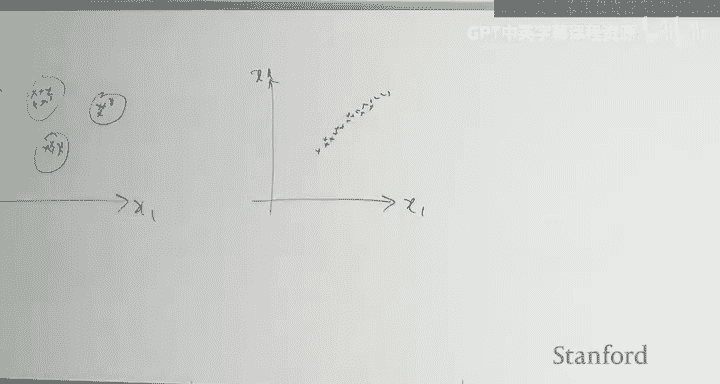
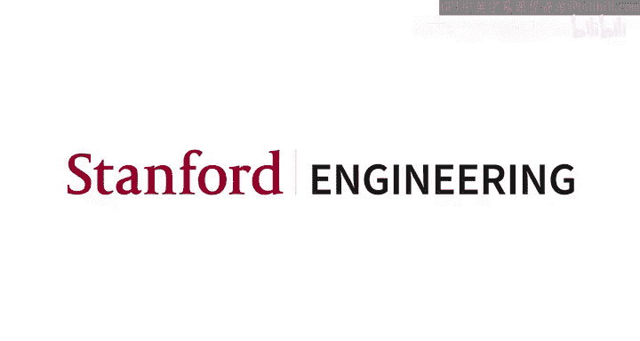

# 斯坦福大学《机器学习｜Stanford CS229 Machine Learning Course  Summer 2019 (Anand Avati)》 - P23：-23-.Lecture 23 - Course Recap and Wrap Up.zh_en - GPT中英字幕课程资源 - BV1NDopY4ECg

This is lecture 23 of CS 2 to9。 So today we are going to just continue the the finals review that we started last class and well finish up the final review and that's going to be it so。

We might finish a little early today。Allright continuing the final reviews so in the last class we started off with supervised learning we we kind of again went through linear regression。

 all the different interpretations of linear regression such as minimizing the square loss。

 the probabilistic interpretation， the projection interpretation， the normal equations。😊。

And then we moved on to logistic regression which is a model that you can use for classification。

 logistic regression outputs of probability for each for each example of the probability that the class is equal to one and then you can use a threshold and convert it into a classifier and then we spoke about Newton's method which is another optimization problem that works well for convex or concave problems。

And the the key summary from Newton's method is that it can be very efficient in terms of converging quickly but。

😊，Newton's method is kind of plug and play， which means it automatically performs optimization。

 You don't need to specify whether you want to maximize a function or minimize a function。

 You just throw a function at it， and it optimizes by finding the nearest。Stationary point。

 which means if your function is concave convex， then it automatically minimizes it for you。

 if it is concave， it automatically maximizes it for you if it is neither convex or concave。

 which just takes you to the nearest nearest stationary point right that was Newton's method。

Moving on so。There was this other algorithm that he saw called the perceptron algorithm。

So the perceptron algorithm was a streaming algorithm by streaming we mean it is an algorithm where you encounter one example at a time。

 you know think of it like stochastic gradient descent where you are encountering one example at a time。

And the perceptron algorithm had a very simple update rule， which was theta equals。

Data plus alpha times。Wai。Mus。G of theta transpose x。

Where G was just an indicator function which would return1 if theta transpose x is greater than equal to 0 or it would return 0 if theta transpose x was less than 0 so it is just an indicator function which returns 1 if z is greater than equal to 0 return 0 if z is less than 0。

嗯。And the the idea here was that supposing you have some examples， let's let's use some colors。

So let's say you have some positive examples。And you have some negative examples。And。

For our purposes suppose this is the origin and you have a theta vector that is currently pointing in some direction right generally you want the the theta vector to point in the direction of your positive class so the intuition behind the way the perceptron algorithm works is that if your answer is correct。

That is if theta transpose x is greater than to 0， then this whole term evaluates to 0 if you make correct prediction。

And so you you， you don't change your。You don't change your parameters at all。 However。

 if you make a mistake， that is if the correct answer was 1 and you predicted the 0。That means that。

You want to this will then end up I forgot x here。 right This will then end up adding a small small scalar times x to your parameter vector。

 right which means if this is。Where a theta is pointing and the new example x。Is， let's say。

 over here。Over over here， then the decision boundary of the current pic vector would be something like。

This。And。Let's say the make it easier。 Let's say the the。Example was here。 And so the， the。

The decision boundaries like this and so this this example is now predicted as a negative because it is it is on the other side of the decision boundary so what we want to do is now is to take this x vector。

This is the x vector which got misclassified take a small a small scalar times this。😊，X vector。

 and add it to。Theta vector， so which means you add a small component。

So we will call this alpha times x。And now this becomes the updated parameter vector。

And in this updated parametermeter vector for this， the separating hyperplane。

 which is perendicicular to it。😊，This would be updated。

Separating hyperplane now we see that the x is now correctly classified right So the the general idea here the the the logite home message is that when you want some vector theta vector。

To take a value that is closer or is oriented closer to some desired vector。

Then a thing you can do or an obvious thing you can do is to add a small scaleal at times the vector to the desired vector right。

That is theta plus alpha times x。Not product with。X。Will always be greater than。Theta transpose x。

That that is the take take on summary that you want to add a small scale at times a vector to theta to make theta be oriented closer to x。

And that's the perceptron algorithm。Adding vector vectors make them， make them similar。 That's。

 that's the take home message。And we saw， in fact you also implemented the perceptron algorithm in I think it was Home2 where we took this algorithm and then kernelized it and you guys also you know plotted the separating boundaries and whatnot。

😊，So that was that was perceptron。And in the perceptron algorithm。

 there is theory which we did not cover in the course， but there is theory to show that if。

A separating hyperplane does exist。Then no matter in what order you present the examples to the learning algorithm。

 it will eventually find some separating hyperplane。

That was that was the property of perceptron algorithms that no matter what order you present the examples in your stream。

😊，As long as you as you follow the update rule。If there is a separating hyperplane。

 it will end up recovering the hyperplane and once you get a separating hyperplane all the updates beyond that point will always be0 so it would have converged to。

😊，One of the， one of the possible separating hyperplanes。And after the perceptron。

 we moved on to something called the exponential family。😊，So， exponential family。

Is a family of probability distributions？Which have the gentle form。

P of y parameterized by Eta is equal to B of y times。Exponent of。Eta transpose T of y minus a of Eta。

Where。Why is the is the is the variable。Why is the variable？

T of y is called the sufficient statistic。And for most of the problems that we considered。

 especially with generalized linear models， T of y would mostly be equal to y for the purposes of our class。

So T of y is the sufficient statistics Statistic Eta is called the natural parameter natural。😊。

Prameter and B Y is called the base measure。And a of Eta。Its called the lock partition function。

And this exponential family covers many different kinds of variables。 exponential families can can。

Encompassees discrete random variables， continuous random variables， positive only random variables。

 integer random variables it is pretty pretty flexible in terms of the different kinds of supports the random variable can have。

😊，And so as a consequence， when we define a generalized linear model。

 generalized linear model where we take an exponential family and set theta equals theta transpose x where theta is now your learnable parameter。

Learnable parameter。That we learn through gradient descent or descent and x's are the inputs that correspond to y。

Once we once we kind of connect the inputs and outputs using this linear model。Then。

The the generalized linear model can therefore be is is is this more general form of regression classification。

 you know personal regression， etc cetera， where depending on the data type of y or the support of why we get all these different different。

😊，Different models， for example， when y is just a real value。

 you get regression when y is binary between 0 and1， you get classification。😊，And， and。

Based on based on this relation of how we extend exponential family to generalized linear model where this is the linear model。

 the sufficient the natural parameter is set equal to theta transpose x。We get these。We get these。

 We also showed these special properties。 So， first of all， the expectation。offff。

T of y or in general just the expectation of y where where T of y equals y。

Is equal to a prime of theta。 that is the derivative of the log partition function。At atam。

Valu to the data。And similarly， the variance。offff。Y are variance of T of y。

Is equal to the second derivative a double prime of theta。You showed this in homework  one。

 problem four。And these these two results can be extended to generalized linear models as well so in generalized linear models。

Expectation of y given x parameterized by theta。Is now。A prime of theta transpose x。Times x。

It's a simple， simple extension from， from， from。Exponential family to G LM。 So this is。

Exponential family。 And this is G L M。And similarly， the variance。

Of y given x parameterized by theta。There no。A double prime of theta transpose x times X。

 X transpose。Right， and using this property， we showed that generalized linear models are。

Or what what we what we showed is that this term over here。😊，Is also the。

Hesian of the log likelihood So the hesian of the log likelihood works out to be this particular formula or in fact it is going to be the sum over all the excise and。

😊，From this made this this term， we can see that the Hessian is always some。Y moment。

I think I wrote it the other way。This should be on the right。

So what we showed was that a double prime of。A double prime of y。Of sorry of of。

Of theta will be the variance of y given x parameterized by theta times x x transpose and。And here。

 this will be a prime of。Of x of theta will be。Will be the expectation of。Of y given x。Times。Times x。

So what we see is that the it can be shown that the the the hessian of your log likelihood will evaluate to this and this is always。

😊，Positive because it is the variance and this is PSD right so the hesian of the log likelihood of a generalized linear model will always be positive semi definite and therefore convex this question。

浮 from。GlM to the exponential company， the GlM essentially is how is it different from a linearium model。

So GLM is when we we take an exponential family right and reparameterize the natural parameter with the covariance of corresponding to that example。

 So that takes us from exponential family to GLM in exponential family you only have y there is no x's there。

😊，RightIf you want to use it as you know， some kind of a predictive model where given x。

 you want to predict y。This exponential family alone does not work because you you have only y and the way you introduce your inputs is by reparameterizing the natural parameter as theta transpose x where x' is are the are the inputs corresponding to y and theta are the learnable parameters。

😊，これらのし。我。Additional benefit does this paraary paraization give you over， for example， featured song。

 feature。So feature good question so feature maps is kind of orthogonal to this。

 so you can still use feature maps where instead of theta transpose X you do theta transpose phi of x。

😊，So you can you can introduce feature maps into generalized senior models。

 So it it' is a separate concept I feature feature maps what what GLM allows you to do is is。😊。

Provide you a way to connect ys ys with x's。RightWithout without GLM， you have only Y。

 There is no X in in exponential families。 again， just to make sure I'm understand scientist right。

Maybe take an offline as but。し品。ta linearSo this this is theta equals theta transpo x So it means that we assume that theta or the natural parameter is equal to theta transpo x and then y is sampled from the exponential family that has this theta that's where the noise comes in So y is going to be a noisy version noisy observation and the noise follows this exponential family and the parameter of the exponential family will be theta transpo x once once you evaluate theta transpos you get an eta which will determine the exponential family and from that you assume that the y is going to be a sample from that exponential。

So that's， that's exponential families。 And then we saw this， this。

And then we saw this connection later in the course between exponential families and maximum entropy。

 right So performing maximum likelihood on exponential family。So if you are given a data set。喂 I。

You know， I equals11 through n， and you perform ML E。With some exponential family。

 that is equivalent。To performing maximum entropy， that is。Max。H of B。

With the constraint that the expectation of some some statisticstistic functions T of y。

Is equal to the。Sample， sample averages。I equals1 to n。T of。Weaihai。Subject to this constraint。

 if we maximize the entropy。Then you the the solution that you get。

Will lie in the exponential family and the parameters of that exponential family will be the ones。

Will be the same parameter that you get by performing maximum likelihood on the exponential family and the sufficient statistics that you used for the constraints are going to be the sufficient statistics of that exponential family。

 So thats you know it's this duality result where you can， you know。

 maximum likelihood and maximum entropy are like these dual problems of each other。😊。

So that was maximum likelihood and maximum entropy。

And then we move on to something called generative models。In yes question youimizing your entro or。

Well， so。Maximizing the。Entropy。Subject to these constraints is the same as maximizing the likelihood of this data set。

Using an exponential family that has sufficient statistics equal to these functions。嗯。

And then we moved on to something called generative models。Genderative models。So。

 the algorithms until then that we studied were modeling。😊。

P of y given x X was considered given right We did not assign any kind of probability distribution to x's。

They were given， but we we would assign some kind of a distribution to to why。

And then with with generative models， we now instead try to so this was our discriminative models。

In discriminative models， we just model p of y to given x。Whereas in generative models。

We actually try to model x as well So our interest here is P of y comma x。

Which is generally written as P of x given y times P of y。So， this is。The joint。And over here。

 P of y， we generally call it the prior。And a wise discrete， you call it the class prior。And P of X。

 Q and Y， you can think of it as the likelihood function。

So we model both y's and x's are x given y's。And depending on the data type of x。

We could either so x's could either be real valued。Real valued。Right， for example， in GDA。

Y was x was x was real valued， or x could be discrete， discrete valued。

And we saw one example of discrete value x， which was9 base。

So are these are these two generative algorithms that we saw where both these generative algorithms have discrete ys so the y's are discrete in both these versions in both these examples which means in a way we are trying to perform classification because your y's were discrete but the x' is in one1 in one case in GD x was real value valued and in the other case in I base x was discrete valued。

😊，And。For GdaA。The the model was something like this。

 So we assume P of y the prior was some Bernoulli。Well newly， with。Prameter P。And。P of x given y。Was。

From some kind of a normal distribution。With mean mu y。

 So each y had its own mu and a common covariance matrix。Sigma。

So this was this was GDA and the kind of picture to have in your mind is in GDA。We have some。Xs， so。

 so some， some， some x's that come from y equals 0。 So let's just call them 0。Next。

That have some kind of covariance structure， sigma。

So this ellipse kind of you know uniquely determines the the covariant sigma and then there is another another class y。

 So this corresponds to y equals 0。Y equals 0。 And for y equals1， we have this other。That has。

 That is。So the assumption is that y equals 1。Also。

This is distributed according to Gaussian with the same covariance structure as y equals 0 right So this is y equals 1。

So this this is the picture to have about GDA where until we studied generative algorithms we were not even visualizing x so we would only focus on you know what y was we would plot you think of think of y and modeling y but now we are trying to assign probabilities to exit x directly so this is x1 x2。

😊，X1 nor xt。And because of this equal covariance。The posterior of P of y given x。B of y given x。

Takes a form of one over one plus。Exponent of。Minus something。

And that is because it is easy to see that if both of them have this this equal covariance structure and suppose both of them have an equal number of examples。

 then the line that are be the set of all points。😊。

That gets equal likelihood both from the class1 Gaussian and the class 2 Gaussian is going to be some straight line。

And that kind of corresponds to a form which can be expressed as a logistic regression because in logistic regression we also got linear separating boundaries now if the equal covariance assumption is not met so instead if we had a normal with new mean corresponding to the class and also covariance corresponding to the class then we would have gotten instead now。

😊，One covariance that looks like this， another covariance probably looks like this。

Right and now the set of all points that get equal likelihood under both these classes would probably look something like this it wouldn't be a straight line anymore。

 it would be a quadratic。So that's， that's GDA。 The posterior of the GDA is is a logistic takes on a logistic regression form。

 You saw that in PS1， Q1。Right， and。We also kind of briefly discuss， you know。

 what are the cases when you want to use logistic regression directly and what are the cases when you want to use GDA。

Yes question。 Why did we make that assumption。こい込め。I you know how to do M with。

Was it just to show that you get a logistic。I a posterior or I'm guessing you don't get a logistic as a posterior Well so in this case so the question is do we get a logistic as a posterior in this case you can show that you do get a logistic as a posterior in this case。

 but that logistic will have quadratic form quadratic features of excess so you can show that this takes on a logistic regression form except that it's a logistic where you include quadratic features of your excess and。

So so so so the question of why we assume something。 the answer is always。

 if you assume something you get this right And and you know why you assume something is most of the times it's because it gives you some kind of a mathematical convenience。

 And then you kind of measure up against your data whether the assumption was reasonable or not that's in general。

 that's gonna be the answer for why we assume something for anything know in the course and in general you know making some assumptions gives you you know some kind of mathematical convenience。

 maybe you know easy to implement or you know convexity or whatever and that assumption may or may not hold through And then so you make that assumption build a model or whatever And then you fit your data and see if that assumption was valid or not。

😊，Next question。Do there significance of trans。テ and geneativeismで。Acur to me。

 when would we want to use a description？全外有。Yeah， so I'm coming I'm coming to that right away。

 So then we kind of kind of ask the question， you know。

 under what some circumstances do we want to use logistic regression and when do we want to use GDA right and the the answer to that is。

😊，If you don't have a lot of data。And also， if you are pretty sure that the modeling assumptions hold true。

In those set of situations， using generative models。

Is is going to be beneficial over using logistic regression。However， if you have lots of data。😊。

And you know you are not too sure of whether the modeling assumptions hold true or not。

 then you are better off using logistic regression in logistic regression we made no assumption about the about how x is are distributed the only model P of y given x。

And X was assumed to be given。 So logistic regression is， in general， more robust。

To the kinds of excess that that you may you may you may actually encounter， however。

In examples where the assumptions hold。GDA will be more sample efficient。

 You need a lot fewer examples when the assumptions hold with GDA， as opposed to logistic regression。

And that that answer kind of holds for you know all generative models when you want to when you want to learn some kind of machine learning model right so when you want to build a model you can kind of give information to it either through assumptions。

😊，Or you can give it information from data。Right， and。As long as your assumptions are true。

 feeding those assumptions is beneficial。And you have these other in this other case。 So in in GDA。

 in these generative models， you are feeding in a lot more assumptions。

 a lot more prior knowledge right And as long as those knowledge is is as long as those assumptions is is true。

 it is beneficial。 You need a lot less data to make up for for the information。😊，In。

Discriminative models， you are feeding a lot fewer assumptions。

 You are saying nothing about X's at all， which means you need to make up for that lack of information that you are feeding by having more data。

And it fits the data no matter how you know it fits the data better because you are just making fewer assumptions about how the data is supposed to be。

😊，So that that is going to be a common difference between our common way to think about when you want to use genderative models versus when you want to use discrimino models。

嗯。Right， so that was GdaA and then we kind of moved on to naive base。It's a9 base。In9 ways。

So9 basis is an algorithm that is commonly used with text classification。

In text classification the inputs or the x's are discrete。

 you know they are discrete words that make up a sentence or message。And。In9ive base。

 we kind of saw these。So， first of all， in nine ways we make this conditional independence assumption the conditional independence assumption tells us that x。

I is independent of x。J， given y。Which means。If you know what the class is， whether you know。

 for example， if you are doing spam classification y can be 0 or 1 spam versus no spam if you know what the class is then the probability of observing one word is independent of the probability of observing another word right this。

Does not mean。X I is independent of xj right so independence and conditional independence are two to kind of orthogonal properties being conditionally independent says nothing about being independent and vice versa right in in9 base we make this conditional independence assumption that if we know the class then the probability of one world occurring is independent of the probability of other words occurring。

RightAnd this， this assumption may or may not hold true in practice， but。

 but it so happens that even when these assumptions are not met。

 the models tend to work reasonably well with text or textual data。😊，Especially for classification。

 Yes question。Does't hold her。Oh， sorry。Yeah， that doesn't hold。And we saw two。

 two different event models called the Berno event model。But newly， he went。Model。And the。

 and the multinoial element model。Can know me。Even。Modern， right。

 So the difference between the these two is。In， in both of， in both of。Both of these event models。

 we assume p of y。Is equal to phi y。P of y equals p Y， right。 So this is the class prior。Clas。Prior。

Last brighter。So the class priority is what fraction of all the messages that you encounter will be spammy in general？

😊，Without even looking at the messages of of the content of the messages。

 That's just the class prior。 And then in the Bernoulli event model， we say P of。X J given y。

equalqual to C。Zhi。😔，Given why。According to again， this is a Bernoulli distribution。Bernoi。

Re what that means is。Over here， X J。Is the Jde。Word。In the vocabulary。喂。

What this means is we have one parameter。P a word in the vocabulary per class。

And what the parameter signifies is the probability that of the word。

 the j word in the vocabulary occurs in a given message。😊。

So on the other hand with the multinomial event model， we have p of xj given y。Is equal to S us。

Equal to phi。J given given y where this is the J multinoial distribution parameter。

Or the categorical distribution parameter。我电脑。A distribution and xj here refers to the J world in a message。

So in the in the Berno event model， we care about。What fraction of the message the word occurs versus does not occur。

 We don't care how many times the word occurs in that message。

 we just we are just counting what fraction of the messages does this word occur versus not occur。

It may occur 10000 times in a message， but we just count it once that it occurred in this message。

Whereas in the multinomial event model， we are trying to。Build a histogram of words。

That occur in all the messages of given of a given class。

So here we basically end up counting the number of times the word repeats across all messages in spamy emails and similarly the number of times a word occurs across all messages in non-pay emails and and then we count them and normalize them to get a multinomial distribution over the words so that's a multinomial event model whereas in a benoul event model we kind of treat each word in the vocabulary as a separate problem and estimates estimate the bernoulli parameter of what fraction of messages does this word occur in the spammy emails or not this question。

Yeah the way I think about it， like， can you confirm this is a。Basically， multiple。The same as Bnoli。

 but what you do is give concatenate。Nonpanm messages and concatenate all the spam messages。ときますけど。

And that's not the case so the question was in multinomial do you think of it as taking all the spining messages concatenating it as one big message take all the nonpin message concatenate against one big message take those two big messages and perform Bernoulli thats not the case because in Bernoulli we are only we are counting the number of times or rather the number of messages in which a word appears so if you collapse everything into one message then the answer is always zero or one does that appear in that one large message or not whereas in multinomial what you want to do is actually count the number of times the word repeats across all messages so those two need not be the same。

And then we also saw this concept called Laplace moving where in laplace moving is a technique to handle rare words where you know words may may occur very infrequently and in Laplace moving the idea is。

For each of the two different event models。First kind of precount that each event happens once。

And starting with count of one for each of the events。

 then look at the data and start incrementing the counters thats that's the general idea of Lo plus smoothing where you want to start with instead of starting with the zero prior。

Where a0 prior means you have no idea whether a message is you know a word occurs in a spay email or not。

 Start with a prior where you assume you've seen you know1。

 one count of each event right So that means。In in the Bernoulli case。

Each word assume that youve seen it once in a spammy email and once in a non spamy email。

 then you start incrementing the counters by looking at the emails seeing whether and checking whether the word occurred in it or not。

And similarly， in the multinomial element model， assume that every word。

Occurs once in the spam class or the spam pool of messages and occurs once in the non spam pool of messages。

And then construct the histogram of words from， you know。

 this pool and that pool by adding on to that one。And then normalize it。So that's the last moving。

And。That kind of wraps up generative models so those were basically the two models that we saw GDA and9ive base GDA was for continuous access9ive base was for discrete access。

And then， after。After generative models， we moved on to kernel methods。So。With kernel methods。

The motivation for kernel methods。Is。Having some kind of an efficient way to introduce feature maps。

So， we saw feature maps in homework1， the last question where we implemented polynomial features。

For linear regression。And we saw that by using feature maps。😊。

Even though we are fitting a linear model， the hypothesis that we get can be quite nonlinear or quite curvy。

😊，So linear regression is linear in its parameters or linear in its features it is not always linear in the with respect to the original data。

 so by introducing these features we can get you know pretty complex nonlinear models。

And kernel methods is a way to。To。Have these nonlinear features。In an efficient way。So a kernel。

So in order to define a kernel， we start with a feature map。个人呢。Methods。

So we start with a feature map， phi of x。😊，That takes。From R D。To。R P。Right，Where x is in。RD。

 that is the data that is given to you right and P。Is。The the dimension。Of the feature space。

And importantly， p can be infinite。And now。We define a kernel based on this feature map and say that a kernel corresponding to a kernel is a function of two inputs。

 let's call it x and x prime。Corsponding to a feature map， if it evaluates to phi of x transpose。

Fee of express。So， a kernel takes us input to xs like you know。

 before you map them to a high dimensional feature space and it evaluates the output。😊。

To have the same value as that you would get。😊，By mapping them to the high dimensional feature space and taking it in product so mathematically these two are equivalent。

 but computationally or algorithmically the kernel would generally perform some kind of a more efficient computation that gives you the same answer as if you had constructed an explicit feature map and done it in a product between them so those are kernels So kernels are functions of X and X prime corresponding to some feature map such that they evaluate to know mathematically evaluate to the same answer as you would have obtained from the explicit feature map construction。

😊，And then there are a few properties of kernels， so a function k。Is a kernel if it is symmetric。

If it is symmetric and。If you were to take a collection of examples， X1 through。

So if you were to take x1 through， let's say x it is called M。And construct a kernel matrix。

 So kernel matrix is then。A matrix of M by M。And these examples can be any examples these need not be a training so take any possible examples you can you can come up with and if you evaluate k of x1。

X1。Key off。X1。XM。Similarly。K off。X M。X M。K hot。P。😔，Next1。

 so evaluate the kernel function on every pair wise on every pair of two choices from this set。

And this。Matris that you obtain where each of these is just a scalar。

Each of these is a scalar and you get this matrix， which is also called the kernel matrix。😊。

This kernel matrix。😊，Will be symmetric and positive semi defite。

And we also saw this theorem called Mercer's theorem。Marcerus Theorem。It says。

In order for a function k to be a kernel， it is necessary and sufficient for the corresponding kernel matrix to be symmetric and positive semi different。

😊，Right， so the， the。So， the kernel matrix being symmetric and positive semi defite is both a property of kernels。

 which means it is a necessary condition。😊，And Mer theorem tells us that it is also a sufficient condition that for any k。

 if this property holds， then k must be a kernel function。😊。

And the Merss theorem you know11 lose intuition there is the Mers theorem is essentially telling us that any sub matrix of a positive semi defite matrix is also positive semi defite so you can think of kernels as these PSD functions which are infinite dimensional。

😊，And a kernel matrix is。You know， a choice of。For some choice of specific input values evaluate the kernel at those points and extract it the matrix and most theorem essentially tells you that you know any sub matrix of this infinite dimensional PSD matrix or PSD function must also is necessarily a positive semi deffininite and vice versa his question。

X1 to xM。It can be any X1 through X M， any arbitrary X1 through X M， any example。

 they need not be a training set。It's， it's just a property of this， of this function。 So that was。

 that was kernels。Next question。So you know the Merss theorem tells us that so this infinite dimensional space that you see you and think of this as the function k where this is one input。

 the other input and the values here are the values that the function evaluates to right and now think of this as an infinite dimensional matrix。

And now if you just you know extract the evaluations of this function at certain points so this corresponds to x1 this corresponds to x2 and this corresponds to xm and similarly this corresponds to x1 xm so basically you are just extracting these these extracting a sub matrix out of this infinitear dimension matrix here。

And versus theorem is another is another way to say that a matrix in this case。

 the infinite dimension matrix is positive semi definite if and only if。😊。

Any sub matrix is positive semi different。So that's， that's that's Mer' theorem。 and that's kernels。

 And the kernel trick is basically。If we can rewrite our algorithm。😊。

To be represented as inner products of X。Then we can replace those inner products with kernel functions。

And。That basically allows us to redefine parameters。

 So if this is our design matrix x where you have n examples。And let's collect P features。So。

 so this is p of x。So there's some feature map。😊，And you have P features and n examples， right？

In the simplistic approach in the naive approach， we would define a theta vector。Right。So。

 we would define a theta vector。In our P， you know if if you used a feature map P and then we would use some kind of a gradient descent to keep updating these theta vectors with each time step by minimizing a loss so think of this as theta at time  zero and then theta at time 1 theta at time 2 and so on and gradient descent gives us updated theta vectors。

With the kernel method， we can basically flip it around and say we define one coefficient per example。

😊，So， this would be。Coll it beta 0。Where。We have one element per example。

Which kind of sets the weight of that example， in a way。And with with kernel methods。😊。

We keep obtaining these updated beta vectors。so gradient descent keeps hopping us from。

You are to hear and similarly， if you kernelize it。

 you work with coefficients for different examples。😊，And this。This method therefore。

 basically allows us to have infinitefrared dimensional。

Feature maps right the9 method would start failing as you extended p to infinity because you need to maintain vectors of that length。

Whereas with kernel methods we are maintaining a vector of length equal to number of examples and so even even this kind of allows you to use infinitely long feature maps。

😊，And we we use kernel the kernel version to evaluate the evaluate the infinite dimensional inner products in some inexpensive way。

😊，And we maintain finite dimensional coefficient vectors。 So that's that's kernel。

 that's the kernel trick。We， in the notes， we have。

We have described how to use the apply the kernel kernel trick to linear regression and in one of the homework problems you kernelize the perceptron algorithm right in the perceptron algorithm not only did you kernelize it but you also made it work in a streaming setting where you are obtaining one example at a time and the beta vector would be extended keep as you kept encountering new examples。

So the that was from colonizing the perceptioncept。And then。

We we briefly covered support vector machines。 So support vector machine is a kernel based classification algorithm。

 a kernelized perceptron is also a kernel based classification algorithm。

The the support vector machine however， focuses on something called as the geometric margin that defines the separating hyperplane。

Right。The the algorithms such as logistic regression try to maximize the functional margin which is different from the geometric margin and you saw the distinction between functional margin and geometric margin in the again in PSet2 question1 on training stability of logistic regression where logistic regression by trying to maximize the functional margin would keep extending the margin all the way to plus infinity because it found well a hyperplane that could be separated and it would just gain for free a higher functional margin by just scaling all the values up and it would just keep scaling it forever whereas with support vector machine you don't have such problems because you are trying to maximize the geometric margin and the geometric margin is the geometric margin because it's a geometric concept。

And the support vector machine also has this other nice benefit that。

The coefficient vector that you end up with。At the end of training is going to be sparse by sparse。

 it means that most of them will be zeros。Except a few。Examples。The rest will all be zeros。

And these few examples which have a non zero coefficient， are also called the support vectors。

So the idea there is。😊，Let's say you have some classes over here。And。

Another class over here with examples， support vector machine tries to find this。

Separating hyperplane that maximizes the geometric margin between the two classes and in order to decide this this exact position of the separating hyperplane all what matters are these nearest examples from both the classes。

😊，And these two these two subset of examples end up being the support vectors and the the。

The location of the other examples don't matter， so they get a coefficient of0。

 but the nearest examples end up having non zero coefficients and those are also called the support vectors right so support vector machines are are are kind of this nice they have this nice benefit that。

You can use kernel methods and get scalability in terms of features to infinite dimensions。But also。

 unlike other kernel methods where you need to hold on to the trainings。

 the entire training set into test time。Support vector machines allow you to hold on to just these few support vectors into test time。

So so the sparse dual coefficient the sparse coefficients that you get from support vector machines gives you this nice benefit that you get scalability in terms of number of features and also scalability in terms of number of examples because you are only going to hold on to you know a few support vectors into test time whereas with other kernel methods you generally need to hold on to the entire training set into test time。

So that was our support vector the machines。And then we moved on to another kind of。Cdinal algorithm。

Clled Gausian processes。Right Gaussian processes。 So Gaussian processes is a kernel method for regression。

So support vector the machine and kernelized perceptron were。😊，Clonnal methods for classification。

 Gaussian processes is a kernel method。For regression。And with Gaussian processes， the。

The the way we we define Gaussian processes is to generalize Gaussian distributions to infinite dimensions。

Right， and in infinite dimensions。So if we have a Gaussian vector you know of a certain dimension。

That has a certain mean。And a certain covariance。In a Gaussian process， you have this。Function。

Where we are visual where we are thinking of function as an infinitely long vector。😊。

So it is like a continuous version of an array of a vector which extends to infinity。😊，And this。

Is a a Gaussian process。That has a mean function。Right，W us again。Infinite dimension。

 And instead of a matrix， you have a covariance function K。

So a Gaussian process is this infinite dimension extension of multivariate Gaussian distribution and。

😊，There are certain properties of multivariated Gaussian distribution that makes marginalization easy。

 So if you want to marginalize out one of the one of the components of a Gaussian distribution。

 you just ignore that component in the mean and ignore that row and column in the covariance function right So marginalization is very easy in in Gaussian distribution。

 So one way to think of the way we apply Gaussian processes to to a given data set is to。

It is an incorrect technically incorrect but very useful in terms of understanding that you have this infinite dimensional Gaussian vector。

😊，And we marginalize out everything that is outside our training set and test set。

So choose only those points。In this infinite infinite dimensional vector。

 choose that finite subset of points。Where the finite subset is made up of examples in our training set and examples in our test set。

And that basically kind of condenses this infinitely infinite long mean。

Function into a finite dimensional mean vector and an infinite， you know。

 a covariance function into a covariance matrix。And this covariance matrix that you。

 that you obtain is exactly。Like this。Have you obtain a kernel matrix with kernel methods。

 you obtain a covariance matrix by using the kernel function and we saw that a kernel matrix must always be positive semi different versus theorem told us and covariance functions or covariance matrices need to be positive semi different so that kind of matches up。

And once we obtain this， we just use the conditioning of Gaustian distributions to condition on the training set。

And obtain posterior on the test set on the examples that we want to make prediction so thats that's Gaussian pro。

 The mathematical notation can be a little messy， but essentially what's happening there is just this marginalize out everything that's not necessary and use the conditioning rules like the rules themselves are heavy on notation。

 but you know you just plug the the correct pieces into the conditioning rule and you get your predictive distribution on on unseen examples so that's that Gaussian pro。

😊，Any questions tonight that？Yeah， yes question。Just what。Yeah。

 good question So what kernel do we use and generally the choice of kernel is a hyperparameter that you tune you try different kernels and see what best what works best instead of giving you good predictive power on a validation set right you generally you generally play around with a few different kernels and choose one that works best for you。

So the the choice of which kernel you want to use is somewhat equivalent to the question of asking what feature map you want to use with linear regression。

 it's very similar。So then we move on to neural networks。So with neural networks。

We want to think of neural networks as these complex。Differentiable。

Layer wise are composite functions。That have parameters at all layers。With non nonlinearities。Right。

So， imagine you're given。Of feedingeding an input vector x into a model。 So this is x in。RD。

And so we are going to we are going to talk about what' is commonly called as as fully connected networks。

This is one specific architecture of neural networks where you start with。

The input x that you are feeding into your model and。You take it through these。Hidden layers。

Where from the input layer just called you know， you can think of it as layer 0。

 you go to hidden layer 1 by multiplying this by a matrix w。W x plus some bias B。And。

Running all of these through some non linearity G So G of w x plus B will give you this vector。

So w w is a parameter that you want to learn and x is the input that is going in B is another set of parameters that you want to learn G is some elementwise non nonlinearity like the sigmoid function for example。

😊，And depending on the dimension of w， right， W will generally be R let's lets let's call this。啊。

K by D， So W x will therefore be。Let's call it RK， where this has K components in it。

And this had D components in it。And then we basically perform， perform another layer of the same。

 So G of。So if this is W1， you have another W。2 of。Of this， which let's call it。Yiwen。Plus。B2。

 and so on。Eventually。We bring it down to one scalar， which we call it as y hat。

And then corresponding to this x， there is another y。So you take the output of the network。

 take the actual output and combine the two into some kind of a loss。And this loss is a scalar。

These outputs and labels could possibly be vectors so if you are doing multiclass classification this would give you this would be like the output of softm so it would be a full vector and the true label would be a one hot vector of what the correct answer is。

And but the loss is always a scalar valued loss right that that that is the common convention。

 So you start with a scalar valued loss。 and now we want to we want to calculate the the the gradient of this loss with respect to every parameter and every layer。

And in order to calculate that we use an algorithm called back propagation and back propagation is essentially just the multivariate chain rule of calculus so the way you want to think of back propagation is always start with one scalar parameter let's say w Ij。

😊，And try to calculate the partial of loss with respect to partial of Wj of some layer L。

And this will always must always evaluate to a scalar because you are calculating the gradient of a scalar with respect to a scalar and the intermediate steps to calculate this will involve you know going from the scalar to a vector and from vector to vector vector to vector and finally vector to scalar。

Right。And so。And each of those intermediate components are called Jacobians right going from vector to vector and and so each of those intermediate are called Jacobbians and you will encounter you will generally see that the seek that the chain of Jacobians that you encounter while calculating this will generally be you know you have a row vector。

Matrix， matrix， matrix， and finally， a column vector。

And once once you once you multiply the out this will just evaluate to a scalar this is this is going to be common and for layers where you are performing a nonlinearity the Jacobian will be a diagonal matrix and for computational reasons you know you might want to instead of implement as a diagonal matrix you might just want to do elementwise multiplication。

So perform this for every possible parameter in the network。😊。

And then you can use some you can identify common patterns and define update tools for the entire matrix。

😊，In a more compact compact form and so so all all that is basically just algebraic manipulation。

 but the goal that we are trying to achieve is to calculate the gradient of the loss。

 which is scalar with respect to every scalar parameter。😊。

And once once you calculate these gradients， it is basically just gradient descent。😊。

Perform gradient des on all these parameters simultaneously take a small step to minimize the loss with respect to all these parameters and take a small step and you know repeat until you converge。

😊，So that was neural networks and back propagation。And after neural networks。

 we moved on to some learning theory。😊，Basically， bias variance analysis。

So bias varianceance analysis is probably the most important concept from the entire course。

And it's this bias variance analysis that distinguishes machine learning from， say， you know。

 optimization right in in。In general optimization problems you are given some kind of a function or an objective and you want to maximize or minimize it。

And we use such optimization techniques like gradient methods。

 Newton's method or even just close form expressions for maximizing or minimizing some kind of a loss。

😊，Right but what distinguishes machine learning from just optimization is the bias variance straight off。

 which means what it actually means is our end goal is not really。😊。

Minimizing the training objective itself。 Yes， we are， we are minimizing the training objective。

 but our goal really is to perform well on unseen data。

And we are kind of doing this minimization of the training loss as a proxy。😊。

With the hope that we are going to do well on test data。 so the。

 the bias variance analysis is is a way to kind of。

Decompose our test error or the encounter the the error that we encounter at test time and break it down into sub components for bias various and irreducible error。

So， irreducible error and this decomposition generally holds true for all losses but in the specific case of a square error loss we get a very clean decomposition that means squared error now on test set or on a test example is the sum of。

😊，Ireducible error。那。B square plus variance。the fundamental assumption is that our data is noisy。😊。

And this noise。😊，Can can can affect our test error in two ways。 So， first of all。

 the test example that we are going to encounter itself is going to be noisy， right。

 And so the noise in the test example contributes to。In the irreducible error。 So this is。Noise in。

Test example。This basically tells us that no matter what model you choose right choose the best possible model that can possibly be you know possibly be imagined。

Even that model is going to encounter some error at test time because your test data itself is noisy。

So that is irreducible error no matter what model you get you are going to pay this irreducible error penalty no matter what。

😊，And then the bias and variance。😊，Or basically， so you can think of the， the。

Noise in the training data that you have。To be contributed， to be contributing to， to variance， so。

Training。Data noise。Contributes。To the variance of the model。Right。

And bias is more or less kind of telling you how inflexible your model is right so your data may be maybe saying some story of course a noisy story of how of the pattern between your x's and ys。

 but the model that you have may be limited to just linear models even though your data has a clear let's say you know。

😊，Qudratic relationship。X and y where there is a clear quadratic linear relationship between x and y。

If you happen to choose linear models。Then obviously。

 your model is biased because you are limited to solutions that look like this。Right，So。

 so bias is mostly due to。Inflexibility in your model class。Inflexibility。Or limited capacity。

Of model class。And variance is due to noise in in your training data。

And so our goal is to not minimize the training loss。

But our goal is to actually minimize the test class。Or the test error and this test error。😊。

Has one component called irreducible error for which we can do nothing about。

 So we focus on just bias and variance。And the kind of action space that we have。

Includes kind of contradictory actions。 So some act， you know， one action is you know。

 increase regularization and increasing regularization will reduce variance。

But there is also another action called reduce regularization which will will which will fight bias so in order to decide which action you want to take you want to get a good sense of what is the contribution of bias versus what is the contribution of variance in your test error。

😊，And a loose proxy for that is you can think of。Bs as training error。And variances as。Gap。Between。

Test。Or validation。And training。So， bias technically is not the training error。

 but for the purposes of choosing the action to take。😊。

It works as a sufficient proxy to think of a bias as training error so if your training error is very high then you want to take steps that fight bias so in that way it is a reasonable proxy for the purposes of the bias variance analysis to think of bias as the training error and the variance is the gap between the test and and。

Test for validation and and training error。And we also discussed some actions in the previous class of what actions help fight bias versus what action helps fight variants and before you take any action you always always want to get a breakdown of test error and train error and kind of make a judgment call of whether you are facing a high bias problem of facing a high variance problem and accordingly take an action that will reduce your overall test error。

So thats that's bias variance problem。 And this methodology。

 this bias variance way of thinking holds for classification， holds for regression。

 holds for supervised， holds for unsupervised it and it is it is it is kind of this。😊。

This topic that permeates all all the models and all the algorithms that we consider and it's probably the most useful when you are applying your model applying machine learning for a new problem that you are working on in practice because the new algorithm that you are working on in practice might be an algorithm that you that you' have not studied in this class。

 for example， random forest but you can apply bias variant for that algorithm as well。

 it works for all algorithms。😊，So that was that was bias variance analysis。

Then we studied regularization。And。I gave a Bayesian interpretation for regularization。

So regularization。is a way in which you add a penalty for large values of your parameters。

Where the intuition is that large values of parameters。Can result in very complex models。

And in order to kind of minimize the complexity of our models。

 we want to limit the the the values or the magnitudes of our parameters。😊，And so we if our。So。

 our loss。Now， if it's generally some kind of I equals1。I equals1 to n。

 let's say Y I minus h theta of x。I square if this is our regular loss。

We want to augment it with some kind of。A penalty for the loss for for the parameters being too large。

And you can either there are several choices here， you may sometimes want to penalize the one norm。

Of the the parameters and we we saw that adding adding the two norm for the parameters is equal is has this Bayesian interpretation of performing MA estimation。

With Gaussian prior。And perform with the one norm is equaling to performing MA estimation with the laplace prior。

And in your homework， you also saw how to you know what the exact value of these lambda terms should be depending on the parameters of the Gausian and Laplace distribution。

😊，So that was regularization。And。After that， we moved on to reinforcement learning。😊，Right。

Reinforcement learning is this， this。Is slightly different from the other algorithms in the sense that in the other algorithms we make this IID assumption where for each prediction in each prediction or each example is completely independent of another example on which we are making a prediction instead in reinforcement learning we are in this sequential decision making situation where the predictions that we make at one at one situation。

Will will result in some action being taken and that action will decide the next state that we are end up with and therefore decide the next situation where our prediction is being made right so the examples if you think of each time step in reinforcement learning as an example these examples are not IID anymore they are all kind of correlated。

And in order to formalize reinforcement learning， we defined something called an MDP or a Markov decision process。

That's a couple of states。Actions。Transition probabilities， PSA， in fact。

 a set of transition probabilities， a discount factor and a reward function。So the reward function。

 so we can be in one of the many states。Which is defined by the set S。

We can take one of the many actions defined by the set of actions a。

And depending on which state we are and what action we take， we end up in a new state。😊。

And that transition or the dynamics of moving to the next state is captured by this this this set of transition probability vectors PSA。

And at each state， when we arrive at a state， we obtain a reward that is defined by the reward function。

😊，And there is this discount factor called gamma， which basically tells the rewards that are obtained sooner or better than rewards obtained later。

And gamma is generally a value between 0 and 1 so this is the the formalism in which we we we attack the reinforcement learning problem and based on this MDP we define these two kind of related concepts called value and policy right so value and policy。

😊，So， policy is a mapping。😊，From state。To action。It' is like a rule book。

 if you are in a particular state， what is the action that we should take right this rule book is called the policy。

😊，And the value。😊，We。That corresponds to a policy pi。Of a given state。I。

Basically telling us if we were to start in a state s。

And were to continue the trajectory by taking actions according to the policy pie。

whichch means when you are in state S， take action according to you know the value pi of s evaluates 2。

And that action， according to the dynamics， is going to take to a random new state。

And in that new state， which is random。Refer to the rule book and take an action according to that policy right and so on。

And if we were to repeat this this process over and over where each time you know you can end up in a different state according to the dynamics。

 what is the average accumulated sum of discounted rewards？And that is， is， is。

 is captured by this function called V pi。His question。说你也就是。

Just value policy integration or just the concept， just the concepts of policy and value。

So policy is just a rule book。And value is the is the long term reward that you are going to accumulate by starting at S and following the rule book P。

😊，喂。And and these two concepts， you know， policy and value。A are kind of el so。

If you are given a policy pi， you can perform something called a policy evaluation。And get v pi。

Or V pipe。And to get v you can you can you can obtain v using a simple set of linear linear equations。

 you can just solve a linear equations and get the values for all the different states and if you are at if you are given some policy v that policy kind of implicitly defines。

I think I said it wrong if you are given a value function v that value function v implicitly defines a policy where the policy is to take action in a greedy way to maximize the value of the next state。

😊，So。So。So pa。Of S。Is equal to。Ag max of a。Expectation。offff。V。Off S prime。

Where S prime comes from PA。chooseose an action that is going to maximize the expected value of the next state。

So。Value implicitly defines a policy， and a policy defines a value。 However。

 the subtlety is that this cycle is not。Is， is， is。I not the inverse of the other direction。

 which means a policy will will give you a particular value function。

 but then if you take this value function and try to calculate the policy that that acts greedily according to this value function。

You will not get the same policy again right and back asymmetry is what is captured in policy tueration。

So， policy iteration。Is an algorithm。Where we start with a random policy。

Evaluate the corresponding value function and take that evaluation value function and re the best possible policy you can come up and then reevaluate the new policy the new value function according to the policy and go on and on until you converge。

 so that's policy， policy iteration。Until your policy converges。

And then there is this other algorithm。Called value iteration。In value iteration。We have this。

This thing called the the Belmon equation。Right， in the。And the goal in， in。

In in the value iteration。Is to estimate this function called v star。

 which is called the optimal value function and v star of S is basically you know。Arc max。P。The of。

 So basically。Now， what is the best possible value that you can have for a given state？

If you were to scan across all possible policies， so thats that's the optimal value function。

And this optimal value function， if you were to plug it here。

 the policy that you are going to recover is the optimal policy。Right， next question。

 shouldn't just max because you shouldn't be a。Yeah， you're right。 This should。 this should just be。

 yeah， you're right。 Thank you。 So this just should be a max， right， So the， the idea with。

With with value iteration is that value iteration has。You perform this update rule。Where V of S。

Set it equal to。V of S plus。'm sorry， Art of。Plus。Gamma times。Max a。ピエ。Its point。Right。I。Yes。

 hearing。Thank you right So this this is this is also called the the Belman backup operator where if you were to perform this over and over you will recover V star and the intuition to have here is。

😊，If this is the space of all value functions。 So this is a V of S1 through。V of S。S。

 all the possible value function。 There is this optimal v star。And no matter where you start。

So you can call this as this operator as V is equal to Belman Operapress。Of we， right， so。

Take any two value， any two value functions。 run both of them through。The Belman operator。Right now。

 the distance between these two。Will always be smaller than the distance between。The original two。

 this distance will always be smaller。Wwhichch means the beman backup operator or the Belllman operator is a contraction mapping right so the space is getting if you were to run your examples over and over with these beman operators then they are kind of converging right and whenever you have a contraction mapping that exists this point called the fixed point。

😊，And this fixed point。Is the， the optimal value function。So the value。

Takes your value function from any space from any point in the space。

 you keep applying the Belman operator。 You're going to eventually converse to the fixed point。

So that that is value iteration。😊，Running this over and over。And we， we also saw this other。

We also saw a variant of this called fitted value。RightSo fitted value iteration。

 where in fitted value iteration， we。We limit ourselves。😊，SoSupposing this is V star。

 we limit ourselves。To a class of value functions。In this class of value functions。

 lets say this this could be the class that is like the output of a neural network or a linear model you know any any any any some class of value functions where we start with some point。

You know， some theta that that parameters this value function and on this we apply the beman backup operator。

The beman backup operator will take us to some new value function which may be outside our parameter space and then we project this back onto so this this Belman operator operator takes us here and then we project it back onto our class by trying to fit。

This。This value function from a function in our class say you know say by minimizing the least square or some such last function so that's like projecting this new function back into the class。

 And from here again， apply the Belman operator you get a new function projected back again apply the Belman operator。

And then project it back。And this is called the fitted value iteration where you are staying within this parameter this parameterized family of functions。

😊，And the iteration takes you closer and closer to V star。

But this algorithm is not guaranteed to converge because this is not a true contraction mapping anymore。

 there is no there is no there is no fixed point for this and。😊，But however， in practice。

 it it tends to work well。So that's， that's fitted value iteration。We in your homework。

You implemented value iteration for the inverted pendulum problem we did not do fitted value it in the homework implemented this and you also implemented this in the context where PSA was not known。

So， in the homework by running your simulator we also learn the transition probabilities as a separate problem and using the estimated transition probabilities we learned the we perform the value iteration question what would fitted value it look like in。

More。What kind of。Yeah， so how would fitted value look in code so in in the homework you represented value as some vector。

😊，Right， whose length was the number of states you had right in。

Which meant you could set each element of this value function freely to any value。

You you could set this and not worry about what value was here。RightIn filtertered value iteration。

You are no longer representing your value function explicitly as an array。But， instead。

You will have V of s will be some， sum let's call it H theta of s。

 So S will be the input to the model。 The output of the model will be the corresponding value。

So this is fitted value。😊，So now。保证 when。根据。valuation was。

the Belman backup operator to get V but now we are trying to fit some theta exactly so initially with with with with Belman backup operator we directly work with this array and apply the beman backup operator until this entire array converges with fitted value iteration we describe the algorithm in the class and it is also in the notes we we limit ourselves to a representation like this it is no longer an explicit array。

Right， and on this， we。We apply the Belman backup operator， obtain something called Y。And then。

 find a new theta。New theta。Arg。Min of H theta of S minus y squared， something like this。

 so we are kind of projecting the y back to the theta space So the assumption So the block that you。

That that's the。Let's say， for example， a linear。Your value can be expressed。ていったから。Yeah， exactly。

 So this could be a linear model where you represent your value as theta transposses。 Yeah。

 so you kind of lose flexibility， but you also gain generalization。 So if you。

 if you do well on one state and another state is very similar。

 then you kind of have a good sense of the value of the other state。

 just because two states are similar， whereas with an explicit array representation。

 there is no hope of generalization whatsoever。Can you explain the。On body。

So on policy of policy is not relevant for the， for the review。 So we have。

 we still have a few more topics。 Maybe I can talk about on policy of policy later。 So。

 so after reinforcement learning， we moved on to unsupervised learning。

 where in unsupervised learning the。We are given a set of examples x's。

 but there is no corresponding y。And our task is to learn some interesting structure。

And the structure。We saw in in the class， basically， we we looked at two kinds of structures。

 The first one is。Do the examples cluster in some way。

And the K means was the first algorithm that we saw。I in K means。

The idea is you' are given know some set of。Some data。No， X1。To X， D。Right， and。

Given this data set that is all what you are given there are no labels you know we don't have a y value that tells this the all these are class one class2 class 3 that you we don't have any of that right and our goal is to now kind of cluster them in some way。

Right， and。Those were clustering algorithms。And。There is this other kind of unsupervised learning。

Where we are interested in finding subspaces， x1 and x D。

If this is our set of examples x there is no y is given to us right in in clustering we are trying to group examples into different categories whereas in subspace finding problems we are trying to see if this high dimensional representation can be instead captured in a lower dimensional representation So this data can be projected onto a one dimensional。

😊。

Representation that pretty much captures all the variants right and this was in PC8。So， we had these。

know unsuppowered learning， we had clustering problems。And subspace finding problems。Right， and。

In in the two the two that we spoke about just now， you know， K means。And PC。

 we call them not probabilistic。Non probabilistic。So K means。And PC。

And we have probabilistic equivalentvalence。For class swing， we use the Gaussian mixture model。

And for subspace finding， we use factor analysis。The the rough intuition to have is think of clustering as the unsupervised version of classification and subspace finding as the unsupervised version of regression like that that that is a lose lose lose analogy there right and we we also saw this algorithm called em or expectation maximization。

That we applied to solve the probabilistic versions。

 know both G MM and factor analysis using this algorithm called expectation maximization in expectation maximization。

Which is really an important algorithm， especially if you want to get into machine learning research you know in you know some of the new hot topics like you know deep generative modules。

😊，It's very important that you have a good understanding of expectation。

 maximization and all its variance， because that's that's really where things kind of start off。

 So in E。We have。Parameterters for a model。 So we start with a model。Where here by model。

 we mean some kind of a probabilistic model x comma z。With some parameters theta。

 which has parameters。Theta。And we call the observed components of our model as evidence。

 So evidence。This is generally denoted as x and we the other unobserved elements of the model are called latent variables。

We call them Z。 and an E。What we do is this iterating it E is an iterating algorithm where。

Each iteration has two steps。い step。We calculate the posterior。Now， Q of Z I is equal to P of。

The I given。X I at the current value of theta。 and in the M step。RightWe update thetas to。

Ag max theta。offff。Expectation of Z， according to。Qアイ。off。Lg。B of x。Z。Data over。Q位。Obviously。

So here the arg max theta， the theta that we are optimizing appears only here。嗯。And。

And by performing this over and over， this term is also called the elbow。

By performing this over and over we saw that this algorithm will eventually converge。

 we saw a proof of convergence of the EM algorithm and this algorithm will eventually converge。😊。

So that was EM algorithm。We also saw another model called ICA。Independent component analysis。

We used it to。You use it to solve the source separation problem in audio right you did that in your last homework where you are given some mixture of different signals you make a non Gausian assumption about the sources of those signals。

And using those non Gaussian assumption， you are able to construct a unmixing matrix and that unmixing matrix is calculated using maximum likelihood。

😊，And the the unmixing matrix that you obtain will be able to separate your audio sources into distinct original audio components。

So we saw this in the homework and again in your homework in the EM algorithm。

 we saw an extension of this for semi supervised learning。😊。

So it I would say it's pretty important to kind of understand that step that leap from unsupervised to semiupervised。

 how we went and try to get a real sense of you know what the moving parts was in the proof for moving from from unsupervised to semiupervised。

And。What else that's， that's pretty much。That we that that we covered in this course。 Then we also。

In in the last few lectures， we saw the variation auto to encoder again in the variation auto to encoder。

 we are。The variation auto encode is probably not not going to be in your exam。

 but you know it is an important concept， especially those who want to go into research where you have the z。

 the latent variable。😊，And x， the evidence。In EM， we would construct a Q for each example。

 the posterior。Whereas with the variation auto encoder。

 we construct an encoder network neural network that takes x as input。And outputs z as the output。

And given the latent variable to the evidence。In case of for example， simple models。

 we call this the likelihood function。😊，But in the VA， we call this the decoder network。

And we train the so again， just like we saw in the in the fitted value iteration right in in the original E。

 each example got its own Q function。😊，for the posterior and each cube of each example could be set independently and freely whereas with the variation autoenr we are trying to come up with this class now just you know have a similar picture in your mind you are trying to represent all the posteriors with some kind of a class and which is called aortized inference where instead of calculating a separate posterior for each you construct this class where you feed x as the input and the output will be the parameters of the correspondingq distribution。

Right。Thats thats and then in the last lecture we covered evaluation metrics evaluation metrics are we don't have time to review them in today's lecture but they are pretty pretty straightforward you can just look at the slides。

So， that completes pretty much the course review weve covered a lot of material in this course another few few kind of ending remarks so with all the kind of techniques that youve learned here you can use these techniques for lots of different purposes right your interest might be in research your interest might be more applied。

A general kind of ending note is to is to kind of recognize the power that machine learning has。

 you can build really powerful algorithms using machine learning but hopefully you know also put some thought into the problems that you are trying to solve with these algorithms machine learning is a great tool it gives you a lot of power which means you know it can be used for good and it can be abused right always put some thought into before you jump into a problem and try to solve a problem using machine learning to think of what the possible side effects could be right so machine learning is。

At the end of the day it looks for correlation among examples it has no sense of causality and so the problems that that are there with correlation know as opposed to causation transfer over to machine learning with the same radar and restrictions so any bias that is there in your data will transfer over into your predictions by bias I don't mean bias and variance but any other kinds of bias and fairness issues that may be there in the data that you've collected which may be which may be know not purely sampled all those issues will transfer over to the predictions that you make so always be skeptical about the way your data was collected and especially if you're going to build some kind of pipeline where actions are being taken depending on the predictions that you are made you need to be especially even more skeptical about your model。

😊，At the same time the you know machine learning can be applied in lots of different fields any field that collects data and needs predictions you can use machine learning there which means the scope of application of machine learning is tremendous。

😊，And probably a good fraction of you might be interested in machine learning research。

 but probably most of you are interested in applying machine learning to different areas。😊。

The hope is that you know the lessons that youve learned in this course。

 especially the different set of tools that youve learned as different models and also the general principles like bias variance analysis will help you solve these problems in your respective fields。

😊，And for those of you who are interested in machine learning research right now machine learning research is super hard。

 there are lots of scope for doing you know cutting edge， bleeding edge research in machine learning。

😊，So good luck for those of you who are interested in doing research。

 happy to chat about research offline。😊，And。To kind of wrap things up I hope you enjoyed the course。

 I hope you enjoyed the material and that weve kind of covered I personally enjoyed teaching this course a lot。

 I myself learned a lot you know by just going through the process of teaching the half of machine learning what I know as of today half of it probably I learned them in the last two months in the process of preparing for the lectures。

😊，And good luck on your finals you know the finals is designed to be hard so you know study hard。

 it is not long but you know it can be tricky。😊，Yeah。

 with that we will kind of end the last lecture thanks everyone。😊。

