# 斯坦福大学《机器学习｜Stanford CS229 Machine Learning Course  Summer 2019 (Anand Avati)》 - P2：-02-.Lecture 2 - Matrix Calculus and Probability Theory.zh_en - GPT中英字幕课程资源 - BV1NDopY4ECg

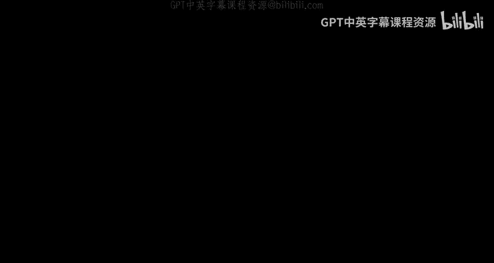

Okay， welcome back， everyone。 Welcome to the second lecture。Of CS229 machine learning。

So where were we？In lecture one， we were going through some of the review material linear algebra。

And for today， the plan is to finish up the review of linear algebra。

 some of the topics we could not cover on Monday。Review some matrix calculus or multivariable calculus and then also review some probability theory。

And with that we will be finishing all the review and from the next class we're going to start with actual machine learning with linear regression。

Okay， so。A quick recap， so。So， we。Went over what a vector is。And the matrix is。Right。

And we saw some of the some of the applications of linear algebra。 We saw why we need to。

Study linear algebra， for example。Now to represent your data。嗯。Covariance matrices。系。Colonels。

You're not expected to know what a kernel is at this stage， but you know this just to。

Name a few concepts that we'll be using later and also in general， multivariate calculus。Right。

And then we went over some operations。Such as。Vector vector operation like the inner product or the dot product。

The out product。For the inner product we take two matrices of the same dimension for an outer product they need not be the same and then we also went over some operations such as matrix vector product where we saw two interpretations。

 the dot product interpretation and the scaling interpretation Yes question。They better awesome。

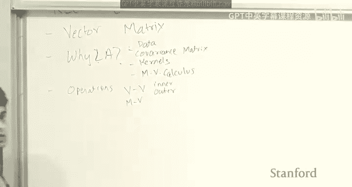

Thank you。We saw the matrix vector operation， both the dot product view and the scaling of the columns interpretation。

 and then we also cover matrix matrix。Multtiplication。

 and we saw a couple of interpretations of that， the inner product interpretation and the outer product interpretation。

And then。We reinterpreted matrices as functions or operators rather than thinking of matrices as a grid of numbers you know think of them as an operator where they operate on a vector that you are multiplying it think of the vector that youre multiplying a matrix as the input and the vector that you get as the output right and with that。

Function point of view。Fangsheng。Depreation of waites。Right。With this function point of view。

 we saw some geometrical interpretations of the subspaces。Which is closely related to。

The rank and the inverse。Rannk。Inverse。And。We also covered projections。Right。

So projecting a vector onto a subspace essentially means finding the point on the subspace that is nearest to the vector that we are trying to project。

Projections， and we saw the the projection matrix。 So if youre trying to project a vector V。

On to the columns of x。Of x， where x is a matrix and v is a vector。

 then the projection matrix is essentially x。Ex transpose。好。X transpose x。Inverse x transpose， right。

 This is a matrix。 So x is a matrix。 X transpose is a matrix。 X transpose。 X is a matrix。

 It's inverse is a matrix。 You multiply this matrix from。

X itself from the left and x transpose from the right use you get one you know still get a matrix。

 So this matrix is the projection matrix and any vector you you multiply it with。Right。

You multiply this matrix with a vector。You get a new。Vectctor called U。

 And U will be the projection of V onto the subspace spanned by the column surface x， right。

This is an important concept that will come back。When we talk about linear regression。

So that's the projection。 And we also started talking about。Eigenvectors。Eigenves。And eigenvalues。

Right。So， that's where we left off。Eigenvectors and eigenvalues are those special vectors for square matrices where the operation of the matrix on the vector does not change the angle。

 it only rescales it by some amount。And the eigenvalue is the ratio by which the vector gets scaled along those spread vector directions。

 so each eigenvector comes with corresponding eigenvalue。

 the remaining vectorctors which are not eigenvectors are not eigenvectors in the sense they can change their direction I there a question。

好的。嘘そ。So question so the question is do the columns of x span the subspace U so to clarify x the columns of x define the subspace onto which we want to project any given vector。

So x the v v over here is some any given vector and you want to project it onto the subspace plan by the columns of x by taking x we construct this matrix。

😊，You know， x transpose x inverted， you know， multiply from the left by x from the right by x transpose。

 you get another matrix。Now， take any vector V and。Multiply V by this matrix。

RightAnd you get an output vector U。Now， that U will be in the subspace spanned by the columns of x。

 and it will be the nearest point to V such that it you know it it's。

It's in the subspace and also nearest to be。Thank you。 Thanks for asking the question。 yes， question。

So。こち知の。什么。I'm not sure I followed your question completely。

 Did you mean you want to add multi you want to consider different vectors that you want to project onto to the subs。

そそ不でそう。Okay， so which is different from this way。Okay， so let's call them x 1 x to x3 as okay。说。嗯哼。

Yeah。So the question is if if I want to project v onto the subspace spanned by the columns of x。

 would it be different from what we would get if we were to project v onto first column of x separately to the second column of x separately to the third column of the x and then sum those projections the answer is no if they will not be the same just because。

Here's an example。 Consider this to be。X， x1， call it x1。 So this is like the first column of x。

 and let this be the second column of x。X 2， now， suppose there is a vector V， and let me。

The vector should ideally be out of the subspace so imagine there is a vector over here right and now I want to project this onto the subspace of x right now if I were to separately project it to say x2 first this might be the projection separately to x1 first this might be the projection and I sum them up it is going to be something here but from here the nearest projection is is this。

If you project them separately and add them up， you don't necessarily reach the nearest point。😊。

DoesDoes that make sense？Yes， question。し。Yes， are if they are the orthonormal to each other。Maybe。

 but， but x 1 and X1 need not be asal。 there there could be any any vectors。

I'm not sure about the autonal and I need to think about that， but in general。

 you know it doesn't hold that you can project them separately。Any more questions？Okay， so moving on。

 so next we're going to focus more on eigenvalues and。See some of some of its properties， so。

So heres the picture that we started with。So， imagine。An input space in。R 3。

 and this is your input space。And。So thiss your x axis， y axis。The axis。Right， and。

The picture that we that we kind of started with to， to build ourtuitions was to consider。

A unit ball， like a soccer ball that's centered around the origin of radius1。Right。

 and you have the matrix， your， your square symmetric matrix a， which is also in。Are3 and symmetric。

Right， and。Take this shape and run it through a Now what does that mean what what does it mean to I mean。

 we know how how how we can take a vector and run it through a and get an output vector。

 but what does it mean to take a shape and run it through a and get another shape。

 It just means take every point on the surface separately run it through a and reconstruct the resulting shape on the other side right so。

So this is our input。Take every point on the surface。 So this is a three dimensional ball。 You know。

 I'm just trying to a circle。 You know， it has。It's a three dimensional arm and run it through a。

 and we get M ellipsi。Right， now。At this point， we are still still talking about symmetric square matrices。

 Now the the the principal。Axies of this。Elllipps。Are the eigenvectors of A。

Right so the the longest axis is going to be the eigen eigenvector corresponding to the largest eigenvalue and thats because。

Points along these axis on the input sphere will get map to a point along the same direction but at a different different distance from the origin right and the ratio of the output distance from the origin to the input distance the origin is the eigenvalue corresponding eigenvector。

No。The product of all the eigenvalues of a matrix is also the。Determinant， right。

 So the determinant of a matrix。ID。Product of all。Eigenvalue。

RightSo the determinant of a matrix depends only on the eigenvalues。

 right the eigenvectors don't matter if you have another matrix。

 which which results in a shape that is similar to。This ellipoid。It will have the same determinant。

 even though it may be oriented differently。So the determinant is the product of all the eigenvalues。

And。Another thing that kind of becomes obvious here is。Li。

Product of all the eigenvalues over here is basically the ratio of。

the principle of this distance to this distance is one eigenvalue， the ratio of this distance。

 the distance distance is another eigenvalue and so on。

And it so happens that the product of all the length of。These。Half diameter of。

 of the different axes of an ellipide is also the volume of the ellipide。

So another interpretation of the determinant is it is the volume。off。Output shape。

Over volume of input ship。For any shape， for any shape that has you know some non0 volume on the input。

 it need not be just a sphere， it could be you know a cube， it could be any arbitrary shape。

 it has some volume。Run that shape through the matrix A， you get an output shape。

And that output shape has some volume as well now the ratio of the output volume to the input volume is the determinant of the matrix。

Now， it should be obvious that if the rank of the matrix is。I if it is not a full rank matrix。

 it means one of the eigenvalues is 0， which means this sphere would have collapsed into an ellipse rather than retaining its ellipoid shape。

And the volume of an ellipse in a three dimensional space is。0ero， exactly right。

 So what you will see is that the volume of the output shape。Will be。I'm up for。Non full rank mates。

The volume of the output shape will be 0 over some non0。And again， you know。

 this is also know directly clear because there's the product eigenvalues。

 one of the eigenvalues is 0 so you know the volume of the output shape will also0。😊。

Any questions about this？Now， the reason why we focus on this。

 this volume interpretation is because this is going to help us further down in the course， right。

 especially when we are talking about。Talking about。Operations that we perform on random variables。

 right， this concept of determinant will become very important because even though we we。

Perform some kind of a linear operation on a random variable。

 we will then need to adjust the resulting random variables probability by dividing it by the determinant so that the volume of the the of the Pf should still integrate to one so you know to maintain constant volume as you perform。

linearar operation you will need to divide the output by the determinant to maintain the volume。😊。

But if you dont know thats advanced were going to go over that again in a lot more detail later in the course but it' is important to kind of have this understanding of the determinant that the determinant kind of tells you how much the matrix either expands or contract the space right if the volume the resulting volume is bigger it is kind of expanding and if its smaller than it is kind of contracting contracting the input space。

Right。Which also means that you know， if one of the one of the eigenvalues is 0。

 it means the determinant is 0 and therefore the matrix does not have an inverse。😊。

RightNow that should also be kind of obvious because you take a soccer ball if you kind of transform it into an ellipard you can still it map every point on the ellips side back to the soccer ball but if if you kind of squash it into an ellipse then there's no way you can map back two dimensional space back into a three dimensional space right so there's no inverse if any one of the eigenvalues is0。

That's it about determinants， any any questions about determinants？Okay， I'll take that as a no。Next。

 going on。There is a technical term for the collection of all eigenvalues of a matrix。😊。

And that is called anybody。Exhisper。Yeah， so so， yeah， yeah， yeah theyre， they're all pretty related。

 So the spectrum is。Collection of。Eigenvalues。Of a matrix。 And， you know。

 you generally sort them in descending order。 You write the the the largest eigenvalue first and kind of sort them in the in the。

In the descending order now， for most operations， the spectrum of a matrix pretty much contains all the information that we care about about。

 you know， the matrix for for most of the operations， essentially， you know， it tells you。

What is going to be the resulting shape of of the ellipoid for， for a given。

In input unit bar the orientation may be different。

 but you know you can kind of adjust that by doing a change of basis you know to orient things differently but essentially the core of the operation of what a matrix does is kind of captured by the spectrum or you know the collection of eigenvalues。

And there is this theorem called the spectral theorem。Which we are not going to prove。

The spectral theorem， which says for。Every square matrix。

Or said d by d every square matrix that is also symmetric。Right。Has。Real valued eigenvalues。And。

Autonormal eigenvectors。はいあ。Whichch makes you know。

And this actually covers a whole lot of different different matrices that we are interested in。

 for example， Hassians。😊，A square matrices and they are symmetric right which means they have real valued eigenvalues。

 all their eigenvalues are real， some could be0， some could be negative。

 but they are all real value there are no complex eigenvalues that is what it means and and has you know orthonormal eigenvectors。

Hassians， covariance matrices。Right，Current matrices。Again， were going to see what kernels are later。

 but you know just so that you know why this is kind of relevant for the course right all these have。

They are all square， they are symmetric， and therefore they have real valued eigenvalues and orgonomal eigenvectors。

With this， next we are going to start something called the quadratic form。Qu writing farms。And。

 and and this is closely connected to。You know， defness， you know。

 positive semi definite negative semi defite And that's going to pop out of this。

 So what's a quadratic form given a matrix a。Assume it is square。And you have some vector x。

the quadratic form is also written as x transpose a x。Right， so far， we've seen。A。

But x transpose Ax is also called the quadratic form。And。The， the。Qudratic form holds for any。

Square matrix， but in general， we assume whenever we are working with a quadratic form。

 we just assume that a is symmetric as well。😊，And that's because for。Any quadratic form expression。

 a， where a is may or may not be symmetric， there always exists。Another B。Such that x transpose B。

 X equals x transpose A X， where B is。Symmetry。It is pretty easy to show why this is the case it is also in the notes I don't want to spend too much time on provinging this it is a very simple proof but in general whenever you are dealing with quadratic forms it is safe to assume that the matrix is symmetric just because you can always represent as another symmetric matrix B where x transpo bx equals x trans x for all values of x。

😊，And， and B actually happens to be just half of a。Half of。A trans。A pretty simple proof。Yes。

 question。What's the equation x transpose Bx？Oh， it just shows that for every for any matrix square matrix a。

😊，There is a corresponding square matrix B， which is also symmetric， which by the way。

 is calculated like this。Such that x transpo a X equals x transpo B x for all x。

Which is why you can just assume that a is symmetric because even if it is not symmetric。

 you can use the corresponding B in its place because their values are the same at all values of X。😊。

Now， this quadratic form。Is used to。哦。Yeah。I just didn't want that we distracting。

So we use the definition the quadratic form to define what is also called as definitiveness。😊，喂。So。

The way we define definitiveness is if x transpose。

A x now for a matrix square matrix matrix a than any value x。Is。Greater than 0， you know for。All x。

 So this symbol means for all x。Then we call the matrix a， you say a is positive definite。😊，Right。

Similarly， if x transpose a x is greater than equal to0 for all。X。Here for all x not equal to 0。

Not equal to 0， because when x is 0， you know a trans x x transpo x will be 0， then。E is is。Positive。

 semi different。If it is less than 0。Rlics are not equal to 0， then a is negative definite。

If it is less than equal to 0 for all x not equal to 0， then a is negative semi deffinite。

And if you cannot say any statement about this where for some values of x it is greater than 0。

 some values of x it is less than0， then we say it is just indefinite。

So this is this is the definition of what is a positive semi defite matrix or a positive definite matrix which means take the square matrix a you know you can assume it to besymmetric and for any value of x for any vector x calculate x transpose a x。

RightIf all the the resulting values of x trans plus a x for every x that is not equal0 if it is greater than 0。

 then a positive positive definite if it is greater than equal 0， it is positive semi definite。😊。

And so on。Right？那。Lets lets let's try to kind of understand this geometrically what what does this actually mean Why is this you know。

s kind of what's the meaning of x transpose AX because know we seem to care about its value so much。

Now。First recall， let us go back to the dot product， a transpose B。

 where A and B are any2 vectors right。Let's let thisPA。This we be， right？

if the value of a transpose B or if the angle between a and B is less than 90 degrees。

 then a transpose B will be。Positive， right。If A and B are。And a transpo B is。谁。

And the other one is obvious。If it's more than 90 degrees。8 trans speed is less than0。No啊。

This is for any two given matrices A and B now what the quadratic form we see over there you know quadratic form but what what is actually doing is it instead of looking at A and B it is looking at x。

Transpose with Ax。You you are seeing what happens to x and then you run it through a， you get ax。

It' is doing a dot product between the input and the output of a for any given value effects that' is essentially what the quadratic form is doing。

😊，And it is and we saw in the picture previously before， let me write again。This time。

 I'll just write on two dimensions。 So assume this is the。The the unit sphere and。

This is the ellipsoid that you get u to a。It is just r2 So this is the input input shape。

 the input ball that we are going to run through and this is the output that we are going to get and what what this is essentially saying is that for a positive。

Semi definite matrix or a positive， definite matrix。For。Any value of x on the input that we take。

Run it through a， we get a corresponding output。RightNow the angle between these two。

Is less than 90 degrees。Does that make sense？X transpose x is greater than 0。 So x is。

This here was input x， and this was output ax。As long as their angle is less than 90 degrees。

 it will always be greater than 0。And this is again。

 this is how we relate extra the definitiveness statement to eigenvectors， eigenvalues。😊。

Because if you have a matrix that has all positive eigenvalues。

 then the eigenvectors only scaled get scaled in a positive direction。Right。

 and this eigenvector gets scaled。You know， in a positive direction and x transpose a x for eigen。

Vectctorors are always positive because they are just scaled in a positive direction and when you do a dot product between two vectors which are oriented similarly it is always positive so you kind of think of the eigenvectors as acting as pivots。

And anything inside them get mapped to vectors that are also in the same quarant。

If one of the eigenvalues was negative， so for example。

 if this eigenvalue was positive but this eigenvalue was negative。Then。A vector over here。

Could have gotten mapped to， you know， to something in this quaon。

 which means its angle could have been bigger than 90 degrees。

Which means x transpo could have been negative。If you have all positive eigenvalues。

 then the eigenvectors kind of act as pivots where the vectors inside one quadrant remain in the same quadrant in the output space。

So how does that connect to the definition of positiveite positive definiteness so。

For a positive definite matrix。All。Eigenvalues。Are greater than0。For a positive semi definite matrix。

 you all greater than equal to 0。For a negative definite matrix。

 all the eigenvalues are less than0 and for a negative semi definite matrix。

They are less than equal to0 and for an indefinite matrix， they can be greater than or less than 0。

So， the definitiveness of a matrix which is defined by the quadratic form。

Has a one to one relation with the spectrum of the matrix。Any questions about that。Yes。就毫无质争。Yeah。

 so when I say it is less than or greater equal to 0 for a few x's。

 it's going to be greater than0 for a few other x's， it' is going to be less than 0。

 So if you construct any positive definite matrix where any symmetric matrix where one of the eigenvalues positive and one of the eigenvalue is negative。

 you're going to get a matrix and they are going to be you know you know。😊。

Eigenvectors corresponding to the there are going to be vectors corresponding to the eigenvectors of that matrix。

 which will result in you know the value the quadratic form being greater than 0 or less than 0。没。

Any questions on this？Okay， so next we're going to move on to。Decomposing matrices。So。

 given a matrix， there are many ways to decompose it and what do we mean by decompose it？

Decomposition， we' are going to look at it right away。The two decompositions that were gonna。

That we are going to look at today are the singular value decomposition。😊，OrIt's also called the SVD。

And the eigenvalue decomposition。Those are the cool things you're gonna。Go over today。

 because these are， you know， these two are are。Probably the most。

Interesting ones from a theoretical point of view， there's another， you know。

 decomposition that's used very frequently called the Cski decomposition。

Maybe we I'll just mention in passing what that is。

 but the interesting ones to analyze are the singular value decomposition and the eigenvalue decomposition。

RightThe singular value decomposition。So this is SV。B， this one I'm going to call it。Eigenvalue。So。

Matrix a for singular value de can be any matrix a。It can be any matrix whatsoever。

 but for eigenvalue decomposition you need square matrices。😊，That's， that's one main difference。

 And the decomposition itself is defined like this。 so singular value decomposition is generally。

 you say a。Equals。You。😔，S。V transpose an eigenvalue decomposition。 We generally say a equals。Li。You。

What what are we saying here basically what we are saying is。Given a matrix A。

 so let let's again think of this in terms of functions right matrices。

 you know think of matrices as functions。 that that's always a useful approach。

What this is basically saying is Ax。Can also be written as。You。😔，S。We transs。X， which means first。

Multiply x with v transpose and you get some output made vector， then take that vector as input to s。

And you get some output and take the output of multiplying by S and feed it as it push to U and you get some output and what it it is basically saying is the operation performed by x can be decomposed into three sub matrices。

Which you apply like a pipeline。 You know， first， apply re transpose to x。 Each of these is a matrix。

First you apply v transpose to x， you get a different vector， you take that vector。

 you know feed it as input to s， you know take the output of that。

 feed it as input to u know it is just a nested operation。And， similarly。The eigen decomposition of。

 of。A can be written as。喂。We saw what a matrix a essentially， essentially does， right so。So。

 what the singular value decomposition and eenvalue decomposition are saying is that you can decompose a matrix a into three subes。

😊，Such that。The operation performed by a on any vector x can be split into three subparts。呃。So。

 the operations。So before we move to operations， let's talk a little more about these individual matrices。

 So you and we。R。They are orthogonnomal matrices。And S is also called。

A singular the the set of singular values its called and this is a diagonal matrices。

Dagonal matrix where the singular values are along the diagonal of S and D is also diagonal。

And the eigenvalues are along the diagonal of T。 So the eigenvalue decomposition decomposes into。

U D U transpose where the columns of U are the eigenvectors。And D is the set of eigenvalues。

And you would， for example。If this is you。And。😔，This is D。

 then there is a one to1 mapping between the eigenvector and the corresponding eigenvalue。And。

A different tiigen vector。The corresponding eigenvalue and so on。

The action performed by a is completely defined by its set of eigenvectors and eigenvalues for a square matrix a。

And for any matrix a， you have。😊，You have a collection of singular values in place of eigenvalues。

And you have a U。And another matrix， we transpose。For the singular value decomposition you and we are you know there are different matrices in general are they just need to be archal。

 which means our unit length and all of them are coant to each other。😊。

Whereas for the eigenvalue decomposition， the third matrix has to be the inverse of U itself。

 so this is just U inverse。Right， now。We have so we can we can break down the eigenvalue the any matrix into the singular value decomposition。

 but the cool thing about the singular value decomposition is that you are guaranteed that the singular values of the matrix are going to be real valued。

😊，No matter what matrix a you feed in， it need not be full rank， it could be anything whatsoever。

Any real valued matrix， you know， as long as you know。

 the values in the in the grids are all real valued。

 you can always come up with a decomposition of this form where the。

Where the U and V matrices are orthoormal and the singular values are all real。Yes， question。

は no question。Now， however， with eigenvalue decomposition。

 things are a little different in that it is limited to square matrices only。😊，Yes question。

So the question is， aren't isn't the eigenvalue decomposition diagonalizable？So if you。

Byagon diagonalizable， if you mean diagonzable into real valued eigen eigenvalue then yes。

 but in general you can take any square matrix and the eigenve the eigenvalues may be complex but you can still break down。

So if it is not diagonalzable， then this is there are going to be complex values in there。

But if you're okay with complex numbers， then you can always represent it like this。So。Yes， question。

That's also S And。あす。So， our S and D diagonal matrices with eigenvalues。

 so in the eigenvalue decomposition it is the d matrix is diagonal with eigenvalues in the singular value decomposition the the S is a diagonal matrix with what is called a singular values。

 not the eigenvalues。Eigenvalues are only defined for square matrices。Soすごい。ちずしおでてす。啊，受受关人民。M。The。

し部が。今年の？Well I'm coming to that I'm coming to that right So this is just the way you can you can break down a matrix into into into sub components。

😊，Right， now。It's kind of interesting to see how these are related。Let's call this a。S we。喂。

So I'm going to call this step 1。Step 2 and step 3。

Where step one corresponds to what happens when you take the first piece and look at its action on x step two is take the output of step1 and run it through the next matrix and step three is take the output of step two and run it through the third matrix right now。

U and V or U U inverse are all orthonormal。Right， which means。

Step one for both singular value and eigenvalue decomposition。Is here it is it is v transpose。

 and here it is U inverse。And the action is going to be just rotation。Andmi。Rotation。Possibly matter。

In fact， it's actually going to be just， just rotations。 It's not even going to be mirroring。

Because it's autoar。It's just going to be some kind of rotation， right。And then。

Step two is you' are multiplying it by a diagonal matrix。Which means？

You are just scaling along the axes， that is what a diagonal matrix multiplying by a diagonal matrix does right take an e vector multipplied by a diagonal matrix then you are taking each component and scaling that component along the corresponding axes by the value of the element in the corresponding diagonal entry。

So this is just scaling。No scaling。That is scaling along the axis。Along the， the X and y axis。

 not the eigen eigenvalue but scaling along the axis。Right， now。

The scaling for the singular value decomposition is always real valued。😊，Right。

 because S is always going to be real valued for SVD。 So this is real valued scaling。

But for the eigenvalue decomposition， some of your eigenvalues may be complex。And。

Scaling by a complex value essentially means there is some amount of rotation involved。

 right Scing by a complex number means there could be rotation。If。Eigenvalue is complex。

And then step 3 is another rotation here the step 3 is going to be rotating it by u。

 so this is just rotation 1 and this is rotation 2。😊，Right。Mean your， we rotate in in SVD， we。

Rotate it， scale it along the diagonals after rotating and then rotate it by a different amount corresponding to you。

Whereas with singular value decomposition with eigenvalue decomposition first we rotate it then scale it。

 but the scaling may you know if you have complex eigenvalue。

 the scaling may involve some implicit rotation and then we。😊，Rtated by U。

 which is basically the inverse of the first step。Inverse of step one。Right。

In eigenvalue to compositionposition， first you rotate it by universeverse。

 then scale it and then undo the rotation that was done by。Yes question。こさのの。违见个。So， the。

So I would say ignore this case for now this is not very crucial for us I'm happy to go deeper into that after the lecture but essentially what you want to think of this you give some shape as input you know you can characterize what a matrix a is doing by thinking of it as first rotating it by some amount。

😊，And then。Scale the rotated version by different amounts along you know the x and y axis。

And then rotated by a different amount。Right， and it could be it is， it is。Different。

For SVD in the sense it could be you know arbitrarily different。

 but for the eigenvalue decomposition you are going to just undo the initial rotation。😊，Right。

 and what you， what you。What you see is that the， the direction。

That ends up aligning with the axes after the first rotation are the directions of your eigenvectors because you you are going to scale though scale the points along the points along the eigenvectors after rotation will end up aligning with the x axes and when you scale them along the axes these points are not changing their direction once you undo the rotation。

Does that make sense？So。What this means again is that for square matrices。

Especially square symmetric matrices where we don't care about complex eigenvalues for all square symmetric matrices。

We are， we。We are going to rotate the the action of a can be summarized as rotated such that the eigenvectors align with the axes。

Scal it by different amounts， the scaling could be negative。

 which means you are kind of familiaring it。And then undo the rotation you did in the first step。

Which means the eigenvectors and the axes of the ellipoid are going to be the same。Right。

Now for singular value decomposition there are no eigenvectors， there are singular vectorctors。

 but the interpretation is not as easy because you are effectively rotating it by some amount。

 scaling it along the axes and not undoing the rotation but just rotating by a different you know by U instead of v inverse。

The the benefit of SVD is that you always get real singular values。

 but with eigenvalues you require the matrix to be square and symmetric to get real eigenvalues。

 but the singular values are always real。😊，And it so happens that if you are having square symmetric matrices in your eigenvalue。

 the singular value decomposition and eigenvalue decomposition will give you the same three components。

 So singular value decomposition and eigenvalue decomposition are the same for square symmetric matrices。

😊，For。For a arbitrary。Wwhich means it need not be square it need not be symmetric SVD is the only thing that works so SVD is like a sledgehammer throw any metric at it it is going to decompose it into three parts right。

If a is。Square。You can still do SD， but you can also do an eigenvalue decomposition。

Some eigenvalues may be complex。But if you do an SVD on a square matrix which is notsymmetric。

 you still get you know real valued singular values。And when a is square and symmetric。

Then SVD and eigenvalue decomposition are the same。 You know。

 you get the same U will be the same S and D will be the same V transpose and universe will be the same。

Yes， question。いス？我中。So， when a is square， you can perform both the eigenvalue decomposition and the singular value decomposition。

 but the decomose components may not be identical。But if a is square and symmetric and you can perform both the decomposition and the components will also be the same。

 So SVD and eigenvalue decomposition are you know it is the same decomposition if it is square symmetric。

こも父も。Yeah， it does not even exist。 I mean， it is not even defined。

 So eigenvalue de composition is defined only for square matrices。

 So eigenvalue you know algebraically the eigenvalue eigenvector is basically the solution to ax equals lambda x。

What it means is take a matrix a multiplied by a vector x and you are going to get an output vector which is you know along the direction of x but scaled by some eigenvalue right and all the solutions of this are your eigenvalues and eigenvectors and in order for this to hold true a has to be square。

😊，For for this for this to be for the output to be a scalealar a scaled version of the input a has to be square otherwise it is just going to be a different dimension。

 So eigenvalue decomposition holds only for square matrices。哎啊。入っちゃう？Okay。

 next we are going to move on to matrix calculus。 Any any questions about this。Yes， question。期间。自こ？

僕空？Yeah， for you know what you say is true in terms of in terms of the intuition。

 you know you probably want to have this as you know in your mind for in terms of having the right intuitions。

 Yes， some matrices are are you know not diagonzable but。😊，For the most part。

 we are going to be dealing only with。symmetric matrices。

 you know square symmetric matrices and we are going to be mostly dealing with with you know quadrating forms you know for any given in which case you have a corresponding symmetric matrices and in case of you know symmetric matrices you can always you can always decompose a square symmetric matrices。

Yeah。不多。要つの。Yes。How do we actually呃。So the question is how do we test whether a given matrix is you know belong to any one of those categories because we just cannot test you know feed in all the possible values of x and see it and that's a great question and the answer is we saw a one to1 correspondence between the definitiveness and the spectrum which means you can always calculate the spectrum of a matrix by doing an eigen decomposition we haven't discuss how you actually do this decomposition and well probably see that later in the course how you can decompose it but there are lots of methods to decompose a given matrix into its know eigenvalue decomposition a singular value decomposition and then you can just inspect the eigenvalues are they all positive are they all negative and you get the corresponding。

それども。没是。そして協ろ。You has switch on with。我咁ぞ。Mmm。Yeah， you can Yeah。

 so the question is can we swap these two rows and columns and also the corresponding you know diagonals and also the corresponding rows。

 Yes， you can do that but as a convention you just write them in descending order。

 it's just a convention。Okay， so moving on to matrix calculus。I should have probably sed。All right。

 so matrix calculus。Lets see， Im assuming all of you are familiar with with calculus， you know。

 with the concept of differentiation and。As a prerequisite。

 you should have already seen multivariate calculus in terms of you know differentiating say a scalar valued function that has a vector valued input and such。

So， in fact， everything that I'm covering。Today。You know hopefully this is not your introduction to these subjects。

 hopefully you should have already seen them and this should be like a refresher or you know just to you know recollect things if you've forgotten them。

😊，So I'll be skipping over a lot of。I'll be skipping over a lot of。

Precise rigorous statements and just giving you the intuition so that， you know。

 you just remember things that you've already studied。

 So hopefully this is not an introduction to these subjects for you so。The matrix calculus。Calculus。

Wai。Let's see。 Let's， let's look at a few functions。So we write a function。Right。

Is this notation familiar to everyone。What this means is we have a function。

That we are going to call as as F F is the name that we assign and this is like the type signature of that function。

 it takes as input a real valued number and produces as output a real valued number。😊， now。

An example of this is， you know。X squared。Take a number x。That's going to be the input。

 you square it。 That' is going to be the output。Real value input， real value output。And。

The value of this function。Is。Real value。This is just an example。

The first derivative of this function。Is going to have a value in， also in。2。the second derivative。

It is going to have a value also in order。 So if you have a function that takes a real value input real valued output。

 for example， x squared its value is is real value right its first derivative in this case2 x is also going to be real valued it。

Second derivative， which just two is also going to be。You。Right， now。Considerr function F。

What does this mean。Means it is a function that we can call it as F。

The input to the function is going to be some vector， a D dimensional vector。

 right and the output is going to be a real valued number。😊，So vector input， scalar output。And。

We are going to encounter a lot of functions of this kind in the scores and the most common one that we are going encounter is what you call as a loss function。

We haven't covered what the loss function is yet。 but you know this this is to give you a sense of what what's the kind of things you're going to be looking at。

 The last function is。That's a value， a scalar value。

And what is the first derivative of a vector what is the type of the first derivative of a function like this。

A gradient is called a gradient， and。The gradientient is going to be RD。

And the second derivative derivative of a function like this is called the。😊，还行。And the Hasian is。

And the Hessian in this case， not only is it a square matrix， it is also guaranteed to be symmetric。

😊，RightAndsymmetric matrices are also written as。S， with just a single D。

 because it's implied that it's D along both the dimensions because it it's symmetric。And。Again。

 further later in the course， we are also going to encounter functions of this type。From hard D to。

RRP。And it is vector input， vector output。And of course， the dimensions are different。

 they could be the same but in general， the dimensions are different。呃。

Can anybody think of functions。Like this。Why you might use such functions in machine learning？I mean。

 it's， it's totally fine if， if。Bed。So a function that takes a D dimensional vector and outputs a p dimensional vector。

Projections and another a commonly used used。A component are going to be like a neural network layer。

So youre going to know the way neural networks work is you transform one vector to another in some way and it one layer of neural network can look like this。

 it takes a D dimensionsal vectors input and produces some other dimensional vectors as output。

And theres that question。あ wasま。Yeah， yeah classification you you feed an image as input and you know output a vector of probabilities Yeah that thats you know that totally falls into this category as well that's a good answer。

 And so the output here is going to be an RPp。😊，And whats the first derivative of this。

Of this kind of function， gonna look。 whats， what's the type of。It's called Jacobion exactly。

 and it's going to be R of。D by P。어 this 비 바디 anyway， 워 not게。It's called the Jacobia。

And that is why if some of you are already familiar with neural networks。

 you're going to encounter Jacobians a lot in neural networks because that's how you train them by evaluating the Jacobians。

😊，呃。The second derivative for this is going to be some kind of。D by P by P， some kind of you。

 let's just call it a higher order tensor。 not very interesting。So。We see right away that you know。

 vectors and matrices are going to show up when you do multivariate calculus。😊，Right， and。对。

The tools that we saw above for example， eigenvalue decomposition can be applied to hesians and that is going to tell you a lot of information about the nature of the function right for example。

 if you if you take the hesian of a function。😊，And if the hessian of a function is positive semi definite。

At all input points x， then it means the the function is kind of bull shape。 It is convex。

If you take some function and if you calculates its hessian and if it is negative definite or negative semi definite then it is kind of an inverted pole shape。

😊，And if。The hesian of a function is indefinite， which means it' is neither a positive definite or in a semi deffinite than it is。

Exactly， it has saddle points。 What does a saddle point mean。

 It means along one axis it it it is cup shaped。And along another axis it is is kind of bowl shape。

 It iss like the shape of a saddle that you place on a horse it goes down along one axis and goes up on another axis right so the connection between multivariable calculus and linear algebra are very deep and。

😊，You got， we got to be using。And analyzing hessians of different loss functions to kind of characterize are they convex。

 it means if they are convex， you know， that is good news。

 it means the when you minimize the loss function， you reach。A unique global minima because it's。

 you know any bold shape function or you know， take any bowl there's always like a unique global minima。

Whereas if a function is not convex or if it has saddle points， then optimization is a little harder。

 trying to minimize the loss function is going to be harder。Now。

 some examples of how we actually go about calculating gradients， for example。

 if you have a function x。😊，The gradient of the function with respect to x is written like this this this is the terminology that we generally use the inverted triangle。

😊，I is denotes the gradient symbol？And if you， if you are writing your homeworks in lateEC。

 then this you know， to get the symbol in lateEC， you use back slash。N不la。And the。

The subscript for Nala indicates what is the variable with respect to which you are taking the gradient and you know for gradients this is going to be vector valued obviously and the definition is just this。

Take the partial derivative of F。Repect to x1。Evalu us。X， so I'm gonna use a red x here。

To indicate that this is the。Value that we are feeding。

 and this is the variable with respect to which we are differentiating。X。D。

This is just the definition of a gradient， which means take every because this is vector valued。

 You know， you can also kind of think of this as。😊，X。X 1， x 2。

Take me right and this is just a short foot short notation for for this。

 So the the function has multiple inputs because youre feeding in a vector of values and the gray and its output is scalar。

And the gradient is then defined as the partial derivative of f with respect to every input。😊。

Evaluated at the vector that you are feeding in and this collection of partial derivativeors is called the gradient。

😊，RightAnd the gradient also has an interpretation。

 which is it is the it is the direction of steepest ascent。 What does that mean if you have a。

So let's assume this is X1。And this is actually， you know， x 2。 And this is。F off。

X and a scalar valued vector input input function is going to be some surface along this you know in in such a graph and the the。

I'm not good at drawing surfaces， but you know imagine there is some kind of a surface here and the height from any point up to that surface is the value of that function right it's similar to you know。

If of x except now its it it has you know， multiple input dimensions。 Now along the surface。

 the surface is gonna have some kind of， you know， a shape and the gradient of the function at this input tells you the direction in which you want to move。

To。To increase the value of the function the most。Right， if you w to the。I'm just gonna。

Try to draw a surface。immagine this is some kind of a surface now if you are at this point and you want to adjust your input to a different value such that the function evaluates to a larger value。

 then you calculate the gradient。At this point， it's going to give you some direction because it's a vector。

 It's going to give point you in some direction。 And if you take a very small step along the direction from。

And from this new point， if you evaluate the value of the function， it should be。

It should be larger It gives you like the direction in which you want to move your input that the output value goes up。

And similarly， you can also calculate the the。Gradient of a function。

That takes as a matrix as input with respect to the matrix。

 it that this is just a generalization of this。And this is going to be again。A whole collection of。

 of。Poion derivatives。Right。So。Even though this is kind of a is two dimensional。

 just pretend it is one long vector kind of serialize it into one long vector。

 right calculate the partial derivatives and then reshape it back into you know a matrix。

Any question？Yes。Yes， f is a function that takes a as input a matrix as input and produces a scalar as output。

😊，In this case， in this case， we were looking at F as a function where it takes a vector as input and scalar result。

😊，Yes。うあい。哦。Yeah， yeah， exactly。 So you know， A is going to be some kind of， you know。😊，Some kind of。

Okay。It's going to have a 1，1。A1， and assuming it is n by N， you know， A N1 till a。M1 A M N。Right。

 so you， you're feeding， you know。These many different inputs to f the output as as a scalar。

 so take the partial derivative of the output of f with respect to a11 and。AllThanks so on。

Any questions about this？Right。Now。So this was F from。A M by N to。R， and over here。F was from。R。

 what I use B。To art。は。We could also look at what is， what is the Hasian。Where x is again F is。RB。

Do R。Now， the hesian is going to look like。This。Now， instead of taking the first partial derivative。

 we are going to take you know two partial derivatives。

 which means it is going to be dell square f by dell x1。Dell x 2 of。X。ItGo square。喂。X， B。た。Have。X。

S么能力。Just square。응 x one。X。X。Li。Off。So here we take the second partial derivatives of F with respect to every input。

 Yes question。Oh yeah， you're late。 Thank you。X 1， X1， X1， X， D， X D， X， D， and this will be square。

X， D。X1。Oh， thanks。The reason Im highlighting things in red is to tell you that by performing the partial the partial derivative or two times partial derivatives。

 you are going to end up with a function。And that function is this function for which you feed any arbitrary x as as the input。

喂。Is this scare？Good， and。A few examples。Now some some a few。

 few things that you' are going to be using， you know， very literally throughout。

 What is the partial derivative or what's the gradient with respect to x of。

B transpose x where B is some vector。Some constant vector。You take a dot product with X and。

We want to calculate the， the this， this is。Scaalar valued B transpose x is scalar。

 and we want to calculate the gradient of B transpose x with respect to x where B some constant。B。

 right， And why is that We apply this directly。So by definition， this is。

I'm just going to write for some I element， partial。Of。X， I of B transpose x。Right， I have just。

Applied this here。And this is going to be。X I of B1， x1 plus B2 x2 plus。B。😔，Dx， D。喂。

And when you when you calculate the partial derivative with re this。

 all the terms except B X I are going to cancel out。😊。

Because the rest of them are all constants with respect to I。 So maybe let's call this B I。系。Xア。

And this is gonna give you。彼爱。AndThis just be。诶。Is this clear？The， the， the。

TheThe function is simple but the methodologyology is the same for any any arbitrarily complex function where we the gradient is just defined as the collection of partial derivatives with respect to every input and then you expand out the function calculate the partial derivative with respect to the corresponding input and and then you finally seek you know is this a pattern that we recognize and in this case it happens to be just be otherwise your gradient is just some expression where in general it need not have you know a simple expression like this。

And。So， that's， that's。How we calculate gradients for simple functions？좋다요。And similarly。

 you can also apply just like regular calculus， you can apply the product rule。

And we're going to see just one example of the product role。 So what is the。

Graadient with respect to x of x transpose a X。Right， we're gonna。Applied the product rule。

 as we know it。 So this is going to be。The gradient， with respect to。嗯。

We're going to use two colors to， to。I are。Precisely。I treat it as a product of two things。And。

 you know，Byuy them differently。 And this is going to。Come out to be。 So here the。

 the gradient here is。You can think of this as。Griient of。X with。Sorry I forgot the principles here。

So yeah， so this is going to be just Ax。Be trans。Ax， and this is going to be a transpo x。

So the this is going to be x times a plus a transpose。 And if a is symmetric。

 this is going to be just2 A X。A few more。Matx directorors which are going to be very useful。

I'm sorry， what's the question？Oh， this is the product rules。 So， for example， when you are taking。

So。Dbei。Dx of。F of x。G of x is equal to D by。D x of F of x。Times G of x。Yes。F of x times。De。G of。

It is the product rule， and this is the multivariate version of them。

You think of this as F of X and G of x。クラプ。Exactly exactly， exactly。 you know。

 because this is when when when I write it as you know the gradient it's not clear to which parts I'm applying it to right So the red parts are the parts that are getting differentiated。

 the black parts you treat them as constants you know just like this。😊，One。I'm sorry。

You could you could do that too， but you generally yeah you could do that too，야，So that's you know。

 this is the product rule， another very useful。Identity that you're going to be using is going to be。

Rant of a。Of the log of the。Determinant of a。This looks pretty， pretty nasty。

 So what's happening here A a matrix。Take the determinant of the matrix。

 and then you take the log of the determinant of the matrix and you want to differentiate it with respect to here。

 why would you want to do that， I mean， but it it turns out that this is going to be a recurring a pattern。

 This is going to show up in multiple places， especially when you are you are dealing with you know Gaussian distributions and stuff。

 remember the Gausian has a determinant in in in the denominator anyways， but this is going to be。

It is going to show up many times in your homework， possibly in your exams and the the。

The answer is just a worse。Right，And the intuition is， you know。Dbi D of。Or D by D x of log x。

think of it like that。All right， we have another 20 minutes remaining。Let's see。

 I'm going to do a quick review of probabilityability in the meantime。

 Do you have any other questions。

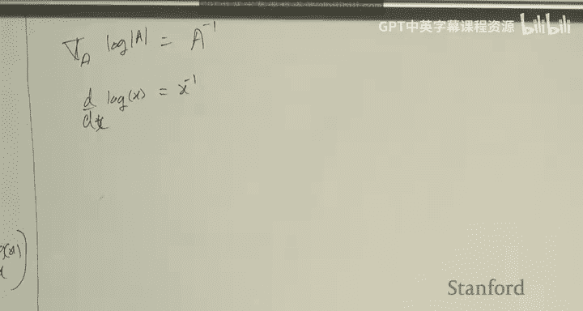

Yes， question。I'm sorry。This one。The first time。About喂。啊。Well， I mean， do you agree with this。I mean。

 so this， this is just the same thing， in， in a multivariate setting。G。好五。すとこ。work。一直说这个数据。

It is pretty straightforward， it's in the lecture notes。

 I mean in the review notes that's posted online， you can go through the steps。Allright。

 so this we're going to switch gears now and briefly review probability theory。

That was it about in terms of。Review of matrix， calculus and linear algebra。

So we're going to switch guys to probability theory now。 And this is going to be the last。

Last topic that we' are going to review。 And from next class， we're going you know。

 start machine learning and with linear regression。All right， again。😊。

Treat this as a review and not as your introduction to the subject。

 we are not going to teach it in the way it has to be taught to a student the first time you are just going to review things so that it refreshes your memory。

Okay， so first of all what are the basic elements of probability theory right so in probability theory there is probability is is basically the study of uncertainty about things that can happen randomly and。

Whenever we are talking about probability there is always an implicit sample space so sample space is basically the set of all outcomes that can happen。

 random outcomes that can happen。😊，For example， if we your sample space can be。

What what what what is the sequence of coin tosses you get if you if you flip it twice right is it going to be heads heads or is it going to be head tails。

 is it going to be tailheads tail tails right now if if the experiment that you are performing is。

2 coin tosses， then any of these is a possible outcome。

And the set of all possible outcomes are is basically called the sample space。OkayNow。

The thing that we assign probabilities to are called events an event is a subset of the sample space。

Right， you want to think of。Lets see an event is a subset of the sample space and in this case you know for example。

 if a is some event where it includes you know headsheads and headstails basically we are saying we are interested in the event that the first coin task turns out to be a heads。

Right。And。The full， the entire probability sample space is also an event。

 which means we are interested in， you know anything that happens。 So it's not very interesting。😊。

So that that is the event space， the set of all possible subsets of your sample space and now if your sample space is finite。

The event space is basically the power set， which means the set of all subsets。

Its is the event space。And then we assign something called as a probability measure the probability measure。

Takes us input an event not an outcome an event and assigns it a value between0 and 1 thats something you want to keep in mind that we don't assign probabilities for outcomes but we actually assign probabilities to events in the case of finite finite sample space the distinction is is mo because you can always create a subset that has only one。

That has only one event and assign a probability that subset。

 but when we you know move on to continuous spaced or continuous valued samples。

 then you know the distinction becomes more relevant。😊。

Now the three main axioms the three axioms of probability are that the probability assigned to an event is always greater than equal to0 for all events again you are not talking about outcomes we are talking about events events are sets of outcomes or you know subset of the sample space。

The probability assigned to the entire event space or the entire sample space is always one。

 which means some event or the other from the sample space will always occur。

And if you take disjoint events where the intersection between any two events are is the nuet。

 then the probability assigned to the union of those disjoint events is equal to just the sum of the individual probabilities right all very intuitive there is nothing fancy happening here。

Then conditional probability let B be an event such that the probability of b is not0 again b is an event not an outcome。

 which means that we are talking about sex of outcomes。

And probability of a given B is this is just the definition。

 it is the probability assigned to the intersection of A and B so the intersection of A and B is also a set and therefore also an event。

So it's the event of a intersection B divided by the property of。The event of me。

Now A and B are independent so the inverted t symbol means independent if the probability of a intersection B is the same as the probability of a times the probability of b right and to I mean this this should make sense right a intersection B is always going to be a subset of a or subset of B and probability of a and probability of b are you know values between0 and1 and when you multiply to numbers that are you know smaller than the one then you are going to get a value which is you know even smaller。

Again， probability of A and B are independent events。

 if and only if probability of a given B is equal to the probability of a。

 which means the probability of a does not change whether B occurred or not。

So you then A and B are independent。Now， random variables。Now。

 consider an event where you know the experiment is say1010 coin tosses and you know this is one such event。

 Now our random variable is a function that maps。Outcomes to real values。

 Now we are not talking about events。 We are talking about outcomes， you know。

 the the the the atoms of what happens in random as a random occurrence right a random variable is a mapping from。

Outcomes to real values。This is just an example of a random variable here where given an outcome you know。

 that sequence of heads and tails。😊，The function just counts the number of heads in it。

 that's that's just a function。 And， you know， the E output is， is a real value。

So it it it's kind of useful to think about it like this。 I'm going I'm going。I'm going to call this。

D。The outcome space。And。

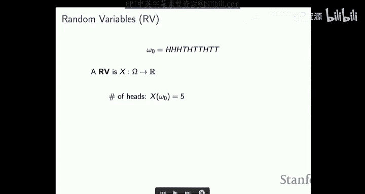

This。To be the real line。Right， now the outcome space has。You know， lots of different。

Actual outcomes。And then on top of these outcomes， we define events。And events could be overlapping。

And a random variable is a function that maps outcomes。😊，To real value。And here this is you know。

 this is a straight line which which means to say you know it you know this is just a real line and I intentionally draw the outcome space with a wiggly line because this is just a bag of things that happen。

 There is no natural order among these。😊，So if if if you take a die which is color for example without the numbers one to3 on it and you roll the die some color is going to show up and you can think of those as the different outcomes where colors are not order but then you can define a random variable。

😊，Wwhich maps each side of the die to a number， for example you number them one，2，3。

 you know that is essentially you are defining a random variable where you are now mapping the random events to the real line。

Right， so。You know， this could be a random variable。 A random variable is a function。 You know， its。

 it's a very poorly chosen name。 A random variable is neither random。 Neither is it a variable。

 It is just a function。 It's a function that maps outcomes to real values。😊，I mean。

 it's just like computer science， it's just a horrible name， it's not about computers。

 it's not a science， but you're still color it computer science right。😊。

So the a random variable is neither random nor is it a variable。 It is just a function that maps。

Outcomes to。To the real line。However， we assign probabilities to events。😊，Right。

 we don't assign probabilities to outcomes actually assign probabilities to events。

 And the reason why we， we， we kind of。Interested in random random variables is because by defining a random variable we are now kind of bringing any experiment into a level playing field。

 you know you map them into the real line and you start the rest of your analysis starting with the real line right you are kind of abstracting away what the specific details of the random event are just map them off to the real line and now you know you can have like a unified theory of what you can you know do with you know random things happening on the real line。

😊。

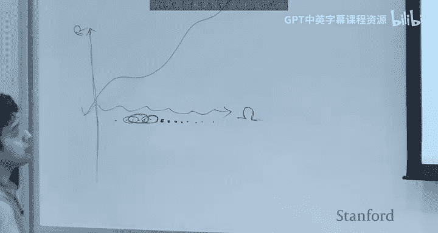

So by value of x， we mean you know the set of all values that x can x can take。 So in this case。

 you know， this random variable can take any of these values。

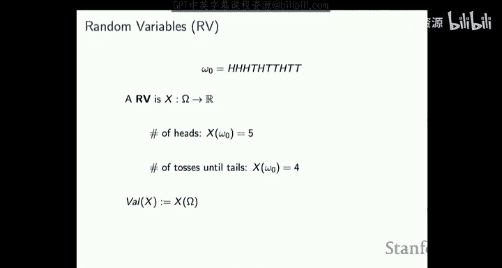

And if it's a discrete random variable， then your function will look like this。

 Each thing gets mapped to。A different number， each outcome gets mapped to a different number。

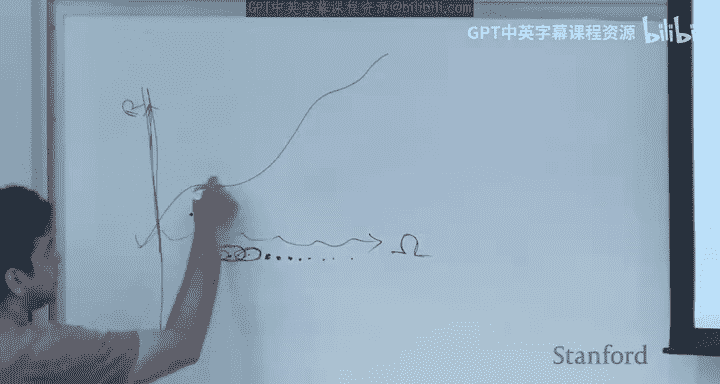

RightAnd this is going to be a discrete random variable right and the v x of that would be you know。

😊，Different values， random molecule。Random variable can take。Right。

And then we have something called the cumulative distribution function。 Now， the。

 the as I said earlier， probabilities are defined on。

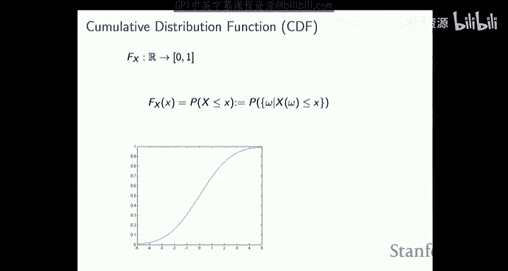

Events and that probability is being defined in this space onto events。Now。

 the cumulative distribution function is trying to map you know these probabilities to probabilities along the real value。

 right？😊。

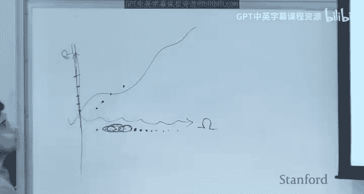

The definition of the CF is。F x of x。Is equal to the probability that x is less than x。

 And what this actually means is， you know what what， what what does actually mean。

 it means the probability assign  to。The set of all。Outcomes， omega， such that。X of。

Omega is less than maybe let me call the T。Let's。What does it mean so。Look at your random variable。

 There are some。ち作金。And。Get the set of all。Omega， such that x of T， X， X of omega is less than t。

Right， so in this case， it is this one， this one， this one and。Create a set out of those。

Cate a set out of create an event out of those outcomes and measure the probability on that event because we always measure probability in in in the sample space or the event space right and。

We pretend that the CDF is measuring probabilities on the real line。

 but actually what it does is we map it back， find the image pre image corresponding to corresponding to the set we are interested and measure the probability in the event space。

And a CDdF looks like this。 A CDdF looks like this because the picture that we see is you know。😊。

Now you got to flip it over， you know here we are mapping from the outcomes to the real line。

 but over here you know once we are kind of comfortable with this agreement。

 you know moving forward we start with the real line as our basis and define probabilities there。

Yeah。嗯哼。Yeah， so omega is the sequence of hetails。 You know， the the， the long sequence is。Oomega。

 it is just a string of head scales， whatever。 And then given that as an input。

 you can count the number of heads in it。And the function that takes the strings input and returns the number as output。

Is is the random variable。RightAnd then you have discrete versus continuous random variables。

 We went through this again， already。I'm just going to skip over this。

And the the way we calculate the so the CDf is defined this way right and the CDF is essentially gives you you know it kind of decouples you from the event space and allows you to only think about you know the real line and once we define the kind of variable you know we we forget what the event space was what the outcome space was and only deal with the real line and so the CDF tells you what is the probability。

😊，That the that your random variable is less than or equal to some value T。

 and the height of the Cdf is。Gives you that value and the CDf is always between 0 and 1。Right。

 the the， the。At minus infinity， the cf is 0 at plus infinity， the CDf features is 1。

And the probability mass function is。Is defined for discrete random variables where there is a probability assigned to to a given number。

 so a probability mass function would look like this。This is R then at 0， you have some height。

Where the height describes。The probability of saying。And again。

 all of these will be between0 and0 and 1， and the sum of all these heights should add up to  one。

That is a probably mass function， Similarlyly， if it is a continuous value。

 then you have a probability density function。And the probability density function is basically the derivative of the probability cumulative cumulative density function or the Cf。

Expected value。 So this is probably the most important concept that we are going to encounter。

 And I'm just going to finish expectation and then we can break for the day。

So what is the expected value， The definition of expected value is like this。So let G B a function。

From。A2。R。Which means， let's assume G， you know。This is some function G。 This is R and this。Part。

And the expectation of G。Of x。Now， if the input that we feed to G is a random variable。😊。

Wwhichhich means the actual event that can get fed is random that get fed as input as random。

 then the expectation of g of x is defined like this you know the sum over every possible x that can be fed as input。

Evaluate G for that input multiplied by the probability that that x can get fed according to the end of variable。

And if x continues， then it is the integral now。One way to think of it is like this if this。

ItDeines if， if， if you're x。That your feeding to G is random。 Then your G of x。

 your x has some kind of a。Probability density。Right，So this is， this is x。This is the。PDf of x。

 the probability density function。 And this is G of x。RightNow。

 what the expectation is is telling you is if you were to sample your excess according to。

This density， if you randomly sample xs according to this density。

 and then for each of those samples evaluate。G of x。And then， kind of。Average of them。You know。

 I take the average over here。It's going to be some， some value。 And this is expectation of。G of x。

 which means if you， if you're sampling x's， according to the random variable， X evaluating G。

On those sample inputs， what is the average value of G you would get if you were to repeat this experiment you know indefinitely long right what is the expected value of the output of G if your inputs are sampled according to x that thats the expectation of G of x and this procedure of calculating the expectation So the analytical definition is here thats the integral of G of x f of x dx。

The the other interpretation of this is to。

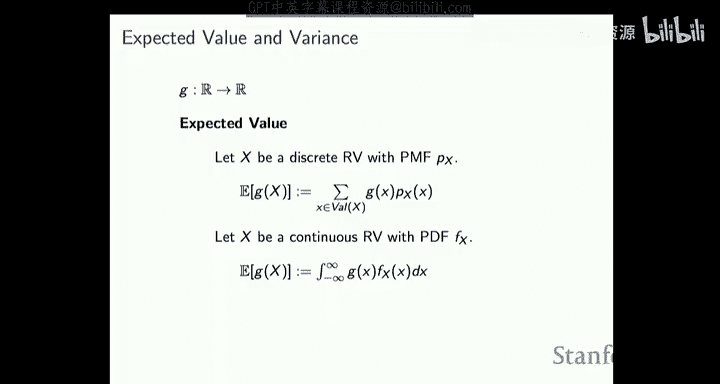

Take the average1 over n。G of。Some more I equals 1，2， n G of X。Where Xi are random samples。

That you random samples of x， that is the input drawn according to the density。

Eval it at G of x and take the average。And what we basically know is that the limit of this as ns to infinity。

😊，Which means。If you perform this procedure with larger and larger number of samples。

The limit of this。Ts to the integral of。30。G of x。And。P of x。

 D X where P of x is the probability density。 G of x is the function that youre trying to calculate expectation over。

 And this， this statement is also called the。Anybody。This is called the law of large numbers。

Lch numbers。super important and this。😊，Estimate of the expectation。

You knowSo this this is an approximate estimate of the expectation which the approximation gets better and better as you increase the number of n and this estimate is also called the anybody。

😊，It's called the Monte Carlo estimate。I'm sorry。Monte Carlo estimate。

This is the Monte Carlo estimate and as as you increase n to infinity your Monte Carlo estimate becomes the true expectation and that is basically a consequence of the law of large numbers and we are going to be seeing the Monte Carlo estimates various you know for various purposes in machine learning and in this course as well。

😊。

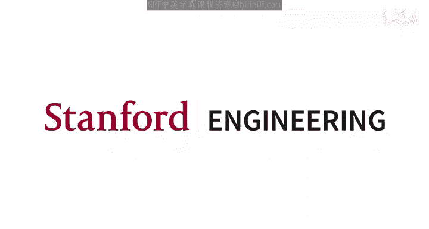