# 斯坦福大学《机器学习｜Stanford CS229 Machine Learning Course  Summer 2019 (Anand Avati)》 - P3：-03-.Lecture 3 - Probability and Statistics.zh_en - GPT中英字幕课程资源 - BV1NDopY4ECg

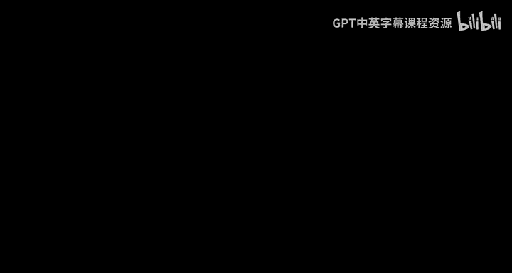

Welcome back to the third lecture of CS2 to9。So in the first two lectures weve been mostly going over the course prerequisites linear algebra probability so on Wednesday's lecture just to recap we went over the concept of determinant its geometrical interpretation and we went through two different kinds of decomposition of a matrix。

 the eigenvalue decomposition and the singular value decomposition。

After that we we quickly went through some matrix calculus。

 the different ways in which linear algebra plays a role in calculus when we are dealing with multivariate functions。

😊，And after that we switched gears into probability to review some basics of probability theory today we will finish up the review of probability theory and。

😊，Maybe in a few， you know， just spend a couple of minutes on on some basics of statistics of why statistics plays a role in machine learning and。

After that， we will jump right into our first learning algorithm linear regression that' is the plan for today。

Any questions about what we have covered so far before we get started？Okay， so。

We were reviewing probability and。😊，Maybe let me just go back a few slides to just touch upon a few。

Important concepts right so we covered whats a sample space sample space are samples are basically the collection of outcomes of random experiments and events are subsets of the sample space。

嗯。We assign probabilities to。Events not to random outcomes。

 but to sets of random out to sets of outcomes。And those are the axioms of probability。

We went over what is the meaning of independence with respect to events。嗯。

An event is independent of the other if the probability of their intersection is the product of their individual probabilities。

And then we discuss this concept of a random variable。

 a random variable is something that maps the space of outcomes which could be anything it could be a string of heads and tails it could be the color of a die it could be anything whatsoever and we map it on the real line and that's when we can start doing mathematics with。

With randomness， know the concept of random variable maps， outcomes。

 which could be in any sample space。On to the real line。For example。

 we could have a random variable that counts the number of heads in a given event。

And to map that event。Outcome let let me say that again。

 So here we have an example of a random variable which takes us input the outcome the outcome in this case is a string of 10 heads or tail coin flips。

And that is just a string of you know heads or tail symbols it is not a number and a random variable an example of a random variable in this case is a random variable that just counts the number of heads in in。

In that sequence of 10 coin flips and maps it to a real number。Wait。And by values of X。

 we means the set of all possible real values that the random variable can possibly map any of the outcomes into。

And then we spoke about the cumulative distribution function so previously we saw that a probability measure is defined on events but once we map it to the real line。

 once we convert define the random variable the probability the probability measure kind of induces some kind of a probability measure on the real line right and that can be captured by something called as the cumulative distribution function it is basically the measure or the probability assigned to the set of all outcomes。

Which get mapped to a value less than or equal to the the desired threshold。Right？So。

 this is how a CDF would you know look for a continuous random variable。

 so the the height of this function is measuring the amount of probability assigned to the set of all events。

The set of all。The set of all outcomes that map less than or equal to the the desired threshold。

 So that is what we have here。 So it is the P over here is now measuring。

an event a set of outcomes and the set of outcomes is defined as the pre image of the random variable the random variable maps outcomes to the real line and if you look at the pre image of that function that is the set of all inputs that get mapped to a value less than or equal to desired threshold that will give you a probability and that is going to be a value between 0 and 1 and which is why now this the values of the CDF lie between 0 and 1。

and we spoke about discrete versus continuous variables。

 discrete variables have a probability mass function and continuous variables have a probability density function。

😊，A CDf or a cumulative distribution function exists for all random variables that is the CDf that we saw over here this CDF exists for all random variables whether it is discrete or continuous but the density function exists only for continuous distributions which is basically the derivative of the CDF。

It is important to note that the density of the the value returned by the density function is not the probability What I mean by that is if。

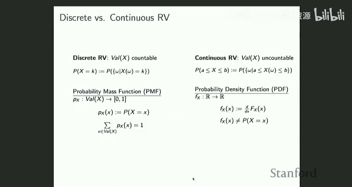

Suppose this is x， and we have some density function。And suppose this is 0。3。Okay， and。

This has some height。It is important to note that the probability of x equals 0。

3 is not equal to this height。The probability for any continuous random variable the probability that the random variable takes a specific value is always0 that sounds that may sound a little counterintu if you are if you are hearing this for the first time but you know let me say that again if we have a discrete probability discrete random variable with a probability mass function。

😊。

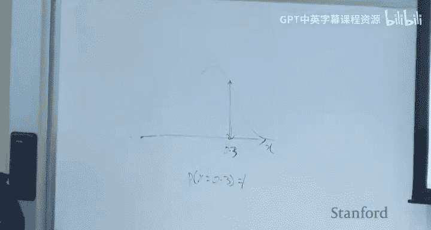

I like 123 then the probability that the random variable takes on the value 3 is given by the height of the probability mass function but the probability density function is something that is fundamentally different in the sense the height of the the density measure at the point is not the probability that the random variable takes on the value for example 0。

3 right probability in case of continuous random variables are only defined on intervals。

Our sets of intervals。So the area under the probability density function。

For a given range of your input， the area under the probability density function is the probability that the random variable takes a value in this range。

But the probability that continuous random variable takes any specific value is always 0。So that's。

 that's that's yes， question。自のそ談も。Mm哼m。😊，So we can't want it。お。一ヶ月か出る。Well。

 so the question is if I understand you correctly let me rephrase it and then you can tell me if I understood your question correctly is we don't know where the what value the continuous random variable is going to take so how can you define the probability to be 0 Well so this is you know you can think of probability as the the。

So there are two two kind of interpretations to probabilities one is。😊。

Looking historically what's been like the distribution of of you know the your true random variable taking on in the past and then based on that you can probably construct some kind of a density or estimate some kind of a density what it actually means is just because if you take a continuous random variable。

The number of possible values it can take is uncountably infinite。

And that makes it impossible or or a continuous random variable is is does not have point masses in the sense any given value in this among this infinite uncountably infinite number of possible values any any。

Any given value of of these has zero probability of occurrence。 But if you take a range。

 you get a probability for the value falling in that range。Okay。

 so thats discrete was this continuous probability and then we we started talking about this very important concept called expectation。

Ex is expectation is a concept that is only associated with a random variable right so we spoke about outcomes。

😊，And we spoke about events。And we define a probability measure on events。

So if we limit ourselves to just these concepts， then the concept of expectation does not come into picture。

 Yes question。Lights。

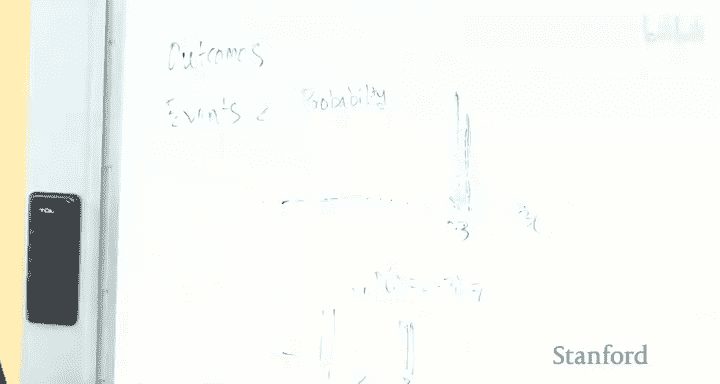

Is it okay？Okay， can you see the slides as well， Is it too bright for the slides。Okay， okay。

 so if we are only limiting ourselves to the concepts of outcomes and events。

 then there is no such thing as an expectation。 But once we define a random variable。

 a random variable， as we saw last time was it。Wem going to draw the outcome space as or the sample space with a squiggggy line just because it is not like a linearly ordered line and then we define a random variable so assume this is some random variable x。

That maps。Outcomes to the real line， you could have another random variable。

Which maps the same sample space。To the real line in a different way。 Let's call this y of omega。

 Now， only after we define this concept called a random variable。

 the concept of expectation comes into picture。 So expectation is。What is the well。

 an informal way to think about expectation is what value does this random variable take on average？

😊，RightThat's so we have a function，That maps。Outcomes to the real line。And generally， we。

 we kind of flip this axis over。 and we， we， we we， we start with。The vertical line flipped over。And。

We ask ourselves， suppose we there is a function G defined on top of this random variable。

 So let this be。Some function G of x。And， this is x。And。

The values over here are those values are coming from。

Random out coming from outcomes that got mapped onto the real line and then the expectation is now asking what is the average value that G G will return right and the average value that G returns is going to depend on the way depend on what values we are feeding into x。

And what expectation informally is if we feed values into G。😊，According to the distribution。

That is induced by x。So events happen sample events。Map it to x through the random variable。

 feed that that value of x into G and you get some value right。

Suppose this this this outcome happen map it to x right x maps it to G and this is the value of G。

And similarly， you repeat this experiment over and over。

Different outcomes map you to different values of x and different values of x map you to different values of g of x and you are measuring what you know the various values of G and you are trying to now ask the question what is the average value of G in general world and you can ask the question of average value only because now you have things on the real line right on the sample space there is no such thing as an average。

There's no such thing as an average sample because you know you have a dive with six colors。

 what's the average color it' is not a meaningful。 once you map them to numbers you can ask whats the average value。

And。For a discrete random variable， the expectation is is defined like this。😊。

sum over all the possible values x can take。And for each of those values multiply g of x that is the value g of x returns times a probability x takes that value and this is just a weighted sum of the different values of G of x according to the probability with which x can occur。

 very very intuitive definition of expectation。 and similarly， the。

For continuous random variables it is defined like this in place of the the summation we have an integral right now you are integrating over all possible values of x。

😊，And for each value of x， we measure the density。😊，Not the probability but the density。

 And because we are now using densities， we have an integral in of for some。Its question。Seriously。

事務所の方。X。So what the question is， whats G of x。 So x is a random variable。

 and G of x is some function of x。It's just some function of x right。 It's G is defined here。

 G is some， some function that takes real value as input and outputs a real value。Right，And you can。

 if， you know， Jesus a function， you， you know， in this case。

The input of x input to G is going to be the random variable， which means， you know， it。

 it can take on different values according to the outcome of some random random experiment。So。

 that is the expectation of G ofx and we saw an important concept last in the last lecture that you can approximate G of x by taking random samples。

😊，Of x and calculating the average of G of x for that sample， right， And that's called the。

monontic Carlo estimate of the expectation and as the number of samples tends to infinity as as you estimate the expectation with more and more number of samples the Monte Carlo estimate converges to the true true expectation right and that is basically the law of large numbers。

😊，Any questions about that。So that was still thats what we covered on Wednesday。

And today we are going to continue further。Now， we are going to talk about variance。

 So what's the variance of x， varianceance of x is defined as。Was there a question。

So the variance of x is is defined as the expectation of x minus expectation of x square。

 Now what whats what's happening here， it basically means。Suppose x has some distribution。

 for example， lets suppose this is the probability density of x。Right。The expectation is， also。

The point that's kind of。The point that you can you can you can think of it as kind of the if you imagine this probability density function。

To have some kind of a shape， then the expectation is that point on x。

 which which is basically like the center of gravity。 like right if you if you， if you。

 if you take an actual physical thing of of this shape and you try to balance it on the on the expectation。

 then you know your that shape will kind of stay balanced right It's like the center of gravity。

 right That's that's the intuition for expectation the variance is kind of trying to measure how spread apart is this random variable around its around its mean。

 So this is going be。😊，The expectation。嗯。The the the variances trying to measure how spread apart is this distribution in general。

There is also another concept called the median of the distribution。

 So the median of the distribution is supposing this is the median。The mediumn of the distribution。

Is the point that divides the mass into。Into into， into。Equal masses on either side。

 And for symmetric distribution， the median and the expectation are are， are the same， however。

There could be distributions which are， you know， for example， you have a distribution like this。

In this case， the median could be somewhere over here。

 but the expectation could be so this could be the median and this could be the expectation because the point where you balance a mass is not necessarily the point where you know you have equal masses on both sides because know I think I think that's called the moment of inert here or something like that where if you have mass that kind spread all the way on the other side then that has more effect。

 So if you want to balance things that's the point where that's the mean or the expectation and medium is the thing that divides it into equal masses on both sides and the variances is trying to measure how spread apart is this if you could have a distribution that has。

A given expectation and a small variance。Or you could have a distribution that has a given expectation and a large variance。

喂。These are two different expressions for。ForFor the variance of x and they are both equivalent that showing this is pretty simple its in the notes。

And here are some examples of various distributions and their parameters parameters。 Now。

 this is the first time we are talking about parameters。

What is a parameter right So when we are talking about distributions there are kind of two concepts One is the the space over which the distribution is being defined supposing it is a random variable it is you know the real line on which the the distribution is being defined and then you have a parameter a parameter is basically a number that tries to。

Smarize the shape of the distribution。Okay， for example， if you have。Gussian random variable。It就是。

Also called the normal distribution or the be curve。

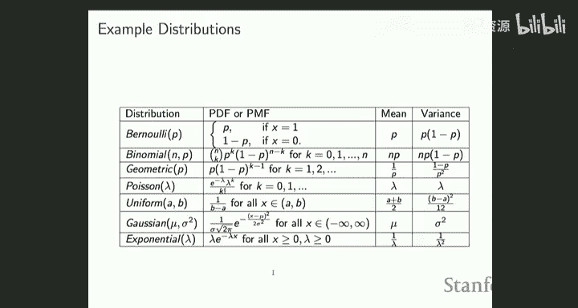

It has to。Two parameters。So one is the so this is the real line。

And this is the Gaussian PDF and mu is the mean of the Gaussian distribution and sigma is like its called a standard deviation。

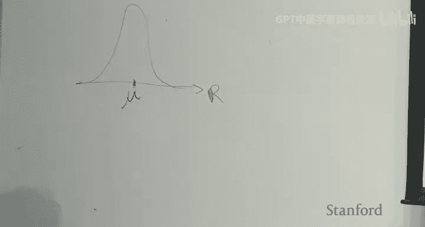

So a Gaussian distribution is summarized by mu and the variant sigma square。

Where sigma is the standard deviation。Similarly， there are you know。

Many different distributions and each of them have have you know parameters。

 some distributions have just one parameters， some have two， some have three。

 but most of the distributions we are going to be interested in in this course are are are you know。

 going to have one or two parameters。You can have。You can look at two random variables jointly。

 right， And for that。What that means is supposing you have a variable x and a variable y。Together。

 they have a joint CF。Which means the probability that x。

The variable x is less than the x threshold and the probability that y is less than the y threshold right So you think of the comma over here as as the logical and。

similarly you have a bivariate probability mass function which is you know the probability that x in this case x and y are discrete in in the continuous they were here they were continuous so this is the probability that x takes the value you know small x and random variable y takes the value small y。

Given to given the joint Pf of two random variables。

 you can construct their marginals So if you have two random variables。Let's call it。

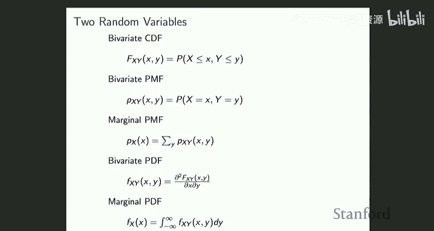

X and Y。The， the。The distribution that that that captures the most information of these two is the joint distribution of the two。

 and that will have assuming they are continuous， you know。You write it as P of x comm y。

That's the joint distribution of the two。Similarly。

 you can have the marginal distributions of the two random variables and the marginal distributions is going to be written as P of x。

Or P of y。

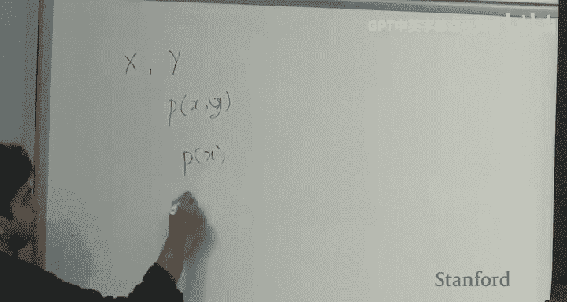

And the way you get these is to。Whats whats called us marginalizing out or summing out or integrating out the other variables So some of all the y P of x comma y。

And you get this。 Or similarly， if it's a continuous random of variable， then you integrate out P of。

Why。DY。Right，And， and this is just the other way。 So here you sum X， if it is。Discrete。

 so this is discrete。And this is continuous。Here it would be something more。 now the。

The way to think about the the joint Pf is that。The joint Pf or the joint PMF has to satisfy the property。

So if you integrate out both the variables， the joint PDF has to integrate to1。Right， and。

If you integrate out only one variable， then you get。

A distribution with respect to the other variable。 And that's called the marginal distribution。So。

Given these concepts of the joint and the marginal。

We can define the base theorem the base theorem is probably one of the the most important theorems in probability theory it' is going to show up all over the place especially in the course and even beyond and the base theorem basically gives you。

The relation between the conditional distribution， the joint distribution and the margin distribution。

 right， So the。Based， the base theorem。Looks like this， so。P of x comma y。You can write this as。Piu。

😔，X times P of y given x。

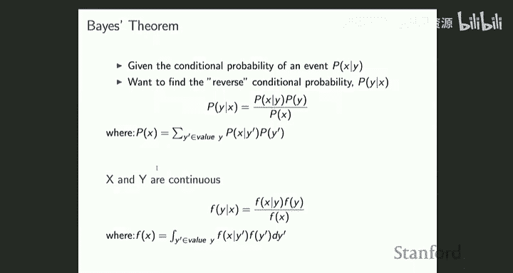

So this is the joint。This is the marginal。And this is the conditional probability。

So the the way you want to remember this is。The joint is the product of the marginal and the conditional。

 But you can also write this as。P of y times P of x given y。

And the way you decompose the joint into into these two parts is called the chain rule so there is a chain rule in calculus this is the chain rule of probability theory so the chain rule tells you that you can you can always for any pair of random variables you can decompose the joint into the marginal times the conditional。

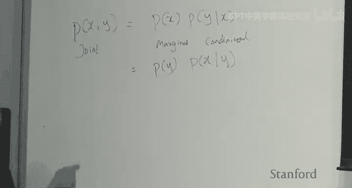

Right， and。A trivial consequence of this chain rule is the base theorem。

 So the base theorem basically equalates these two。 So you write P of x。

Times p of y given x equals P of y。Hences P of x given y。Right， and。Assuming P of x is never 0。

You can divide both sides by P of x， and that gives you P of y given x。

Equals p of y times p of x given y over p of x，So， this is。

Based here it's a very simple consequence of of the of the chain rule。

 You apply the chain rule in two different ways。Eate the two different ways and divide divide over by one of the mars and you get the base rule。

Yeah， so here we are writing this in terms of X， F， but you know， can you can use F or P。

 It doesn't matter。And another way in which base the base theorem is。Is also commonly written is。

Retain the numererate aszious， P， F， Y times P F。X given y。And the the denominator is。

Instead of writing it as P of x， you're going to write it as assuming it's。

 it's a discrete sum over y prime。P of Y prime。Times。B of x given。White prime。These two are the same。

 Why are they the same。Because P of y prime times P of x con y prime is the joint。

It's the joint and youre marginalizing out y prime from this， which gives you P of x。you know， just。

 just to add。This is basically equal to summing over y prime。P of x comma y prime。

You're going to use this form of。B theorem， also in the scores。Right。Any questions？

So some of you sitting over here， you may not be able to see this read this because this kind of comes in the way so maybe you can move over next time or you can move over even now if you want to。

Example of base。 let's skip over this。Independence so the independence of two random variables is very similar to the independence of of two events。

 they are distinct concepts， independence we we spoke about independence of random events a few slides ago here we are talking about independence of two random variables and the independence of two random variables is defined like this that the the。

Joint probability is equal to the product of the marginal probabilities。

 right or the joint den is equal to the product of the marginal densities。That also， you know。

That's basically telling， you know， if it is。Independent。

You are saying p of this is equal to p of x times p of y。

 So if if two random variables are independent then you know p of y must be equal to p of y given x right we saw something very similar for random for independence of random events it it' is very very very similar So p of y given x of two variables will be equal to p of y yes question。

しです。うさ表り。So the question is if two random variables are independent。

 can we say that the events that they are。Defined over are also independent。I， I。

The it it must be the case， right。Next question。Yes， question。Go by Ka。This is。

Definine when F of x is not equal。大ましよ。So， the。When the probability so assuming we are talking about discrete in the discrete case。

 the conditional of y given x itself is not defined if the probability of x is 0。😊，Right。

 assuming that the condition is defined， you know， the。The base them tells you that， you know。

 you can represent it like this。Does that make sense。 So。

 so the conditional probability itself is defined only when you know。

 conditional of y of x is defined only when x has a nonze probability。So。Over here。

 this is the conditional distribution of y， given x takes on some。You know， a given value。Right。

Right，Next， we are going to talk about this， you know， so。Yeah， independence。

 So were gonna know independent random variables are are。

Are super important because it lets you decompose the joint probability into just product of the marginals and this independence makes this independence is what makes a lot of machine learning theory kind of you know easy to work with we we make we are going to be making assumptions about you know your training examples which you think of them as random areas being independent of each other So the concept of independence is。

I is very important。Let's keep all this。This is the expectation of two random variables。

You can go over these on your slides。Just like the concept of。Of variance。

 there is the concept of covariance when we are talking about two random variables。

And the covariance of random variables are defined like this。So， the variances up。So。

 the variance of。X was defined as expectation of。X squared minus。Expectation of。X。Square。

We saw this on a few slides ago， Similarlyly， the covariance of。X comma y。

Is defined as the expectation of。X are times y。Minus expectation of。X。てしま？Why。

Which basically tells you that the covariance of x with x is just the variance of x。All right。

The multivariate Gaussian。 So this is one of the most commonly used distributions defined over a collection of random variables right and。

This is something that' is going to show up a whole lot in this course。

And hopefully towards the end of the course， if you are woken up in the middle of your sleep and ask you what is the probability density of a multivariate Gaussian。

 you will be able to say this。😊，You know， instinctively right this looks looks a little scary at first。

 but let let let's kind of dissect it a little bit so。😊，So， x is。In some n dimensional。Space。And。

The probability， the density of x given two parameters mu。And sigma。Is defined as。1 over。都牌。To the。

N by two。Times the determinant of sigma to the power half。Cs。The exponent。offff。Winus half。

X minus mu。I suppose。Sigma inverse。X minus from you。哇。So。First of all。

 let's see what's happening here and add some color to it。 So x is。The space over which。

We are defining the probability density， so we see that x appears only here inside the exponent。

And you have two parameters， mu and sigma。The sigma is called the covariance matrix。

And new is the mean。And the covariance matrix。Shows up power here。 and then we have the mean。mean。

Maybe I' just black from this。Min。😔，Min。😔，Meing。Rightright。So this is the， is the。

The the joint distribution of a multivariate Gaussian。And we right away。

 recognize a few things that we have seen in our linear algebra course before， right So first of all。

 sigma is a matrix It is called a covariance matrix。😊。

It turns out to be a positive semi defite matrix， any covariance matrix for any any joint distribution no matter what the distribution is is always going to be positive semi defite right So this and this is a positive semi defite matrix。

And we， it is going to be full rank， which means the inverse will exist。

And we can recognize a few more things。 So this is the is the determinant of the matrix。

That is the notation for the determinant， and it' is like the square root of the determinant。

And we also see this form of over here。 Does anybody recognize this form。This is the quadratic form。

 So x minus mu is some vector。RightAnd what we are doing is x minus mu transpose some matrix times x minus mu。

So this is the quadratic form that we also spent some time on。

So all the review that we did with linear algebra is going to apply on this shortly。😊。

And this term over here is just some constant。It has no mean no no data， no covariance。

 this is just some constant。 and the purpose of this one over two pi to the n by two。

 the purpose of its existence is to only make this。

The integral of this with respect to x be equal to1。 So this， this is just some normalizing constant。

Yes， question。Yeah。Exactly， so the question is if this is a multivariate distribution。

 what does the integral with respect to x mean， it means exactly what you said you are integrating out all x1 through xN。

😊，原明。Okay， yeah， okay， sorry， so。The， the integral would would look something like this。

 You would have。Pf。X。New square types， D X1， D X 2。

it would be double integralte or triple integralte or。Right， so this is the， the。

The multivariate Gausian intensity and we are going to be working a whole lot with this。

 so you know you will get familiar with this if you if you if you are not already。

And here are some intuitions about what the mean and covariance matrix of a multivariate Gaussian looks like。

So what we have in the left are examples of particular instances of mu and sigma。

The figure on the center is a plot of the probability density function。

Here it is a two dimensional Gaussian。And the figure on the rightmost column is what is also called a contour plot or a heat map。

😊，Well。A lighter color， a color of orange means。That that region has a higher value and blue means it has a low value。

 So imagine。Looking at the plot in the middle directly from the top and using different colors to represent different heights right that that is the plot on the right。

RightSo let's just get a feel for you know， what the different。

Different parameters mean in terms of the probability density。

 So a mu equal to 0 means the center of the distribution or or or the the distribution is going to be centered around 00。

We see this to be the you know，0，0 over here， and the。The peak of the distribution is over 0。

0 in this case。And the the covariance matrix， the diagonals of the covariance matrix are the variances of the marginals of x1 and x 2。

So what this roughly means is that x the variable x1 so if you just look at x1 over here it is going to have like a standard deviation of 1 you know that looks roughly correct if you if you imagine this to be the x direction it has like a。

Of standard deviation of1。 And x2 also has a standard deviation of one。

And the cross entries in the covariance matrix are the actual covariances between those two random variables。

 a covariance of0 here roughly means that there is no strong relation between x1 and x2。

 which makes it take a spherical shape。嗯。Movinging on。

 So here's another example where the the covariance matrix has。Smaller diagonal elements。

 which means the distribution is still centered around  zero， but it is more concentrated。

 It has a smaller variance。Which means it is more peaked。😊。

It is more peak compared to this distribution and in terms of the contourt plot the the circles just appear to be smaller。

😊，And similarly， if you increase the variance of your distribution。😊，The covariances are still0。

 which means that it is still spherly shaped。Now it looks more flattened。

 your probability density looks more flattened and the concentric circles are also more expanding。😊。

Let's look at a few more examples。Now。Over here， you know， this is still the first picture now。Now。

 let us scale the x1 to have variance 。6 and x 2 to have variance 1。So， x1 is now。More compressed。

 but x2 still maintains the same variance。 So you see from the control plot over here that。It is。

 it is more vertically aligned， probably the slides。The sheep。

The projection of the slides make it look a little different， but thats that's the。

It seems on the on the picture over there， this looks like a circle。

 but it's supposed to be know compressed vertically。 and it' it's supposed to be longer。Now。

 instead of shrinking x1 if we expand x1， now you see that it stretch across more widely。

But still there is no correlation between x1 and x2。

 so you don't see any particular correlation over there。Now， let's add some correlation， right Now。

 X 1 in in this case。X 1 and x2 still have a variance of 1 and 1。

 but now weve added a correlation of 0。5 which means as you increase x1 x2 also tends to increase that that is the general idea that x1 and x2 tend to cooc。

You know， more know， as， as you increase the values of effects。

If you increase the covariance further， you know the relation becomes even tighter， even stronger。

The marginals in this case are still one and one， which means from if if if you if you were to。

Integrate out x1， you would get a probability density of a unit of a mean0 variance1 on x2 and similarly if you were to integrate out x2 you would still get a normal curve on the x1 axis。

So that this intuition for how a multivariate Gaussian would look know with true dimension it is easy to visualize and get some intuitions。

So if this is the next slide and if the correlation is negative now what this means is larger values of x x1 tend to cooc with smaller values of x2 so。

😊，For example over here for x x1 equal to you know for x1 to have a particular color you know x2 has to be you know negative that is what it means so so you see a reverse relation between x1 going up and x2 going down。

And if you again， make it negative and make it a bigger number。

 you see a stronger correlation between x1 and x2， but the in the reverse direction。Similarly。

 for a given covariance matrix， you can move your you know use a different mu。

 which means the covariance matrix is deciding the shape。😊，And orientation of the， of the。

Of this function and mu tells you where to place it， where to center it。

So this is basically the same be shaped， but placed at x1 equal to 0 and x2 equals 05。

 So here you see， it's just in terms of x 2's moved up a little bit。

And this is another example where x1 is 1。5 the center of the distribution is that x1 equals 1。

5 and x2 equals minus05 that is where the center is and the covariance matrix decides the shape and orientation。

Right， any questions。Yes， question。如果。So if you， if you the question is。

 this is with respect to two variables。 and what if we have more variables， I I that the question。

Yeah， so if you have three dimensional Gaussian， then you would have a 3 by three covariance matrix and each of the pairwise correlations will be the values in the corresponding cell。

Right。Okay， so conditional probability。We went over this already。

So here is a useful identity which is the conditional expectation so the conditional expectation is another important concept in probability and the conditional expectation is defined like this。

😊，And the conditional expectation is actually。Itactly somewhat subtle， right so。

Conditional expectation is。So， the conditional expectation of。E off。Given。Why。

So you think of the conditional expectation in this form where x and y are random variables。😊。

To be a random variable。Right。The expectation of x。Is a constant？

The conditional variable of expectation the conditional expectation of x Q and y is another random variable。

😊，X is random。X is random。 Y is random。 expectationectation of x is just a constant。

 It is not random。Right。Conditional expectation of x Q and y is a random variable。😊。

RightIts a random variable defined over the space of y。However， conditional。Expectation of x。

 given y equals。Small y。This is a function。Of small white。Right。

The conditional expectation of X Q and Y where you you know。

You you are just placing the random variable over here is another random variable it doesn't look like it。

 but x given y kernel expectation of x given y is another random variable。

 but conscious expectation of x given y equals some specific y is a function of。That specific way。

Yes， question。These two are。Not the same in the sense， this is still a random variable。

This whole thing is random variable， and this whole thing is a function of small y。

This is this is a subtle concept and you may want to go back to your probability book to kind of go through this again。

 but this can be this can be relevant in some of your homework So that you want you want to have a good goods good clear understanding that are are view these as distinct things conditional expectation of x given y where y is still random variable is another random variable it is basically you are saying you feeding。

A random variable y as input， and this becomes a function of y。

 and therefore it is still a random variable。And think of it that way。Yes， question。そたと。Exactly。

 so the question is， if this is an random variable。

 then can we apply all the all the rules that weve seen so far on this exactly you can。

 but you cannot on this one。Next question。So over here。

 the random variable is defined over the space of y only。😊，Yes question。啊。

Random variables are functions already。This is a function of y of or small y。

 but you know this is a random variable in the sense， this is a function over your sample space。

Don think of it that way。This is just over the sample space of Y alone。

So maybe the next next slide might make it a little more clear so maybe you know hold your question until the end of the next slide and there was one more question。

Yes， question。m。も。就。Yeah， so in the case of Gaussian， you can think of it like this， right。

 So assume this is the contour plot of。Of Gautians， where it is centerd on some。

Let's call this a plus one and plus 2。 And the expectation， and let's call this X。

 And let's call this y。 So the expectation of。Of x given y equals， you know， say。Some small value Y。

 and assume the small value Y is this right What it basically tells us if， if you kind of。

Limit yourself with this slice of of the Gaussian。 And that's gonna be， you know。

Just gonna have some kind of a balance shape。 And what's the expectation of that。Yes question。So。

This is a function of small， by， expectation of。That's the typo。 that should be a small way， sorry。

This over here should be small， white， thank you。Yeah， so。

So now we have something called the law of total expectation。Right。

 so the law of total expectation tells us that。Expectation of x。Can be written as the expectation。

Off。Expectation of x Q and Y。 now， this holds true。For any X and any y。

Y could be completely independent of x， It could be dependent on x。

 but the expectation of x can always be decomposed into this nested form where you condition on y。

You get a new random variable。And take the expectation of this random variable and you get back the expectation of x。

 This is called the loft total expectation。😊，嗯。And while this holds true for any in general。

You have the choice of choosing the Y and you want to choose a y that makes your problem easier to solve by know breaking it down this way and the choice of what y you want to choose is more of an art and youve got to when youre asked to calculate know the expectation of x and its pretty its pretty complex you want to use some some creativity in choosing a y to defining this random variable and then take the expectation of that and by breaking it down into subpro you can solve some complex problems。

So， the expectation of x given y where y is left unspecified is a random variable。😊。

And that's what shows up here in the lawft total expectation。

 And when you take the expectation of that， you get back the expectation of x itself。Yes question。

This one。Yeah you can think of it as a function of big y thats one way to think of it or just think of this as a random variable。

 this is a random variable。😊，Like Z， you know， think of this as Z， you some random variable。

But here's a proof to show this disproving loft total expectation。 I'm not going go over this。

 You can go through this yourself pretty straightforward。 there' is nothing complex going on here。

And that's one more version of base rule that's going to be helpful for you。😊。

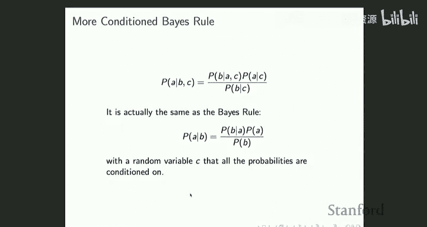

Right。So let's write the base rule that we've already seen P of a given B。Is equal to P of B。

 given a。Times。P of。嗯。O。P of B。So this is the base rule that we saw already。Rightm。

The base rule basically also allows you to have another variable that is conditioned throughout。

 right So you can think of this as the conditional base rule， which means P of。

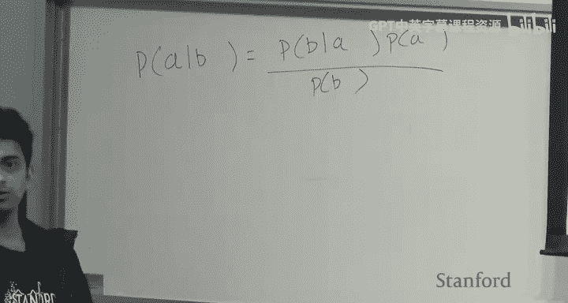

みかマし。So you can have C condition。In all the terms。And this is also base rule， the。

 the expression that you see over here。Right， similarly， you can also。

So this is the base rule where we are kind of swapping A and B over here， similarly。

 you could have also just as well kept B conditioned throughout and just swapped A and C and that that's also you can think of that as base rule。

All right， any any questions？Okay， with this， okay， so heres a proof for this。 you can go over this。

 but you know you can just you can just remember it this way and you can apply it。

this proof is just to convince yourself， you're not gonna test you on on these kind of proofs。啊。

With that， we finished the the review of probability。Any questions。

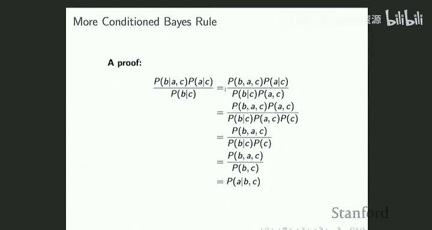

Now， I want to take a few moments to。To kind of give you。

A slightly a big picture overview of the role statistics plays in machine learning。嗯。

What we saw in the slide so far， we had parameters。 for example。Mu。Sigma of the Gasian。

And we had observations。Praome， And we had observations， for example， in the multivari Gaussian。

 you had x in some。好人。Right， so。Probability， basically。

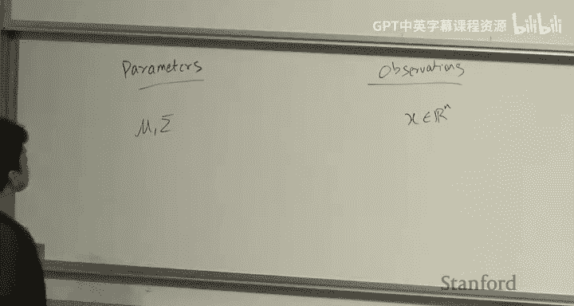

Is the field where。You are trying to make statements about the observations。Given your parameters。

Right。Probaably。So， given given parameters you are trying to make statements about the data。

 you know what is the probability of this， what is going to be the marginal probability。

 what is the conditional probability， what is the joint probability， things like that。😊。

So given given given parameters， we assume that the parameters are given or they are fixed and you are making statements about observations our data you can think of this as data。

Right。And。Statistics is kind of doing like the opposite。 right， You're given data。

 You start with data and you're trying to make statements about your parameters。

You make some assumptions in statistics about what the distribution is given given the data。

You take the data that is given to you right you are not making statements about you know what the probability of some other data is or anything like that。

 but given the data you are trying to make statements about the parameters。Right，And， and。

 and and that's statistics。 And you're， you're trying to。Generally。

 the statements that you make about the parameters and statistics are about things like is this parameter value equal to 0 or is this parameter value much farther away from 0 And you're going to assign you know P values for those observations。

 you're going to define confidence intervals were you know what what you believe the range for those parameters are So you start from from data and make statements about the parameters and statistics。

 but in probability， you're kind of know going the other way。

 and these two are kind of you know like yin and yang they are kind of coupled to each other。

And there are many， many techniques to estimate parameters given given your data， right so。

Things like method of moments。Or maximum likelihood estimation。And it is。

This approach that is kind of relevant for us in this course and for most of machine learning。And。

Using these techniques， you you kind of feed an x as the input for these techniques and it is going to output some some some parameters for you。

Now。Where does machine learning come into picture。 So with machine learning。

What we are trying to do is you are given。What's called as a training data。

Your training data is going to be some collection of x， you know。You can think of them as X。

 Y pairs for supervised learning。 and you're given a collection of them。Right。

 and given the given your training data， you want to。Learn the parameters of your model。

You are going to define some kind of a model for this data and learn the parameters and using the learned parameters。

So for machine learning， you know。You feed training data。And youre going to learn your model。

And using those models， you want to make predictions about future data。

So machine learning we are actually the goal that we are interested in is actually given the training data make predictions about future data。

😊，Right， but incidentally， we kind of。Take statistical approaches where we build a model and use the model to make predictions on future data and that is where kind of statistics comes into picture where you know you are given given training data of use tools from statistics like maximum likelihood estimation and other things to learn the model。

😊，Even though we are using the same tools of statistics， the goals are very different in statistics。

 the goal is to make statements about the parameters itself。In machine learning。

We really don't care about the parameters at all All we care is how good is this model in making predictions about future data and thats how we measure the quality of machine learning methods you know how good is it in making predictions about about future data whereas in statistics you know the game end here we measure how good the model is or how good our method is in terms of making proper statements about the parameters。

😊，In machine learning we this is a black box for us it does estimate your parameters。

 but they are not of direct interest to us are only we are only interested in the parameters because they help us make predictions about future data。

😊，And。This。This part of the cycle is also what is called as learning。Our training。Or fitting。

F a model with data。And。In in classical statistics， you also call this statistical inference。

You are inferring what the parameters are given given the data。And once you have data。😊。

This is called prediction。You are making predictions about future data， about unseen things。

 things that you haven't seen before， about data that you haven't encountered before。Right， and。

Which， which brings us to maximum likelihood estimation right in maximum likelihood estimation。

We will call it ME。Now， Emily。V。Let's start with a very simple example of M E。

 to kind of give you the flavor of。Let's， let's start with Gaussians。Gussian data。

 So in the here we are going to talk about a simple situation where we are given data X in。RD。

 and you're given a collection of them。 I'm going to write them as x 1。Through。X， n。In this notation。

 what I mean is。Each x。I is the I example。It does not mean x raised to the power of I or x race to the power of n。

 whenever I like to superscript with parenthesesis， it means it's the I example。

And there are n such examples。Each example is。In R D， So its each each X is a D dimensional vector。

And we are given， let' us assume we are given。And such examples， right now。The probability。

We already saw the probability density of。Of of the Gaussian， which is P of x， given mu。食吗？

S to1 hour。都排毒了。D by2。Half。😔，Exponent。Right， so。This is the。Probability。Thats的。那我。

We are now going to define something called as a likelihood function。

So let's define the likelihood function。Of the parameters， mu。Com啊 sigma。Given。Given the data x。

And for notation， let's， let's call x as the。As the collection of your N examples。And over here。

 the semicolon means。Thinks to the right are kind of think of them as parameters or think of them as as you know。

 given values。 And the function is being defined on the variables that are to the left of the semi semi。

In order to define the likelihood function， we are going to make yet another assumptionsumption。

The assumption here is that each of these are。Sample。Independently。And。😔，Iden。Tickically。Distributed。

So this is also commonly called II。And this is going to be a very common assumption in all our all machine learning methods that the the training data that you have are sampled in an IID fashion。

 which means X1 through xN are all independent of each other they were sampled independently。Now。

 the light we define the likelihood function as。So。So this was for one example。

 Let's make this for all the examples。So the probability of x1。Through。X， n。Moma sigma。Is going be。

We saw， we saw independence that P of x。Wen。😔，Through。😔，XN。

 if x1 through xn are independent of each other， we can write this as the product of I equals 1 through n。

Pf。X， i。Right， this is。This means product you're multiplying the。The terms over here。Yes question。

そうする？All， let me let me I I haven't finished this yet。 So let let me come back to this in a moment。

So。The the joint probability of independent pieces of data is the product of the individual marginal。

Right， now， if you want to define the probability density of your full data set， x1。这。😔，X， N。Mu。😔。

Sigma， you're gonna write this as the product of。Y equals one through n。1 over。2 pi to the D by2。I。😔。

Exponent。Mus。Here， x。I， minus muu。Transpo。Does make sense because we are making think of this as。

This was for the case of one example， but if you are given you know an entire training set。

 the probability density of the full training set。Because of the IID assumption。

 we can break it down into。The probabilities of individual examples and just multiply over them。

Yes question。这不。X is a vector。As a vector of D dimensions， yes。This is a vi。So this， in this case。

 x is also a vector。Right，So you have x minus mu transpose。 this this is still in a vector setting。

So this is for one example。😊，But the example is still vector value and this is n examples where each of the examples still need D dimension yes question。

😊，So the semi colonlon is a way of saying things that come to the right。

 you are treating them as given。You don't think of them as variables。 They are just some， some。

 some constants。Now。So， this is the probabilityable density and it is precisely this IID assumption that lets us break down a complex problem into smaller pieces。

😊，Its representing this as one large Gaussian would would just makes it a harder problem we don't even know you know what this distribution might look like if there is you know if the interactions are pretty complex so instead when we make the II assumption that training data just came to you each example was generated independently we break it down into you know smaller problems now once we have this you know。

This as the probability density， we are going to now define the likelihood function。So。

 the likelihood function is。You know， in the spirit of this， a probability density function。

Takes x as your data。X has your data is the variable and assumes your parameters to be given。😊，But。

For going the other way you are going to take your data to be given and your parameters are the thing you want to make a statement over。

 So over here the likelihood function is going to be over mu and sigma。X。X 1 through。X N。Right。And。

You know， to no surprise。This is going to look。Exactly like this。Next question。Yeah。

 hold hold that question for a moment。嗯。What we see is that this expression over here in case of the Gaussian。

 this the what we thought of as the density function。😊，Also， you。

 we can repurpose it as our likelihood function。😊，The difference is that in case of when we。

 when we think of this as density function， right the。

The data is kind of the function is defined over the data space。

But when we define it as a likelihood function。Product from I equals1 to n1 over2 pi to the D by 2。

Sigma。Do the half。Exponent of。X， I。Minus mi。In。It is basically the same expression。

 but we are interpreting it differently we consider in the likelihood when we see this as a likelihood function we think of the the parameters to be the variables。

😊，And your data to be given。When we think of reinterpret this as the probability density function。

 we think of the data as the variables and your parameters to be fixed。😊，Yes question。

So the question is think when you write probability of newcomer sigma given x。

A small correction over there。 When we， we， we use the term。Probability。off。Data。

We never use the term probability of your parameters and we use the term likelihood of your parameters。

the correct phrase is to use this probability of the data given parameters。

And the likelihood of the parameters given data。Right。有了有有。That is。

 that is the only difference in terms of， you know， mathematically， but semantically。

 we are treating the， the。The data as as the variable here。

 but the parameters as variable here other other than that， the expression is just the same and。

The one of the obvious another obvious way in which they are different is if you integrate your probabilityability density over its variables you get one。

RightBut if you integrate your likelihood with respect to， you know for your parameter space。

 it may not even exist。Yes question。Does the likelihood form one particular slice in the in the。あつす。

That's a good question， so let's kind of go over that again。Now。

 assume this is your probability density function。RightNow the shape of this curve and the position everything about this curve is kind of fixed by the mu and sigma。

RightAnd the x axis is data or observation。Now， the likelihood。😊，For this is going to be。Mu。

Sigma synthesis。Likelihood， and here it was the probability density。

And the likelihood function is going to take in some shape。

And your training data is going to decide what the shape of this is。So that's， that's， that's。

 you know。You got to think of it this way， where the。This would probably， again， be。SomeSome。

 some kind of。UpUward bending， but the x axis over here is data。

 the x axis over here is mu and sigma。So， this is。Probability。And this is likelihood。So。

 if you are given a different collection of training data。

Your likelihood function is going to take a different shape。

 be located somewhere else it may take a you know it may look very different and this may not even integrate over to one。

😊，You know， the area under this or the volume under this under the likelihood function。

 but for a probability density function， the the parameters will decide the shape。And。

The volume under， under this function will always integrate one， so。Yeah， it's。

 it's it's the the analogy of taking a slice。 it doesn't quite hold。 know， there is two different。

 think of them as two different functions。So given all。不。Works。因有我是个。Exactly。

 so the problem that we are going to attack with the likelihood function is given the training data that we have。

 we want to choose some mu and sigma that maximizes the likelihood the most。😊。

And thats thats that's basically like the big picture of what we do in statistics here， given a data。

 that data is going to you know implicitly define some kind of a likelihood function。

 And now we want to find the parameters that make the given data。You know， most probable。

Its its I'm not intentionally not going to go into the the details of you know will a maximum always exist or not。

 but this is the intuition you want to have。 there are technical conditions that make a maximum exist and things like that but you know that's beyond the scope you know for most of our problems you know you know this is the inition that you want to have you know the likelihood is a function defined over the parameter space and the shape of the function is going。

Be different according to the data that we have and the probability， you know。

 which is which is like the other way， it's defined over the observations of the data and different parameters is going to give you。

 you know， different probability density function。There was another question。Yes。うこしし。不。Again。

 hold that thought。 Were gonna were gonna talk about what we how we' are gonna to extend this into machine learning。

 But this is， you know， you know， classical statistics， what's likelihood， what's probability。

Yes question。Yes， yes。So the question was when we you know you know based on the training data that we are given。

 we can estimate a muant sigma and that newant sigma is going to define some probability distribution and thats the and using this distribution is what we are going to use for making predictions over future data。

That's， that's， that's the rough idea。So that's maximum likelihood。😊，嗯。And。The procedure you know。

 that we are going to follow is。嗯。In some kind of， you know， an abstract， you know。

 in an abstract way， if L theta given。X。Is the likelihood function Take some form where x is。

So suppose we are given some training data and it you know we we make an assumption that it belongs to some distribution。

 For example， the Gaussian， right the likelihood is going to take some form。

 and that's going to be of the form of some。No product of I equals 1 to n， know， L of theta。

X I I am intentionally not expanding out what L is。

 it could be a Gaussian like that and the maximum likelihood procedure basically tells us that theta hat。

So， in general， we use the the the notation that we are going to use is we are going to put a hat over things that are estimated。

😊，Things that are given to us like training data are you know we just use them as variables。

 but things that we estimate as the output of some some estimation process you are going to put a hat over it。

😊，And theta hat。And I'm going to use the subscript M E to say that we use the maximum likelihood procedure to estimate this is going to be。

Arg max。Of theta。Of I equals1 to n。The likelihood of theta。For each。Right，So think of， you know。

 for example， in case of the Gaussian， you can think of this expression coming over。

 coming in over here。And further。我。I'm going to make this claim。

 And this is always going to be the sames。Arc max of。Log of。Product of I equals one to n。And take的。

What should I do here？There was this。This function。

 the likelihood function defined over all your training examples。And。

I make a claim here that instead of maximizing this the product of these。

 I am going to maximize the log of the product of this。😊，诶。And why is this true？

Log is a monotonically increasing function。 And if we want to the the。

The theta that we obtain with this will always be the theta will always be the same as the theta that we obtain with this。

Because it's a monoonically increasing function。 Yes， question。めとこ。Do。我。Look just。Okay。Okay。

 let's keep that question for you know I'm going to answer that after that just because I'm running short of time I want to know cover a few more things。

 but in general we are going to assume some form， some probability density and just going to work with that。

😊， no。Here the。So yeah， we replace the the thing that we wanna maximize with with the log of。

 of the same thing。It' is important to note that here we are calculating the arg max you know if we are just calculating the max then of course these two are different but here we are calculating the arg max so the the theta that maximizes this will also be the same theta that maximizes the log of this。

😊，Because we are doing the a max。And this can now be written as。Arg。Max of theta。S of I equals 1，2。

And。Small L of。对对。😔，X I。Where。L of theta is equal to。Logo。

So the log of a product of a few terms is the sum of the log of the individual terms。 and。

The the and we replace the the function L with the log of itself。Now。

 what would happen if L were to be a Gaussian？If， if。

 if we assume that our training data x is coming from a multivari Gaussian， we would then plug in。So。

 so far， it' is a standard template， no matter what problem that we have。You know。

 this is the recipe that you are going to follow for maximum likelihood estimation。And。

To take this further， we now have to get into the functional form of what the likelihood function actually is for that problem。

And in this case， for Gaussian。It's gonna be。Arg Max。OfNow， so far。

 we were just talking about theta in in general。 but now we are going to。

Talk about the parameters of the Gaussian here we were you know by theta we were just mentioning the parameters of whatever distribution that were going to use in an abstract way。

And。S over I equals 1，2 n。Log of。This whole thing。1 over2 pi。To the D by2， this is going to look。

A little big， but it's going to simplify， I promise。2。Exponent of。Minus half。X minus mu transpose。

 sigma inverse。Right。Can we simplify this further。Yes we can So there is an exponent and there is a log right so know the exponent and log cancel out and it is the log of the product of two terms you know and that can be broken down into the sum of the logs of the individual terms right and here I am going to use this as mu hat。

Come啊识 my head。And this is。Ad max mu。识吗？Some over high equals 1，2 n。So。

 I am going to break this down into three parts1 over 2 pi to the d by 2 and the log of that。

It's going to be some constant。 It is some constant。 There are no variables there。

 So Im just going to write that as some constant K。Plus。Log。Or half log of the determinant of sigma。

Is it plus half or minus half， sorry。-5。Plus。Log of the exponent。 they're going to cancel。

 And there's a minus， minus。啊。X minus mu transpose。Sigma verse。X minus3。Right。And no。

This is some function。 This whole thing is some function。Of muant sigma。

 we're going to think of x as， as given。This should be X。Now， how do we do the a max。

Calculus right take the take the derivative， set the derivative equal to 0 and solveulfur mu sigma。

Right， and。We have time to do this today。 Yeah， we have some time so。Here， here。

And this is where the things we reviewed over the last couple of days are going to come in handy。😊。

We saw how to take the derivative of quadratic forms。

We saw how to take the derivative of a log of a determinant of a matrix。

RightAnd those things are gonna be used。Right away over here。Whats the question again。So this is the。

 the， the summation applies for the whole thing。The summation is for all the terms in there。So。

I'm going to write it out here。 So we need to maximize this with respect to two variables。

 mu and sigma jointly。 So we' are going to take。Partial derivatives。

 So lets lets solve it separately。 So this is for mu and this is for sigma。Right， and。

So the derivative with respect to mu。off。The summation I equals 1，2， n。Okay， thanks。Minus half。Log。

识吗？inus half。X， I minus muu。Pranncple is sigma inverse。X， I minus muu。Right。

And when we take the derivative and this is going to be sum over i equals1 to n derivative of k with respect to mu is 0 derivative of log determinant of this with respect to mu is 0 and all what we are left at is the。

Deivative with respect to the photoatic form。Right， and。

So we saw that the derivative of x with respect to x transpose ax。Is equal to 2 A x。

If it issymmetric and sigma is symmetric， it is a covariance matrix。

 covariance matrix are all this symmetric。And there is a half and theres and the half is going to cancel with the two。

And this will give us minus。X pi minus mu。So let me expand this out to in case it cause any confusion。

We' are going to expand this out， so that will give us so minus half is a common。

 iss common for everything。X i。Transpose， sigma inverse。X系。

So this is just the distributive property of multiplication。 You take every。

 every pair and write it out minus。X， I transpose sigma， inverse mu。And the other way。

 minus mu transpose sigma inverse X I。Plus， mu transpose sigma inverse mu。

Is it clear how we went from this step to this step？Its this the know。

 the distributed property of multiplication。嗯。And now， you we want to take。

With respectspect to mu and this is equal to some over I equals one to n minus half。Right。

This has no mu in it。 So this is just going be 0。This and this are the same thing because it is a scalar and you can take the transpose of each other。

So I'm going to write this as， let me still read。But to you。Thiss gonna be。Sigma inverse。

And the transpose of that is the same X。Transpose mu。Minus2 of that。Plus。

Mux transpose sigma inverse mu。And now take the derivative in。 it's going to be。I equals1 to n。

Mus half。 and the two cancel out。 and this will be。This will be with respect to mu。

 So this is just sigma inverse。X I， and this is the quadratic form。

And that's going to come with the two， the two and the two cancel。 there is going to be a minus。都。

re the two councils。Sigma inverse。M。And then we set it equal to 0。And solve for you。

 And this will basically give us that。N times， because it's a summation over n。

 N times sigma was mu equals。Sumation I equals 1，2， n。Sigma inverse。X。Ae。And sigma inverse。

 you can take it out。And。I'm going to continue it here。

 and that that will give us basically sigma inverse mu is equal to sigma inverse。1 over n。

I equals 1 to n。X I， right， and multiply with sigma on both sides。 You get mu equals1 over and。

I equals one to n。Ex slide。So mu is just the average of the x。That are given to us。It's， it's。

 it's a， it's it looks pretty tedious。It's something you want to you know。

 go back home and reeriveve it on your own just to make sure you are comfortable with it。

And this is going to be probably the last time we are going to do such detailed derivations on board right going forward you know Im just going to defer it to you to verify the derivations。

 but this is the essence。Now， what about sigma。We want to estimate。The parameter sigma。

 what we see here that we have a sigma inverse right how do you take you know that makes it a little complex。

😊，was the question。Well， so sigma inverse is not the same as one by sigma， because Sigma is a matrix。

It what is one over a matrix。 There' is no such thing as one over a matrix。

 You have a matrix inverse， which is another matrix。😊，Right。

So now for doing it with respect to sigma， you are going to use a change of variable trick。😊。

Which means。We are going to。Consider a variable S。Which is equal to sigma inverse。

And make the observation that。Right。The gradient of some function L with respect to s is equal to 0。

If and only if。Graient。The spec sigma inverse of L equals 0。Does that make sense。

And then we are going to solve it for x， solve for S， and once we get the s。

 we are going to invert it。😊，And the inverse of that is going to be the sigma that you want。

This is a pretty standard classical change of variable trick that you do with calculus。So。

This thing over here。 So now we are going to take the derivative with respect to S。I equals1 to n。Ha。

Log， there's a minus。 and so this will make it。To to S。And minus。Ha。X minus mu transpose。S。

X minus mu。I just want to be X y。X I。Right， and。The derivative of a log determinant with respect to the matrix is。

S inverse， S inverse， iss not1 by S1 over S。 it is S inverse。And we're gonna。Some over n such things。

 So that is going to be n times。S inverse。And there's a half outside。Minus。What's the， what's the。

With respect to a of x transpose A X。 So we saw what it is with respect to life。

 What is it with respect to a。I' am going to leave it as an exercise。

 and you will have to verify that。😊。

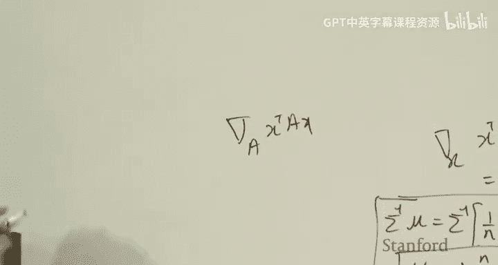

This is just X， X transpose。Yes， Mr。とくんで。そ。So， I took a half。Yes outside， is there another negative。

 there is probably another negative。是个。Oh yeah， So that's where the negative comes in。

 So the the the log， So log of one over something becomes the negative of the log of something。Right。

So that's where the the negative got canceled out。我m sorry。I mean， there is one。But this should be。

 yeah。No that makes sense， sorry。And minus。Some i equals1 to n。X， I minus mu。X。I minus new transpose。

Which means。S。And you set this equal to 0， the half cancels。 and you get S inverse equals1 over n。

I equals 1 to n。X， I minus muu。X， I minus muu。Transpo。And S inverse is equal to。Sigma。

So sigma is 101 n。X I minus is mu。 X minus is mu transpose。 And this， you know， it's， it's。

Similar to expectation of。X minus。Expectation of。X。Square， right， You can kind of。See theim exactly。

 and， and， that's， that's your covariance。This question。

There was a minus that cut that observed the1 over S。As， as， as determined。

RightSo anyway so if you have questions about this you know come up the stage after the lecture but this is this is you know this gives you a flavor of how to do maximum likelihood estimation right and you know you are expected to be comfortable to do this kind of matrix calculus to derive maximum likelihood estimates and we are going to be doing a whole lot of such matrix calculus you know throughout the course for different kinds of models and this is just a simple model a multivariate gation。

😊，Where you know where the sketch used now what are we going to be doing for linear regression I don't think we have time for linear regression。

 but maybe you know just give you a flavor of what linear regression is about。

 So for linear regression it is a supervised learning problem and a supervised learning problem is。😊。

A problem in which we want to learn relations between x and y。

So we're going to be given training sets in the， in the form of X， I。Y， I pass。喂。

You're gonna be given pairs of X， I， Y， I， where X I is。Some kind of a vector。

 a D dimensional vector。And we are going to be given。And such pairs。

So this terminology means this is it is a pair of x X I and y i and you have you know I from one to n you have n such pairs thats the terminology use over here and y。

It's going to be in R。And you want to learn a function。 You're going to call that function as H of x。

And we want h of x。To output why。And this h is going to be parameterized by some theta。

And in this case， theta was mu and sigma over here。

 theta is going to be something else that we are going to see。😊，And from the given training data set。

 we want to learn。The function H theta of， which means you are given a training set。Right。

From the training set。You' are going to construct。Hチ dataタ。So this is called the learning process。

The learning algorithm。This was X Y pairs。And。The output of the learning process is an algorithm。

So the H theta is the output of of the learning algorithm itself。

And into h theta we are going to feed new x let us call it x star unseen x and it is supposed to output wise for the unseen X right this is like the macro setting of regression problems or supervised learning problems。

And in the next lecture， we are going to see a couple of algorithms for learning linear relationships between x and y。

 and that' is going to be linear regression。

