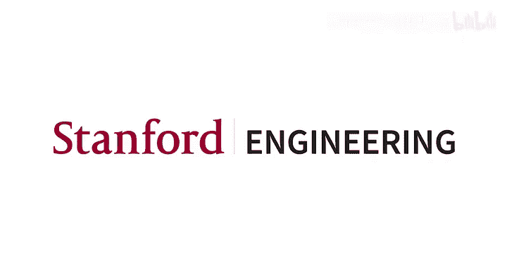
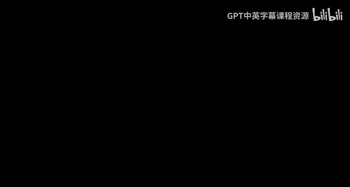
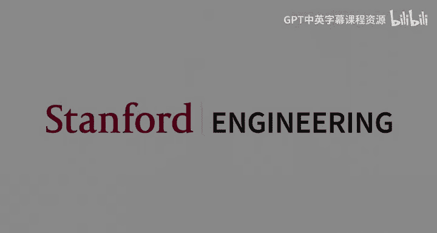

# 斯坦福大学《机器学习｜Stanford CS229 Machine Learning Course  Summer 2019 (Anand Avati)》 - P4：-04-.Lecture 4 - Linear Regression.zh_en - GPT中英字幕课程资源 - BV1NDopY4ECg

Allright， let's let's jump right in then。Quick recap。

We basically just reviewed prerequisites for the course the hope is all of you are now more or less on the same page in terms of prerequisites also the pre the kind of material that we covered in the prerequisites give you a flavor of you know the kind of mathematical background you're expected to have and the kind of you problems that you will be solving in the homework so hopefully that's informative for you in terms of。

expecting what to come what comes in the rest of the course so we covered linear algebra and we went over some matrix calculus matrix calculus mostly we are interested in in you know for example taking derivatives of scalar value function with respect to a vector valued input you know that's the most common thing well be doing in the course either vector valued input or matrix valued input but most of the times its a scalar valued output which is going to be like your loss function were going to cover that today we also covered probability theory some some parts of probability theory。

嗯。And then on Friday we we touched upon maximum likelihood expectation。

 that's you know just just a small part of mathematical statistics that's kind of relevant to or that part that's most relevant to the scores。

And we we saw the example of how can how you can use maximum likelihood estimation to estimate the parameters of a Gausian。

 a multivariate Gausian。😊，And we saw that what the estimators that we obtained for the mean and covariance happen to be very intuitive ones right for example the mean the mean estimator turned out to be just the average of the given you know axis and the covariance happens to be the sample covariance of the given inputs so it' is nice to see that you know the intuitive definitions happen to you know be well grounded in some solid theory。

So today we are going to switch gears and start supervised learning。

Supervised learning is basically deals with problems where we are trying to learn a mapping from some input x to some output y and the input x and y are could be anything most of the times we are going to be。

Dealing with problems that are either regression problems or classification problems。

 those are like the most common kind of machine learning problems。 And depending on the problem。

For example， if it is regression。And let's say we are trying to predict the price of say houses。

And you're given the living area。And this is the price。Okay， so you may have。

Let's call this in square feet。So let's say you are given a data set that has mappings x and y。

or pairs of x and y where x is where each example denotes11 house and the x of that row is the living area in some unit and the y of that row is the price in some unit。

And given this data set， we could， for example， plot it like this。😊，So the unit here is square feet。

 and the unit here is thousand dollars。 and you may get。So。

What we have here so here we have a plot where each dot represents one row and the x coordinate of the dot is the x value and the y coordinate of the dot is the corresponding y value and this is just a scatter plot of the housing prices data。

And the goal here is to learn some function， let' us call it a hypothesisthes。

The reason it's called hypotheses is not very crucial， So we want to learn。

A hypothees we call it h of x which is some function of x that is similar to or is that gives you an output that is as close as possible to y。

That's the thats the goal of a regression problem。 And in there are some other cases where。

What you' are trying to learn is a classification problem where。And here。And x2。So， here， this was。X。

 and this was y x was scalar value， but imagine a different problem where your x's have two have have two attributes instead of just one attribute。

 lets say there was。A second attribute， you could call it， you could call it。For example， number of。

Bedrooms。And and there's going to be a corresponding。Maybe。But me just。this differently。

 let's say you have a different。Data set where you have x1， x2 and y。And each example again is 1 row。

 and your y's are zeros in ones。And your x would be some values。Well。

 0 and 1 tell you what class the example belongs to and our goal is to learn some kind of a classifier。

Which is， you know。Some hyperplane that divides your x's into two parts and the the goal is to learn a suitable hyperplane such that most of the positive examples are on one side and most of the negative examples are on the other side。

These are two different kinds of supervised learning problems and we call it supervised because with each example there is a corresponding why that is given to us which is like that is the supervision signal where it tells you what the right answer is for each given example。

😊，And for probably the first third or first half of the course。

 we are going to be focusing on supervised learning problems and the two most common problems we are going to be looking at are regression and classification。

😊，And to set up the basic terminology。😊，We are going to stick with this terminology。In fact。

 throughout the course。嗯。In supervised settings， we are going to call the inputs as x and the outputs as y。

N is going to be the number of examples in our training set。

You are given a training set from which we want to learn some hypotheses and the number of examples in the training set is going to be n in all your homeworks and through the rest of the course。

And we are going to call the given pair X Y as an example in a supervised learning training set。😊。

NowD is going to be the number of dimensions of our input。 in this case， D was 1。😊。

In this case d is2 right but D could be you know an arbitrarily large number。😊，嗯。

OfOf dimensions of the input。And we are going to use superscript。

I with parenthesis to indicate that it is the I example。 So X， I would be the。X1， you know， x 1。

 x 2 of the I example and Y I will be the corresponding。啊啊。Why I will be the corresponding label。

 So we we we generally call the wise as labels。Or ground truth。And x will be called your input。

 So y is the example output or you can call it。Lbel or。Ground truth。And when given a pair X I， Y。

 I together， they form the I example， I super supervised learning example。

Any questions about this terminology？So you are not too confuse whenever there is a parenthesis。

 you know， it means we are not taking the Ih power of x or the Ih power of y。😊，It means， you know。

 it's just the I example。And in the case of regression problem， Y I。Will be a real valued number。

And in case of classification， why I will be。Why I will be in0 or1。 if it's binary classification。

 if its a multi class classification， then why I will be， you know。

 it can take more number of discrete values。So this this is， know to set up the terminology。

 Any questions about the terminology。And not， let's， let's。Let's jump into supervised learning。

Right， so the big picture of supervised learning， we saw this picture。

Is you' are given a training set？Training set is the set of X I。Why I pairs。Where。I is from one to n。

This means a set of X I， Y I pairs。En， and end of them。And。Using this training set。

 we want to run it through some learning algorithm。

Now the specific algorithm that we choose will depend on what YI is， for example。

 if its real valued then it has to be a regression learning algorithm if it is discrete valued then it has to be a classification algorithm and the output of the learning algorithm is our hypothesis or the learned hypothesis。

So this this h of x is going to be the output of the learning algorithm and this this output or this model that we call or the learned model lets called this the learn model。

Can now take a new axis。Let's call this X test。An output。The corresponding， why hat。So this is the。

 the。The big picture of supervised learning and all the algorithms that we are going to study are going to follow this pattern。

So we start with a training set。We will run it through the learning algorithm。

 we obtain a model and the model can now take examples from what we call as the test set or you know these could be examples that that are fed into the model when you actually deploy the model in production。

And the， the。The goal here is that even though we are learning from a fixed set of examples we hope to generalize well to examples that we have not seen before。

 so X test in general will be an example that your model has never seen before and we hope to we hope that the algorithm that weve learned of the model that weve learned will output wise that are you know kind of correct in some way。

So with that， let's start with our very first。Learning algorithm。Linear regression。So。

 a linear regression。X。Is an R D。And why。Is an R。 and。

That's the training sector that you are given and and such things。And。Such examples。

And now we want to learn a hypothesis。Which belongs to a family。 What do we mean by that。

 So in this in this setting。We didn。 We did not impose any kind of restriction on what H can be。

It could be any function whatsoever that takes x as an input and produces real some y。However。

That is。A very broad class of algorithms， a very broad broad class of hypotheses。

 And we want to limit the。The family of hypotheses over which we are going to learn in some way。

And the most。Simst form of such a hypothesis is called a linear hypothesis。

 and we are going to write it in this way H theta of x。Squ equal to。X not plus。8到 one。Next one。

Theta 2。Next door。Theta D。X0。Right。What's happening here。So。The hypothesis that we want to learn。

Has some parameter theta。And theta。Is。In this case。Before I tell what。T다。That should be。Take a mark。

So。The hypothesis that we learn comes with a theta vector。That has D plus1 components。Right。

1 through d corresponding to the xs and and another theta nu。 So theta n or theta is in。

Our D plus one， this is the extra plus one that we get。

And the goal of linear regression is to learn a suitable set of parameters theta。That。

That make y value as close as possible to h the of x。Right， that's the， that's the。

That's the goal of of learning algorithm。 And this， we can。Also right。X theta of x。Is equal to。

Summation of。I equals1。ToD。てた系い。X， I。Pluss theta not。Right。

And we will adopt the convention that we will add a new column to our excess。😊，Let's call it x not。

And that will be equal to one for all the examples。And。Which means。

IWe can now write h theta of x to be theta n。X not plus theta 1， x1 plus。Theta D。X， D。

And this is also easier I equals this time from0 to D。Tai。Exite。

And also be it to mass theta transpose。Right。This。This additional term that we include in all our examples。

Where we just set it to one。Is also called the interceptor。

And this is mostly just for notational convenience right there is is you know there is absolutely no difference between this version and this version except for notation here we have an annoying extra additive term here there is no annoying extra additive term thats about you know it is just notational difference。

😊，Right， now。Given this this family of hypotheses that we want to limit ourselves to where the specific member of the family is decided by the specific theta vector is that is used。

We are going to define something called as a cost function。

Or it's also sometimes called the last function。And in this cost function or loss function。

 we want to capture the。Amount of displeasure a specific hypothesis causes to us in some way。Right。

 and a common a very commonly used cost function for regression problems is。Called the。Squared error。

 and we are going to define it like this。 So all the cost functions or loss functions in this course will be called J。

Right， and。We call it a cost function when we want it to be small。

 the desired output for a cost function should be you know， small。

And this is going to be defined as half of。I equals1，2。So what's happening here？

We have n training examples I from1 to n and for each example。We take the hypothesis。

That that we obtain by some given theta that is an input to the cost function。

Calculate what that hypothesis will。What output that hypothesis will output？

And calculate the squared error between the correct answer and the output of the hypothesis and squared。

This is also called the squared error。嗯。And this is a very commonly used loss function。

And for different values of theta， the cost function will evaluate to different different values for the given training set。

Yes， question。Why do we have a half here， good question， I'll come to that shortly。嗯。

The the the thing to observe here is that。From the cost functions point of view。

 theta is the only variable。The training set that we have given is is kind of embedded in this function。

 It is fixed。😊，And if you obtain a different。😊，Set of training a different training set of having different features and labels。

 the cost function is going to be different。So， the thing that makes one cost function different from another is one of course the functional form and also the training set itself so the training set the training data that we have is kind of embedded into the cost function。

that's something you want to keep in mind。And now the goal is。😊，To find theta hat。

Which is which somehow minimizes the cost function。Theta， and， you know， this is。对た。I equals1 to n。

H data of。X i。Y I squared。So we want to find。That theta that minimizes the cost function。

To the smallest value possible。Right， any， any， any questions so far。Yes。So the question is。

 should we be dividing it by the number of examples to normalize this？

So if our goal is to find the lowest possible。Cost itself or the loss value itself。 then yes。

It matters a lot whether we normalize this by n or not。But the goal here is to find the argument。

 which is， you know what is the value of theta that minimizes this the most and the value that minimizes the value of theta that minimizes the cost the most is the same whether you know the cost is this value or the cost is this times1 over n you can take one over n you know outside and the value the theta value always be the same。

 So in terms of if the interest is in finding the small theta。

 then it it doesn't matter whether you normalize it by n or not。 good question。

Now the question is now how are we going to perform this minimization whats what what what do we do to actually perform this minimization because this is just a mathematical expression。

 This is not an algorithm the algorithm will tell us how we are going to perform this minimization process。

And。This brings us to。Our first。Egar them， what we call is gradient descent。Right， so。

To perform gradient descent， let me， let me start with some pictures to。Yeah。

What I have drawn here are。So the two axes are x1 through let's call this x D。

 Imagine there are you know this is in a D dimensional space。

 it is easy to visualize it in a two dimensional space。

 but you know it it it is representing a D dimensional space。

And what I have done here is the contour plot of the cost function。Right， now。

This plot is fundamentally different from the two plots we saw over there or there the axis were data。

😊，And here， the axises is the parameters， a very different plot。Right， we have the， the。

The axis is to be the parameters， and this is the contour plot of the cost function。

 What is the contour plot。Yeses。同それ。知道。So good question。

Good question so the question is shouldnt the y axis be j of theta and the theta 1 and through theta db be be kind of on the x axis that so the answer is this is a contour plot right in a contour plot what we what we do is we trace out the set of all。

The set of all points in in theta， which output a specific value of J theta。 So this corresponds to。

J of theta equals。1， and this。Cresponds to。J of theta equals 2。 this corresponds to。主要 t打。3。

It it's a very different way of looking at at。😊，Of， of plotting things， right， the， the value of。

J Theta is not visible here， and it is it is kind of implicit in the shape of the contours that we draw。

Now， a few things that you can observe is that what can we say about the shape of J theta here？😊。

Yeah， it is like a ball shape where it is minimized at this value and as you as you kind of move farther away in the parameter space from this value your the cost function evaluates to larger values。

I the scare？Yes， question。調査するの。不。So the question is can we also not think of this as a dome shaped right you this would also be the controlour plot offer of a dome shaped function if the values were in the other way this is three this is two。

 this is one。Then for these values of J theta， then this should be a dome shape。RightNow。

 as we get closer to the center， the value J theta value to become smaller and smaller。

 So it kind of you know。Comes down to as we move to the center。Good question。Now。

 the the cost function that we described over here。

Where theta is in some D plus one dimension because of the extra intercept term。Right。

 so perhaps this is theta D plus one。Now， the goal is to find。The data。

That minimizes this cost function。 So assume this cost function takes the shape。

 It could be know you know some shape。And now we want to find a theta that minimizes this cost function to the smallest possible value。

Yes， question。我是当地。Very good question so how do we know that there is only one value of theta that minimizes the cost function in general it need not if you the correct way to actually write this is you know theta belongs to argument where argument gives you a set of minimizers。

There could be multiple values of theta that minimize minimize your function for example imagine this to be the cost function and your cost function has this shape so any theta along this line is a minimizer it is not a bowl shape is just you know that it is just that the minimum value can be attained by multiple values of theta along the line in such cases argument is actually a set of theta values。

But for， for the most part， we'll be assuming that there is one unique minimizer。 Good question。So。

 so our our。Our goal is to find the value of theta where j theta is the smallest。And for this。

 we are going to use an algorithm called gradient descent。Now， how does gradient descent work。

 so gradient descent？We start with a random initial value of theta。😊，So。He said。Theta。

 let's call this theta not。Equal to you know， some initialization。

A common initialization is to just start with theta not equal to z at the origin。Right。Theta 9。Now。

 it is again， important not to confuse with the superscript I am using here。If it is data。

 then the superscript means the Ih example。Right now， if you are running gradient descent。嗯。

The superscript over here indicates the time step know after what iteration we are you know the value of theta that we get at a particular iteration。

So set theta not initialize it to some value， it could be the origin。And then。So。

 first I am going to write it in in the partial partial derivative notation and then in a gradient form so theta。

J of one。Will be equal to。赔的。C of0。Minus alpha times。And she。😔，What does that mean？

So we are at theta knot。Equal to 0。A a the or not。 So first what we do is we find the partial derivative of the function J with respect to some coordinate。

J。J can take a value between。1 to D plus1。And we calculate the partial derivative of the loss function with respect to J。

And。Itdia use a different color over here。We have multiplied by some constant alpha。

Where alpha is what we call as a learning rate。😊，And。We repeat this for all Js。For all J。In one。

Deepless one。And this is。With this rule， we calculate。😊，We calculate theta J for the next。Iteration。

And that's going to give us， for example。睇到 one。Now， what's happening here？

An easy way to understand this is to look at this with with the vector notation。

So in the vector notation， this will look like theta 1。Is equal to。Theta not。

Minus alpha times gradient with respect theta of。In this notation， which is。The same as this。Pcation。

So we have the last function J over here。And the gradient of。A scalar valued function。

With respect to theta will give you the direction of steepest ascent。So if we are at this value。

The gradient of。J of theta with respect theta will tell us that you need to move in this direction to improve theta to increase the value of j theta。

Right， instead， what we do is。We flipped the sign。Make it a negative。Which means now。

 we are looking at。This direction。And。Update theta by moving it by a small amount in the direction of steepest descent。

Right， so the step size that we move。Right， this difference。Is。Alpha times。Negative gradient。

We started a theta not。Calculate the direction in which。J Theta increases the most。Flip the sign。

And take a small step in that direction where the step size is decided by alpha。Any questions here？

 Yes question。So theta 0， can it be random， Theta 0 is some kind of an initialization。

And a common initialization is to start at zero。 You can actually initialize it to any any value。And。

A topic that is slightly more advanced is that if your cost function is convex。

 which is it is like a bowl shape function， then the value that you initialize it to does not matter。

 You always can you know end up when this algorithm ends， you always reach the same value。

Next question。Good question。 How do we know we are not trapped in a local minimum。

 I'm going postpone that question for now and assume， you know， we don't have local minimums。

 we deal with local minimums later。 Yes， question。Yes， in practice。

 what value of alpha should we take。Great question。 And there is no。it so happens that。

Well defined cost functions like you know gradient descent on say the linear regression are tolerant to a whole range of alphas and you know。

But in practice， you actually experiment with a few different values of alphas and figure out which one works best for you。

Right？This is one step， you know， this is one step in partial derivative notation。

 This is one step in vector notation， right。I personally feel a vector rotationation is easier to kind of understand this looks a little cryptic whereas over here there is a very clear geometric meaning where you are at one particular value you know in this in this parameter space you you calculate the gradient of the cost function with respect to you know the current position and that gives you the direction of ascent you flip the sign take a small step in that direction and you you reach a new theta theta 1 such that J of。

Theta 1。Is。Hopefully。Less than G of。Theta not， Why do I write hopefully here。Because if you take。

To large a step you can overshoot and reach。Which a point that is actually at a higher cost。

 So tuning the learning rate is important because you don't want to overstep。

And as long as your learning grid is well tuned for your cost function。

 then this hopefully will be true most of the time。😊，And what we do， we。It read this。So。Repeat。

Till convergence。Now we say repeat tilt convergence。 What does that mean。What we mean is。If if we。

 if I write this as theta of。T plus  one equals theta of。T minus。停。If we repeat this process。

We will get。A series of parameters。铁 does zero。Theta 1。Tter do。It a T。Deepest one。Right。

 we get a series of values。Now， for those of you who are。

Who have a more advanced math background and know what convergence means than we are talking about the convergence of this series。

When the series converges， you can stop iterating。Now， however， in practice。

 defining the convergence has a more。Practical definition。

 So there are many ways to check for convergence。 One way to check for convergence is to look at the norm of。

Theta P minus theta。T -1。Have you stopped after taking a step？

Have you reached a stage where theta t to theta t 1 was you know was was was too small or iorably small。

 That's one way to check for convergence。 Another way to check for convergence is has your loss stopped going down So J of theta of T。

Minus J of theta of D minus1。I'm putting it as a norm， but this is just the scale art。

that's another way to check for convergence。Yet another way to check for convergence is was the norm of your gradient too small。

So you can look for the norm of the gradient and check if the norm of the gradient became too small or you can you can look at the difference between the two you know the previous parameter and the current parameter and check if you know that difference got smaller than some epsilon or if you know the cost value itself if it stopped stopped reducing。

There's no right answer for how you want to check for convergence in practice。

 These are just a few few thoughts on how you can implement。

 So in your in your code there would be some kind of an epsilon that you define which is you know maybe 10 to the minus5 or you know some some such small number and you keep itating this in a loop by you know where where you know think of T as your iteration number and you keep iterating until。

One of these values becomes smaller than epsilon， so that would be like your breaking condition for the loop。

Yes question。何にする。Oh no， this is just notation。 So， you know， think of it as the absolute value。

So if it stops with this， yes。嗯哼。おこ。呃，就是。So the question， if I understood， right， is。

 can we not have。A way to intelligently set alpha for each iteration to get closer you can you can do a whole lot of you know such variants and there are a lot of variants of this algorithms that exist in practice but for the most part we kind of exploit the fact that as you get closer to to the minimum the gradient also keeps becoming smaller。

so as you get closer the overall update even for a constant alpha the overall update also keeps becoming smaller because your gradient also becomes smaller and smaller I mean the the intuition there is that once you reach the absolute minimum right so supposing this is J of theta。

Once you reach the absolute minimum， the gradient is 0。Right，So。

 and the gradient keeps getting smaller and smaller as you you know， approach， approach the minimum。

 So most of the times some kind of well tuneed value for alpha constant value is is is you know。

 works works well enough。Good question。Any other question？So whats what's happening now， we。

 we saw this。This algorithm called gradient descent where we are given some kind of a cost function which we visualize with contour plots。

That is defined over the parameter space。And the shape of the cost function has the data set kind of embedded in it right if you chose a different training set then maybe your cost function is tilted differently or has a minimum at a different location。

 but the training set is kind of embedded inside this cost function itself。

And now we start with a random initialization of the theta。😊，And we keep taking small steps。

In the direction of the negative gradient。And we keep taking steps。

Until we hit some kind of a convergence convergence condition。

And there are many choices for defining what the convergence condition is。And we take this algorithm。

 which we call as gradient descent and apply it to。😊，The linear regression cost function。

We take this algorithm and we apply to the linear regression cost function。 What does that mean。😊。

It means。The update rules that we have。The update rule that we have over here。

Will take a specific form。So the methodologyorology that we are following here is。

It's common for pretty much。All the algorithms that we're going to be。

That we're going to be studying。Where we define。Given the training set。

 we define some kind of a cost function。To find over a parameter space and use gradient descent to find a parameter that minimizes that cost function right this this is a common template that we repeat over and over for different algorithms。

 the algorithm for different models the model will give us different cost functions。

And the corresponding cost function will be plugged into this algorithm。Until we minimize it。

 that's going to be a repeating pattern throughout this class。

 So in case of you know gradient descent。On linear regression。So。

 gradient descent on linear regression will look like this。😊，Repeat。On。退出。Convergence。So first。

 let's set theta n。Equal to sum initialization。repeat until convergence。P的。T plus one。Eals。Theta T。

Minus。Alpha， that's the step size or the learning rate。Times the gradient of。M。 Jata。

RightNow this is the standard gradient de。 And we when we apply to linear regression。

 we replace the cost function with。The cost function of linear regression。 So this is。Thetata T。

Minus。Half。데。And what's the class function。Equals 1 to n。H data of。X， I。inus Y i。Squa。

Let's simplify this further。E of t minus alpha times。Craadian。Half of。Toend。H the of x is。

Theta transpose x。Per。And suppose。X， I。Mus。Waiaii。Square。 so just to make it clear。

 the thing that we are。Minimizing with respect to。Is the respective theta。And。

This is the only place where。It up。Right。TheX's and ys are all given。

 They are just constants for the purposes of optimizing this cost function， which is why we we we。

 we think of the the training set kind of being embedded in in their cost function。

 They are just different constants as far as the cost function is concerned。

And lets expand this further using our matrix calcus tricks。This is theta T。minus。Alpha of。And。

I is the square。This will give us two times。I'm sorry。So， two times。Theatta transpose。X， I minus。I。

Times。X。And now。2 and a half cancer。 So somebody asked， why do we have。

Have a half in the in the cost function。 The reason is only to just make the gradient update rule look simple。

Just just the way multiplying it by one over end did not matter。

 in fact the know half also does not matter except to make our gradient expression look look simple and this is。

And sports T。Mus。Alpha times。Somewhat like equals1 to N。Of。Theta transpose x。Minus。はイ。😔，Weipi。Times。

Xi。Right。Notice here that。Theta R was X is a scalar。Yhy I is a scalar？

So theta transpose xs minus Y I is also a scalar。So it is a scalar times。A vector。

And the dimension of this is D。Right so it is youre summing over a D dimensional vector scaled by some scalar and in such terms。

 So this whole expression is。D dimensional vector。And theta T was also a D dimensional vector。

So we the the next theta T plus1。Here has a D dimensional vector minus some scal at times a D dimensional vector。

 So this is also a D dimensional vector So when you when when you write out matrix calculus。

 it is always always a good good idea to make sure that the dimensions match。Any questions about？

Any questions about this So this is the gradient update algorithm where you repeat this over and over until one of the convergence conditions hit。

😊，With with your training set embedded here and once you once this algorithm converges。

 you would have solved linear regression。Gues， there was a question。Yes。

 so the question is what the what are we talking about theta over here Theta is the set of all all parameters which is vector valued and the superscript over here is basically saying you know which iteration in gradient descent are we at。

So this is a d dimensional vector x is a d dimensional vector or maybe d plus1 to account for the interceptor。

 this is also d plus one dimensional and h theta of x is scalar y is scalar and so on。Any questions。

 yes。If you take the log of the sum of the square errors， I'm sorry， I missed the question。嗯。

Not really。 So taking a law wouldn't wouldn't。So， the reason the1 half exists here is only to make this update rule look simple there is other no other reason because you know whatever constant you have you know half or any other constant。

 you can always kind of counter it by choosing a different alpha。Right so there's this。

No purpose for that。All right， so that's gradient descent。However， in practice。

What we use is a variant of so for a lot of convex functions like this for for example for linear regression the algorithm that you know gradient descent works perfectly fine。

 however there is a variant of gradient descent called stochastic gradient descent。It's called S GD。

So the way SGD works is。It is。So let's look at this gradient descent almon linear regression here。😊。

So this is the update rule， what we have over here。

 and we repeat this over and over for each each for each update。 So in order to。

Make so much of progress。😡，So the goal is we start from here and we want to reach here and these are small steps of progress that we are making each step that we are you know of gradient descent is like a small amount of progress that we are making so in order to make so much of progress one step worth of progress。

We need to compute this。And for those of you who who are probably kind of algorithmically minded。

 you might be wondering for each small step of progress that we want to make。

 we need to iterate over our entire training set。😊。

RightAnd the number of examples in your training set could be a million。 It could be a billion。

In order to a in order to make a small step of progress。

 we need to scan through our entire training set with the algorithm。

And that can be extremely expensive if if your training set is too big or if if your model is also too big to compute gradients on so many examples。

And this motivates the the SGD or the stochastic gradient descent algorithm。

 which is a variant of gradient descent。Where。What we do is。We say theta of。T plus one。Is equal to。

Theta of T。Plus。Or rather minus。Alpha times。I'm going call this。J Tilda。Of data。V J of theta。

Is in case of linear regression， it's going to be。Half。offff。So what do we do？

Instead of calculating the gradient of the loss function on the full training set。

 we instead sample just one example。Uniformly at random。And pretend that is our entire training set。

 pretend that our training set has only one example。Calculate the gradient。Of that cost function。

 which has only one random example。RightAnd take a step in the direction according to that cost function。

And we take one step。And repeat this process by sampling a new training example to construct this temporary or proxy loss function。

Specific to that example， there is no summation here。 We use some example K。

 and that K is sampled uniformly at random from your training set。And for each iteration。

 we sample a different example。This might look， this might look。It might be surprising。

 you might wonder， would this even work？Right。The， the intuition over here。Is that。You know。

This is our。啊。J theta。They don't want to。Theta D， and we start at some random position。

In case of gradient descent。😊，In case of gradient design。D。

The trajectory followed by this sequence of thetas。Would look something like this。You that we。

 we are making。Making。We are making progress in the direction of。

The final minima and taking smaller and smaller steps as we go closer and closer right this would this is a trajectory that gradient descent would have taken。

Whereas with stochastic gradient descent。The updates might look like this。喂。We start with it or not。

Instead of calculating the gradient with respect to the true cost function。

We are calculating the gradient with respect to this proxy cost function。

 which has only one random example in it， right and we are going to make a step in the negative gradient of that you know。

Proxy cost function。And that's going to be a theta 1。

And theta 2 will be with respect to the next random example。 And what we notice is that。

while in the case of gradient descent， the direction was consistent and always headed towards the local minima。

😊，In stochastic gradient descent。The directions are a little crooked sort of speed and you might even encounter cases where you are kind of actually going in the opposite direction。

😊，Of you know， where you actually want to go eventually。

But it so happens that by following this algorithm。Eventually， you will reach。A region。Around the。

들어온 매마？And all further updates of stochastic gradient descent is going to keep you confined to a small ball around the true global minima and the radius of that ball。

Is going to be a function of the step size alpha。RightThere's a lot of theory that that that kind of。

Precisely characterizes this。 So， for example， if you， you know。

 if you're interested to go deeper into this theory， you can。You。

 you can study stochastic approximation。That give you that， that， that formally。

That precisely formulates the behavior of SGD， but for from this course point of view all we need to know is that SGD works。

诶。So。SGD is it makes very noisy updates because we are not taking the full set of training the full training set at every step it is going to make noisy steps but on average you are going to reach the global minimum or you are going to reach a region that is you know sufficiently close to the global minimum and that region is characterized by by the step size alpha that you choose。

Next question。Go。或者说。So is is there can you take a running sample of running some of of the previous gradients and do some kind of an averaging of them to to kind of have less noisy updates。

Yeah， there are lots of variants of of， of gradient sent and the。

The technique that you describe is also commonly called as momentum。So when you， when you。

 when you look。When you look up all the different optimization algorithms that exist for machine learning。

 you know some of them are going to have this parameter called momentum and that does something exactly what you described where it keeps like a running average of previous descent to kind of make the updates less noisy。

So。For true SGD。Each time you pick an example you randomly pick it the next time you may pick the same example but you don't care you know just just pick it randomly but in a lot of actual applications and also in the notes what you see is you kind of scan your training set from top to bottom。

Preferably you want to shuffle your training set once and just loop over your training set from you know1 through n。

By doing a scan by using a different example each time。

 And then you can just repeat again or you know， at the end of one sweep， you know。

 shuffle reshuffle and and you know， repeat again。No。

 there is there is no restriction on the minimum size of training training set。

 the algorithm works for any training set， but。If your training set is not too large。

 then you know this regular gradient de set might work well for you。Also。

 another thing to note is that with stochastic gradient descent。

 you may need a lot more number of steps。To converge。As compared to gradient descent。

But the cost of taking each step or the computation cost of each step is so small that it is well worth well worth it to have more number of steps。

But they are you know， so much more inexpensive compared to F。 Yes question。说错。Yeah。

So the question is can we can we do something in between gradient descent and stochastic gradient descent where instead of one example we take a small batch of examples and the JTla theta is then defined as a summation or that batch of examples Yes you can absolutely do that and that's called mini batch gradient descent and in fact most of you know deep learning and neural networks do exactly that where you take a batch of examples where the batch sizes is some small number like 64 or something。

Is it more advantageous to use that thing， it could be more advantageous。For。

 for it so happens that the。The situations where we try。

 where we need to use SGD or mini batch SGD happen to be with deep learning or neural networks where the cost function is not convex。

And once you have a nonconvex cost function it very it is very hard to analyze and make precise statements of what helps and what doesn't help and so in those situations the answer is almost always try and see if it works better。

So that's S GD and gradient descent。Any any questions before we move on？Right， so。

Now that we have seen SGD and gradient descent two different。Iterative algorithms。

 they are also called numerical algorithms， because。In order to compute the values。

 you actually need a computer where you。Where you code this algorithm and run it and get a solution。

 you don't have like a mathematical expression for what the final answer is right you just describe this algorithm implement it as code executed on a computer and it is going to return some numerical values for your theta。

😊，And this is this is going to be the case for most of our algorithms where we dont have a precise mathematical expression for the final answer。

 we are going to define a numerical solution， an iterative solution and。

You then need to code it up and find。A numerical answer。For that particular problem。Yes， question。

よ手見なが。Yes， that's what we are coming to。 So the only exception or one of the few exception is linear regression where there is a close form。

😊，A close form solution for for minimizing the cost function over here。Now。

 the reason why we first started with gradient descent for linear regression is because taking gradients is very easy and it is easy to kind of show you how gradient descent works but in practice as an exception you know for linear regression that is actually a closed form solution which you can use and that is something we will see now。

So first， let's redefine J theta。 So first， we saw J theta to be red defineine it as half。

I went to pen。This was our cost function。Now。Let us， first。Rewrite this as in， in。

In vectorized notation。Let us define the。What do you call is the design matrix。X。

Which is an N by D vector。Right。And each。Each row in this matrix is one input。Input x vector。Right。

And we also define。Why。Why one through。为 n。And now。Tta to be。A vector theta 1 through。Ter D。

Or D plus  one。So， the row of each。The row of each design matrix is D plus one dimensional。

 If you include the interceptor and the vector theta is is a D plus one。Dimmensional vector。

 And y is n dimensional one for each。One， for each example。Right， now。The expression。X theta minus。

wei。Will be the matrix x。Multiplied by the vector theta minus the vector y right So x is in。R。N by D。

Theta is in。R n D plus 1 theta is an r d plus 1。And y is an R？And。Right。

So multiplying a matrix of n by d plus  one times a vector of d plus one will give us a vector n。RN。

Minus。R n。And this will be just in our right。So what does this look like？😊，X theta is equal to。X1。

Transpose theta。X I transpose theta。X n transpose theta。はい。Minus y， so we can include y right here。

Minus。Weiwen。Minness。Y i。Minus。Y N。And this is x theta minus y。With this turn。Is this clear。

Any questions on this。And we define the。J of theta。We have。X theta， minus y。Granspo。X theta minus。

Why。Why is this？So this is x theta minus y。We transpose it。And you know。

 take the dot part of this with this。 So its it's basically you're squaring each term and summing them up。

Does that make sense， you are squaring each term and summing it up and you are dividing it by a half。

Which makes this actually exactly equal to。Half I equals1 to n。Theatta transpose。アマイナス。wifi。Square。

So this is the same as the original cost function that we have。Any questions here？

Exactly the same here we are using vector notation here we were just you know iterating and having a loop over every example。

 just just a vector notation。And now。Let's try to solve for theta from the expression。

eququal to 0 right we want to we want to set the gradient of this with respect to theta to be equal to 0 and solve for theta from this from this expression right。

So。Ha。X theta minus y transpose。X theta minus。Xt。mininus y now the reason why there is no transpose between these two is because this is not one example it is the full matrix the design matrix and in the matrix every example is already in the form for row vector。

So every example is already in the form of a robot vector。s kind of pre transpo for you。 So this is。

This is a vector of n dimension。Of scalrs of end dimension。

 And this is equal to just the cost function。 And now let's， let's。Let's chuck through this。

 This is a gradient of theta。Of half。I'm just going expand this。 So x theta。Transpose， ex theta。

Winness。X theta。Transpo y。Minus y transpose x theta。Plus， y transpose y。This is。pect to the。Half of。

Theta transpose。X trans equal x。皮得。Minus。And suppose。X。Transpose y。And these two are scalealrs。

And these two evaluate to the same thing。And so I'm just going to make it too。Plus。Why transpose y。喂。

Any questions on how we went from here to here？There was a question on Pis of a similar step we did for the Gaussian MLE of the mean of the Gaussian。

 this is a scalar。X is x is a matrix theta as a vector x theta is a vector vector dot vector is a scalar。

 this is a scalar so。And if you are scalrs the transpose of the scalar is the same thing。

 So if you transpose this you get two times the first expression。

 So this is just two times two times that。And。And now。

Let us observe a few things so this is a vector and this is some scalar this is some vector and vector transpose another vector is a scalar。

 This is the by the quadratic form that we have seen in the past。Right。

 and when we take the when we take the gradients， we get half of。Do。X transpose， x theta minus。

To x transpose y。And this is just zero。 So this is going to just cancel out。

And this this is the gradient and we want this to be equal to 0。Which gives us。X transpose x。Takeた。

一個です。X transpose y。And this equation that we have here is called the normal equation。And from this。

 you can solve for theta to be equal to x transpose x。Inverse。X trans plus y。

As long as x transpose x is invertible。Right， and。For now， let's assume x transpo x is invertible。😊。

If you have two rows， two columns in your matrix that are duplicates of each other then x transpose x may not be inverible but we will address you know those kind of oddities later for now assume x transpose x is inverable and this gives you an estimator。

For data hack。So this is called the normal equation。And。

It is is is only in the case of so linear regression is one of the few cases where you can come up with an exact solution and not limited to a numerical solution for which we need a computer。

This is an exact solution for calculating theta hat or to minimize your cost function because。

J of this the hat。Is going to minimize。1儿。Is going minimize this to be the smallest。 any questions。

Yes question。RightSo what is the use of the other approach the other approach is we use linear regression to describe gradient descent because it is easy to derive the update rules for the purposes of know education right you are going to use gradient descent based approaches for pretty much all other machine learning algorithms like that we are going to come across in this course linear regression。

😊，Is one exception which you can solve it with gradient descent。

 There's no problem solving it with gradient descent but you also have a close form。

Solution for linear regression， which the other algorithms don't have。Any other question？哎。Now。

 let's， let's kind of。See a few more interpretations of this。That are。So。

 there is a probabilistic interpretation of this。So in the probabilistic interpretation。

We make this assumption that the way our。Why eyes are generated in our training set？

Is through this process。 So why I。Is equal to。Theta transpose。Xi。pl。Epsilon I。Where Epsilon I。Yes。

Some kind of Gausian noise。It means 0。Variance， sigma squared。So。

 what does this mean it means the way our data is generated is we start with some x， for example。

 if you are talking about the the price of a house。

 the x' will describe the features of that house like the area or number of bedrooms etc。

And there exists some unknown theta vector that know that we are interested in calculating。😊。

And the way the corresponding YI is generated is by taking the dot product of theta and theta and the features of the input and adding random Gaussian noise。

RightNow the noise that gets added to each example is a different noise。

 but the noises are distributed according to a Gausian variable according to a Gausian distribution。

does this this this is the assumption that we are making。

 This may or may not hold through in reality。But this we start with the way our our we start with this assumption to describe the way our data is generated。

No。Then what we， what we。What we then do is。Swab the drums around， so。Epsilon I is， is。

Is a random ba variable。Which means。Epsilon I is also equal to。Y I minus。Heterranposexi。Right。

Just move X over， and。Data transpo to the other side。And。This term is therefore。Right。

 so y minus theta transpo X I is。Also。Distributed according to a Gaussian variable。

Which now means that。This is。This is the claim that we make because epsilon I is normally distributed。

Right。Y minus theta transpose X is also normally distributed。With， with mean0 and。Vant sigma square。

 which means。Probability of y given x。😡，Has this density function。Is this clear。

Any questions of how we went from here to here。Yes。Yeah， so in this case。

 the parameters of this probability of this probability density is theta。Right， theta is the is the。

Prob density that is given to us are the parameter that is given to us。

Unlike the usual Gaussians where the parameter is mu。

This is a re parameterameterized version where the parameters are theta。So， what this means is。Why I。

 so。That's a good question。 Let me let me clarify this a little further。So。

Gussian variables have this， this。Property where so。If， if Y I minus theta transpose X I is。

 is distributed according to Gaussian now。I minus。Theater trans。X， I。Is this mutous。

This also implies。W I。Because Gaussians have this have this what is also called as location scale property where you can you can move your Gaussian if you add some constant to your Gaussian random variable then it just you know moves the Gaussian there so over here nothing in this is random it is just some constant right so if yi minus theta transposexii is distributed according to this then it means yi is distributed according to a normal distribution that has mean theta transposexii invari sigma squared。

And now this is the mean and this is the variance。 And， you know， that's what you see。

Exactly so we are assuming that Yi has is distributed as a normal random variable as a standard normal variable whose mean is different for different examples so for y2 the mean is going to be theta transpo x2 for y1 is the mean theta transpo x1。

And。This statement is exactly the same as this statement。So to to jump from here to here。

So it is easy to kind of go through these steps so if epsilon I is y minus theta transposexii distributed according to Gaussian that means you know y i minus theta transposexii is distribution according to a mean zero Gaussian which also means y I is distribution is distributed according to a normal with mean theta transposexii and variance sigma square and。

This can be， you know and therefore the probability density of Y I is given by this right So Y I is the is is is the variable。

 This is the mean。 This is the variance。Yes question。Yes， I missed the one half。 Thank you。Thank you。

Is this clear？ now， once we have this， once we have。Yi in this form。We are now going to do。

Maximum likelihood。我。This question。Exactly， so here we are human。The data， x and y。

Which is distributed according to。Some unknown parameter。

And now the data is given and the parameters are unknown。😊。

And we are going to do maximum likelihood you2。Estimate the parameters。Right， so。

The data is the x is and y。Prameterters。general it is mu at sigma square。

 but in this case the parameters are theta and sigma squared。But theta is not the mean。

Theta transpose x is the mean for each y。RightSo the， this is a conditional distribution。 right。

 And so we can write the。Likelihood function as。I equals1 to n。Probity of Y I given。Xite。

With with the given theta。And we are making an I IDd assumption。 That's the case all the time。

 We assume that the epsilons， the。Epsilons over here are IID。Which means we can break down the。

Likelihood as a product of n different， different terms。How are we doing respect。

 the have1 moments with respect to and。And then what we do is instead of of the likelihood。

 we take the log likelihood。Right， and this is going to give us。Log。Loob of that P D F。

 So the sum equals 1，1，2， n。I call this L theta。Pot over。P。Square。Oh。Minus。Y I minus。等住。Sorry。😔。

Square。😔，Or。We。Right this a little more clearly。 this is just。嗯睇得。All right， now。Let's。

Take a step back， and kind of analyze this。Function over which the， the， the variable over which we。

T。かさ。Here。And now。With this likelihood function。You can kind of， you know。

 zoom out and look at this expression。 and you can see that。

Log and X part are something that cancel out。Right。The， the。2 pi sigma squared is just some constant。

 We are assumingsum sigma squared is some， just some unknown constant。This is some constant， again。

We have a minus half square。 So all this is going to you know， the the， the。

I guess the summary here is that， you know， by looking at this expression here。

 attention should naturally just。Focus on this part。RightEverything else just， just， just， goes away。

Right， the。You can write this as。Some more I equals one to n。Log of some constant is some K。

 you don't care。 Lo in the exponent cancel out。Minus。Half。3 sigma squared。Y I minus theta transpose。

X， I。Square。There's a half， and so。Is equal to。I going to take this K out or some n times K。

 some constant minus。1 over。Sigma squared。Ha。Es1 to n。So the likelihood function。

The log likelihood function。By making a probabilistic assumption about the noise。

Is going to give us the negative of a scaled version of the original cost function。Right。

Which means by performing maximum likelihood。We are minimizing。The squaredta。Does that make sense？

So this， this， this is kind of。😊，Whenever you see a Gausian。Come into picture， you know。

This is probably the most important thing it is the exponent of some squared entity and when you take the log likelihood you know the log in the exponent cancel out and you are going to be left with just the square term。

And it's going to come with a negative sign。And because we are doing maximum likelihood。

 we are trying to maximize the negative of something， which means were trying to minimize this。方。

Yes question。Exactly what we have shown here is that is that linear regression can be viewed as performing maximum likelihood。

😊，Where the noise that comes into each example is assumed to be a Gausian noise。

If you make the assumption that the x' and y's have a linear relationship and have an additive Gaussian noise。

😊，Then the maximum likelihood theory tells you what you need to do is exactly the same as minimizing the you know squared error or ordinary least squares the are the two approaches of defining the cost function and minimizing it or giving it a probabilistic setting and maximizing the likelihood are exactly the same。

😊，Right， so through， you know， just mean my。Arg。Max of L theta。Was equal to。Ark。Min。offff。Jted。

There are some extra scaled versions， but we are not interested in the values。

 but we are interested in the arc max and the argument， right， and they are exactly the same。

This question。他中理。ようしで。Yeah， so the question is， if we made assumption that Epsilon instead of Gaussian was Poan。

 what， what would happen。 And for that， I would say wait till。Where we're going to cover GLMs。Yes。

 that's a very good question。 And what we're going to see is is the maximum likelihood interpretation is actually more general and you can you can。

You can do many more things。Yes， question。いや、それいで先に。

So the epsilon over here is actually the difference between kind of the true y value and the observed y value like theta transpo X is like in a way like the true price of the house。

 but what you observe has some noise in it you know maybe the mood of the buyer was bad that day or there is some noise that gets added into the process and youre making an assumption that the noise is captured。

Now， in the last few minutes that。that we have。I want to provide yet another interpretation of linear regression。

So we saw linear regression can be solved through gradient descent or through the normal equations。

We saw that linear regression is is actually the same as maximum likelihood if you assume that the noise is Gaussian。

Now， here's yet another view of linear regression。Now， if， if。What we want to solve is x theta。

It was white。Now here x is a matrix theta is a vector and y is another vector。Now， remember the， the。

The functional view of matrices that we spoke about earlier。 So you can imagine an input space。

Theta 1。E2。3D。You have a matrix x。And you have an output space。Weiwen。Weidu。😔，Weaiin。

Let me intentionally keep this two dimension。Yeah， theta1 to。To take。Right。

What this means is we have some theta， some some parameter space theta。There's the input space。

To the matrix X， X is that design matrix。Now the rows of here the data is actually in x。

 not in theta。😊，And why is is is the corresponding y labels。 Now， what we want is to find theta that。

That makes our output as close to y as possible。We also saw in when we were reviewing linear algebra that。

If x is not full rank， then there exists a subspace and x。

 a lower dimensional subspace that has a one to one mapping between the input and the output space。

Now， for now， lets assume x。Is full rank。Which means if x is in is in D by n and D is the smaller dimension。

 then assume that x has rank D。Right， and y is in an n dimensional space。

 So n is generally much larger。N is much larger。And the given day so the training say set that we are given is represented by this matrix x。

😊，And some point。In this。Output space of wise。Where at this point。Remember。

 y are all scalarrs so each dimension。Is representing a different example。

It is an n dimensional space where each dimension represents a different example。

And there's gonna be some subspace。In， in the output space。It passes through the origin。Which。

For which there is a biject between theta and the subspace。And also。

The set of all points in the output space that can be reached by theta is limited to that subspace。

Right， we remember that。Now。We also spoke about projections。Right now， if you have a matrix x。

Whose columns。Define a set of bases。Onto which we want to project something。Right。

 the projection matrix was。Anybody remembers。X transpose。Ex trans plus what。Inverse。X transpose。

 This was the projection matrix。 So this subspace defines the set of all points that can be reached through linear combinations of x。

Right， and those columns are， you know， basically the columns over here。

And the projection matrix of this output subspace is this。Right。Now。Which means the given y。

 supposing we are given some value y。Most likely it's not going to reside in the subspace。

 Its because you know the space， the n dimensional space is so much larger and the D dimensional space D is so much smaller than n that very likely the y that you observe is not going to lie in the space exactly in the subspace exactly。

😊，And what we want to do。Is no。Project this point。Onto the subspace。Such that is perpennacle。

So this is our observed vector of y。😊，That we want to project onto to the subspace that that is reachable through x。

And the projection matrix is going to be this。And。What the point onto which it gets projected？

Will have a one to one mapping with some。Point over here。Right， so which means。X theta hat。

Is going to be equal to。X transpose x。Inverse。X transpose y this the projection matrix。

 This is the vector that you want to project。Right and this basically kind of is another way of seeing that。

 you know。Data hat equals x transpose x equals x transpose。Does't make sense。So。

This is the projection matrix。That will take any vector in the output space and project it onto the column space of。

Of x。 and we take the vector y and project it on the column space of x。

 And once it's in the column space of x， there will exist some。

Made some sum vector in the input space that you know because there is a biject between the column space and the row space。

Which means x theta hat。Equals some， some value will have an inverse because there's a one to one bijection that exists。

 And that inverse is， is， you know。Because， because now， you know。

X is now kind of invertible because it's in that space where the bijection exists。 Theta hat is。

s equal to x trans plus x equals x trans plus x in was x trans plus y。

 so basically what linear regression is doing is projecting the y values onto the subspace reachable through x and then solving finding the had you know corresponding to that projection。

Yes， question。I'm sorry。So how do we notice the optimal theta？Here， optimal， in the sense。So。

 so we we when when we spoke about projections， we discuss this interpretation that the point to which you get projected is in a way the closest possible point to the true vector。

So in that way， you are trying to find a theta will that will take you to a point that is closest to y。

And basically Pythagoras theorem tells you that the square of this instance is equal to the sum of the squares of you know the each components and that you know turns out to be exactly equally so Pythagor theorem tells you that this is equal to the square of this residual。

Alright， with that， we will。 We will conclude our。Our survey of linear regression and next。

We're going to start with classification。

