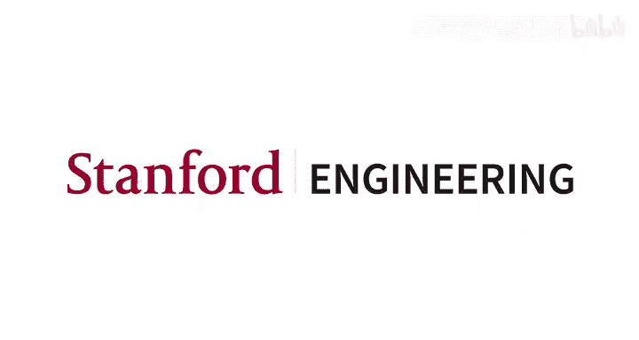
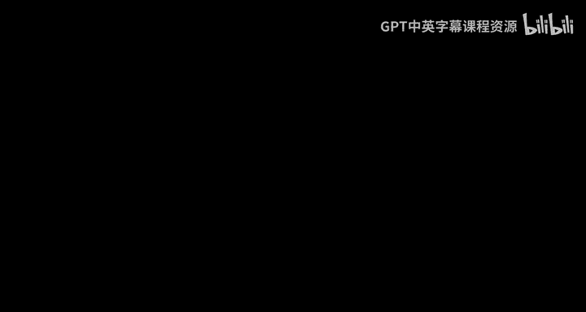
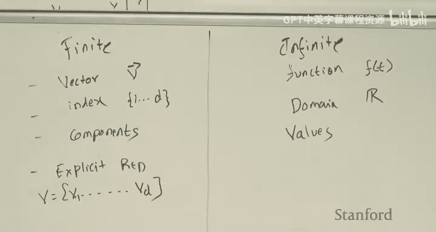
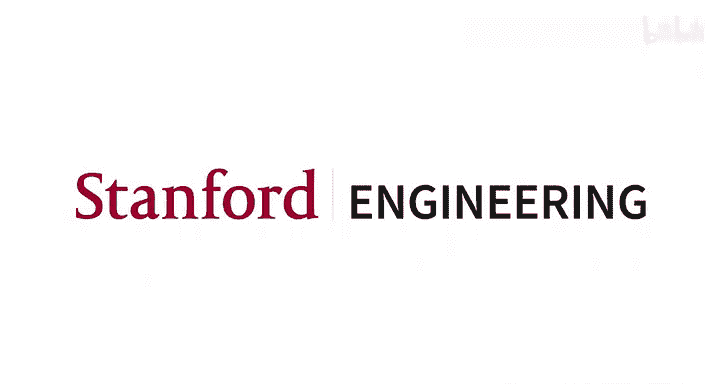

# 斯坦福大学《机器学习｜Stanford CS229 Machine Learning Course  Summer 2019 (Anand Avati)》 - P5：-05-.Lecture 5 - Perceptron and Logistic Regression.zh_en - GPT中英字幕课程资源 - BV1NDopY4ECg

Okay， welcome back everyone。 Let's get started。 So we are in the fifth lecture today and today we are going to switch over to classification。

 And before we switch over， let's do a quick recap of what weve covered。😊。

We covered prerequisites and we started with supervised learning and supervised learning is basically learning a mapping from x to y。

And we started with regression and looked at the very first regression algorithm。

 linear regression where we are trying to learn a mapping from some example X。

 which lives in a D dimensional space to an output y， which is real value。

 and we assume or we limited ourselves to。Hypotheses are， you know。

 models which belong to this family of the form Theta transpo x。

Where theta is some parameter that identifies the specific member of our hypothesis family。

 and we wanted our， our。The desired outcome is x x theta or here x is a design matrix and y is a vector of all all outputs we want x theta to be as close as possible to y but in general this will never hold true x x theta will almost surely never be exactly equal to y。

And the method that we fall back to is to define a cost function。

Wwhich is the difference between x theta and y x theta minus y and that is going to be a vector and you take the squared norm of it and the squared norm is basically exactly equal to the sum of the squares of the individual terms or the sum of this errors of each example right and we want to minimize this sum of squared errors。

By choosing an appropriate theta。哎。And。We saw two different kinds of solutions for that。

 a numerical solution and a closed form solution， So in numerical solutions again we saw two different methods。

 gradient descent and stochastic gradient descent。😊。

The the key difference between the two is with gradient de set。 we consider all examples。

For every step。 So these are iterative algorithms where at each step we start with a random initialization of theta and each at each step time step we make some change to theta updated by some amount and in gradient descent for each update we consider all the examples and for stochastic gradient descent we consider one example at a time。

And the way we perform the update is that for the next time step。

 the theta for the next time step is going to be theta of the current time step minus alpha which is some step size times the gradient of the loss and this happens to be the gradient for the squared loss。

I probably forgot a half over here。For this to be the gradient。

And another way of writing the same thing is in this notation we have different variables for theta T and theta T plus spun。

 but if you are implementing this in a computer program you would have some variable for the parameters and you keep updating it over and over so when when we use the notation of colon equal to it it means you are performing an in place update of the variable which makes more sense if you think about a computer algorithm。

😊，Whereas this makes more sense as a mathematical expression， So you update theta in place。By。

The current theta plus alpha times。The negative gradient。These two are exactly the same。 I switched。

 I changed the minus to a plus and therefore swap the order。

And theta transpos is is basically the hypothesis。So， you know。This is an important。

Equation to kind of know pin it in your memory。 We're gonna you know see this pattern over and over again。

And then there is the other solution， which is the close form solution。

 It exists for linear regression， but it may not exist for different kinds of models or algorithms in which case youd use gradient descent or stochastic gradient descent。

But for the linear regression alone， you can， you can start with the cost function。

 do some matrix calculus， you know， take the derivative。

 set it equal to0 and you end up with the normal equations which you can invert to get the。

Clsose form update for。Calculating theta this is not an iterative algorithm。

 you calculate this and bam you have the final solution。 you don't have to iterate over and over。

 whereas with numerical solutions you want to iterate over this over and over until you hit some kind of a convergence condition which means your datata has stopped changing a lot or your cost has stopped reducing so there are there are different kinds of convergence conditions we discussed last in the last class。

 but this would be itated until you hit a convergence condition but this is just a one step algorithm you where you calculate the final solutions and you are done。

And we also looked at a couple of interpretations of linear regression。

 the first is if we assume a Gaussian noise for each example。Which has。

Mean 0 and some constant variance sigma square， which。

Which actually does not matter for our calculation， because we assume it to be a constant。

 It could be a big variance， small variance。 It doesn't matter As long as it's a constant variance for all examples。

You're good。And we assume that y is the， the observed why is some true why you know。

This is some kind of a true y plus some noise。 So right you can you can kind of think of this as the signal and this is the noise。

RightAnd you， you， you are making a noisy observation。And the goal of linear regression is to。

Given x's and ys we dont know what the individual noise terms are given x and y we want to recover theta we want to kind of weed out all the noise and extract the signal that that is the general intuition and with this assumption we get a likelihood expression P of y and x or the density for y given x and theta to be this Gaussian distribution。

And when we take the log likelihood we saw that even though the Gausian distribution has all these terms。

 when you take the log kind of you know all of these are constants the log in the exponent cancel and this is constant for all examples and this just not the constants so the log likelihood essentially boils down to just the squared error between between。

Between the prediction and the observed noise。 And we perform maximum likelihood of estimation。

 We some we've seen maximum likelihood a couple of times so far。

 maximum likelihood is basically take the the。Define the likelihood across all the examples and because of the independence assumption you can you know the the joint likelihood is just going to be the product of this term across all examples and then take the gradient of the log likelihood。

With respect to theta set it equal to 0， or you can solve it with gradient set。

So the the and what we saw was that a performing maximum likelihood estimation was exactly the same as minimizing the square error loss right there is a negative term here。

😊，So maximizing the likelihood is the same as minimizing the squared or loss if you assume your noise to be Gausian。

So in general， if you are defining your objective to be the maximum likelihood objective。😊。

It has a one to one correspondence with having a loss where the loss is equal to the negative log likelihood。

😊，take the log likelihood。Flip the sign。 And that is your last function。

And in this case you take the likelihood， take the log， flip the sign。

 you just get the square error and this holds true for any probabilistic model not just one that assumes Gaussian noise it could be any any probabilistic model whatsoever。

 you define the likelihood take the log of it flip the sign that is the loss function。😊。

Now we saw yet another interpretation， the projection interpretation where we want this would we want x theta to be equal to y。

 but that is never the case because。Why lives in a higher dimensional space。Compared to theta。

And theta will map to some subspace in this y space which goes through the origin。

W is also the column space of x。 and the observed y will almost surely never live exactly on the subspace because we are adding some noise。

 if the noise was 0， then you know， you would expect your y to be some linear combination of x。

 but because there is some noise， your y will be。Will be outside the subspace。So instead。

 what we want to do is project this y onto the subspace。

Let' us call it y hat the projected point and once you project it。

You can actually solve x theta you know exactly equal to y because now it's projected onto the column space。

😊，And the way you project it is to take y and multiply by the projection matrix。

And this this this whole term will be y hat the projected point and now x theta will will actually be you know exactly equal to this this projected point and you know because you know。

Because they're exactly the same。 You can， you can cancel x and you get theta equals x transpose x in x transpose y。

 which is， which was the。Normal equation work we have。So， that's what we covered。

Any questions before we move on to classification？Yes， question。

So in this case how do we know x x matrix is invertible for for now we will just assume x matrix is invertible and you know we will come up with remedies for later in the course when it is not so for now let's assume x matrix is invert。

😊，Yes， question。So the question is if the observations are not independent。

 does this does this theory all hold if the observations are not independent。

 none of this theory holds all this all this theory is is making an independent assumption you know IID assumption right only because of which you can you know multiply them together。

 take the log decompposition it into separate sums if they are not independent。

 it becomes much more complex to analyze。However in practice even if examples are related they tend to work well except you know the intuition to have is that if your examples are not independent and somewhat correlated your one intuition to have is that your effective dataset sizes becomes smaller you know think about it if you have a data set of 100 examples where all the hundred examples are the copy exact copies of each other right even though know you have 100 examples they are not independent they are exactly the same and your effective data size is just one so similarly if your examples are not independent your effective data size is kind of is kind of reduced and yes the theory also does not hold in practice you know think of it as a smaller data set。

😊，It is much harder and and most of the theories kind of assume you have independent observations。

 However， when we go later in the course， for example， reinforcement learning。

 therere actually you know across time step There is clearly you know there is dependence you know at each time step ofuppos you're playing a game of just what you do in the next move depends a lot on what in the previous move therere actually not。

And in those cases， yes， we， we kind of give up the I Id assumption and you get， you know。

 different kinds of theories。Yes question。I'm sorry。So the question is。

 are there cases where you can， you cannot use numerical examples so。Generally。

 numerical solutions always exist。 The， the cross form solutions may or may not exist。

 That's generally the case。Right， let's move on。 So today the。The plan for today is。

 we're going to cover。嗯。So today， we're going to cover。The perceptron algorithm。

And this corresponds to section 5 in the node， Section 6 in the node。

And then we will cover logistic regression。This is section 5。And。Newton's method。Next section 7。

And time permitting， we will。Time permitting， we will。

 we will try to do a review of some ideas from functional analysis。Basically。

 as a way to kind of prepare ourselves for some of the future topics。

There is also one section in the notes that is locally weighted regression。 that section 4。Yeah。

 we might revisit this later， but for now we are going to just keep moving。Right， yeah。

 so that's the plan for today。And we'll start with the perceptron algorithm。

So the perceptron algorithm is a very simple classification algorithm。😊，Where we are given examples。

In let's R D。And the correct answer of the label of the target。

NoIt's either0 or one for each example。this algorithm we we study it mostly because of historical interest and also because it is very easy to analyze and to build some good intuitions。

😊，In practice。I don't know anybody who uses perceptron algorithm in practice， but it as I said。

 it's a very simple algorithm to kind of build intuitions of howifying most many classification algorithms work。

And in the perceptron algorithm。The hypothesis， its theta of x。Ququality to G of。Theta transpose x。

Where。G of， say， some variable G。There一個度 one。If。Z is。그게 한。0 if z is less than 0。So G sum function。

Think of it like this。If this is。Z。This is zero。G looks like this。

G takes the value0 until its if the input is less than or equal to 0， and it is。1。Yep。Yeah。

 so and you can you can actually define it as less than or equal to or greater than or equal to it doesn't matter so lets。

Is see how it's in the notes。 I think in the notes， it is。グレート団にことあ。Anyways， it doesn't matter。 Let。

 let's assume it is greater than or equal to， which means at。At 0， it is actually one and。Right。嗯。

So what's happening here？The hypothesis for the perceptron algorithm has some parameter theta and given a vector input input vector x。

We do theta transpose x， just like in in the case of linear regression， But the output is then。

So theta trans for x can can take any value， any real value between minus infinity and plus infinity。

 its， it's just you take two vectors and take the dot product It can be any value whatsoever。Now。

 we take this you know， real valued number。And map it to a value you know map it to either 0 or one。

IfIf theta transpose x is less than 0。We map it to 0。 if it is greater than or equal to 0。

 we map map it to one。😊，Right。And。With this hypothesis， the algorithm looks something like this。

So the perceptron algorithm is also called a streaming algorithm， which means。

It is designed to work in a setting where you are encountering examples one after another。

 you don't have access to all the examples up front you are just given one example at a time and you need to update your model and then wait for the next example and then update your model and then wait for the next example and so on and the algorithm for training the perceptron look something like this。

So。So set your theta to be some initialization。So generally， it is just the zero vector。 know。

 that works totally fine。And。f。😔，I in1，2， and so on。 You know。

 just just a stream of of examples that are coming at you。 you perform theta。Equals。Tide。Plus。

Alpha times。You might I minus。H theyta of。X， I。Times。Exite。What's happening here。

So first we see that the update rule for the perceptron。😊。

Looks very similar to the update rule of linear regression。 but they are not actually the same。

 What is different between the two。Each state of x is different。

they look kind of superficially similar where。😊，Given the the hyposized value or the predicted value and the actual value。

The update looks rules look very similar， but the hypotheses are actually different in linear regression。

 your hypothesisthe was just。Theta transpose X here it is G of theta transpose x。And。

The there is there is theory to prove that if your data set is actually linearly separable。

 then this algorithm will find that。Separation point。

 your hypothesis will be able to classify all the points。It's， it's not entirely clear how this。

 you know， just looking at this form。 It may not be entirely clear how this how this works or why。

 why it would even work right for this， let's， let's try to visualize this so。

Let's assume this to be， you know， x12。X D again， in all these examples。

 I am assuming your x to include the intercept term so assume it to be d plus1 or in general。

 it is fine to assume you know x in in D where D just includes the intercept term and your true data was D minus1 dimension right we dont we don't stress about that too much So assume the intercept term is is included here。

And let's assume your theta vector has some current value。 So let's， let's， let's。

And you use a different color。 Let's assume your theta vector to be here。So let's。

 let's call this theta of。your theta vector is currently here。Now。

It's obvious looking at this formulation that。What really matters is for a given new value of x。

 whether theta transpose x is greater than 0 or less than 0。The actual value。

 you know actually doesn't matter。 What really matters is whether it is just greater than equal to 0 or less than 0 because it just gets map to 1 and 0。

 no matter how big how how large than 0 it was or you know how little bigger than 0 it was know similarly you know if theta transpo x here or here it still get maps to 0 So what really matters is is。

😊，The is is theta transpose x greater than 0 or less than 0。

 which means theta transpose x equal to 0 kind of forms a hyperplane that is meant to separate your data your data points。

 You want all the points， all the all the points that have y equal to one。

To satisfy the requirement that theta transpose x is you know bigger than 0 for them and less than0 for those that have y equal to 0。

Now， if theta is this vector。Theta transpose X。Is the hyperplanan that is。This。

 this hyperplan corresponds to。Theta transpose x equal to 0。And because theta has oriented this way。

All points in on this side， satisfy。Theta transpose x greater than 0。And all x's on。

 on the other side satisfy theta transpose x is less than 0。Is this clear I is this。

 is this you know it。The idea here is that you know any x that lies on this this this line is perpendicular to theta。

 so theta transpose x will be equal to 0。And if you have an x over here， you know。

The inner product between them is is you know， it' is basically less than 19 degrees so theta transpo will be positive if if you have an x over here。

 you know the angle between theta and x is more than 90 so theta transpo will be negative and the line that is exactly perpenneicular to theta is like the decision boundary。

Is this scare？那。Another intuition that we want to， we want to have is。

Let's assume you have two vectors， A and B。This is on vector a。 And let's say， this is some。

Vectctor B。And。A transpose B equals some value。In this case， suppose you know， in this case。

 a transpo B is is is some value less than0 right and we desire let let's assume you know。

 this was you know our theta and this was some x。 And let's say this was an x whose y label was plus one right we want theta transpose x to be。

😊，To be positive。Now。However， theta transpo x is a negative number because it is， it is。

Greater than 90 degrees。And if the desired value of a transpose B or a do b。

Is bigger than the current value of A dot B。Is there a way in which we can。

We can modify one of the two vectors to make the desired value larger。

How do we make theta transpose you know A dot B achieve a bigger value。

Is is is basically the question。 So one simple answer for that is。Take the vector a。Right。

In this case， you know， think of a as your theta vector。And you have a vector x。What we can do is。

Take a small。A small amount of x and add it to a， which means at at the， at the end of a。

Let's call this。Alpha times。X。So x is a vector。This is right。Now。A plus alpha times x。Oh， I'm sorry。

 Let's call it B。So， alpha times B。K plus alpha times B。Is this re。Right。This is。Aless。

Allfpha times B。And we notice that by adding some amount of B to a。The angle between them got closer。

 which means you can expect A or B to be。A dot。B plus。Alpha times a。Will be。

A transpose B plus alpha times a transpose a and a transpose a is always positive。

 which means this will be greater than equal to。A trans supposed B。So if if we have two vectors。

 x and theta or A and B and we want the dot product between them。😊。

To be bigger than what it currently is。One way to achieve it is to。

Take one of the vectors and add a small amount of that vector to the other vector。Right。Similarly。

 if。The doc product between two vectors is bigger than what you would like it to be。

You can take a small amount of one of the vectors and subtract it from the other vector。

And you know here you just flip the sign and a transpose a will always be positive。

 and so a negative value of a transpose a is going to be negative。

That will make the the the updated vector be smaller。

 So what what does that what does that mean in with respect to our equation update rule。

What we say is。Suppose。Y is 1 and the current value of H theta x is also one。Which means current。

 according to the current current parameter， we are correctly classifying I example。

Then this will be 0。😊，And you don't modify theta at all。

Which means if you encounter an example that's already correctly classified， don't do anything。

1 minus-1 is 0。Similarly， if the current example is。

Has label 0 and you are outputting your h theta of x output 0， you know， don't do anything。

So if you encounter an example that' is already being correctly classified by your half frame model。

 don't do anything。However， if you encounter an example。Whose correct label is one。

 but they are outputting 0。Then this will be 1 minus0 equals 1。 So add some amount of x to theta。

If you encounter an example whose true label is one， but we are outputting0。

 then add some amount of that vector to theta。Similarly。

 if the correct label is0 and we are outputting1， which means you are making a mistake but a mistake in the other way。

 then0 minus-1 is -1。So。Subtract some amount of that vector from the current parameter theta。系。

If you start your theta vector to be0， then what we see is。

The theta vector that we end up with is going to be some linear combination of sums of。Your excess。

 So everything that we have here。 this is。Real value。This is。In R D。And this is。RD。

So all of this is just a scalar and the， the， the。The basis vectors that we are getting are basically just the examples themselves。

 So what we are doing is is adding small portions of our example to construct the theta。

 and we add them in such a way that。😊，If the current value of theta is， is。Is misclassifying it。

Then we either add or subtract。 So， for example， let's see。 So this。Let's assume we encounter some x。

Over here。Which is labeled 0。So this corresponds y equals 0。And theta transpose x is。

Less than 0 or theta transpo x is going to be greater than 0 because the angle is less than 90 degrees。

Which means now we are going to add a small amount of this vector。Are we gonna to add。Now。

 we are going to subtract because the label is is y equals 0。

 we are going to subtract some amount of this vector from theta。So what does that look like。

 So this is the vector。 Take a small amount of that vector and。Subtracted from theta and。

Theta T plus1 will。So this is theta。Deep plus one。And the decision boundary corresponding to theta t plus 1。

Will be this。So， the example which was classified as positive under the blue hypothesis after performing their update rule could correctly classified as negative under the updated hypothesis。

😊，Yes question。So why is the separating Hyplane always orthogonal to theta。 So theta is is， is the。

Is the current vector right and if if you look over here theta transpose x equal to0 is like the decision boundary because if theta transpose x is is bigger than 0 it is considered positive and if it less than 0 it is considered negative so you can think of theta transpose x equal to0 as you know。

😊，The the the separating boundary and if theta is in a particular direction。

The set of all x's that give you theta transpose x equal to 0 are all the set of all points that are kind of perpendicular to theta。

Because if you take a dot product between two perpendicular vectors。The dark heart this year。

Does that make sense。Yes question。So in practice， you never use perceptionceptron algorithm this algorithm is hardly used in practice。

 However， it is very useful to analyze this algorithm and to get some some intuitionions about about how the update rule works because this update rule pattern is going to you know come again and again。

😊，Yeah， so this， this is this is the perceptron algorithm。 The there is。

 there is theory which says if you're given a data set where youre the X'， according to the classes。

Can actually be separated， linearly separated Then this perceptron algorithm。

 which looks very simple， will actually find the separating hyperlink。😊，Yes question。是讼收。

So the question is， will we， will we need to revisit a few examples again。Yeah。Yeah。

 so the question is you know if it has three data points or if it has 1000 data points does it matter well so the so the answer there is if you have like a very small data set。

 then you may want to iterate over them a few times。Right，But if you have a large enough data。

 then you know， generally just making one pass across the large data should be sufficient。

Next question。Yeah， so the question is aren't there an infinite number of correct solutions for theta for a given data set。

 the answer is yes， there are an infinite number of solutions and this algorithm will find one solution some solution。

Any other questions？Yes，Will the solution change according to the order of the examples， Yes。

 it can change according to the order of the examples and that's fine you know。

 because we are generally interested in some solution that works。Next question。That's correct。

 We use， you know， the question is， do we use one example at a time and not all of them。 Yes， this。

 you know， think of this as similar to S GD， you know， take one example， perform an update。

 pick another example， perform an update。Good， so。That that's the perceptron algorithm。 Now。

 let's move on to logistic regression。Yes是。So the question is does the order matter？

The theory of perceptance tell you tells you that if you have a large enough data set。

Go through it in any order。 and you will find some separating some solution， some value solution。

 Yeah， So the order does not。Yeah， you get a different answer。

 but you will still find some some subject。Why don't we use this in practice。

 We don't use this in practice because there are many other algorithm gardens that work better and。

The perceptron algorithm。If you don't mind， ask the same question， you know， remember it。

 ask the same question after logistic regression so that we can。Romsom comparison。

But the key takeaway from the perceptron algorithm is this idea that。

If you have two vectors and their dot product is smaller than what you would desire it to be then take a small amount of one of the vectors and add it to the other and that will make the dot product bigger and similarly if the dot product is larger than what you would like it to be then。

Take a small amount of one vector and subtract it from the other vector。

How do we determine alpha just the way you determine alpha for。Radium same。 Take a small mark。

Alright， Lo regression。So to start off with logistic regression。

 it would not be an understatement to say logistic regression is the workhouse of machine learning and it is probably one of the most commonly used algorithms in practice in production right go to any company in Silicon Valley。

The chances are， if they have some kind of a classification problem。

 it's way more likely that theyre using logistic regression compared to any other algorithm。And。

And it's， it's， it's surprisingly effective。And it should probably be one of the first algorithms that you try for a classification problem that you're trying to solve right always start with logistic regression more likely than not its just going。

Work pretty well。So。In logistic regression， the setting is very similar to the perceptron algorithm。

😊，We have x's。In R D。Why。Yin。0，1。Right and。When why I。Equals one， we call it a positive example。

And when why I。Equal to0， we call it a negative example。

And this is a description of the data It does not know it is not a positive example a negative example does not mean the model is correctly classifying it or model is negatively classifying it just it is just the way we call the examples if the label is plus one we call it a positive example。

 if the label is 0， we call it a negative example。😊，And。

The hypothesis for the logistic regression is going to look something like this。H theta of x。

Ass equal to。G of theta transpose x。Right， where it is again。Similar to the perceptron。

 the perceptrons hypothesis where h theta of x was equal to G of theta transpose x。The difference is。

G， in this case， is defined as follows。 So G of Z。Where z is you know。

 think of z as the value that you get after doing a theta transpose X。G of Z is defined as。

1 over1 plus e to the minus z。Right， the。This function， G of Z。

 which has the form1 over1 plus E to the minus C， is also called the logistic function。

Which is basically why this algorithms called logistic regression。And。It actually looks。

Somewhat like the， the， the。The perceptron G function。So G of Z looks something like this。

Oupposing this is Z。0。This is one。So G of Z looks something like this。The G of Z。As。So， the limit of。

G of Z as Z tends to minus infinity。Equals 0， and similarly。

 the limit of G of z as z tends to plus infinity is。As Z tends to plus infinity， G of z tends to1。

Right， and this line over here is。G of z equals1 over1 plus e to the minus。No。If you。

 if you compare this with the perceptrons z in the case of perceptron。

 it was exactly equal to 0 until 0 and exactly equal to 1。When 0 was greater than 0。

 you can think of the logistic logistic function as some kind of， a soft version of。The perceptrons。

Forceptron's version of of G。Right。And no。We define just as in the case， of linear regression。

We define a likelihood function。So， me see。P of y。I equal to one。Given。😔，X， I。哇。Tta。Equal to。off。

Thanks。similar learning。W I。知个。Thisは。Theta is equal to。1 minus。They data offs。What this means is。

For any human x。Can you given an example x。We take the theta vector that we have do a dot product。😊。

We get some z value， run it through G of z。And it's going to give you a value between 0 and 1。

And now， the claim is。Because it is a value between 0 and 1。

 you are going to pretend that it is a probability value because probabilities are between 0 and1。

So the probability of y equals  one。Given x and theta is defined to be h theta of x。

 So supposing we have an x。Whose datata transpo x is。Plus 10。So Z is going to be plus 10。

G of Z is gonna be something very close to one。Similarly。

 if you have a some example x whose theta transpose x， say minus-1。It's going to be here。

And G of that is going to be a value that is close to 0。

And if you have an example x whose theta transpose x equals 0。G of0 is。Point fight。So the， the。

 the interpretation here is that。If。The output of， of H theta x。

Or the output of H the x will be closer to。One， if the model thinks it is a positive example and it is going to be closer to 0 if the model thinks its a negative example。

Because if it thinks it's， it's a positive example， then you expect the model to。😊。

Have theta runs was x to be much bigger than 0。If it is much。

 if theta transspapo x is much smaller than 0， then it would give it a very low probability。

And similarly， the probability that y equals 0 is always going to be the。1 minus of this function。

 if。This height。Yes。P of y equals1， given x。And this height。Yes。P of y equals 0。You next。

And because it it's a binary setting， it must be the case that。

Probability of y equals one plus probability of y equals 0 must equals 1。

because we are talking about a binary setting， the sum of the two probabilities。

 which must always sum up to one。And the height of this function is basically the probability that the model assigns to that example that the label is one。

😊，So， the。The correct way to think of logistic regression is that it is。A probability machine。

 It is not actually a classifier。 It is a probability machine for any given example。

 it outputs a probability and then it is up to us to choose some kind of a threshold and a common threshold is 0。

5。😊，Right。It is up to us to choose some kind of a threshold and check whether the probability that was outputted was higher than that threshold or smaller than that threshold and convert it into a classifier。

😊，So logistic regression plus some chosen threshold will give you a classifier。

 Log regression by itself， just outputs probabilities。😊。

But it' is common to just call logistic regression as a classification algorithm because we just assume that the threshold is 0。

5。😊，So this is our hypothesis。Now， based on this， based on these two expressions。

We're going to define the likelihood function。So instead of writing you know a different expression for different values of y。

😊，We will instead write it in a compact way， P of y given x。Data。Is equal to。Each theta of x。

The power of y。Times。1 minus H theta of x。The power of 1 minus y。What's happening here？

What' is happening is if y is equal to1。That is if y is equal to 1。The second term just becomes 0。

 you know，1 minus-1 is 0。 anything grace for the power of  zero is times 1。So。

 in the cases when y equals 1， it evaluates to this expression in the cases when y equals to0。

 it evaluates to this expression。😊，You think of this as as as how how you would write if else in a programming language and just like the mathematical version of writing and F else。

😊，So if y equals equals 1， it evaluates to this expression， because this becomes 0。 If y equals 0。

 then， you know， this entire thing is raised power 0， you get this expression。 So it's。

 it's basically， you know， if else of this written in in a compact way。 Any questions， yes。

This is another way is the question is is this another way to write the indicator function， Yes。

 this is another way to to write an indicator function but you know in a more compact way right yeah think of it as an indicator function。

😊，Yes， question。嗯不。すごく。对。就是说。Co sir。Can you please repeat the question？え丈。

So the is there a version of this algorithm where the the output of the algorithm is still a probability。

 but the the label is。Sure， so if I understand the question， what you're saying is。

 is there a version of this algorithm where we take the predicted h the of x treated as a probability and sample y from it and act based on that。

 you can do that。 you can do that but it's far more common in practice where people choose some kind of a threshold and have a deterministic output So the version of the algorithm that you describe will behave randomly and people don't like algorithms that we have randomly they want algorithms to you know。

To， to， to be， to be deterministic。 So yeah， you can， you can absolutely do。

 you can absolutely have a randomized classifier where you take the predicted probability and sample away from that。

 And， and that's。😊，YouTheoretically， that's perfectly fine。

 but in practice people just don't do that。Yeah， good question。So this is， this is。You know， this。

 this is how we define P of y equals y given x。 And in case of linear regression。

 we came up with a P of y U x， which had a Gaussian form。In case of logistic regression， you know。

 this is actually a Bernoulli distribution。 know think of this as a Bernoulli distribution where this is just P and this is the the outcome。

And。Given this。We can now define the likelihood function for your full data set。 So L theta。Is。

It to be the product of I equals1 to n and。Peve。W I given。Take。

And we are able to break down our full data set into individual product of individual examples because of the IID assumption。

Wai。What do we do next？Just as before， we take the log likelihood log L。Of theta。

 which is also commonly written。 a small L of theta。

And this is going to be equal to the product changes into the sum。Want to end。And。So。

 this this term is equal to this and when you apply the logithm to this term again the product breaks into some this product broke into summation and this product is also going to break into some of two terms。

It's going to be log of this term plus log of this term。 yes question。So。

 can you please repeat the question。So y should be multiplied by P of x。기。So what。

 what you're saying is， should we have P of。Y given x。Times P of x。Should we have this as well。But。

 this will be。P of y comma X。So。And yeah parameterized by theta everywhere。

 So the question is that that is a very good question Now why are we considering our likelihood function to be p of y given x and why is it not p of y comma x Why aren't we maximizing the joint probability of x and y and instead why are we maximizing just p of y given x。

😊，And what we will see late in the course is that for many algorithms。

 we are going to maximize this as our objective。😊，And those algorithms will be called genemative algorithms。

generative models。And those and the， the other algorithms， which only。

Limit themselves to the interest of Y given x will be called。Discriminative algorithms。Right。

 for now。The the intuition to have here is that when you deploy this model。

 somebody is going to give you x you know you don't have a choice of deciding what x is。

 you know X gets thrown at you at production time and you want to make a prediction on y given that x right and which is why you know we are most mostly interested in P of y given x making sure that we are able to。

Make making sure we are able to output a meaningful value of y when x is just given to you。

That that's the general algorithm。 but you know there are algorithms where we do with this。 you know。

 for now， lets let's just focus on discriminative algorithms this week。Good， good question。

So back to the log like I heard So the summation so the log broke down this product into summation and it' is going to break down this product into summation And when we apply log withm to the first half it is going to be。

Why。系。Log。H data。Exite。Plus。1 minus y。1 minus Y I。Loug。1 minus each theta。Of X I。 this is our。

Lg likelihood。Which we want to maximize because we wanted do maximum likelihood。

You can also optionally formulate a loss function for this where you take the negative sign of this and you just think of that as a cost function。

Which is， and then you want to minimize the cost function。

 which means which is exactly the same as trying to maximize this。And。And then， we。And then。

 we apply gradient descent。It is it is know once you define a log likelihood。

Of of the parameters given the data once you are able to write out it in this form。

 then it is just wrote calculus you know you know just just follow the same template。

 calculate the gradient， start your theta at some random initialization and update it in some direction based on the gradient right and you do that over and over until you converge its the same algorithm once you define the likelihood function。

So let's calculate the gradient。So in order to calculate the gradient。

In order to calculate the gradient， what we what we will do is。First， we will observe that。G of Z。

Which is equal to1 over1 plus key to the minus。And in practice， you know。

 z will be theta transpose x。Li。The derivative of this。Is equal to。

So you can you can look the something in the notes。 I'm just going to skip。

 skip the steps over here or or anyway， let's just do it， right。

So how do we calculate the derivative of this， So derivative of one over something is。

us1 over the same thing square。Square times the derivative of this。Which in this case， will be times。

Minus E to the minus z。The right。And this。Is equal to。1 over1 plus H to the minus z。

Times E to the Z times1 over one plus E to the。もです。喂。

And over here you can add one and subtract one from the numerator and this will be in1 over 1 plus a to the minus z。

Times。1-1 plus。Here to the mine is。Zi。Over one plus e to minus z。贵州。すね。And this will be just。

Plus 1-1，1 plus z。 So this will be one plus。1 minus。1 over 1 plus8 of minus z。Okay。

And we see that this is actually equal to just G of Z again times 1 minus G of c。

So the derivative of the logistic function is equal to the logistic function times1 minus the logistic function。

嗯。And。Using this。The that question。question。So using this， lets。That great。

Brilliant of the log likelihood。So。L of theta is equal to。

So lets let's just look at one example for now with just one x and y and for you know across all of them which is summation over example。

 So I'm just going to use x and y for now。 So L theta is y。Loug。😔，H the of x。

 H the of x is just G of theta transpose x。Plus，1 minus y。Times。Log。1 minus。G。Theta doespo x。

This is just the lock likelihood written， for one example。And now。The gradient。This will be。

Y times 1。Over。G of theta transpose x， because log of something is one over that times。G prime of。

Theta transpose x。Times x。Bless。1 minus y times Lo of this is。1 over1 minus。G F theta transpose。X。

Times。-1 times。G prime of。It transformse x。Times x。Just the chain road。 Any questions on this。Yes。

How does taking the derivative of。So this is based on derivative with the spec theta of theta transpose x is equal to x。

 We， know we reviewed this in class  two or something greater calcus。

And this is y1 over G of theta transpose x， and this is G of theta transpose x times 1 minus G of theta transpose x。

Plus，1 minus y。Times。No1 minus。Zhiu。😔，They are not suppose， thanks。Times-1 of again。

 G prime G of theta transpose x times 1。Minus。G of theta transpose x。X。M。And this， you know。

 these two cancer here leads two cancer。So what are we left with？We have。W。Times，1 minus。

G of theta transpose x。Plus 1 minus y。1-5 times。us1 of。G of theta transpose x。

I think Ive forgot it times x here， So times x。Times x。So。

X and x are the only vector value quantities everything else before that evaluates to a scalar。😊。

Right whenever you are doing matrix scals always keep plaing the dimensions this the left hand side。

 the gradient is a vector and it is a vector because x is a vector and x is a vector。

 everything else here evaluate extra scalar。😊，And。So， this becomes。Y 1 minus。G of theta transpose x。

Minus。Minus comes here，1 minus y。Of G。Tta transpose x。The whole thing。Time 6。This is just。So。

 you have a why。mininus。喂hy。G of theta transpose x。Minus。

G of theta transpose x minus and minus plus Y G of。Theta transpose x。whole thing。Times x。

And these cancer。And'm going to get the gradient to be equal to y minus。

G of theta transpose x is just h theta of x。Times x。 So the gradient。

Of theta of the likelihood with respect theta is this。

 which means the update rule will look like theta equals。Theta plus alpha。Times the gradient。

 which is。Y minus。エ data。Of x times x。So we basically got the same。Update rule。

As the perceptron algorithm and the same update rule as linear regression。

 where the only thing that changes is the definition of H state of x。And again。

 this is not a coincidence。 You will see why it's not a coincidence。But， you know， it looks very。

 know， they， they look very similar。Any questions on this？Yes question。多放。一要呢佢。Good question。

 Was there a reason why we chose the logistic function。 Could we have chosen something else， right？

 And the answer is。The logistic function is a natural choice that we you're gonna see why it's a natural choice in the Friday lecture when we study generalizing linear models。

😊，You you can in general choose any other function instead of 1 over 1 plus e to the minus x you can choose any other function that maps it between 0 and 1 you can define a likelihood function you know based on that version of G of theta。

 take the derivatives。And the update rule might look different。Right， and。

By choosing the logistic function to be of this particular form。

 we get an update rule that looks similar to the other update rules and we will basically see the connection in the next lecture。

Will be so the question is， will we deviate from linearity And I'm intentionally not going you know。

 go into more details I know， and Ill you know， I'd suggest you to wait。So this is。

 this is logistic regression。 right we got an update rule。😊，And。Over here。

 if we want to do based on the update rule， we can perform gradient descent or stochastic gradient descent。

If it is stochastic gradient descent， then we sample one example randomly。

Plug in the values of that example， update or theta。 if it is you know a full gradient descent。

 then here there is going to be summation across all your examples。any questions。Yes。

So the question is here you know are we going to look at all examples at once or you know one by one like the perceptron and that' is going to depend on whether we choose to optimize this with gradient descent or stochastic gradient descent if we do gradient descent then we are going to sum over all the examples。

And if you choose to do stochastic gradient de， then we choose one random example at a time。

 calculate this， you know this update role and update your theta and then pick another example。

 update your data on the update rule and so on。Yes， the question is。

 are we looking at binary classification， Yes， for now， we are just looking at binary classification。

 true or false。😊，And again， you know， the thing to note here。

 if you want to compare it to perceptron is that in the perceptron algorithm。

Assuming we start theta from 0， right a vector of zeros。In the perceptproron algorithm。

 we were basically adding or subtracting our examples。

 you know small you know fractions of our examples。

To theta to to to kind of make progress right and each time we were multiplying it by some amount alpha。

And we were only performing this update if we got the example wrong。In case of perceptone。

But in logistic regression， what we see is that H theta of x。😊。

Its going to take some value between0 and1。 It's going to look something like。

This and it will never be exactly equal to one or0。Which means in every step。

We will always take some amount of x。Which is based on you know。

 the difference between y and h state of x H state of x is never exactly equal to 0 or1。

 it will be some value between 0 and 1。And。And therefore。

 you can think of this as as like a soft version of of you know the perceptronnal algorithm instead of deciding that we got this example correct and just discarding it。

You， we are going to learn from every example， but by you know some amount。

 depending to the degree to which we got it right。Yes question。強要。我承。ごち接。哦。Yeah， good question。

 So the question is at test time at validation time。

 we are given we calculated theta during the training phase and we got a theta and at test example a test time。

 we got a new example x。 Now how do we class as as0 or1 you know classified as positive or negative and the answer there is that you know first we go through the math you know do theta transpo x run it through the logistic function and we're going to get a value between 0 and1 right and's you know think of that as the probability that the model thinks the correct answer is 0 or1 and then we're going to use in practice were going to use some kind of a threshold it's commonly 0。

5 if if if the probability that was that was predicted was you know greater than that threshold which is typically 0。

5 we kind of think of that as as a positive example and as another another student suggested some time ago you could also take the probability and sample your y。

😊，Based on un probability if the predicted output probability was like 0。99。

 then you know most of the times youre gonna to sample y equals 01 y equal to 1 and that can be your prediction in which case your your model is is like a random model。

 but if you have a threshold then its a deterministic model。Good question， yes。結構ついて。Yeah。Yes。Yes。Wジ。

Yes。Yes， so the question is in we can think of in the case of perceptron the resulting theta to be a linear combination of just the misclassified examples during the training phase。

😊， whereas with logistic regression， it' is going be some linear combination of all your examples。

Exactly。And the the weights of the combination is going to depend on how correct or wrong we got each example。

During the training。Yes。我。Yeah。Yes， so so the question is during training phase for you know。

 when we encountered an example， if we got it like really wrong。

 we predicted a very low probability when the correct answer was a high you know is equal to one then you know the difference is going to be big exactly。

Right。So that's， that's logistic regression and。You will be implementing this in your homework。

But in your homework， if I remember correctly， you'll be。Implementing it with。Newton's method。So。

 here is another。Optimization algorithm that you may use in place of gradient descent。I think in in。

 in the case of gradient descent， we just took the。We just took the gradients。

And adjusted our theta values， according to the direction in which the gradient pointed us to。

Instead， there is。Another algorithm called Newton's method。Newton's method。And。Think of this as。

Alternative to gradient descent。Rraadian descent or stochasticically。

Think of this as an alternative to。Craadian descent。Anddy。

Intuition for Newton's method is is something like this。So。Let's draw some pictures， where。

So let's assume we are trying to。We're trying to minimize a function。

 minimize some kind of a loss function。Right， and let's say your last function looks like this。

And similarly， for the， for the same。Setting。Here we are assuming one dimensional input。

RightSo the derivative， not the gradient， the derivative。Let's call it L prime。Of theta。

How would that look like， So until this point。The gradient is negative or the derivative is negative。

 So in this region to the left of this mini。The function will。

I'll probablyably look something like this。And then to the right of this point。

 the gradientn is kind positive。So， maybe it。I。K of looks。Something like this。Does that make sense？

So this is our loss function， and。This is the the first derivative of our last option。And。

What we want to do is find the point where the loss function is。Is is minimum。

Which means find the point where the derivative crosses 0。Does that make sense。And。

There is this algorithm called Newton's method。😊，So， newton's method is a way。😊。

In which for any given function， some f of x。It finds it's a way in which you can find those values of x for which f of x equals 0 and the the those values of input for which a function values 0 are also called like the roots of the function。

So Newton's method is a root finding method。Where。For any given function F。

It will will find the input values。At which the function values to 0。

And what we are going to do is apply Newton's method to the first derivative of our loss function。

And the way Newton's method works is like this。Start with some random initialization， you know。

 just like gradient and de you start with some random initialization of your thetas。

Let's call it this， you know。It's call this theta of one， the random initialization。

And Newton's method will approximate the function。By a linear function。

That is equal to the given function at that point。 So maybe I。

So the the black line is supposed to be a curvy line and the blue line is supposed to be a straight line。

Where the， the the blue line is the linear approximation of the。Of the first derivative。

RightAnd once you have a linear linear function， finding the root is very easy And in in Newton's method。

 what we do is。😊，Approxxim a function by by the linear by its the linear linear function and solve for the root of the linear function。

And consider this to be your。Theta one。And from this point repeat the process calculate the construct a new approximation。

 so Im going to mark iteration 2 with red color and over here the linear approximation might look like this。

And solve for。The second approximation， and that's going to be theta。2。And and so on。

 And once you get closer， Newton's method converges extremely fast to the to the true answer。😊。

Instead， what did we do in gradient design in gradient design we started over here。😊，Right。

And the gradient pointed us in the right word direction and we took a small step here。

And we you know and we saw that the gradient was still and we took a small step here and we kept taking small steps until we reached the minimum。

In Newton's method。What we do is we we look at the gradient function at the first derivative at each step approximated by a linear function and solve that linear function to be equal to 0。

😊，And jump to that point。Sa from theta 1 we call this theta 0 from theta 0 we jump to theta 1 and from theta 1 we jump to theta 2 and what we see is that the rate at which the sequence of thetas。

Converges to say the true theta star or you know， let's call this theta star as the the true global minimum。

 the rate at which Newton's method converges is much。

 much faster than the rate at which regular gradient is would converge。

and the Newtons method update rule looks like this。This question。So yeah。

 so the diagram was a little small。 So let let me let me draw a better version of the diagram。Right。

 so。한 going 들어라。Let's assume this to be our。This is the first derivative。It's a start at some。

Pa or not。Right。So this is the derivative。 There is a corresponding， you know， true loss function。

 right This is the derivative。 This is not the last function。So at this point。The function will。

 you know， the function value some somewhere over here。It's a curld function。Instead。

 we approximated by a linear function，Which means。And here， I'm going to use a different color。

So the blue line is the first linear approximation。Right。And this is going to be theta 1。And。

 similarly。This is where this is L prime of theta 1。And construct yet another。

Linear approximation at the new point。In the way and the place where the second one。

 this would be theta 2。Does that make sense。At every point， construct a linear approximation。

 solve for the linear approximation， and the solution is the next。Next location for our theta。

 That's where we move to。Is to this question。Yes， so the question is what happens if there is a non convex function。

 I'm going to come to that。Right， yeah， and， and the update rule for Newton's method is。Supposing we。

 we call this。F of theta。The update rule for Newton's method is theta of t plus one equals。

Theta of T。mininus。F of theta over。F prime of theta。This is the update nu。Rule for Newton's method。

And now our F was the the the first derivative of our loss function。

 So if we plug in our loss function here。😊，What we get is。Theta of T plus one equals。Theta of T。

mininus。L prime of theta over L double prime。Does that make sense？Yeah， evaluate theatre。

Yes question。Or does it do what your stuff like？So when when we find the the new theta is there some kind of a step size here yeah in practice you will use a step size Im coming to that。

And。So this is Newton's method。 but however， this was using scalar valued inputs。In practice。

 however， our loss function has a vector valued input because we have， you know， theta as a vector。

And。So， this was for。In the scalar case。스케일라테가。For vector theta。The update rule looks like this。Well。

Right， so。In the。In the scalar case， we would divide the first derivative by the second derivative。

But in a vector case， the first derivative is going to be a vector and the second derivative is going to be a。

😊，The Hasian matrix right and we cannot divide a vector by a matrix right that that that' is not a meaningful operation。

 So instead what we have is this variant of Newton's method， which is called Newton Rafen method。

Which is a vector version of Newton's method you know for vector valued inputs。

And H over here is the he。And you invert the hesian。That's like， you know。

 dividing the second taking the the the reciprocal of the second derivative。

 So you invert the hesian， multiply it by the gradient。 And that's going to be the。

 the the direction in which we。In which we ahead。And in practice。

 it is very common to have a learning grid here as well。Though you you know in many cases。

 you don't need an extra learning rate。 So think of this you know。

 compare it to gradient descent in gradient descent， it was pretty much the same except for。

Having a Hasian。RightBut in Newton's method， you multipied by the you know multiied by Hesian as well because essentially what what's happening by multi multiplying it by the inverse is that youre you are trying to account for the curvature of the loss function。

 You know， thats thats that's the intuition to have right in in。In gradient descent。

 we are only looking at the direction of this of the steepest descent。

 but then the curvature of the function can be pretty。Unusual and Newton's method kind of。

Accounts for the， the， the， the second level curvature as well。

And this this this algorithm generally works much faster in terms of the number of steps required to converge。

😊，But there's a catch。The catch is that。嗯。Calculating the gradient is is you know。4 of D。

In terms of the time complexity。And that is all that we need for doing gradient descent。However。

 the hessian is you know D by D， so you have O of d square for calculating the hesian。

And even further you need to invert the hessian。 So that's about order D cube。

So if your D is high dimensional， then Newton's method。

 even though it requires a fewer number of steps。The cost of each step can be prohibitively high。

And it is that trade off that you need to that you need to do in terms of deciding whether you want to use gradient descent or u's method。

Another point to note is that Newton's method is a root finding method。Which means if your're。

A prime of data。Look like this。If L prime of theta look like this。Which means your cost function。

 L of theta。Was。那。Like this。Then it went up。And then it came down again。喂。

Newton's method is only is going to find you one of the roots。It could。

 It could find either the route where the the。The first derivative was going up。

 which means over here or it could find a route where the first derivative was going down which means over here and it is going to depend on initialization。

 you know， did you initialize close to you know the first the the first stationary point or to initial size close to the second stationary point。

 It's Newton's method is just going to take you to the nearest stationary point of that function。

Stationary point means a function where the gradient is 0。 It could be a minima。

 It could be a maximuma。 It could be a saddle point。

 Newuters weather is going to just take you to the nearest stationary point。

Which also means that Newton's method。Throw a function at it。

It's going to take you to the nearest stationary point。 And if it's a convex function。

 it's automatically minimizing it。 If it' is a concave function， it is automatically maximizing it。

 So it's kind of like plug and play。 you can even flip the sign of your function and throw it at Newton's method。

 and it's still going to recover the same point。😊，It is going take you to the nearest stationary point。

 It could be a maximum or a minimum。 So flipping science is not a problem。So that's。

 that's newuter the。 Yes question。It's going to find the nearest stationary point。

RightIf the nearest stationary point is the only stationary point。

 then it is you know and and it's the local minima， then it's the global minima。 But if your。

 if your function has lots of local minis or lots of local max。

 its going to take you to the nearest stationary point。

And that's the reason Newton's method is most commonly used only with convex functions or concave functions。

Whereas gradient descent does not have that limitation gradient descent will always keep take you will take you down down and down right if if if the nearest stationary point is a local maxima gradient descent will not take you to it gradient decent will take you。

😊，You know， only down。 whereas Newton methods is going to take it to the nearest。Station。

 yes question。Yeah， so for S GD， so Newton's method generally does not work well with S GD and the reason is because you know if you take just a few examples。

 the hessian may not be inverible right you you need a lot of examples to make the hessian invertible。

 So Newton's method generally does not work well with in an SGD kind of setting or maybe I misunderstood your question。

好。あののまし。No， it's not analogous to S GD。 So the scalar version of Newton's method is。

 is is analogous to having a model where you have only one parameter。

 That's when you can use this method。We take one sample at a time， not one parameter at a time。

This question。Yes。でおび込。Yes， so gradient descent can be caught in a local minimum thats right。

 whereas with Newton's method you you get caught in the most nearby stationary point。

 it could be a maximum or a minimum。And， and it works really well when you function as convex。

 where you know that the nearest point is the global optimum。 that's when Yes question。😊，ククス。

You could end up in a maximum offuse。With Caribian descent， was that the question？

So with gradient descent， if you。Yeah， so with gradient indess， if you， if you。

 if you have a function that has max and minis and you start exactly。😊，You know。

 at the local maximum， then yes， gradient descent will not make progress because you know。

 the gradient there is already here。 That's right。Okay， cool。 so that's Newton's method。😊。

And in the last few remaining minutes。You know。Let's， let's get some intuitions about， about。

Functional analysis。 So this is going to be。For the last few minutes。

 what we are going to cover is you can think of it as purely optional in the sense there are not going to be any questions on your homeworks or in your exam from the material for the rest of this lecture。

 but there are some the intuitions that you get from a functional lattice point standpoint can be very useful for understanding many algorithms that we are going to cover later this quarter。

Right， so what's functional analysis。 So think of this as like a five minute overview of functional analysis。

 Fun analysis is is like know an advanced mathematical topic， which， you know。

 you probably spend a year studying。 But you know， we're just going to look at some。Some intuitions。

 right， So you can think of functional analysis as the study of functions。

You think of it as like a study of functions。Functions， but。

A more common or a more useful interpretation of functional is think of it as linear algebra in infinite dimensions。

😊，So。The last 10 minutes or five minutes that you're going to spend this is basically。

 you know think of it as as as if you haven't seen this material before。

 think of it as you know some kind of a mental exercise to force yourself to think about about vectors and functions in a different way right it's good to learn new things。

 but I think it's even better to learn new perspectives And know this perspective can be very useful when you know we study things like Gaussian processes and kernels and so forth。

 So。😊，嗯。So assume this is vector space r 3。Okay， let's call it， you know， x1。Fix door。

X3 has the axes。 And you have some point。你。And。く。The claim that we are going to make is that。

Functions and vectors are the same。Right， you know， functions are。

Think of them as an infinite dimensional vector。And that might sound surprising initially。

 because we think， we think of vectors as， you know， something that's like straight and linear。

 right， And your function can be you like Sine X can be， you know， wgly， right， So what's， what。

 what's the connection there， right？ So one way to see the connection is。😊，A vector。

 think of this vector。😊，As a function。Think of the vector v as a function defined over the domain。😊。

Where the domain is。So the index that we are going to the the index of the of the space is going to serve as the input of the function。

So supposing this function has， you know， let's， let's see。 So this function has。Im to call this V1。

Right， and。This is。We 3， and similarly， it has some。That's V2， right。

 just the components of the vector。So you can think of writing this vector as we of。1 equals。

 you know， V 1。V of 2 equals V2 V of。3 equals。Me 3， where you know。

 those are the components right Think of a vector as a function right where the the input that you' are feeding is the axis。

And the number of axes you have for the space。Is， is， is is basically the。Domain of that function of。

 of that vector。Now， this vector can， you can also now visualize it as。A function。One，2， three。

So this vector， let' us call it a blue vector。So v1 is some value， v2 is some value。

 v3 is some value right。So think of it as a function。Whose domain is just three teachers。

 And you know， its values is， is real value。那。If you look at a more common in more。In R。

 And let's consider a function。Think of the sense。off。X equals x squared plus  one。

Trying to do the same analogy here， it's just that。For this function， we have an infinite number of。

Infinite number of of inputs that we can pass for these functions。

 we have just three possible inputs。 For this function， we have an infinite number of inputs。

And the value of the function at each point。So， pretend this is one long vector。

 an infinitely long vector。Where the value of each coordinate is the height of the function。

 So the value of the function is what you fill in in that vector right。A vector in three dimension。

 we would write it as you know。V1， V2， I don't know V 3。And a function， similarly。

 you can write this function as equal to。F of x 1。F of x 2。Right， and an infinite number of them。

 So a function can be explicitly written out with， you know。😊，By the values。

 the function evaluates at different points。And it， it looks very similar to a vector。

 It's just infinitely long。And。This analogy is， you know。

 you got to use some amount of imagination because here， you know， we we， were。

This works only for countably infinite kind of kind of infinitefinities。 But imagine you can。

 you know， you write it to every possible real value right It's like， you know。

 uncountably infinitely long vector。😊，That's the kind of intuition you want to have。No。You know。

 just the way， you know， if if you have a function defined over three elements。

 you can map it into a three dimensional space。😊，In the same way， you can， you can。

 you can map this function in。You know。I name for it。Dimenssional space， right。

 So imagine you have an infinite number of axes。Right， imagine you have an infinite number of axes。

 I cannot draw it on the board。 I' am sorry。😊，And。There is a point。It's called this F。Suchs that X1。

 x 2。X 3， you know， and， and there are you know， an infinite number of these and the。

Value of a function at a given a。Because each axis corresponds to one possible input。So。

 the value of a function at a given input is the same as the coordinate of the vector。😊，A the taxes。

Which is is the same analogy from here to here。 the value of the function at a given input。

Is basically the coordinate value of the vector along the taxes。Okay。

Just extend that to an infinite infinite dimensions。Which means now， you can。And having this， this。

 this functional space of。Of functions being points in an infinite dimensional space will be super useful for some of the algorithms that we are going to study。

😊，And you can， actually。To to formalize this a little more or to to kind of strengthen your intuitions some more。

That's kind of。Draw comparisons of different concepts。So on the one side， you're going have。

Finite case。Yes。Infinite case。In the finite case， you have a vector。😊。

Gally call it B in the infinite case， you have a function。Let's call it like F of。

And in the finite case。You would have some kind of an index。think of， you know， like V1， V2， V3。

 the the the the axes， which are， which are like the indexes。 and they are generally， you know。

 some kind of say，12 D， for example。If D dimensional space。And。

In case of the infrared case for functions， it it's basically the domain over which the function is defined。

Well here it's like R。And for a vector， you have components。And in the infrared case。

 you have values of the function at at at different interval。Doest make sense。

And vectors are generally represented。With an explicit representation。

So you generally write v equals you v1 v2 v。MeD。RightYou just write out the actual values of of the vector。

 but functions generally have， you know。

Some kind of a symbolic representation。Which means you know you have some kind of a shortcut you know。

 given the index， you know， whats the value， you know， some kind of a rule， but given the index。

 what the value should be right。You can， you can， you know， just as well， think of， you know。

 an explicit representation of function where you're just writing out all the values of the function at every possible input as one long vector。

 right It the same intuition you want to have。😊，And。A few more things。 So in vectors。

 you have a dot product。do product where you can write the。Between two vector， U and V。

Some of were high。Ui。にあ？And。Similarly， with with functions。

 you can actually take an enough product between two functions。 And that would look like this。

 you know。F G。Equality to integral of。Have5。G of T。And then this is， this is， you know。

 perfectly valid inner product between two functions。 right It's。

 it's just the extension of the inner product to to an infinite dimensional setting。 And。

 and in fact， you know， this form you you might be familiar。 you know。

 this if F is like a probability density function and G is like a random of variable， you know。

 expectation。Of。The expectation of some G of x。Where x is run according to some distribution P is actually just the inner product between P and G。

And。You have a matrix， right matrix a。The equivalent thing over here is some kind of a。

A two input function。 Let's， let's， let's call it K of。S come。

Where in a matrix a you have AI J to be that know the specific element of the I throw and Jth column。

 but for in an infinite dimensional setting just evaluate the function at the two given inputs。And。

And so on。 And， and you can， you can。Each matrix is you can think of it as a linear operator。

Which means。You have linear operators on functional spaces as well。 So， for example。A of x。

 let's say Y equals a of x。Is a linear operation on a vector。Similarly。

 you can have a linear operation in functional space。 And one such example is。F prime equals。D of F。

You have a function F。And differentiation is a linear operator。And you get an output function。

D is you know， you can think of differentiation as one big。

 you know infinite by infinite dimensional dimensional matrix。And。The， the and， and there are。

 you know， you can draw further analog， for example， you have。Eigenvectors。

For a matrix a such that ax equals lambda x。Similarly， for some kind of， this is finite。This is。

Infin。Similarly， you can haveigen eigenfunction for some operator。If。F Brian。Equal to。Be of。

F is equal to some lambda times f。Then F is an eigenfunction， and lambda is the eigenvalue。

 and for the differentiation know。Can you make a guess of what can be an eigenfunction for differentiation。

Exactly， so say e to the K T where t is the variable。😊，Is equal to k times。He to the。K。

 so you can think of the the exponential as like an eigenfunction for the differentiation。

A differentiation operator。And。And。The way we represent A X。啊。So if， if， for example， u equals。AV。

Then we write U I is equal to。Smation over J。A I J。VG诶。This is matrix multiplication。Which means。

 now。The kind of equivalent in the， in the。G of S。Is equal to。てく。Let's call it some K of Scom。F off。

I see that。So this is like a matrix multiplication。

but it's just happening in in infinite dimensional space。And。

These are also called integral transforms。Right， and。

You might have come across many functions of this form already， for example。

 when k of S comma T is equal to E to the minus S T。This becomes the。

The plus transform right and if you have k of this command p is equal to e to the minus ID。

 this becomes a fourier transforms。 So you can think of the plus transform as fourier transforms as as linear transformations you know instead of。

If it were a finite dimensional， it would be like， you know。

 a matrix multiplication in an infinite dimensional。 it's， it's。You know。

 you run through some operator just like multiply through matrix and you get you know the index changes from T to S。

 which means you know from one axis， the input changes to the other axis。And。

The idea here is is is the the big picture that you want to take away from from all of this is that functions are points in an infinite dimensional space。

And a lot of operations that。You may already be familiar with you know。

 all kinds of transformation like the plus transform Fourier transforms are all just linear operations。

 including differentiation are all linear operations on points in this infinite dimensional space。

 And these points we call them functions just the way we call vectors and as points in a finite dimensional space。

 And and this， this way of thinking， you know， of thinking of functions。

 which we normally think of them as， you know， some kind of a curve along some axes。😊。

Think of them as points in an infinite dimension space。

 where the coordinate along each axis is the height of the function at that particular input。

And and this kind of you know mental dexterity of switching between these two views can be extremely useful when we study things like Gausian processes or kernel methods or even gradient boosting you know。

 later in the course。Right， anyway， so you're not going to ask any of these on your。

 on your homeworks or exams， but it's just。It's a new perspective where you start thinking of functions as just points。

 not as curves or surface。 Just think of them as some points that live in an infinite dimension abstract。

